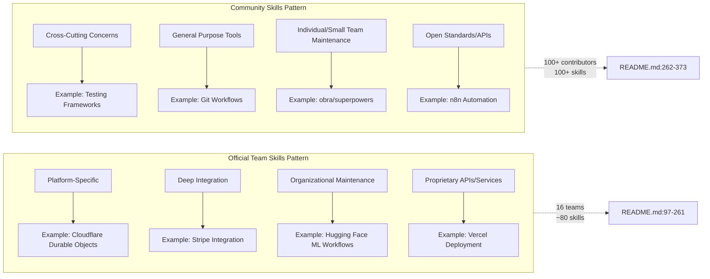
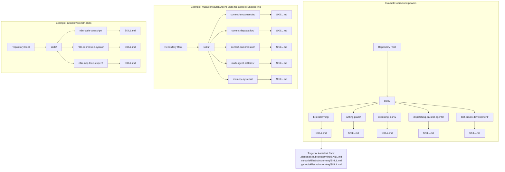
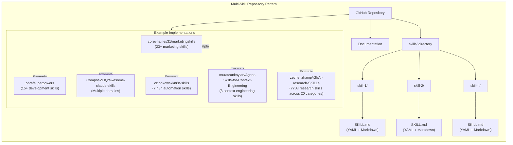

<!-- source: DeepWiki mcp.deepwiki.com · repo VoltAgent/awesome-agent-skills · page 4.2 Community Skills · fetched 2026-10-26 -->

# Community Skills

<details>
<summary>Relevant source files</summary>

The following files were used as context for generating this wiki page:

- [README.md](README.md)

</details>


## Purpose and Scope

This page provides an overview of the 100+ community-contributed Agent Skills in the Awesome Agent Skills collection. Community skills are capabilities developed by individual developers and organizations outside the official team partnerships, covering a diverse range of functional domains from marketing and productivity to security and specialized research workflows.

For official team skills from organizations like Anthropic, Vercel, and Cloudflare, see [Official Team Skills](#4.1). For detailed listings of individual community skills by category, see the subsections [Development and Testing](#4.2.1), [Marketing](#4.2.2), [Productivity and Collaboration](#4.2.3), [Context Engineering](#4.2.4), and [Specialized Domains](#4.2.5).

**Sources:** [README.md:262-373]()

## Community Contribution Model

Community skills represent capabilities developed independently by developers and contributed to the curated collection through pull requests. Unlike official team skills which are typically platform-specific and maintained by large organizations, community skills address cross-cutting concerns and niche use cases across the AI assistant ecosystem.

The contribution model follows a strict quality gate defined in [CONTRIBUTING.md]() that requires:
- Public GitHub repository hosting
- Comprehensive documentation
- Demonstrated community usage
- Maximum 10-word description
- Proven effectiveness in real-world scenarios

This quality-over-quantity approach ensures that only battle-tested skills make it into the collection, maintaining a high bar for reliability and usefulness.

**Sources:** [README.md:374-382](), [README.md:390-392]()

## Organizational Taxonomy

Community skills are organized by functional domain rather than by contributing organization. This structure enables efficient discovery based on use case rather than platform affiliation.

```mermaid
graph TB
    subgraph CommunitySkills["Community Skills (100+)"]
        Marketing["Marketing<br/>(23+ skills)"]
        Productivity["Productivity & Collaboration<br/>(20+ skills)"]
        Development["Development & Testing<br/>(40+ skills)"]
        ContextEng["Context Engineering<br/>(8 skills)"]
        N8N["n8n Automation<br/>(7 skills)"]
        Specialized["Specialized Domains<br/>(10+ skills)"]
    end
    
    Marketing --> M1["coreyhaines31/marketingskills"]
    Marketing --> M2["ComposioHQ/content-research-writer"]
    Marketing --> M3["ComposioHQ/competitive-ads-extractor"]
    Marketing --> M4["wshuyi/x-article-publisher-skill"]
    
    Productivity --> P1["notiondevs/Notion Skills for Claude"]
    Productivity --> P2["op7418/NanoBanana-PPT-Skills"]
    Productivity --> P3["gokapso/integrate-whatsapp"]
    Productivity --> P4["obra/superpowers-lab"]
    Productivity --> P5["wrsmith108/linear-claude-skill"]
    
    Development --> D1["robzolkos/skill-rails-upgrade"]
    Development --> D2["antonbabenko/terraform-skill"]
    Development --> D3["zxkane/aws-skills"]
    Development --> D4["Rootly-AI-Labs/rootly-incident-responder"]
    Development --> D5["lackeyjb/playwright-skill"]
    Development --> D6["ibelick/ui-skills"]
    Development --> D7["fvadicamo/dev-agent-skills"]
    Development --> D8["alinaqi/claude-bootstrap"]
    
    ContextEng --> C1["muratcankoylan/context-fundamentals"]
    ContextEng --> C2["muratcankoylan/context-degradation"]
    ContextEng --> C3["muratcankoylan/context-compression"]
    ContextEng --> C4["muratcankoylan/multi-agent-patterns"]
    ContextEng --> C5["muratcankoylan/memory-systems"]
    
    N8N --> N1["czlonkowski/n8n-code-javascript"]
    N8N --> N2["czlonkowski/n8n-code-python"]
    N8N --> N3["czlonkowski/n8n-expression-syntax"]
    N8N --> N4["czlonkowski/n8n-mcp-tools-expert"]
    
    Specialized --> S1["K-Dense-AI/claude-scientific-skills"]
    Specialized --> S2["sanjay3290/imagen"]
    Specialized --> S3["SHADOWPR0/security-bluebook-builder"]
    Specialized --> S4["huifer/Claude-Ally-Health"]
    Specialized --> S5["zechenzhangAGI/AI-research-SKILLs"]
    
    style Marketing fill:#f9f9f9
    style Productivity fill:#f9f9f9
    style Development fill:#f9f9f9
    style ContextEng fill:#f9f9f9
    style N8N fill:#f9f9f9
    style Specialized fill:#f9f9f9
```



**Diagram:** Community Skills Organizational Taxonomy with GitHub Repository Paths

**Sources:** [README.md:262-373]()

## Skill Distribution Analysis

The following table provides a quantitative breakdown of community skills by functional category, showing the concentration of contributions across different domains:

| Category | Skill Count | Primary Use Cases | Example Repositories |
|----------|-------------|-------------------|---------------------|
| **Development & Testing** | 40+ | Testing frameworks, CI/CD, debugging, code review, infrastructure automation | `robzolkos/skill-rails-upgrade`, `antonbabenko/terraform-skill`, `lackeyjb/playwright-skill` |
| **Marketing** | 23+ | SEO/SEM, content creation, social media, advertising analysis | `coreyhaines31/marketingskills`, `ComposioHQ/competitive-ads-extractor` |
| **Productivity & Collaboration** | 20+ | Notion integration, project management, communication tools, document generation | `notiondevs/Notion Skills`, `obra/superpowers-lab`, `wrsmith108/linear-claude-skill` |
| **Context Engineering** | 8 | Memory systems, RAG patterns, multi-agent architectures, context optimization | `muratcankoylan/context-fundamentals`, `muratcankoylan/memory-systems` |
| **n8n Automation** | 7 | Workflow automation, JavaScript/Python code nodes, expression syntax, MCP integration | `czlonkowski/n8n-code-javascript`, `czlonkowski/n8n-workflow-patterns` |
| **Specialized Domains** | 10+ | Scientific research, healthcare, security, materials science, AI research | `K-Dense-AI/claude-scientific-skills`, `zechenzhangAGI/AI-research-SKILLs` |

**Sources:** [README.md:262-373]()

## Community vs Official Team Skills

The architectural distinction between community and official team skills reflects different development patterns and use case coverage:



**Diagram:** Architectural Patterns - Official Team vs Community Skills

Key distinctions:

- **Scope:** Official team skills focus on platform-specific capabilities (e.g., Cloudflare Workers, Hugging Face model training), while community skills address generic workflows (e.g., testing, debugging, project management)
- **Maintenance:** Official skills maintained by engineering teams; community skills maintained by individual developers or small groups
- **Integration Depth:** Official skills often leverage proprietary APIs and services; community skills typically use open standards
- **Use Case Coverage:** Official skills provide deep vertical integration; community skills provide broad horizontal coverage

**Sources:** [README.md:97-261](), [README.md:262-373]()

## Repository Structure and File Paths

Community skill repositories follow standardized directory conventions that enable cross-assistant compatibility. The typical repository structure mirrors official team patterns:



**Diagram:** Community Skill Repository Structure and File Path Mapping

Each skill is defined in a `SKILL.md` file within a named directory under `skills/`. Users copy these directories to their AI assistant's skill path (e.g., `.claude/skills/`, `.cursor/skills/`).

**Sources:** [README.md:281-321](), [README.md:334-341](), [README.md:358-364]()

## Notable Contributor Patterns

Several prolific contributors have established distinct skill patterns:

### obra/superpowers Pattern

The `obra/superpowers` repository demonstrates a comprehensive meta-development approach with 15+ interconnected skills spanning development workflows, testing strategies, and agent coordination:

- **Development Lifecycle:** `test-driven-development`, `finishing-a-development-branch`, `verification-before-completion`
- **Code Review:** `requesting-code-review`, `receiving-code-review`
- **Debugging:** `systematic-debugging`, `root-cause-tracing`
- **Agent Coordination:** `dispatching-parallel-agents`, `subagent-driven-development`
- **Git Management:** `using-git-worktrees`

**Sources:** [README.md:281-321]()

### muratcankoylan/Agent-Skills-for-Context-Engineering Pattern

Focused exclusively on advanced AI agent patterns with 8 specialized skills addressing context management challenges:

- **Fundamentals:** `context-fundamentals` - definitions and anatomy
- **Problem Detection:** `context-degradation` - failure patterns like lost-in-middle, poisoning
- **Optimization:** `context-compression`, `context-optimization` - compaction and caching strategies
- **Architecture:** `multi-agent-patterns`, `memory-systems` - orchestration and memory design
- **Integration:** `tool-design`, `evaluation` - tool building and testing frameworks

**Sources:** [README.md:334-341]()

### czlonkowski/n8n-skills Pattern

Domain-specific skills for n8n workflow automation covering the complete n8n development stack:

- **Coding:** `n8n-code-javascript`, `n8n-code-python`
- **Expression Language:** `n8n-expression-syntax`
- **Integration:** `n8n-mcp-tools-expert`
- **Configuration:** `n8n-node-configuration`
- **Debugging:** `n8n-validation-expert`
- **Patterns:** `n8n-workflow-patterns`

**Sources:** [README.md:358-364]()

## Multi-Skill Repository Architecture

Many community contributors organize related skills in monorepo structures, enabling skill discovery through a single repository:



**Diagram:** Multi-Skill Repository Architecture Pattern

Notable examples:
- `coreyhaines31/marketingskills`: 23+ skills for SEO, copywriting, email, and ads
- `obra/superpowers`: 15+ interconnected development and testing skills
- `zechenzhangAGI/AI-research-SKILLs`: 77 skills across 20 AI research categories

**Sources:** [README.md:266](), [README.md:281-321](), [README.md:353]()

## Integration with External Services

Several community skills demonstrate integration patterns with external APIs and services:

| Skill | Service Integration | Pattern |
|-------|-------------------|---------|
| `Rootly-AI-Labs/rootly-incident-responder` | Rootly API | Requires [Rootly MCP Server](https://github.com/Rootly-AI-Labs/Rootly-MCP-server) |
| `gokapso/integrate-whatsapp` | WhatsApp Business API | Webhook setup and message sending |
| `wrsmith108/linear-claude-skill` | Linear API | Issue, project, and team management |
| `sanjay3290/postgres` | PostgreSQL | Read-only SQL query execution |
| `sanjay3290/imagen` | Google Gemini API | Image generation |
| `sanjay3290/deep-research` | Gemini Deep Research Agent | Multi-step autonomous research |
| `PleasePrompto/notebooklm-skill` | NotebookLM | Document-based conversations |

These integrations often require additional setup (API keys, MCP servers, authentication) beyond the base skill definition.

**Sources:** [README.md:276-279](), [README.md:289](), [README.md:298-301](), [README.md:347]()

## Specialized High-Volume Skill Collections

Two community contributions stand out for their comprehensive coverage:

### coreyhaines31/marketingskills
A curated collection of 23+ marketing skills covering:
- SEO optimization and SEM strategies
- Copywriting and content creation
- Email marketing automation
- Advertising campaign management

**Sources:** [README.md:266]()

### zechenzhangAGI/AI-research-SKILLs
A comprehensive library of 77 AI research engineering skills organized across 20 categories:
- Model architecture design
- Fine-tuning techniques
- Distributed training
- Inference optimization
- Evaluation frameworks
- MLOps workflows

This represents one of the most extensive single-repository skill collections in the community.

**Sources:** [README.md:353]()

## Quality Requirements and Curation Process

Community skills undergo strict quality verification before inclusion in the curated collection. The requirements defined in [CONTRIBUTING.md]() include:

1. **Public Repository Requirement:** Skills must be hosted in public GitHub repositories
2. **Documentation Standard:** Comprehensive documentation explaining usage and configuration
3. **Community Usage Verification:** Demonstrated adoption and real-world usage
4. **Description Length:** Maximum 10-word description for clarity
5. **Maturity Gate:** Skills created hours ago are rejected; focus on proven capabilities

The README explicitly states: "Please don't submit skills you created 3 hours ago. We're now focusing on community-adopted skills, especially those published by development teams and proven in real-world usage. Quality over quantity."

This quality-first approach distinguishes the collection from open-submission directories, ensuring reliability and practical value.

**Sources:** [README.md:374-382]()

## Discovery and Navigation

Community skills are listed in the main README under the "Community Skills" section, organized by functional category. Each entry follows a standardized format:

```
- **[contributor/repository](github-url)** - Brief description (≤10 words)
```

Examples from the codebase:
- [README.md:266](): `**[coreyhaines31/marketingskills](url)** - 23+ marketing skills for SEO, copywriting, email, and ads`
- [README.md:296](): `**[antonbabenko/terraform-skill](url)** - Terraform infrastructure as code best practices`
- [README.md:334](): `**[muratcankoylan/context-fundamentals](url)** - Understand what context is, why it matters, and the anatomy of context in agent systems`

Users discover skills by browsing these categorized listings, then navigate to the external GitHub repository to review documentation and copy skill definitions to their AI assistant's skill directory.

**Sources:** [README.md:262-373]()

## Contribution Workflow

The process for adding community skills to the collection follows a structured workflow:

1. **Develop and Test:** Create skill in external repository, test with community users
2. **Submit PR:** Open pull request against `VoltAgent/awesome-agent-skills`
3. **Format Entry:** Follow standardized format with repository link and description
4. **Place in Category:** Add to appropriate functional category section
5. **Maintainer Review:** Undergo quality verification against contribution guidelines
6. **Merge:** Approved skills added to README, making them discoverable

For detailed contribution instructions, see [Contributing to the Collection](#5).

**Sources:** [README.md:374-382]()

---

