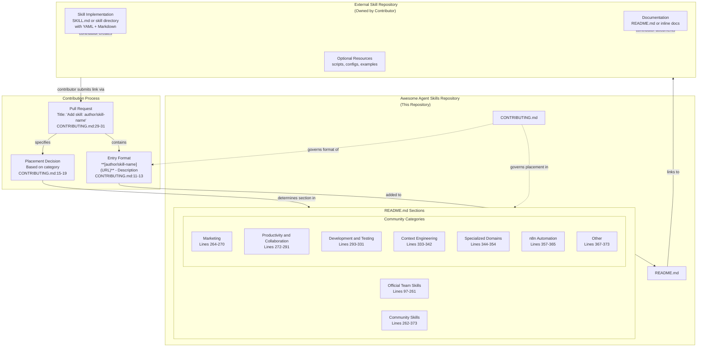
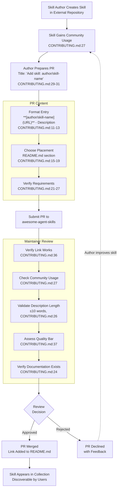
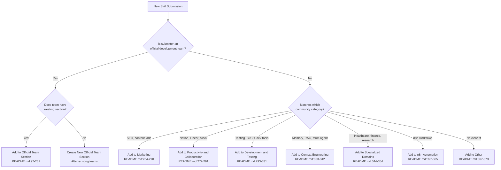
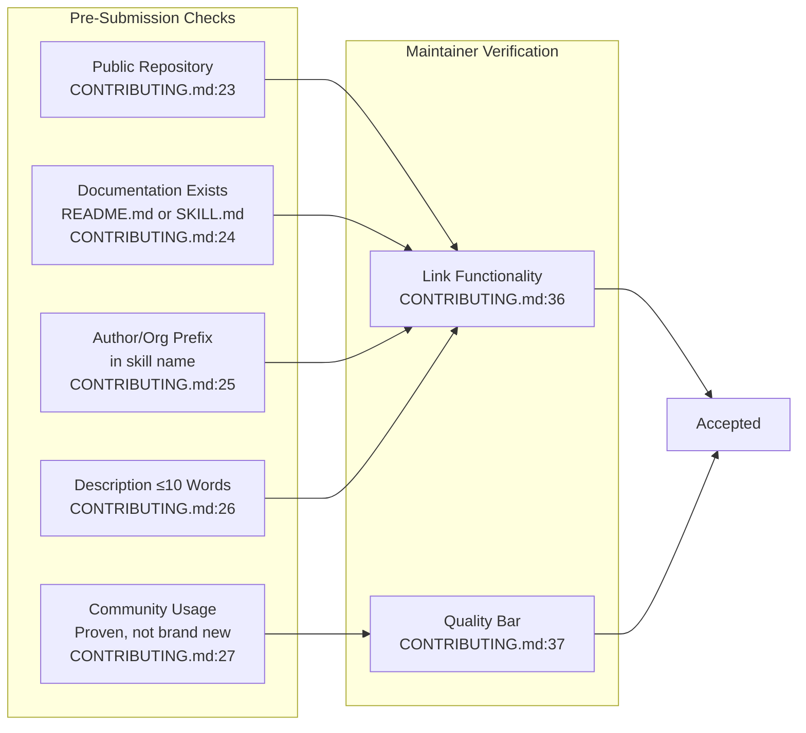
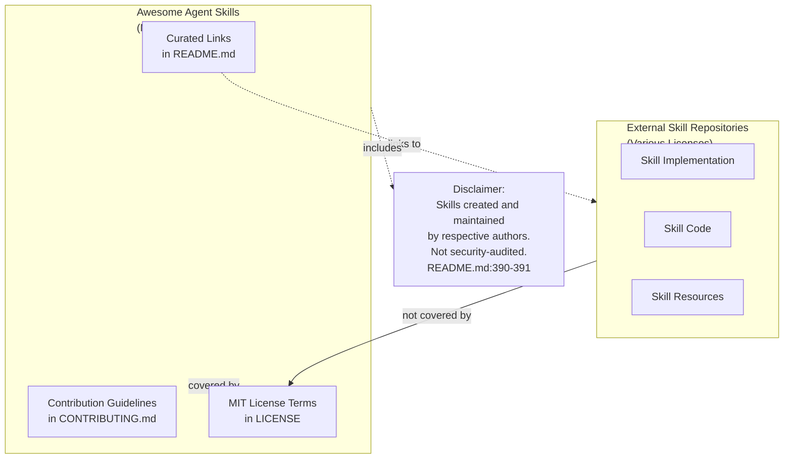

<!-- source: DeepWiki mcp.deepwiki.com · repo VoltAgent/awesome-agent-skills · page 5 Contributing to the Collection · fetched 2026-10-26 -->

# Contributing to the Collection

<details>
<summary>Relevant source files</summary>

The following files were used as context for generating this wiki page:

- [CONTRIBUTING.md](CONTRIBUTING.md)
- [README.md](README.md)

</details>


This document guides contributors through the process of submitting Agent Skills to the Awesome Agent Skills curated collection. It covers the overall contribution workflow, architectural boundaries, and quality requirements for skill submissions.

For detailed step-by-step submission instructions, see [Contribution Guidelines](#5.1). For quality standards and acceptance criteria, see [Quality Requirements](#5.2). For information about the review process, see [Review Process](#5.3).

## Scope and Purpose

This page addresses how external skill authors contribute links to their skills in the centralized collection. It does not cover:

- Creating skills themselves (see [Skill Definition Format](#3.1))
- Installing skills in AI assistants (see [Installing Skills](#2.1))
- Using the skills catalog (see [Skill Catalog](#4))

## Architectural Context: What Is Being Contributed

The Awesome Agent Skills repository follows a **decentralized content, centralized discovery** architecture. Contributors do not submit skill implementations to this repository—they submit links to external repositories where skills are maintained.



**Sources:** [CONTRIBUTING.md:1-44](), [README.md:1-394]()

### Repository Boundaries

This table clarifies what is hosted where:

| Component | Location | Maintained By | Modified By Contributors |
|-----------|----------|---------------|--------------------------|
| Skill implementation (YAML + Markdown) | External repository | Skill author | No - stays external |
| Skill documentation | External repository | Skill author | No - stays external |
| Link to skill | `README.md` in this repo | Collection maintainers | Yes - via PR |
| Contribution rules | `CONTRIBUTING.md` | Collection maintainers | No - governance only |
| License | `LICENSE` | Collection maintainers | No - governance only |

**Sources:** [CONTRIBUTING.md:33-37](), Diagram 6 in high-level architecture

## Contribution Workflow

The complete contribution lifecycle follows this sequence:



**Sources:** [CONTRIBUTING.md:1-44](), [README.md:374-382](), Diagram 2 in high-level architecture

### Entry Format Specification

Contributors must format entries according to this exact pattern:

```markdown
- **[author/skill-name](https://github.com/author/repo/path)** - Short description of what it does
```

**Format Components:**

| Component | Requirement | Example | Location |
|-----------|-------------|---------|----------|
| Prefix | `- **` | `- **` | Start of line |
| Author/Skill Name | `[author/skill-name]` | `[anthropics/docx]` | Link text |
| URL | `(full-github-path)` | `(https://github.com/anthropics/skills/tree/main/skills/docx)` | Link target |
| Suffix | `**` | `**` | After link |
| Separator | ` - ` | ` - ` | Before description |
| Description | ≤10 words | `Create, edit, and analyze Word documents` | End of line |

**Sources:** [CONTRIBUTING.md:8-13]()

### Placement Decision Tree



**Sources:** [CONTRIBUTING.md:15-19](), [README.md:97-373]()

## Core Requirements

All submissions must meet these mandatory requirements before acceptance:



**Sources:** [CONTRIBUTING.md:21-27](), [CONTRIBUTING.md:33-37]()

### Community Usage Requirement

The most critical and frequently overlooked requirement:

> Skill must have real community usage. We focus on community-adopted, proven skills. Brand new skills that were just created are not accepted. Give your skill time to mature and gain users before submitting.

This requirement is emphasized in both `CONTRIBUTING.md` and `README.md`:

```markdown
# From CONTRIBUTING.md:27
- Skill must have real community usage. We focus on community-adopted, proven skills. 
  Brand new skills that were just created are not accepted. Give your skill time to 
  mature and gain users before submitting.

# From README.md:381-382  
**Note:** Please don't submit skills you created 3 hours ago. We're now focusing on 
community-adopted skills, especially those published by development teams and proven 
in real-world usage. Quality over quantity.
```

**Sources:** [CONTRIBUTING.md:27](), [README.md:381-382]()

## Getting Help

Contributors experiencing issues should follow this escalation path:

| Issue Type | Action | Reference |
|------------|--------|-----------|
| General contribution questions | Check existing issues and PRs | [CONTRIBUTING.md:41]() |
| New questions about process | Open new issue | [CONTRIBUTING.md:42]() |
| Skill-specific functionality | Visit skill's own repository | [CONTRIBUTING.md:43]() |
| Broken links or removal requests | Open issue in this repository | [README.md:392]() |

**Sources:** [CONTRIBUTING.md:39-44](), [README.md:390-393]()

## License and Legal Boundaries



The repository's license (MIT) applies only to the curated list content in this repository. Individual skills maintain their own licenses and security posture:

> This is a curated list. Skills listed here are created and maintained by their respective authors and teams, not by us. We select community-adopted, proven skills and do not audit, endorse, or guarantee the security or correctness of listed projects. They are not security-audited and should be reviewed before production use.

**Sources:** [README.md:386-393](), [LICENSE:1-21]()

## Next Steps

For detailed information about specific aspects of contributing:

- **Submission mechanics:** See [Contribution Guidelines](#5.1) for PR format, entry syntax, and placement rules
- **Quality standards:** See [Quality Requirements](#5.2) for acceptance criteria and quality bar
- **Review process:** See [Review Process](#5.3) for how submissions are evaluated and what to expect

**Sources:** [CONTRIBUTING.md:1-44](), Table of Contents for sections 5.1-5.3

---

