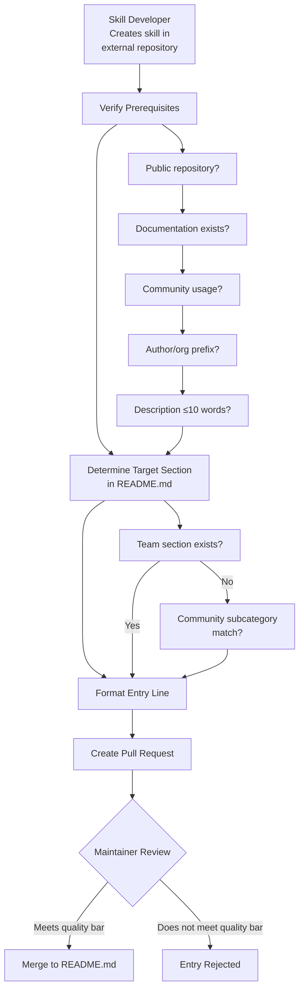
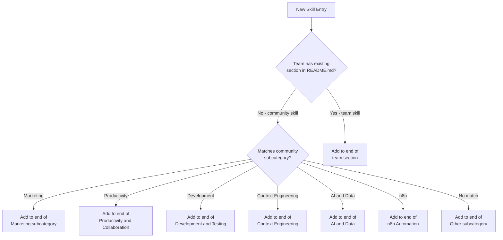
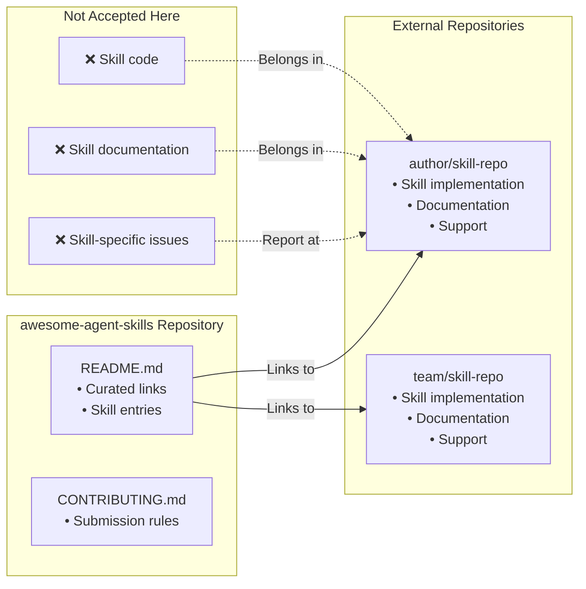

<!-- source: DeepWiki mcp.deepwiki.com · repo VoltAgent/awesome-agent-skills · page 5.1 Contribution Guidelines · fetched 2026-10-26 -->

# Contribution Guidelines

<details>
<summary>Relevant source files</summary>

The following files were used as context for generating this wiki page:

- [CONTRIBUTING.md](CONTRIBUTING.md)

</details>


This document specifies the technical requirements and procedures for submitting skills to the Awesome Agent Skills curated collection. It covers entry formatting, skill placement logic, PR submission requirements, and the boundaries of the curation model.

For quality standards and acceptance criteria, see [Quality Requirements](#5.2). For information about the review process after submission, see [Review Process](#5.3).

**Sources**: [CONTRIBUTING.md:1-44]()

---

## Purpose and Scope

The Awesome Agent Skills repository operates as a **curation hub**, not an implementation host. Contributors submit pull requests to add links to skills that are maintained in external repositories. This document provides the technical specification for preparing and submitting those pull requests.

**Sources**: [CONTRIBUTING.md:1-3](), [CONTRIBUTING.md:33-35]()

---

## Submission Workflow

The following diagram illustrates the complete submission workflow from skill creation to merge:



**Sources**: [CONTRIBUTING.md:5-43]()

---

## Entry Format Specification

All skill entries in `README.md` follow a standardized Markdown format defined in [CONTRIBUTING.md:11-13]():

### Required Format

```markdown
- **[author/skill-name](https://github.com/author/repo/path)** - Short description of what it does
```

### Format Components

| Component | Specification | Example | Reference |
|-----------|---------------|---------|-----------|
| **List marker** | Dash with space `- ` | `- ` | [CONTRIBUTING.md:11]() |
| **Bold wrapper** | Double asterisks `**...**` | `**[...]**` | [CONTRIBUTING.md:12]() |
| **Link text** | `author/skill-name` format | `anthropic/document-creation` | [CONTRIBUTING.md:12]() |
| **URL** | Full GitHub path to skill | `https://github.com/anthropics/anthropic-skills/tree/main/document-creation` | [CONTRIBUTING.md:12]() |
| **Separator** | Space-dash-space ` - ` | ` - ` | [CONTRIBUTING.md:12]() |
| **Description** | ≤10 words, no paragraphs | `Create professional documents with proper structure` | [CONTRIBUTING.md:26]() |

### Validation Rules

The entry format must satisfy these constraints defined in [CONTRIBUTING.md:23-26]():

1. **Link text** must include author/org prefix (e.g., `vercel/`, `anthropic/`)
2. **URL** must point to a public repository with working skill
3. **Description** must not exceed 10 words
4. **Description** must not contain lengthy paragraphs or multiple sentences

**Sources**: [CONTRIBUTING.md:7-13](), [CONTRIBUTING.md:23-26]()

---

## Skill Placement Logic

The placement of a skill entry in `README.md` depends on whether it is contributed by an official development team or the community.

### Placement Decision Tree



**Sources**: [CONTRIBUTING.md:15-19]()

### Team Section Placement

If your organization has an existing section in `README.md` (e.g., "Skills by Vercel Engineering Team", "Skills by Anthropic Team"), add your entry to the **end** of that section, as specified in [CONTRIBUTING.md:17]().

Examples of team sections:
- Skills by Anthropic Team
- Skills by Vercel Engineering Team
- Skills by Cloudflare Engineering Team
- Skills by Hugging Face Team
- Skills by Trail of Bits Team
- Skills by Expo Team
- Skills by Sentry Team
- Skills by Stripe Team

**Sources**: [CONTRIBUTING.md:17]()

### Community Subcategory Placement

For community-contributed skills, match your skill to one of the following subcategories under "Community Skills" in `README.md`, as defined in [CONTRIBUTING.md:18]():

| Subcategory | Skill Types | Placement |
|-------------|-------------|-----------|
| **Marketing** | SEO, content creation, social media | End of Marketing subsection |
| **Productivity and Collaboration** | Notion, Linear, Slack, project mgmt | End of Productivity subsection |
| **Development and Testing** | Testing, debugging, CI/CD, code review | End of Development subsection |
| **Context Engineering** | Memory systems, RAG, multi-agent patterns | End of Context Engineering subsection |
| **AI and Data** | ML workflows, data processing | End of AI and Data subsection |
| **n8n Automation** | n8n workflows, automation | End of n8n Automation subsection |
| **Other** | Skills not matching above categories | End of Other subsection |

Add entries to the **end** of the matching subcategory. If no category fits, use "Other" as specified in [CONTRIBUTING.md:19]().

**Sources**: [CONTRIBUTING.md:18-19]()

---

## Pull Request Format

### PR Title Format

All pull requests must use the following title format defined in [CONTRIBUTING.md:29-31]():

```
Add skill: author/skill-name
```

**Examples**:
```
Add skill: anthropic/document-creation
Add skill: vercel/nextjs-patterns
Add skill: community/marketing-seo
```

### PR Content Requirements

Your pull request must include:

1. **Single line addition** to `README.md` in the correct section
2. **Link verification** - ensure the URL is accessible and points to a working skill
3. **Format compliance** - entry matches the exact format specified in [CONTRIBUTING.md:11-13]()

**Sources**: [CONTRIBUTING.md:29-31](), [CONTRIBUTING.md:36]()

---

## Curation Model Boundaries

### Repository Scope

The following diagram clarifies what this repository contains versus what is maintained externally:



**Sources**: [CONTRIBUTING.md:33-35]()

### Important Constraints

As stated in [CONTRIBUTING.md:33-35]():

1. **This repository curates links only** - Skill implementations are not hosted here
2. **Each skill lives in its own repo** - Contributors maintain skills in their own repositories
3. **Link verification required** - Contributors must verify URLs work before submitting

### Help Resources

For assistance, follow this decision tree defined in [CONTRIBUTING.md:39-43]():

| Issue Type | Action | Location |
|------------|--------|----------|
| **Submission questions** | Check existing issues and PRs | This repository |
| **Process clarification** | Open new issue | This repository |
| **Skill-specific help** | Visit skill's repository | External skill repo |
| **Skill bugs** | Report to skill maintainer | External skill repo |
| **Skill feature requests** | Submit to skill maintainer | External skill repo |

**Sources**: [CONTRIBUTING.md:39-43]()

---

## Pre-Submission Checklist

Before submitting a pull request, verify the following requirements from [CONTRIBUTING.md:21-27]():

```markdown
- [ ] Skill is in a public repository
- [ ] Repository contains documentation (README.md or SKILL.md)
- [ ] Entry includes author/org prefix in name
- [ ] Description is 10 words or fewer
- [ ] Skill has real community usage (not brand new)
- [ ] Link has been verified to work
- [ ] Entry is added to the end of the correct section
- [ ] PR title follows format: "Add skill: author/skill-name"
```

The **community usage requirement** is critical and explained in detail on the [Quality Requirements](#5.2) page. As noted in [CONTRIBUTING.md:27](): "Brand new skills that were just created are not accepted. Give your skill time to mature and gain users before submitting."

**Sources**: [CONTRIBUTING.md:21-27]()

---

## Next Steps

After preparing your pull request following these guidelines:

1. **Submit the PR** - Create pull request with proper title format
2. **Wait for review** - Maintainers will evaluate per [Review Process](#5.3)
3. **Address feedback** - Respond to any maintainer comments
4. **Quality bar assessment** - See [Quality Requirements](#5.2) for acceptance criteria

Note from [CONTRIBUTING.md:37](): "We review all submissions and may decline skills that don't meet the quality bar."

**Sources**: [CONTRIBUTING.md:37]()

---

