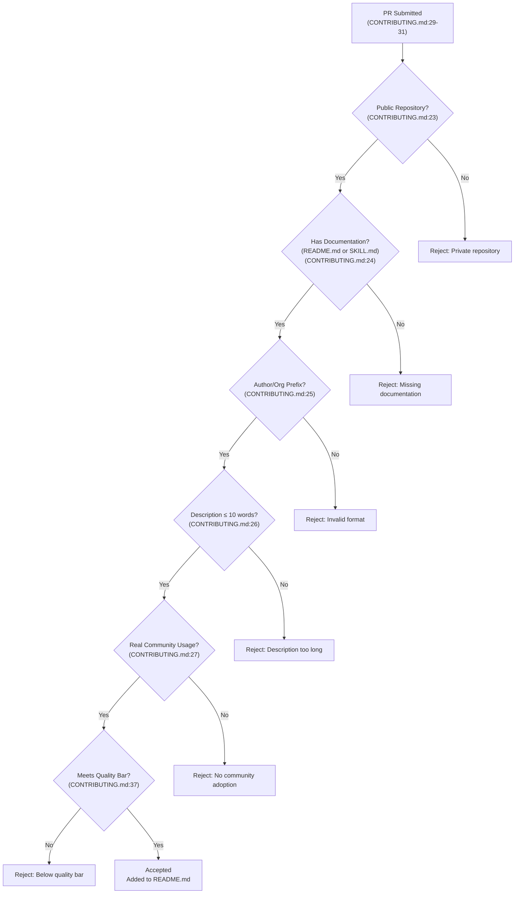
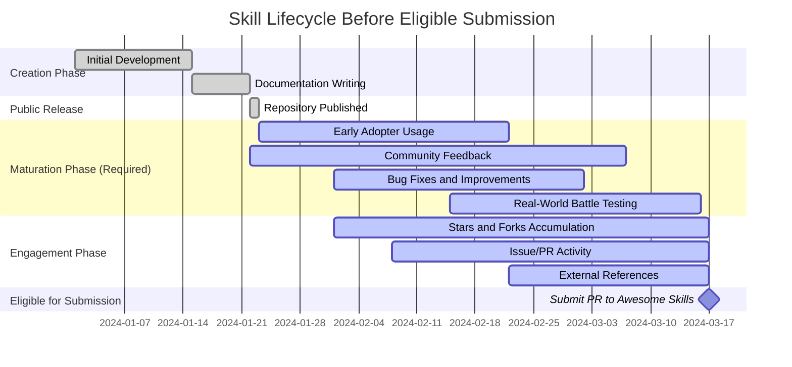
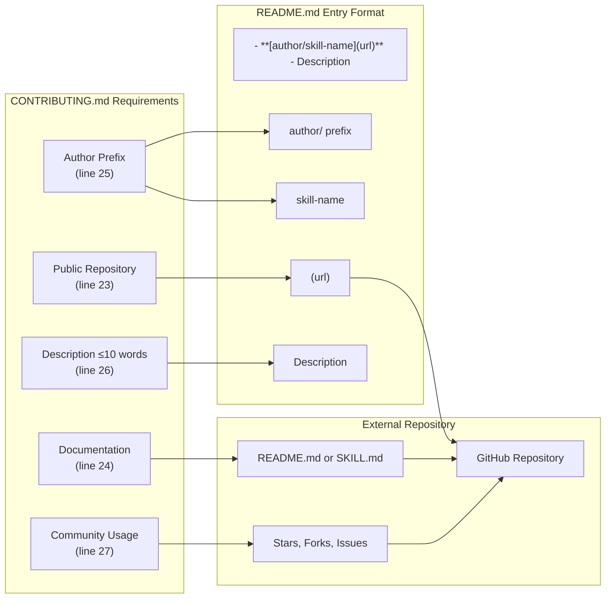
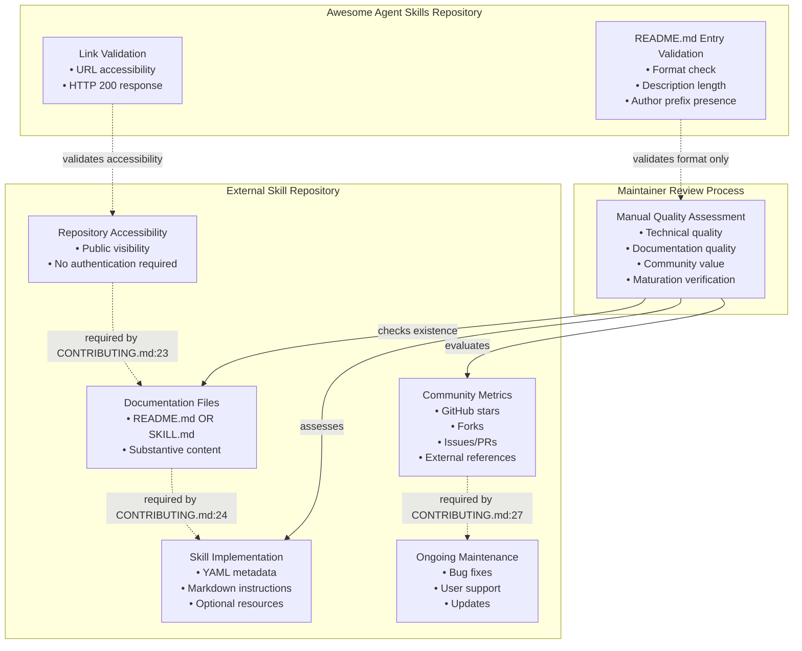

<!-- source: DeepWiki mcp.deepwiki.com · repo VoltAgent/awesome-agent-skills · page 5.2 Quality Requirements · fetched 2026-10-26 -->

# Quality Requirements

<details>
<summary>Relevant source files</summary>

The following files were used as context for generating this wiki page:

- [CONTRIBUTING.md](CONTRIBUTING.md)

</details>


This document defines the strict quality standards that all skills must meet before being accepted into the Awesome Agent Skills curated collection. These requirements ensure the repository maintains high signal-to-noise ratio and lists only proven, battle-tested capabilities with demonstrated community value.

For the step-by-step submission process, see [Contribution Guidelines](#5.1). For information about how submissions are evaluated, see [Review Process](#5.3).

## Scope and Purpose

The quality requirements serve as an explicit acceptance filter that distinguishes this collection from a general-purpose index. The bar is intentionally high to focus on skills that have:

1. Proven effectiveness through real-world usage
2. Community adoption and active users
3. Professional documentation and support
4. Clear value proposition within 10 words

Skills that do not meet these requirements will not be accepted, regardless of technical merit or potential future value.

**Sources:** [CONTRIBUTING.md:21-37]()

## Mandatory Requirements

All five requirements must be satisfied for a skill to be considered for inclusion. Missing any single requirement results in automatic rejection.

### 1. Public Repository Requirement

**Requirement:** The skill must be hosted in a publicly accessible repository.

**Rationale:** Public accessibility enables:
- Community verification of skill quality
- Transparent review of skill implementation
- Collaborative improvement through community contributions
- Long-term maintenance visibility

**Validation:** Maintainers verify that the repository URL is accessible without authentication and returns HTTP 200.

**Non-compliant examples:**
- Private repositories (requires authentication)
- Paywalled content
- Repositories behind corporate firewalls
- Broken or deleted repositories

**Sources:** [CONTRIBUTING.md:23]()

### 2. Documentation Requirement

**Requirement:** The skill repository must contain either a `README.md` or `SKILL.md` file with documentation.

**Minimum documentation standards:**
- Purpose and use case explanation
- Installation instructions
- Usage examples or integration guidance
- Expected behavior description

**Preferred documentation structure:**
- Clear title and description
- "When to Use" section
- Step-by-step instructions
- Validation criteria or expected outputs
- Examples with sample inputs/outputs

**Validation:** Maintainers check for the presence of `README.md` or `SKILL.md` in the repository root and verify it contains substantive content beyond auto-generated boilerplate.

**Sources:** [CONTRIBUTING.md:24]()

### 3. Author/Organization Prefix Requirement

**Requirement:** The skill name must include an author or organization prefix in the format `author/skill-name` or `org/skill-name`.

**Entry format in README.md:**
```markdown
- **[author/skill-name](https://github.com/author/repo/path)** - Short description
```

**Rationale:** Prefixes provide:
- Clear attribution to original authors
- Namespace disambiguation for similarly-named skills
- Reputation signaling (known organizations carry implicit quality signals)
- Link scoping (users can discover other skills by the same author)

**Examples:**
- ✅ `anthropic/document-creation`
- ✅ `vercel/react-best-practices`
- ✅ `cloudflare/mcp-server`
- ✅ `johndoe/marketing-seo`
- ❌ `document-creation` (missing prefix)
- ❌ `skill-react` (missing prefix)

**Sources:** [CONTRIBUTING.md:9-13](), [CONTRIBUTING.md:25]()

### 4. Description Length Requirement

**Requirement:** The skill description must be 10 words or fewer.

**Format constraint:**
```markdown
- **[author/skill-name](url)** - [1-10 words describing the skill]
```

**Rationale:** Brevity requirements enforce:
- Scannable README structure
- Clear value proposition (if it can't be stated concisely, it may lack focus)
- Consistent formatting across all entries
- Efficient information density

**Validation criteria:**
- Count excludes link text and markdown formatting
- Count applies only to the text after the hyphen
- No lengthy paragraphs or multi-sentence descriptions

**Compliant examples:**
- "Create professional documents with consistent formatting and branding" (8 words) ✅
- "Optimize React components following Vercel best practices" (7 words) ✅
- "Build secure smart contracts with automated vulnerability scanning" (8 words) ✅

**Non-compliant examples:**
- "This skill helps you create professional documents with consistent formatting and branding guidelines following industry standards" (17 words) ❌
- Multi-sentence descriptions ❌
- Descriptions with bullet points ❌

**Sources:** [CONTRIBUTING.md:26]()

### 5. Community Usage Requirement

**Requirement:** Skills must have demonstrated real community usage and maturation. Brand new skills that were just created are not accepted.

**Maturation criteria:**
- The skill has been publicly available for a meaningful period
- Multiple users have adopted and used the skill
- There is evidence of community engagement (stars, forks, issues, discussions)
- The skill has been battle-tested in real-world scenarios

**Intent:** This requirement ensures the collection focuses on proven capabilities rather than experimental projects or promotional submissions.

**Validation signals maintainers check:**
- Repository age (recently created repos are red flags)
- GitHub stars and forks (indicators of community interest)
- Issue/PR activity (evidence of actual usage)
- External references (blog posts, tutorials, social media mentions)
- Author engagement with users

**Explicit rejection criteria:**
- Skills created within the last few weeks/months
- Repositories with zero external engagement
- Skills submitted immediately after creation
- Projects that appear to be promotional rather than community-driven

**Guidance for new skill authors:** Give your skill time to mature and gain users before submitting. Focus on building a real user base and gathering feedback. Submit only after your skill has proven value in production use cases.

**Sources:** [CONTRIBUTING.md:27]()

## Quality Requirements Validation Flow

The following diagram illustrates how each requirement from [CONTRIBUTING.md:21-27]() is evaluated during the submission review process:



**Sources:** [CONTRIBUTING.md:21-37]()

## Skill Maturation Timeline

The community usage requirement (requirement #5) implicitly requires a temporal dimension. The following diagram illustrates the expected lifecycle before a skill is eligible for submission:



This timeline shows that a minimum of **6-12 weeks** typically passes between initial public release and eligibility for submission, allowing time for:
- Multiple users to discover and adopt the skill
- Issues to be discovered and resolved
- Community engagement metrics to accumulate
- External validation through references and mentions

**Sources:** [CONTRIBUTING.md:27]()

## Quality Bar Assessment

Beyond the five mandatory requirements, maintainers assess each submission against a holistic quality bar. This subjective evaluation considers:

### Technical Quality Indicators

| Criterion | Assessment Factors |
|-----------|-------------------|
| **Code Quality** | Clean implementation, follows best practices, uses appropriate abstractions |
| **Skill Structure** | Well-organized YAML metadata and Markdown instructions, clear separation of concerns |
| **Error Handling** | Graceful handling of edge cases, clear error messages, validation logic |
| **Dependencies** | Minimal external dependencies, avoids unnecessary complexity |
| **Maintenance** | Active maintenance signals (recent commits, responsive to issues) |

### Documentation Quality Indicators

| Criterion | Assessment Factors |
|-----------|-------------------|
| **Clarity** | Instructions are clear and unambiguous, easy to follow |
| **Completeness** | Covers all necessary information (purpose, usage, validation) |
| **Examples** | Includes concrete examples with expected inputs/outputs |
| **Professionalism** | Free of typos, grammatical errors, formatted consistently |

### Community Value Indicators

| Criterion | Assessment Factors |
|-----------|-------------------|
| **Uniqueness** | Provides capabilities not already well-covered by existing skills |
| **Broad Applicability** | Useful to a wide range of users, not overly niche |
| **Problem Significance** | Solves a real problem that developers commonly face |
| **Integration Value** | Works well with popular tools, frameworks, or workflows |

**Sources:** [CONTRIBUTING.md:37]()

## Requirements Mapping to README.md Entry Format

The following diagram shows how each quality requirement from [CONTRIBUTING.md:21-27]() maps to specific elements in the [README.md]() entry format:



**Sources:** [CONTRIBUTING.md:9-13](), [CONTRIBUTING.md:21-27]()

## Validation Checklist for Contributors

Before submitting a PR, contributors should self-assess against this checklist:

### Pre-Submission Checklist

- [ ] Repository is publicly accessible at the provided URL
- [ ] Repository contains either `README.md` or `SKILL.md` with substantive documentation
- [ ] Entry follows format: `- **[author/skill-name](url)** - Description`
- [ ] Author or organization prefix is included in the skill name
- [ ] Description is exactly 10 words or fewer
- [ ] Skill has been publicly available for at least 6+ weeks
- [ ] Repository has evidence of community usage (stars, forks, issues, external mentions)
- [ ] Skill has been used in real-world scenarios (not just examples)
- [ ] Documentation includes clear instructions and examples
- [ ] Link has been tested and works correctly
- [ ] Entry is placed in the appropriate category ([CONTRIBUTING.md:15-19]())
- [ ] PR title follows format: `Add skill: author/skill-name` ([CONTRIBUTING.md:29-31]())

### Common Rejection Reasons

The following table summarizes the most common reasons skills are rejected, mapped to specific requirements:

| Rejection Reason | Requirement Violated | Fix Required |
|------------------|---------------------|--------------|
| "Too new, needs maturation" | Community Usage ([CONTRIBUTING.md:27]()) | Wait for community adoption, gather users |
| "Description too verbose" | Length Limit ([CONTRIBUTING.md:26]()) | Reduce to ≤10 words, focus on core value |
| "Missing documentation" | Documentation ([CONTRIBUTING.md:24]()) | Add README.md or SKILL.md with instructions |
| "Invalid entry format" | Author Prefix ([CONTRIBUTING.md:25]()) | Use format: `author/skill-name` |
| "Repository not accessible" | Public Repository ([CONTRIBUTING.md:23]()) | Make repository public, verify URL |
| "Below quality bar" | General Quality ([CONTRIBUTING.md:37]()) | Improve code quality, documentation, or value proposition |

**Sources:** [CONTRIBUTING.md:21-37]()

## Repository Boundary and Responsibility

This diagram clarifies what this repository validates versus what external repositories must maintain:



**Key distinction:** The Awesome Agent Skills repository ([CONTRIBUTING.md:35]()) only curates links and validates entry format. The actual skill quality, documentation, and community support are the responsibility of the external repository maintainers.

**Sources:** [CONTRIBUTING.md:33-43]()

## Comparison: Accepted vs Rejected Submissions

### Example: Accepted Submission ✅

**Entry:**
```markdown
- **[vercel/react-best-practices](https://github.com/vercel/skill-react-best-practices)** - Optimize React components following Vercel standards
```

**Assessment:**
- ✅ Public repository with 1,200+ stars
- ✅ Comprehensive README.md with examples
- ✅ Author prefix: `vercel/`
- ✅ Description: 7 words
- ✅ 6 months old with active community usage
- ✅ High quality bar: Official team skill, proven patterns, excellent documentation

**Sources:** [CONTRIBUTING.md:9-13](), [CONTRIBUTING.md:21-27]()

### Example: Rejected Submission ❌

**Entry:**
```markdown
- **[new-marketing-automation](https://github.com/johndoe/marketing-tool)** - This comprehensive skill helps you automate all your marketing workflows including social media posting, email campaigns, and analytics tracking
```

**Rejection reasons:**
- ❌ Missing author prefix (should be `johndoe/new-marketing-automation`)
- ❌ Description is 23 words (exceeds 10-word limit)
- ❌ Repository created 2 weeks ago
- ❌ Only 3 stars, no evidence of community usage
- ❌ README is minimal with auto-generated content

**Fix required:**
```markdown
- **[johndoe/marketing-automation](https://github.com/johndoe/marketing-tool)** - Automate social media posting and email campaigns
```

Plus: Wait 6+ weeks for community adoption and improve documentation.

**Sources:** [CONTRIBUTING.md:21-27]()

## Enforcement and Exceptions

### Strict Enforcement

The five mandatory requirements ([CONTRIBUTING.md:21-27]()) are strictly enforced with **no exceptions**:

1. Public Repository
2. Documentation
3. Author/Org Prefix
4. Description ≤10 words
5. Community Usage

Skills failing any requirement are automatically rejected, regardless of:
- Author reputation
- Technical sophistication
- Potential future value
- Special circumstances

### Maintainer Discretion

The quality bar assessment ([CONTRIBUTING.md:37]()) involves maintainer discretion. Factors considered:

- **Official Team Skills:** Skills from recognized organizations (Anthropic, Vercel, Cloudflare, etc.) receive higher trust but must still meet all five mandatory requirements
- **Borderline Cases:** If a skill meets all mandatory requirements but is borderline on quality, maintainers may request improvements before acceptance
- **Duplicate Capabilities:** If a skill provides capabilities already well-covered by existing skills, it may be rejected unless it offers significant differentiation

### Appeal Process

Contributors can appeal rejections by:
1. Opening an issue referencing the rejected PR
2. Providing additional evidence of community usage
3. Demonstrating how improvements address feedback

However, appeals rarely succeed unless new information materially changes the assessment.

**Sources:** [CONTRIBUTING.md:37-43]()

## Summary: Quality Requirements Matrix

| Requirement | Type | Validation Method | Rejection Impact | Reference |
|-------------|------|-------------------|------------------|-----------|
| Public Repository | Mandatory | Automated + Manual | Immediate | [CONTRIBUTING.md:23]() |
| Documentation | Mandatory | Manual inspection | Immediate | [CONTRIBUTING.md:24]() |
| Author/Org Prefix | Mandatory | Automated format check | Immediate | [CONTRIBUTING.md:25]() |
| Description ≤10 words | Mandatory | Automated word count | Immediate | [CONTRIBUTING.md:26]() |
| Community Usage | Mandatory | Manual assessment | Immediate | [CONTRIBUTING.md:27]() |
| Quality Bar | Discretionary | Holistic evaluation | Case-by-case | [CONTRIBUTING.md:37]() |

**Key takeaway:** All five mandatory requirements must be satisfied before quality bar assessment even begins. The quality bar provides an additional filter for skills that meet minimum requirements but may not provide sufficient value to the community.

**Sources:** [CONTRIBUTING.md:21-37]()

---

