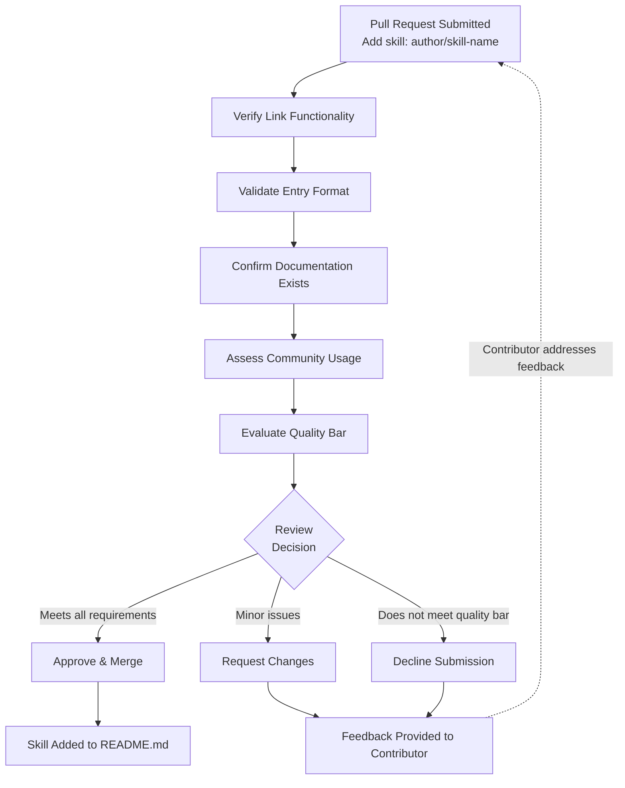
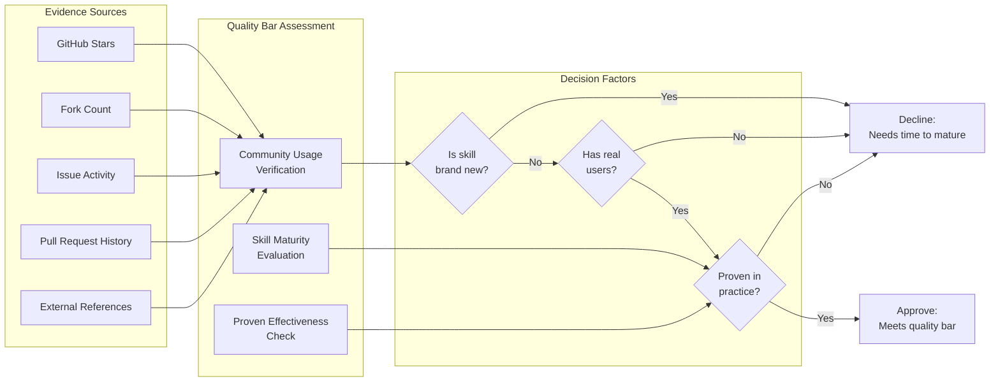
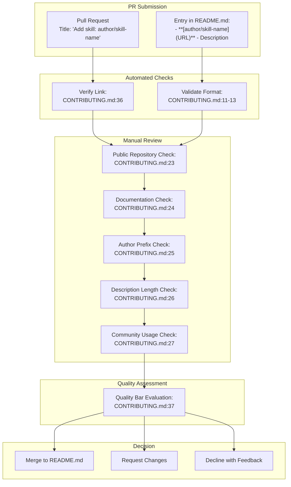
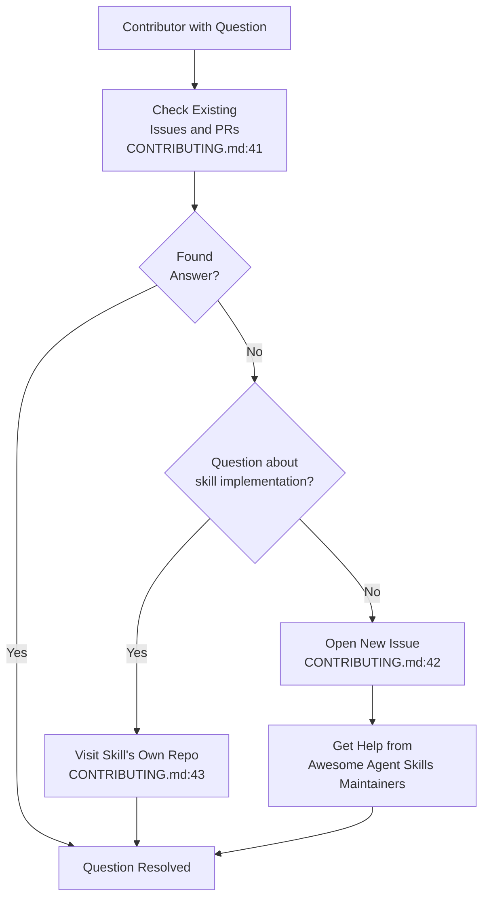

<!-- source: DeepWiki mcp.deepwiki.com · repo VoltAgent/awesome-agent-skills · page 5.3 Review Process · fetched 2026-10-26 -->

# Review Process

Relevant source files

The following files were used as context for generating this wiki page:

- [CONTRIBUTING.md](CONTRIBUTING.md)

## Purpose and Scope

This document describes the maintainer review process for skill submissions to the Awesome Agent Skills collection. It covers the workflow from PR submission through final acceptance or rejection, the criteria maintainers evaluate, possible decision outcomes, and how contributors can get support during review.

For the initial submission process and PR format requirements, see [Contribution Guidelines](#5.1). For detailed quality standards that submissions must meet, see [Quality Requirements](#5.2).

## Review Workflow Overview

When a contributor submits a pull request to add a skill to the curated collection, maintainers follow a structured review process to ensure only high-quality, proven skills are accepted. The review focuses on verifying requirements compliance rather than evaluating the skill's implementation details, as skills are hosted in external repositories.

**Sources**: [CONTRIBUTING.md:33-37](), [CONTRIBUTING.md:21-27]()

## Review Criteria

Maintainers evaluate each submission against specific criteria defined in the contribution guidelines. The review process checks both technical and quality requirements.

### Technical Requirements Checklist

| Requirement | What Maintainers Verify | Relevant Code Reference |
|------------|-------------------------|-------------------------|
| **Link Functionality** | Repository URL loads correctly and points to the skill | [CONTRIBUTING.md:36]() |
| **Public Repository** | Skill repository is publicly accessible | [CONTRIBUTING.md:23]() |
| **Documentation** | README.md or SKILL.md exists in the repository | [CONTRIBUTING.md:24]() |
| **Author/Org Prefix** | Skill name includes author or organization prefix | [CONTRIBUTING.md:25]() |
| **Description Length** | Description is 10 words or fewer | [CONTRIBUTING.md:26]() |
| **Entry Format** | Follows markdown format: `- **[author/skill-name](URL)** - Description` | [CONTRIBUTING.md:11-13]() |

**Sources**: [CONTRIBUTING.md:21-27](), [CONTRIBUTING.md:7-13]()

### Quality Bar Assessment

The most critical aspect of the review process is assessing whether the skill meets the quality bar. This evaluation is subjective and based on maintainer judgment.

The quality bar requirement explicitly states: "Skill must have real community usage. We focus on community-adopted, proven skills. Brand new skills that were just created are not accepted. Give your skill time to mature and gain users before submitting." ([CONTRIBUTING.md:27]())

**Sources**: [CONTRIBUTING.md:27]()

## Review Decision Outcomes

After completing the review criteria checks, maintainers make one of three decisions:

### Approval and Merge

When a submission meets all requirements and passes the quality bar assessment, maintainers approve and merge the pull request. The skill entry is added to the appropriate section in `README.md`.

**Criteria for Approval:**
- All technical requirements satisfied
- Link verified as functional
- Documentation present and adequate
- Community usage demonstrated
- Quality bar met

**Sources**: [CONTRIBUTING.md:37]()

### Request Changes

If a submission has minor issues that can be easily corrected, maintainers request changes rather than declining the submission. Common change requests include:

- **Link Issues**: Broken URL, incorrect path, or inaccessible repository
- **Format Issues**: Incorrect markdown format, missing author prefix, or improper categorization
- **Description Issues**: Description exceeds 10 words or lacks clarity
- **Documentation Issues**: Documentation exists but is insufficient

Contributors can address the feedback and update their pull request for re-review.

**Sources**: [CONTRIBUTING.md:36](), [CONTRIBUTING.md:26]()

### Decline Submission

Submissions are declined when they fail to meet the quality bar or violate fundamental requirements. Common reasons for decline:

| Decline Reason | Explanation | Guidance for Contributors |
|---------------|-------------|---------------------------|
| **Brand New Skill** | Skill was recently created with no community adoption | Allow skill to mature and gain users before resubmitting |
| **No Community Usage** | No evidence of real users or adoption | Build community around skill before submitting |
| **Quality Bar Not Met** | Skill doesn't demonstrate effectiveness or value | Improve skill quality and prove effectiveness |
| **Invalid Skill** | Not a working skill or repository doesn't contain skill code | Ensure repository contains functional skill implementation |
| **Missing Documentation** | No README or SKILL.md in repository | Add comprehensive documentation before submitting |

The review process is documented in [CONTRIBUTING.md:37](): "We review all submissions and may decline skills that don't meet the quality bar."

**Sources**: [CONTRIBUTING.md:27](), [CONTRIBUTING.md:37]()

## Maintainer Review Workflow

The following diagram maps the review process to specific checks maintainers perform against the contribution guidelines file:

This workflow demonstrates how each review step corresponds to specific lines in `CONTRIBUTING.md`, ensuring consistency in the review process.

**Sources**: [CONTRIBUTING.md:11-13](), [CONTRIBUTING.md:23-27](), [CONTRIBUTING.md:36-37]()

## Getting Help During Review

The contribution guidelines provide multiple support channels for contributors who have questions or need assistance during the review process.

### Support Channels

**Help Guidelines** ([CONTRIBUTING.md:39-43]()):

1. **Check Existing Issues and PRs First**: Search for similar questions or submissions that may have already been addressed
2. **Open a New Issue for Questions**: If your question hasn't been answered, create a new issue in the repository
3. **Visit the Skill's Own Repo for Skill-Specific Help**: Implementation questions about the skill itself should be directed to the skill's repository, not the Awesome Agent Skills collection

### Important Distinction

The review process evaluates whether a skill meets the criteria for inclusion in the curated collection. It does **not** evaluate the skill's implementation details or provide debugging support for the skill code. As stated in [CONTRIBUTING.md:35](): "This repository curates links only. Each skill lives in its own repo."

**Sources**: [CONTRIBUTING.md:33-43]()

## Review Timeline and Expectations

While not explicitly documented in the contribution guidelines, contributors should understand the review process operates on maintainer availability. The review workflow prioritizes quality over speed to ensure the collection maintains its high standards.

### Expected Contributor Actions

- **Before Submitting**: Verify all requirements in [Quality Requirements](#5.2)
- **During Review**: Respond promptly to change requests
- **After Feedback**: Address all maintainer comments before requesting re-review
- **If Declined**: Allow skill to mature before resubmitting

### Repository Architecture Context

The review process reflects the repository's role as a curation hub rather than an implementation host. As documented in the architecture diagrams, this repository contains only:

- `README.md` - The curated skill collection
- `CONTRIBUTING.md` - Contribution and review guidelines  
- `LICENSE` - MIT license terms

All skill implementations live in external repositories maintained by their original authors. This architectural boundary means the review process focuses solely on whether a skill deserves inclusion in the curated collection, not on the skill's code quality or functionality.

**Sources**: [CONTRIBUTING.md:35]()

---

