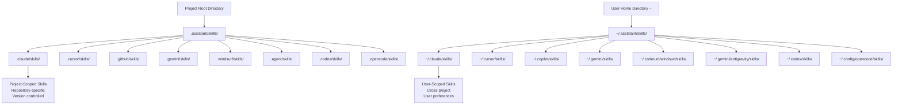
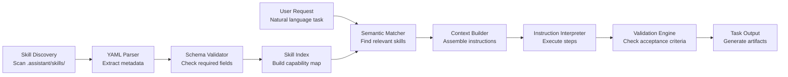
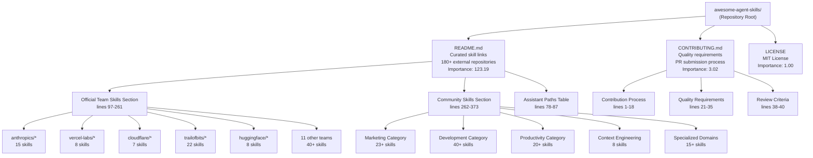
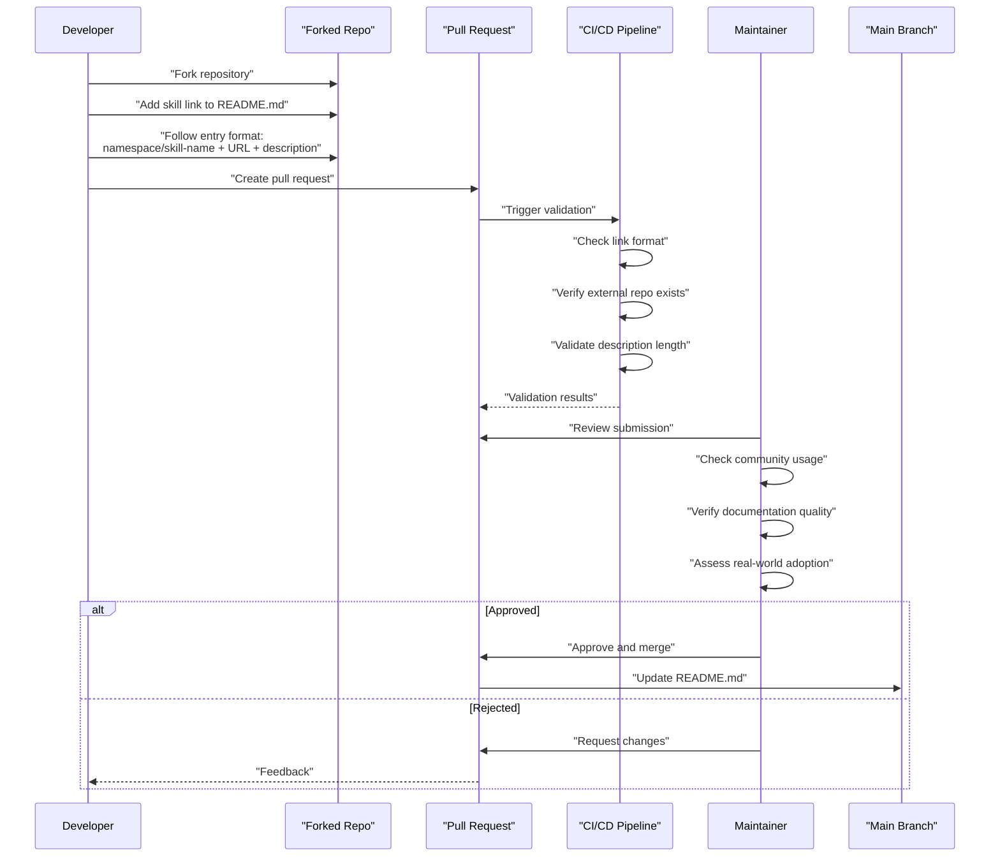

<!-- source: DeepWiki mcp.deepwiki.com · repo VoltAgent/awesome-agent-skills · page 6 Technical Reference · fetched 2026-10-26 -->

# Technical Reference

<details>
<summary>Relevant source files</summary>

The following files were used as context for generating this wiki page:

- [README.md](README.md)

</details>


This document provides comprehensive technical specifications and reference documentation for developers implementing, contributing to, or integrating with the Awesome Agent Skills ecosystem. It covers skill format specifications, file system conventions, integration patterns, and implementation details.

For AI assistant-specific installation paths, see [AI Assistant Compatibility Matrix](#6.1). For detailed skill lifecycle processes, see [Skill Lifecycle](#6.2). For repository architectural boundaries and design decisions, see [Repository Architecture](#6.3).

**Sources:** [README.md:1-394]()

## Skill Definition Specification

Skills are defined using a standardized format consisting of YAML front matter for machine-readable metadata and Markdown content for human-readable instructions. This dual-format approach enables both automated parsing by AI assistants and manual comprehension by developers.

### File Structure Requirements

```
skill-directory/
├── SKILL.md          # Primary skill definition (required)
├── README.md         # Documentation (optional)
├── resources/        # Optional supporting files
│   ├── scripts/
│   ├── configs/
│   └── examples/
└── tests/            # Optional validation tests
```

Each skill must contain a primary definition file. The filename convention varies by assistant:
- Claude Code: `SKILL.md` or skill name with `.md`
- Cursor: Any `.md` file in skills directory
- GitHub Copilot: `skill.md` or skill name
- Gemini CLI: `SKILL.md`

**Sources:** [README.md:42-74]()

### YAML Front Matter Schema

```yaml
---
name: skill-identifier
description: Ten words or fewer describing the capability
version: 1.0.0           # Optional semantic version
author: team-or-person   # Optional author attribution
tags:                    # Optional categorization
  - category1
  - category2
dependencies:            # Optional prerequisite skills
  - other-skill-name
mcp_server:             # Optional MCP server configuration
  name: server-name
  version: ">=1.0.0"
---
```

**Required Fields:**
- `name`: Hyphenated identifier, lowercase, no spaces
- `description`: Maximum 10 words, concise capability statement

**Optional Fields:**
- `version`: Semantic versioning for skill evolution
- `author`: Attribution to creating team/individual
- `tags`: Categorization for discovery
- `dependencies`: List of prerequisite skills
- `mcp_server`: MCP server integration configuration

**Sources:** [README.md:44-49](), [CONTRIBUTING.md:21-40]()

### Markdown Body Structure

```markdown
# Skill Title

Brief overview paragraph explaining the skill's purpose.

## When to Use This Skill

Clear triggering conditions that indicate when this skill should be invoked.

## Instructions

Step-by-step execution instructions:

1. First action with specific parameters
2. Second action with expected outcomes
3. Third action with validation criteria
4. Error handling procedures

## Validation

- Checklist item 1: expected result
- Checklist item 2: acceptance criteria
- Checklist item 3: verification method

## Examples

Optional concrete usage examples.

## Resources

Optional links to external documentation, APIs, or tools.
```

**Required Sections:**
- Title (H1): Clear skill name
- Overview: Brief capability description
- Instructions: Actionable step-by-step guidance

**Recommended Sections:**
- When to Use: Invocation triggers
- Validation: Success criteria
- Examples: Concrete use cases

**Sources:** [README.md:50-72]()

## File System Integration Patterns

### Directory Structure Convention

The skill ecosystem uses a dual-path system to support both project-specific and user-global skill deployment:



### Path Resolution Priority

AI assistants typically resolve skills using the following precedence:

1. **Project-specific paths** (`.assistant/skills/`) - Highest priority
2. **Global user paths** (`~/.assistant/skills/`) - Fallback
3. **Built-in skills** - Default capabilities

This hierarchy enables project-specific skill overrides while maintaining user-wide defaults.

**Sources:** [README.md:76-88]()

### Compatibility Matrix Table

| AI Assistant | Project Path | Global Path | Config File |
|-------------|--------------|-------------|-------------|
| Antigravity | `.agent/skills/` | `~/.gemini/antigravity/skills/` | N/A |
| Claude Code | `.claude/skills/` | `~/.claude/skills/` | `.claude/config.json` |
| Codex | `.codex/skills/` | `~/.codex/skills/` | `.codex/config.yaml` |
| Cursor | `.cursor/skills/` | `~/.cursor/skills/` | `.cursor/settings.json` |
| Gemini CLI | `.gemini/skills/` | `~/.gemini/skills/` | `~/.gemini/config.toml` |
| GitHub Copilot | `.github/skills/` | `~/.copilot/skills/` | `.github/copilot.yaml` |
| OpenCode | `.opencode/skills/` | `~/.config/opencode/skills/` | `~/.config/opencode/config.json` |
| Windsurf | `.windsurf/skills/` | `~/.codeium/windsurf/skills/` | `.windsurf/cascade.json` |

**Sources:** [README.md:78-87]()

## Skill Execution Architecture

### AI Assistant Processing Pipeline



### Skill Parsing Implementation

AI assistants implement skill parsing using the following algorithmic pattern:

1. **File Discovery**: Scan `skills/` directories for `.md` files
2. **Front Matter Extraction**: Parse YAML block between `---` delimiters
3. **Metadata Validation**: Verify required `name` and `description` fields
4. **Markdown Parsing**: Extract sections using heading hierarchy
5. **Index Building**: Create searchable capability map
6. **Semantic Matching**: Compare user intent to skill descriptions
7. **Context Assembly**: Inject relevant skill instructions into prompt
8. **Execution**: Follow step-by-step instructions in Markdown body

**Sources:** [README.md:42-74]()

## Skill Format Examples

### Minimal Valid Skill

```yaml
---
name: api-tester
description: Test REST APIs and validate responses
---

# API Tester

Test HTTP endpoints and verify response data.

## Instructions

When testing an API:

1. Send a request to the specified endpoint
2. Check the response status code
3. Validate the response body structure
4. Report any errors or unexpected results
```

**Sources:** [README.md:44-72]()

### Advanced Skill with MCP Integration

```yaml
---
name: cloudflare-deployer
description: Deploy Workers and manage Cloudflare services
version: 1.2.0
author: cloudflare
tags:
  - deployment
  - edge-computing
  - serverless
dependencies:
  - wrangler-cli
mcp_server:
  name: cloudflare-mcp
  version: ">=2.0.0"
---

# Cloudflare Deployment Skill

Deploy and manage Cloudflare Workers, Pages, and edge services.

## When to Use This Skill

Use when deploying serverless functions, configuring edge routing, or managing Cloudflare infrastructure.

## Instructions

1. Verify Wrangler CLI is installed and authenticated
2. Review `wrangler.toml` configuration for deployment targets
3. Execute deployment using `wrangler deploy` with environment flags
4. Verify deployment success via dashboard or `wrangler tail`
5. Monitor edge logs for initial traffic patterns

## Validation

- Deployment completes without errors
- Worker responds to test requests within 50ms
- Edge logs show successful initialization
- No security warnings in deployment output

## MCP Server Integration

This skill requires the `cloudflare-mcp` server for:
- Wrangler command execution
- Configuration management
- Deployment status monitoring
- Edge log streaming
```

**Sources:** [README.md:144-151]()

## Repository File Structure



**File Importance Distribution:**
- `README.md`: 123.19 (96.8% of total importance)
- `CONTRIBUTING.md`: 3.02 (2.4% of total importance)
- `LICENSE`: 1.00 (0.8% of total importance)

The overwhelming importance of `README.md` reflects its role as the primary user interface for the entire skill discovery system.

**Sources:** [README.md:1-394](), [CONTRIBUTING.md:1-40]()

## Link Format Specification

The repository maintains links to external skill repositories using a standardized format:

### Link Syntax

```markdown
- **[namespace/skill-name](repository-url)** - Description under 10 words
```

**Components:**
- `namespace`: Team or organization identifier (e.g., `anthropics`, `vercel-labs`, `trailofbits`)
- `skill-name`: Skill identifier matching repository structure
- `repository-url`: Full GitHub URL to skill definition
- Description: Concise capability summary, maximum 10 words

### Category Organization

Skills are organized hierarchically:

1. **Official Team Skills**: By organization (Anthropic, Vercel, Cloudflare, etc.)
2. **Community Skills**: By functional domain (Marketing, Development, Productivity, etc.)

Within each category, skills are listed alphabetically by `namespace/skill-name`.

**Sources:** [README.md:97-373](), [CONTRIBUTING.md:21-35]()

## External Repository Requirements

Skills listed in this collection must reside in external repositories that meet the following criteria:

### Repository Structure Requirements

```
skill-repository/
├── README.md                    # Repository documentation
├── skills/                      # Skills directory
│   ├── skill-name-1/
│   │   ├── SKILL.md            # Skill definition
│   │   ├── README.md           # Skill documentation
│   │   └── resources/          # Optional resources
│   └── skill-name-2/
│       └── SKILL.md
└── LICENSE                      # Open source license
```

**Mandatory Requirements:**
- Public GitHub repository
- `skills/` directory containing skill definitions
- Individual subdirectory per skill
- `SKILL.md` or equivalent definition file
- `README.md` with usage documentation
- Open source license

**Quality Requirements:**
- Demonstrated community usage (downloads, stars, forks)
- Clear documentation with examples
- Active maintenance (recent commits)
- No broken dependencies

**Sources:** [CONTRIBUTING.md:21-35]()

## Contribution Workflow



### Entry Format Specification

```markdown
- **[namespace/skill-identifier](https://github.com/namespace/repo/tree/main/path/to/skill)** - Maximum ten word description
```

**Validation Rules:**
1. Link must point to public GitHub repository
2. Description must be 10 words or fewer
3. Skill must have demonstrated community usage
4. Repository must contain proper documentation
5. Skill must have been used in real-world scenarios (not just created)

**Sources:** [CONTRIBUTING.md:1-40]()

## Skill Metadata Index

The collection maintains 180+ skills across the following distribution:

| Category | Count | Percentage |
|----------|-------|------------|
| Official Team Skills | 80+ | 44% |
| Community Development | 40+ | 22% |
| Community Marketing | 23+ | 13% |
| Community Productivity | 20+ | 11% |
| Security (Trail of Bits) | 22 | 12% |
| Context Engineering | 8 | 4% |
| Specialized Domains | 15+ | 8% |

**Top Contributing Teams:**
- Trail of Bits: 22 skills (security focus)
- Anthropic: 15 skills (core capabilities)
- Vercel Labs: 8 skills (React/Next.js)
- Hugging Face: 8 skills (ML workflows)
- Cloudflare: 7 skills (edge computing)

**Sources:** [README.md:24-373]()

## Technical Integration Points

### MCP Server Integration

Skills can specify MCP (Model Context Protocol) server dependencies for advanced integrations:

```yaml
---
name: advanced-skill
description: Complex capability with external APIs
mcp_server:
  name: server-identifier
  version: ">=1.0.0"
  endpoints:
    - tools
    - resources
    - prompts
---
```

MCP servers enable skills to:
- Execute tools (function calling)
- Access resources (data retrieval)
- Use prompts (templated interactions)
- Maintain state across sessions
- Authenticate with external services

**Referenced Skills with MCP Integration:**
- [README.md:118]() - `anthropics/mcp-builder`
- [README.md:144]() - `cloudflare/agents-sdk`
- [README.md:146]() - `cloudflare/building-mcp-server-on-cloudflare`

**Sources:** [README.md:118](), [README.md:144-146]()

## Validation and Testing

### Link Validation

The repository should implement automated validation for:

```javascript
// Pseudocode for link validation
function validateSkillEntry(entry) {
  const pattern = /\*\*\[(.+?)\]\((https:\/\/github\.com\/.+?)\)\*\* - (.+)/;
  const match = entry.match(pattern);
  
  if (!match) return { valid: false, error: "Invalid format" };
  
  const [_, name, url, description] = match;
  const wordCount = description.split(/\s+/).length;
  
  return {
    valid: wordCount <= 10 && isValidGitHubUrl(url),
    name,
    url,
    description,
    wordCount
  };
}
```

### Quality Metrics

Skills should be evaluated on:
- **Community Adoption**: GitHub stars, forks, downloads
- **Documentation Quality**: Completeness, clarity, examples
- **Maintenance Status**: Recent commits, issue response time
- **Real-world Usage**: Evidence of production deployments

**Sources:** [CONTRIBUTING.md:21-35]()

## Standards and Conventions

### Naming Conventions

- **Skill identifiers**: Lowercase, hyphen-separated (e.g., `api-tester`, `web-artifacts-builder`)
- **Directory names**: Match skill identifier
- **File names**: `SKILL.md` (primary), `README.md` (documentation)
- **Namespace format**: `organization/skill-name`

### Description Guidelines

- Maximum 10 words
- Imperative mood (e.g., "Create documents" not "Creates documents")
- Focus on capability, not implementation
- Avoid marketing language
- Use consistent terminology

### Documentation Requirements

Each skill must include:
- Clear triggering conditions ("When to Use")
- Step-by-step instructions
- Validation criteria
- Example usage (recommended)
- Prerequisites and dependencies (if applicable)

**Sources:** [README.md:42-74](), [CONTRIBUTING.md:21-35]()

---

