<!-- source: DeepWiki mcp.deepwiki.com · repo VoltAgent/awesome-agent-skills · page 6.2 Skill Lifecycle · fetched 2026-10-26 -->

# Skill Lifecycle

<details>
<summary>Relevant source files</summary>

The following files were used as context for generating this wiki page:

- [CONTRIBUTING.md](CONTRIBUTING.md)
- [README.md](README.md)

</details>


This document provides a technical deep-dive into the complete lifecycle of an Agent Skill, from initial creation through maturation, contribution, publication, discovery, integration, and execution. It covers the state transitions, validation gates, data flows, and technical requirements at each phase.

For information about submitting skills to the collection, see [Contribution Guidelines](#5.1) and [Quality Requirements](#5.2). For details on how the repository itself is architectured, see [Repository Architecture](#6.3). For skill format specifications, see [Skill Definition Format](#3.1).

---

## Lifecycle Overview

A skill progresses through seven distinct phases before reaching end users. Each phase has specific entry criteria, validation requirements, and exit conditions.

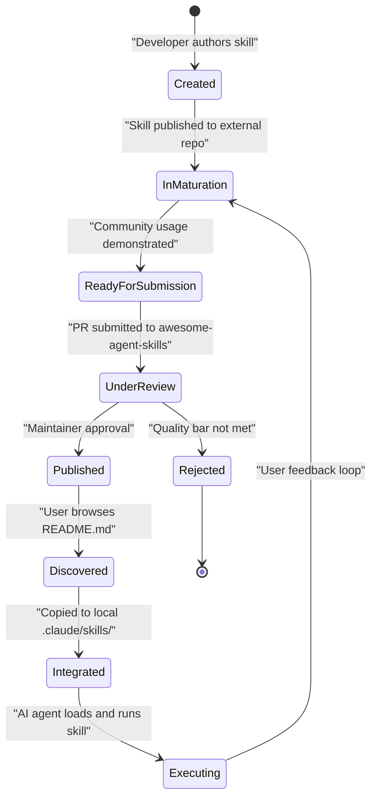

**Sources:** [README.md:1-309](), [CONTRIBUTING.md:1-44]()

---

## Phase 1: Creation

Skills are authored as YAML front matter combined with Markdown instructions. The creator develops the skill in an external repository, not in the `awesome-agent-skills` repository itself.

### Skill Definition Structure

The standard format consists of three components:

| Component | Format | Purpose |
|-----------|--------|---------|
| YAML Metadata | Front matter delimited by `---` | Machine-readable skill identification |
| Markdown Title | `# Skill Name` heading | Human-readable primary identifier |
| Markdown Content | Structured sections | Instructions, usage conditions, validation rules |

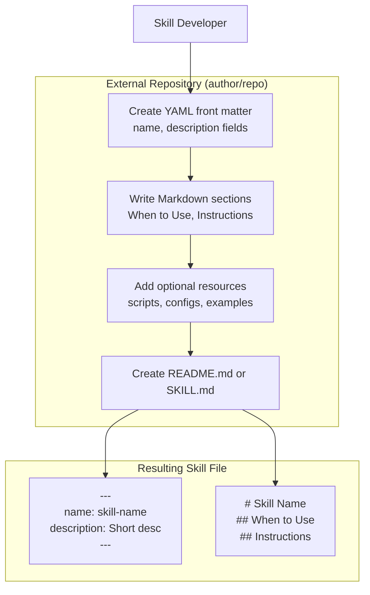

**Example Structure:**

The skill format shown in [README.md:44-72]() demonstrates the canonical structure:

- Lines 44-48: YAML front matter with `name` and `description` fields
- Lines 50-52: Title and brief description
- Lines 54-56: "When to Use This Skill" section
- Lines 58-65: "Instructions" section with numbered steps
- Lines 67-71: Optional validation or additional sections

**Sources:** [README.md:42-74]()

---

## Phase 2: Maturation

Before a skill can be submitted to the curated collection, it must demonstrate real community usage. This requirement acts as a critical quality gate.

### Maturation Requirements

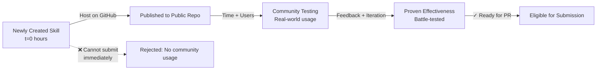

**Validation Criteria:**

Per [CONTRIBUTING.md:27](), skills must have "real community usage" before submission. The file explicitly states at [CONTRIBUTING.md:27](): "We focus on community-adopted, proven skills. Brand new skills that were just created are not accepted."

The README reinforces this at [README.md:381](): "Please don't submit skills you created 3 hours ago. We're now focusing on community-adopted skills, especially those published by development teams and proven in real-world usage."

**Sources:** [CONTRIBUTING.md:21-27](), [README.md:381]()

---

## Phase 3: Curation (Submission and Review)

Once matured, skills enter the contribution workflow through a Pull Request to the `awesome-agent-skills` repository.

### Submission Process

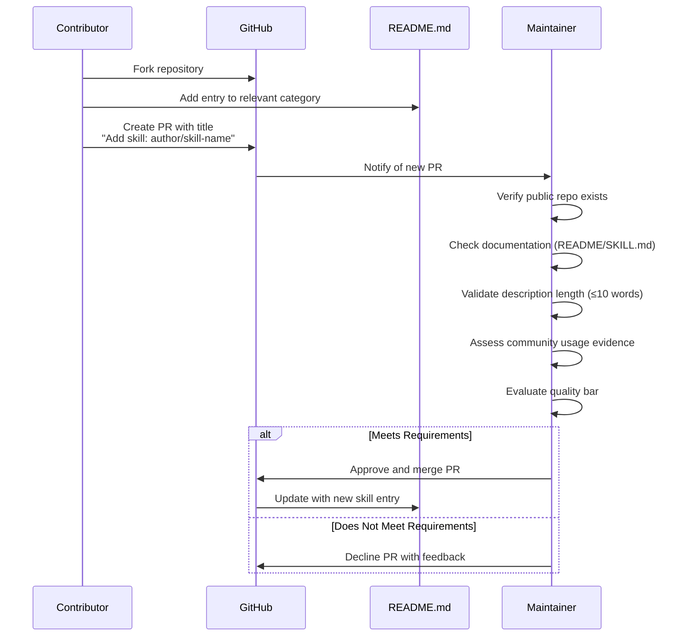

### Entry Format Requirements

Per [CONTRIBUTING.md:9-13](), the exact format is:

```markdown
- **[author/skill-name](https://github.com/author/repo/path)** - Short description of what it does
```

**Component Breakdown:**

| Element | Requirement | Example | Line Reference |
|---------|-------------|---------|----------------|
| Author prefix | Must include author/org name | `anthropics/docx` | [CONTRIBUTING.md:25]() |
| Repository link | Must be public and working | Full GitHub URL | [CONTRIBUTING.md:23]() |
| Description | ≤10 words | "Create, edit, and analyze Word documents" | [CONTRIBUTING.md:26]() |
| Documentation | README.md or SKILL.md required | Either file must exist | [CONTRIBUTING.md:24]() |

### Category Placement Logic

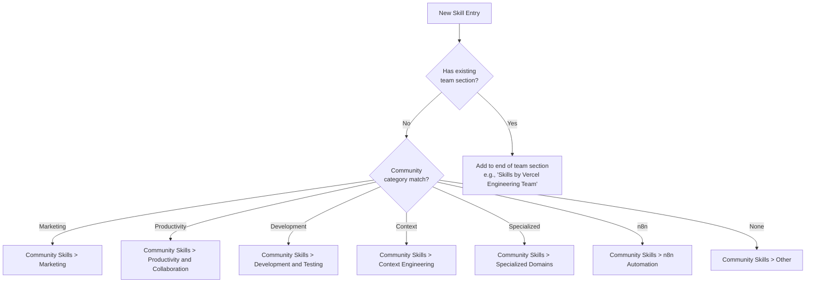

**Sources:** [CONTRIBUTING.md:15-19]()

---

## Phase 4: Publication

Upon PR approval, the skill is added to `README.md`, making it part of the curated collection.

### README.md Structure

The README maintains a hierarchical organization of all 180+ skills:

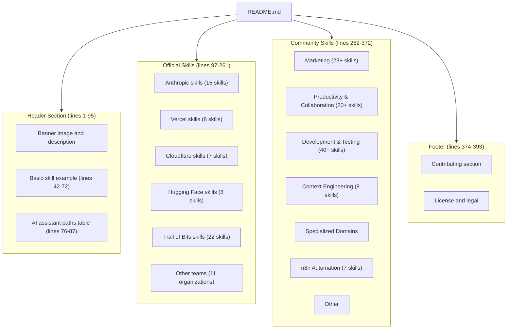

**Key Metrics:**

The repository tracks its scale through badges at [README.md:24]():
- Skills count: 180+
- Teams represented: 16 official organizations
- Community categories: 7 functional domains

**Sources:** [README.md:1-393]()

---

## Phase 5: Discovery

Users discover skills by browsing the `README.md` file or searching the repository.

### Discovery Paths

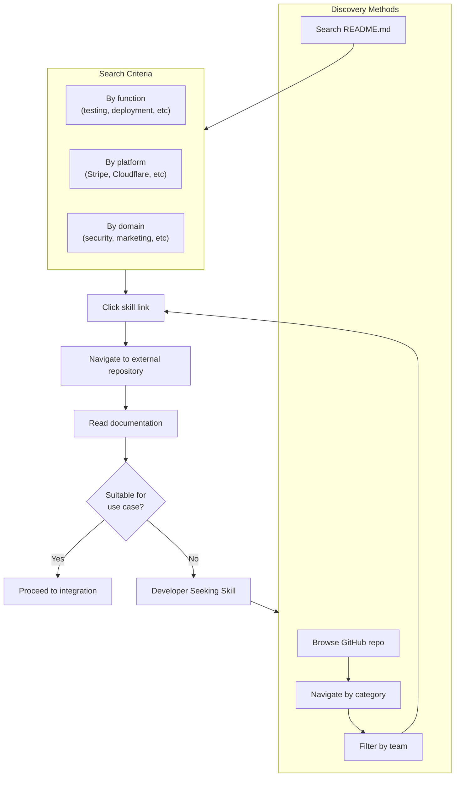

**Search Optimization:**

The README structure enables multiple search strategies:

1. **By Team:** Skills grouped under team headers (lines 97-261)
2. **By Category:** Community skills organized functionally (lines 262-372)
3. **By Keyword:** Skill descriptions optimized for search terms
4. **By AI Assistant:** Compatibility table at lines 76-87

**Sources:** [README.md:76-372]()

---

## Phase 6: Integration

After discovery, users copy skills to their local file system following AI assistant-specific conventions.

### File System Integration

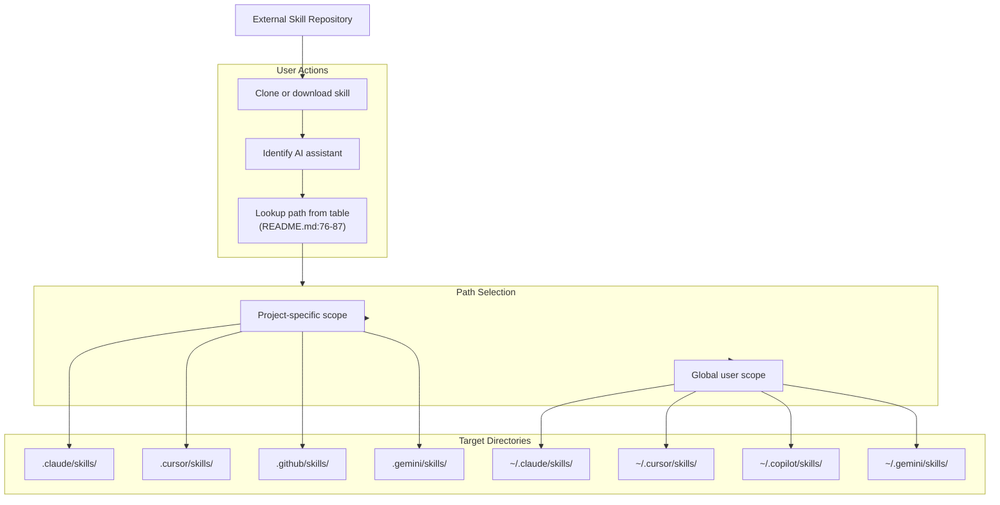

### AI Assistant Path Mapping

The canonical path reference is maintained at [README.md:76-87]():

| AI Assistant | Project Path | Global Path | Documentation Link |
|--------------|--------------|-------------|-------------------|
| Claude Code | `.claude/skills/` | `~/.claude/skills/` | [README.md:81]() |
| Cursor | `.cursor/skills/` | `~/.cursor/skills/` | [README.md:83]() |
| GitHub Copilot | `.github/skills/` | `~/.copilot/skills/` | [README.md:85]() |
| Gemini CLI | `.gemini/skills/` | `~/.gemini/skills/` | [README.md:84]() |
| Windsurf | `.windsurf/skills/` | `~/.codeium/windsurf/skills/` | [README.md:87]() |
| Antigravity | `.agent/skills/` | `~/.gemini/antigravity/skills/` | [README.md:80]() |
| Codex | `.codex/skills/` | `~/.codex/skills/` | [README.md:82]() |
| OpenCode | `.opencode/skills/` | `~/.config/opencode/skills/` | [README.md:86]() |

**Scope Semantics:**

- **Project path:** Skill available only within the specific project directory
- **Global path:** Skill available across all projects for the user

**Sources:** [README.md:76-88]()

---

## Phase 7: Execution

Once integrated, AI assistants parse and execute skills when users request relevant tasks.

### Execution Flow

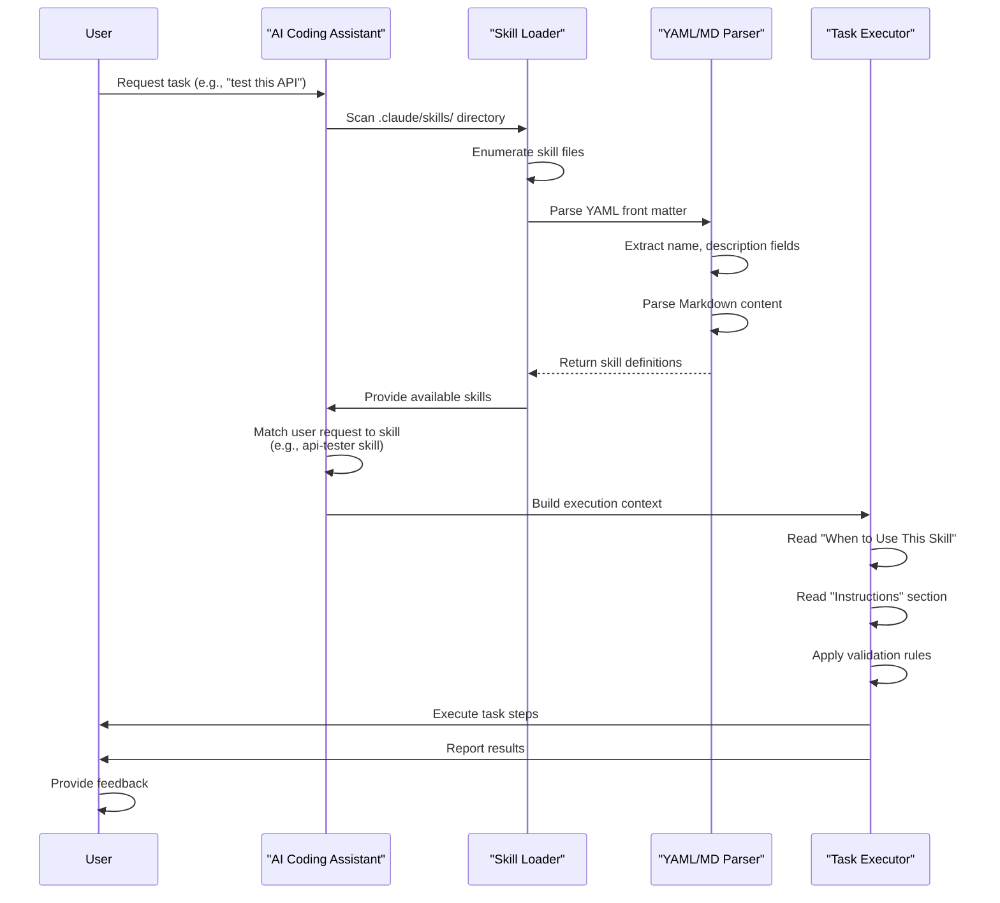

### Skill Parsing

Skills are parsed in the order shown at [README.md:44-72]():

1. **YAML Front Matter (lines 44-48):** Extract `name` and `description` fields
2. **Title Section (line 50):** Primary skill identifier
3. **Description (line 52):** Brief capability summary
4. **When to Use (lines 54-56):** Trigger conditions for skill activation
5. **Instructions (lines 58-65):** Step-by-step execution logic
6. **Validation (lines 67-71):** Optional verification rules

**Processing Steps:**

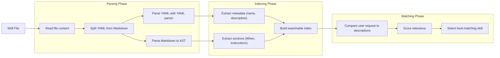

**Sources:** [README.md:42-74]()

---

## Feedback Loop and Iteration

The lifecycle includes a continuous feedback mechanism where execution results influence skill maturation and evolution.

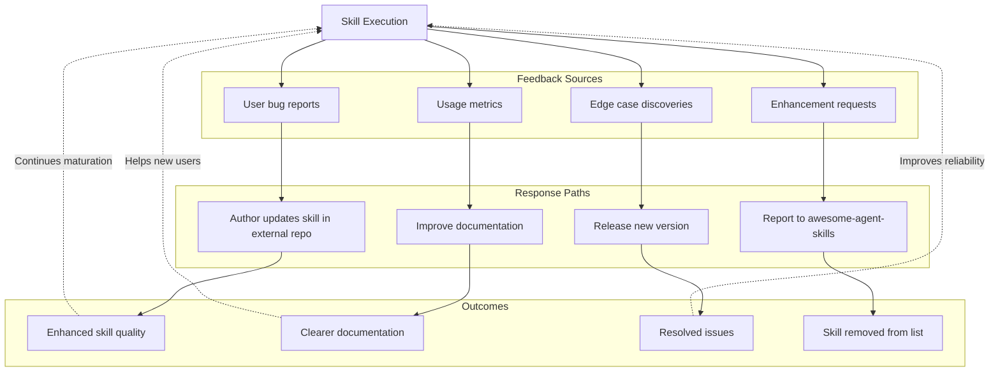

### Issue Reporting

Per [README.md:392](), users can report issues with listed skills:

> "If you find an issue with a listed skill or want your skill removed, please open an issue and we'll take care of it promptly."

This establishes a feedback channel from execution back to publication, enabling:

1. **Skill removal:** Low-quality or broken skills can be delisted
2. **Documentation updates:** Links and descriptions can be corrected
3. **Quality enforcement:** Continued monitoring of skill effectiveness

**Sources:** [README.md:390-392](), [CONTRIBUTING.md:40-43]()

---

## State Transition Summary

The complete state machine governing skill lifecycle:

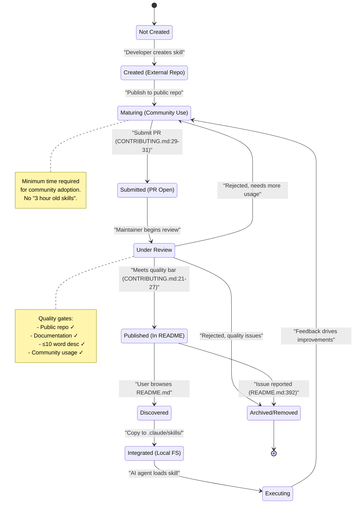

**Critical Gates:**

1. **Maturation Gate:** Enforced at [CONTRIBUTING.md:27]() - requires demonstrated community usage
2. **Quality Gate:** Enforced during review per [CONTRIBUTING.md:37]() - skills may be declined if they don't meet quality standards
3. **Maintenance Gate:** Enforced via issue reporting at [README.md:392]() - broken skills can be removed

**Sources:** [README.md:1-393](), [CONTRIBUTING.md:1-44]()

---

