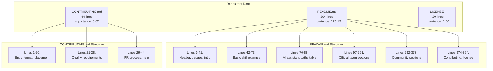
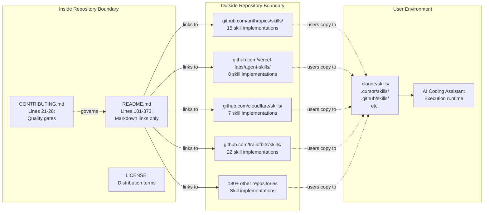
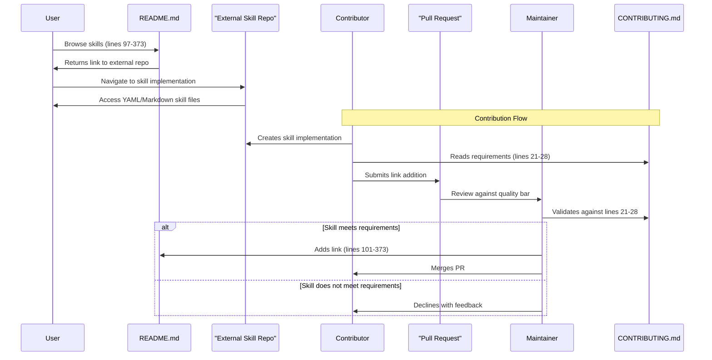
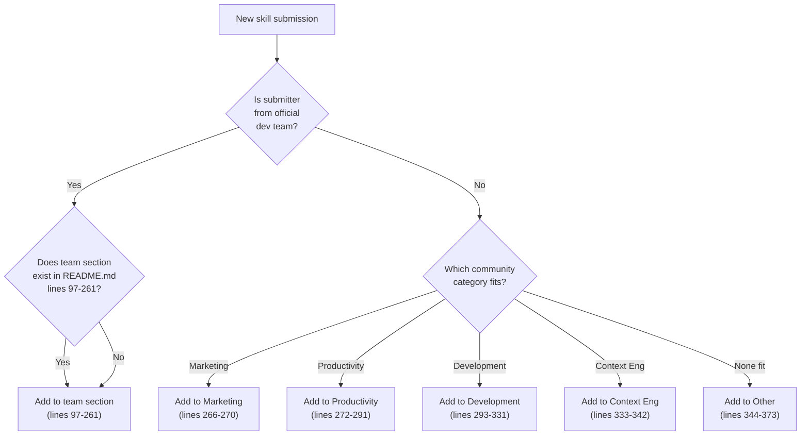

<!-- source: DeepWiki mcp.deepwiki.com · repo VoltAgent/awesome-agent-skills · page 6.3 Repository Architecture · fetched 2026-10-26 -->

# Repository Architecture

<details>
<summary>Relevant source files</summary>

The following files were used as context for generating this wiki page:

- [CONTRIBUTING.md](CONTRIBUTING.md)
- [README.md](README.md)

</details>


This document explains the architectural design of the Awesome Agent Skills repository, focusing on its role as a curation hub rather than an implementation host, the decentralized content model, and the physical structure of the repository itself. For information about how individual skills are structured and executed by AI assistants, see [Skill Architecture](#3). For details on the contribution process workflow, see [Contributing to the Collection](#5).

## Physical Repository Structure

The repository contains exactly three files, with drastically different importance levels based on contribution frequency:

| File | Importance Score | Lines | Primary Purpose |
|------|-----------------|-------|-----------------|
| `README.md` | 123.19 | 394 | Curated skill catalog and integration guide |
| `CONTRIBUTING.md` | 3.02 | 44 | Contribution guidelines and quality standards |
| `LICENSE` | 1.00 | ~20 | MIT license terms |

The importance score of 123.19 for `README.md` indicates it receives over 40x more edits than `CONTRIBUTING.md`, reflecting its role as the primary interface for the entire system.

**Sources:** [README.md:1-394](), [CONTRIBUTING.md:1-44]()



**Diagram: File Structure and Line-Level Organization**

This diagram maps the physical files to their internal structure, showing how content is organized within each file. The line numbers indicate the precise location of each content section.

**Sources:** [README.md:1-394](), [CONTRIBUTING.md:1-44]()

## Architectural Boundaries

The repository implements a strict separation between curation and implementation. This architectural decision has profound implications for maintenance, scalability, and responsibility distribution.



**Diagram: Architectural Boundaries and Data Flow**

This diagram shows what exists inside versus outside the repository boundary. All skill implementations live externally; the repository contains only links and metadata.

**Sources:** [README.md:101-373](), [CONTRIBUTING.md:33-37]()

### Responsibility Matrix

| Responsibility | This Repository | External Skill Repositories |
|----------------|-----------------|----------------------------|
| Skill discovery | ✓ (via README.md links) | ✗ |
| Quality curation | ✓ (via contribution review) | ✗ |
| Skill implementation | ✗ | ✓ (YAML + Markdown files) |
| Documentation | ✗ | ✓ (README or SKILL.md) |
| Issue support | ✗ | ✓ (individual repo issues) |
| Security audits | ✗ | ✓ (author responsibility) |
| Version control | ✗ | ✓ (independent versioning) |
| Maintenance | ✗ | ✓ (author maintenance) |

As stated in [README.md:390-392](): "Skills listed here are created and maintained by their respective authors and teams, not by us. We select community-adopted, proven skills and do not audit, endorse, or guarantee the security or correctness of listed projects."

**Sources:** [README.md:390-392](), [CONTRIBUTING.md:33-37]()

## Decentralized Content Model

The repository implements a hub-and-spoke architecture where the central hub (`README.md`) maintains metadata about 180+ skills distributed across external repositories.

### Link Structure Analysis

Each skill entry follows a strict format defined in [CONTRIBUTING.md:9-13]():

```markdown
- **[author/skill-name](https://github.com/author/repo/path)** - Short description of what it does
```

This format encodes:
- **Author/organization prefix** - Enables namespace collision avoidance
- **GitHub URL** - Direct link to external implementation
- **Description constraint** - Maximum 10 words per [CONTRIBUTING.md:26]()

### Skill Distribution by Source

```mermaid
graph TB
    README["README.md<br/>Central Catalog"]
    
    subgraph "Official Teams - 16 Organizations"
        Anthropic["anthropics/*<br/>Lines 101-129<br/>15 skills"]
        Vercel["vercel-labs/*<br/>Lines 131-141<br/>8 skills"]
        Cloudflare["cloudflare/*<br/>Lines 143-151<br/>7 skills"]
        HuggingFace["huggingface/*<br/>Lines 163-175<br/>8 skills"]
        TrailOfBits["trailofbits/*<br/>Lines 181-205<br/>22 skills"]
        Others["12 other teams<br/>Lines 152-261<br/>~30 skills"]
    end
    
    subgraph "Community - 100+ Contributors"
        Marketing["Marketing skills<br/>Lines 266-270<br/>~25 skills"]
        Productivity["Productivity skills<br/>Lines 272-291<br/>~20 skills"]
        Development["Development skills<br/>Lines 293-331<br/>~40 skills"]
        Context["Context Engineering<br/>Lines 333-342<br/>8 skills"]
        Specialized["Specialized domains<br/>Lines 344-373<br/>~27 skills"]
    end
    
    README --> Anthropic
    README --> Vercel
    README --> Cloudflare
    README --> HuggingFace
    README --> TrailOfBits
    README --> Others
    
    README --> Marketing
    README --> Productivity
    README --> Development
    README --> Context
    README --> Specialized
```



**Diagram: Content Distribution and Line Mapping**

Each node shows the line numbers in `README.md` where that category is defined, enabling precise code navigation.

**Sources:** [README.md:97-373]()

## Information Flow Architecture

The repository serves as a read-only discovery interface with a one-way contribution pipeline.



**Diagram: Information Flow and Contribution Sequence**

This sequence diagram shows the precise interaction points between users, files, and the contribution process, with specific line number references.

**Sources:** [README.md:97-373](), [CONTRIBUTING.md:1-44]()

## Contribution Pipeline Architecture

The contribution process implements a quality gate system defined entirely in `CONTRIBUTING.md`.

### Quality Requirements (Lines 21-28)

| Requirement | Enforcement Location | Validation Method |
|-------------|---------------------|-------------------|
| Public repository | [CONTRIBUTING.md:23]() | Manual reviewer check |
| Documentation exists | [CONTRIBUTING.md:24]() | Link validation during review |
| Author/org prefix | [CONTRIBUTING.md:25]() | Format validation in PR |
| Description ≤ 10 words | [CONTRIBUTING.md:26]() | Word count during review |
| Community usage proof | [CONTRIBUTING.md:27]() | Manual assessment of adoption |

The most critical requirement is stated at [CONTRIBUTING.md:27](): "Skill must have real community usage. We focus on community-adopted, proven skills. Brand new skills that were just created are not accepted."

**Sources:** [CONTRIBUTING.md:21-28]()

### Placement Logic

The placement algorithm defined in [CONTRIBUTING.md:15-19]() implements a hierarchical categorization:



**Diagram: Skill Placement Decision Tree**

This diagram encodes the exact placement logic with line number references for each category in `README.md`.

**Sources:** [CONTRIBUTING.md:15-19](), [README.md:97-373]()

## Integration Metadata Table

The repository serves as the authoritative source for AI assistant integration paths. This metadata is encoded in a table at [README.md:76-88]():

| Column | Purpose | Example Value |
|--------|---------|---------------|
| Tool | AI assistant name | `Claude Code`, `Cursor`, `Gemini CLI` |
| Project Path | Project-specific directory | `.claude/skills/`, `.cursor/skills/` |
| Global Path | User-wide directory | `~/.claude/skills/`, `~/.cursor/skills/` |
| Official Docs | External documentation link | `https://docs.anthropic.com/...` |

This table supports 8 AI coding assistants as of [README.md:80-87]():
- Antigravity: `.agent/skills/` / `~/.gemini/antigravity/skills/`
- Claude Code: `.claude/skills/` / `~/.claude/skills/`
- Codex: `.codex/skills/` / `~/.codex/skills/`
- Cursor: `.cursor/skills/` / `~/.cursor/skills/`
- Gemini CLI: `.gemini/skills/` / `~/.gemini/skills/`
- GitHub Copilot: `.github/skills/` / `~/.copilot/skills/`
- OpenCode: `.opencode/skills/` / `~/.config/opencode/skills/`
- Windsurf: `.windsurf/skills/` / `~/.codeium/windsurf/skills/`

**Sources:** [README.md:76-88]()

## Skill Example Template

The repository includes exactly one inline skill example at [README.md:42-73]() to demonstrate the standardized format:

```yaml
---
name: api-tester
description: Test REST APIs and validate responses
---

# API Tester

Test HTTP endpoints and validate response structures.

## When to Use This Skill
...
## Instructions
...
## Response Validation
...
```

This 32-line example serves as the minimal reference implementation. The actual skill template is hosted externally at [README.md:129](): `anthropics/template`.

**Sources:** [README.md:42-73](), [README.md:129]()

## Architectural Benefits

The decentralized content model provides:

1. **Scalability**: No repository size limits - can curate unlimited skills without storage constraints
2. **Independent versioning**: Each skill repository maintains its own version history
3. **Distributed maintenance**: Authors maintain their skills independently
4. **Clear ownership**: Each skill has a single source of truth at its external repository
5. **Reduced liability**: Per [README.md:390-392](), the repository explicitly does not audit or guarantee listed skills
6. **Single point of discovery**: Users need only bookmark one repository to find all skills

The architecture sacrifices:
- **Consistency enforcement**: Cannot guarantee all external repos maintain format standards
- **Availability control**: External repositories may become unavailable
- **Security auditing**: Cannot perform security reviews on external code
- **Version locking**: Users must track external repository versions themselves

**Sources:** [README.md:390-392](), [CONTRIBUTING.md:33-37]()

## Metrics and Scale

Current repository metrics as of [README.md:24]():

- **Total skills**: 180+
- **Official teams**: 16 organizations
- **Community contributors**: 100+
- **AI assistants supported**: 8
- **Repository files**: 3
- **External repositories linked**: 180+

The importance weighting (123.19 for `README.md`) indicates the catalog receives approximately 1-2 updates per day on average, suggesting active curation.

**Sources:** [README.md:24](), [README.md:35](), [README.md:37]()

---

