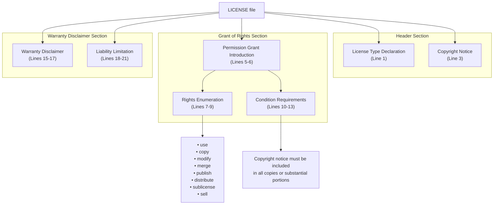
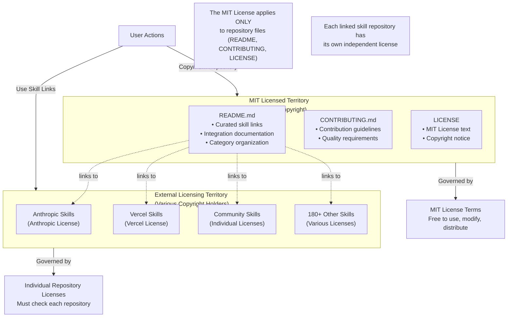
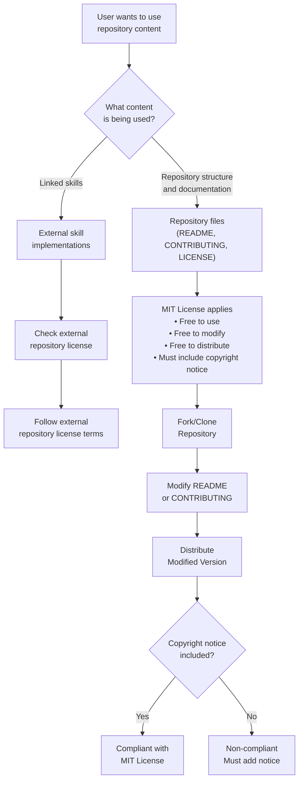

<!-- source: DeepWiki mcp.deepwiki.com · repo VoltAgent/awesome-agent-skills · page 7 License and Legal · fetched 2026-10-26 -->

# License and Legal

<details>
<summary>Relevant source files</summary>

The following files were used as context for generating this wiki page:

- [LICENSE](LICENSE)

</details>


This document describes the licensing terms under which the Awesome Agent Skills repository is distributed and clarifies the legal boundaries between repository content and external resources. It specifies the rights and obligations for users, contributors, and maintainers.

**Scope**: This page covers only the licensing of the Awesome Agent Skills repository itself (README.md, CONTRIBUTING.md, and LICENSE). For information about contributing content to the collection, see [Contributing to the Collection](#5). For details about the repository's architectural boundaries, see [Repository Architecture](#6.3).

---

## License Overview

The Awesome Agent Skills repository is distributed under the **MIT License**, one of the most permissive open-source licenses. The license grants broad permissions for use, modification, and distribution while limiting liability and warranty obligations.

**Copyright Holder**: VoltAgent (as of 2025)

**License Type**: MIT License

**SPDX Identifier**: `MIT`

Sources: [LICENSE:1-3]()

---

## MIT License Terms

The complete license text is reproduced below from the repository's LICENSE file:

```
MIT License

Copyright (c) 2025 VoltAgent

Permission is hereby granted, free of charge, to any person obtaining a copy
of this software and associated documentation files (the "Software"), to deal
in the Software without restriction, including without limitation the rights
to use, copy, modify, merge, publish, distribute, sublicense, and/or sell
copies of the Software, and to permit persons to whom the Software is
furnished to do so, subject to the following conditions:

The above copyright notice and this permission notice shall be included in all
copies or substantial portions of the Software.

THE SOFTWARE IS PROVIDED "AS IS", WITHOUT WARRANTY OF ANY KIND, EXPRESS OR
IMPLIED, INCLUDING BUT NOT LIMITED TO THE WARRANTIES OF MERCHANTABILITY,
FITNESS FOR A PARTICULAR PURPOSE AND NONINFRINGEMENT. IN NO EVENT SHALL THE
AUTHORS OR COPYRIGHT HOLDERS BE LIABLE FOR ANY CLAIM, DAMAGES OR OTHER
LIABILITY, WHETHER IN AN ACTION OF CONTRACT, TORT OR OTHERWISE, ARISING FROM,
OUT OF OR IN CONNECTION WITH THE SOFTWARE OR THE USE OR OTHER DEALINGS IN THE
SOFTWARE.
```

Sources: [LICENSE:1-21]()

### License Structure and Components

The following diagram maps the MIT License structure to its specific legal provisions:

**Diagram: MIT License Component Mapping**



Sources: [LICENSE:1-21]()

---

## Granted Permissions

The MIT License grants the following specific permissions without fee:

| Permission | Description | License Reference |
|-----------|-------------|-------------------|
| **Use** | Execute, run, or consume the software for any purpose | [LICENSE:7-8]() |
| **Copy** | Create duplicates or reproductions of the repository | [LICENSE:7-8]() |
| **Modify** | Alter, transform, or build upon the content | [LICENSE:7-8]() |
| **Merge** | Combine with other software or documentation | [LICENSE:7-8]() |
| **Publish** | Make available to the public | [LICENSE:7-8]() |
| **Distribute** | Share copies with others | [LICENSE:7-8]() |
| **Sublicense** | Grant derivative licenses to third parties | [LICENSE:8-9]() |
| **Sell** | Commercialize copies or derivatives | [LICENSE:8-9]() |

**Restriction**: All of these rights are subject to the condition that copyright and permission notices are included in all copies or substantial portions of the software [LICENSE:12-13]().

Sources: [LICENSE:5-13]()

---

## Required Attribution

When using, distributing, or modifying content from this repository, you **must** include:

1. **The copyright notice**: `Copyright (c) 2025 VoltAgent`
2. **The permission notice**: The full text of the MIT License permission grant

These notices must appear in:
- All copies of the repository
- All substantial portions of the repository
- Any derivative works

**Implementation**: Typically, this requirement is satisfied by including the complete LICENSE file in any distribution or by reproducing the copyright and permission notices in documentation or header comments.

Sources: [LICENSE:12-13]()

---

## Licensing Boundaries

A critical architectural distinction exists between the repository content and the external skills it references. The following diagram illustrates these boundaries:

**Diagram: Licensing Jurisdiction and Boundaries**



Sources: [LICENSE:1-21]()

### What the MIT License Covers

The MIT License applies **exclusively** to the following content in this repository:

| File | Lines | Content Description |
|------|-------|---------------------|
| README.md | All | Curated links to external skills, categorization, integration documentation |
| CONTRIBUTING.md | All | Contribution guidelines, quality requirements, submission process |
| LICENSE | All | License text and copyright notice |

The license grants rights to:
- Fork the repository
- Create modified versions of the README with different skill selections
- Use the CONTRIBUTING.md guidelines in other projects
- Distribute the repository content
- Create derivative collections based on this structure

Sources: [LICENSE:1-21]()

### What the MIT License Does NOT Cover

The MIT License of this repository **does not** grant rights to:

- **External skill implementations**: Each of the 180+ linked skill repositories has its own license
- **Skills themselves**: The actual YAML and Markdown skill definitions reside in external repositories
- **Skill documentation**: Documentation hosted in external repositories
- **Trademarks**: Company names, product names, or logos mentioned in the README
- **Linked resources**: Any content accessible via URLs in the README

**Important**: Before using any skill from an external repository, users must review and comply with that repository's specific license terms.

Sources: [LICENSE:1-21]()

---

## Warranty Disclaimer

The MIT License includes explicit warranty disclaimers that limit the liability of the copyright holder and contributors:

### No Warranty Provision

The software is provided "AS IS" without warranty of any kind, including:

- **Express warranties**: No explicit guarantees about functionality or fitness
- **Implied warranties**: No implied guarantees of:
  - Merchantability (suitability for sale or commercial use)
  - Fitness for a particular purpose
  - Non-infringement (freedom from intellectual property claims)

**Legal Text**: "THE SOFTWARE IS PROVIDED "AS IS", WITHOUT WARRANTY OF ANY KIND, EXPRESS OR IMPLIED, INCLUDING BUT NOT LIMITED TO THE WARRANTIES OF MERCHANTABILITY, FITNESS FOR A PARTICULAR PURPOSE AND NONINFRINGEMENT." [LICENSE:15-17]()

### Practical Implications

| Scenario | Legal Position |
|----------|---------------|
| Broken skill link | No warranty that links remain valid |
| Inaccurate skill description | No warranty of accuracy or completeness |
| Skill causes damage | No liability for consequences of using linked skills |
| Repository outdated | No obligation to maintain or update content |
| Integration issues | No warranty that skills work with specific AI assistants |

Sources: [LICENSE:15-21]()

---

## Liability Limitation

The MIT License explicitly limits the liability of authors and copyright holders:

**Legal Text**: "IN NO EVENT SHALL THE AUTHORS OR COPYRIGHT HOLDERS BE LIABLE FOR ANY CLAIM, DAMAGES OR OTHER LIABILITY, WHETHER IN AN ACTION OF CONTRACT, TORT OR OTHERWISE, ARISING FROM, OUT OF OR IN CONNECTION WITH THE SOFTWARE OR THE USE OR OTHER DEALINGS IN THE SOFTWARE." [LICENSE:18-21]()

### Covered Scenarios

The liability limitation applies to:

- **Claims**: Legal demands for compensation or remedy
- **Damages**: Financial losses, data loss, system failures
- **Contract liability**: Breach of contract allegations
- **Tort liability**: Negligence or wrongful conduct claims
- **Other liability**: Any other legal theory of responsibility

**Scope**: Extends to all uses, including uses arising from, out of, or in connection with the software.

Sources: [LICENSE:18-21]()

---

## Rights Flow and Decision Tree

The following diagram illustrates how licensing rights flow from the repository to end users and what license applies to different usage scenarios:

**Diagram: License Application Decision Flow**



Sources: [LICENSE:1-21]()

---

## Contributor License Agreement

### Implicit Agreement

By submitting a pull request to this repository, contributors implicitly agree that:

1. **Contribution ownership**: The contributor has the legal right to submit the contribution
2. **License grant**: The contribution is submitted under the repository's MIT License
3. **Copyright retention**: Contributors may retain copyright on their contributions
4. **VoltAgent copyright**: VoltAgent retains copyright on the repository as a whole
5. **No additional terms**: No additional licensing terms are applied to contributions

### Scope of Contributions

Contributions to this repository typically include:

- Adding new skill links to README.md
- Updating skill descriptions
- Fixing broken links
- Improving documentation
- Updating categories or organization

**Note**: Contributors are **not** submitting the actual skill implementations, only references to external repositories. The skill implementations remain under their original licenses in their respective repositories.

Sources: [LICENSE:1-21]()

---

## Legal Compliance Checklist

When using or redistributing this repository, ensure compliance with the following requirements:

### For Users

- [ ] Review the MIT License terms in [LICENSE:1-21]()
- [ ] Understand that the license covers only repository files, not external skills
- [ ] Check external repository licenses before using any linked skills
- [ ] Comply with external licenses when using skill implementations

### For Distributors

- [ ] Include the LICENSE file in any distribution
- [ ] Preserve copyright notice: `Copyright (c) 2025 VoltAgent`
- [ ] Include the MIT License permission text
- [ ] Maintain attribution in modified versions
- [ ] Do not misrepresent authorship or copyright

### For Contributors

- [ ] Ensure you have rights to submit your contribution
- [ ] Understand your contribution will be MIT licensed
- [ ] Follow contribution guidelines in CONTRIBUTING.md
- [ ] Do not add copyrighted content without permission
- [ ] Link only to skills with appropriate licenses

Sources: [LICENSE:1-21]()

---

## Summary

The Awesome Agent Skills repository is licensed under the MIT License, providing broad permissions for use, modification, and distribution with minimal restrictions. The primary obligation is to preserve copyright and permission notices in copies and derivatives.

**Key Points**:
- **Repository License**: MIT License (VoltAgent copyright)
- **Repository Scope**: README.md, CONTRIBUTING.md, LICENSE files only
- **External Skills**: Each has independent licensing (not covered by this MIT License)
- **User Obligation**: Include copyright notice and license text when distributing
- **No Warranty**: Software provided "AS IS" without warranties
- **No Liability**: Authors not liable for damages or claims

**For Questions**: Legal questions about the repository license should be directed to the VoltAgent organization. Questions about external skill licenses should be directed to the respective skill repository maintainers.

Sources: [LICENSE:1-21]()