# Page: Overview

# Overview

<details>
<summary>Relevant source files</summary>

The following files were used as context for generating this wiki page:

- [README.md](README.md)

</details>


This document introduces the Awesome Agent Skills repository, explaining its architecture as a curated collection of skill definitions for AI coding assistants, the ecosystem it serves, and how it functions as a discovery hub for 180+ skills maintained across external repositories.

For detailed installation instructions, see [Getting Started](#2). For the complete catalog of available skills, see [Skill Catalog](#4). For information about submitting your own skills, see [Contributing to the Collection](#5).

## What This Repository Is

The Awesome Agent Skills repository is a **curated discovery hub** that maintains links to 180+ Agent Skills distributed across external repositories. The repository itself contains only three files:

| File | Lines | Importance Score | Purpose |
|------|-------|------------------|---------|
| `README.md` | 394 | 123.19 | Primary interface containing categorized skill listings |
| `CONTRIBUTING.md` | 40 | 3.02 | Contribution process and quality requirements |
| `LICENSE` | ~20 | 1.00 | MIT license terms |

The repository **does not host skill implementations**. Each skill listed in [README.md:97-372]() is a hyperlink to an external repository where the skill is developed, maintained, and supported by its original author or team.

**Sources:** [README.md:1-394](), Diagram 6 from high-level architecture

## Repository Architecture

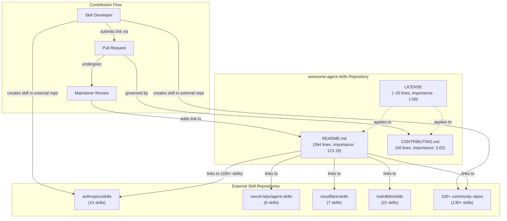

**Architecture: Repository Boundary and Responsibility Model**

The repository implements a **decentralized content, centralized discovery** architecture. Skill developers maintain their implementations externally, while `README.md` serves as the canonical index for community-adopted skills.

**Sources:** [README.md:1-394](), Diagram 1 and Diagram 6 from high-level architecture

## Agent Skills Definition Format

Agent Skills are structured as directories containing YAML front matter and Markdown instructions. The basic format shown in [README.md:44-72]() demonstrates the standardized structure:

```yaml
---
name: api-tester
description: Test REST APIs and validate responses
---
```

Followed by Markdown sections defining:
- Skill title and overview
- When to use the skill
- Step-by-step instructions
- Validation criteria
- Optional resources (scripts, configurations)

This format is compatible with 8+ AI coding assistants listed in [README.md:78-87]() through standardized file system paths.

**Sources:** [README.md:42-74]()

## Supported AI Coding Assistants

The following table from [README.md:78-87]() documents the complete compatibility matrix:

| AI Assistant | Project-Specific Path | Global Path | Documentation Link |
|--------------|----------------------|-------------|-------------------|
| Antigravity | `.agent/skills/` | `~/.gemini/antigravity/skills/` | Official docs linked |
| Claude Code | `.claude/skills/` | `~/.claude/skills/` | Official docs linked |
| Codex | `.codex/skills/` | `~/.codex/skills/` | Official docs linked |
| Cursor | `.cursor/skills/` | `~/.cursor/skills/` | Official docs linked |
| Gemini CLI | `.gemini/skills/` | `~/.gemini/skills/` | Official docs linked |
| GitHub Copilot | `.github/skills/` | `~/.copilot/skills/` | Official docs linked |
| OpenCode | `.opencode/skills/` | `~/.config/opencode/skills/` | Official docs linked |
| Windsurf | `.windsurf/skills/` | `~/.codeium/windsurf/skills/` | Official docs linked |

Each assistant supports both project-scoped (`.tool/skills/`) and user-scoped (`~/.tool/skills/`) skill installations, enabling flexible deployment strategies.

**Sources:** [README.md:76-87](), Diagram 3 from high-level architecture

## Skill Ecosystem Structure

```mermaid
graph TB
    subgraph "Skill Contributors"
        OfficialTeams["Official Development Teams<br/>(16 organizations)"]
        CommunityDevs["Community Developers<br/>(100+ contributors)"]
    end
    
    subgraph "Skill Categories in README.md"
        DocCreation["Document Creation<br/>lines 99-105"]
        Creative["Creative and Design<br/>lines 107-113"]
        Development["Development<br/>lines 115-119"]
        Branding["Branding and Communication<br/>lines 121-124"]
        Meta["Meta<br/>lines 126-129"]
        Security["Security Skills by Trail of Bits<br/>lines 181-204 (22 skills)"]
        Marketing["Community: Marketing<br/>lines 264-269 (23+ skills)"]
        Productivity["Community: Productivity<br/>lines 271-290 (20+ skills)"]
        DevTesting["Community: Development<br/>lines 292-331 (40+ skills)"]
        Context["Community: Context Engineering<br/>lines 332-341 (8 skills)"]
        Specialized["Community: Specialized Domains<br/>lines 343-353"]
    end
    
    subgraph "End Users"
        Developers["Software Developers"]
        Teams["Engineering Teams"]
    end
    
    OfficialTeams -->|"contribute"| DocCreation
    OfficialTeams -->|"contribute"| Creative
    OfficialTeams -->|"contribute"| Development
    OfficialTeams -->|"contribute"| Branding
    OfficialTeams -->|"contribute"| Meta
    OfficialTeams -->|"contribute"| Security
    
    CommunityDevs -->|"contribute"| Marketing
    CommunityDevs -->|"contribute"| Productivity
    CommunityDevs -->|"contribute"| DevTesting
    CommunityDevs -->|"contribute"| Context
    CommunityDevs -->|"contribute"| Specialized
    
    DocCreation -->|"discovered by"| Developers
    Security -->|"discovered by"| Teams
    Marketing -->|"discovered by"| Developers
    DevTesting -->|"discovered by"| Teams
```

**Skill Organization in README.md**

Skills in [README.md:97-372]() are organized into two primary categories:

1. **Official Team Skills** ([README.md:97-260]()): Platform-specific capabilities from 16 organizations including Anthropic, Vercel, Cloudflare, Hugging Face, Trail of Bits, Expo, Sentry, Stripe, Supabase, Google Labs, Better Auth, Tinybird, Neon, fal.ai, Sanity, and Remotion.

2. **Community Skills** ([README.md:262-372]()): Cross-cutting capabilities organized by functional domain including Marketing, Productivity, Development, Context Engineering, and Specialized Domains.

**Sources:** [README.md:97-372](), Diagram 4 from high-level architecture

## Skill Contributors by Organization

The following diagram maps the major contributing organizations to their skill repositories:

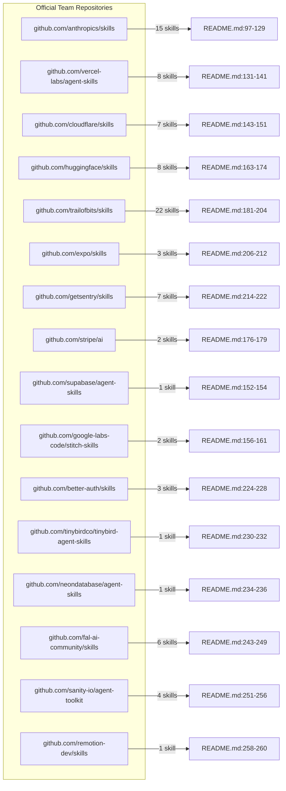

**Official Team Skill Distribution**

The distribution shows Trail of Bits as the largest contributor with 22 security-focused skills ([README.md:181-204]()), followed by Anthropic with 15 skills across document creation, creative design, development, branding, and meta categories ([README.md:97-129]()).

**Sources:** [README.md:97-260]()

## Quality Curation Model

The repository implements strict quality requirements documented in [CONTRIBUTING.md](). The curation process filters skills based on:

1. **Community Usage Requirement**: Skills must demonstrate real-world adoption before listing ([CONTRIBUTING.md:21-35]())
2. **Public Repository**: Must be hosted in a publicly accessible repository
3. **Documentation**: Must include comprehensive instructions and examples
4. **Description Length**: Maximum 10 words for consistency ([CONTRIBUTING.md]())

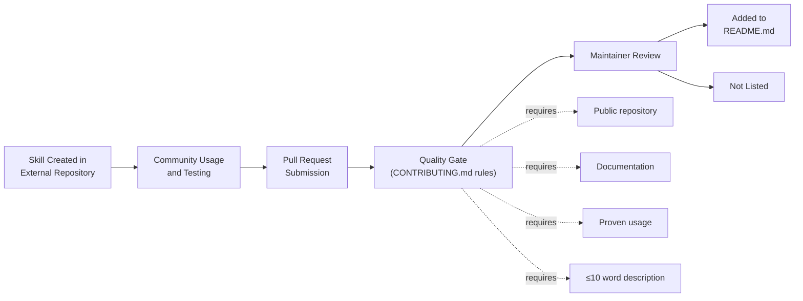

**Quality-First Curation Process**

The note in [README.md:381]() explicitly states: "Please don't submit skills you created 3 hours ago. We're now focusing on community-adopted skills, especially those published by development teams and proven in real-world usage. Quality over quantity."

This ensures the collection maintains high standards and serves as a reliable resource for production use.

**Sources:** [README.md:374-382](), [CONTRIBUTING.md:1-40](), Diagram 2 from high-level architecture

## Contribution Statistics

The repository features community contribution tracking:

- 180+ total skills cataloged ([README.md:24]())
- 16 official development teams contributing
- 100+ community contributors
- Contributor visualization at [README.md:384]()
- Active Discord community linked at [README.md:26]()

**Sources:** [README.md:9-29](), [README.md:383-384]()

## Legal and Licensing

The repository operates under MIT License ([LICENSE]()). Important disclaimers in [README.md:386-392]():

1. **No Endorsement**: Listed skills are not audited, endorsed, or guaranteed by the repository maintainers
2. **Author Responsibility**: Skills are created and maintained by respective authors and teams
3. **Security Notice**: Skills are not security-audited and should be reviewed before production use
4. **Removal Process**: Skill authors can request removal via GitHub issues

**Sources:** [README.md:386-392](), [LICENSE]()

---

# Page: Getting Started

# Getting Started

<details>
<summary>Relevant source files</summary>

The following files were used as context for generating this wiki page:

- [README.md](README.md)

</details>


## Purpose and Scope

This page introduces Agent Skills and guides you through the essential concepts needed to start using them. You will learn what Agent Skills are, how they fit into the AI coding assistant ecosystem, and the basic workflow for discovering and deploying skills.

For detailed installation instructions across specific AI assistants, see [Installing Skills](#2.1). For a hands-on walkthrough of using your first skill, see [Using Your First Skill](#2.2). For understanding how skills are technically structured and executed, see [Skill Architecture](#3).

**Sources:** [README.md:1-393]()

---

## What Are Agent Skills?

Agent Skills are folders containing instructions, scripts, and resources that teach AI coding assistants how to perform specific tasks. Each skill is defined using a standardized format consisting of YAML metadata and Markdown instructions that AI agents can parse and execute.

A skill teaches an AI assistant a capability such as:
- Creating and editing documents (Word, PowerPoint, Excel, PDF)
- Testing APIs and validating responses
- Deploying applications to cloud platforms
- Performing security audits and vulnerability analysis
- Managing project workflows and collaboration tools
- Generating code following specific frameworks and best practices

The key characteristic of Agent Skills is their **portability**: a single skill definition works across multiple AI coding assistants (Claude Code, Cursor, GitHub Copilot, Gemini CLI, Windsurf, and others) without modification.

**Sources:** [README.md:33-37](), [README.md:42-74]()

---

## The Decentralized Skills Ecosystem

Understanding the architecture of the Agent Skills ecosystem is crucial for getting started effectively:

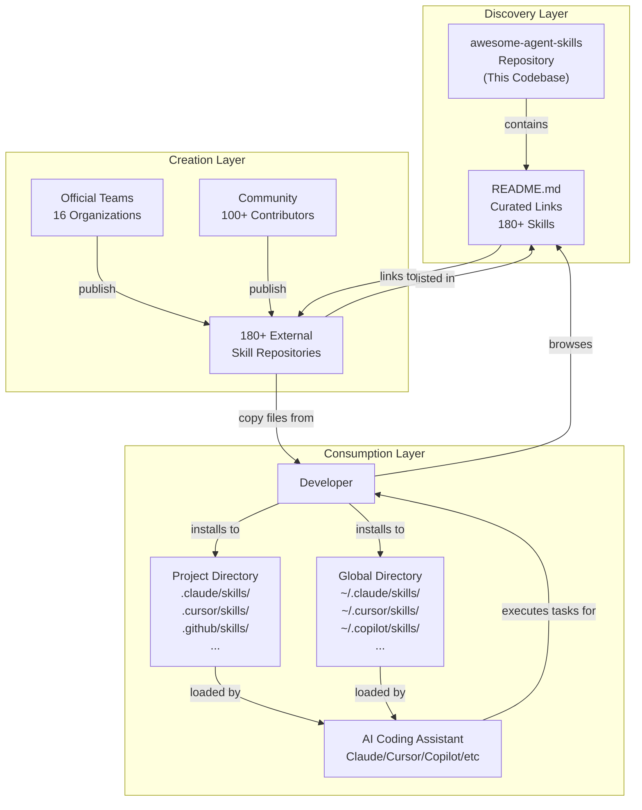

**Diagram: Agent Skills Ecosystem Architecture**

**Critical Distinction:** The `awesome-agent-skills` repository does **not** host skill implementations. It only curates links to external repositories where skills are maintained by their original authors. This separation ensures:
- Skill creators maintain full control over their implementations
- The curated list remains focused on quality and discovery
- Skills can be updated independently by their maintainers

**Sources:** [README.md:1-393](), [README.md:33-40]()

---

## Basic Workflow: Discover, Install, Execute

The standard workflow for using Agent Skills follows three phases:

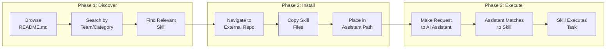

**Diagram: Three-Phase Agent Skills Workflow**

**Phase 1: Discover** - Browse the curated collection in [README.md:97-373]() organized by official teams and community categories. Each skill listing includes a GitHub link and a concise description (≤10 words).

**Phase 2: Install** - Navigate to the external repository, copy the skill files (typically a directory containing `SKILL.md` or similar), and place them in your AI assistant's skill directory. Skills can be installed either project-specific (in your project's `.claude/skills/` directory) or globally (in `~/.claude/skills/`).

**Phase 3: Execute** - Once installed, your AI assistant automatically loads the skill. When you make a request that matches the skill's domain, the assistant interprets the skill's instructions and executes the task.

**Sources:** [README.md:76-87](), [README.md:97-373]()

---

## Skill Anatomy: YAML + Markdown Structure

Every Agent Skill follows a standardized format combining YAML front matter for metadata with Markdown content for human-readable instructions:

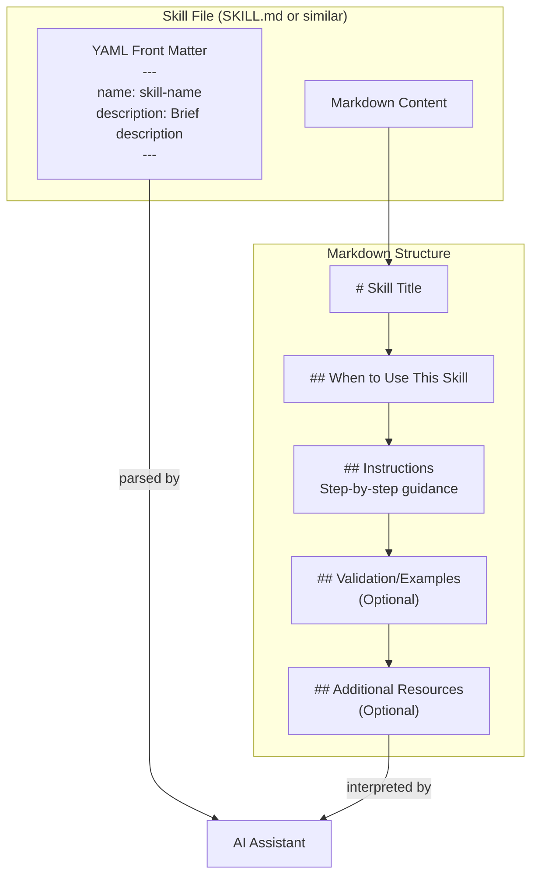

**Diagram: Skill File Structure and Processing**

The minimal skill structure demonstrated in [README.md:44-72]() shows:

1. **YAML Front Matter** - Machine-readable metadata:
   - `name`: Identifier for the skill (e.g., `api-tester`)
   - `description`: Brief explanation of capability

2. **Markdown Content** - Human-readable instructions:
   - Title and overview
   - "When to Use This Skill" section defining applicability
   - "Instructions" section with step-by-step guidance
   - Optional validation rules and examples

AI assistants parse both components: the YAML provides indexing and matching capabilities, while the Markdown provides execution instructions.

**Sources:** [README.md:42-74]()

---

## Installation Path Architecture

Agent Skills use a dual-path system that allows skills to be deployed either project-wide or globally across all projects:

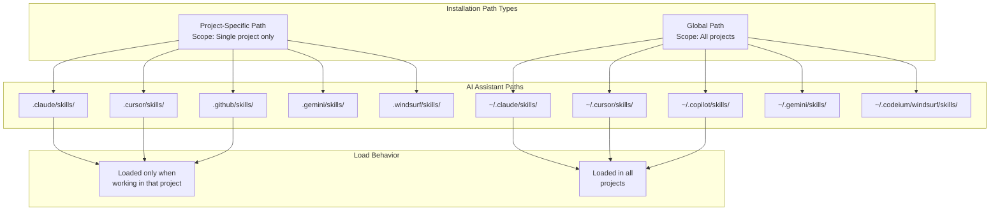

**Diagram: Project-Specific vs Global Installation Paths**

The complete compatibility matrix in [README.md:76-87]() documents eight AI coding assistants with their respective paths:

| Assistant | Project Path | Global Path |
|-----------|-------------|-------------|
| Claude Code | `.claude/skills/` | `~/.claude/skills/` |
| Cursor | `.cursor/skills/` | `~/.cursor/skills/` |
| GitHub Copilot | `.github/skills/` | `~/.copilot/skills/` |
| Gemini CLI | `.gemini/skills/` | `~/.gemini/skills/` |
| Windsurf | `.windsurf/skills/` | `~/.codeium/windsurf/skills/` |
| Antigravity | `.agent/skills/` | `~/.gemini/antigravity/skills/` |
| Codex | `.codex/skills/` | `~/.codex/skills/` |
| OpenCode | `.opencode/skills/` | `~/.config/opencode/skills/` |

**Path Selection Strategy:**
- Use **project-specific paths** (`.claude/skills/`) for skills relevant only to a particular codebase (e.g., framework-specific patterns, project conventions)
- Use **global paths** (`~/.claude/skills/`) for general-purpose skills used across multiple projects (e.g., document creation, API testing, security analysis)

**Sources:** [README.md:76-87]()

---

## Available Skill Categories

The collection organizes 180+ skills into major categories for efficient discovery:

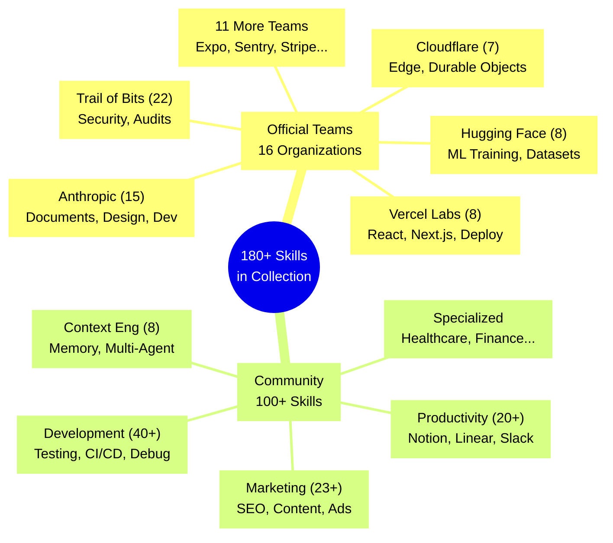

**Diagram: Skill Catalog Organization**

The README organizes skills by contributing team to make discovery intuitive:
- **Official Team Skills** ([README.md:97-261]()): Platform-specific capabilities from major organizations
- **Community Skills** ([README.md:262-373]()): Cross-cutting functionality organized by domain

For detailed exploration of all available skills, see [Skill Catalog](#4).

**Sources:** [README.md:97-373]()

---

## Prerequisites and Requirements

Before installing and using Agent Skills:

**Required:**
- An AI coding assistant that supports the Agent Skills format (see compatibility matrix above)
- Basic familiarity with file system navigation and directory structures
- Access to GitHub to browse external skill repositories

**Helpful:**
- Understanding of YAML and Markdown syntax (for creating custom skills later)
- Familiarity with your AI assistant's configuration and settings
- Command-line experience (for manual file management)

**Not Required:**
- Programming experience (skills are designed for all skill levels)
- Understanding of AI/ML internals
- Prior experience with AI coding assistants

**Sources:** [README.md:33-40](), [README.md:76-87]()

---

## Next Steps

You now understand the foundational concepts of Agent Skills. Proceed to:

1. **[Installing Skills](#2.1)** - Detailed, step-by-step instructions for installing skills in your specific AI coding assistant, including troubleshooting common issues

2. **[Using Your First Skill](#2.2)** - A hands-on walkthrough that demonstrates discovering, installing, and executing a real skill from start to finish

For deeper technical understanding of how skills are structured and processed, see [Skill Architecture](#3). To explore the full catalog of available skills, see [Skill Catalog](#4). If you're interested in contributing your own skills, see [Contributing to the Collection](#5).

**Sources:** [README.md:1-393]()

---

# Page: Installing Skills

# Installing Skills

<details>
<summary>Relevant source files</summary>

The following files were used as context for generating this wiki page:

- [README.md](README.md)

</details>


This document provides detailed instructions for installing Agent Skills across different AI coding assistants. It covers the file system paths, directory structures, and installation procedures for all supported AI assistants including Claude Code, Cursor, GitHub Copilot, Gemini CLI, Windsurf, and others.

For information about discovering and using skills after installation, see [Using Your First Skill](#2.2). For technical details about how AI assistants load and execute skills, see [AI Assistant Integration](#3.2).

**Sources:** [README.md:76-88]()

## Installation Overview

Agent Skills are installed by copying skill definition files to specific directories on your file system. Each AI coding assistant monitors designated paths for skill files and automatically loads them when detected. Skills use a standardized format (YAML front matter + Markdown content) that works across all supported AI assistants.

The installation process involves three steps:

1. **Locate the skill** - Find the skill repository from the collection
2. **Copy skill files** - Download or clone the skill definition files
3. **Place in target directory** - Move files to the appropriate path for your AI assistant

Skills can be installed either project-specifically (scoped to a single project) or globally (available across all projects).

**Sources:** [README.md:33-37](), [README.md:76-88]()

## Installation Scope: Project vs Global Paths

Each AI coding assistant supports two types of installation paths:

### Project-Specific Paths

Project-specific paths install skills only for a particular project directory. Skills are placed in a hidden subdirectory within the project root (e.g., `.claude/skills/` or `.cursor/skills/`). These skills are only available when working within that specific project.

**Use project-specific paths when:**
- The skill is relevant only to a specific codebase
- You want different skill configurations per project
- Team members need to share skills via version control

### Global Paths

Global paths install skills in user home directories (e.g., `~/.claude/skills/` or `~/.cursor/skills/`). These skills are available across all projects for the current user.

**Use global paths when:**
- The skill applies to all your development work
- You want skills available in any project directory
- You're installing personal productivity or utility skills

**Sources:** [README.md:78-87]()

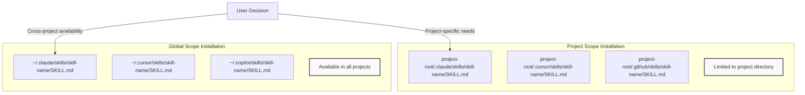

**Sources:** [README.md:78-87]()

## Installation Paths by AI Assistant

The following table provides complete installation paths for all supported AI coding assistants. Each assistant has specific project and global directory conventions.

| AI Assistant | Project Path | Global Path | Documentation Reference |
|--------------|-------------|-------------|------------------------|
| **Antigravity** | `.agent/skills/` | `~/.gemini/antigravity/skills/` | [README.md:80]() |
| **Claude Code** | `.claude/skills/` | `~/.claude/skills/` | [README.md:81]() |
| **Codex** | `.codex/skills/` | `~/.codex/skills/` | [README.md:82]() |
| **Cursor** | `.cursor/skills/` | `~/.cursor/skills/` | [README.md:83]() |
| **Gemini CLI** | `.gemini/skills/` | `~/.gemini/skills/` | [README.md:84]() |
| **GitHub Copilot** | `.github/skills/` | `~/.copilot/skills/` | [README.md:85]() |
| **OpenCode** | `.opencode/skills/` | `~/.config/opencode/skills/` | [README.md:86]() |
| **Windsurf** | `.windsurf/skills/` | `~/.codeium/windsurf/skills/` | [README.md:87]() |

**Sources:** [README.md:76-87]()

## Skill File System Structure

Skills are organized in a standardized directory structure. Each skill consists of a primary skill definition file and optional supporting resources.

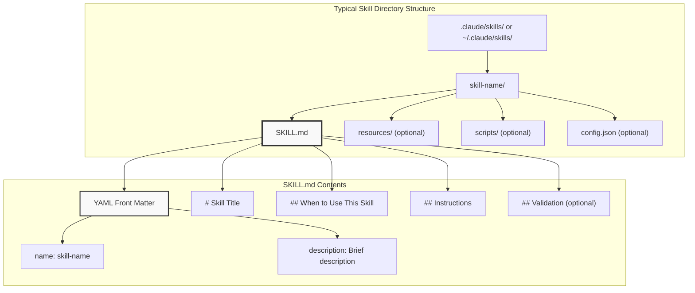

**Sources:** [README.md:44-72]()

### Minimal Skill Example

A basic skill file (`SKILL.md`) contains YAML metadata followed by Markdown instructions:

```yaml
---
name: api-tester
description: Test REST APIs and validate responses
---

# API Tester

Test HTTP endpoints and validate response structures.

## When to Use This Skill

Use this skill when you need to test API endpoints and verify response data.

## Instructions

When testing an API:

1. Send a request to the specified endpoint
2. Check the response status code
3. Validate the response body structure
4. Report any errors or unexpected results

## Response Validation

- Verify required fields exist
- Check data types match expected values
- Confirm nested objects have correct structure
```

**Sources:** [README.md:44-72]()

## Installation Procedure

### Step 1: Create the Skills Directory

For project-specific installation, create the skills directory in your project root:

```bash
# For Claude Code (project-specific)
mkdir -p .claude/skills

# For Cursor (project-specific)
mkdir -p .cursor/skills

# For GitHub Copilot (project-specific)
mkdir -p .github/skills
```

For global installation, create the directory in your home directory:

```bash
# For Claude Code (global)
mkdir -p ~/.claude/skills

# For Cursor (global)
mkdir -p ~/.cursor/skills

# For GitHub Copilot (global)
mkdir -p ~/.copilot/skills
```

**Sources:** [README.md:78-87]()

### Step 2: Obtain the Skill

Skills are hosted in external repositories. To install a skill:

1. Navigate to the skill repository (links provided in the collection at [README.md:97-372]())
2. Download or clone the skill files
3. Locate the skill definition file (typically `SKILL.md` or similar)

Example for installing the Anthropic `docx` skill:

```bash
# Clone the entire skills repository
git clone https://github.com/anthropics/skills.git

# Or download just the specific skill folder
# Navigate to: https://github.com/anthropics/skills/tree/main/skills/docx
```

**Sources:** [README.md:101-105](), [README.md:33-37]()

### Step 3: Copy Skill Files to Target Directory

Copy the skill directory into your chosen skills path:

```bash
# Project-specific installation (Claude Code)
cp -r path/to/downloaded/skill .claude/skills/skill-name/

# Global installation (Claude Code)
cp -r path/to/downloaded/skill ~/.claude/skills/skill-name/
```

Ensure the skill directory contains at minimum a `SKILL.md` file with valid YAML front matter and Markdown content.

**Sources:** [README.md:44-72]()

## Installation Path Resolution

AI coding assistants follow a specific path resolution order when loading skills. Understanding this order helps troubleshoot installation issues.

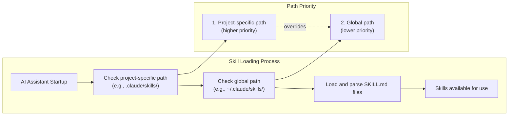

**Sources:** [README.md:78-87]()

When the same skill exists in both project-specific and global paths, the project-specific version typically takes precedence. This allows project-level customization of global skills.

## Multi-Assistant Installation

A single skill can be installed for multiple AI assistants by copying it to each assistant's designated path. The skill format is standardized across all assistants.

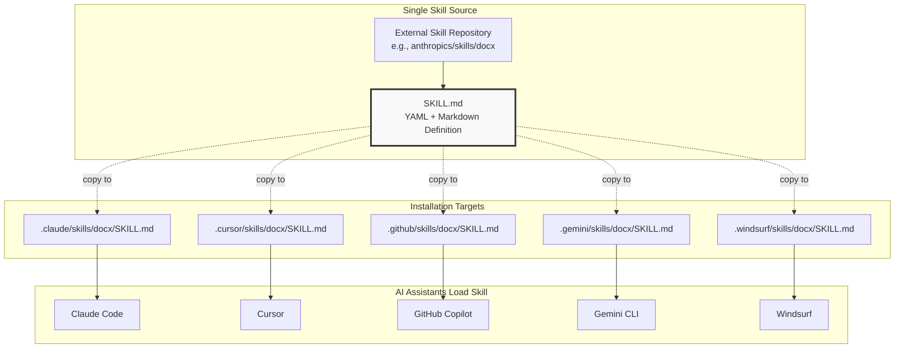

**Sources:** [README.md:37](), [README.md:76-87]()

## Verification Steps

After installing a skill, verify that it has been properly loaded by your AI assistant:

1. **Check file permissions** - Ensure the skill files are readable by your user account
2. **Validate YAML syntax** - Confirm the front matter has valid YAML structure with required `name` and `description` fields
3. **Restart the AI assistant** - Some assistants require a restart to detect new skills
4. **Query the assistant** - Ask your AI assistant to list available skills or attempt to use the newly installed skill

**Sources:** [README.md:44-72]()

## Directory Structure Examples

### Example 1: Claude Code Project Installation

```
my-project/
├── .claude/
│   └── skills/
│       ├── docx/
│       │   └── SKILL.md
│       ├── pdf/
│       │   └── SKILL.md
│       └── web-artifacts-builder/
│           ├── SKILL.md
│           └── resources/
│               └── templates/
├── src/
└── package.json
```

### Example 2: Global Installation for Multiple Assistants

```
~/
├── .claude/
│   └── skills/
│       ├── api-tester/
│       │   └── SKILL.md
│       └── terraform-skill/
│           └── SKILL.md
├── .cursor/
│   └── skills/
│       ├── api-tester/
│       │   └── SKILL.md
│       └── terraform-skill/
│           └── SKILL.md
└── .copilot/
    └── skills/
        ├── api-tester/
        │   └── SKILL.md
        └── terraform-skill/
            └── SKILL.md
```

**Sources:** [README.md:78-87](), [README.md:44-72]()

## Common Installation Patterns

### Pattern 1: Installing Official Team Skills

Official skills from teams like Anthropic, Vercel, or Cloudflare are maintained in dedicated repositories:

```bash
# Install Anthropic's docx skill (global)
git clone https://github.com/anthropics/skills.git /tmp/anthropic-skills
cp -r /tmp/anthropic-skills/skills/docx ~/.claude/skills/
```

**Sources:** [README.md:97-130]()

### Pattern 2: Installing Community Skills

Community skills may have different repository structures:

```bash
# Install a community skill (project-specific)
git clone https://github.com/username/skill-name.git /tmp/skill-name
cp -r /tmp/skill-name/.claude/skills/skill-name .claude/skills/
```

**Sources:** [README.md:262-372]()

### Pattern 3: Batch Installation Script

For installing multiple skills across multiple assistants:

```bash
#!/bin/bash
SKILL_SOURCE="/path/to/skill-directory"
SKILL_NAME="my-skill"

# Install for Claude Code
mkdir -p .claude/skills
cp -r "${SKILL_SOURCE}" .claude/skills/"${SKILL_NAME}"

# Install for Cursor
mkdir -p .cursor/skills
cp -r "${SKILL_SOURCE}" .cursor/skills/"${SKILL_NAME}"

# Install for GitHub Copilot
mkdir -p .github/skills
cp -r "${SKILL_SOURCE}" .github/skills/"${SKILL_NAME}"
```

**Sources:** [README.md:76-87]()

## Troubleshooting Installation Issues

### Skill Not Detected

If your AI assistant doesn't recognize an installed skill:

1. Verify the file is named `SKILL.md` (case-sensitive)
2. Check that YAML front matter uses three dashes (`---`) as delimiters
3. Confirm `name` and `description` fields are present in YAML front matter
4. Ensure the file is in the correct directory path for your AI assistant
5. Restart your AI assistant to reload skill definitions

**Sources:** [README.md:44-72](), [README.md:78-87]()

### Path Resolution Conflicts

If a skill behaves unexpectedly:

1. Check for duplicate installations in both project and global paths
2. Remember project-specific skills override global skills
3. Use unique skill names to avoid naming conflicts
4. Review file permissions on skill directories

### Invalid Skill Format

If the AI assistant reports a parsing error:

1. Validate YAML syntax using a YAML linter
2. Ensure there are no tabs in the YAML front matter (use spaces)
3. Confirm the YAML front matter is closed with `---`
4. Check that Markdown content starts after the closing `---`

**Sources:** [README.md:44-72]()

## Next Steps

After successfully installing skills, proceed to [Using Your First Skill](#2.2) to learn how to invoke and execute skills within your AI coding assistant. For advanced configuration and integration details, see [AI Assistant Integration](#3.2).

To discover available skills for installation, browse the [Skill Catalog](#4). For information about creating your own skills, see [Contribution Guidelines](#5.1).

**Sources:** [README.md:1-309]()

---

# Page: Using Your First Skill

# Using Your First Skill

<details>
<summary>Relevant source files</summary>

The following files were used as context for generating this wiki page:

- [README.md](README.md)

</details>


This document provides a practical walkthrough of the complete skill workflow: discovering a skill from the curated collection, installing it in your AI coding assistant, and executing tasks with it. This guide demonstrates the basic end-to-end process using concrete examples.

For detailed installation instructions for specific AI coding assistants, see [Installing Skills](#2.1). For information about skill structure and technical architecture, see [Skill Definition Format](#3.1).

## Discovery to Execution Workflow

The following diagram illustrates the complete user journey from discovering a skill to executing tasks with it.

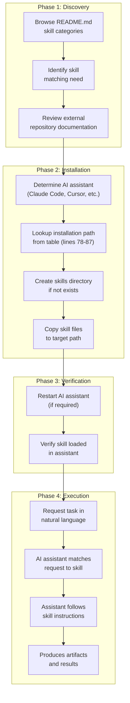

**Sources:** [README.md:1-393]()

## Skill File System Structure

Skills are installed by copying files to specific directory paths. The following diagram shows the file system organization for both project-specific and global installations.

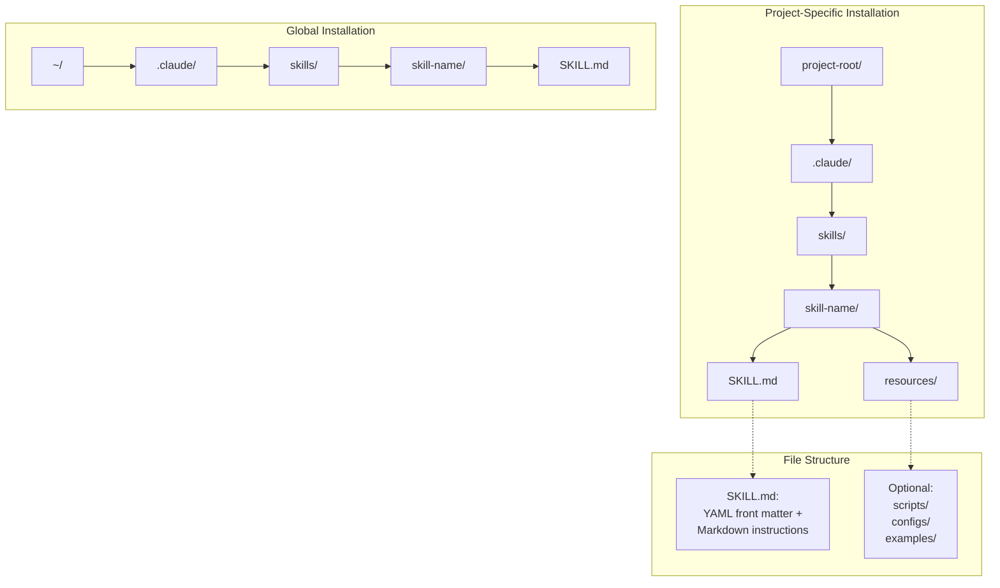

**Sources:** [README.md:78-87]()

## Skill Definition Anatomy

Skills consist of YAML metadata followed by Markdown content. The AI assistant parses both components to understand when and how to execute the skill.

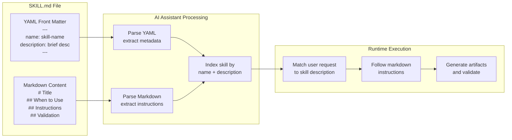

**Sources:** [README.md:44-72]()

## Practical Example: Installing the DOCX Skill

This section demonstrates installing the `anthropics/docx` skill, which enables creating, editing, and analyzing Word documents.

### Step 1: Locate the Skill in README.md

The skill is listed in the "Official Claude Skills" section under "Document Creation":

| Field | Value |
|-------|-------|
| Skill Name | `anthropics/docx` |
| Repository URL | `https://github.com/anthropics/skills/tree/main/skills/docx` |
| Description | Create, edit, and analyze Word documents |
| Category | Document Creation |
| README Location | Lines 101 |

**Sources:** [README.md:101]()

### Step 2: Determine Installation Path

Using the AI assistant compatibility matrix, determine the correct path for your assistant:

| AI Assistant | Project Path | Global Path |
|-------------|-------------|-------------|
| Claude Code | `.claude/skills/` | `~/.claude/skills/` |
| Cursor | `.cursor/skills/` | `~/.cursor/skills/` |
| GitHub Copilot | `.github/skills/` | `~/.copilot/skills/` |
| Gemini CLI | `.gemini/skills/` | `~/.gemini/skills/` |
| Windsurf | `.windsurf/skills/` | `~/.codeium/windsurf/skills/` |

For this example, we'll use Claude Code with project-specific installation at `.claude/skills/`.

**Sources:** [README.md:78-87]()

### Step 3: Create Directory Structure

Execute the following commands in your project root:

```bash
# Create skills directory if it doesn't exist
mkdir -p .claude/skills/docx

# Navigate to the external repository
# Visit: https://github.com/anthropics/skills/tree/main/skills/docx
# Download or clone the skill files
```

### Step 4: Copy Skill Files

The skill repository contains:

```
docx/
├── SKILL.md          # Main skill definition
├── examples/         # Optional example files
└── resources/        # Optional additional resources
```

Copy the `SKILL.md` file (minimally required) and any additional resources to `.claude/skills/docx/`.

**Sources:** [README.md:44-72]()

### Step 5: Verify Installation

The installed skill should now be present in your project:

```
your-project/
├── .claude/
│   └── skills/
│       └── docx/
│           └── SKILL.md
├── src/
└── README.md
```

## Execution Workflow Example

Once installed, the skill becomes available to the AI assistant. The following diagram shows how a user request is matched to the skill and executed.

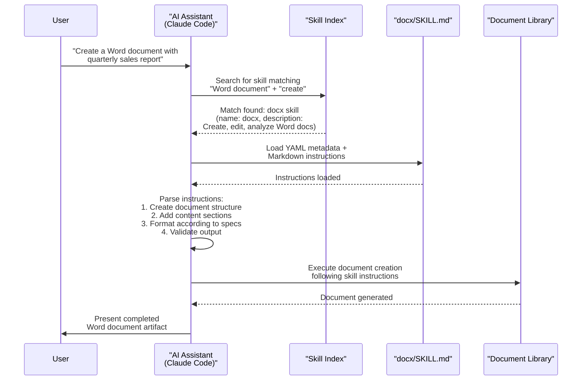

**Sources:** [README.md:44-72]()

## Example User Interaction

Here's what the actual interaction looks like:

**User Request:**
```
Create a Word document with our Q4 sales analysis. Include:
- Executive summary
- Regional performance tables
- Year-over-year comparison charts
```

**AI Assistant Response (with docx skill loaded):**

The assistant recognizes this matches the `docx` skill based on the YAML description "Create, edit, and analyze Word documents". It then follows the instructions in `SKILL.md` to:

1. Parse the user's requirements
2. Structure the document with appropriate sections
3. Create tables and formatting as specified
4. Generate the `.docx` file
5. Validate the output contains all requested elements

**Resulting Artifact:**

The assistant produces a properly formatted Word document following the skill's instructions for document structure, formatting, and validation.

**Sources:** [README.md:101]()

## Installation Path Reference Table

| AI Assistant | Example Project Path | Example Global Path | Official Documentation |
|-------------|---------------------|-------------------|----------------------|
| Antigravity | `.agent/skills/docx/` | `~/.gemini/antigravity/skills/docx/` | [Antigravity Skills](https://antigravity.google/docs/skills) |
| Claude Code | `.claude/skills/docx/` | `~/.claude/skills/docx/` | [Claude Code Skills](https://docs.anthropic.com/en/docs/claude-code/skills) |
| Codex | `.codex/skills/docx/` | `~/.codex/skills/docx/` | [Codex Skills](https://developers.openai.com/codex/skills) |
| Cursor | `.cursor/skills/docx/` | `~/.cursor/skills/docx/` | [Cursor Skills](https://cursor.com/docs/context/skills) |
| Gemini CLI | `.gemini/skills/docx/` | `~/.gemini/skills/docx/` | [Gemini CLI Skills](https://geminicli.com/docs/cli/skills/) |
| GitHub Copilot | `.github/skills/docx/` | `~/.copilot/skills/docx/` | [Copilot Skills](https://docs.github.com/en/copilot/concepts/agents/about-agent-skills) |
| OpenCode | `.opencode/skills/docx/` | `~/.config/opencode/skills/docx/` | [OpenCode Skills](https://opencode.ai/docs/skills) |
| Windsurf | `.windsurf/skills/docx/` | `~/.codeium/windsurf/skills/docx/` | [Windsurf Cascade Skills](https://docs.windsurf.com/windsurf/cascade/skills) |

**Sources:** [README.md:78-87]()

## Skill Matching and Execution Flow

This diagram shows how the AI assistant matches user requests to installed skills and executes them.

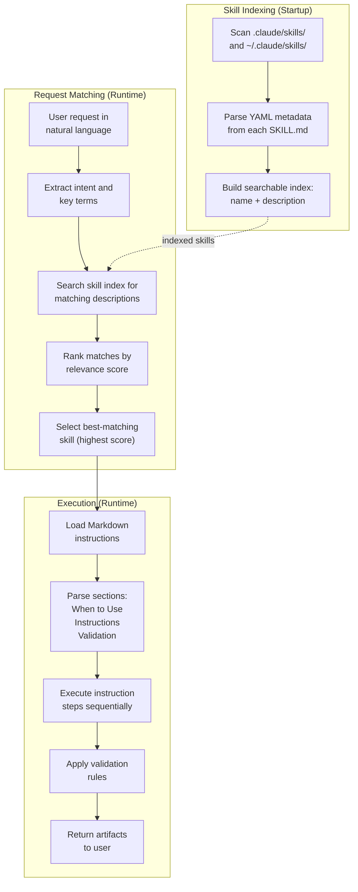

**Sources:** [README.md:44-72](), [README.md:78-87]()

## Common Troubleshooting

| Issue | Cause | Solution |
|-------|-------|----------|
| Skill not recognized | Directory path incorrect | Verify path matches table for your AI assistant |
| Skill not loading | Missing `SKILL.md` file | Ensure file is named exactly `SKILL.md` (case-sensitive) |
| Assistant doesn't use skill | Description too vague | Check YAML description matches your use case terms |
| Partial execution | Missing instructions | Verify all required sections present in Markdown |
| No restart trigger | Assistant cached old state | Manually restart the AI assistant application |

**Sources:** [README.md:78-87]()

## Project vs Global Installation

Skills can be installed in two scopes:

**Project-Specific (`.claude/skills/`):**
- Skills apply only to the current project
- Version-controlled with the project (if committed)
- Team members share same skills
- Useful for project-specific workflows

**Global (`~/.claude/skills/`):**
- Skills apply to all projects
- User-specific configuration
- Persistent across projects
- Useful for personal productivity tools

Both installation paths are scanned simultaneously. If a skill with the same name exists in both locations, the project-specific version takes precedence.

**Sources:** [README.md:78-87]()

## Next Steps

After successfully installing and using your first skill:

1. Explore additional skills from the curated collection in [README.md:98-372]()
2. Learn about advanced skill features in [Skill Definition Format](#3.1)
3. Understand how skills integrate with MCP servers in [MCP Server Integration](#3.3)
4. Consider contributing your own skills following [Contribution Guidelines](#5.1)

**Sources:** [README.md:1-393]()

---

# Page: Skill Architecture

# Skill Architecture

<details>
<summary>Relevant source files</summary>

The following files were used as context for generating this wiki page:

- [README.md](README.md)

</details>


## Purpose and Scope

This document explains the technical architecture of the Agent Skills system, focusing on how skills are defined, discovered, and executed by AI coding assistants. It covers the standardized skill format, file system conventions, and the execution model that enables write-once, run-anywhere portability across multiple AI assistants.

For details about the specific YAML and Markdown structure of skill definitions, see [Skill Definition Format](#3.1). For information about how individual AI assistants integrate with and execute skills, see [AI Assistant Integration](#3.2). For MCP server capabilities within skills, see [MCP Server Integration](#3.3).

**Sources:** [README.md:1-43]()

## Architectural Overview

The Agent Skills system implements a decentralized architecture where skill implementations live in external repositories while discovery and curation happen through this repository. This separation enables independent skill development while maintaining a curated quality bar.

### System Components

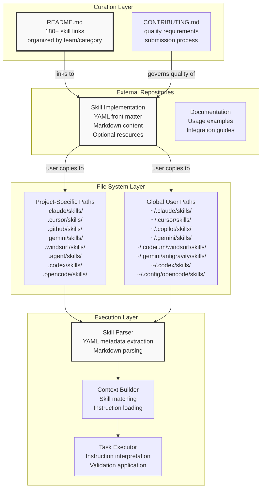

**Diagram: End-to-End Skill Architecture**

This architecture implements three key design principles:

1. **Decentralized Content, Centralized Discovery**: Skills are maintained in 180+ external repositories but discovered through `README.md`
2. **Standardized Format**: All skills use identical YAML + Markdown structure regardless of AI assistant
3. **Dual-Scope Deployment**: Skills can be installed project-wide or globally per-user

**Sources:** [README.md:1-43](), [README.md:76-88]()

## Skill File Structure

Each skill consists of two required components and one optional component:

### Required Components

| Component | Format | Purpose |
|-----------|--------|---------|
| YAML Front Matter | YAML block between `---` delimiters | Machine-readable metadata for parsing |
| Markdown Content | Standard Markdown | Human-readable instructions for AI agent |

### Optional Component

| Component | Format | Purpose |
|-----------|--------|---------|
| Resources | Additional files | Scripts, configs, examples that support the skill |

**Sources:** [README.md:42-73]()

### YAML Front Matter Fields

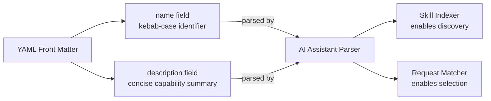

**Diagram: YAML Metadata Processing**

The `name` field uses kebab-case (e.g., `api-tester`, `web-artifacts-builder`) and serves as the skill's unique identifier. The `description` field provides a brief summary of capabilities, typically 10 words or fewer.

**Sources:** [README.md:44-48]()

### Markdown Content Structure

Skills follow a consistent Markdown structure:

```mermaid
graph TB
    Title["# Skill Title<br/>Human-readable name"]
    Summary["Brief summary paragraph<br/>One-line capability statement"]
    WhenToUse["## When to Use This Skill<br/>Triggering conditions"]
    Instructions["## Instructions<br/>Step-by-step procedures"]
    Validation["## Validation/Response<br/>Success criteria"]
    
    Title --> Summary
    Summary --> WhenToUse
    WhenToUse --> Instructions
    Instructions --> Validation
    
    Instructions -->|"numbered steps"| Step1["1. Action verb + target"]
    Instructions -->|"numbered steps"| Step2["2. Action verb + target"]
    Instructions -->|"numbered steps"| Step3["3. Action verb + target"]
    
    Validation -->|"bullet points"| Check1["- Verify condition"]
    Validation -->|"bullet points"| Check2["- Check requirement"]
```

**Diagram: Skill Markdown Structure**

**Sources:** [README.md:50-72]()

## File System Conventions

The skill system uses standardized directory paths that enable multi-assistant compatibility. Each AI coding assistant recognizes specific directory patterns for skill discovery.

### Directory Path Patterns

```mermaid
graph TB
    subgraph "Project-Scoped Skills"
        ProjectRoot["Project Root Directory"]
        
        ProjectRoot --> claude[".claude/skills/"]
        ProjectRoot --> cursor[".cursor/skills/"]
        ProjectRoot --> github[".github/skills/"]
        ProjectRoot --> gemini[".gemini/skills/"]
        ProjectRoot --> windsurf[".windsurf/skills/"]
        ProjectRoot --> agent[".agent/skills/"]
        ProjectRoot --> codex[".codex/skills/"]
        ProjectRoot --> opencode[".opencode/skills/"]
    end
    
    subgraph "User-Scoped Skills"
        UserHome["User Home Directory ~"]
        
        UserHome --> claudeGlobal["~/.claude/skills/"]
        UserHome --> cursorGlobal["~/.cursor/skills/"]
        UserHome --> copilotGlobal["~/.copilot/skills/"]
        UserHome --> geminiGlobal["~/.gemini/skills/"]
        UserHome --> windsurfGlobal["~/.codeium/windsurf/skills/"]
        UserHome --> antigravityGlobal["~/.gemini/antigravity/skills/"]
        UserHome --> codexGlobal["~/.codex/skills/"]
        UserHome --> opencodeGlobal["~/.config/opencode/skills/"]
    end
    
    claude --> ClaudeCode["Claude Code"]
    cursor --> Cursor["Cursor"]
    github --> Copilot["GitHub Copilot"]
    gemini --> GeminiCLI["Gemini CLI"]
    windsurf --> Windsurf["Windsurf"]
    agent --> Antigravity["Antigravity"]
    codex --> Codex["Codex"]
    opencode --> OpenCode["OpenCode"]
    
    claudeGlobal --> ClaudeCode
    cursorGlobal --> Cursor
    copilotGlobal --> Copilot
    geminiGlobal --> GeminiCLI
    windsurfGlobal --> Windsurf
    antigravityGlobal --> Antigravity
    codexGlobal --> Codex
    opencodeGlobal --> OpenCode
```

**Diagram: File System Path Mapping to AI Assistants**

### Path Resolution Priority

AI assistants typically check paths in this order:

1. Project-specific path (`.assistant/skills/`)
2. Global user path (`~/.assistant/skills/`)

Skills in project-specific paths override identically-named skills in global paths, enabling project-specific customization.

**Sources:** [README.md:76-88]()

## Skill Discovery and Execution Flow

```mermaid
sequenceDiagram
    participant User
    participant README as README.md
    participant ExtRepo as External Repository
    participant FileSystem as File System
    participant Parser as AI Assistant Parser
    participant Executor as AI Executor
    
    User->>README: Browse skills by category
    README->>User: Display skill links
    User->>ExtRepo: Navigate to skill repository
    ExtRepo->>User: View YAML + Markdown
    User->>FileSystem: Copy skill to .assistant/skills/
    
    Note over FileSystem: Skill file stored locally
    
    User->>Parser: Issue task request
    Parser->>FileSystem: Scan .assistant/skills/
    FileSystem->>Parser: Return skill files
    
    Parser->>Parser: Parse YAML front matter
    Parser->>Parser: Extract name, description
    Parser->>Parser: Parse Markdown sections
    
    Parser->>Executor: Load matched skill
    Executor->>Executor: Build execution context
    Executor->>Executor: Interpret instructions
    Executor->>Executor: Execute task steps
    Executor->>Executor: Apply validation rules
    
    Executor->>User: Return task results
```

**Diagram: Skill Discovery and Execution Sequence**

### Processing Stages

| Stage | Component | Input | Output |
|-------|-----------|-------|--------|
| Discovery | `README.md` | User browsing | Skill repository URLs |
| Installation | User action | Skill files | Local `.assistant/skills/` directory |
| Parsing | AI Assistant Parser | YAML + Markdown files | Structured skill metadata |
| Matching | Request Matcher | User task + skill descriptions | Selected skill(s) |
| Execution | Task Executor | Skill instructions + user request | Task results |

**Sources:** [README.md:1-88]()

## Repository Architecture and Boundaries

This repository serves as a curation hub rather than an implementation host. Understanding these boundaries is critical to the architecture.

```mermaid
graph TB
    subgraph "awesome-agent-skills Repository"
        READMEFile["README.md<br/>Lines: 1-394<br/>Importance: 123.19"]
        CONTRIBFile["CONTRIBUTING.md<br/>Lines: 1-40<br/>Importance: 3.02"]
        LICENSEFile["LICENSE<br/>Lines: 1-21<br/>Importance: 1.00"]
    end
    
    subgraph "External Ecosystem"
        AnthropicRepo["github.com/anthropics/skills<br/>15 skills"]
        VercelRepo["github.com/vercel-labs/agent-skills<br/>8 skills"]
        CloudflareRepo["github.com/cloudflare/skills<br/>7 skills"]
        TrailOfBitsRepo["github.com/trailofbits/skills<br/>22 skills"]
        CommunityRepos["100+ community repositories<br/>130+ skills"]
    end
    
    READMEFile -->|"links to"| AnthropicRepo
    READMEFile -->|"links to"| VercelRepo
    READMEFile -->|"links to"| CloudflareRepo
    READMEFile -->|"links to"| TrailOfBitsRepo
    READMEFile -->|"links to"| CommunityRepos
    
    CONTRIBFile -->|"governs PRs to"| READMEFile
    
    AnthropicRepo -.->|"maintained by"| AnthropicTeam["Anthropic Team"]
    VercelRepo -.->|"maintained by"| VercelTeam["Vercel Labs"]
    CloudflareRepo -.->|"maintained by"| CloudflareTeam["Cloudflare Team"]
    TrailOfBitsRepo -.->|"maintained by"| TrailOfBitsTeam["Trail of Bits"]
    CommunityRepos -.->|"maintained by"| CommunityDevs["Community Developers"]
    
    style READMEFile fill:#f9f9f9,stroke:#333,stroke-width:4px
    style CONTRIBFile fill:#f9f9f9,stroke:#333,stroke-width:2px
```

**Diagram: Repository Architecture and External Dependencies**

### Responsibility Separation

| Repository | Responsibilities | Does NOT Include |
|------------|------------------|------------------|
| `awesome-agent-skills` | Curate links, maintain quality standards, organize by category | Skill implementations, support, maintenance |
| External skill repositories | Implement skills, provide documentation, support users | Curation, quality gatekeeping |

This architecture enables:
- **Independent skill evolution**: Authors update implementations without touching this repository
- **Quality-controlled discovery**: Only community-proven skills appear in `README.md`
- **Distributed maintenance**: Each team maintains their own skills
- **Single source of truth**: `README.md` remains the canonical skill catalog

**Sources:** [README.md:1-394](), [README.md:374-393]()

## Standardization Benefits

The standardized architecture provides several key benefits:

### Write-Once, Run-Anywhere

```mermaid
graph LR
    SingleSkill["Single Skill Definition<br/>YAML + Markdown"]
    
    SingleSkill -->|"copy to"| Claude[".claude/skills/<br/>Claude Code"]
    SingleSkill -->|"copy to"| Cursor[".cursor/skills/<br/>Cursor"]
    SingleSkill -->|"copy to"| Copilot[".github/skills/<br/>GitHub Copilot"]
    SingleSkill -->|"copy to"| Gemini[".gemini/skills/<br/>Gemini CLI"]
    SingleSkill -->|"copy to"| Windsurf[".windsurf/skills/<br/>Windsurf"]
    SingleSkill -->|"copy to"| Antigravity[".agent/skills/<br/>Antigravity"]
    SingleSkill -->|"copy to"| Codex[".codex/skills/<br/>Codex"]
    SingleSkill -->|"copy to"| OpenCode[".opencode/skills/<br/>OpenCode"]
    
    Claude -->|"identical parsing"| Result["Task Execution"]
    Cursor -->|"identical parsing"| Result
    Copilot -->|"identical parsing"| Result
    Gemini -->|"identical parsing"| Result
    Windsurf -->|"identical parsing"| Result
    Antigravity -->|"identical parsing"| Result
    Codex -->|"identical parsing"| Result
    OpenCode -->|"identical parsing"| Result
```

**Diagram: Cross-Assistant Portability**

### Zero Vendor Lock-In

Because skills use a standardized format independent of any specific AI assistant, users can:
- Switch between assistants without recreating skills
- Use different assistants for different projects
- Share skills across teams using different tools
- Adopt new assistants as they emerge

**Sources:** [README.md:37-88]()

## Integration Points

Skills can integrate with external systems through several mechanisms:

### MCP Server Integration

Skills may reference MCP (Model Context Protocol) servers to access external APIs and services. For detailed information about MCP integration patterns, see [MCP Server Integration](#3.3).

Example skills using MCP servers:
- [README.md:118]() - `anthropics/mcp-builder` for creating MCP servers
- [README.md:146]() - `cloudflare/building-mcp-server-on-cloudflare` for remote MCP servers
- [README.md:361]() - `czlonkowski/n8n-mcp-tools-expert` for n8n MCP tools

### External Tool Integration

Skills can invoke external development tools and CLIs:
- [README.md:119]() - `anthropics/webapp-testing` uses Playwright
- [README.md:302]() - `jthack/ffuf-claude-skill` uses ffuf for web fuzzing
- [README.md:303]() - `lackeyjb/playwright-skill` for browser automation

### API Integration

Skills may call external APIs directly:
- [README.md:244-249]() - `fal-ai-community/*` skills integrate with fal.ai APIs
- [README.md:298]() - `Rootly-AI-Labs/rootly-incident-responder` requires Rootly MCP Server

**Sources:** [README.md:118-119](), [README.md:146](), [README.md:244-249](), [README.md:298](), [README.md:302-303](), [README.md:361]()

## Quality Architecture

The contribution process enforces quality through architectural constraints defined in `CONTRIBUTING.md`:

```mermaid
graph TB
    Submission["Skill Submission PR"]
    
    Submission --> Check1{"Public repository?"}
    Check1 -->|"No"| Reject["Rejection"]
    Check1 -->|"Yes"| Check2{"Documentation exists?"}
    
    Check2 -->|"No"| Reject
    Check2 -->|"Yes"| Check3{"Community usage proven?"}
    
    Check3 -->|"No"| Reject
    Check3 -->|"Yes"| Check4{"Description ≤10 words?"}
    
    Check4 -->|"No"| Reject
    Check4 -->|"Yes"| Review["Maintainer Review"]
    
    Review --> QualityBar{"Meets quality bar?"}
    QualityBar -->|"No"| Reject
    QualityBar -->|"Yes"| Accept["Add to README.md"]
```

**Diagram: Quality Enforcement Flow**

This architectural approach ensures `README.md` contains only battle-tested, community-validated skills rather than experimental projects.

**Sources:** [README.md:374-382]()

---

This skill architecture enables a scalable, decentralized ecosystem where skill creators maintain independence while users benefit from centralized discovery and quality curation. The standardized format ensures skills work across all major AI coding assistants, maximizing utility and minimizing vendor lock-in.

---

# Page: Skill Definition Format

# Skill Definition Format

<details>
<summary>Relevant source files</summary>

The following files were used as context for generating this wiki page:

- [README.md](README.md)

</details>


This document specifies the standardized format for defining Agent Skills. A skill is defined using a two-part structure: YAML front matter for machine-readable metadata and Markdown content for human-readable instructions. This format is portable across all supported AI coding assistants including Claude Code, Cursor, GitHub Copilot, Gemini CLI, Windsurf, and others.

For information about how AI assistants load and execute skills, see [AI Assistant Integration](#3.2). For contributing skills to the collection, see [Contribution Guidelines](#5.1).

## Format Overview

Agent Skills use a standardized text-based format that combines structured metadata with natural language instructions. The format consists of two primary components that work together to provide both machine-parseable configuration and human-readable guidance.

```mermaid
graph TB
    subgraph "Skill File Structure"
        File["SKILL.md or skill.md<br/>(Single text file)"]
        
        File --> YAMLSection["YAML Front Matter<br/>Delimited by ---"]
        File --> MarkdownSection["Markdown Body<br/>(Following YAML)"]
        
        YAMLSection --> NameField["name: string"]
        YAMLSection --> DescField["description: string"]
        YAMLSection --> OptionalFields["(Future fields TBD)"]
        
        MarkdownSection --> Title["# Skill Title<br/>(H1 heading)"]
        MarkdownSection --> WhenToUse["## When to Use This Skill<br/>(Trigger conditions)"]
        MarkdownSection --> Instructions["## Instructions<br/>(Step-by-step guidance)"]
        MarkdownSection --> AdditionalSections["## Additional Sections<br/>(Validation, examples, etc.)"]
    end
    
    subgraph "Optional Resources"
        Scripts["scripts/<br/>(Helper scripts)"]
        Configs["config/<br/>(Configuration files)"]
        Examples["examples/<br/>(Usage examples)"]
    end
    
    File -.->|"May include"| Scripts
    File -.->|"May include"| Configs
    File -.->|"May include"| Examples
```

**Sources:** [README.md:33-74]()

## YAML Front Matter

The YAML front matter is a metadata block enclosed by triple-dash delimiters (`---`) at the beginning of the skill file. It provides machine-readable information that AI assistants use to index, search, and identify skills.

### Required Fields

| Field | Type | Constraints | Purpose |
|-------|------|-------------|---------|
| `name` | string | Lowercase with hyphens, alphanumeric | Unique identifier for the skill |
| `description` | string | ≤10 words (by convention) | Brief summary of skill capability |

### Field Specifications

**`name`**
- Format: kebab-case (lowercase with hyphens)
- Example: `api-tester`, `web-artifacts-builder`, `mcp-builder`
- Used as: Directory name convention, search index key
- Must be: Unique within a skill collection, URL-safe

**`description`**
- Format: Plain text, concise sentence or phrase
- Length: Typically 5-10 words as per [CONTRIBUTING.md]()
- Purpose: Displayed in skill listings, used for search/discovery
- Should: Clearly state what the skill does, avoid marketing language

### Example YAML Block

```yaml
---
name: api-tester
description: Test REST APIs and validate responses
---
```

**Sources:** [README.md:44-48](), [CONTRIBUTING.md:21-35]()

## Markdown Body Structure

The Markdown body follows immediately after the closing `---` delimiter of the YAML front matter. It contains natural language instructions that guide AI assistants on how to execute the skill's capabilities.

### Standard Sections

```mermaid
graph LR
    subgraph "Markdown Body Organization"
        H1["# Main Title<br/>(Skill name in title case)"]
        
        H1 --> Brief["Brief description paragraph<br/>(1-2 sentences)"]
        Brief --> WhenSection["## When to Use This Skill"]
        WhenSection --> InstructionsSection["## Instructions"]
        InstructionsSection --> OptionalSections["## Optional Sections"]
        
        WhenSection --> WhenContent["Trigger conditions<br/>Use cases<br/>Context indicators"]
        
        InstructionsSection --> InstructionsList["Numbered steps<br/>Bullet points<br/>Sub-sections"]
        
        OptionalSections --> Validation["Validation rules"]
        OptionalSections --> Examples["Examples"]
        OptionalSections --> Notes["Notes/warnings"]
        OptionalSections --> Resources["Resource references"]
    end
```

### Section Descriptions

**# Main Title (H1 Heading)**
- Format: Title case version of the `name` field
- Example: `# API Tester` (for `name: api-tester`)
- Appears once at the top of the markdown body
- May be followed by a 1-2 sentence summary

**## When to Use This Skill**
- Purpose: Defines trigger conditions and appropriate contexts
- Content: Describes scenarios where the skill should be activated
- Format: Prose, bullet points, or conditional statements
- Example from [README.md:54-56]():
  ```markdown
  ## When to Use This Skill
  
  Use this skill when you need to test API endpoints and verify response data.
  ```

**## Instructions**
- Purpose: Provides step-by-step execution guidance
- Content: Detailed procedures for accomplishing the skill's task
- Format: Numbered lists, bullet points, or sub-sections
- Should: Be clear, actionable, and unambiguous
- Example from [README.md:58-66]():
  ```markdown
  ## Instructions
  
  When testing an API:
  
  1. Send a request to the specified endpoint
  2. Check the response status code
  3. Validate the response body structure
  4. Report any errors or unexpected results
  ```

**## Additional Sections (Optional)**
Common optional sections include:
- **Validation**: Rules for verifying correct execution
- **Examples**: Sample inputs/outputs
- **Configuration**: Setup requirements
- **Notes**: Important caveats or limitations
- **Resources**: External references or dependencies

Example validation section from [README.md:68-72]():
```markdown
## Response Validation

- Verify required fields exist
- Check data types match expected values
- Confirm nested objects have correct structure
```

**Sources:** [README.md:44-72]()

## File Naming and Directory Structure

Skills follow a conventional directory layout that enables AI assistants to discover and load them consistently across different tools.

```mermaid
graph TB
    subgraph "Skill Directory Layout"
        SkillDir["skill-name/<br/>(Directory named after 'name' field)"]
        
        SkillDir --> MainFile["SKILL.md or skill.md<br/>(Primary definition file)"]
        SkillDir --> OptionalDirs["Optional subdirectories"]
        
        OptionalDirs --> ScriptsDir["scripts/<br/>(Executable helpers)"]
        OptionalDirs --> ConfigDir["config/<br/>(Configuration files)"]
        OptionalDirs --> ExamplesDir["examples/<br/>(Usage samples)"]
        OptionalDirs --> ResourcesDir["resources/<br/>(Additional materials)"]
        
        ScriptsDir --> ScriptFiles["*.py, *.sh, *.js<br/>(Referenced from instructions)"]
        ConfigDir --> ConfigFiles["*.json, *.yaml, *.toml<br/>(Settings/templates)"]
        ExamplesDir --> ExampleFiles["example-*.md<br/>(Demonstrations)"]
    end
    
    subgraph "AI Assistant Paths"
        ProjectPath[".claude/skills/<br/>.cursor/skills/<br/>.github/skills/<br/>etc."]
        GlobalPath["~/.claude/skills/<br/>~/.cursor/skills/<br/>~/.copilot/skills/<br/>etc."]
    end
    
    ProjectPath -.-> SkillDir
    GlobalPath -.-> SkillDir
```

### File Naming Conventions

**Primary Definition File**
- Name: `SKILL.md` or `skill.md` (both conventions are used)
- Location: Root of the skill directory
- Content: YAML front matter + Markdown body as documented above
- Note: Anthropic's official skills use `SKILL.md`; community practices vary

**Directory Name**
- Must match: The `name` field in YAML front matter
- Format: kebab-case (lowercase with hyphens)
- Examples from [README.md]():
  - `docx/` for `name: docx`
  - `api-tester/` for `name: api-tester`
  - `web-artifacts-builder/` for `name: web-artifacts-builder`

### Installation Paths

Skills are deployed to assistant-specific directories as specified in [README.md:78-87]():

| AI Assistant | Project Path | Global Path |
|--------------|-------------|-------------|
| Claude Code | `.claude/skills/` | `~/.claude/skills/` |
| Cursor | `.cursor/skills/` | `~/.cursor/skills/` |
| GitHub Copilot | `.github/skills/` | `~/.copilot/skills/` |
| Gemini CLI | `.gemini/skills/` | `~/.gemini/skills/` |
| Windsurf | `.windsurf/skills/` | `~/.codeium/windsurf/skills/` |
| Antigravity | `.agent/skills/` | `~/.gemini/antigravity/skills/` |
| Codex | `.codex/skills/` | `~/.codex/skills/` |
| OpenCode | `.opencode/skills/` | `~/.config/opencode/skills/` |

**Sources:** [README.md:33](), [README.md:78-87]()

## Processing Flow

This diagram illustrates how AI assistants parse and consume the skill definition format, bridging the text-based format to runtime execution.

```mermaid
graph TB
    subgraph "File System"
        SkillFile["skill-name/SKILL.md"]
    end
    
    subgraph "Parsing Layer"
        FileReader["File I/O Reader"]
        YAMLParser["YAML Parser<br/>(Parse front matter)"]
        MarkdownParser["Markdown Parser<br/>(Parse body structure)"]
        
        FileReader --> SplitDelimiter["Split on ---<br/>(Separate YAML from Markdown)"]
        SplitDelimiter --> YAMLParser
        SplitDelimiter --> MarkdownParser
    end
    
    subgraph "Data Structures"
        MetadataObj["Metadata Object<br/>{name, description}"]
        ContentObj["Content Object<br/>{title, sections[]}"]
        
        YAMLParser --> MetadataObj
        MarkdownParser --> ContentObj
    end
    
    subgraph "AI Agent Context"
        SkillIndex["Skill Index<br/>(name → file path mapping)"]
        SkillContext["Skill Context<br/>(Full instructions in prompt)"]
        
        MetadataObj --> SkillIndex
        ContentObj --> SkillContext
        MetadataObj --> SkillContext
    end
    
    subgraph "Execution"
        UserRequest["User Request"]
        SkillMatcher["Skill Matcher<br/>(Match request to skill)"]
        InstructionInterpreter["Instruction Interpreter<br/>(Execute steps)"]
        
        UserRequest --> SkillMatcher
        SkillIndex --> SkillMatcher
        SkillMatcher --> InstructionInterpreter
        SkillContext --> InstructionInterpreter
    end
    
    SkillFile --> FileReader
```

**Sources:** [README.md:44-72]()

## Complete Annotated Example

The following is a complete, annotated skill definition showing all components of the format:

```yaml
# File: api-tester/SKILL.md

---
# YAML Front Matter (Required)
# Enclosed by --- delimiters at the start of the file
name: api-tester                           # Unique identifier (kebab-case)
description: Test REST APIs and validate responses  # Brief summary (≤10 words)
---

# Markdown Body starts after closing ---

# API Tester
# H1 heading - title case version of the name

Test HTTP endpoints and validate response structures.
# Brief description (1-2 sentences) immediately after title

## When to Use This Skill
# Defines trigger conditions - when should this skill activate?

Use this skill when you need to test API endpoints and verify response data.

## Instructions
# Step-by-step guidance - the core execution logic

When testing an API:

1. Send a request to the specified endpoint
2. Check the response status code
3. Validate the response body structure
4. Report any errors or unexpected results

## Response Validation
# Optional section providing additional context

- Verify required fields exist
- Check data types match expected values
- Confirm nested objects have correct structure
```

### Key Characteristics

| Aspect | Specification |
|--------|--------------|
| **File format** | Plain text, UTF-8 encoding |
| **YAML version** | YAML 1.2 compatible |
| **Markdown flavor** | GitHub Flavored Markdown (GFM) |
| **Line endings** | LF (Unix-style) or CRLF (Windows-style) |
| **Required sections** | YAML front matter with `name` and `description`; Markdown body with title |
| **Recommended sections** | "When to Use This Skill", "Instructions" |
| **Optional sections** | Unlimited, based on skill complexity |

**Sources:** [README.md:44-72]()

## Validation Checklist

When creating or reviewing a skill definition, verify the following:

**Format Compliance**
- [ ] File begins with `---` delimiter
- [ ] YAML front matter is properly closed with `---`
- [ ] `name` field is present and uses kebab-case
- [ ] `description` field is present and concise (≤10 words)
- [ ] Markdown body follows immediately after YAML
- [ ] H1 heading (`#`) appears once at the top of markdown body

**Content Quality**
- [ ] "When to Use This Skill" section clearly defines trigger conditions
- [ ] "Instructions" section provides actionable, step-by-step guidance
- [ ] Language is clear and unambiguous
- [ ] Examples are provided where helpful
- [ ] Validation criteria are specified if applicable

**File System**
- [ ] Directory name matches `name` field from YAML
- [ ] Primary file is named `SKILL.md` or `skill.md`
- [ ] Optional resources are organized in subdirectories

**Sources:** [README.md:44-72](), [CONTRIBUTING.md:21-35]()

## Extended Format Features

While the basic format documented above covers the majority of use cases, some skills in the ecosystem demonstrate extended patterns and conventions.

### Multi-File Skills

Some skills organize content across multiple files:

```
skill-name/
├── SKILL.md                 # Main definition (required)
├── README.md                # Extended documentation
├── scripts/
│   ├── setup.sh            # Initialization script
│   └── helper.py           # Utility functions
├── config/
│   └── defaults.json       # Default configuration
└── examples/
    ├── example-1.md        # Usage example 1
    └── example-2.md        # Usage example 2
```

Instructions in `SKILL.md` may reference these resources:
- `See scripts/setup.sh for initialization`
- `Refer to examples/example-1.md for usage patterns`
- `Configure using config/defaults.json`

### Integration with External Resources

Skills may reference external systems or require additional setup:

```markdown
## Prerequisites

This skill requires:
- MCP server installed: `npm install -g @example/mcp-server`
- API credentials configured in environment variables
- External tool available: `ffmpeg` (for media processing)

## Instructions

1. Verify prerequisites using the setup script: `scripts/check-prerequisites.sh`
2. [Continue with main instructions...]
```

### Skill Composition

Advanced skills may reference or compose other skills:

```markdown
## Instructions

1. First, use the `code-review` skill to analyze the changes
2. Then, apply the `security-audit` skill to check for vulnerabilities
3. Finally, use this skill's specific validation steps...
```

**Sources:** [README.md:118](), [README.md:146]()

## Format Evolution

The skill definition format is established by community convention and AI assistant implementations. Current limitations and future considerations:

**Current State**
- Format is stable across 180+ skills from 16+ official teams
- Minimal breaking changes since initial adoption
- Backward compatibility maintained by assistant implementations

**Known Variations**
- File naming: Both `SKILL.md` and `skill.md` are accepted
- Section headers: Minor variations in capitalization and phrasing
- YAML fields: Currently only `name` and `description` are standardized

**Future Extensions** (Not Yet Standardized)
- Additional YAML metadata fields (version, author, tags, dependencies)
- Structured instruction formats (JSON-LD, YAML blocks within instructions)
- Schema validation and type systems
- Skill dependency declarations
- Versioning and compatibility indicators

See the [official Anthropic skills repository](https://github.com/anthropics/skills) and [creation guide](https://support.claude.com/en/articles/12512198-how-to-create-custom-skills) referenced in [README.md:74]() for authoritative guidance.

**Sources:** [README.md:33-74](), [README.md:78-87]()

---

# Page: AI Assistant Integration

# AI Assistant Integration

<details>
<summary>Relevant source files</summary>

The following files were used as context for generating this wiki page:

- [README.md](README.md)

</details>


This document explains the technical architecture by which AI coding assistants discover, load, and execute Agent Skills. It covers the file system conventions, parsing mechanisms, and execution models that enable a single skill definition to work across multiple AI assistants.

For information about the skill definition format itself (YAML front matter and Markdown structure), see [Skill Definition Format](#3.1). For details on how skills integrate with external services via MCP servers, see [MCP Server Integration](#3.3).

**Sources:** [README.md:1-87]()

---

## Discovery Architecture

AI coding assistants discover skills through standardized file system paths. Each assistant monitors specific directories for skill definitions, supporting both project-scoped and user-scoped installations.

### File System Path Conventions

The skill discovery mechanism relies on convention-based directory structures. Skills are stored as files or directories within designated paths that follow a predictable pattern:

```
<scope>/<assistant>/skills/<skill-name>/
```

Where:
- `<scope>` is either the project root (`.`) or user home (`~`)
- `<assistant>` is the assistant-specific directory name
- `<skill-name>` is the individual skill identifier

**Sources:** [README.md:76-87]()

### Supported AI Assistants and Paths

The following table documents all supported AI coding assistants with their respective discovery paths:

| Assistant | Project Path | Global Path | Documentation Link |
|-----------|-------------|-------------|-------------------|
| Antigravity | `.agent/skills/` | `~/.gemini/antigravity/skills/` | [Antigravity Skills](https://antigravity.google/docs/skills) |
| Claude Code | `.claude/skills/` | `~/.claude/skills/` | [Claude Code Skills](https://docs.anthropic.com/en/docs/claude-code/skills) |
| Codex | `.codex/skills/` | `~/.codex/skills/` | [Codex Skills](https://developers.openai.com/codex/skills) |
| Cursor | `.cursor/skills/` | `~/.cursor/skills/` | [Cursor Skills](https://cursor.com/docs/context/skills) |
| Gemini CLI | `.gemini/skills/` | `~/.gemini/skills/` | [Gemini CLI Skills](https://geminicli.com/docs/cli/skills/) |
| GitHub Copilot | `.github/skills/` | `~/.copilot/skills/` | [Copilot Skills](https://docs.github.com/en/copilot/concepts/agents/about-agent-skills) |
| OpenCode | `.opencode/skills/` | `~/.config/opencode/skills/` | [OpenCode Skills](https://opencode.ai/docs/skills) |
| Windsurf | `.windsurf/skills/` | `~/.codeium/windsurf/skills/` | [Windsurf Cascade Skills](https://docs.windsurf.com/windsurf/cascade/skills) |

**Sources:** [README.md:78-87]()

---

## Path Resolution and Scoping

```mermaid
graph TB
    subgraph UserRequest["User Request Processing"]
        Request["User Task Request"]
        Match["Skill Matcher"]
    end
    
    subgraph ProjectScope["Project-Scoped Paths"]
        ProjectClaudeDir[".claude/skills/"]
        ProjectCursorDir[".cursor/skills/"]
        ProjectCopilotDir[".github/skills/"]
        ProjectGeminiDir[".gemini/skills/"]
        ProjectWindsurfDir[".windsurf/skills/"]
        ProjectAntigravityDir[".agent/skills/"]
        ProjectCodexDir[".codex/skills/"]
        ProjectOpenCodeDir[".opencode/skills/"]
    end
    
    subgraph GlobalScope["User-Scoped Paths"]
        GlobalClaudeDir["~/.claude/skills/"]
        GlobalCursorDir["~/.cursor/skills/"]
        GlobalCopilotDir["~/.copilot/skills/"]
        GlobalGeminiDir["~/.gemini/skills/"]
        GlobalWindsurfDir["~/.codeium/windsurf/skills/"]
        GlobalAntigravityDir["~/.gemini/antigravity/skills/"]
        GlobalCodexDir["~/.codex/skills/"]
        GlobalOpenCodeDir["~/.config/opencode/skills/"]
    end
    
    subgraph Resolution["Path Resolution Logic"]
        SearchProject["Search Project Path"]
        SearchGlobal["Search Global Path"]
        MergeSkills["Merge Available Skills"]
    end
    
    Request --> Match
    Match --> SearchProject
    Match --> SearchGlobal
    
    SearchProject --> ProjectClaudeDir
    SearchProject --> ProjectCursorDir
    SearchProject --> ProjectCopilotDir
    SearchProject --> ProjectGeminiDir
    SearchProject --> ProjectWindsurfDir
    SearchProject --> ProjectAntigravityDir
    SearchProject --> ProjectCodexDir
    SearchProject --> ProjectOpenCodeDir
    
    SearchGlobal --> GlobalClaudeDir
    SearchGlobal --> GlobalCursorDir
    SearchGlobal --> GlobalCopilotDir
    SearchGlobal --> GlobalGeminiDir
    SearchGlobal --> GlobalWindsurfDir
    SearchGlobal --> GlobalAntigravityDir
    SearchGlobal --> GlobalCodexDir
    SearchGlobal --> GlobalOpenCodeDir
    
    ProjectClaudeDir --> MergeSkills
    ProjectCursorDir --> MergeSkills
    ProjectCopilotDir --> MergeSkills
    ProjectGeminiDir --> MergeSkills
    ProjectWindsurfDir --> MergeSkills
    ProjectAntigravityDir --> MergeSkills
    ProjectCodexDir --> MergeSkills
    ProjectOpenCodeDir --> MergeSkills
    
    GlobalClaudeDir --> MergeSkills
    GlobalCursorDir --> MergeSkills
    GlobalCopilotDir --> MergeSkills
    GlobalGeminiDir --> MergeSkills
    GlobalWindsurfDir --> MergeSkills
    GlobalAntigravityDir --> MergeSkills
    GlobalCodexDir --> MergeSkills
    GlobalOpenCodeDir --> MergeSkills
    
    MergeSkills --> Match
```

### Scoping Semantics

**Project-Scoped Skills** (`./<assistant>/skills/`)
- Located in the project repository root
- Scoped to the current project context
- Typically version-controlled with the project
- Take precedence over global skills with the same name
- Examples: project-specific coding standards, framework-specific patterns

**User-Scoped Skills** (`~/<assistant>/skills/`)
- Located in the user's home directory
- Available across all projects for that user
- Persist across different projects and repositories
- Examples: personal productivity workflows, general-purpose utilities

AI assistants typically merge skills from both scopes, with project-scoped skills overriding global skills when naming conflicts occur.

**Sources:** [README.md:78-87]()

---

## Skill Loading Mechanism

```mermaid
graph LR
    subgraph FileSystem["File System"]
        SkillDir["<assistant>/skills/<skill-name>/"]
        SkillFile["SKILL.md or README.md"]
        ResourceFiles["Additional Resources<br/>(optional)"]
    end
    
    subgraph Parser["Skill Parser"]
        FileReader["File Reader"]
        YAMLParser["YAML Front Matter Parser"]
        MarkdownParser["Markdown Content Parser"]
    end
    
    subgraph DataStructure["Parsed Skill Object"]
        Metadata["Metadata<br/>name, description"]
        Content["Structured Content<br/>title, sections, instructions"]
        Resources["Resource References"]
    end
    
    subgraph SkillRegistry["Skill Registry"]
        IndexedSkills["Indexed Skills Map"]
        SkillMetadataDB["Skill Metadata Database"]
    end
    
    SkillDir --> FileReader
    SkillFile --> FileReader
    ResourceFiles --> FileReader
    
    FileReader --> YAMLParser
    FileReader --> MarkdownParser
    
    YAMLParser --> Metadata
    MarkdownParser --> Content
    FileReader --> Resources
    
    Metadata --> IndexedSkills
    Content --> IndexedSkills
    Resources --> IndexedSkills
    
    IndexedSkills --> SkillMetadataDB
```

### File Format Structure

Skills follow a standardized file format consisting of YAML front matter followed by Markdown content:

```
---
name: skill-identifier
description: Brief description (≤10 words)
---

# Skill Title

Markdown content with structured sections...
```

The skill file is typically named `SKILL.md` or `README.md` within the skill directory.

**Sources:** [README.md:44-72]()

### Parsing Stages

1. **File Discovery**: Assistant scans both project and global skill directories
2. **File Reading**: Loads skill file content into memory
3. **YAML Parsing**: Extracts metadata from front matter block
4. **Markdown Parsing**: Parses structured content sections
5. **Validation**: Verifies required fields and structure
6. **Registration**: Adds skill to internal registry with metadata index

**Sources:** [README.md:44-72]()

---

## Execution Architecture

```mermaid
graph TB
    subgraph UserContext["User Context"]
        UserRequest["User Task<br/>Request"]
        ProjectContext["Project<br/>Context"]
        ConversationHistory["Conversation<br/>History"]
    end
    
    subgraph SkillMatching["Skill Matching Layer"]
        SkillRegistry["Skill Registry"]
        SemanticMatcher["Semantic Matcher"]
        SelectedSkill["Selected Skill"]
    end
    
    subgraph InstructionLayer["Instruction Interpretation"]
        InstructionParser["Instruction Parser"]
        StepExtractor["Step Extractor"]
        ValidationRules["Validation Rule<br/>Extractor"]
    end
    
    subgraph ExecutionEngine["Execution Engine"]
        ContextBuilder["Context Builder"]
        StepExecutor["Step-by-Step<br/>Executor"]
        ToolInvoker["Tool/API Invoker"]
        OutputGenerator["Output Generator"]
    end
    
    subgraph ExternalIntegrations["Optional Integrations"]
        MCPServers["MCP Servers"]
        ExternalAPIs["External APIs"]
        DevTools["Development Tools"]
    end
    
    subgraph Results["Execution Results"]
        Artifacts["Generated<br/>Artifacts"]
        ValidationResults["Validation<br/>Results"]
        ExecutionLog["Execution Log"]
    end
    
    UserRequest --> SemanticMatcher
    ProjectContext --> SemanticMatcher
    ConversationHistory --> SemanticMatcher
    SkillRegistry --> SemanticMatcher
    
    SemanticMatcher --> SelectedSkill
    SelectedSkill --> InstructionParser
    
    InstructionParser --> StepExtractor
    InstructionParser --> ValidationRules
    
    StepExtractor --> ContextBuilder
    ValidationRules --> ContextBuilder
    ProjectContext --> ContextBuilder
    
    ContextBuilder --> StepExecutor
    StepExecutor --> ToolInvoker
    
    ToolInvoker -.->|optional| MCPServers
    ToolInvoker -.->|optional| ExternalAPIs
    ToolInvoker -.->|optional| DevTools
    
    MCPServers --> OutputGenerator
    ExternalAPIs --> OutputGenerator
    DevTools --> OutputGenerator
    StepExecutor --> OutputGenerator
    
    OutputGenerator --> Artifacts
    OutputGenerator --> ValidationResults
    OutputGenerator --> ExecutionLog
    
    ValidationRules --> ValidationResults
```

### Execution Flow

1. **Skill Selection**: AI assistant matches user request to appropriate skill using semantic similarity and metadata
2. **Context Building**: Assembles execution context from project state, conversation history, and skill instructions
3. **Instruction Interpretation**: Parses skill's Markdown sections to extract actionable steps
4. **Step Execution**: Executes instructions sequentially, potentially invoking external tools
5. **Validation**: Applies validation rules specified in skill definition
6. **Output Generation**: Produces artifacts (documents, code, designs) and execution results

**Sources:** [README.md:44-72](), [README.md:97-261]()

### Instruction Interpretation Model

AI assistants interpret skill instructions from Markdown sections:

- **When to Use This Skill**: Conditions that trigger skill activation
- **Instructions**: Step-by-step procedures to execute
- **Response Validation**: Rules for verifying outputs
- **Examples**: Reference implementations (if provided)

The assistant uses these structured sections to guide task execution, treating them as executable procedures rather than mere documentation.

**Sources:** [README.md:44-72]()

---

## Cross-Assistant Portability

### Standardization Principle

The Agent Skills ecosystem achieves portability through a **write-once, run-anywhere** architecture. A single skill definition works across all supported AI assistants without modification.

```mermaid
graph TB
    subgraph SkillDefinition["Single Skill Definition"]
        YAML["YAML Metadata"]
        Markdown["Markdown Instructions"]
        Combined["Combined Format"]
    end
    
    subgraph DeploymentTargets["Deployment Targets"]
        ClaudePath[".claude/skills/api-tester/"]
        CursorPath[".cursor/skills/api-tester/"]
        CopilotPath[".github/skills/api-tester/"]
        GeminiPath[".gemini/skills/api-tester/"]
        WindsurfPath[".windsurf/skills/api-tester/"]
        AntigravityPath[".agent/skills/api-tester/"]
        CodexPath[".codex/skills/api-tester/"]
        OpenCodePath[".opencode/skills/api-tester/"]
    end
    
    subgraph AIAssistants["AI Coding Assistants"]
        Claude["Claude Code<br/>Parser + Executor"]
        Cursor["Cursor<br/>Parser + Executor"]
        Copilot["GitHub Copilot<br/>Parser + Executor"]
        Gemini["Gemini CLI<br/>Parser + Executor"]
        Windsurf["Windsurf<br/>Parser + Executor"]
        Antigravity["Antigravity<br/>Parser + Executor"]
        Codex["Codex<br/>Parser + Executor"]
        OpenCode["OpenCode<br/>Parser + Executor"]
    end
    
    YAML --> Combined
    Markdown --> Combined
    
    Combined -.->|copy to| ClaudePath
    Combined -.->|copy to| CursorPath
    Combined -.->|copy to| CopilotPath
    Combined -.->|copy to| GeminiPath
    Combined -.->|copy to| WindsurfPath
    Combined -.->|copy to| AntigravityPath
    Combined -.->|copy to| CodexPath
    Combined -.->|copy to| OpenCodePath
    
    ClaudePath --> Claude
    CursorPath --> Cursor
    CopilotPath --> Copilot
    GeminiPath --> Gemini
    WindsurfPath --> Windsurf
    AntigravityPath --> Antigravity
    CodexPath --> Codex
    OpenCodePath --> OpenCode
```

### Portability Requirements

For a skill to be portable across assistants, it must:

1. **Use standard YAML front matter** with `name` and `description` fields
2. **Structure content in Markdown** with conventional section headings
3. **Avoid assistant-specific APIs** unless explicitly documented as optional
4. **Reference external tools generically** rather than with hardcoded paths
5. **Document tool dependencies** clearly in skill content

**Sources:** [README.md:44-72](), [README.md:76-87]()

---

## Integration Patterns

### Pattern 1: Project-Specific Skill

Used when a skill is tightly coupled to a specific codebase or project:

```
my-project/
├── .claude/
│   └── skills/
│       └── project-conventions/
│           └── SKILL.md
├── .cursor/
│   └── skills/
│       └── project-conventions/
│           └── SKILL.md
└── src/
    └── ...
```

The same `project-conventions` skill is copied to both `.claude/skills/` and `.cursor/skills/` to work with multiple assistants within the project.

**Sources:** [README.md:78-87]()

### Pattern 2: User-Wide Skill

Used for general-purpose skills that apply across multiple projects:

```
~/.claude/
└── skills/
    └── api-tester/
        └── SKILL.md

~/.cursor/
└── skills/
    └── api-tester/
        └── SKILL.md
```

The `api-tester` skill is installed globally for each assistant, making it available in all projects.

**Sources:** [README.md:78-87]()

### Pattern 3: Multi-Assistant Bundle

A repository containing skills for multiple assistants with shared resources:

```
my-skills-repo/
├── skills/
│   └── api-tester/
│       ├── SKILL.md          # Standardized definition
│       ├── examples/
│       │   └── test-example.json
│       └── scripts/
│           └── validate.sh
└── install.sh                 # Installation script
```

Installation script copies the skill to appropriate paths for all detected assistants.

**Sources:** [README.md:44-72](), [README.md:97-261]()

---

## Skill Registry and Indexing

AI assistants maintain an internal registry of available skills for efficient matching:

```mermaid
graph TB
    subgraph SkillSources["Skill Sources"]
        ProjectSkills["Project Skills<br/>./<assistant>/skills/"]
        GlobalSkills["Global Skills<br/>~/<assistant>/skills/"]
    end
    
    subgraph IndexingProcess["Indexing Process"]
        Scanner["Directory Scanner"]
        MetadataExtractor["Metadata Extractor"]
        Indexer["Skill Indexer"]
    end
    
    subgraph SkillRegistry["Skill Registry Structure"]
        ByName["Index by Name<br/>Map<string, Skill>"]
        ByDescription["Index by Description<br/>Embedding Vector Space"]
        ByCategory["Index by Category<br/>Map<string, Set<Skill>>"]
    end
    
    subgraph QueryInterface["Query Interface"]
        NameLookup["lookup_by_name()"]
        SemanticSearch["semantic_search()"]
        CategoryFilter["filter_by_category()"]
    end
    
    ProjectSkills --> Scanner
    GlobalSkills --> Scanner
    
    Scanner --> MetadataExtractor
    MetadataExtractor --> Indexer
    
    Indexer --> ByName
    Indexer --> ByDescription
    Indexer --> ByCategory
    
    ByName --> NameLookup
    ByDescription --> SemanticSearch
    ByCategory --> CategoryFilter
```

### Registry Operations

**Initialization**
- Scans skill directories on assistant startup
- Parses metadata from all discovered skills
- Builds multiple indices for fast lookup

**Query Operations**
- `lookup_by_name(skill_name)`: Direct name-based retrieval
- `semantic_search(user_request)`: Finds skills matching user intent via embedding similarity
- `filter_by_category(category)`: Retrieves skills in a specific domain

**Update Operations**
- Watches skill directories for file system changes
- Incrementally updates registry when skills are added/modified
- Invalidates cache for deleted skills

**Sources:** [README.md:44-72]()

---

## Skill Execution Context

When executing a skill, AI assistants construct a rich context object:

```mermaid
graph TB
    subgraph ContextSources["Context Sources"]
        SkillDef["Skill Definition"]
        ProjectState["Project State<br/>(files, git, env)"]
        UserRequest["User Request"]
        ConversationHist["Conversation History"]
        ToolAvailability["Available Tools/APIs"]
    end
    
    subgraph ContextBuilder["Context Builder"]
        Merger["Context Merger"]
        Validator["Context Validator"]
    end
    
    subgraph ExecutionContext["Execution Context Object"]
        SkillInstructions["skill.instructions"]
        ProjectFiles["project.files[]"]
        ProjectMetadata["project.metadata"]
        UserIntent["user.intent"]
        ConversationState["conversation.state"]
        AvailableTools["tools.available[]"]
        ExecutionEnv["execution.environment"]
    end
    
    SkillDef --> Merger
    ProjectState --> Merger
    UserRequest --> Merger
    ConversationHist --> Merger
    ToolAvailability --> Merger
    
    Merger --> Validator
    Validator --> SkillInstructions
    Validator --> ProjectFiles
    Validator --> ProjectMetadata
    Validator --> UserIntent
    Validator --> ConversationState
    Validator --> AvailableTools
    Validator --> ExecutionEnv
```

### Context Components

**Skill Instructions** (`skill.instructions`)
- Parsed steps from skill's Markdown content
- Validation rules
- Examples and templates

**Project State** (`project.*`)
- File tree structure
- Git repository status
- Environment variables
- Build system configuration

**User Context** (`user.intent`, `conversation.state`)
- Current user request
- Previous conversation turns
- User preferences and settings

**Tool Availability** (`tools.available[]`)
- Detected development tools (git, npm, python, etc.)
- Configured MCP servers
- External API credentials

**Execution Environment** (`execution.environment`)
- Working directory
- Shell environment
- Permissions and capabilities

**Sources:** [README.md:44-72]()

---

## Official Documentation References

Each AI assistant provides official documentation for skill integration:

| Assistant | Documentation URL |
|-----------|------------------|
| Antigravity | https://antigravity.google/docs/skills |
| Claude Code | https://docs.anthropic.com/en/docs/claude-code/skills |
| Codex | https://developers.openai.com/codex/skills |
| Cursor | https://cursor.com/docs/context/skills |
| Gemini CLI | https://geminicli.com/docs/cli/skills/ |
| GitHub Copilot | https://docs.github.com/en/copilot/concepts/agents/about-agent-skills |
| OpenCode | https://opencode.ai/docs/skills |
| Windsurf | https://docs.windsurf.com/windsurf/cascade/skills |

These resources provide assistant-specific implementation details, advanced features, and troubleshooting guidance.

**Sources:** [README.md:78-87]()

---

## Implementation Considerations

### Skill Naming Conventions

Use lowercase, hyphenated names for skill identifiers:
- ✅ `api-tester`, `web-design-guidelines`, `mcp-builder`
- ❌ `API_Tester`, `webDesignGuidelines`, `MCP Builder`

This ensures cross-platform compatibility and predictable directory paths.

### File System Watching

Most AI assistants implement file system watching to detect skill changes:
- Adding a new skill triggers immediate indexing
- Modifying a skill invalidates cached versions
- Deleting a skill removes it from the registry

This enables live-editing workflows where skill updates take effect without restarting the assistant.

### Performance Optimization

Assistants typically optimize skill loading through:
- **Lazy loading**: Skills are fully parsed only when selected for execution
- **Metadata caching**: Skill metadata is cached for fast lookup
- **Incremental indexing**: Only changed skills trigger re-indexing

**Sources:** [README.md:44-87]()

---

## Compatibility Matrix

The following features are supported across different AI assistants:

| Feature | Claude Code | Cursor | Copilot | Gemini CLI | Windsurf | Others |
|---------|------------|--------|---------|-----------|----------|--------|
| YAML front matter | ✓ | ✓ | ✓ | ✓ | ✓ | ✓ |
| Markdown instructions | ✓ | ✓ | ✓ | ✓ | ✓ | ✓ |
| Project-scoped skills | ✓ | ✓ | ✓ | ✓ | ✓ | ✓ |
| Global skills | ✓ | ✓ | ✓ | ✓ | ✓ | ✓ |
| File system watching | ✓ | ✓ | ✓ | ✓ | ✓ | Varies |
| MCP server integration | ✓ | ✓ | ✓ | ✓ | ✓ | Varies |
| External API calls | ✓ | ✓ | ✓ | ✓ | ✓ | Varies |
| Custom validation rules | ✓ | ✓ | Partial | ✓ | ✓ | Varies |

For assistant-specific capabilities, consult the official documentation referenced in the table above.

**Sources:** [README.md:37-87]()

---

# Page: MCP Server Integration

# MCP Server Integration

<details>
<summary>Relevant source files</summary>

The following files were used as context for generating this wiki page:

- [README.md](README.md)

</details>


This document details how skills leverage Model Context Protocol (MCP) servers to interact with external APIs and services. MCP integration is an optional but powerful capability that extends skill functionality beyond the AI assistant's built-in capabilities.

For information about the overall skill architecture, see [Skill Architecture](#3). For details on how skills are defined, see [Skill Definition Format](#3.1). For how AI assistants load and execute skills, see [AI Assistant Integration](#3.2).

## Overview

MCP (Model Context Protocol) servers act as bridges between skills and external services, providing standardized interfaces for tools, resources, and data sources. Skills can optionally integrate with MCP servers during execution to access capabilities beyond the AI assistant's native features.

**Sources:** [README.md:118](), [README.md:144](), [README.md:146]()

### MCP Server Role in Skill Execution

```mermaid
graph TB
    subgraph "Skill Definition Layer"
        SkillDef["Skill Definition<br/>(YAML + Markdown)"]
        MCPRef["MCP Server References<br/>(Optional)"]
    end
    
    subgraph "AI Assistant Processing"
        AgentParse["Agent Parses Skill"]
        AgentExec["Agent Executes Instructions"]
    end
    
    subgraph "MCP Integration Layer"
        MCPClient["MCP Client<br/>(Built into AI Assistant)"]
        MCPServer1["MCP Server 1<br/>(e.g., Rootly)"]
        MCPServer2["MCP Server 2<br/>(e.g., Stitch)"]
        MCPServer3["Custom MCP Server"]
    end
    
    subgraph "External Services"
        API1["REST API"]
        API2["Database"]
        API3["SaaS Platform"]
        API4["Tool Execution"]
    end
    
    subgraph "Skill Output"
        Results["Task Results"]
    end
    
    SkillDef --> AgentParse
    MCPRef -.-> AgentParse
    AgentParse --> AgentExec
    
    AgentExec -->|"uses (optional)"| MCPClient
    MCPClient --> MCPServer1
    MCPClient --> MCPServer2
    MCPClient --> MCPServer3
    
    MCPServer1 --> API3
    MCPServer2 --> API1
    MCPServer3 --> API2
    MCPServer3 --> API4
    
    AgentExec --> Results
    API1 --> Results
    API2 --> Results
    API3 --> Results
    API4 --> Results
```

**Sources:** [README.md:118](), [README.md:298](), Diagram 5 from high-level architecture

## Integration Patterns

### Pattern 1: Skill References Existing MCP Server

Skills can reference and utilize pre-existing MCP servers that must be installed and configured separately.

| Skill | Required MCP Server | Purpose |
|-------|-------------------|---------|
| `rootly-incident-responder` | Rootly MCP Server | Incident response with ML similarity matching and on-call coordination |
| Google Labs skills | Stitch MCP Server | Design.md management and React component conversion |
| `n8n-mcp-tools-expert` | n8n MCP tools | Workflow automation node configuration |

**Sources:** [README.md:298](), [README.md:158](), [README.md:361]()

### Pattern 2: Skill Builds MCP Servers

Some skills guide the AI agent in creating new MCP servers to expose custom functionality.

```mermaid
graph LR
    subgraph "Skill-Guided MCP Creation"
        BuilderSkill["mcp-builder Skill"]
        Instructions["Building Instructions"]
    end
    
    subgraph "Agent Actions"
        GenerateCode["Generate MCP Server Code"]
        ConfigureAuth["Configure OAuth/Auth"]
        ExposeTools["Expose Tools & Resources"]
    end
    
    subgraph "Resulting MCP Server"
        NewMCPServer["Custom MCP Server"]
        Tools["Tools"]
        Resources["Resources"]
        Prompts["Prompts"]
    end
    
    subgraph "External Integration"
        ExternalAPI["External API<br/>(GitHub, Stripe, etc)"]
    end
    
    BuilderSkill --> Instructions
    Instructions --> GenerateCode
    GenerateCode --> ConfigureAuth
    ConfigureAuth --> ExposeTools
    
    ExposeTools --> NewMCPServer
    NewMCPServer --> Tools
    NewMCPServer --> Resources
    NewMCPServer --> Prompts
    
    NewMCPServer --> ExternalAPI
```

**Sources:** [README.md:118](), [README.md:146]()

#### MCP Builder Skills

| Skill | Focus | Key Capabilities |
|-------|-------|-----------------|
| `anthropics/mcp-builder` | General MCP server creation | Integrate external APIs and services |
| `cloudflare/building-mcp-server-on-cloudflare` | Cloudflare-hosted MCP servers | Build remote MCP servers with tools and OAuth |
| `cloudflare/agents-sdk` | Stateful AI agents | Build agents with scheduling, RPC, and MCP servers |

**Sources:** [README.md:118](), [README.md:146](), [README.md:144]()

### Pattern 3: Skill-Agnostic MCP Usage

The AI assistant's MCP client can interact with any properly configured MCP server, regardless of whether a specific skill references it. Skills provide context and workflows, while MCP servers provide tools.

```mermaid
graph TB
    subgraph "Skill Layer"
        Skill1["Security Audit Skill"]
        Skill2["Code Review Skill"]
        Skill3["Deployment Skill"]
    end
    
    subgraph "MCP Client"
        MCPClient["AI Assistant MCP Client"]
    end
    
    subgraph "Available MCP Servers"
        GitHubMCP["GitHub MCP Server"]
        CloudflareMCP["Cloudflare MCP Server"]
        DatabaseMCP["Database MCP Server"]
        CustomMCP["Custom Tool MCP Server"]
    end
    
    Skill1 --> MCPClient
    Skill2 --> MCPClient
    Skill3 --> MCPClient
    
    MCPClient --> GitHubMCP
    MCPClient --> CloudflareMCP
    MCPClient --> DatabaseMCP
    MCPClient --> CustomMCP
```

**Sources:** [README.md:144-150](), Diagram 5 from high-level architecture

## MCP Server Types in the Ecosystem

### Platform-Specific MCP Servers

Cloudflare provides several platform-specific MCP integration patterns:

| Server Type | Skill | Capabilities |
|------------|-------|--------------|
| Cloudflare Agents | `cloudflare/agents-sdk` | Stateful agents with scheduling, RPC, MCP servers |
| Remote MCP Servers | `cloudflare/building-mcp-server-on-cloudflare` | Tools, OAuth, remote execution |
| AI Agent Platform | `cloudflare/building-ai-agent-on-cloudflare` | State management, WebSockets, AI agents |

**Sources:** [README.md:144](), [README.md:145](), [README.md:146]()

### Third-Party MCP Servers

External services provide MCP servers that skills can leverage:

```mermaid
graph LR
    subgraph "Skills Requiring MCP Servers"
        RootlySkill["rootly-incident-responder"]
        StitchSkills["Google Labs Skills<br/>(design-md, react-components)"]
        N8nSkills["n8n-mcp-tools-expert"]
    end
    
    subgraph "Required MCP Servers"
        RootlyMCP["Rootly MCP Server<br/>(github.com/Rootly-AI-Labs/Rootly-MCP-server)"]
        StitchMCP["Stitch MCP Server<br/>(Google Labs)"]
        N8nMCP["n8n MCP Tools"]
    end
    
    subgraph "External Services"
        RootlyAPI["Rootly Platform<br/>(Incident Management)"]
        GoogleServices["Google Services"]
        N8nPlatform["n8n Automation Platform"]
    end
    
    RootlySkill --> RootlyMCP
    StitchSkills --> StitchMCP
    N8nSkills --> N8nMCP
    
    RootlyMCP --> RootlyAPI
    StitchMCP --> GoogleServices
    N8nMCP --> N8nPlatform
```

**Sources:** [README.md:298](), [README.md:158-161](), [README.md:361]()

## MCP Server Components

MCP servers expose three primary types of components that skills can utilize:

### Tools

Executable functions that perform specific actions:

- API calls (REST, GraphQL)
- Database operations
- File system operations
- External service interactions

### Resources

Data sources and content that can be read:

- Configuration files
- Documentation
- Cached data
- State information

### Prompts

Pre-defined instruction templates:

- Common workflows
- Best practices
- Domain-specific guidance

**Sources:** [README.md:146](), [README.md:361]()

## Execution Flow with MCP Integration

```mermaid
sequenceDiagram
    participant User
    participant Agent as "AI Agent"
    participant Skill as "Skill Definition"
    participant MCPClient as "MCP Client"
    participant MCPServer as "MCP Server"
    participant ExternalAPI as "External Service"
    
    User->>Agent: "Request task"
    Agent->>Skill: "Load skill instructions"
    Skill-->>Agent: "Instructions + MCP references"
    
    Agent->>Agent: "Parse instructions"
    Agent->>Agent: "Determine MCP usage needed"
    
    alt MCP Server Available
        Agent->>MCPClient: "Request tool/resource"
        MCPClient->>MCPServer: "MCP protocol request"
        MCPServer->>ExternalAPI: "Execute API call"
        ExternalAPI-->>MCPServer: "Response"
        MCPServer-->>MCPClient: "MCP protocol response"
        MCPClient-->>Agent: "Tool result"
    else MCP Server Not Available
        Agent->>Agent: "Use fallback approach<br/>or request server installation"
    end
    
    Agent->>User: "Return results"
```

**Sources:** [README.md:298](), Diagram 5 from high-level architecture

## Use Cases

### Incident Response Automation

The `rootly-incident-responder` skill demonstrates MCP integration for complex workflows:

- **MCP Server**: Rootly MCP Server (required dependency)
- **Capabilities**: ML similarity matching, solution suggestions, on-call coordination
- **Integration**: Skill provides workflow context; MCP server handles API interactions

**Sources:** [README.md:298]()

### Platform Deployment

Cloudflare skills leverage MCP for deployment automation:

- **Workers deployment**: `cloudflare/wrangler` skill with MCP tools
- **Durable Objects**: `cloudflare/durable-objects` with RPC, SQLite, WebSockets via MCP
- **AI agents**: `cloudflare/agents-sdk` for stateful agent creation with MCP servers

**Sources:** [README.md:144](), [README.md:148](), [README.md:150]()

### Design Tool Integration

Google Labs Stitch MCP server enables design workflow skills:

- **Skill**: `google-labs-code/design-md`
- **MCP Server**: Stitch
- **Function**: Create and manage DESIGN.md files through MCP tools
- **Compatibility**: Works with Claude Code, Gemini CLI, Cursor

**Sources:** [README.md:158](), [README.md:160]()

### Automation Workflow Configuration

n8n skills use MCP for workflow node configuration:

- **Skill**: `czlonkowski/n8n-mcp-tools-expert`
- **Focus**: MCP tools guide with tool selection and node formats
- **Integration**: Provides patterns for connecting AI to automation workflows

**Sources:** [README.md:361]()

## MCP Server Configuration

### Installation Paths

MCP servers are typically configured at the AI assistant level, not within individual skills. Each AI assistant has its own MCP configuration mechanism:

| AI Assistant | Configuration Location | Documentation |
|-------------|----------------------|---------------|
| Claude Code | `~/.claude/` | [Claude Code Skills](https://docs.anthropic.com/en/docs/claude-code/skills) |
| Gemini CLI | `~/.gemini/` | [Gemini CLI Skills](https://geminicli.com/docs/cli/skills/) |
| Cursor | `~/.cursor/` | [Cursor Skills](https://cursor.com/docs/context/skills) |

**Sources:** [README.md:78-87]()

### Skill Requirements Documentation

Skills that require MCP servers should document this in their definition:

1. **Required MCP server name and repository**
2. **Installation instructions or links**
3. **Configuration requirements**
4. **Authentication/OAuth setup if needed**

**Example from ecosystem:**

> Requires [Rootly MCP Server](https://github.com/Rootly-AI-Labs/Rootly-MCP-server)

**Sources:** [README.md:298]()

## Benefits of MCP Integration

### For Skill Developers

- **Reusability**: Build MCP server once, use across multiple skills
- **Separation of concerns**: Skills define workflows; MCP servers handle service integration
- **Standardization**: Common protocol for external integrations
- **Authentication**: Centralized OAuth and credential management

### For Users

- **Flexibility**: Mix and match skills with available MCP servers
- **Security**: Credentials managed at MCP server level, not in skills
- **Extensibility**: Add new capabilities by installing MCP servers
- **Portability**: MCP servers work across compatible AI assistants

**Sources:** [README.md:146](), [README.md:298](), Diagram 3 from high-level architecture

## Limitations and Considerations

### MCP Server Availability

Skills that require specific MCP servers may not function if:

- The required MCP server is not installed
- The MCP server is not configured correctly
- Authentication credentials are missing
- The MCP server version is incompatible

### Platform Compatibility

Not all AI assistants support MCP servers equally:

- Some may have limited MCP support
- Configuration mechanisms vary by platform
- MCP protocol version differences may exist

**Sources:** [README.md:78-87](), [README.md:298]()

## Related Skills for MCP Development

| Skill Category | Skills | Purpose |
|---------------|--------|---------|
| MCP Server Creation | `anthropics/mcp-builder`, `cloudflare/building-mcp-server-on-cloudflare` | Guide agents in building new MCP servers |
| Platform Integration | `cloudflare/agents-sdk`, `cloudflare/durable-objects` | Leverage platform-specific MCP capabilities |
| Tool Configuration | `n8n-mcp-tools-expert` | Configure MCP tools for automation |

**Sources:** [README.md:118](), [README.md:144](), [README.md:146](), [README.md:361]()

---

# Page: Skill Catalog

# Skill Catalog

<details>
<summary>Relevant source files</summary>

The following files were used as context for generating this wiki page:

- [README.md](README.md)

</details>


This document serves as the primary navigation hub for discovering and browsing the 180+ agent skills curated in this repository. The catalog is organized by contributing source (official teams vs. community) and functional domain, with each entry linking to external repositories where skill implementations are maintained.

**Scope**: This page documents the organizational taxonomy, distribution statistics, and navigation structure of the skill collection as defined in [README.md:97-373](). It does not cover skill installation procedures (see [Installing Skills](#2.1)), skill format specifications (see [Skill Definition Format](#3.1)), or contribution requirements (see [Contributing to the Collection](#5)).

## Catalog Organization Structure

The skill catalog uses a two-tier hierarchical organization model defined in [README.md:97-373]():

```mermaid
graph TB
    subgraph "Skill Catalog Structure"
        Catalog["Skill Catalog<br/>(README.md:97-373)"]
        
        OfficialTeams["Official Teams Section<br/>(README.md:97-261)"]
        CommunitySkills["Community Skills Section<br/>(README.md:263-373)"]
        
        Catalog --> OfficialTeams
        Catalog --> CommunitySkills
        
        OfficialTeams --> Anthropic["Anthropic<br/>(README.md:97-130)<br/>15 skills"]
        OfficialTeams --> Vercel["Vercel Labs<br/>(README.md:132-141)<br/>8 skills"]
        OfficialTeams --> Cloudflare["Cloudflare<br/>(README.md:143-151)<br/>7 skills"]
        OfficialTeams --> HuggingFace["Hugging Face<br/>(README.md:164-175)<br/>8 skills"]
        OfficialTeams --> TrailOfBits["Trail of Bits<br/>(README.md:182-205)<br/>22 skills"]
        OfficialTeams --> Other["11 Other Teams<br/>(README.md:153-261)<br/>21 skills"]
        
        CommunitySkills --> Marketing["Marketing<br/>(README.md:264-270)<br/>23+ skills"]
        CommunitySkills --> Productivity["Productivity & Collaboration<br/>(README.md:272-291)<br/>20+ skills"]
        CommunitySkills --> Development["Development & Testing<br/>(README.md:293-331)<br/>40+ skills"]
        CommunitySkills --> ContextEng["Context Engineering<br/>(README.md:333-342)<br/>8 skills"]
        CommunitySkills --> Specialized["Specialized Domains<br/>(README.md:344-373)<br/>20+ skills"]
    end
    
    style Catalog fill:#f9f9f9
    style OfficialTeams fill:#f0f0f0
    style CommunitySkills fill:#f0f0f0
```

**Sources**: [README.md:97-373]()

## Distribution Statistics

The catalog contains skills distributed across official teams and community contributors, with significant variation in contribution volume by source:

| Category | Teams/Contributors | Total Skills | Average per Source | Notable Outliers |
|----------|-------------------|--------------|-------------------|------------------|
| Official Teams | 16 | 81 | 5.1 | Trail of Bits (22), Anthropic (15) |
| Community | 50+ | 100+ | ~2 | obra/superpowers (20+), muratcankoylan (8) |
| **Total** | **65+** | **180+** | **2.8** | - |

**Key Observations**:
- Trail of Bits contributes 27% of all official team skills [README.md:182-205]()
- Security-focused skills represent the largest single category (22 from Trail of Bits alone)
- Community contributions show long-tail distribution with most contributors providing 1-3 skills

**Sources**: [README.md:97-373]()

## Skill Entry Format

Each skill in the catalog follows a standardized markdown list entry format defined in [README.md:101-373]():

```markdown
- **[org/repo-path](github-url)** - Brief description (≤10 words)
```

### Entry Components

| Component | Format | Example | Location in Codebase |
|-----------|--------|---------|---------------------|
| Link Label | `[org/skill-name]` | `[anthropics/docx]` | [README.md:101]() |
| Repository URL | Full GitHub path | `https://github.com/anthropics/skills/tree/main/skills/docx` | [README.md:101]() |
| Description | ≤10 words | "Create, edit, and analyze Word documents" | [README.md:101]() |

**Sources**: [README.md:101-373](), [CONTRIBUTING.md:21-35]()

## Official Team Skills by Organization

### Primary Contributors Overview

```mermaid
graph LR
    subgraph "Official Team Skills Distribution"
        Anthropic["anthropics/skills<br/>Document Creation (5)<br/>Creative Design (5)<br/>Development (3)<br/>Branding (2)"]
        Vercel["vercel-labs/agent-skills<br/>vercel-labs/next-skills<br/>React/Next.js (8)"]
        Cloudflare["cloudflare/skills<br/>Edge Computing (7)"]
        HuggingFace["huggingface/skills<br/>ML Workflows (8)"]
        TrailOfBits["trailofbits/skills<br/>Security (22)"]
        
        Anthropic --> DocumentCreation["docx, pptx, xlsx, pdf<br/>doc-coauthoring"]
        Anthropic --> CreativeDesign["algorithmic-art<br/>canvas-design<br/>frontend-design<br/>slack-gif-creator<br/>theme-factory"]
        Anthropic --> DevTools["web-artifacts-builder<br/>mcp-builder<br/>webapp-testing"]
        
        Vercel --> ReactPatterns["react-best-practices<br/>composition-patterns<br/>react-native-skills"]
        Vercel --> NextJS["next-best-practices<br/>next-cache-components<br/>next-upgrade"]
        
        Cloudflare --> EdgeInfra["agents-sdk<br/>durable-objects<br/>wrangler"]
        Cloudflare --> MCPDev["building-mcp-server-on-cloudflare<br/>building-ai-agent-on-cloudflare"]
        
        HuggingFace --> MLOps["hugging-face-cli<br/>hugging-face-model-trainer<br/>hugging-face-evaluation"]
        HuggingFace --> DataMgmt["hugging-face-datasets<br/>hugging-face-jobs<br/>hugging-face-trackio"]
        
        TrailOfBits --> SecurityAudit["audit-context-building<br/>differential-review<br/>fix-review"]
        TrailOfBits --> VulnDetection["building-secure-contracts<br/>semgrep-rule-creator<br/>variant-analysis"]
        TrailOfBits --> StaticAnalysis["static-analysis<br/>constant-time-analysis<br/>sharp-edges"]
    end
```

**Sources**: [README.md:97-261]()

### Anthropic Skills Catalog

The Anthropic team maintains 15 skills in `anthropics/skills` repository, organized into 5 functional categories:

**Document Creation** ([README.md:99-106]()):
| Skill Path | Description | Primary Use Case |
|-----------|-------------|------------------|
| `skills/docx` | Word document manipulation | DOCX creation/editing |
| `skills/doc-coauthoring` | Collaborative editing | Multi-author workflows |
| `skills/pptx` | PowerPoint operations | Presentation generation |
| `skills/xlsx` | Excel spreadsheet handling | Data/table manipulation |
| `skills/pdf` | PDF text extraction/forms | Document processing |

**Creative and Design** ([README.md:108-114]()):
| Skill Path | Description | Tech Stack |
|-----------|-------------|------------|
| `skills/algorithmic-art` | Generative art | p5.js, seeded randomness |
| `skills/canvas-design` | Visual art generation | PNG, PDF formats |
| `skills/frontend-design` | UI/UX development | Frontend frameworks |
| `skills/slack-gif-creator` | Animated GIF creation | Slack optimization |
| `skills/theme-factory` | Theme generation/styling | Artifact styling |

**Development** ([README.md:116-120]()):
| Skill Path | Description | Integration |
|-----------|-------------|-------------|
| `skills/web-artifacts-builder` | claude.ai HTML artifacts | React, Tailwind CSS |
| `skills/mcp-builder` | MCP server creation | External API integration |
| `skills/webapp-testing` | Local web app testing | Playwright |

**Branding** ([README.md:122-125]()): `brand-guidelines`, `internal-comms`

**Meta** ([README.md:127-130]()): `skill-creator`, `template`

**Sources**: [README.md:97-130]()

### Vercel Labs Skills Catalog

Vercel maintains 8 skills across two repositories focused on React/Next.js ecosystem:

**Repository: `vercel-labs/agent-skills`** ([README.md:133-141]()):
| Skill Path | Focus Area | Key Patterns |
|-----------|------------|--------------|
| `skills/react-best-practices` | React patterns | Component design |
| `skills/claude.ai/vercel-deploy-claimable` | Deployment | Vercel platform |
| `skills/web-design-guidelines` | Web standards | Design systems |
| `skills/composition-patterns` | Component architecture | Reusable patterns |
| `skills/react-native-skills` | Mobile development | Performance optimization |

**Repository: `vercel-labs/next-skills`** ([README.md:137-140]()):
| Skill Path | Next.js Version | Specialization |
|-----------|----------------|----------------|
| `skills/next-best-practices` | Latest | Recommended patterns |
| `skills/next-cache-components` | Latest | Caching strategies |
| `skills/next-upgrade` | Migration | Version upgrades |

**Sources**: [README.md:132-141]()

### Cloudflare Skills Catalog

Cloudflare provides 7 skills in `cloudflare/skills` focused on edge computing and infrastructure:

**Infrastructure Skills** ([README.md:143-151]()):

| Skill Path | Technology | Primary Capability |
|-----------|-----------|-------------------|
| `agents-sdk` | Durable Objects | Stateful AI agents, scheduling, RPC |
| `building-ai-agent-on-cloudflare` | Workers, WebSockets | State management, real-time |
| `building-mcp-server-on-cloudflare` | MCP protocol | Remote tools, OAuth |
| `durable-objects` | SQLite, RPC | Stateful coordination |
| `wrangler` | Cloudflare CLI | KV, R2, D1, Vectorize, Queues |
| `web-perf` | Analytics | Core Web Vitals auditing |
| `commands` | CLI reference | Platform commands |

**Sources**: [README.md:143-151]()

### Hugging Face Skills Catalog

Hugging Face maintains 8 skills in `huggingface/skills` for ML workflows:

**ML Operations** ([README.md:164-175]()):

```mermaid
graph TB
    subgraph "Hugging Face ML Workflow Skills"
        CLI["hugging-face-cli<br/>(skills/hugging-face-cli)<br/>Hub operations, repos, jobs"]
        Datasets["hugging-face-datasets<br/>(skills/hugging-face-datasets)<br/>Dataset creation, SQL queries"]
        Trainer["hugging-face-model-trainer<br/>(skills/hugging-face-model-trainer)<br/>TRL: SFT, DPO, GRPO, GGUF"]
        Eval["hugging-face-evaluation<br/>(skills/hugging-face-evaluation)<br/>vLLM, lighteval, tables"]
        Jobs["hugging-face-jobs<br/>(skills/hugging-face-jobs)<br/>Compute jobs, scripts"]
        Paper["hugging-face-paper-publisher<br/>(skills/hugging-face-paper-publisher)<br/>Paper publishing, linking"]
        Tools["hugging-face-tool-builder<br/>(skills/hugging-face-tool-builder)<br/>Reusable API scripts"]
        Track["hugging-face-trackio<br/>(skills/hugging-face-trackio)<br/>Experiment tracking"]
        
        CLI --> Datasets
        CLI --> Jobs
        Datasets --> Trainer
        Trainer --> Eval
        Eval --> Paper
        Jobs --> Track
        CLI --> Tools
    end
```

| Skill Path | Core Technology | Output |
|-----------|----------------|--------|
| `skills/hugging-face-cli` | Hub CLI | Model/dataset management |
| `skills/hugging-face-datasets` | Datasets API | Data configs, SQL |
| `skills/hugging-face-model-trainer` | TRL framework | SFT/DPO/GRPO models |
| `skills/hugging-face-evaluation` | vLLM, lighteval | Evaluation metrics |
| `skills/hugging-face-jobs` | Compute API | Training jobs |
| `skills/hugging-face-paper-publisher` | Hub publishing | Research papers |
| `skills/hugging-face-tool-builder` | API wrappers | Automation scripts |
| `skills/hugging-face-trackio` | Experiment tracking | Dashboards |

**Sources**: [README.md:164-175]()

### Trail of Bits Security Skills Catalog

Trail of Bits contributes the largest single skill collection with 22 security-focused skills in `trailofbits/skills`:

**Security Skill Categories** ([README.md:182-205]()):

| Category | Skills Count | Example Paths |
|----------|--------------|---------------|
| Audit Workflows | 4 | `plugins/audit-context-building`, `plugins/differential-review`, `plugins/fix-review` |
| Vulnerability Detection | 5 | `plugins/building-secure-contracts`, `plugins/semgrep-rule-creator`, `plugins/variant-analysis` |
| Static Analysis | 4 | `plugins/static-analysis`, `plugins/constant-time-analysis`, `plugins/sharp-edges` |
| Testing | 3 | `plugins/property-based-testing`, `plugins/testing-handbook-skills` |
| Smart Contract Security | 3 | `plugins/building-secure-contracts`, `plugins/entry-point-analyzer`, `plugins/spec-to-code-compliance` |
| Configuration Security | 2 | `plugins/insecure-defaults`, `plugins/firebase-apk-scanner` |
| Tooling | 1 | `plugins/semgrep-rule-variant-creator` |

**Notable Security Tools**:

```mermaid
graph LR
    subgraph "Trail of Bits Security Analysis Pipeline"
        BuildContext["audit-context-building<br/>plugins/audit-context-building<br/>Ultra-granular analysis"]
        StaticScan["static-analysis<br/>plugins/static-analysis<br/>CodeQL, Semgrep, SARIF"]
        ContractSec["building-secure-contracts<br/>plugins/building-secure-contracts<br/>6 blockchain scanners"]
        
        DiffReview["differential-review<br/>plugins/differential-review<br/>Git history security"]
        FixReview["fix-review<br/>plugins/fix-review<br/>Verify audit fixes"]
        VariantAnalysis["variant-analysis<br/>plugins/variant-analysis<br/>Pattern-based vuln search"]
        
        BuildContext --> StaticScan
        BuildContext --> DiffReview
        StaticScan --> VariantAnalysis
        DiffReview --> FixReview
        ContractSec --> VariantAnalysis
    end
```

**Sources**: [README.md:182-205]()

### Additional Official Teams

**Other Contributing Teams** ([README.md:153-261]()):

| Team | Repository | Skills | Focus Area |
|------|-----------|--------|------------|
| Supabase | `supabase/agent-skills` | 1 | PostgreSQL best practices |
| Google Labs | `google-labs-code/stitch-skills` | 2 | DESIGN.md, React components |
| Stripe | `stripe/ai` | 2 | Payment integration, SDK upgrades |
| Expo | `expo/skills` | 3 | Mobile app development |
| Sentry | `getsentry/skills` | 7 | Code review, PR management |
| Better Auth | `better-auth/skills` | 3 | Authentication setup |
| Tinybird | `tinybirdco/tinybird-agent-skills` | 1 | Data pipeline best practices |
| Neon | `neondatabase/agent-skills` | 1 | Serverless Postgres |
| fal.ai | `fal-ai-community/skills` | 6 | Image/video/audio AI generation |
| Sanity | `sanity-io/agent-toolkit` | 4 | CMS, content modeling, SEO |
| Remotion | `remotion-dev/skills` | 1 | Programmatic video creation |

**Sources**: [README.md:153-261]()

## Community Skills by Domain

### Marketing Skills

**Primary Repository**: `coreyhaines31/marketingskills` contains 23+ marketing skills ([README.md:266]()):

| Skill Repository | Focus | Key Capabilities |
|------------------|-------|------------------|
| `coreyhaines31/marketingskills` | Marketing automation | SEO, copywriting, email, ads |
| `ComposioHQ/content-research-writer` | Content creation | Research-enhanced writing |
| `ComposioHQ/competitive-ads-extractor` | Competitive analysis | Ad campaign analysis |
| `wshuyi/x-article-publisher-skill` | Social media | X/Twitter publishing |

**Sources**: [README.md:264-270]()

### Productivity and Collaboration Skills

**Notion Integration** ([README.md:273]()):
- `notiondevs/Notion Skills for Claude` - Comprehensive Notion workspace skills

**Presentation Generation** ([README.md:274-276]()):

| Repository | Technology | Output Format |
|-----------|-----------|---------------|
| `op7418/NanoBanana-PPT-Skills` | AI-powered | PPT with styled images |
| `zarazhangrui/frontend-slides` | Animation-rich | HTML presentations |

**Communication Platforms** ([README.md:277-279]()):

```mermaid
graph TB
    subgraph "WhatsApp Integration Skills (gokapso/agent-skills)"
        Integrate["integrate-whatsapp<br/>skills/integrate-whatsapp<br/>Webhooks, messaging"]
        Automate["automate-whatsapp<br/>skills/automate-whatsapp<br/>Workflows, agents"]
        Observe["observe-whatsapp<br/>skills/observe-whatsapp<br/>Debugging, health checks"]
        
        Integrate --> Automate
        Automate --> Observe
    end
    
    subgraph "Other Productivity Tools"
        NotebookLM["notebooklm-skill<br/>PleasePrompto/notebooklm-skill<br/>Document conversations"]
        Linear["linear-claude-skill<br/>wrsmith108/linear-claude-skill<br/>Issue management"]
        Readme["readme<br/>Shpigford/skills/readme<br/>Project documentation"]
    end
```

**Collaboration Skills** ([README.md:281-291]()):

| Skill Path | Repository | Purpose |
|-----------|-----------|---------|
| `superpowers-lab` | `obra/superpowers-lab` | Claude superpowers lab |
| `skills/brainstorming` | `obra/superpowers` | Idea generation |
| `skills/writing-plans` | `obra/superpowers` | Strategic documentation |
| `skills/executing-plans` | `obra/superpowers` | Plan implementation |
| `skills/dispatching-parallel-agents` | `obra/superpowers` | Multi-agent coordination |

**Sources**: [README.md:272-291]()

### Development and Testing Skills

**Infrastructure and Cloud** ([README.md:294-298]()):

| Repository | Platform | Specialization |
|-----------|----------|----------------|
| `robzolkos/skill-rails-upgrade` | Ruby on Rails | Upgrade analysis |
| `antonbabenko/terraform-skill` | Terraform | IaC best practices |
| `zxkane/aws-skills` | AWS | Cloud architecture |

**Testing and Automation** ([README.md:295-319]()):

```mermaid
graph TB
    subgraph "Testing Skills Ecosystem"
        Playwright["playwright-skill<br/>lackeyjb/playwright-skill<br/>Browser automation"]
        Screenshots["screenshots<br/>Shpigford/skills/screenshots<br/>Marketing screenshots"]
        IOSSimulator["ios-simulator-skill<br/>conorluddy/ios-simulator-skill<br/>iOS Simulator control"]
        Pypict["pypict-skill<br/>omkamal/pypict-claude-skill<br/>Pairwise test generation"]
        
        TDD["test-driven-development<br/>obra/superpowers/skills<br/>Test-first approach"]
        SubagentDev["subagent-driven-development<br/>obra/superpowers/skills<br/>Multi-agent dev"]
        SystematicDebug["systematic-debugging<br/>obra/superpowers/skills<br/>Methodical debugging"]
        RootCause["root-cause-tracing<br/>obra/superpowers/skills<br/>Problem identification"]
        
        TDD --> SubagentDev
        SystematicDebug --> RootCause
    end
```

**Database and Data** ([README.md:301-302]()):

| Skill | Repository | Technology | Mode |
|-------|-----------|-----------|------|
| `postgres` | `sanjay3290/ai-skills` | PostgreSQL | Read-only SQL queries |
| `deep-research` | `sanjay3290/ai-skills` | Gemini Deep Research | Multi-step research |

**Security and Fuzzing** ([README.md:303]()):
- `jthack/ffuf_claude_skill` - Web fuzzing with ffuf tool

**Framework-Specific Skills** ([README.md:304-331]()):

| Framework | Repository | Key Features |
|-----------|-----------|--------------|
| UI/UX | `ibelick/ui-skills` | Interface constraints |
| UI/UX Pro | `nextlevelbuilder/ui-ux-pro-max-skill` | Design patterns |
| React Native | `callstackincubator/agent-skills` | Callstack performance optimization |
| SwiftUI | `AvdLee/SwiftUI-Agent-Skill` | iOS 26+ Liquid Glass |
| Swift | `efremidze/swift-patterns-skill` | Modern Swift/SwiftUI |
| Three.js | `CloudAI-X/threejs-skills` | 3D elements, interactions |
| Makepad | `ZhangHanDong/makepad-skills` | Rust UI framework |

**Git and Version Control** ([README.md:314-323]()):

```mermaid
graph LR
    subgraph "Git Workflow Skills (obra/superpowers)"
        Worktrees["using-git-worktrees<br/>skills/using-git-worktrees<br/>Multiple working trees"]
        FinishBranch["finishing-a-development-branch<br/>skills/finishing-a-development-branch<br/>Complete branches"]
        RequestReview["requesting-code-review<br/>skills/requesting-code-review<br/>Initiate reviews"]
        ReceiveReview["receiving-code-review<br/>skills/receiving-code-review<br/>Process feedback"]
        
        FinishBranch --> RequestReview
        RequestReview --> ReceiveReview
    end
    
    subgraph "GitHub Workflows"
        DevAgent["dev-agent-skills<br/>fvadicamo/dev-agent-skills<br/>Commits, PRs, reviews"]
        Changelog["changelog-generator<br/>ComposioHQ/awesome-claude-skills<br/>Git to release notes"]
    end
```

**Advanced Development Patterns** ([README.md:324-331]()):

| Repository | Pattern | Technology |
|-----------|---------|------------|
| `alinaqi/claude-bootstrap` | Opinionated init | Security-first, spec-driven |
| `massimodeluisa/recursive-decomposition-skill` | Long-context | 100+ files, 50k+ tokens, RLM research |

**Sources**: [README.md:293-331]()

### Context Engineering Skills

**Repository**: `muratcankoylan/Agent-Skills-for-Context-Engineering` provides 8 specialized skills ([README.md:333-342]()):

| Skill Path | Topic | Core Concepts |
|-----------|-------|---------------|
| `skills/context-fundamentals` | Foundations | Anatomy, importance, systems |
| `skills/context-degradation` | Failure modes | Lost-in-middle, poisoning, clash |
| `skills/context-compression` | Compression | Long-running session strategies |
| `skills/context-optimization` | Optimization | Compaction, masking, caching |
| `skills/multi-agent-patterns` | Architecture | Orchestrator, P2P, hierarchical |
| `skills/memory-systems` | Memory | Short-term, long-term, graph-based |
| `skills/tool-design` | Tool building | Architectural reduction patterns |
| `skills/evaluation` | Evaluation | Agent system frameworks |

**Context Engineering Pipeline**:

```mermaid
graph LR
    subgraph "Context Engineering Skills Flow"
        Fundamentals["context-fundamentals<br/>skills/context-fundamentals<br/>Anatomy, systems"]
        Degradation["context-degradation<br/>skills/context-degradation<br/>Failure patterns"]
        Compression["context-compression<br/>skills/context-compression<br/>Strategy design"]
        Optimization["context-optimization<br/>skills/context-optimization<br/>Compaction, caching"]
        
        MultiAgent["multi-agent-patterns<br/>skills/multi-agent-patterns<br/>Orchestrator, P2P"]
        Memory["memory-systems<br/>skills/memory-systems<br/>Short/long-term, graph"]
        Tools["tool-design<br/>skills/tool-design<br/>Reduction patterns"]
        Eval["evaluation<br/>skills/evaluation<br/>Framework building"]
        
        Fundamentals --> Degradation
        Degradation --> Compression
        Compression --> Optimization
        
        Fundamentals --> MultiAgent
        MultiAgent --> Memory
        Memory --> Tools
        Tools --> Eval
    end
```

**Sources**: [README.md:333-342]()

### Specialized Domain Skills

**Scientific and Research** ([README.md:345-354]()):

| Domain | Repository | Scope |
|--------|-----------|-------|
| Materials Science | `HeshamFS/materials-simulation-skills` | Numerical stability, mesh generation, validation |
| Scientific Research | `K-Dense-AI/claude-scientific-skills` | Research, analysis |
| AI Research | `zechenzhangAGI/AI-research-SKILLs` | 77 skills, 20 categories: architecture, fine-tuning, MLOps |

**Platform-Specific** ([README.md:346-353]()):

| Platform | Repository | Purpose |
|----------|-----------|---------|
| Windows 11 | `NotMyself/claude-win11-speckit-update-skill` | System management |
| Google Gemini | `sanjay3290/ai-skills/skills/imagen` | Image generation API |
| SMS | `jeffersonwarrior/claudisms` | Messaging integration |

**Security and Quality** ([README.md:349-353]()):

```mermaid
graph TB
    subgraph "Quality and Security Skills"
        BluebookBuilder["security-bluebook-builder<br/>SHADOWPR0/security-bluebook-builder<br/>Security Blue Books"]
        DefenseDepth["defense-in-depth<br/>obra/superpowers/skills<br/>Multi-layer security"]
        
        ClarityGate["clarity-gate<br/>frmoretto/clarity-gate<br/>RAG epistemic quality<br/>9-point verification"]
        
        Health["Claude-Ally-Health<br/>huifer/Claude-Ally-Health<br/>Medical analysis, tracking"]
    end
```

**Sources**: [README.md:344-354]()

### n8n Automation Skills

**Repository**: `czlonkowski/n8n-skills` provides 7 n8n workflow skills ([README.md:356-365]()):

| Skill Path | Focus | Key Technologies |
|-----------|-------|-----------------|
| `skills/n8n-code-javascript` | JavaScript coding | Code nodes, data access |
| `skills/n8n-code-python` | Python coding | Code nodes, limitations |
| `skills/n8n-expression-syntax` | Expression syntax | `{{}}`, `$json`, `$node` |
| `skills/n8n-mcp-tools-expert` | MCP integration | Tool selection, formats |
| `skills/n8n-node-configuration` | Node config | Dependencies, AI connections |
| `skills/n8n-validation-expert` | Error fixing | Error catalog, validation |
| `skills/n8n-workflow-patterns` | Workflow patterns | Webhook, HTTP, database, AI |

**Sources**: [README.md:356-365]()

### Miscellaneous Skills

**Specialized Utilities** ([README.md:367-373]()):

| Repository | Purpose | Technology |
|-----------|---------|------------|
| `wrsmith108/varlock-claude-skill` | Secrets management | Environment variables, git safety |
| `SHADOWPR0/beautiful_prose` | Writing style | Hard-edged English prose contract |
| `SeanZoR/claude-speed-reader` | Speed reading | RSVP 600+ WPM, Spritz ORP |
| `yusufkaraaslan/Skill_Seekers` | Skill generation | Documentation to skills converter |

**Sources**: [README.md:367-373]()

## Catalog Maintenance and Quality Standards

The skill catalog enforces strict quality requirements through [CONTRIBUTING.md:21-35]():

**Entry Requirements**:
1. Public repository with documentation
2. Demonstrated community usage (not "created 3 hours ago")
3. ≤10 word description
4. Properly formatted markdown entry

**Quality Bar** ([README.md:381-382]()):
- Focus on "community-adopted skills"
- Emphasis on "development teams and proven in real-world usage"
- "Quality over quantity" principle

**Curation Note** ([README.md:390-392]()):
> "This is a curated list. Skills listed here are created and maintained by their respective authors and teams, not by us. We select community-adopted, proven skills and do not audit, endorse, or guarantee the security or correctness of listed projects."

**Sources**: [README.md:381-392](), [CONTRIBUTING.md:21-35]()

## Catalog Navigation by Use Case

The following mapping helps locate skills by common development scenarios:

| Use Case | Relevant Skills | Section Reference |
|----------|----------------|-------------------|
| Document generation | anthropics/docx, pptx, xlsx, pdf | [Official Teams](#official-team-skills-by-organization) |
| API integration | anthropics/mcp-builder, cloudflare/building-mcp-server | [Anthropic](#anthropic-skills-catalog), [Cloudflare](#cloudflare-skills-catalog) |
| Security auditing | Trail of Bits (all 22 skills) | [Trail of Bits](#trail-of-bits-security-skills-catalog) |
| ML workflows | Hugging Face (all 8 skills) | [Hugging Face](#hugging-face-skills-catalog) |
| React development | Vercel (8 skills), Callstack | [Vercel](#vercel-labs-skills-catalog), [Development](#development-and-testing-skills) |
| Testing automation | playwright-skill, pypict, obra/test-driven | [Development](#development-and-testing-skills) |
| Context optimization | muratcankoylan (8 skills) | [Context Engineering](#context-engineering-skills) |
| Marketing automation | coreyhaines31 (23+ skills) | [Marketing](#marketing-skills) |
| n8n workflows | czlonkowski (7 skills) | [n8n Automation](#n8n-automation-skills) |

**Sources**: [README.md:97-373]()

---

# Page: Official Team Skills

# Official Team Skills

<details>
<summary>Relevant source files</summary>

The following files were used as context for generating this wiki page:

- [README.md](README.md)

</details>


This document covers the skills contributed by official development teams from major organizations and companies. These skills are platform-specific capabilities deeply integrated with their respective ecosystems, maintained by the teams that build the platforms themselves.

For community-contributed skills covering broader functional domains, see [Community Skills](#4.2). For the complete skill catalog navigation, see [Skill Catalog](#4).

## Overview

Official team skills represent capabilities published and maintained by 16 major organizations, totaling 89 skills across various domains. Unlike community skills which address cross-cutting concerns, official team skills focus on platform-specific implementations, best practices for proprietary technologies, and integration patterns for commercial services.

These skills are maintained in separate repositories by their respective teams and are listed in [README.md:97-261]().

**Sources:** [README.md:97-261]()

## Organizational Structure

The following diagram shows the hierarchical organization of official team skills and their relationships to skill repositories:

```mermaid
graph TB
    OfficialTeams["Official Team Skills<br/>(README.md:97-261)"]
    
    subgraph "Infrastructure & Platform"
        Anthropic["Anthropic<br/>15 skills<br/>(README.md:97-130)"]
        Cloudflare["Cloudflare<br/>7 skills<br/>(README.md:142-151)"]
        Vercel["Vercel Labs<br/>8 skills<br/>(README.md:131-141)"]
        Neon["Neon<br/>1 skill<br/>(README.md:234-237)"]
        Supabase["Supabase<br/>1 skill<br/>(README.md:152-155)"]
    end
    
    subgraph "Machine Learning"
        HuggingFace["Hugging Face<br/>8 skills<br/>(README.md:163-175)"]
        FalAI["fal.ai<br/>6 skills<br/>(README.md:242-250)"]
    end
    
    subgraph "Security"
        TrailOfBits["Trail of Bits<br/>22 skills<br/>(README.md:181-205)"]
    end
    
    subgraph "Developer Tools"
        Expo["Expo<br/>3 skills<br/>(README.md:206-213)"]
        Sentry["Sentry<br/>7 skills<br/>(README.md:214-223)"]
        GoogleLabs["Google Labs (Stitch)<br/>2 skills<br/>(README.md:156-162)"]
    end
    
    subgraph "Content & Media"
        Sanity["Sanity<br/>4 skills<br/>(README.md:251-257)"]
        Remotion["Remotion<br/>1 skill<br/>(README.md:258-261)"]
    end
    
    subgraph "Services & Auth"
        Stripe["Stripe<br/>2 skills<br/>(README.md:176-180)"]
        BetterAuth["Better Auth<br/>3 skills<br/>(README.md:224-229)"]
    end
    
    subgraph "Data & Analytics"
        Tinybird["Tinybird<br/>1 skill<br/>(README.md:230-233)"]
    end
    
    OfficialTeams --> Anthropic
    OfficialTeams --> Cloudflare
    OfficialTeams --> Vercel
    OfficialTeams --> HuggingFace
    OfficialTeams --> TrailOfBits
    OfficialTeams --> Expo
    OfficialTeams --> Sentry
    OfficialTeams --> Stripe
    OfficialTeams --> Neon
    OfficialTeams --> Supabase
    OfficialTeams --> GoogleLabs
    OfficialTeams --> BetterAuth
    OfficialTeams --> Tinybird
    OfficialTeams --> FalAI
    OfficialTeams --> Sanity
    OfficialTeams --> Remotion
    
    Anthropic --> AnthropicRepo["github.com/anthropics/skills"]
    Cloudflare --> CloudflareRepo["github.com/cloudflare/skills"]
    Vercel --> VercelRepo["github.com/vercel-labs/agent-skills<br/>github.com/vercel-labs/next-skills"]
    HuggingFace --> HFRepo["github.com/huggingface/skills"]
    TrailOfBits --> TOBRepo["github.com/trailofbits/skills"]
    Expo --> ExpoRepo["github.com/expo/skills"]
    Sentry --> SentryRepo["github.com/getsentry/skills"]
    Stripe --> StripeRepo["github.com/stripe/ai"]
```

**Sources:** [README.md:97-261]()

## Team Distribution by Domain

| Domain | Teams | Total Skills | Focus Areas |
|--------|-------|--------------|-------------|
| Infrastructure & Platform | Anthropic, Cloudflare, Vercel, Neon, Supabase | 32 | Document creation, edge computing, React/Next.js patterns, serverless Postgres |
| Machine Learning | Hugging Face, fal.ai | 14 | Model training, datasets, evaluation, image/video generation |
| Security | Trail of Bits | 22 | Security audits, static analysis, smart contracts, vulnerability detection |
| Developer Tools | Expo, Sentry, Google Labs | 12 | Mobile development, monitoring, workflow management |
| Content & Media | Sanity, Remotion | 5 | Content modeling, programmatic video creation |
| Services & Auth | Stripe, Better Auth | 5 | Payments integration, authentication setup |
| Data & Analytics | Tinybird | 1 | Real-time analytics pipelines |

**Sources:** [README.md:97-261]()

## Repository to Skill Mapping

The following diagram maps external skill repositories to their actual skill implementations, showing how skills are organized within each team's repository:

```mermaid
graph LR
    subgraph "Anthropic Repository"
        AnthropicRepo["github.com/anthropics/skills"]
        AnthropicRepo --> docx["skills/docx"]
        AnthropicRepo --> pptx["skills/pptx"]
        AnthropicRepo --> xlsx["skills/xlsx"]
        AnthropicRepo --> pdf["skills/pdf"]
        AnthropicRepo --> mcpbuilder["skills/mcp-builder"]
        AnthropicRepo --> skillcreator["skills/skill-creator"]
        AnthropicRepo --> template["template/"]
    end
    
    subgraph "Cloudflare Repository"
        CloudflareRepo["github.com/cloudflare/skills"]
        CloudflareRepo --> agentssdk["agents-sdk/"]
        CloudflareRepo --> durableobjects["durable-objects/"]
        CloudflareRepo --> buildingmcp["building-mcp-server-on-cloudflare/"]
        CloudflareRepo --> wrangler["wrangler/"]
        CloudflareRepo --> webperf["web-perf/"]
    end
    
    subgraph "Vercel Repositories"
        VercelAgentRepo["github.com/vercel-labs/agent-skills"]
        VercelNextRepo["github.com/vercel-labs/next-skills"]
        VercelAgentRepo --> reactbp["skills/react-best-practices"]
        VercelAgentRepo --> webdesign["skills/web-design-guidelines"]
        VercelAgentRepo --> composition["skills/composition-patterns"]
        VercelNextRepo --> nextbp["skills/next-best-practices"]
        VercelNextRepo --> nextcache["skills/next-cache-components"]
        VercelNextRepo --> nextupgrade["skills/next-upgrade"]
    end
    
    subgraph "Trail of Bits Repository"
        TOBRepo["github.com/trailofbits/skills"]
        TOBRepo --> auditcontext["plugins/audit-context-building"]
        TOBRepo --> buildingsecure["plugins/building-secure-contracts"]
        TOBRepo --> staticanalysis["plugins/static-analysis"]
        TOBRepo --> semgrep["plugins/semgrep-rule-creator"]
        TOBRepo --> diffreview["plugins/differential-review"]
    end
    
    subgraph "Hugging Face Repository"
        HFRepo["github.com/huggingface/skills"]
        HFRepo --> hfcli["skills/hugging-face-cli"]
        HFRepo --> hfdatasets["skills/hugging-face-datasets"]
        HFRepo --> hfeval["skills/hugging-face-evaluation"]
        HFRepo --> hftrainer["skills/hugging-face-model-trainer"]
        HFRepo --> hfpaper["skills/hugging-face-paper-publisher"]
    end
```

**Sources:** [README.md:101-175](), [README.md:181-205]()

## Skill Categories by Team

### Document and Content Creation

Teams focusing on document creation and manipulation provide skills for working with office formats and creative design:

| Team | Skills | Repository Path |
|------|--------|-----------------|
| Anthropic | `docx`, `pptx`, `xlsx`, `pdf`, `doc-coauthoring` | `github.com/anthropics/skills/tree/main/skills/` |
| Anthropic | `algorithmic-art`, `canvas-design`, `frontend-design`, `slack-gif-creator`, `theme-factory` | `github.com/anthropics/skills/tree/main/skills/` |

**Sources:** [README.md:99-114]()

### Platform Integration and Development

Teams providing platform-specific development tools and best practices:

| Team | Focus | Key Skills |
|------|-------|------------|
| Vercel Labs | React/Next.js | `react-best-practices`, `next-best-practices`, `next-cache-components` |
| Cloudflare | Edge computing | `agents-sdk`, `durable-objects`, `building-mcp-server-on-cloudflare` |
| Expo | Mobile development | `expo-app-design`, `expo-deployment`, `upgrading-expo` |
| Anthropic | MCP integration | `mcp-builder`, `web-artifacts-builder`, `webapp-testing` |

**Sources:** [README.md:115-141](), [README.md:142-151](), [README.md:206-213]()

### Machine Learning Workflows

| Team | Repository | Skill Count | Workflow Coverage |
|------|-----------|-------------|-------------------|
| Hugging Face | `github.com/huggingface/skills` | 8 | Model training, datasets, evaluation, jobs, paper publishing |
| fal.ai | `github.com/fal-ai-community/skills` | 6 | Image/video generation, audio processing, upscaling |

**Sources:** [README.md:163-175](), [README.md:242-250]()

### Security and Code Analysis

Trail of Bits maintains the largest single collection of official team skills (22 skills) focused entirely on security:

```mermaid
graph TB
    TOBSkills["Trail of Bits Security Skills<br/>(README.md:181-205)"]
    
    subgraph "Audit Workflows"
        auditcontext["audit-context-building<br/>Deep architectural analysis"]
        diffreview["differential-review<br/>Security-focused diff review"]
        fixreview["fix-review<br/>Verify fix commits"]
        speccode["spec-to-code-compliance<br/>Blockchain audit compliance"]
    end
    
    subgraph "Static Analysis"
        staticanalysis["static-analysis<br/>CodeQL, Semgrep, SARIF"]
        semgrepcreator["semgrep-rule-creator<br/>Create detection rules"]
        semgrepvariant["semgrep-rule-variant-creator<br/>Port rules to languages"]
        variantanalysis["variant-analysis<br/>Pattern-based vuln search"]
    end
    
    subgraph "Smart Contract Security"
        buildingsecure["building-secure-contracts<br/>6 blockchain scanners"]
        entrypoint["entry-point-analyzer<br/>State-changing entry points"]
    end
    
    subgraph "Vulnerability Detection"
        insecuredefaults["insecure-defaults<br/>Hardcoded secrets, weak crypto"]
        sharpedges["sharp-edges<br/>Error-prone APIs"]
        constanttime["constant-time-analysis<br/>Timing side-channels"]
        firebaseapk["firebase-apk-scanner<br/>APK misconfigurations"]
    end
    
    subgraph "Testing"
        propertybased["property-based-testing<br/>Multiple languages"]
        testinghandbook["testing-handbook-skills<br/>Fuzzers, sanitizers"]
    end
    
    TOBSkills --> auditcontext
    TOBSkills --> diffreview
    TOBSkills --> staticanalysis
    TOBSkills --> buildingsecure
    TOBSkills --> insecuredefaults
    TOBSkills --> propertybased
```

**Sources:** [README.md:181-205]()

## Platform-Specific Service Integration

Teams providing skills for their commercial platforms:

| Team | Platform | Skills | Integration Type |
|------|----------|--------|------------------|
| Stripe | Payment processing | `stripe-best-practices`, `upgrade-stripe` | API integration, SDK upgrades |
| Better Auth | Authentication | `best-practices`, `commands`, `create-auth` | Auth setup, CLI commands |
| Supabase | Serverless Postgres | `postgres-best-practices` | Database patterns |
| Neon | Serverless Postgres | `using-neon` | Database best practices |
| Tinybird | Real-time analytics | `tinybird-best-practices` | Datasources, pipes, SQL |
| Sanity | Content platform | `sanity-best-practices`, `content-modeling-best-practices`, `seo-aeo-best-practices` | CMS workflows, GROQ |

**Sources:** [README.md:152-155](), [README.md:176-180](), [README.md:224-237](), [README.md:251-257]()

## Meta Skills and Development Tools

Several teams provide meta-level skills for skill creation and development workflows:

```mermaid
graph LR
    MetaSkills["Meta Skills"]
    
    Anthropic1["anthropics/skill-creator<br/>(README.md:128)"]
    Anthropic2["anthropics/template<br/>(README.md:129)"]
    Sentry1["getsentry/agents-md<br/>(README.md:216)"]
    Sentry2["getsentry/code-review<br/>(README.md:218)"]
    Sentry3["getsentry/commit<br/>(README.md:219)"]
    Sentry4["getsentry/create-pr<br/>(README.md:220)"]
    GoogleLabs1["google-labs-code/design-md<br/>(README.md:160)"]
    
    MetaSkills --> Anthropic1
    MetaSkills --> Anthropic2
    MetaSkills --> Sentry1
    MetaSkills --> Sentry2
    MetaSkills --> Sentry3
    MetaSkills --> Sentry4
    MetaSkills --> GoogleLabs1
```

**Sources:** [README.md:128-129](), [README.md:214-223](), [README.md:156-162]()

## Quality Characteristics

Official team skills exhibit distinct characteristics that differentiate them from community contributions:

| Characteristic | Description | Example Teams |
|----------------|-------------|---------------|
| **Platform Authority** | Published by platform creators with deep internal knowledge | Anthropic, Cloudflare, Vercel, Stripe |
| **Production-Grade** | Battle-tested in production environments | Trail of Bits (22 security skills in active audits), Sentry (internal dev team usage) |
| **Maintained Repositories** | Dedicated GitHub repositories with active maintenance | All 16 teams maintain separate skill repositories |
| **Platform Evolution** | Updated alongside platform changes | Vercel's `next-upgrade`, Stripe's `upgrade-stripe`, Expo's `upgrading-expo` |
| **Integration Depth** | Deep integration with platform internals | Cloudflare's `durable-objects`, Hugging Face's `hugging-face-cli` |
| **Domain Specialization** | Focused on specific platform ecosystems | fal.ai (AI models), Sanity (CMS), Remotion (video) |

**Sources:** [README.md:35](), [README.md:97-261]()

## Repository Architecture Pattern

All official team skills follow a consistent repository structure pattern:

```mermaid
graph TB
    OrgRepo["Organization Repository<br/>e.g., github.com/anthropics/skills"]
    
    SkillsDir["skills/ or plugins/ directory"]
    SkillFolder["Individual skill folder<br/>e.g., skills/docx"]
    
    SKILLMD["SKILL.md<br/>Skill definition"]
    YAMLFrontmatter["YAML front matter<br/>name, description"]
    MarkdownContent["Markdown content<br/>Instructions, validation"]
    Resources["Optional resources<br/>Scripts, configs, examples"]
    
    OrgRepo --> SkillsDir
    SkillsDir --> SkillFolder
    SkillFolder --> SKILLMD
    SKILLMD --> YAMLFrontmatter
    SKILLMD --> MarkdownContent
    SkillFolder --> Resources
```

**Example paths:**
- `github.com/anthropics/skills/tree/main/skills/docx`
- `github.com/cloudflare/skills/tree/main/agents-sdk`
- `github.com/trailofbits/skills/tree/main/plugins/static-analysis`
- `github.com/huggingface/skills/tree/main/skills/hugging-face-cli`

**Sources:** [README.md:44-74](), [README.md:97-261]()

## Cross-Reference to Detailed Documentation

For comprehensive documentation of each team's skill collection:

- Anthropic Skills: See [Anthropic Skills](#4.1.1)
- Vercel Skills: See [Vercel Skills](#4.1.2)
- Cloudflare Skills: See [Cloudflare Skills](#4.1.3)
- Hugging Face Skills: See [Hugging Face Skills](#4.1.4)
- Trail of Bits Security Skills: See [Trail of Bits Security Skills](#4.1.5)
- Other Team Skills (Expo, Sentry, Stripe, etc.): See [Other Team Skills](#4.1.6)

**Sources:** [README.md:97-261]()

---

# Page: Anthropic Skills

# Anthropic Skills

<details>
<summary>Relevant source files</summary>

The following files were used as context for generating this wiki page:

- [README.md](README.md)

</details>


This page documents the 15 official Agent Skills published by Anthropic, the creators of Claude. These skills are maintained in the [`anthropics/skills`](https://github.com/anthropics/skills) repository and cover five functional domains: document creation, creative/design workflows, development tools, branding/communication, and meta-skills for skill development itself.

For information on the skill definition format used by these skills, see [Skill Definition Format](#3.1). For installation instructions across different AI assistants, see [Installing Skills](#2.1). For skills from other official teams, see [Other Team Skills](#4.1.6) and [Community Skills](#4.2).

## Overview

Anthropic Skills represent the reference implementation of the Agent Skills specification. They demonstrate best practices for skill structure, documentation quality, and use case definition. The skills span from basic document manipulation (Office file formats) to advanced development workflows (MCP server creation, web application testing) and creative generation (algorithmic art, GIF creation).

**Sources:** [README.md:97-130]()

## Skill Categories

The 15 Anthropic skills are organized into five functional categories:

| Category | Skill Count | Primary Focus |
|----------|-------------|---------------|
| Document Creation | 5 | Office file format manipulation (DOCX, PPTX, XLSX, PDF) |
| Creative and Design | 5 | Visual content generation and design tools |
| Development | 3 | Web development, testing, and MCP integration |
| Branding and Communication | 2 | Corporate identity and internal communications |
| Meta | 2 | Skill creation and template provision |

**Sources:** [README.md:99-130]()

### Category Breakdown

```mermaid
graph TB
    subgraph "Anthropic Skills Repository"
        Root["anthropics/skills<br/>15 Official Skills"]
    end
    
    subgraph "Document Creation (5)"
        Doc1["docx<br/>Word Documents"]
        Doc2["doc-coauthoring<br/>Collaborative Editing"]
        Doc3["pptx<br/>Presentations"]
        Doc4["xlsx<br/>Spreadsheets"]
        Doc5["pdf<br/>PDF Operations"]
    end
    
    subgraph "Creative and Design (5)"
        Art1["algorithmic-art<br/>p5.js Generative Art"]
        Art2["canvas-design<br/>PNG/PDF Visual Art"]
        Art3["frontend-design<br/>UI/UX Tools"]
        Art4["slack-gif-creator<br/>Animated GIFs"]
        Art5["theme-factory<br/>Visual Themes"]
    end
    
    subgraph "Development (3)"
        Dev1["web-artifacts-builder<br/>React + Tailwind"]
        Dev2["mcp-builder<br/>MCP Servers"]
        Dev3["webapp-testing<br/>Playwright Tests"]
    end
    
    subgraph "Branding and Communication (2)"
        Brand1["brand-guidelines<br/>Anthropic Brand"]
        Brand2["internal-comms<br/>Reports/FAQs"]
    end
    
    subgraph "Meta (2)"
        Meta1["skill-creator<br/>Creation Guide"]
        Meta2["template<br/>Basic Template"]
    end
    
    Root --> Doc1
    Root --> Doc2
    Root --> Doc3
    Root --> Doc4
    Root --> Doc5
    
    Root --> Art1
    Root --> Art2
    Root --> Art3
    Root --> Art4
    Root --> Art5
    
    Root --> Dev1
    Root --> Dev2
    Root --> Dev3
    
    Root --> Brand1
    Root --> Brand2
    
    Root --> Meta1
    Root --> Meta2
```

**Sources:** [README.md:99-130]()

## Document Creation Skills

These skills manipulate common office file formats, enabling programmatic document generation and analysis.

| Skill | Repository Path | Capabilities |
|-------|----------------|--------------|
| `docx` | `anthropics/skills/tree/main/skills/docx` | Create, edit, and analyze Microsoft Word documents |
| `doc-coauthoring` | `anthropics/skills/tree/main/skills/doc-coauthoring` | Collaborative document editing workflows |
| `pptx` | `anthropics/skills/tree/main/skills/pptx` | Create, edit, and analyze PowerPoint presentations |
| `xlsx` | `anthropics/skills/tree/main/skills/xlsx` | Create, edit, and analyze Excel spreadsheets |
| `pdf` | `anthropics/skills/tree/main/skills/pdf` | Extract text, create PDFs, handle PDF forms |

### Document Creation Workflow

```mermaid
graph LR
    User["User Request"]
    
    subgraph "Document Skills"
        DOCX["docx<br/>skills/docx/"]
        PPTX["pptx<br/>skills/pptx/"]
        XLSX["xlsx<br/>skills/xlsx/"]
        PDF["pdf<br/>skills/pdf/"]
        Collab["doc-coauthoring<br/>skills/doc-coauthoring/"]
    end
    
    subgraph "Output Formats"
        WordFile[".docx Files"]
        PPTFile[".pptx Files"]
        ExcelFile[".xlsx Files"]
        PDFFile[".pdf Files"]
    end
    
    User -->|"word document"| DOCX
    User -->|"presentation"| PPTX
    User -->|"spreadsheet"| XLSX
    User -->|"pdf operations"| PDF
    User -->|"collaborative edit"| Collab
    
    DOCX --> WordFile
    PPTX --> PPTFile
    XLSX --> ExcelFile
    PDF --> PDFFile
    Collab --> WordFile
```

**Sources:** [README.md:99-106]()

## Creative and Design Skills

These skills generate visual content and design artifacts using various libraries and tools.

| Skill | Repository Path | Technology Stack |
|-------|----------------|------------------|
| `algorithmic-art` | `anthropics/skills/tree/main/skills/algorithmic-art` | p5.js with seeded randomness |
| `canvas-design` | `anthropics/skills/tree/main/skills/canvas-design` | PNG and PDF generation |
| `frontend-design` | `anthropics/skills/tree/main/skills/frontend-design` | UI/UX development tools |
| `slack-gif-creator` | `anthropics/skills/tree/main/skills/slack-gif-creator` | Animated GIF generation (Slack-optimized) |
| `theme-factory` | `anthropics/skills/tree/main/skills/theme-factory` | Visual theme generation and application |

### Creative Pipeline Architecture

```mermaid
graph TB
    Input["User Creative Request"]
    
    subgraph "Creative Skills Layer"
        AlgoArt["algorithmic-art<br/>skills/algorithmic-art/<br/>p5.js + seeded random"]
        Canvas["canvas-design<br/>skills/canvas-design/<br/>PNG/PDF rendering"]
        Frontend["frontend-design<br/>skills/frontend-design/<br/>UI/UX patterns"]
        GIF["slack-gif-creator<br/>skills/slack-gif-creator/<br/>GIF animation"]
        Theme["theme-factory<br/>skills/theme-factory/<br/>theme generation"]
    end
    
    subgraph "Output Layer"
        StaticArt["Static Artworks<br/>PNG/PDF"]
        InteractiveArt["Interactive Art<br/>HTML/Canvas"]
        AnimatedArt["Animated Content<br/>GIF"]
        StyledUI["Themed UI<br/>CSS/Styles"]
    end
    
    Input -->|"generative art"| AlgoArt
    Input -->|"visual design"| Canvas
    Input -->|"UI mockup"| Frontend
    Input -->|"animation"| GIF
    Input -->|"styling"| Theme
    
    AlgoArt --> InteractiveArt
    Canvas --> StaticArt
    Frontend --> StyledUI
    GIF --> AnimatedArt
    Theme --> StyledUI
```

**Sources:** [README.md:107-114]()

## Development Skills

These skills support modern web development workflows, from artifact building to testing and MCP server integration.

| Skill | Repository Path | Primary Use Case |
|-------|----------------|------------------|
| `web-artifacts-builder` | `anthropics/skills/tree/main/skills/web-artifacts-builder` | Build complex claude.ai HTML artifacts with React and Tailwind CSS |
| `mcp-builder` | `anthropics/skills/tree/main/skills/mcp-builder` | Create Model Context Protocol (MCP) servers for external API integration |
| `webapp-testing` | `anthropics/skills/tree/main/skills/webapp-testing` | Test local web applications using Playwright automation framework |

### Development Skills Integration

```mermaid
graph TB
    DevRequest["Development Request"]
    
    subgraph "Development Skills"
        Artifacts["web-artifacts-builder<br/>skills/web-artifacts-builder/<br/>React + Tailwind"]
        MCP["mcp-builder<br/>skills/mcp-builder/<br/>MCP Server Creation"]
        Testing["webapp-testing<br/>skills/webapp-testing/<br/>Playwright"]
    end
    
    subgraph "External Dependencies"
        React["React Library"]
        Tailwind["Tailwind CSS"]
        MCPSpec["MCP Protocol"]
        Playwright["Playwright Engine"]
    end
    
    subgraph "Outputs"
        HTMLArtifact["claude.ai<br/>HTML Artifacts"]
        MCPServer["MCP Server<br/>Implementations"]
        TestResults["Test Reports<br/>Screenshots"]
    end
    
    DevRequest -->|"build UI"| Artifacts
    DevRequest -->|"integrate API"| MCP
    DevRequest -->|"test webapp"| Testing
    
    Artifacts --> React
    Artifacts --> Tailwind
    MCP --> MCPSpec
    Testing --> Playwright
    
    Artifacts --> HTMLArtifact
    MCP --> MCPServer
    Testing --> TestResults
```

For detailed information on MCP integration, see [MCP Server Integration](#3.3).

**Sources:** [README.md:115-120]()

## Branding and Communication Skills

These skills apply Anthropic's corporate identity and support internal communication workflows.

| Skill | Repository Path | Purpose |
|-------|----------------|---------|
| `brand-guidelines` | `anthropics/skills/tree/main/skills/brand-guidelines` | Apply Anthropic's brand colors, typography, and visual identity to artifacts |
| `internal-comms` | `anthropics/skills/tree/main/skills/internal-comms` | Write status reports, newsletters, and FAQ documents |

### Communication Workflow

```mermaid
graph LR
    CommRequest["Communication Need"]
    
    subgraph "Communication Skills"
        Brand["brand-guidelines<br/>skills/brand-guidelines/<br/>Colors + Typography"]
        Internal["internal-comms<br/>skills/internal-comms/<br/>Reports + FAQs"]
    end
    
    subgraph "Brand Assets"
        Colors["Anthropic Colors"]
        Typography["Typography Rules"]
    end
    
    subgraph "Outputs"
        BrandedDoc["Branded Documents"]
        StatusReport["Status Reports"]
        Newsletter["Newsletters"]
        FAQ["FAQ Documents"]
    end
    
    CommRequest -->|"apply branding"| Brand
    CommRequest -->|"write comms"| Internal
    
    Brand --> Colors
    Brand --> Typography
    Brand --> BrandedDoc
    
    Internal --> StatusReport
    Internal --> Newsletter
    Internal --> FAQ
```

**Sources:** [README.md:121-125]()

## Meta Skills

These skills facilitate the creation and documentation of new skills, serving as both guides and templates.

| Skill | Repository Path | Function |
|-------|----------------|----------|
| `skill-creator` | `anthropics/skills/tree/main/skills/skill-creator` | Comprehensive guide for creating skills that extend Claude's capabilities |
| `template` | `anthropics/skills/tree/main/template` | Basic template structure for new skill development |

### Meta Skills Structure

```mermaid
graph TB
    NewSkill["New Skill Development"]
    
    subgraph "Meta Skills"
        Creator["skill-creator<br/>skills/skill-creator/<br/>Creation Guide"]
        Template["template<br/>template/<br/>Basic Structure"]
    end
    
    subgraph "Skill Components"
        YAML["YAML Front Matter<br/>name + description"]
        Markdown["Markdown Content<br/>Instructions"]
        Resources["Optional Resources<br/>Scripts/Configs"]
    end
    
    subgraph "Output"
        NewSkillImpl["New Skill<br/>Implementation"]
    end
    
    NewSkill -->|"read guide"| Creator
    NewSkill -->|"copy structure"| Template
    
    Creator --> YAML
    Creator --> Markdown
    Creator --> Resources
    
    Template --> YAML
    Template --> Markdown
    
    YAML --> NewSkillImpl
    Markdown --> NewSkillImpl
    Resources --> NewSkillImpl
```

The `skill-creator` skill references the official [creation guide](https://support.claude.com/en/articles/12512198-how-to-create-custom-skills) for detailed instructions. For information on contribution requirements, see [Contribution Guidelines](#5.1).

**Sources:** [README.md:126-130](), [README.md:74]()

## Repository Structure

All Anthropic skills are hosted in the `anthropics/skills` GitHub repository. Each skill follows a standardized directory structure with YAML front matter and markdown documentation.

### File Path Mapping

```mermaid
graph TB
    Repo["github.com/anthropics/skills"]
    
    subgraph "Repository Root"
        SkillsDir["skills/<br/>Main Skills Directory"]
        TemplateDir["template/<br/>Template Skill"]
    end
    
    subgraph "Example Skill Structure"
        DocxDir["skills/docx/<br/>Word Document Skill"]
        MCPDir["skills/mcp-builder/<br/>MCP Builder Skill"]
        CreatorDir["skills/skill-creator/<br/>Meta Skill"]
    end
    
    subgraph "Skill File Components"
        SkillMD["SKILL.md<br/>Main Definition"]
        ReadmeMD["README.md<br/>Documentation"]
        ResourcesDir["resources/<br/>Optional Scripts"]
    end
    
    Repo --> SkillsDir
    Repo --> TemplateDir
    
    SkillsDir --> DocxDir
    SkillsDir --> MCPDir
    SkillsDir --> CreatorDir
    
    DocxDir --> SkillMD
    DocxDir --> ReadmeMD
    DocxDir --> ResourcesDir
```

**Sources:** [README.md:101-130]()

## Installation and Usage

To use Anthropic skills, copy the skill directory to your AI assistant's skill path. Each assistant has specific directory conventions.

### Installation Paths

| AI Assistant | Project Path | Global Path |
|-------------|-------------|-------------|
| Claude Code | `.claude/skills/` | `~/.claude/skills/` |
| Cursor | `.cursor/skills/` | `~/.cursor/skills/` |
| GitHub Copilot | `.github/skills/` | `~/.copilot/skills/` |
| Gemini CLI | `.gemini/skills/` | `~/.gemini/skills/` |
| Windsurf | `.windsurf/skills/` | `~/.codeium/windsurf/skills/` |

For complete installation instructions across all 8+ supported AI assistants, see [Installing Skills](#2.1). For compatibility information, see [AI Assistant Compatibility Matrix](#6.1).

**Sources:** [README.md:78-88]()

## Skill Definition Example

The following shows the basic structure referenced in the Awesome Agent Skills collection:

```yaml
---
name: api-tester
description: Test REST APIs and validate responses
---

# API Tester

Test HTTP endpoints and validate response structures.

## When to Use This Skill

Use this skill when you need to test API endpoints and verify response data.

## Instructions

When testing an API:

1. Send a request to the specified endpoint
2. Check the response status code
3. Validate the response body structure
4. Report any errors or unexpected results

## Response Validation

- Verify required fields exist
- Check data types match expected values
- Confirm nested objects have correct structure
```

This example demonstrates the YAML front matter (lines 1-4) containing `name` and `description` fields, followed by markdown content with structured sections. For detailed specification of this format, see [Skill Definition Format](#3.1).

**Sources:** [README.md:44-73]()

## Integration with Other Systems

Anthropic skills integrate with multiple systems and protocols:

### MCP Server Integration

The `mcp-builder` skill at `anthropics/skills/tree/main/skills/mcp-builder` enables creation of Model Context Protocol servers for external API integration. See [MCP Server Integration](#3.3) for technical details.

### Web Artifacts

The `web-artifacts-builder` skill creates HTML artifacts for claude.ai using React and Tailwind CSS. These artifacts are rendered directly in the Claude interface.

### Playwright Testing

The `webapp-testing` skill leverages Playwright for automated browser testing of local web applications.

**Sources:** [README.md:117-120]()

## Relationship to Other Official Skills

Anthropic's 15 skills represent one of 16 official team contributions to the Agent Skills ecosystem. Other major contributors include:

- Vercel Labs (8 skills): React/Next.js patterns
- Cloudflare (7 skills): Edge computing and Workers
- Hugging Face (8 skills): ML workflows
- Trail of Bits (22 skills): Security auditing
- Plus 11 additional official teams

For complete coverage of other teams, see [Official Team Skills](#4.1) and its subsections [Vercel Skills](#4.1.2), [Cloudflare Skills](#4.1.3), [Hugging Face Skills](#4.1.4), [Trail of Bits Security Skills](#4.1.5), and [Other Team Skills](#4.1.6).

**Sources:** [README.md:35](), [README.md:131-261]()

## Quality and Maintenance

As the reference implementation from Anthropic (the creators of Claude), these skills demonstrate:

- **Documentation Quality**: Comprehensive README files and inline documentation
- **Structural Best Practices**: Proper YAML front matter and markdown organization
- **Use Case Definition**: Clear "When to Use" sections and step-by-step instructions
- **Active Maintenance**: Regular updates from the Anthropic team

All Anthropic skills are publicly maintained at `github.com/anthropics/skills`. For contribution guidelines to the Awesome Agent Skills collection, see [Contributing to the Collection](#5) and [Quality Requirements](#5.2).

**Sources:** [README.md:35](), [README.md:74]()

---

# Page: Vercel Skills

# Vercel Skills

<details>
<summary>Relevant source files</summary>

The following files were used as context for generating this wiki page:

- [README.md](README.md)

</details>


## Purpose and Scope

This page documents the 8 official Agent Skills contributed by the Vercel Engineering Team through Vercel Labs. These skills provide best practices, patterns, and workflows for developing with React, Next.js, and the Vercel platform. The skills focus on modern web development practices, performance optimization, deployment automation, and design standards.

For skills from other official teams, see [Official Team Skills](#4.1). For community-contributed development skills, see [Development and Testing Skills](#4.2.1).

**Sources:** [README.md:131-141]()

## Skill Categories

The Vercel skill collection is organized into four functional domains:

| Category | Skills | Focus Area |
|----------|--------|------------|
| **React Ecosystem** | `react-best-practices`, `composition-patterns`, `react-native-skills` | Component architecture, reusable patterns, cross-platform development |
| **Next.js Framework** | `next-best-practices`, `next-cache-components`, `next-upgrade` | Server-side rendering, caching strategies, framework migrations |
| **Deployment** | `vercel-deploy-claimable` | Platform deployment automation |
| **Design Standards** | `web-design-guidelines` | UI/UX guidelines and web design principles |

**Sources:** [README.md:131-141]()

## Repository Architecture

Vercel Labs maintains two separate GitHub repositories for their skill collection:

```mermaid
graph TB
    subgraph "Vercel Labs GitHub Organization"
        MainRepo["vercel-labs/agent-skills<br/>Primary Repository"]
        NextRepo["vercel-labs/next-skills<br/>Next.js-Specific Repository"]
    end
    
    subgraph "agent-skills Repository"
        ReactBP["skills/react-best-practices"]
        DeployClaim["skills/claude.ai/vercel-deploy-claimable"]
        WebDesign["skills/web-design-guidelines"]
        CompPatterns["skills/composition-patterns"]
        ReactNative["skills/react-native-skills"]
    end
    
    subgraph "next-skills Repository"
        NextBP["skills/next-best-practices"]
        NextCache["skills/next-cache-components"]
        NextUpgrade["skills/next-upgrade"]
    end
    
    MainRepo --> ReactBP
    MainRepo --> DeployClaim
    MainRepo --> WebDesign
    MainRepo --> CompPatterns
    MainRepo --> ReactNative
    
    NextRepo --> NextBP
    NextRepo --> NextCache
    NextRepo --> NextUpgrade
    
    subgraph "AI Assistant Integration"
        ClaudeSkills[".claude/skills/"]
        CursorSkills[".cursor/skills/"]
        CopilotSkills[".github/skills/"]
    end
    
    ReactBP -.->|copied to| ClaudeSkills
    NextBP -.->|copied to| CursorSkills
    DeployClaim -.->|copied to| CopilotSkills
```

**Sources:** [README.md:133-141]()

## Skill Catalog

### React Best Practices

**Repository:** `vercel-labs/agent-skills/tree/main/skills/react-best-practices`

Provides comprehensive guidance on React component development, including modern patterns, performance optimization techniques, and architectural best practices aligned with Vercel's internal standards.

**Sources:** [README.md:133]()

### Vercel Deploy Claimable

**Repository:** `vercel-labs/agent-skills/tree/main/skills/claude.ai/vercel-deploy-claimable`

Automates deployment workflows to the Vercel platform. Handles project configuration, environment variable management, and deployment triggering through the Vercel API.

**Path Structure:** Note that this skill uses a nested `claude.ai` directory, suggesting initial development specifically for Claude Code before broader AI assistant compatibility.

**Sources:** [README.md:134]()

### Web Design Guidelines

**Repository:** `vercel-labs/agent-skills/tree/main/skills/web-design-guidelines`

Codifies Vercel's web design standards and UI/UX principles. Covers layout systems, typography, spacing, color usage, and responsive design patterns.

**Sources:** [README.md:135]()

### Composition Patterns

**Repository:** `vercel-labs/agent-skills/tree/main/skills/composition-patterns`

Teaches React component composition strategies and reusable pattern libraries. Focuses on compound components, render props, higher-order components, and custom hooks patterns.

**Sources:** [README.md:136]()

### Next.js Best Practices

**Repository:** `vercel-labs/next-skills/tree/main/skills/next-best-practices`

Documents recommended patterns for Next.js applications including App Router conventions, Server Components usage, data fetching strategies, and route organization.

**Sources:** [README.md:137]()

### Next.js Cache Components

**Repository:** `vercel-labs/next-skills/tree/main/skills/next-cache-components`

Provides detailed guidance on Next.js caching mechanisms including React Server Components cache, Data Cache, Full Route Cache, and Router Cache. Covers cache invalidation strategies and cache-aware component design.

**Sources:** [README.md:138]()

### Next.js Upgrade

**Repository:** `vercel-labs/next-skills/tree/main/skills/next-upgrade`

Guides AI assistants through Next.js version migration processes, including breaking change analysis, codemods application, dependency updates, and configuration adjustments.

**Sources:** [README.md:139]()

### React Native Skills

**Repository:** `vercel-labs/agent-skills/tree/main/skills/react-native-skills`

Covers React Native development best practices with emphasis on performance optimization, platform-specific code organization, and cross-platform component design.

**Sources:** [README.md:140]()

## Skill Dependency Graph

The following diagram illustrates how Vercel skills relate to each other and build upon shared knowledge domains:

```mermaid
graph TB
    subgraph "Foundation Skills"
        ReactBP["react-best-practices"]
        WebDesign["web-design-guidelines"]
    end
    
    subgraph "Advanced React Skills"
        CompPatterns["composition-patterns"]
        ReactNative["react-native-skills"]
    end
    
    subgraph "Next.js Skills"
        NextBP["next-best-practices"]
        NextCache["next-cache-components"]
        NextUpgrade["next-upgrade"]
    end
    
    subgraph "Platform Skills"
        DeployClaim["vercel-deploy-claimable"]
    end
    
    ReactBP --> CompPatterns
    ReactBP --> ReactNative
    ReactBP --> NextBP
    
    WebDesign --> CompPatterns
    WebDesign --> NextBP
    
    NextBP --> NextCache
    NextBP --> NextUpgrade
    NextBP --> DeployClaim
    
    NextCache --> DeployClaim
```

**Dependency Patterns:**
- `react-best-practices` serves as a foundation for all React-based skills
- `composition-patterns` extends both React best practices and design guidelines
- Next.js skills build hierarchically: best practices → caching → upgrade workflows
- `vercel-deploy-claimable` requires understanding of Next.js configuration and caching

**Sources:** [README.md:131-141]()

## Technology Stack Coverage

```mermaid
graph LR
    subgraph "Frontend Frameworks"
        React["React Core"]
        ReactNative["React Native"]
        NextJS["Next.js Framework"]
    end
    
    subgraph "Vercel Skills Mapping"
        ReactSkills["react-best-practices<br/>composition-patterns"]
        RNSkills["react-native-skills"]
        NextSkills["next-best-practices<br/>next-cache-components<br/>next-upgrade"]
        DeploySkills["vercel-deploy-claimable"]
        DesignSkills["web-design-guidelines"]
    end
    
    subgraph "Vercel Platform"
        Platform["Vercel Deployment<br/>Edge Network<br/>Serverless Functions"]
    end
    
    React --> ReactSkills
    ReactNative --> RNSkills
    NextJS --> NextSkills
    
    ReactSkills --> DeploySkills
    NextSkills --> DeploySkills
    DesignSkills --> ReactSkills
    DesignSkills --> NextSkills
    
    DeploySkills --> Platform
```

**Sources:** [README.md:131-141]()

## Integration with AI Coding Assistants

All Vercel skills follow the standardized Agent Skill format and can be installed in any compatible AI coding assistant. The skills are distributed as external repositories and must be copied to the appropriate local directory.

### Installation Paths

| AI Assistant | Project Path | Global Path |
|--------------|--------------|-------------|
| Claude Code | `.claude/skills/` | `~/.claude/skills/` |
| Cursor | `.cursor/skills/` | `~/.cursor/skills/` |
| GitHub Copilot | `.github/skills/` | `~/.copilot/skills/` |
| Gemini CLI | `.gemini/skills/` | `~/.gemini/skills/` |
| Windsurf | `.windsurf/skills/` | `~/.codeium/windsurf/skills/` |
| Antigravity | `.agent/skills/` | `~/.gemini/antigravity/skills/` |
| Codex | `.codex/skills/` | `~/.codex/skills/` |
| OpenCode | `.opencode/skills/` | `~/.config/opencode/skills/` |

For detailed installation instructions, see [Installing Skills](#2.1).

**Sources:** [README.md:76-88]()

## Skill Format Structure

Each Vercel skill follows the standard YAML front matter + Markdown structure:

```mermaid
graph TB
    subgraph "Skill File Structure"
        YAMLMeta["YAML Front Matter<br/>---<br/>name: skill-name<br/>description: Brief description<br/>---"]
        MarkdownContent["Markdown Content"]
    end
    
    subgraph "Markdown Sections"
        Title["# Skill Title"]
        WhenToUse["## When to Use This Skill"]
        Instructions["## Instructions"]
        Examples["## Examples (optional)"]
        Validation["## Validation (optional)"]
    end
    
    YAMLMeta --> MarkdownContent
    MarkdownContent --> Title
    Title --> WhenToUse
    WhenToUse --> Instructions
    Instructions --> Examples
    Examples --> Validation
    
    subgraph "AI Assistant Processing"
        Parse["Parse YAML metadata"]
        LoadInstructions["Load instruction set"]
        ExecuteTask["Execute task following instructions"]
    end
    
    YAMLMeta --> Parse
    MarkdownContent --> LoadInstructions
    LoadInstructions --> ExecuteTask
```

For detailed format specifications, see [Skill Definition Format](#3.1).

**Sources:** [README.md:42-73]()

## Skill Usage Patterns

The following table summarizes common use cases for each Vercel skill:

| Skill | Primary Use Case | Typical Trigger Phrases |
|-------|------------------|------------------------|
| `react-best-practices` | Component development guidance | "Create a React component", "Optimize this component" |
| `vercel-deploy-claimable` | Deployment automation | "Deploy to Vercel", "Create production build" |
| `web-design-guidelines` | UI/UX implementation | "Design this interface", "Apply design standards" |
| `composition-patterns` | Advanced component architecture | "Refactor using composition", "Create reusable pattern" |
| `next-best-practices` | Next.js application development | "Create Next.js app", "Implement SSR" |
| `next-cache-components` | Performance optimization | "Optimize caching", "Implement cache strategy" |
| `next-upgrade` | Framework migration | "Upgrade Next.js", "Migrate to App Router" |
| `react-native-skills` | Mobile development | "Create React Native component", "Optimize mobile performance" |

**Sources:** [README.md:131-141]()

## Quality and Maintenance

Vercel skills are maintained by the official Vercel Labs team and are updated to reflect current framework versions and platform capabilities. These skills represent production-tested patterns used internally at Vercel.

### Repository Locations

- **Primary React/General Skills:** `https://github.com/vercel-labs/agent-skills`
- **Next.js-Specific Skills:** `https://github.com/vercel-labs/next-skills`

### Update Frequency

Official team skills are periodically updated to align with major framework releases and platform updates. Users should periodically check the source repositories for updated versions.

**Sources:** [README.md:35](), [README.md:131-141]()

## Relationship to Other Official Skills

Vercel skills complement other official team skills in the ecosystem:

```mermaid
graph TB
    subgraph "Vercel Skills"
        VercelReact["React/Next.js<br/>Development"]
        VercelDeploy["Vercel Platform<br/>Deployment"]
    end
    
    subgraph "Related Official Skills"
        Anthropic["Anthropic Skills<br/>Document creation<br/>Web artifacts"]
        Cloudflare["Cloudflare Skills<br/>Edge computing<br/>Workers deployment"]
        Stripe["Stripe Skills<br/>Payment integration"]
        Expo["Expo Skills<br/>Mobile deployment"]
    end
    
    VercelReact -.->|"complements"| Anthropic
    VercelReact -.->|"alternative to"| Cloudflare
    VercelReact -.->|"integrates with"| Stripe
    VercelReact -.->|"mobile variant"| Expo
    
    VercelDeploy -.->|"alternative to"| Cloudflare
    VercelDeploy -.->|"mobile variant"| Expo
```

- **Anthropic Skills**: Vercel's `web-design-guidelines` complements Anthropic's `frontend-design` and `web-artifacts-builder` skills. See [Anthropic Skills](#4.1.1).
- **Cloudflare Skills**: Vercel deployment skills provide an alternative to Cloudflare Workers deployment. See [Cloudflare Skills](#4.1.3).
- **Stripe Skills**: Vercel React skills can be combined with Stripe integration skills for payment-enabled applications.
- **Expo Skills**: Vercel's `react-native-skills` complements Expo's mobile deployment workflows. See [Other Team Skills](#4.1.6).

**Sources:** [README.md:97-261]()

## Contributing and Feedback

Vercel skills are maintained in official Vercel Labs repositories. For issues, feature requests, or contributions:

1. Navigate to the appropriate repository (`vercel-labs/agent-skills` or `vercel-labs/next-skills`)
2. Review existing issues and pull requests
3. Submit feedback through GitHub issues
4. Propose changes via pull requests following repository contribution guidelines

This Awesome Agent Skills repository only curates links to these skills. To report issues with the collection entry itself, see [Contributing to the Collection](#5).

**Sources:** [README.md:374-392]()

---

# Page: Cloudflare Skills

# Cloudflare Skills

<details>
<summary>Relevant source files</summary>

The following files were used as context for generating this wiki page:

- [README.md](README.md)

</details>


## Purpose and Scope

This document catalogs and explains Cloudflare's 7 official Agent Skills that teach AI coding assistants how to build, deploy, and optimize applications on the Cloudflare platform. These skills cover edge computing, stateful coordination with Durable Objects, MCP server development, web performance optimization, and CLI-based deployment workflows.

For information about installing and using skills with AI assistants, see [Installing Skills](#2.1). For other official team skills, see [Official Team Skills](#4.1).

**Sources:** [README.md:142-150]()

## Overview of Cloudflare Skills

Cloudflare maintains 7 official skills in the [cloudflare/skills](https://github.com/cloudflare/skills) repository, organized around core platform capabilities:

| Skill Name | Repository Path | Primary Focus |
|------------|----------------|---------------|
| `agents-sdk` | `cloudflare/skills/tree/main/agents-sdk` | Build stateful AI agents with scheduling, RPC, and MCP servers |
| `building-ai-agent-on-cloudflare` | `cloudflare/skills/tree/main/building-ai-agent-on-cloudflare` | Build AI agents with state and WebSockets on Cloudflare |
| `building-mcp-server-on-cloudflare` | `cloudflare/skills/tree/main/building-mcp-server-on-cloudflare` | Build remote MCP servers with tools and OAuth |
| `commands` | `cloudflare/skills/tree/main/commands` | Cloudflare CLI commands reference |
| `durable-objects` | `cloudflare/skills/tree/main/durable-objects` | Stateful coordination with RPC, SQLite, and WebSockets |
| `web-perf` | `cloudflare/skills/tree/main/web-perf` | Audit Core Web Vitals and render-blocking resources |
| `wrangler` | `cloudflare/skills/tree/main/wrangler` | Deploy and manage Workers, KV, R2, D1, Vectorize, Queues, Workflows |

**Sources:** [README.md:142-150]()

## Skill Categories

### Infrastructure and Deployment Skills

**`wrangler`** provides comprehensive guidance for deploying and managing Cloudflare resources. This skill teaches AI agents how to use the Wrangler CLI to deploy Workers, configure KV namespaces, manage R2 object storage, set up D1 databases, configure Vectorize indexes, deploy Queues, and orchestrate Workflows.

**`commands`** serves as a reference guide for Cloudflare CLI commands, enabling AI agents to execute platform operations through command-line interfaces.

### Stateful Computing Skills

**`durable-objects`** focuses on Cloudflare's unique stateful coordination primitive. This skill teaches AI agents how to implement RPC patterns, integrate SQLite storage within Durable Objects, and establish WebSocket connections for real-time communication. Durable Objects provide single-threaded, strongly consistent coordination across Cloudflare's edge network.

**`agents-sdk`** extends stateful capabilities specifically for AI agent development, incorporating scheduling mechanisms, RPC communication patterns, and MCP server integration within the Durable Objects framework.

### AI Integration Skills

**`building-ai-agent-on-cloudflare`** teaches the end-to-end process of deploying AI agents on Cloudflare's edge platform. This skill covers state management patterns, WebSocket integration for real-time agent communication, and leveraging Cloudflare's distributed architecture for agent deployment.

**`building-mcp-server-on-cloudflare`** focuses on implementing Model Context Protocol (MCP) servers as Cloudflare Workers. This skill covers tool definition, OAuth authentication flows, and remote MCP server patterns that allow AI agents to access external APIs and services through the MCP interface.

### Performance Optimization Skills

**`web-perf`** provides auditing capabilities for Core Web Vitals and render-blocking resources. This skill teaches AI agents how to analyze web performance metrics, identify bottlenecks, and recommend optimizations for applications deployed on Cloudflare's edge network.

**Sources:** [README.md:142-150]()

## Cloudflare Skill Ecosystem Architecture

```mermaid
graph TB
    subgraph "Development Skills"
        commands["commands<br/>(CLI Reference)"]
        wrangler["wrangler<br/>(Deployment & Management)"]
    end
    
    subgraph "Compute Primitives"
        workers["Cloudflare Workers<br/>(Edge Compute)"]
        durable["durable-objects<br/>(Stateful Coordination)"]
    end
    
    subgraph "AI Agent Skills"
        agents_sdk["agents-sdk<br/>(Stateful AI Agents)"]
        ai_agent["building-ai-agent-on-cloudflare<br/>(Agent Deployment)"]
        mcp_server["building-mcp-server-on-cloudflare<br/>(MCP Integration)"]
    end
    
    subgraph "Optimization Skills"
        web_perf["web-perf<br/>(Performance Auditing)"]
    end
    
    subgraph "Cloudflare Platform Components"
        kv["KV<br/>(Key-Value Store)"]
        r2["R2<br/>(Object Storage)"]
        d1["D1<br/>(SQLite Database)"]
        vectorize["Vectorize<br/>(Vector Search)"]
        queues["Queues<br/>(Message Queuing)"]
        workflows["Workflows<br/>(Orchestration)"]
        websockets["WebSockets<br/>(Real-time)"]
    end
    
    commands --> wrangler
    wrangler --> workers
    wrangler --> kv
    wrangler --> r2
    wrangler --> d1
    wrangler --> vectorize
    wrangler --> queues
    wrangler --> workflows
    
    durable --> workers
    durable --> d1
    durable --> websockets
    
    agents_sdk --> durable
    agents_sdk --> mcp_server
    
    ai_agent --> workers
    ai_agent --> durable
    ai_agent --> websockets
    
    mcp_server --> workers
    
    web_perf --> workers
    
    style agents_sdk fill:#f9f9f9
    style ai_agent fill:#f9f9f9
    style mcp_server fill:#f9f9f9
    style durable fill:#f9f9f9
```

**Cloudflare Skill Dependency and Platform Integration**

This diagram illustrates how Cloudflare's 7 skills integrate with platform components. The `wrangler` skill serves as the primary deployment interface, managing Workers and storage services (KV, R2, D1, Vectorize, Queues, Workflows). The `durable-objects` skill provides stateful coordination on top of Workers, leveraging D1 for persistence and WebSockets for real-time communication. AI-focused skills (`agents-sdk`, `building-ai-agent-on-cloudflare`, `building-mcp-server-on-cloudflare`) build upon these primitives to enable intelligent agent deployment. The `web-perf` skill provides optimization guidance for deployed applications.

**Sources:** [README.md:142-150]()

## Development Workflow Using Cloudflare Skills

```mermaid
graph LR
    subgraph "Planning Phase"
        define["Define Requirements"]
        choose["Choose Architecture"]
    end
    
    subgraph "Implementation Phase"
        implement_worker["Implement Worker<br/>(building-ai-agent-on-cloudflare)"]
        implement_durable["Add State Management<br/>(durable-objects)"]
        implement_mcp["Add MCP Integration<br/>(building-mcp-server-on-cloudflare)"]
        implement_agent["Implement Agent Logic<br/>(agents-sdk)"]
    end
    
    subgraph "Deployment Phase"
        deploy_cli["Deploy with Wrangler<br/>(wrangler, commands)"]
        config_storage["Configure Storage<br/>(KV, R2, D1)"]
        setup_websocket["Setup WebSockets<br/>(durable-objects)"]
    end
    
    subgraph "Optimization Phase"
        audit["Audit Performance<br/>(web-perf)"]
        optimize["Apply Optimizations"]
    end
    
    define --> choose
    choose --> implement_worker
    
    implement_worker --> implement_durable
    implement_worker --> implement_mcp
    
    implement_durable --> implement_agent
    implement_mcp --> implement_agent
    
    implement_agent --> deploy_cli
    deploy_cli --> config_storage
    deploy_cli --> setup_websocket
    
    config_storage --> audit
    setup_websocket --> audit
    audit --> optimize
    optimize -.->|iterate| implement_worker
```

**Cloudflare Skills Development Lifecycle**

This workflow diagram shows how the 7 Cloudflare skills work together in a typical development lifecycle. Projects begin by defining requirements and choosing an architecture. Implementation starts with basic Worker setup using `building-ai-agent-on-cloudflare`, adds stateful coordination via `durable-objects`, integrates external services through `building-mcp-server-on-cloudflare`, and implements agent logic using `agents-sdk`. Deployment leverages `wrangler` and `commands` to publish Workers and configure storage resources. Finally, `web-perf` audits performance and identifies optimization opportunities, creating an iterative improvement cycle.

**Sources:** [README.md:142-150]()

## Technical Stack Mapping

```mermaid
graph TB
    subgraph "GitHub Repository Structure"
        repo["github.com/cloudflare/skills"]
        agents_sdk_path["agents-sdk/"]
        building_ai_path["building-ai-agent-on-cloudflare/"]
        building_mcp_path["building-mcp-server-on-cloudflare/"]
        commands_path["commands/"]
        durable_path["durable-objects/"]
        web_perf_path["web-perf/"]
        wrangler_path["wrangler/"]
    end
    
    subgraph "CLI Tools"
        wrangler_cli["wrangler CLI<br/>(npx wrangler)"]
        npx["npx commands"]
    end
    
    subgraph "Platform APIs"
        workers_api["Workers API"]
        durable_api["Durable Objects API"]
        kv_api["KV API"]
        r2_api["R2 API"]
        d1_api["D1 API"]
        vectorize_api["Vectorize API"]
        queues_api["Queues API"]
        workflows_api["Workflows API"]
    end
    
    subgraph "Runtime Components"
        worker_runtime["Worker Runtime"]
        durable_runtime["Durable Object Runtime"]
        sqlite["SQLite in Durable Objects"]
        websocket_runtime["WebSocket Connections"]
    end
    
    subgraph "MCP Integration"
        mcp_protocol["Model Context Protocol"]
        mcp_tools["MCP Tools"]
        oauth_flow["OAuth Authentication"]
    end
    
    repo --> agents_sdk_path
    repo --> building_ai_path
    repo --> building_mcp_path
    repo --> commands_path
    repo --> durable_path
    repo --> web_perf_path
    repo --> wrangler_path
    
    wrangler_path --> wrangler_cli
    commands_path --> npx
    
    wrangler_cli --> workers_api
    wrangler_cli --> kv_api
    wrangler_cli --> r2_api
    wrangler_cli --> d1_api
    wrangler_cli --> vectorize_api
    wrangler_cli --> queues_api
    wrangler_cli --> workflows_api
    
    workers_api --> worker_runtime
    durable_api --> durable_runtime
    
    durable_path --> durable_runtime
    durable_path --> sqlite
    durable_path --> websocket_runtime
    
    agents_sdk_path --> durable_runtime
    agents_sdk_path --> mcp_protocol
    
    building_ai_path --> worker_runtime
    building_ai_path --> durable_runtime
    building_ai_path --> websocket_runtime
    
    building_mcp_path --> worker_runtime
    building_mcp_path --> mcp_protocol
    building_mcp_path --> mcp_tools
    building_mcp_path --> oauth_flow
    
    web_perf_path --> worker_runtime
```

**Code Entity and Repository Structure Mapping**

This diagram bridges natural language skill names to concrete code entities and repository structures. Each skill resides in the `github.com/cloudflare/skills` repository under its own directory path. The `wrangler` and `commands` skills interact with the `wrangler` CLI tool, which interfaces with Cloudflare's platform APIs (Workers, KV, R2, D1, Vectorize, Queues, Workflows). The `durable-objects` skill teaches patterns for the Durable Object Runtime, including SQLite integration and WebSocket management. AI-focused skills (`agents-sdk`, `building-ai-agent-on-cloudflare`, `building-mcp-server-on-cloudflare`) leverage these runtimes and the Model Context Protocol (MCP) for external integrations. The `web-perf` skill provides guidance for optimizing Worker Runtime performance.

**Sources:** [README.md:142-150]()

## Core Technology Integration

### Durable Objects Integration

Cloudflare Durable Objects provide globally distributed, strongly consistent state coordination. The `durable-objects` skill teaches AI agents how to:

- **Implement RPC patterns** for inter-object communication
- **Leverage SQLite storage** for persistent state within individual Durable Objects
- **Manage WebSocket connections** for real-time bidirectional communication
- **Coordinate distributed state** across Cloudflare's edge network

Durable Objects are the foundation for the `agents-sdk` and `building-ai-agent-on-cloudflare` skills, providing the stateful infrastructure required for complex AI agent deployments.

### MCP Server Development

The `building-mcp-server-on-cloudflare` skill focuses on implementing Model Context Protocol servers as Cloudflare Workers. Key capabilities include:

- **Tool definition and registration** using MCP protocol specifications
- **OAuth authentication flows** for secure API access
- **Remote MCP server patterns** enabling AI agents to interact with external services
- **Worker-based deployment** leveraging Cloudflare's edge network for low-latency tool execution

This skill is referenced by `agents-sdk` for comprehensive AI agent implementations that require external service integration.

### Wrangler CLI Operations

The `wrangler` skill provides comprehensive coverage of Wrangler CLI operations:

- **Worker deployment:** `wrangler deploy`, `wrangler dev`
- **KV operations:** Namespace creation, key management
- **R2 operations:** Bucket creation, object storage management
- **D1 operations:** Database creation, migrations, queries
- **Vectorize operations:** Index creation, vector search configuration
- **Queues operations:** Queue creation, message publishing
- **Workflows operations:** Workflow definition, execution, monitoring

The `commands` skill provides quick reference for these CLI operations.

**Sources:** [README.md:142-150]()

## Skill Relationships and Dependencies

```mermaid
graph TD
    commands["commands<br/>(CLI Reference)"]
    wrangler["wrangler<br/>(Deployment)"]
    durable["durable-objects<br/>(Stateful Primitive)"]
    agents_sdk["agents-sdk<br/>(AI Agent Framework)"]
    building_ai["building-ai-agent-on-cloudflare<br/>(Agent Deployment)"]
    building_mcp["building-mcp-server-on-cloudflare<br/>(MCP Servers)"]
    web_perf["web-perf<br/>(Performance)"]
    
    commands -.->|"references"| wrangler
    wrangler -.->|"deploys"| durable
    wrangler -.->|"deploys"| building_mcp
    wrangler -.->|"deploys"| building_ai
    
    durable -->|"foundation for"| agents_sdk
    durable -->|"state management for"| building_ai
    
    building_mcp -->|"integrated by"| agents_sdk
    
    agents_sdk -->|"implements"| building_ai
    
    web_perf -.->|"optimizes"| building_ai
    web_perf -.->|"audits"| building_mcp
```

**Cloudflare Skill Dependency Graph**

This graph shows the relationships between Cloudflare skills. Solid arrows indicate functional dependencies (e.g., `agents-sdk` builds upon `durable-objects`), while dashed arrows indicate operational relationships (e.g., `wrangler` deploys Workers built using other skills). The `durable-objects` skill serves as a foundational primitive for AI-focused skills. The `wrangler` and `commands` skills provide deployment and management capabilities for all other skills. The `web-perf` skill provides cross-cutting optimization guidance.

**Sources:** [README.md:142-150]()

## Platform-Specific Capabilities

### Edge Computing Focus

All Cloudflare skills are designed for edge computing deployments. Workers execute code globally across Cloudflare's network, providing:

- **Geographic distribution:** Code runs close to users worldwide
- **Low latency:** Reduced round-trip times through edge execution
- **Scalability:** Automatic scaling without capacity planning
- **Isolation:** V8 isolate-based execution for security and performance

### Storage and Data Services

The `wrangler` skill teaches integration with Cloudflare's storage ecosystem:

| Service | Purpose | Access Pattern |
|---------|---------|----------------|
| **KV** | Key-value store | Eventually consistent, global replication |
| **R2** | Object storage | S3-compatible API, no egress fees |
| **D1** | SQLite database | SQL queries, regional replication |
| **Durable Objects SQLite** | Per-object SQLite | Strongly consistent, single-object scope |
| **Vectorize** | Vector database | Semantic search, embeddings storage |
| **Queues** | Message queues | Asynchronous processing, FIFO ordering |

### WebSocket Support

The `durable-objects` and `building-ai-agent-on-cloudflare` skills teach WebSocket patterns for real-time communication:

- **Connection persistence:** Durable Objects maintain WebSocket connections
- **State synchronization:** Real-time updates across connected clients
- **RPC over WebSockets:** Request-response patterns using WebSocket transport
- **Agent communication:** Real-time interaction between AI agents and clients

**Sources:** [README.md:142-150]()

## Community Contribution

In addition to the 7 official Cloudflare team skills, the community has contributed:

**`dmmulroy/cloudflare-skill`** - A comprehensive Cloudflare platform reference covering Workers, Pages, storage services, AI capabilities, and networking features. This skill provides complementary documentation and patterns that extend the official skill set.

This community contribution is maintained by a Cloudflare engineer and serves as an additional resource for developers building on the Cloudflare platform.

**Sources:** [README.md:238-240]()

## Integration with AI Assistants

Cloudflare skills are compatible with all AI coding assistants that support the standard Agent Skills format. To use these skills:

1. **Navigate to the skill directory** in the [cloudflare/skills](https://github.com/cloudflare/skills) repository
2. **Copy the skill directory** to your AI assistant's skills path
3. **Reference the skill** when interacting with your AI assistant

For specific installation paths for different AI assistants, see [Installing Skills](#2.1). For general information about AI assistant integration, see [AI Assistant Integration](#3.2).

**Sources:** [README.md:76-87](), [README.md:142-150]()

---

# Page: Hugging Face Skills

# Hugging Face Skills

<details>
<summary>Relevant source files</summary>

The following files were used as context for generating this wiki page:

- [README.md](README.md)

</details>


## Purpose and Scope

This document details the 8 official Agent Skills published by the Hugging Face team, designed to enable AI coding assistants to execute machine learning workflows on the Hugging Face Hub platform. These skills cover the complete ML lifecycle from dataset creation through model training, evaluation, and paper publishing.

For general information about Official Team Skills, see [Official Team Skills](#4.1). For skills from other ML and AI platforms, see [fal.ai Skills](#4.1.6).

**Sources:** [README.md:163-174]()

---

## Overview

The Hugging Face skill collection provides AI agents with capabilities to interact with the Hugging Face Hub infrastructure, including model repositories, dataset management, compute jobs, and experiment tracking. Each skill is hosted in the `huggingface/skills` repository under `skills/[skill-name]/` directories and follows the standardized YAML + Markdown format.

### Skill Repository Structure

```mermaid
graph TB
    HFRepo["huggingface/skills<br/>Repository"]
    
    CLI["skills/hugging-face-cli/"]
    Datasets["skills/hugging-face-datasets/"]
    Eval["skills/hugging-face-evaluation/"]
    Jobs["skills/hugging-face-jobs/"]
    Trainer["skills/hugging-face-model-trainer/"]
    Paper["skills/hugging-face-paper-publisher/"]
    Tool["skills/hugging-face-tool-builder/"]
    Track["skills/hugging-face-trackio/"]
    
    HFRepo --> CLI
    HFRepo --> Datasets
    HFRepo --> Eval
    HFRepo --> Jobs
    HFRepo --> Trainer
    HFRepo --> Paper
    HFRepo --> Tool
    HFRepo --> Track
    
    CLI -.-> HubCLI["HF Hub CLI Commands"]
    Datasets -.-> DataAPI["Dataset Configs & SQL"]
    Eval -.-> EvalTools["vLLM + lighteval"]
    Jobs -.-> Compute["HF Compute Infrastructure"]
    Trainer -.-> TRL["TRL Library:<br/>SFT, DPO, GRPO"]
    Paper -.-> HubPapers["HF Hub Papers"]
    Tool -.-> HFAPI["HF API Scripts"]
    Track -.-> ExpDash["Experiment Dashboards"]
```

**Sources:** [README.md:163-174]()

---

## Skill Categories

The 8 Hugging Face skills are organized into four functional categories based on ML workflow stages:

| Category | Skills | Purpose |
|----------|--------|---------|
| **Infrastructure & CLI** | `hugging-face-cli` | Hub operations, repository management, compute job control |
| **Data Management** | `hugging-face-datasets` | Dataset creation, configuration, SQL querying |
| **Model Development** | `hugging-face-model-trainer`<br/>`hugging-face-jobs`<br/>`hugging-face-tool-builder` | Model training with TRL, compute job execution, API script building |
| **Evaluation & Publishing** | `hugging-face-evaluation`<br/>`hugging-face-paper-publisher`<br/>`hugging-face-trackio` | Model evaluation, paper publishing, experiment tracking |

**Sources:** [README.md:163-174]()

---

## Infrastructure & CLI Skills

### hugging-face-cli

The `hugging-face-cli` skill enables AI agents to execute Hugging Face Hub CLI commands for managing models, datasets, repositories, and compute jobs.

**Repository:** `github.com/huggingface/skills/tree/main/skills/hugging-face-cli`

**Core Capabilities:**
- Model and dataset repository operations
- Repository cloning and uploading
- Compute job submission and monitoring
- Hub authentication and configuration

```mermaid
graph LR
    Agent["AI Agent"]
    CliSkill["hugging-face-cli<br/>Skill"]
    
    HubCLI["HF Hub CLI<br/>Command Line Tool"]
    
    Models["Model<br/>Repositories"]
    Datasets["Dataset<br/>Repositories"]
    Repos["Generic<br/>Repositories"]
    Jobs["Compute<br/>Jobs"]
    
    Agent --> CliSkill
    CliSkill --> HubCLI
    
    HubCLI --> Models
    HubCLI --> Datasets
    HubCLI --> Repos
    HubCLI --> Jobs
```

**Integration Pattern:**
- AI agents invoke the skill with natural language requests
- Skill translates to `huggingface-cli` commands
- CLI executes operations against HF Hub API
- Results returned to agent for further processing

**Sources:** [README.md:167]()

---

## Data Management Skills

### hugging-face-datasets

The `hugging-face-datasets` skill provides capabilities for creating, configuring, and querying datasets on the Hugging Face Hub.

**Repository:** `github.com/huggingface/skills/tree/main/skills/hugging-face-datasets`

**Core Capabilities:**
- Dataset creation and upload
- Dataset configuration files
- SQL-based dataset querying
- Data validation and schema management

```mermaid
graph TB
    DatasetSkill["hugging-face-datasets<br/>Skill"]
    
    Create["Dataset Creation"]
    Config["Configuration Files"]
    Query["SQL Querying"]
    Validate["Data Validation"]
    
    DatasetSkill --> Create
    DatasetSkill --> Config
    DatasetSkill --> Query
    DatasetSkill --> Validate
    
    Create --> HubDataset["Hugging Face Hub<br/>Dataset Repository"]
    Config --> HubDataset
    Query --> HubDataset
    Validate --> HubDataset
    
    HubDataset --> Parquet["Parquet Files"]
    HubDataset --> Metadata["Dataset Metadata"]
    HubDataset --> README["README.md"]
```

**Technical Details:**
- Supports dataset configuration YAML files
- Integrates with Hub's SQL query interface
- Handles data formats: Parquet, CSV, JSON, Arrow
- Manages dataset splits (train, validation, test)

**Sources:** [README.md:168]()

---

## Model Development Skills

### hugging-face-model-trainer

The `hugging-face-model-trainer` skill enables model training using the TRL (Transformer Reinforcement Learning) library with support for supervised fine-tuning (SFT), direct preference optimization (DPO), and grouped reward policy optimization (GRPO).

**Repository:** `github.com/huggingface/skills/tree/main/skills/hugging-face-model-trainer`

**Core Capabilities:**
- Supervised Fine-Tuning (SFT)
- Direct Preference Optimization (DPO)
- Grouped Reward Policy Optimization (GRPO)
- GGUF format conversion for quantized models

```mermaid
graph TB
    TrainerSkill["hugging-face-model-trainer<br/>Skill"]
    
    TRL["TRL Library"]
    
    SFT["SFT Trainer"]
    DPO["DPO Trainer"]
    GRPO["GRPO Trainer"]
    GGUF["GGUF Converter"]
    
    TrainerSkill --> TRL
    
    TRL --> SFT
    TRL --> DPO
    TRL --> GRPO
    TrainerSkill --> GGUF
    
    SFT --> BaseModel["Base Model<br/>from HF Hub"]
    DPO --> BaseModel
    GRPO --> BaseModel
    
    SFT --> FinedTuned["Fine-tuned Model<br/>to HF Hub"]
    DPO --> FinedTuned
    GRPO --> FinedTuned
    GGUF --> Quantized["Quantized GGUF<br/>to HF Hub"]
```

**Training Methods:**

| Method | Purpose | Use Case |
|--------|---------|----------|
| **SFT** | Supervised fine-tuning on instruction datasets | Adapt base models to specific tasks |
| **DPO** | Align models with human preferences | Improve output quality without reward models |
| **GRPO** | Optimize policies with grouped rewards | Advanced RL-based alignment |
| **GGUF** | Convert to quantized format | Deploy efficient inference |

**Sources:** [README.md:171]()

---

### hugging-face-jobs

The `hugging-face-jobs` skill allows AI agents to submit and run compute jobs and Python scripts on Hugging Face infrastructure.

**Repository:** `github.com/huggingface/skills/tree/main/skills/hugging-face-jobs`

**Core Capabilities:**
- Submit Python scripts as compute jobs
- Configure compute resources (GPUs, CPUs, memory)
- Monitor job execution status
- Retrieve job outputs and logs

```mermaid
graph LR
    JobsSkill["hugging-face-jobs<br/>Skill"]
    
    Submit["Job Submission"]
    Monitor["Status Monitoring"]
    Logs["Log Retrieval"]
    
    JobsSkill --> Submit
    JobsSkill --> Monitor
    JobsSkill --> Logs
    
    Submit --> HFCompute["HF Compute<br/>Infrastructure"]
    Monitor --> HFCompute
    Logs --> HFCompute
    
    HFCompute --> GPU["GPU Instances"]
    HFCompute --> CPU["CPU Instances"]
    HFCompute --> Storage["Persistent Storage"]
```

**Job Workflow:**
1. Agent defines Python script and dependencies
2. Skill submits job with resource requirements
3. HF infrastructure allocates compute resources
4. Job executes with access to Hub models/datasets
5. Outputs saved to Hub repositories or returned

**Sources:** [README.md:170]()

---

### hugging-face-tool-builder

The `hugging-face-tool-builder` skill enables creation of reusable Python scripts for Hugging Face API operations.

**Repository:** `github.com/huggingface/skills/tree/main/skills/hugging-face-tool-builder`

**Core Capabilities:**
- Build custom HF API wrapper scripts
- Create reusable automation tools
- Encapsulate common API patterns
- Generate parameterized utilities

```mermaid
graph TB
    ToolBuilder["hugging-face-tool-builder<br/>Skill"]
    
    Template["Script Templates"]
    HFAPI["HF API Integration"]
    Params["Parameterization"]
    
    ToolBuilder --> Template
    ToolBuilder --> HFAPI
    ToolBuilder --> Params
    
    Template --> CustomTool["Custom Tool Script"]
    HFAPI --> CustomTool
    Params --> CustomTool
    
    CustomTool --> ModelOps["Model Operations"]
    CustomTool --> DataOps["Dataset Operations"]
    CustomTool --> RepoOps["Repository Operations"]
```

**Use Cases:**
- Batch model downloads
- Automated dataset preprocessing pipelines
- Custom evaluation harnesses
- Repository management workflows

**Sources:** [README.md:173]()

---

## Evaluation & Publishing Skills

### hugging-face-evaluation

The `hugging-face-evaluation` skill provides model evaluation capabilities using vLLM and lighteval frameworks with support for evaluation leaderboards.

**Repository:** `github.com/huggingface/skills/tree/main/skills/hugging-face-evaluation`

**Core Capabilities:**
- Model evaluation with vLLM inference engine
- Integration with lighteval benchmarks
- Generation of evaluation tables
- Leaderboard submission

```mermaid
graph TB
    EvalSkill["hugging-face-evaluation<br/>Skill"]
    
    vLLM["vLLM<br/>Inference Engine"]
    Lighteval["lighteval<br/>Framework"]
    
    EvalSkill --> vLLM
    EvalSkill --> Lighteval
    
    Model["Model from<br/>HF Hub"]
    Benchmarks["Benchmark<br/>Datasets"]
    
    vLLM --> Model
    Lighteval --> Benchmarks
    
    vLLM --> Results["Evaluation<br/>Results"]
    Lighteval --> Results
    
    Results --> EvalTable["Evaluation<br/>Tables"]
    Results --> Leaderboard["HF<br/>Leaderboards"]
```

**Evaluation Pipeline:**
1. Load model from Hub using vLLM
2. Run lighteval benchmarks (MMLU, GSM8K, etc.)
3. Generate structured evaluation results
4. Create evaluation table cards
5. Submit to Hub leaderboards

**Sources:** [README.md:169]()

---

### hugging-face-paper-publisher

The `hugging-face-paper-publisher` skill enables publishing research papers on the Hugging Face Hub with linked models and datasets.

**Repository:** `github.com/huggingface/skills/tree/main/skills/hugging-face-paper-publisher`

**Core Capabilities:**
- Publish papers to HF Hub
- Link papers to model repositories
- Link papers to dataset repositories
- Generate paper metadata

```mermaid
graph LR
    PaperSkill["hugging-face-paper-publisher<br/>Skill"]
    
    Paper["Research Paper<br/>PDF/LaTeX"]
    Metadata["Paper Metadata"]
    Links["Resource Links"]
    
    PaperSkill --> Paper
    PaperSkill --> Metadata
    PaperSkill --> Links
    
    Paper --> HubPaper["Paper on<br/>HF Hub"]
    Metadata --> HubPaper
    
    HubPaper --> ModelLink["Linked<br/>Models"]
    HubPaper --> DatasetLink["Linked<br/>Datasets"]
    HubPaper --> CodeLink["Linked<br/>Code"]
```

**Publishing Workflow:**
1. Prepare paper document (PDF or LaTeX)
2. Extract or define metadata (title, authors, abstract)
3. Identify related model/dataset repositories
4. Create paper repository on Hub
5. Link associated resources
6. Publish with proper citations

**Sources:** [README.md:172]()

---

### hugging-face-trackio

The `hugging-face-trackio` skill provides ML experiment tracking with real-time dashboard visualization.

**Repository:** `github.com/huggingface/skills/tree/main/skills/hugging-face-trackio`

**Core Capabilities:**
- Track experiment metrics
- Log hyperparameters
- Create real-time dashboards
- Compare experiment runs

```mermaid
graph TB
    TrackSkill["hugging-face-trackio<br/>Skill"]
    
    Metrics["Experiment<br/>Metrics"]
    Params["Hyperparameters"]
    Artifacts["Model<br/>Artifacts"]
    
    TrackSkill --> Metrics
    TrackSkill --> Params
    TrackSkill --> Artifacts
    
    Metrics --> Dashboard["Real-time<br/>Dashboard"]
    Params --> Dashboard
    Artifacts --> Dashboard
    
    Dashboard --> Viz["Metric<br/>Visualization"]
    Dashboard --> Compare["Run<br/>Comparison"]
    Dashboard --> Export["Export<br/>Results"]
```

**Tracking Features:**
- Real-time metric streaming
- Hyperparameter grid search tracking
- Model checkpoint management
- Cross-run comparison views
- Integration with training jobs

**Sources:** [README.md:174]()

---

## Complete ML Workflow Integration

The following diagram illustrates how Hugging Face skills integrate into a complete machine learning workflow:

```mermaid
graph TB
    subgraph "Data Preparation"
        DS["hugging-face-datasets"]
        DSCreate["Create Dataset"]
        DSConfig["Configure Schema"]
        DSQuery["Query & Validate"]
        
        DS --> DSCreate
        DS --> DSConfig
        DS --> DSQuery
    end
    
    subgraph "Model Training"
        Trainer["hugging-face-model-trainer"]
        Jobs["hugging-face-jobs"]
        Track["hugging-face-trackio"]
        
        SFT["SFT Training"]
        DPO["DPO Alignment"]
        Monitor["Track Metrics"]
        
        Trainer --> SFT
        Trainer --> DPO
        Jobs --> SFT
        Jobs --> DPO
        Track --> Monitor
    end
    
    subgraph "Evaluation & Publishing"
        Eval["hugging-face-evaluation"]
        Paper["hugging-face-paper-publisher"]
        
        RunEval["Run Benchmarks"]
        GenTable["Generate Tables"]
        PubPaper["Publish Paper"]
        
        Eval --> RunEval
        Eval --> GenTable
        Paper --> PubPaper
    end
    
    subgraph "Infrastructure"
        CLI["hugging-face-cli"]
        Tool["hugging-face-tool-builder"]
        
        HubOps["Hub Operations"]
        CustomTools["Custom Scripts"]
        
        CLI --> HubOps
        Tool --> CustomTools
    end
    
    DSQuery --> SFT
    DPO --> RunEval
    RunEval --> PubPaper
    Monitor --> GenTable
    HubOps -.-> DSCreate
    HubOps -.-> PubPaper
    CustomTools -.-> DSCreate
    CustomTools -.-> RunEval
```

**Sources:** [README.md:163-174]()

---

## Common Use Cases

### Use Case 1: Full Model Training Pipeline

```mermaid
sequenceDiagram
    participant Agent as AI Agent
    participant CLI as hugging-face-cli
    participant DS as hugging-face-datasets
    participant Trainer as hugging-face-model-trainer
    participant Track as hugging-face-trackio
    participant Eval as hugging-face-evaluation
    
    Agent->>DS: Create training dataset
    DS->>CLI: Upload to Hub
    CLI-->>Agent: Dataset URL
    
    Agent->>Trainer: Configure SFT training
    Agent->>Track: Initialize experiment
    Trainer->>Track: Log training metrics
    Trainer-->>Agent: Model checkpoint
    
    Agent->>CLI: Upload model to Hub
    CLI-->>Agent: Model URL
    
    Agent->>Eval: Run benchmarks
    Eval-->>Agent: Evaluation results
    Agent->>Track: Log eval metrics
```

**Steps:**
1. Use `hugging-face-datasets` to create and upload training data
2. Use `hugging-face-cli` to verify dataset on Hub
3. Configure training with `hugging-face-model-trainer` (SFT)
4. Initialize experiment tracking with `hugging-face-trackio`
5. Monitor training metrics in real-time
6. Upload trained model with `hugging-face-cli`
7. Evaluate with `hugging-face-evaluation` (vLLM + lighteval)
8. Log evaluation results to trackio dashboard

**Sources:** [README.md:167-174]()

---

### Use Case 2: Research Paper with Model Release

```mermaid
sequenceDiagram
    participant Agent as AI Agent
    participant Trainer as hugging-face-model-trainer
    participant Eval as hugging-face-evaluation
    participant CLI as hugging-face-cli
    participant Paper as hugging-face-paper-publisher
    
    Agent->>Trainer: Train model (DPO)
    Trainer-->>Agent: Fine-tuned model
    
    Agent->>CLI: Upload model to Hub
    CLI-->>Agent: Model repo URL
    
    Agent->>Eval: Benchmark evaluation
    Eval-->>Agent: Eval tables
    
    Agent->>Paper: Prepare paper metadata
    Paper->>Paper: Link model repo
    Paper->>Paper: Link eval results
    Paper->>CLI: Publish to Hub
    CLI-->>Agent: Paper published
```

**Steps:**
1. Train model with `hugging-face-model-trainer` (DPO alignment)
2. Upload model repository with `hugging-face-cli`
3. Run comprehensive evaluation with `hugging-face-evaluation`
4. Generate evaluation tables and leaderboard entries
5. Prepare paper with `hugging-face-paper-publisher`
6. Link model and dataset repositories to paper
7. Publish paper on Hugging Face Hub

**Sources:** [README.md:169-172]()

---

### Use Case 3: Custom Automation Pipeline

```mermaid
graph TB
    ToolBuilder["hugging-face-tool-builder"]
    
    BatchDownload["Batch Model<br/>Download Script"]
    DataPreproc["Dataset<br/>Preprocessing Script"]
    AutoEval["Automated<br/>Evaluation Script"]
    
    ToolBuilder --> BatchDownload
    ToolBuilder --> DataPreproc
    ToolBuilder --> AutoEval
    
    Jobs["hugging-face-jobs"]
    
    BatchDownload --> Jobs
    DataPreproc --> Jobs
    AutoEval --> Jobs
    
    Jobs --> Results["Automation<br/>Results"]
```

**Implementation:**
1. Use `hugging-face-tool-builder` to create custom API scripts:
   - Batch download utility for model comparison
   - Dataset preprocessing pipeline
   - Automated benchmark runner
2. Submit scripts as compute jobs with `hugging-face-jobs`
3. Monitor execution and collect results
4. Use `hugging-face-cli` to manage output artifacts

**Sources:** [README.md:170-173]()

---

## Integration with AI Assistants

All 8 Hugging Face skills are compatible with the standard AI assistant skill paths:

| Assistant | Project Path | Global Path |
|-----------|--------------|-------------|
| Claude Code | `.claude/skills/` | `~/.claude/skills/` |
| Cursor | `.cursor/skills/` | `~/.cursor/skills/` |
| GitHub Copilot | `.github/skills/` | `~/.copilot/skills/` |
| Gemini CLI | `.gemini/skills/` | `~/.gemini/skills/` |
| Windsurf | `.windsurf/skills/` | `~/.codeium/windsurf/skills/` |

**Installation Example:**
```bash
# Clone skill to project directory
git clone https://github.com/huggingface/skills
cp -r skills/skills/hugging-face-model-trainer .claude/skills/

# Or install globally
cp -r skills/skills/hugging-face-model-trainer ~/.claude/skills/
```

**Sources:** [README.md:76-87](), [README.md:163-174]()

---

## Technical Architecture

### Skill-to-Hub Integration Layer

```mermaid
graph TB
    subgraph "AI Agent Layer"
        ClaudeCode["Claude Code"]
        Cursor["Cursor"]
        Copilot["GitHub Copilot"]
    end
    
    subgraph "Skill Layer"
        CLI["hugging-face-cli"]
        DS["hugging-face-datasets"]
        Trainer["hugging-face-model-trainer"]
        Eval["hugging-face-evaluation"]
        Jobs["hugging-face-jobs"]
        Paper["hugging-face-paper-publisher"]
        Tool["hugging-face-tool-builder"]
        Track["hugging-face-trackio"]
    end
    
    subgraph "HF Hub Infrastructure"
        HubAPI["HF Hub API"]
        HubCLI["huggingface-cli"]
        TRL["TRL Library"]
        vLLM["vLLM Engine"]
        Lighteval["lighteval"]
        Compute["HF Compute"]
    end
    
    subgraph "HF Hub Storage"
        Models["Model Repos"]
        Datasets["Dataset Repos"]
        Papers["Paper Repos"]
        Spaces["Spaces"]
    end
    
    ClaudeCode --> CLI
    ClaudeCode --> Trainer
    Cursor --> DS
    Cursor --> Eval
    Copilot --> Jobs
    
    CLI --> HubCLI
    DS --> HubAPI
    Trainer --> TRL
    Eval --> vLLM
    Eval --> Lighteval
    Jobs --> Compute
    Paper --> HubAPI
    Tool --> HubAPI
    Track --> HubAPI
    
    HubCLI --> Models
    HubCLI --> Datasets
    HubAPI --> Models
    HubAPI --> Datasets
    HubAPI --> Papers
    TRL --> Models
    vLLM --> Models
    Compute --> Models
    Compute --> Datasets
```

**Sources:** [README.md:76-87](), [README.md:163-174]()

---

## Skill Dependencies and Prerequisites

### Required Tools and Libraries

| Skill | External Dependencies | Configuration |
|-------|----------------------|---------------|
| `hugging-face-cli` | `huggingface-cli` (pip package) | HF token authentication |
| `hugging-face-datasets` | `datasets` library | Hub write access |
| `hugging-face-model-trainer` | `trl`, `transformers`, `accelerate` | GPU access recommended |
| `hugging-face-evaluation` | `vllm`, `lighteval` | GPU required for inference |
| `hugging-face-jobs` | HF account with compute credits | Compute quota |
| `hugging-face-paper-publisher` | Hub write access | Repository creation permissions |
| `hugging-face-tool-builder` | `huggingface_hub` library | Python 3.8+ |
| `hugging-face-trackio` | Hub write access | Repository permissions |

### Authentication Setup

All skills require Hugging Face Hub authentication:

```bash
# Set HF token as environment variable
export HF_TOKEN=hf_your_token_here

# Or login via CLI
huggingface-cli login
```

**Sources:** [README.md:163-174]()

---

## Summary

The Hugging Face skills collection provides comprehensive ML workflow automation through 8 specialized skills hosted at `github.com/huggingface/skills`. These skills integrate with HF Hub infrastructure to enable:

- **Data Management:** Dataset creation, configuration, and querying via `hugging-face-datasets`
- **Model Training:** SFT, DPO, GRPO training with TRL via `hugging-face-model-trainer`
- **Compute Jobs:** Python script execution on HF infrastructure via `hugging-face-jobs`
- **Evaluation:** vLLM and lighteval benchmarking via `hugging-face-evaluation`
- **Publishing:** Research paper publication via `hugging-face-paper-publisher`
- **Tracking:** Real-time experiment monitoring via `hugging-face-trackio`
- **Automation:** Custom tool development via `hugging-face-tool-builder`
- **Infrastructure:** Hub operations via `hugging-face-cli`

For contributing new Hugging Face skills, see [Contribution Guidelines](#5.1). For other official team skills, see [Official Team Skills](#4.1).

**Sources:** [README.md:163-174]()

---

# Page: Trail of Bits Security Skills

# Trail of Bits Security Skills

<details>
<summary>Relevant source files</summary>

The following files were used as context for generating this wiki page:

- [README.md](README.md)

</details>


This document provides comprehensive documentation of the 22 security-focused agent skills contributed by Trail of Bits, the leading security research and consulting firm. These skills enable AI coding assistants to perform security audits, static analysis, vulnerability detection, smart contract review, and secure development workflows.

For general information about official team skills, see [Official Team Skills](#4.1). For community-contributed security skills, see [Specialized Domain Skills](#4.2.5). For contribution requirements, see [Quality Requirements](#5.2).

## Purpose and Scope

The Trail of Bits security skills collection represents the largest single-team contribution to the Awesome Agent Skills repository, with 22 specialized capabilities covering the full spectrum of security engineering workflows. All skills are maintained in the [`trailofbits/skills`](https://github.com/trailofbits/skills/tree/main/plugins/) repository under the `plugins/` directory.

This page documents:
- The organizational structure of the 22 Trail of Bits security skills
- Technical capabilities and use cases for each skill category
- Integration patterns with security tools and workflows
- Relationships between complementary skills for complex security tasks

**Sources:** [README.md:181-204]()

## Collection Overview

The Trail of Bits skills collection addresses eight primary security domains:

| Domain | Skill Count | Primary Focus |
|--------|-------------|---------------|
| Security Audit Workflows | 4 | Context building, differential review, fix verification |
| Static Analysis & Detection | 6 | CodeQL, Semgrep, variant analysis, timing analysis |
| Smart Contract Security | 3 | Blockchain audits, entry point analysis, spec compliance |
| Configuration Security | 2 | Insecure defaults, dangerous API patterns |
| Mobile & Application Security | 2 | Firebase scanning, Burp Suite integration |
| Testing Methodologies | 2 | Property-based testing, fuzzing, sanitizers |
| Development Practices | 1 | Modern Python tooling |
| Infrastructure & Tooling | 2 | MCP troubleshooting, documentation indexing |

All skills follow the standard agent skill format with YAML front matter and Markdown instructions, and are compatible with Claude Code, Cursor, GitHub Copilot, Gemini CLI, Windsurf, and other AI coding assistants (see [AI Assistant Integration](#3.2) for deployment paths).

**Sources:** [README.md:181-204]()

## Skill Taxonomy and Repository Structure

```mermaid
graph TB
    subgraph "trailofbits/skills Repository"
        Root["plugins/<br/>(root directory)"]
        
        subgraph "Audit Workflows"
            AskQuestions["ask-questions-if-underspecified/"]
            AuditContext["audit-context-building/"]
            DiffReview["differential-review/"]
            FixReview["fix-review/"]
        end
        
        subgraph "Static Analysis"
            StaticAnalysis["static-analysis/"]
            SemgrepCreator["semgrep-rule-creator/"]
            SemgrepVariant["semgrep-rule-variant-creator/"]
            VariantAnalysis["variant-analysis/"]
            ConstantTime["constant-time-analysis/"]
            DwarfExpert["dwarf-expert/"]
        end
        
        subgraph "Contract Security"
            SecureContracts["building-secure-contracts/"]
            EntryPoint["entry-point-analyzer/"]
            SpecCompliance["spec-to-code-compliance/"]
        end
        
        subgraph "Configuration Security"
            InsecureDefaults["insecure-defaults/"]
            SharpEdges["sharp-edges/"]
        end
        
        subgraph "Mobile Security"
            FirebaseAPK["firebase-apk-scanner/"]
            BurpSuite["burpsuite-project-parser/"]
        end
        
        subgraph "Testing"
            PropertyTesting["property-based-testing/"]
            TestingHandbook["testing-handbook-skills/"]
        end
        
        subgraph "Development"
            ModernPython["modern-python/"]
        end
        
        subgraph "Infrastructure"
            ClaudeChrome["claude-in-chrome-troubleshooting/"]
            CultureIndex["culture-index/"]
        end
    end
    
    Root --> AskQuestions
    Root --> AuditContext
    Root --> DiffReview
    Root --> FixReview
    Root --> StaticAnalysis
    Root --> SemgrepCreator
    Root --> SemgrepVariant
    Root --> VariantAnalysis
    Root --> ConstantTime
    Root --> DwarfExpert
    Root --> SecureContracts
    Root --> EntryPoint
    Root --> SpecCompliance
    Root --> InsecureDefaults
    Root --> SharpEdges
    Root --> FirebaseAPK
    Root --> BurpSuite
    Root --> PropertyTesting
    Root --> TestingHandbook
    Root --> ModernPython
    Root --> ClaudeChrome
    Root --> CultureIndex
```

This diagram shows the directory structure of all 22 skills within the `trailofbits/skills` repository. Each directory contains a skill definition with YAML metadata and Markdown instructions following the standard format documented in [Skill Definition Format](#3.1).

**Sources:** [README.md:181-204]()

## Security Audit Workflow Skills

These four skills form a complete security audit lifecycle, from initial context gathering through fix verification.

### audit-context-building

**Repository:** [`trailofbits/skills/tree/main/plugins/audit-context-building`](https://github.com/trailofbits/skills/tree/main/plugins/audit-context-building)

**Purpose:** Deep architectural context via ultra-granular code analysis

Enables AI agents to build comprehensive understanding of codebases before security audits by performing systematic analysis of:
- Architectural patterns and design decisions
- Data flow paths and trust boundaries
- Dependencies and external integrations
- Attack surface enumeration

This skill is typically the first step in the audit workflow, providing the foundation for all subsequent security analysis.

### ask-questions-if-underspecified

**Repository:** [`trailofbits/skills/tree/main/plugins/ask-questions-if-underspecified`](https://github.com/trailofbits/skills/tree/main/plugins/ask-questions-if-underspecified)

**Purpose:** Prompt for clarification on ambiguous requirements

Trains AI agents to identify and surface ambiguous security requirements, unclear specifications, and underspecified threat models. Prevents false assumptions during audits by ensuring all security-critical decisions are explicitly documented and agreed upon.

### differential-review

**Repository:** [`trailofbits/skills/tree/main/plugins/differential-review`](https://github.com/trailofbits/skills/tree/main/plugins/differential-review)

**Purpose:** Security-focused diff review with git history analysis

Performs security-focused analysis of code changes by:
- Analyzing git diffs for security implications
- Reviewing commit history for security-sensitive modifications
- Identifying introduced vulnerabilities in changed code
- Detecting removed security controls

Integrates with git to access historical context and change patterns.

### fix-review

**Repository:** [`trailofbits/skills/tree/main/plugins/fix-review`](https://github.com/trailofbits/skills/tree/main/plugins/fix-review)

**Purpose:** Verify fix commits address audit findings without new bugs

Completes the audit workflow by verifying that:
- Fixes completely address reported vulnerabilities
- No new security issues are introduced
- Edge cases are properly handled
- Fix implementation matches recommended remediation

**Sources:** [README.md:183-184, 190-191, 194]()

## Static Analysis and Vulnerability Detection Skills

Six complementary skills for automated vulnerability detection and pattern-based security analysis.

```mermaid
graph LR
    subgraph "Static Analysis Workflow"
        StaticAnalysis["static-analysis<br/>CodeQL, Semgrep, SARIF"]
        
        subgraph "Semgrep Ecosystem"
            RuleCreator["semgrep-rule-creator<br/>Create detection rules"]
            RuleVariant["semgrep-rule-variant-creator<br/>Port rules to new languages"]
        end
        
        VariantAnalysis["variant-analysis<br/>Find similar vulnerabilities"]
        ConstantTime["constant-time-analysis<br/>Timing side-channels"]
        DwarfExpert["dwarf-expert<br/>Debug info analysis"]
    end
    
    StaticAnalysis --> RuleCreator
    RuleCreator --> RuleVariant
    RuleCreator --> VariantAnalysis
    StaticAnalysis --> VariantAnalysis
    ConstantTime -.->|"specialized"| StaticAnalysis
    DwarfExpert -.->|"specialized"| StaticAnalysis
```

### static-analysis

**Repository:** [`trailofbits/skills/tree/main/plugins/static-analysis`](https://github.com/trailofbits/skills/tree/main/plugins/static-analysis)

**Purpose:** Static analysis toolkit with CodeQL, Semgrep, and SARIF

Central skill for automated vulnerability detection supporting:
- **CodeQL queries** for deep semantic analysis
- **Semgrep rules** for pattern-based detection
- **SARIF output** for standardized reporting
- Integration with CI/CD pipelines

Acts as the foundation for the other static analysis skills in this category.

### semgrep-rule-creator

**Repository:** [`trailofbits/skills/tree/main/plugins/semgrep-rule-creator`](https://github.com/trailofbits/skills/tree/main/plugins/semgrep-rule-creator)

**Purpose:** Create and refine Semgrep rules for vulnerability detection

Guides AI agents through the process of:
- Writing Semgrep patterns for specific vulnerability classes
- Testing rules against known vulnerable code
- Refining patterns to reduce false positives
- Documenting rule metadata and severity

### semgrep-rule-variant-creator

**Repository:** [`trailofbits/skills/tree/main/plugins/semgrep-rule-variant-creator`](https://github.com/trailofbits/skills/tree/main/plugins/semgrep-rule-variant-creator)

**Purpose:** Port existing Semgrep rules to new target languages with test-driven validation

Enables cross-language vulnerability detection by:
- Analyzing existing Semgrep rules for one language
- Translating patterns to equivalent constructs in target languages
- Creating test cases to validate ported rules
- Maintaining semantic equivalence across language variants

### variant-analysis

**Repository:** [`trailofbits/skills/tree/main/plugins/variant-analysis`](https://github.com/trailofbits/skills/tree/main/plugins/variant-analysis)

**Purpose:** Find similar vulnerabilities via pattern-based analysis

After identifying a vulnerability, this skill:
- Extracts the vulnerability pattern
- Searches codebase for similar patterns
- Identifies variant instances of the same bug class
- Generates comprehensive reports of related issues

Critical for ensuring complete remediation of vulnerability classes rather than one-off fixes.

### constant-time-analysis

**Repository:** [`trailofbits/skills/tree/main/plugins/constant-time-analysis`](https://github.com/trailofbits/skills/tree/main/plugins/constant-time-analysis)

**Purpose:** Detect compiler-induced timing side-channels in crypto code

Specialized skill for cryptographic implementations that:
- Analyzes compiled code for timing variations
- Identifies non-constant-time operations in crypto primitives
- Detects compiler optimizations that introduce timing leaks
- Validates constant-time guarantees

### dwarf-expert

**Repository:** [`trailofbits/skills/tree/main/plugins/dwarf-expert`](https://github.com/trailofbits/skills/tree/main/plugins/dwarf-expert)

**Purpose:** DWARF debugging format expertise

Provides deep expertise in DWARF debug information format for:
- Binary analysis and reverse engineering
- Debug information validation
- Symbol table analysis
- Low-level debugging workflows

**Sources:** [README.md:188-189, 191-192, 198-199, 202, 204]()

## Smart Contract Security Skills

Three specialized skills for blockchain and smart contract security audits covering multiple blockchain platforms.

| Skill | Blockchains Supported | Primary Capability |
|-------|----------------------|-------------------|
| `building-secure-contracts` | 6 (Ethereum, Solana, etc.) | Vulnerability scanners, security patterns |
| `entry-point-analyzer` | Multi-chain | State-changing function identification |
| `spec-to-code-compliance` | Multi-chain | Specification compliance verification |

### building-secure-contracts

**Repository:** [`trailofbits/skills/tree/main/plugins/building-secure-contracts`](https://github.com/trailofbits/skills/tree/main/plugins/building-secure-contracts)

**Purpose:** Smart contract security toolkit with vulnerability scanners for 6 blockchains

Comprehensive toolkit providing:
- **Multi-blockchain support:** Ethereum, Solana, and 4 additional blockchain platforms
- **Vulnerability scanners:** Automated detection of common smart contract vulnerabilities
- **Security patterns:** Best practices for secure contract development
- **Known vulnerability database:** Reference implementations of vulnerable patterns

This is the primary skill for smart contract audits and secure contract development.

### entry-point-analyzer

**Repository:** [`trailofbits/skills/tree/main/plugins/entry-point-analyzer`](https://github.com/trailofbits/skills/tree/main/plugins/entry-point-analyzer)

**Purpose:** Identify state-changing entry points in smart contracts

Performs analysis to:
- Enumerate all public/external functions
- Identify state-modifying operations
- Map entry points to state transitions
- Analyze access control for each entry point

Critical for understanding attack surface and state manipulation risks.

### spec-to-code-compliance

**Repository:** [`trailofbits/skills/tree/main/plugins/spec-to-code-compliance`](https://github.com/trailofbits/skills/tree/main/plugins/spec-to-code-compliance)

**Purpose:** Specification-to-code compliance checker for blockchain audits

Verifies that smart contract implementations match their specifications by:
- Parsing formal specifications and whitepapers
- Mapping spec requirements to code implementations
- Identifying missing or incorrect functionality
- Generating compliance reports

Essential for audits where contracts must implement specific protocols or standards.

**Sources:** [README.md:185, 192, 201]()

## Configuration and Default Security Skills

Two skills focused on detecting dangerous defaults and configuration issues.

### insecure-defaults

**Repository:** [`trailofbits/skills/tree/main/plugins/insecure-defaults`](https://github.com/trailofbits/skills/tree/main/plugins/insecure-defaults)

**Purpose:** Detect insecure default configurations like hardcoded secrets, default credentials, and weak crypto

Scans for common configuration security issues:

| Vulnerability Class | Detection Capability |
|-------------------|---------------------|
| Hardcoded secrets | API keys, passwords, tokens in code |
| Default credentials | Unchanged default usernames/passwords |
| Weak cryptography | MD5, SHA1, deprecated algorithms |
| Insecure permissions | World-readable files, overly permissive access |
| Debug features | Enabled debug modes in production |

### sharp-edges

**Repository:** [`trailofbits/skills/tree/main/plugins/sharp-edges`](https://github.com/trailofbits/skills/tree/main/plugins/sharp-edges)

**Purpose:** Identify error-prone APIs and dangerous configurations

Identifies APIs and patterns that are:
- Known to be misused frequently
- Have security-sensitive side effects
- Require careful initialization or cleanup
- Have confusing or inconsistent behavior

Acts as a complement to `insecure-defaults` by focusing on API misuse patterns rather than configuration values.

**Sources:** [README.md:195, 200]()

## Mobile and Application Security Skills

### firebase-apk-scanner

**Repository:** [`trailofbits/skills/tree/main/plugins/firebase-apk-scanner`](https://github.com/trailofbits/skills/tree/main/plugins/firebase-apk-scanner)

**Purpose:** Scan Android APKs for Firebase misconfigurations and security vulnerabilities

Specialized Android security skill that:
- Extracts and analyzes APK contents
- Identifies Firebase configuration files
- Detects insecure Firebase rules
- Finds exposed API keys and credentials
- Reports misconfigured authentication flows

### burpsuite-project-parser

**Repository:** [`trailofbits/skills/tree/main/plugins/burpsuite-project-parser`](https://github.com/trailofbits/skills/tree/main/plugins/burpsuite-project-parser)

**Purpose:** Search and extract data from Burp Suite project files

Enables AI agents to:
- Parse Burp Suite project files (`.burp`)
- Extract HTTP requests and responses
- Search for specific patterns in captured traffic
- Analyze security testing results
- Generate reports from Burp Suite data

Bridges manual penetration testing workflows with automated analysis.

**Sources:** [README.md:186, 193]()

## Testing Methodology Skills

### property-based-testing

**Repository:** [`trailofbits/skills/tree/main/plugins/property-based-testing`](https://github.com/trailofbits/skills/tree/main/plugins/property-based-testing)

**Purpose:** Property-based testing for multiple languages and smart contracts

Implements property-based testing methodologies including:
- **Hypothesis (Python)** - Property-based testing framework
- **QuickCheck (Haskell)** - Original property-based testing tool
- **PropTest (Rust)** - Rust property testing
- **Smart contract properties** - Invariant testing for blockchain

Generates test cases by:
1. Defining properties that should always hold
2. Generating random inputs
3. Verifying properties across input space
4. Shrinking failing cases to minimal examples

### testing-handbook-skills

**Repository:** [`trailofbits/skills/tree/main/plugins/testing-handbook-skills`](https://github.com/trailofbits/skills/tree/main/plugins/testing-handbook-skills)

**Purpose:** Testing Handbook skills: fuzzers, static analysis, sanitizers

Comprehensive testing toolkit covering:
- **Fuzzers:** AFL, LibFuzzer, Honggfuzz
- **Static analyzers:** Clang Static Analyzer, Infer
- **Sanitizers:** AddressSanitizer, UndefinedBehaviorSanitizer, MemorySanitizer
- **Test harness creation** for various testing tools

Implements best practices from the Trail of Bits Testing Handbook.

**Sources:** [README.md:197, 203]()

## Development Practices Skills

### modern-python

**Repository:** [`trailofbits/skills/tree/main/plugins/modern-python`](https://github.com/trailofbits/skills/tree/main/plugins/modern-python)

**Purpose:** Modern Python tooling with uv, ruff, ty, and pytest best practices

Enforces modern Python development standards using:

| Tool | Purpose |
|------|---------|
| `uv` | Fast Python package installer and resolver |
| `ruff` | Extremely fast Python linter and formatter |
| `ty` | Type checking utilities |
| `pytest` | Testing framework with best practices |

Guides AI agents to:
- Set up modern Python projects
- Configure tooling correctly
- Write idiomatic, type-safe code
- Implement comprehensive test suites

**Sources:** [README.md:196]()

## Infrastructure and Tooling Skills

### claude-in-chrome-troubleshooting

**Repository:** [`trailofbits/skills/tree/main/plugins/claude-in-chrome-troubleshooting`](https://github.com/trailofbits/skills/tree/main/plugins/claude-in-chrome-troubleshooting)

**Purpose:** Diagnose and fix Claude in Chrome MCP extension connectivity issues

Specialized troubleshooting skill for the Claude in Chrome MCP extension that:
- Diagnoses connection failures
- Checks MCP server configuration
- Validates extension permissions
- Resolves common setup issues
- Provides step-by-step remediation

### culture-index

**Repository:** [`trailofbits/skills/tree/main/plugins/culture-index`](https://github.com/trailofbits/skills/tree/main/plugins/culture-index)

**Purpose:** Index and search culture documentation

Enables AI agents to:
- Index internal documentation and wikis
- Search organizational knowledge bases
- Retrieve relevant context from documentation
- Maintain updated indices of cultural and process documentation

Useful for onboarding and maintaining institutional knowledge.

**Sources:** [README.md:187, 189]()

## Skill Integration Patterns

The Trail of Bits skills are designed to work together in comprehensive security workflows. This diagram shows common integration patterns:

```mermaid
graph TB
    subgraph "Complete Security Audit Workflow"
        Start["Start Audit"]
        
        AskQuestions["ask-questions-if-underspecified<br/>Clarify requirements"]
        AuditContext["audit-context-building<br/>Build deep context"]
        
        subgraph "Analysis Phase"
            StaticAnalysis["static-analysis<br/>Run automated scans"]
            InsecureDefaults["insecure-defaults<br/>Check configurations"]
            SharpEdges["sharp-edges<br/>Find API misuse"]
        end
        
        subgraph "Smart Contract Path"
            SecureContracts["building-secure-contracts<br/>Scan vulnerabilities"]
            EntryPoint["entry-point-analyzer<br/>Map attack surface"]
            SpecCompliance["spec-to-code-compliance<br/>Verify implementation"]
        end
        
        subgraph "Vulnerability Expansion"
            VariantAnalysis["variant-analysis<br/>Find similar bugs"]
            SemgrepCreator["semgrep-rule-creator<br/>Create detection rules"]
        end
        
        DiffReview["differential-review<br/>Review changes"]
        FixReview["fix-review<br/>Verify fixes"]
        
        End["Complete Audit"]
    end
    
    Start --> AskQuestions
    AskQuestions --> AuditContext
    
    AuditContext --> StaticAnalysis
    AuditContext --> InsecureDefaults
    AuditContext --> SharpEdges
    AuditContext --> SecureContracts
    
    SecureContracts --> EntryPoint
    EntryPoint --> SpecCompliance
    
    StaticAnalysis --> VariantAnalysis
    VariantAnalysis --> SemgrepCreator
    
    StaticAnalysis --> DiffReview
    SharpEdges --> DiffReview
    SpecCompliance --> DiffReview
    
    DiffReview --> FixReview
    FixReview --> End
```

**Sources:** [README.md:181-204]()

## Common Security Workflows

### Blockchain Smart Contract Audit

```mermaid
graph LR
    Step1["1. audit-context-building<br/>Understand architecture"]
    Step2["2. building-secure-contracts<br/>Run vulnerability scanners"]
    Step3["3. entry-point-analyzer<br/>Map state changes"]
    Step4["4. spec-to-code-compliance<br/>Verify spec adherence"]
    Step5["5. variant-analysis<br/>Find similar issues"]
    Step6["6. property-based-testing<br/>Test invariants"]
    
    Step1 --> Step2
    Step2 --> Step3
    Step3 --> Step4
    Step4 --> Step5
    Step5 --> Step6
```

### Python Application Security Review

```mermaid
graph LR
    Step1["1. modern-python<br/>Verify tooling setup"]
    Step2["2. insecure-defaults<br/>Check configurations"]
    Step3["3. static-analysis<br/>Run CodeQL/Semgrep"]
    Step4["4. sharp-edges<br/>Find API misuse"]
    Step5["5. testing-handbook-skills<br/>Add fuzzers/sanitizers"]
    
    Step1 --> Step2
    Step2 --> Step3
    Step3 --> Step4
    Step4 --> Step5
```

### Mobile Application Security Assessment

```mermaid
graph LR
    Step1["1. firebase-apk-scanner<br/>Scan APK for Firebase issues"]
    Step2["2. insecure-defaults<br/>Find hardcoded secrets"]
    Step3["3. burpsuite-project-parser<br/>Analyze traffic captures"]
    Step4["4. static-analysis<br/>Scan application code"]
    
    Step1 --> Step2
    Step2 --> Step3
    Step3 --> Step4
```

**Sources:** [README.md:181-204]()

## Deployment and Usage

All Trail of Bits skills can be deployed to any supported AI coding assistant using the standard paths documented in [Installing Skills](#2.1):

| Assistant | Project Path | Global Path |
|-----------|-------------|-------------|
| Claude Code | `.claude/skills/` | `~/.claude/skills/` |
| Cursor | `.cursor/skills/` | `~/.cursor/skills/` |
| GitHub Copilot | `.github/skills/` | `~/.copilot/skills/` |
| Gemini CLI | `.gemini/skills/` | `~/.gemini/skills/` |
| Windsurf | `.windsurf/skills/` | `~/.codeium/windsurf/skills/` |

To install a Trail of Bits skill:

1. Clone the [`trailofbits/skills`](https://github.com/trailofbits/skills) repository
2. Copy the desired skill directory from `plugins/<skill-name>/` 
3. Paste into your AI assistant's skills directory
4. Restart your AI assistant or reload skills

For example, to install `static-analysis` for Claude Code:
```bash
git clone https://github.com/trailofbits/skills.git
cp -r skills/plugins/static-analysis ~/.claude/skills/
```

**Sources:** [README.md:76-87, 181-204]()

## Relationship to Other Skills

The Trail of Bits security skills complement other security-focused skills in the collection:

- **[Rootly Incident Responder](#4.2.1)** - Incident response and on-call management (use after detection)
- **[ffuf Web Fuzzing](#4.2.1)** - Web application fuzzing (complements `burpsuite-project-parser`)
- **[Defense in Depth](#4.2.5)** - Multi-layered security design patterns
- **[Security Bluebook Builder](#4.2.5)** - Security documentation for sensitive applications

For general development and testing workflows that integrate with security practices, see [Development and Testing Skills](#4.2.1).

**Sources:** [README.md:262-373]()

---

# Page: Other Team Skills

# Other Team Skills

<details>
<summary>Relevant source files</summary>

The following files were used as context for generating this wiki page:

- [README.md](README.md)

</details>


This page documents skills contributed by 11 official development teams beyond the five teams covered in dedicated pages (Anthropic, Vercel, Cloudflare, Hugging Face, and Trail of Bits). These teams provide platform-specific expertise across mobile development, monitoring, authentication, analytics, databases, AI infrastructure, content management, and video creation.

For skills from the five major teams with dedicated coverage, see [Anthropic Skills](#4.1.1), [Vercel Skills](#4.1.2), [Cloudflare Skills](#4.1.3), [Hugging Face Skills](#4.1.4), and [Trail of Bits Security Skills](#4.1.5). For community-contributed skills, see [Community Skills](#4.2).

## Overview of Contributing Teams

The following table summarizes the 11 teams documented in this section and their skill focus areas:

| Team | Repository | Skill Count | Primary Focus |
|------|-----------|-------------|---------------|
| Expo | [expo/skills](https://github.com/expo/skills) | 3 | Mobile app development and deployment |
| Sentry | [getsentry/skills](https://github.com/getsentry/skills) | 7 | Development workflow and monitoring |
| Better Auth | [better-auth/skills](https://github.com/better-auth/skills) | 3 | Authentication implementation |
| Tinybird | [tinybirdco/tinybird-agent-skills](https://github.com/tinybirdco/tinybird-agent-skills) | 1 | Real-time analytics pipelines |
| Neon | [neondatabase/agent-skills](https://github.com/neondatabase/agent-skills) | 1 | Serverless Postgres workflows |
| Cloudflare (dmmulroy) | [dmmulroy/cloudflare-skill](https://github.com/dmmulroy/cloudflare-skill) | 1 | Cloudflare platform reference |
| fal.ai | [fal-ai-community/skills](https://github.com/fal-ai-community/skills) | 6 | AI-powered media generation |
| Sanity | [sanity-io/agent-toolkit](https://github.com/sanity-io/agent-toolkit) | 4 | Content management systems |
| Remotion | [remotion-dev/skills](https://github.com/remotion-dev/skills) | 1 | Programmatic video creation |

**Sources:** [README.md:206-261]()

## Team Breakdown

### Expo Team - Mobile Development

```mermaid
graph TB
    subgraph "expo/skills Repository"
        ExpoAppDesign["expo-app-design<br/>plugins/expo-app-design"]
        ExpoDeployment["expo-deployment<br/>plugins/expo-deployment"]
        UpgradingExpo["upgrading-expo<br/>plugins/upgrading-expo"]
    end
    
    subgraph "Development Workflows"
        Design["Design Phase<br/>• UI/UX patterns<br/>• Component structure<br/>• Navigation setup"]
        Deploy["Deployment Phase<br/>• EAS Build<br/>• App Store submission<br/>• OTA updates"]
        Upgrade["Maintenance Phase<br/>• SDK version migration<br/>• Dependency updates<br/>• Breaking changes"]
    end
    
    subgraph "Target Platforms"
        iOS["iOS Apps<br/>TestFlight/App Store"]
        Android["Android Apps<br/>Play Store"]
        Web["Web Apps<br/>Progressive Web"]
    end
    
    ExpoAppDesign --> Design
    ExpoDeployment --> Deploy
    UpgradingExpo --> Upgrade
    
    Design --> iOS
    Design --> Android
    Design --> Web
    
    Deploy --> iOS
    Deploy --> Android
    
    Upgrade --> iOS
    Upgrade --> Android
```

**Expo Skills Architecture**

The Expo team provides three skills covering the complete mobile application lifecycle:

| Skill | Path | Purpose |
|-------|------|---------|
| `expo-app-design` | `plugins/expo-app-design` | Design and build Expo applications with best practices for React Native |
| `expo-deployment` | `plugins/expo-deployment` | Deploy Expo apps to production using EAS Build and Submit |
| `upgrading-expo` | `plugins/expo-deployment` | Upgrade Expo SDK versions with automated migration guidance |

**Sources:** [README.md:206-213]()

### Sentry Team - Development Workflow

```mermaid
graph TB
    subgraph "getsentry/skills Repository"
        AgentsMD["agents-md<br/>plugins/sentry-skills/skills/agents-md"]
        ClaudeAudit["claude-settings-audit<br/>plugins/sentry-skills/skills/claude-settings-audit"]
        CodeReview["code-review<br/>plugins/sentry-skills/skills/code-review"]
        Commit["commit<br/>plugins/sentry-skills/skills/commit"]
        CreatePR["create-pr<br/>plugins/sentry-skills/skills/create-pr"]
        FindBugs["find-bugs<br/>plugins/sentry-skills/skills/find-bugs"]
        IteratePR["iterate-pr<br/>plugins/sentry-skills/skills/iterate-pr"]
    end
    
    subgraph "Development Lifecycle"
        DocGen["Documentation<br/>AGENTS.md generation"]
        DevCycle["Development Cycle<br/>• Commits<br/>• Bug detection<br/>• Code review"]
        PRFlow["Pull Request Flow<br/>• PR creation<br/>• Iteration<br/>• Review feedback"]
        Config["Configuration<br/>Claude settings audit"]
    end
    
    AgentsMD --> DocGen
    ClaudeAudit --> Config
    
    Commit --> DevCycle
    FindBugs --> DevCycle
    CodeReview --> DevCycle
    
    CreatePR --> PRFlow
    IteratePR --> PRFlow
    CodeReview --> PRFlow
```

**Sentry Development Skills**

Sentry's internal development team created seven skills for their own engineering workflows:

| Skill | File Path | Functionality |
|-------|-----------|---------------|
| `agents-md` | `plugins/sentry-skills/skills/agents-md` | Generate and manage `AGENTS.md` documentation files |
| `claude-settings-audit` | `plugins/sentry-skills/skills/claude-settings-audit` | Audit Claude configuration and settings |
| `code-review` | `plugins/sentry-skills/skills/code-review` | Perform systematic code reviews |
| `commit` | `plugins/sentry-skills/skills/commit` | Create commits following best practices |
| `create-pr` | `plugins/sentry-skills/skills/create-pr` | Generate pull requests with proper formatting |
| `find-bugs` | `plugins/sentry-skills/skills/find-bugs` | Identify bugs and potential issues in codebases |
| `iterate-pr` | `plugins/sentry-skills/skills/iterate-pr` | Process and respond to pull request feedback |

**Sources:** [README.md:214-223]()

### Better Auth Team - Authentication

The Better Auth team provides three skills focused on implementing authentication systems using their authentication framework:

| Skill | Repository Path | Purpose |
|-------|----------------|---------|
| `best-practices` | `better-auth/best-practices` | Best practices for Better Auth integration and implementation |
| `commands` | `better-auth/commands` | Better Auth CLI commands and tool usage |
| `create-auth` | `better-auth/create-auth` | Create authentication setup with Better Auth framework |

**Sources:** [README.md:224-229]()

### Tinybird Team - Real-Time Analytics

The Tinybird team provides a single comprehensive skill covering their real-time analytics platform:

| Skill | Repository Path | Coverage |
|-------|----------------|----------|
| `tinybird-best-practices` | `skills/tinybird-best-practices` | Guidelines for datasources, pipes, endpoints, and SQL queries in Tinybird projects |

**Sources:** [README.md:230-233]()

### Neon Team - Serverless Postgres

The Neon team provides a single skill for their serverless Postgres platform:

| Skill | Repository Path | Coverage |
|-------|----------------|----------|
| `using-neon` | `skills/neon-postgres` | Best practices for Neon Serverless Postgres implementation |

**Sources:** [README.md:234-237]()

### Cloudflare Engineer (dmmulroy) - Platform Reference

A Cloudflare engineer created a comprehensive platform reference skill:

| Skill | Repository Path | Coverage |
|-------|----------------|----------|
| `cloudflare-skill` | `skill/cloudflare` | Cloudflare platform reference for Workers, Pages, storage, AI, and networking |

**Sources:** [README.md:238-241]()

## Media and Content Skills

### fal.ai Team - AI Media Generation

```mermaid
graph TB
    subgraph "fal-ai-community/skills Repository"
        FalAudio["fal-audio<br/>skills/claude.ai/fal-audio/SKILL.md"]
        FalGenerate["fal-generate<br/>skills/claude.ai/fal-generate/SKILL.md"]
        FalImageEdit["fal-image-edit<br/>skills/claude.ai/fal-image-edit/SKILL.md"]
        FalPlatform["fal-platform<br/>skills/claude.ai/fal-platform/SKILL.md"]
        FalUpscale["fal-upscale<br/>skills/claude.ai/fal-upscale/SKILL.md"]
        FalWorkflow["fal-workflow<br/>skills/claude.ai/fal-workflow/SKILL.md"]
    end
    
    subgraph "Media Types"
        Audio["Audio Processing<br/>• Text-to-speech<br/>• Speech-to-text"]
        Image["Image Generation<br/>• AI models<br/>• Style transfer<br/>• Object removal"]
        Video["Video Processing<br/>• Generation<br/>• Upscaling"]
    end
    
    subgraph "Platform Features"
        Management["Model Management<br/>• Pricing<br/>• Usage tracking"]
        Orchestration["Workflow Orchestration<br/>• Model chaining<br/>• Pipeline JSON"]
    end
    
    FalAudio --> Audio
    FalGenerate --> Image
    FalGenerate --> Video
    FalImageEdit --> Image
    FalUpscale --> Image
    FalUpscale --> Video
    FalPlatform --> Management
    FalWorkflow --> Orchestration
```

**fal.ai Media Generation Skills**

The fal.ai team provides six skills covering AI-powered media generation and processing:

| Skill | File Path | Functionality |
|-------|-----------|---------------|
| `fal-audio` | `skills/claude.ai/fal-audio/SKILL.md` | Text-to-speech and speech-to-text using fal.ai audio models |
| `fal-generate` | `skills/claude.ai/fal-generate/SKILL.md` | Generate images and videos using fal.ai AI models |
| `fal-image-edit` | `skills/claude.ai/fal-image-edit/SKILL.md` | AI-powered image editing with style transfer and object removal |
| `fal-platform` | `skills/claude.ai/fal-platform/SKILL.md` | Platform APIs for model management, pricing, and usage tracking |
| `fal-upscale` | `skills/claude.ai/fal-upscale/SKILL.md` | Upscale and enhance image and video resolution using AI |
| `fal-workflow` | `skills/claude.ai/fal-workflow/SKILL.md` | Generate workflow JSON files for chaining AI models |

**Sources:** [README.md:242-250]()

### Sanity Team - Content Management

```mermaid
graph TB
    subgraph "sanity-io/agent-toolkit Repository"
        SanityBP["sanity-best-practices<br/>skills/sanity-best-practices"]
        ContentModeling["content-modeling-best-practices<br/>skills/content-modeling-best-practices"]
        SEOAEO["seo-aeo-best-practices<br/>skills/seo-aeo-best-practices"]
        ContentExperimentation["content-experimentation-best-practices<br/>skills/content-experimentation-best-practices"]
    end
    
    subgraph "CMS Core"
        Studio["Sanity Studio<br/>• Configuration<br/>• Customization"]
        GROQ["GROQ Queries<br/>• Data fetching<br/>• Filtering"]
        Workflows["Content Workflows<br/>• Publishing<br/>• Versioning"]
    end
    
    subgraph "Advanced Features"
        Schemas["Content Modeling<br/>• Schema design<br/>• Scalability"]
        SEO["SEO/AEO<br/>• Search optimization<br/>• Answer engines"]
        Testing["Content Testing<br/>• A/B testing<br/>• Experimentation"]
    end
    
    SanityBP --> Studio
    SanityBP --> GROQ
    SanityBP --> Workflows
    
    ContentModeling --> Schemas
    SEOAEO --> SEO
    ContentExperimentation --> Testing
```

**Sanity Content Management Skills**

The Sanity team provides four skills for their headless CMS platform:

| Skill | Repository Path | Coverage |
|-------|----------------|----------|
| `sanity-best-practices` | `skills/sanity-best-practices` | Best practices for Sanity Studio, GROQ queries, and content workflows |
| `content-modeling-best-practices` | `skills/content-modeling-best-practices` | Guidelines for designing scalable content models in Sanity |
| `seo-aeo-best-practices` | `skills/seo-aeo-best-practices` | SEO and answer engine optimization patterns for content sites |
| `content-experimentation-best-practices` | `skills/content-experimentation-best-practices` | Content A/B testing and experimentation workflows |

**Sources:** [README.md:251-257]()

### Remotion Team - Programmatic Video

The Remotion team provides a single skill for programmatic video creation:

| Skill | Repository Path | Technology |
|-------|----------------|------------|
| `remotion` | `skills/remotion` | Programmatic video creation with React |

**Sources:** [README.md:258-261]()

## Skill Integration Architecture

```mermaid
graph TB
    subgraph "Platform-Specific Skills"
        Mobile["Mobile Development<br/>• expo-app-design<br/>• expo-deployment<br/>• upgrading-expo"]
        DevOps["DevOps/Monitoring<br/>• agents-md<br/>• code-review<br/>• create-pr<br/>• iterate-pr"]
        Auth["Authentication<br/>• best-practices<br/>• commands<br/>• create-auth"]
        Data["Data/Analytics<br/>• tinybird-best-practices<br/>• using-neon"]
        Cloud["Cloud Platforms<br/>• cloudflare-skill"]
        Media["Media Generation<br/>• fal-audio<br/>• fal-generate<br/>• fal-image-edit<br/>• fal-upscale<br/>• fal-workflow"]
        CMS["Content Management<br/>• sanity-best-practices<br/>• content-modeling-best-practices<br/>• seo-aeo-best-practices"]
        Video["Video Creation<br/>• remotion"]
    end
    
    subgraph "AI Coding Assistants"
        ClaudeCode[".claude/skills/"]
        Cursor[".cursor/skills/"]
        Gemini[".gemini/skills/"]
        Windsurf[".windsurf/skills/"]
        Others["Other AI Assistants"]
    end
    
    subgraph "Development Workflows"
        MobileApp["Mobile App<br/>Development"]
        WebDev["Web Application<br/>Development"]
        ContentWork["Content<br/>Operations"]
        MediaWork["Media<br/>Production"]
    end
    
    Mobile --> ClaudeCode
    Mobile --> Cursor
    Mobile --> Gemini
    
    DevOps --> ClaudeCode
    DevOps --> Cursor
    
    Auth --> ClaudeCode
    Auth --> Cursor
    Auth --> Gemini
    
    Data --> ClaudeCode
    Data --> Cursor
    
    Cloud --> ClaudeCode
    Cloud --> Cursor
    Cloud --> Gemini
    
    Media --> ClaudeCode
    Media --> Cursor
    
    CMS --> ClaudeCode
    CMS --> Cursor
    
    Video --> ClaudeCode
    Video --> Cursor
    
    ClaudeCode --> MobileApp
    ClaudeCode --> WebDev
    ClaudeCode --> ContentWork
    ClaudeCode --> MediaWork
    
    Cursor --> MobileApp
    Cursor --> WebDev
    
    Gemini --> MobileApp
    Gemini --> WebDev
    
    Windsurf --> WebDev
    Others --> WebDev
```

**Skill Integration Model**

These official team skills follow the standardized integration model documented in [AI Assistant Integration](#3.2). Each skill is defined as a YAML front matter document with Markdown content, deployable to any of the eight supported AI coding assistants by copying to the appropriate directory path.

**Sources:** [README.md:206-261](), [README.md:76-88]()

## Skill Characteristics by Category

The following table summarizes the characteristics and typical use cases for skills from each team:

| Team | Skill Type | Platform Dependency | Integration Complexity | Primary Use Case |
|------|-----------|---------------------|----------------------|------------------|
| Expo | Platform-Specific | High (Expo SDK) | Medium | Mobile app development lifecycle |
| Sentry | Workflow | Low (Git/GitHub) | Low | Internal development processes |
| Better Auth | Framework-Specific | High (Better Auth) | Medium | Authentication implementation |
| Tinybird | Platform-Specific | High (Tinybird) | Medium | Real-time analytics pipelines |
| Neon | Platform-Specific | High (Neon) | Low | Serverless Postgres operations |
| Cloudflare | Platform-Specific | High (Cloudflare) | Medium | Edge computing workflows |
| fal.ai | API-Based | Medium (fal.ai API) | Medium | AI-powered media generation |
| Sanity | Platform-Specific | High (Sanity CMS) | Medium | Content management workflows |
| Remotion | Framework-Specific | High (Remotion) | High | Programmatic video creation |

**Sources:** [README.md:206-261]()

## Repository Structure Patterns

```mermaid
graph TB
    subgraph "Common Repository Structures"
        Pattern1["Pattern 1: plugins/<br/>• expo/skills<br/>• trailofbits/skills<br/>• getsentry/skills"]
        Pattern2["Pattern 2: skills/<br/>• vercel-labs/agent-skills<br/>• anthropics/skills<br/>• huggingface/skills"]
        Pattern3["Pattern 3: skills/claude.ai/<br/>• fal-ai-community/skills"]
        Pattern4["Pattern 4: Root level<br/>• tinybird-agent-skills<br/>• neondatabase/agent-skills"]
    end
    
    subgraph "File Organization"
        SkillMD["SKILL.md<br/>Primary skill definition"]
        Resources["Resources/<br/>Scripts, configs, examples"]
        README["README.md<br/>Documentation"]
        Tests["Tests/<br/>Validation"]
    end
    
    Pattern1 --> SkillMD
    Pattern2 --> SkillMD
    Pattern3 --> SkillMD
    Pattern4 --> SkillMD
    
    SkillMD --> Resources
    SkillMD --> README
    SkillMD --> Tests
```

**Repository Organization Patterns**

Teams organize their skill repositories using several common patterns:

1. **plugins/ directory**: Used by Expo, Sentry, and Trail of Bits
2. **skills/ directory**: Used by Vercel, Anthropic, and Hugging Face
3. **skills/claude.ai/ nested**: Used by fal.ai for Claude-specific skills
4. **Root-level skills/**: Used by Tinybird and Neon

All patterns result in skills that conform to the standardized format documented in [Skill Definition Format](#3.1).

**Sources:** [README.md:206-261]()

## Usage Patterns and Best Practices

### Platform-Specific Skills

Skills from Expo, Better Auth, Tinybird, Neon, and Sanity require the corresponding platform or service to be actively used in the project:

```
# Example: Installing Expo skills for mobile development
.claude/skills/
├── expo-app-design/
│   └── SKILL.md
├── expo-deployment/
│   └── SKILL.md
└── upgrading-expo/
    └── SKILL.md
```

These skills contain platform-specific knowledge including:
- API patterns and conventions
- CLI command reference
- Configuration best practices
- Common troubleshooting scenarios

**Sources:** [README.md:206-241]()

### Development Workflow Skills

Skills from Sentry provide reusable patterns for common development workflows that can be adapted to any project:

```
# Example: Installing Sentry workflow skills
.cursor/skills/
├── code-review/
│   └── SKILL.md
├── commit/
│   └── SKILL.md
├── create-pr/
│   └── SKILL.md
└── iterate-pr/
    └── SKILL.md
```

These skills encode best practices for software development processes and can be used independently of the Sentry monitoring platform.

**Sources:** [README.md:214-223]()

### Media Generation Skills

Skills from fal.ai require API access to their service and include instructions for:
- Model selection
- Parameter configuration
- Output handling
- Cost optimization

```
# Example: Installing fal.ai media skills
.gemini/skills/
├── fal-generate/
│   └── SKILL.md
├── fal-image-edit/
│   └── SKILL.md
└── fal-upscale/
    └── SKILL.md
```

**Sources:** [README.md:242-250]()

## Comparison with Major Team Skills

Skills documented in this section differ from those covered in dedicated pages ([Anthropic](#4.1.1), [Vercel](#4.1.2), [Cloudflare](#4.1.3), [Hugging Face](#4.1.4), [Trail of Bits](#4.1.5)) primarily in:

| Characteristic | Major Teams (5) | Other Teams (11) |
|----------------|-----------------|------------------|
| Skill Count | 7-22 per team | 1-7 per team |
| Focus Breadth | Broad (multiple categories) | Narrow (platform-specific) |
| Documentation Depth | Extensive with examples | Concise with essentials |
| Community Adoption | High (thousands of users) | Medium (hundreds of users) |
| Update Frequency | Regular (weekly/monthly) | Occasional (quarterly) |

However, all skills follow the same standardized format and integration model regardless of team size or skill count.

**Sources:** [README.md:97-261]()

## Discovery and Installation

To discover and install skills from these teams:

1. Browse the [README.md:206-261]() for the complete skill listings
2. Navigate to the team's GitHub repository
3. Review the skill documentation in `SKILL.md` or equivalent
4. Copy the skill directory to your AI assistant's skills path
5. Reference the [Skills Paths table](#6.1) for your specific assistant

Example installation for Remotion skill in Claude Code:

```bash
# Navigate to Claude skills directory
cd ~/.claude/skills/

# Clone the Remotion skill
git clone https://github.com/remotion-dev/skills
cp -r skills/skills/remotion/ ./

# Verify installation
ls -la remotion/
```

For detailed installation instructions, see [Installing Skills](#2.1).

**Sources:** [README.md:76-88](), [README.md:206-261]()

---

# Page: Community Skills

# Community Skills

<details>
<summary>Relevant source files</summary>

The following files were used as context for generating this wiki page:

- [README.md](README.md)

</details>


## Purpose and Scope

This page provides an overview of the 100+ community-contributed Agent Skills in the Awesome Agent Skills collection. Community skills are capabilities developed by individual developers and organizations outside the official team partnerships, covering a diverse range of functional domains from marketing and productivity to security and specialized research workflows.

For official team skills from organizations like Anthropic, Vercel, and Cloudflare, see [Official Team Skills](#4.1). For detailed listings of individual community skills by category, see the subsections [Development and Testing](#4.2.1), [Marketing](#4.2.2), [Productivity and Collaboration](#4.2.3), [Context Engineering](#4.2.4), and [Specialized Domains](#4.2.5).

**Sources:** [README.md:262-373]()

## Community Contribution Model

Community skills represent capabilities developed independently by developers and contributed to the curated collection through pull requests. Unlike official team skills which are typically platform-specific and maintained by large organizations, community skills address cross-cutting concerns and niche use cases across the AI assistant ecosystem.

The contribution model follows a strict quality gate defined in [CONTRIBUTING.md]() that requires:
- Public GitHub repository hosting
- Comprehensive documentation
- Demonstrated community usage
- Maximum 10-word description
- Proven effectiveness in real-world scenarios

This quality-over-quantity approach ensures that only battle-tested skills make it into the collection, maintaining a high bar for reliability and usefulness.

**Sources:** [README.md:374-382](), [README.md:390-392]()

## Organizational Taxonomy

Community skills are organized by functional domain rather than by contributing organization. This structure enables efficient discovery based on use case rather than platform affiliation.

```mermaid
graph TB
    subgraph CommunitySkills["Community Skills (100+)"]
        Marketing["Marketing<br/>(23+ skills)"]
        Productivity["Productivity & Collaboration<br/>(20+ skills)"]
        Development["Development & Testing<br/>(40+ skills)"]
        ContextEng["Context Engineering<br/>(8 skills)"]
        N8N["n8n Automation<br/>(7 skills)"]
        Specialized["Specialized Domains<br/>(10+ skills)"]
    end
    
    Marketing --> M1["coreyhaines31/marketingskills"]
    Marketing --> M2["ComposioHQ/content-research-writer"]
    Marketing --> M3["ComposioHQ/competitive-ads-extractor"]
    Marketing --> M4["wshuyi/x-article-publisher-skill"]
    
    Productivity --> P1["notiondevs/Notion Skills for Claude"]
    Productivity --> P2["op7418/NanoBanana-PPT-Skills"]
    Productivity --> P3["gokapso/integrate-whatsapp"]
    Productivity --> P4["obra/superpowers-lab"]
    Productivity --> P5["wrsmith108/linear-claude-skill"]
    
    Development --> D1["robzolkos/skill-rails-upgrade"]
    Development --> D2["antonbabenko/terraform-skill"]
    Development --> D3["zxkane/aws-skills"]
    Development --> D4["Rootly-AI-Labs/rootly-incident-responder"]
    Development --> D5["lackeyjb/playwright-skill"]
    Development --> D6["ibelick/ui-skills"]
    Development --> D7["fvadicamo/dev-agent-skills"]
    Development --> D8["alinaqi/claude-bootstrap"]
    
    ContextEng --> C1["muratcankoylan/context-fundamentals"]
    ContextEng --> C2["muratcankoylan/context-degradation"]
    ContextEng --> C3["muratcankoylan/context-compression"]
    ContextEng --> C4["muratcankoylan/multi-agent-patterns"]
    ContextEng --> C5["muratcankoylan/memory-systems"]
    
    N8N --> N1["czlonkowski/n8n-code-javascript"]
    N8N --> N2["czlonkowski/n8n-code-python"]
    N8N --> N3["czlonkowski/n8n-expression-syntax"]
    N8N --> N4["czlonkowski/n8n-mcp-tools-expert"]
    
    Specialized --> S1["K-Dense-AI/claude-scientific-skills"]
    Specialized --> S2["sanjay3290/imagen"]
    Specialized --> S3["SHADOWPR0/security-bluebook-builder"]
    Specialized --> S4["huifer/Claude-Ally-Health"]
    Specialized --> S5["zechenzhangAGI/AI-research-SKILLs"]
    
    style Marketing fill:#f9f9f9
    style Productivity fill:#f9f9f9
    style Development fill:#f9f9f9
    style ContextEng fill:#f9f9f9
    style N8N fill:#f9f9f9
    style Specialized fill:#f9f9f9
```

**Diagram:** Community Skills Organizational Taxonomy with GitHub Repository Paths

**Sources:** [README.md:262-373]()

## Skill Distribution Analysis

The following table provides a quantitative breakdown of community skills by functional category, showing the concentration of contributions across different domains:

| Category | Skill Count | Primary Use Cases | Example Repositories |
|----------|-------------|-------------------|---------------------|
| **Development & Testing** | 40+ | Testing frameworks, CI/CD, debugging, code review, infrastructure automation | `robzolkos/skill-rails-upgrade`, `antonbabenko/terraform-skill`, `lackeyjb/playwright-skill` |
| **Marketing** | 23+ | SEO/SEM, content creation, social media, advertising analysis | `coreyhaines31/marketingskills`, `ComposioHQ/competitive-ads-extractor` |
| **Productivity & Collaboration** | 20+ | Notion integration, project management, communication tools, document generation | `notiondevs/Notion Skills`, `obra/superpowers-lab`, `wrsmith108/linear-claude-skill` |
| **Context Engineering** | 8 | Memory systems, RAG patterns, multi-agent architectures, context optimization | `muratcankoylan/context-fundamentals`, `muratcankoylan/memory-systems` |
| **n8n Automation** | 7 | Workflow automation, JavaScript/Python code nodes, expression syntax, MCP integration | `czlonkowski/n8n-code-javascript`, `czlonkowski/n8n-workflow-patterns` |
| **Specialized Domains** | 10+ | Scientific research, healthcare, security, materials science, AI research | `K-Dense-AI/claude-scientific-skills`, `zechenzhangAGI/AI-research-SKILLs` |

**Sources:** [README.md:262-373]()

## Community vs Official Team Skills

The architectural distinction between community and official team skills reflects different development patterns and use case coverage:

```mermaid
graph LR
    subgraph OfficialPattern["Official Team Skills Pattern"]
        OT1["Platform-Specific"]
        OT2["Deep Integration"]
        OT3["Organizational Maintenance"]
        OT4["Proprietary APIs/Services"]
        
        OT1 --> OTE1["Example: Cloudflare Durable Objects"]
        OT2 --> OTE2["Example: Stripe Integration"]
        OT3 --> OTE3["Example: Hugging Face ML Workflows"]
        OT4 --> OTE4["Example: Vercel Deployment"]
    end
    
    subgraph CommunityPattern["Community Skills Pattern"]
        CT1["Cross-Cutting Concerns"]
        CT2["General Purpose Tools"]
        CT3["Individual/Small Team Maintenance"]
        CT4["Open Standards/APIs"]
        
        CT1 --> CTE1["Example: Testing Frameworks"]
        CT2 --> CTE2["Example: Git Workflows"]
        CT3 --> CTE3["Example: obra/superpowers"]
        CT4 --> CTE4["Example: n8n Automation"]
    end
    
    OfficialPattern -.->|"16 teams<br/>~80 skills"| CollectionA["README.md:97-261"]
    CommunityPattern -.->|"100+ contributors<br/>100+ skills"| CollectionB["README.md:262-373"]
```

**Diagram:** Architectural Patterns - Official Team vs Community Skills

Key distinctions:

- **Scope:** Official team skills focus on platform-specific capabilities (e.g., Cloudflare Workers, Hugging Face model training), while community skills address generic workflows (e.g., testing, debugging, project management)
- **Maintenance:** Official skills maintained by engineering teams; community skills maintained by individual developers or small groups
- **Integration Depth:** Official skills often leverage proprietary APIs and services; community skills typically use open standards
- **Use Case Coverage:** Official skills provide deep vertical integration; community skills provide broad horizontal coverage

**Sources:** [README.md:97-261](), [README.md:262-373]()

## Repository Structure and File Paths

Community skill repositories follow standardized directory conventions that enable cross-assistant compatibility. The typical repository structure mirrors official team patterns:

```mermaid
graph TB
    subgraph ExampleRepo["Example: obra/superpowers"]
        Root["Repository Root"]
        SkillsDir["skills/"]
        
        Root --> SkillsDir
        
        SkillsDir --> S1["brainstorming/"]
        SkillsDir --> S2["writing-plans/"]
        SkillsDir --> S3["executing-plans/"]
        SkillsDir --> S4["dispatching-parallel-agents/"]
        SkillsDir --> S5["test-driven-development/"]
        
        S1 --> S1F["SKILL.md"]
        S2 --> S2F["SKILL.md"]
        S3 --> S3F["SKILL.md"]
        S4 --> S4F["SKILL.md"]
        S5 --> S5F["SKILL.md"]
    end
    
    subgraph ExampleRepo2["Example: muratcankoylan/Agent-Skills-for-Context-Engineering"]
        Root2["Repository Root"]
        SkillsDir2["skills/"]
        
        Root2 --> SkillsDir2
        
        SkillsDir2 --> C1["context-fundamentals/"]
        SkillsDir2 --> C2["context-degradation/"]
        SkillsDir2 --> C3["context-compression/"]
        SkillsDir2 --> C4["multi-agent-patterns/"]
        SkillsDir2 --> C5["memory-systems/"]
        
        C1 --> C1F["SKILL.md"]
        C2 --> C2F["SKILL.md"]
        C3 --> C3F["SKILL.md"]
        C4 --> C4F["SKILL.md"]
        C5 --> C5F["SKILL.md"]
    end
    
    subgraph ExampleRepo3["Example: czlonkowski/n8n-skills"]
        Root3["Repository Root"]
        SkillsDir3["skills/"]
        
        Root3 --> SkillsDir3
        
        SkillsDir3 --> N1["n8n-code-javascript/"]
        SkillsDir3 --> N2["n8n-expression-syntax/"]
        SkillsDir3 --> N3["n8n-mcp-tools-expert/"]
        
        N1 --> N1F["SKILL.md"]
        N2 --> N2F["SKILL.md"]
        N3 --> N3F["SKILL.md"]
    end
    
    S1F --> TargetPath["Target AI Assistant Path:<br/>.claude/skills/brainstorming/SKILL.md<br/>.cursor/skills/brainstorming/SKILL.md<br/>.github/skills/brainstorming/SKILL.md"]
```

**Diagram:** Community Skill Repository Structure and File Path Mapping

Each skill is defined in a `SKILL.md` file within a named directory under `skills/`. Users copy these directories to their AI assistant's skill path (e.g., `.claude/skills/`, `.cursor/skills/`).

**Sources:** [README.md:281-321](), [README.md:334-341](), [README.md:358-364]()

## Notable Contributor Patterns

Several prolific contributors have established distinct skill patterns:

### obra/superpowers Pattern

The `obra/superpowers` repository demonstrates a comprehensive meta-development approach with 15+ interconnected skills spanning development workflows, testing strategies, and agent coordination:

- **Development Lifecycle:** `test-driven-development`, `finishing-a-development-branch`, `verification-before-completion`
- **Code Review:** `requesting-code-review`, `receiving-code-review`
- **Debugging:** `systematic-debugging`, `root-cause-tracing`
- **Agent Coordination:** `dispatching-parallel-agents`, `subagent-driven-development`
- **Git Management:** `using-git-worktrees`

**Sources:** [README.md:281-321]()

### muratcankoylan/Agent-Skills-for-Context-Engineering Pattern

Focused exclusively on advanced AI agent patterns with 8 specialized skills addressing context management challenges:

- **Fundamentals:** `context-fundamentals` - definitions and anatomy
- **Problem Detection:** `context-degradation` - failure patterns like lost-in-middle, poisoning
- **Optimization:** `context-compression`, `context-optimization` - compaction and caching strategies
- **Architecture:** `multi-agent-patterns`, `memory-systems` - orchestration and memory design
- **Integration:** `tool-design`, `evaluation` - tool building and testing frameworks

**Sources:** [README.md:334-341]()

### czlonkowski/n8n-skills Pattern

Domain-specific skills for n8n workflow automation covering the complete n8n development stack:

- **Coding:** `n8n-code-javascript`, `n8n-code-python`
- **Expression Language:** `n8n-expression-syntax`
- **Integration:** `n8n-mcp-tools-expert`
- **Configuration:** `n8n-node-configuration`
- **Debugging:** `n8n-validation-expert`
- **Patterns:** `n8n-workflow-patterns`

**Sources:** [README.md:358-364]()

## Multi-Skill Repository Architecture

Many community contributors organize related skills in monorepo structures, enabling skill discovery through a single repository:

```mermaid
graph TB
    subgraph MonorepoPattern["Multi-Skill Repository Pattern"]
        Repo["GitHub Repository"]
        
        Repo --> Skills["skills/ directory"]
        Repo --> Docs["Documentation"]
        Repo --> Examples["Examples"]
        
        Skills --> Skill1["skill-1/"]
        Skills --> Skill2["skill-2/"]
        Skills --> SkillN["skill-n/"]
        
        Skill1 --> MD1["SKILL.md<br/>(YAML + Markdown)"]
        Skill2 --> MD2["SKILL.md<br/>(YAML + Markdown)"]
        SkillN --> MDN["SKILL.md<br/>(YAML + Markdown)"]
    end
    
    subgraph Examples["Example Implementations"]
        E1["coreyhaines31/marketingskills<br/>(23+ marketing skills)"]
        E2["obra/superpowers<br/>(15+ development skills)"]
        E3["ComposioHQ/awesome-claude-skills<br/>(Multiple domains)"]
        E4["czlonkowski/n8n-skills<br/>(7 n8n automation skills)"]
        E5["muratcankoylan/Agent-Skills-for-Context-Engineering<br/>(8 context engineering skills)"]
        E6["zechenzhangAGI/AI-research-SKILLs<br/>(77 AI research skills across 20 categories)"]
    end
    
    MonorepoPattern -.->|"Example"| E1
    MonorepoPattern -.->|"Example"| E2
    MonorepoPattern -.->|"Example"| E3
    MonorepoPattern -.->|"Example"| E4
    MonorepoPattern -.->|"Example"| E5
    MonorepoPattern -.->|"Example"| E6
```

**Diagram:** Multi-Skill Repository Architecture Pattern

Notable examples:
- `coreyhaines31/marketingskills`: 23+ skills for SEO, copywriting, email, and ads
- `obra/superpowers`: 15+ interconnected development and testing skills
- `zechenzhangAGI/AI-research-SKILLs`: 77 skills across 20 AI research categories

**Sources:** [README.md:266](), [README.md:281-321](), [README.md:353]()

## Integration with External Services

Several community skills demonstrate integration patterns with external APIs and services:

| Skill | Service Integration | Pattern |
|-------|-------------------|---------|
| `Rootly-AI-Labs/rootly-incident-responder` | Rootly API | Requires [Rootly MCP Server](https://github.com/Rootly-AI-Labs/Rootly-MCP-server) |
| `gokapso/integrate-whatsapp` | WhatsApp Business API | Webhook setup and message sending |
| `wrsmith108/linear-claude-skill` | Linear API | Issue, project, and team management |
| `sanjay3290/postgres` | PostgreSQL | Read-only SQL query execution |
| `sanjay3290/imagen` | Google Gemini API | Image generation |
| `sanjay3290/deep-research` | Gemini Deep Research Agent | Multi-step autonomous research |
| `PleasePrompto/notebooklm-skill` | NotebookLM | Document-based conversations |

These integrations often require additional setup (API keys, MCP servers, authentication) beyond the base skill definition.

**Sources:** [README.md:276-279](), [README.md:289](), [README.md:298-301](), [README.md:347]()

## Specialized High-Volume Skill Collections

Two community contributions stand out for their comprehensive coverage:

### coreyhaines31/marketingskills
A curated collection of 23+ marketing skills covering:
- SEO optimization and SEM strategies
- Copywriting and content creation
- Email marketing automation
- Advertising campaign management

**Sources:** [README.md:266]()

### zechenzhangAGI/AI-research-SKILLs
A comprehensive library of 77 AI research engineering skills organized across 20 categories:
- Model architecture design
- Fine-tuning techniques
- Distributed training
- Inference optimization
- Evaluation frameworks
- MLOps workflows

This represents one of the most extensive single-repository skill collections in the community.

**Sources:** [README.md:353]()

## Quality Requirements and Curation Process

Community skills undergo strict quality verification before inclusion in the curated collection. The requirements defined in [CONTRIBUTING.md]() include:

1. **Public Repository Requirement:** Skills must be hosted in public GitHub repositories
2. **Documentation Standard:** Comprehensive documentation explaining usage and configuration
3. **Community Usage Verification:** Demonstrated adoption and real-world usage
4. **Description Length:** Maximum 10-word description for clarity
5. **Maturity Gate:** Skills created hours ago are rejected; focus on proven capabilities

The README explicitly states: "Please don't submit skills you created 3 hours ago. We're now focusing on community-adopted skills, especially those published by development teams and proven in real-world usage. Quality over quantity."

This quality-first approach distinguishes the collection from open-submission directories, ensuring reliability and practical value.

**Sources:** [README.md:374-382]()

## Discovery and Navigation

Community skills are listed in the main README under the "Community Skills" section, organized by functional category. Each entry follows a standardized format:

```
- **[contributor/repository](github-url)** - Brief description (≤10 words)
```

Examples from the codebase:
- [README.md:266](): `**[coreyhaines31/marketingskills](url)** - 23+ marketing skills for SEO, copywriting, email, and ads`
- [README.md:296](): `**[antonbabenko/terraform-skill](url)** - Terraform infrastructure as code best practices`
- [README.md:334](): `**[muratcankoylan/context-fundamentals](url)** - Understand what context is, why it matters, and the anatomy of context in agent systems`

Users discover skills by browsing these categorized listings, then navigate to the external GitHub repository to review documentation and copy skill definitions to their AI assistant's skill directory.

**Sources:** [README.md:262-373]()

## Contribution Workflow

The process for adding community skills to the collection follows a structured workflow:

1. **Develop and Test:** Create skill in external repository, test with community users
2. **Submit PR:** Open pull request against `VoltAgent/awesome-agent-skills`
3. **Format Entry:** Follow standardized format with repository link and description
4. **Place in Category:** Add to appropriate functional category section
5. **Maintainer Review:** Undergo quality verification against contribution guidelines
6. **Merge:** Approved skills added to README, making them discoverable

For detailed contribution instructions, see [Contributing to the Collection](#5).

**Sources:** [README.md:374-382]()

---

# Page: Development and Testing Skills

# Development and Testing Skills

<details>
<summary>Relevant source files</summary>

The following files were used as context for generating this wiki page:

- [README.md](README.md)

</details>


## Purpose and Scope

This document catalogs the 40+ community-contributed skills focused on software development workflows, testing methodologies, debugging practices, and engineering tooling. These skills extend AI coding assistants with specialized capabilities for building, testing, and maintaining software across multiple languages, frameworks, and platforms.

For marketing-focused skills, see [Marketing Skills](#4.2.2). For productivity and collaboration tools, see [Productivity and Collaboration Skills](#4.2.3). For advanced AI agent patterns and context management, see [Context Engineering Skills](#4.2.4).

**Sources:** [README.md:292-331]()

## Skill Taxonomy

The development and testing skills are organized into seven functional domains, each addressing specific engineering workflows:

```mermaid
graph TB
    DevTestingSkills["Development and Testing Skills<br/>(40+ Community Skills)"]
    
    DevTestingSkills --> FrameworkSpecific["Framework-Specific Skills<br/>6 skills"]
    DevTestingSkills --> Testing["Testing & Quality Assurance<br/>5 skills"]
    DevTestingSkills --> VersionControl["Version Control & Code Review<br/>5 skills"]
    DevTestingSkills --> Infrastructure["Infrastructure & Cloud<br/>2 skills"]
    DevTestingSkills --> Debugging["Debugging & Analysis<br/>4 skills"]
    DevTestingSkills --> DevPatterns["Development Patterns<br/>6 skills"]
    DevTestingSkills --> UIUX["UI/UX & Visualization<br/>4 skills"]
    DevTestingSkills --> Specialized["Specialized Development<br/>8 skills"]
    
    FrameworkSpecific --> Rails["robzolkos/skill-rails-upgrade"]
    FrameworkSpecific --> ReactNative["callstackincubator/react-native-best-practices"]
    FrameworkSpecific --> SwiftUI["AvdLee/swiftui-expert-skill"]
    FrameworkSpecific --> Swift["efremidze/swift-patterns-skill"]
    FrameworkSpecific --> Makepad["ZhangHanDong/makepad-skills"]
    FrameworkSpecific --> ThreeJS["CloudAI-X/threejs-skills"]
    
    Testing --> TDD["obra/test-driven-development"]
    Testing --> Playwright["lackeyjb/playwright-skill"]
    Testing --> Pypict["omkamal/pypict-skill"]
    Testing --> TestingSubagents["obra/testing-skills-with-subagents"]
    Testing --> AntiPatterns["obra/testing-anti-patterns"]
    
    VersionControl --> RequestReview["obra/requesting-code-review"]
    VersionControl --> ReceiveReview["obra/receiving-code-review"]
    VersionControl --> FinishBranch["obra/finishing-a-development-branch"]
    VersionControl --> GitWorktrees["obra/using-git-worktrees"]
    VersionControl --> DevAgentSkills["fvadicamo/dev-agent-skills"]
    
    Infrastructure --> Terraform["antonbabenko/terraform-skill"]
    Infrastructure --> AWS["zxkane/aws-skills"]
    
    Debugging --> SystematicDebug["obra/systematic-debugging"]
    Debugging --> RootCause["obra/root-cause-tracing"]
    Debugging --> FFUF["jthack/ffuf-claude-skill"]
    Debugging --> Verification["obra/verification-before-completion"]
    
    DevPatterns --> SubagentDev["obra/subagent-driven-development"]
    DevPatterns --> Bootstrap["alinaqi/claude-bootstrap"]
    DevPatterns --> Recursive["massimodeluisa/recursive-decomposition-skill"]
    DevPatterns --> Commands["obra/commands"]
    DevPatterns --> WritingSkills["obra/writing-skills"]
    DevPatterns --> Waiting["obra/condition-based-waiting"]
    
    UIUX --> UISkills["ibelick/ui-skills"]
    UIUX --> UIUXPro["nextlevelbuilder/ui-ux-pro-max-skill"]
    UIUX --> Screenshots["Shpigford/screenshots"]
    UIUX --> Slides["zarazhangrui/frontend-slides"]
    
    Specialized --> IOSSimulator["conorluddy/ios-simulator-skill"]
    Specialized --> Postgres["sanjay3290/postgres"]
    Specialized --> DeepResearch["sanjay3290/deep-research"]
    Specialized --> Rootly["Rootly-AI-Labs/rootly-incident-responder"]
    Specialized --> Vexor["scarletkc/vexor"]
    Specialized --> Changelog["ComposioHQ/changelog-generator"]
    Specialized --> PPT["op7418/NanoBanana-PPT-Skills"]
    Specialized --> Readme["Shpigford/readme"]
```

**Sources:** [README.md:292-331]()

## Framework and Language-Specific Skills

These skills provide deep expertise in specific programming languages, frameworks, and runtime environments, encoding best practices and platform-specific patterns.

| Skill Repository | Target Platform | Primary Capabilities | GitHub Path |
|-----------------|-----------------|---------------------|-------------|
| `robzolkos/skill-rails-upgrade` | Ruby on Rails | Rails app analysis, upgrade assessments, version migration | [Link](https://github.com/robzolkos/skill-rails-upgrade) |
| `callstackincubator/react-native-best-practices` | React Native | Performance optimization, mobile-specific patterns | [Link](https://github.com/callstackincubator/agent-skills/blob/main/skills/react-native-best-practices/SKILL.md) |
| `AvdLee/swiftui-expert-skill` | SwiftUI/iOS | iOS 26+ patterns, Liquid Glass adoption, modern SwiftUI | [Link](https://github.com/AvdLee/SwiftUI-Agent-Skill/tree/main/swiftui-expert-skill) |
| `efremidze/swift-patterns-skill` | Swift | Swift/SwiftUI best practices, idiomatic patterns | [Link](https://github.com/efremidze/swift-patterns-skill/tree/main/swift-patterns) |
| `ZhangHanDong/makepad-skills` | Rust/Makepad | Makepad UI development, setup, shaders, packaging | [Link](https://github.com/ZhangHanDong/makepad-skills) |
| `CloudAI-X/threejs-skills` | Three.js | 3D element creation, interactive experiences | [Link](https://github.com/CloudAI-X/threejs-skills) |

### Architecture Pattern: Framework Skill Structure

```mermaid
graph LR
    subgraph "AI Assistant"
        Agent["AI Coding Agent"]
    end
    
    subgraph "Skill Definition Layer"
        SkillMD["SKILL.md<br/>YAML + Markdown"]
        Patterns["patterns/<br/>Code examples"]
        Config["config/<br/>Framework configs"]
    end
    
    subgraph "Framework Knowledge Base"
        BestPractices["Best Practices<br/>Idiomatic patterns"]
        Migrations["Migration Guides<br/>Version upgrades"]
        Performance["Performance Rules<br/>Optimization patterns"]
        PlatformAPI["Platform API Reference<br/>Framework-specific APIs"]
    end
    
    subgraph "Code Generation"
        CodeGen["Generated Code<br/>Framework-compliant"]
        Tests["Generated Tests<br/>Framework test patterns"]
        Configs["Generated Configs<br/>Build/deploy configs"]
    end
    
    Agent --> SkillMD
    SkillMD --> Patterns
    SkillMD --> Config
    
    Patterns --> BestPractices
    Patterns --> Performance
    
    BestPractices --> CodeGen
    Performance --> CodeGen
    Migrations --> CodeGen
    PlatformAPI --> CodeGen
    
    BestPractices --> Tests
    Performance --> Tests
    
    PlatformAPI --> Configs
```

**Sources:** [README.md:294](), [README.md:327-330]()

## Testing and Quality Assurance Skills

Testing skills implement systematic approaches to code verification, from test-driven development to pairwise combinatorial testing and browser automation.

### Core Testing Skills

| Skill | Testing Approach | Key Features | Repository |
|-------|-----------------|--------------|------------|
| `obra/test-driven-development` | TDD workflow | Write tests before implementation | [obra/superpowers SKILL.md](https://github.com/obra/superpowers/blob/main/skills/test-driven-development/SKILL.md) |
| `lackeyjb/playwright-skill` | Browser automation | Automated UI testing with Playwright | [lackeyjb/playwright-skill](https://github.com/lackeyjb/playwright-skill) |
| `omkamal/pypict-skill` | Pairwise testing | Combinatorial test case generation | [omkamal/pypict-claude-skill SKILL.md](https://github.com/omkamal/pypict-claude-skill/blob/main/SKILL.md) |
| `obra/testing-skills-with-subagents` | Multi-agent testing | Collaborative testing using sub-agents | [obra/superpowers SKILL.md](https://github.com/obra/superpowers/blob/main/skills/testing-skills-with-subagents/SKILL.md) |
| `obra/testing-anti-patterns` | Quality gates | Identify ineffective testing practices | [obra/superpowers SKILL.md](https://github.com/obra/superpowers/blob/main/skills/testing-anti-patterns/SKILL.md) |

### Testing Workflow Integration

```mermaid
graph TB
    subgraph "Test Strategy Layer"
        TDD["test-driven-development<br/>Red-Green-Refactor cycle"]
        AntiPatterns["testing-anti-patterns<br/>Detect bad practices"]
    end
    
    subgraph "Test Generation Layer"
        Pypict["pypict-skill<br/>Pairwise test generation"]
        Subagents["testing-skills-with-subagents<br/>Collaborative test creation"]
    end
    
    subgraph "Test Execution Layer"
        Playwright["playwright-skill<br/>Browser automation"]
        UnitTests["Unit Test Frameworks<br/>Language-specific runners"]
    end
    
    subgraph "Validation Layer"
        VerificationSkill["verification-before-completion<br/>Pre-commit validation"]
        Results["Test Results<br/>Coverage reports"]
    end
    
    TDD --> Pypict
    TDD --> Subagents
    AntiPatterns --> TDD
    
    Pypict --> Playwright
    Pypict --> UnitTests
    Subagents --> Playwright
    Subagents --> UnitTests
    
    Playwright --> VerificationSkill
    UnitTests --> VerificationSkill
    VerificationSkill --> Results
```

**Sources:** [README.md:307-313]()

## Version Control and Code Review Skills

These skills encode Git workflows, code review processes, and branch management strategies that teams use in production.

### Git Workflow Skills Mapping

```mermaid
graph LR
    subgraph "Development Phase"
        GitWorktrees["using-git-worktrees<br/>~/.claude/skills/using-git-worktrees/"]
        FinishBranch["finishing-a-development-branch<br/>~/.claude/skills/finishing-a-development-branch/"]
    end
    
    subgraph "Review Phase"
        RequestReview["requesting-code-review<br/>~/.claude/skills/requesting-code-review/"]
        ReceiveReview["receiving-code-review<br/>~/.claude/skills/receiving-code-review/"]
    end
    
    subgraph "Integration Phase"
        DevAgentSkills["dev-agent-skills<br/>Git + GitHub workflows"]
        Changelog["changelog-generator<br/>Transform commits to notes"]
    end
    
    subgraph "Git Operations"
        GitCommit["git commit"]
        GitPR["GitHub PR API"]
        GitHistory["git log"]
    end
    
    GitWorktrees --> FinishBranch
    FinishBranch --> RequestReview
    RequestReview --> GitPR
    
    GitPR --> ReceiveReview
    ReceiveReview --> DevAgentSkills
    
    DevAgentSkills --> GitCommit
    GitHistory --> Changelog
```

**Code Review Process Flow:**

1. **Branch Finalization** - `obra/finishing-a-development-branch` validates work is complete
2. **Review Request** - `obra/requesting-code-review` structures PR submission
3. **Review Processing** - `obra/receiving-code-review` incorporates feedback
4. **Git Workflow Automation** - `fvadicamo/dev-agent-skills` handles commits and PR operations
5. **Release Documentation** - `ComposioHQ/changelog-generator` generates release notes from commit history

**Sources:** [README.md:314-316](), [README.md:322](), [README.md:308]()

## Infrastructure and Cloud Skills

Infrastructure skills provide expertise in Infrastructure as Code (IaC) and cloud platform automation.

| Skill | Platform | Capabilities | Repository |
|-------|----------|--------------|------------|
| `antonbabenko/terraform-skill` | Terraform | IaC best practices, resource management, state handling | [terraform-skill](https://github.com/antonbabenko/terraform-skill) |
| `zxkane/aws-skills` | AWS | Infrastructure automation, cloud architecture patterns, service integration | [aws-skills](https://github.com/zxkane/aws-skills) |

### Infrastructure Skill Architecture

```mermaid
graph TB
    subgraph "Skill Definitions"
        TerraformSkill["terraform-skill<br/>.claude/skills/terraform-skill/"]
        AWSSkills["aws-skills<br/>.claude/skills/aws-skills/"]
    end
    
    subgraph "IaC Layer"
        TerraformHCL["Terraform HCL<br/>Resource definitions"]
        AWSCloudFormation["CloudFormation/CDK<br/>AWS templates"]
        StateManagement["State Management<br/>Remote backends"]
    end
    
    subgraph "Cloud Provider APIs"
        AWSAPI["AWS API<br/>EC2, S3, Lambda, etc."]
        TerraformProvider["Terraform Providers<br/>AWS, Azure, GCP"]
    end
    
    subgraph "Infrastructure"
        Compute["Compute Resources<br/>EC2, Lambda"]
        Storage["Storage Resources<br/>S3, EBS"]
        Network["Network Resources<br/>VPC, Subnets"]
    end
    
    TerraformSkill --> TerraformHCL
    AWSSkills --> AWSCloudFormation
    
    TerraformHCL --> StateManagement
    TerraformHCL --> TerraformProvider
    AWSCloudFormation --> AWSAPI
    
    TerraformProvider --> AWSAPI
    
    AWSAPI --> Compute
    AWSAPI --> Storage
    AWSAPI --> Network
```

**Sources:** [README.md:296-297]()

## Debugging and Analysis Skills

Debugging skills implement systematic approaches to problem identification, root cause analysis, and security testing.

### Debugging Skill Hierarchy

```mermaid
graph TB
    Problem["Code Problem/Bug"]
    
    SystematicDebug["systematic-debugging<br/>Methodical problem-solving"]
    RootCause["root-cause-tracing<br/>Fundamental issue identification"]
    FFUF["ffuf-claude-skill<br/>Web fuzzing/security testing"]
    Verification["verification-before-completion<br/>Pre-deployment validation"]
    
    Problem --> SystematicDebug
    SystematicDebug --> RootCause
    
    RootCause --> FFUF
    RootCause --> Verification
    
    FFUF --> SecurityIssues["Security Vulnerabilities"]
    Verification --> ValidationResults["Validation Report"]
    
    RootCause --> Fix["Proposed Fix"]
    Fix --> Verification
```

| Skill | Debugging Domain | Methodology | Repository |
|-------|-----------------|-------------|------------|
| `obra/systematic-debugging` | General debugging | Structured debugging workflows, hypothesis testing | [superpowers SKILL.md](https://github.com/obra/superpowers/blob/main/skills/systematic-debugging/SKILL.md) |
| `obra/root-cause-tracing` | Root cause analysis | Trace symptoms to fundamental causes | [superpowers SKILL.md](https://github.com/obra/superpowers/blob/main/skills/root-cause-tracing/SKILL.md) |
| `jthack/ffuf-claude-skill` | Web security testing | HTTP fuzzing, vulnerability discovery | [ffuf_claude_skill](https://github.com/jthack/ffuf_claude_skill) |
| `obra/verification-before-completion` | Pre-commit validation | Validation gates before task completion | [superpowers SKILL.md](https://github.com/obra/superpowers/blob/main/skills/verification-before-completion/SKILL.md) |

**Sources:** [README.md:310-311](), [README.md:318](), [README.md:302]()

## Development Pattern Skills

These meta-skills define development methodologies and architectural patterns for building software with AI assistance.

### Meta-Development Architecture

```mermaid
graph TB
    subgraph "Development Paradigms"
        SubagentDev["subagent-driven-development<br/>Multi-agent task decomposition"]
        Bootstrap["claude-bootstrap<br/>Security-first initialization"]
        Recursive["recursive-decomposition-skill<br/>Large codebase handling"]
    end
    
    subgraph "Workflow Control"
        Waiting["condition-based-waiting<br/>Conditional pauses"]
        Commands["commands<br/>Command structure management"]
        WritingSkills["writing-skills<br/>Capability documentation"]
    end
    
    subgraph "Execution Patterns"
        Subagent1["Sub-agent 1<br/>Specialized task"]
        Subagent2["Sub-agent 2<br/>Specialized task"]
        Subagent3["Sub-agent N<br/>Specialized task"]
    end
    
    subgraph "Project Initialization"
        SecurityGuardrails["Security Guardrails<br/>Auth, secrets, validation"]
        SpecTodos["Spec-driven Todos<br/>Atomic task breakdown"]
        LLMTesting["LLM Testing Patterns<br/>AI-specific tests"]
        CLITools["CLI Tool Orchestration<br/>gh, vercel, supabase"]
    end
    
    SubagentDev --> Subagent1
    SubagentDev --> Subagent2
    SubagentDev --> Subagent3
    
    Bootstrap --> SecurityGuardrails
    Bootstrap --> SpecTodos
    Bootstrap --> LLMTesting
    Bootstrap --> CLITools
    
    Recursive --> SubagentDev
    
    Commands --> SubagentDev
    WritingSkills --> Commands
    Waiting --> SubagentDev
```

### Pattern Details

| Pattern Skill | Use Case | Key Concepts | Repository |
|--------------|----------|--------------|------------|
| `obra/subagent-driven-development` | Complex multi-step tasks | Task decomposition, parallel execution, sub-agent coordination | [superpowers SKILL.md](https://github.com/obra/superpowers/blob/main/skills/subagent-driven-development/SKILL.md) |
| `alinaqi/claude-bootstrap` | Project initialization | Security-first guardrails, spec-driven atomic todos, LLM testing, CLI orchestration | [claude-bootstrap](https://github.com/alinaqi/claude-bootstrap) |
| `massimodeluisa/recursive-decomposition-skill` | Large codebases (100+ files, 50k+ tokens) | Recursive task decomposition based on RLM research | [recursive-decomposition-skill](https://github.com/massimodeluisa/recursive-decomposition-skill) |
| `obra/commands` | Command management | Create and manage command structures | [superpowers commands](https://github.com/obra/superpowers/tree/main/skills/commands) |
| `obra/writing-skills` | Capability development | Document and develop new capabilities | [superpowers SKILL.md](https://github.com/obra/superpowers/blob/main/skills/writing-skills/SKILL.md) |
| `obra/condition-based-waiting` | Asynchronous workflows | Conditional pauses and state synchronization | [superpowers SKILL.md](https://github.com/obra/superpowers/blob/main/skills/condition-based-waiting/SKILL.md) |

**Sources:** [README.md:309](), [README.md:324](), [README.md:326](), [README.md:319-321]()

## UI/UX and Visualization Skills

Skills for designing, building, and documenting user interfaces and visual assets.

| Skill | Output Type | Capabilities | Repository |
|-------|------------|--------------|------------|
| `ibelick/ui-skills` | Web interfaces | Opinionated constraints for UI development | [ui-skills](https://github.com/ibelick/ui-skills) |
| `nextlevelbuilder/ui-ux-pro-max-skill` | UI/UX designs | Design patterns and best practices | [ui-ux-pro-max-skill](https://github.com/nextlevelbuilder/ui-ux-pro-max-skill) |
| `Shpigford/screenshots` | Marketing screenshots | Playwright-based screenshot generation | [screenshots](https://github.com/Shpigford/skills/tree/main/screenshots) |
| `zarazhangrui/frontend-slides` | HTML presentations | Animation-rich presentations with style previews | [frontend-slides](https://github.com/zarazhangrui/frontend-slides) |

**Sources:** [README.md:304-305](), [README.md:295](), [README.md:275]()

## Specialized Development Skills

Additional development skills addressing specific domains including mobile development, database operations, incident response, and documentation generation.

### Specialized Skill Matrix

| Skill | Domain | Technology | Primary Use Case | Repository |
|-------|--------|------------|------------------|------------|
| `conorluddy/ios-simulator-skill` | Mobile | iOS Simulator | Control and automate iOS Simulator | [ios-simulator-skill](https://github.com/conorluddy/ios-simulator-skill) |
| `sanjay3290/postgres` | Database | PostgreSQL | Safe read-only SQL query execution | [postgres](https://github.com/sanjay3290/ai-skills/tree/main/skills/postgres) |
| `sanjay3290/deep-research` | Research | Gemini Deep Research | Autonomous multi-step research workflows | [deep-research](https://github.com/sanjay3290/ai-skills/tree/main/skills/deep-research) |
| `Rootly-AI-Labs/rootly-incident-responder` | Incident Response | Rootly MCP Server | ML similarity matching, solution suggestions, on-call coordination | [rootly-incident-responder](https://github.com/Rootly-AI-Labs/Rootly-MCP-server/blob/main/examples/skills/rootly-incident-responder.md) |
| `scarletkc/vexor` | Code Search | Vector embeddings | Semantic file search with Claude/Codex integration | [vexor](https://github.com/scarletkc/vexor) |
| `ComposioHQ/changelog-generator` | Documentation | Git | Transform commits to release notes | [changelog-generator](https://github.com/ComposioHQ/awesome-claude-skills/tree/master/changelog-generator) |
| `op7418/NanoBanana-PPT-Skills` | Presentations | Document analysis | AI-powered PPT generation with styled images | [NanoBanana-PPT-Skills](https://github.com/op7418/NanoBanana-PPT-Skills) |
| `Shpigford/readme` | Documentation | Project analysis | Generate comprehensive project documentation | [readme](https://github.com/Shpigford/skills/tree/main/readme) |

### Incident Response Architecture

```mermaid
graph LR
    subgraph "Incident Detection"
        Alert["System Alert/Error"]
        Monitoring["Monitoring System"]
    end
    
    subgraph "Rootly Integration"
        RootlySkill["rootly-incident-responder<br/>.claude/skills/rootly-incident-responder/"]
        MCPServer["Rootly MCP Server<br/>API integration"]
    end
    
    subgraph "Analysis Layer"
        MLSimilarity["ML Similarity Matching<br/>Find related incidents"]
        SolutionDB["Solution Database<br/>Historical fixes"]
        OnCall["On-Call Coordination<br/>Team notification"]
    end
    
    subgraph "Response"
        SuggestedFix["Suggested Solution"]
        Runbook["Automated Runbook"]
        Escalation["Escalation Process"]
    end
    
    Alert --> RootlySkill
    Monitoring --> RootlySkill
    
    RootlySkill --> MCPServer
    MCPServer --> MLSimilarity
    MCPServer --> SolutionDB
    MCPServer --> OnCall
    
    MLSimilarity --> SuggestedFix
    SolutionDB --> SuggestedFix
    SuggestedFix --> Runbook
    OnCall --> Escalation
```

**Sources:** [README.md:298-301](), [README.md:306](), [README.md:308](), [README.md:274](), [README.md:290]()

## Skill Integration and Execution Model

Development and testing skills follow a common integration pattern across all supported AI coding assistants, with standardized file system paths and skill discovery mechanisms.

### File System Integration Paths

```mermaid
graph TB
    subgraph "Skill Repository Sources"
        GitHub["External GitHub Repos<br/>40+ development skills"]
    end
    
    subgraph "Project-Specific Paths"
        ClaudeProject[".claude/skills/test-driven-development/"]
        CursorProject[".cursor/skills/playwright-skill/"]
        CopilotProject[".github/skills/terraform-skill/"]
        GeminiProject[".gemini/skills/aws-skills/"]
        WindsurfProject[".windsurf/skills/systematic-debugging/"]
    end
    
    subgraph "Global User Paths"
        ClaudeGlobal["~/.claude/skills/subagent-driven-development/"]
        CursorGlobal["~/.cursor/skills/react-native-best-practices/"]
        CopilotGlobal["~/.copilot/skills/requesting-code-review/"]
        GeminiGlobal["~/.gemini/skills/swiftui-expert-skill/"]
        WindsurfGlobal["~/.codeium/windsurf/skills/ffuf-claude-skill/"]
    end
    
    subgraph "AI Assistant Execution"
        ClaudeCode["Claude Code"]
        Cursor["Cursor"]
        Copilot["GitHub Copilot"]
        GeminiCLI["Gemini CLI"]
        Windsurf["Windsurf"]
    end
    
    GitHub --> ClaudeProject
    GitHub --> CursorProject
    GitHub --> CopilotProject
    GitHub --> GeminiProject
    GitHub --> WindsurfProject
    
    GitHub --> ClaudeGlobal
    GitHub --> CursorGlobal
    GitHub --> CopilotGlobal
    GitHub --> GeminiGlobal
    GitHub --> WindsurfGlobal
    
    ClaudeProject --> ClaudeCode
    ClaudeGlobal --> ClaudeCode
    
    CursorProject --> Cursor
    CursorGlobal --> Cursor
    
    CopilotProject --> Copilot
    CopilotGlobal --> Copilot
    
    GeminiProject --> GeminiCLI
    GeminiGlobal --> GeminiCLI
    
    WindsurfProject --> Windsurf
    WindsurfGlobal --> Windsurf
```

### Skill Execution Flow

All development and testing skills follow this standardized execution pattern:

1. **Skill Discovery** - AI assistant scans project-specific and global skill directories
2. **Skill Loading** - YAML front matter parsed, markdown instructions loaded into context
3. **Task Matching** - User request matched against skill descriptions and use cases
4. **Context Building** - Skill instructions, code examples, and validation rules assembled
5. **Execution** - AI agent executes task steps according to skill instructions
6. **Validation** - Results validated against skill-defined criteria (e.g., `obra/verification-before-completion`)
7. **Output Generation** - Artifacts produced (code, tests, documentation, infrastructure configs)

**Sources:** [README.md:76-88]()

## Common Skill Patterns

Development and testing skills share several architectural patterns:

### Pattern 1: Validation-First Development

Skills like `obra/test-driven-development` and `obra/verification-before-completion` enforce validation gates before proceeding to the next step.

```yaml
---
name: verification-before-completion
description: Validate work before finalizing
---

## Validation Checklist

Before marking a task complete:
1. All tests pass
2. Code follows style guidelines
3. Documentation is updated
4. No security vulnerabilities introduced
```

### Pattern 2: Multi-Agent Decomposition

Skills like `obra/subagent-driven-development` and `massimodeluisa/recursive-decomposition-skill` break complex tasks into sub-tasks executed by specialized agents.

### Pattern 3: Tool Integration

Skills like `lackeyjb/playwright-skill`, `jthack/ffuf-claude-skill`, and `Rootly-AI-Labs/rootly-incident-responder` integrate external tools via command-line interfaces or MCP servers.

### Pattern 4: Framework Convention Encoding

Skills like `callstackincubator/react-native-best-practices` and `AvdLee/swiftui-expert-skill` encode platform-specific conventions and best practices.

**Sources:** [README.md:44-72](), [README.md:118]()

## Skill Composition Examples

Development skills can be composed together to create complex workflows:

### Example 1: Test-Driven Feature Development

```
1. obra/test-driven-development
   └─> Write failing test
2. obra/subagent-driven-development
   └─> Decompose implementation into sub-tasks
3. callstackincubator/react-native-best-practices (if React Native)
   └─> Implement with framework best practices
4. obra/verification-before-completion
   └─> Validate implementation
5. obra/requesting-code-review
   └─> Submit for review
```

### Example 2: Infrastructure Setup

```
1. antonbabenko/terraform-skill
   └─> Define infrastructure as code
2. zxkane/aws-skills
   └─> Configure AWS-specific services
3. obra/verification-before-completion
   └─> Validate Terraform plans
4. fvadicamo/dev-agent-skills
   └─> Commit infrastructure code
5. ComposioHQ/changelog-generator
   └─> Document infrastructure changes
```

### Example 3: Large Codebase Analysis

```
1. massimodeluisa/recursive-decomposition-skill
   └─> Decompose 100+ file analysis
2. scarletkc/vexor
   └─> Semantic search for relevant files
3. obra/systematic-debugging
   └─> Debug identified issues
4. obra/root-cause-tracing
   └─> Trace to fundamental causes
5. obra/requesting-code-review
   └─> Submit fixes for review
```

**Sources:** [README.md:292-331]()

---

# Page: Marketing Skills

# Marketing Skills

<details>
<summary>Relevant source files</summary>

The following files were used as context for generating this wiki page:

- [README.md](README.md)

</details>


This page documents the community-contributed marketing skills available in the Awesome Agent Skills collection. These skills enable AI coding assistants to perform marketing-focused tasks including SEO optimization, content creation, competitive analysis, and social media management.

For development-related skills, see [Development and Testing Skills](#4.2.1). For productivity tools and collaboration, see [Productivity and Collaboration Skills](#4.2.3).

**Sources:** [README.md:264-269]()

## Overview

The marketing skills category comprises 4 specialized skill repositories contributed by community developers. These skills leverage AI coding assistants to automate and enhance various aspects of digital marketing workflows, from content research and copywriting to competitive intelligence and social media publishing.

**Sources:** [README.md:264-269]()

## Skill Repository Summary

The following table catalogs all marketing skills currently available in the collection:

| Repository | Skill Count | Primary Focus | Key Capabilities |
|------------|-------------|---------------|------------------|
| `coreyhaines31/marketingskills` | 23+ | Comprehensive marketing toolkit | SEO, copywriting, email marketing, advertising |
| `ComposioHQ/content-research-writer` | 1 | Content enhancement | Research integration, fact verification, source citation |
| `ComposioHQ/competitive-ads-extractor` | 1 | Competitive intelligence | Ad analysis, competitor monitoring, market insights |
| `wshuyi/x-article-publisher-skill` | 1 | Social media automation | X/Twitter publishing, article distribution |

**Sources:** [README.md:264-269]()

## Detailed Skill Descriptions

### coreyhaines31/marketingskills

The largest marketing skill repository in the collection, containing 23+ individual skills covering the full spectrum of digital marketing activities. This comprehensive toolkit addresses SEO optimization, copywriting workflows, email campaign development, and advertising content creation.

**Repository:** `coreyhaines31/marketingskills`

**Installation Path Examples:**
- Project-specific: `.claude/skills/marketingskills/`, `.cursor/skills/marketingskills/`
- Global: `~/.claude/skills/marketingskills/`, `~/.cursor/skills/marketingskills/`

**Core Capabilities:**
- **SEO/SEM:** Search engine optimization strategies, keyword research, meta tag generation
- **Copywriting:** Marketing copy creation, A/B testing variants, brand voice consistency
- **Email Marketing:** Campaign design, segmentation strategies, automation workflows
- **Advertising:** Ad copy generation, targeting recommendations, performance optimization

**Sources:** [README.md:266]()

### ComposioHQ/content-research-writer

Enhances content quality by integrating research capabilities into the writing workflow. This skill enables AI assistants to gather supporting evidence, verify factual claims, and incorporate authoritative sources into written content.

**Repository:** `ComposioHQ/content-research-writer`  
**Location:** `ComposioHQ/awesome-claude-skills/tree/master/content-research-writer`

**Primary Functions:**
- Research integration during content creation
- Fact verification and source attribution
- Citation management and reference formatting
- Enhanced credibility through evidence-based writing

**Sources:** [README.md:267]()

### ComposioHQ/competitive-ads-extractor

Provides competitive intelligence capabilities by analyzing competitor advertising strategies. This skill helps marketing teams understand competitive positioning, identify successful ad patterns, and inform their own advertising decisions.

**Repository:** `ComposioHQ/competitive-ads-extractor`  
**Location:** `ComposioHQ/awesome-claude-skills/tree/master/competitive-ads-extractor`

**Analytical Capabilities:**
- Competitor ad identification and extraction
- Ad messaging and creative analysis
- Targeting and positioning insights
- Trend identification across competitive landscape

**Sources:** [README.md:268]()

### wshuyi/x-article-publisher-skill

Automates the publication of articles to X (formerly Twitter), streamlining social media distribution workflows. This skill handles the technical integration with X's API and manages content formatting for the platform.

**Repository:** `wshuyi/x-article-publisher-skill`

**Publishing Features:**
- X/Twitter API integration
- Article-to-thread conversion
- Automated posting workflows
- Content scheduling and distribution

**Sources:** [README.md:269]()

## Marketing Workflow Architecture

```mermaid
graph TB
    subgraph "Content Creation Workflow"
        Research["ComposioHQ/content-research-writer<br/>Research & Fact Verification"]
        Writing["coreyhaines31/marketingskills<br/>Copywriting Skills"]
        SEO["coreyhaines31/marketingskills<br/>SEO Optimization"]
    end
    
    subgraph "Competitive Analysis Workflow"
        CompAnalysis["ComposioHQ/competitive-ads-extractor<br/>Extract Competitor Ads"]
        Strategy["coreyhaines31/marketingskills<br/>Ad Strategy Development"]
    end
    
    subgraph "Distribution Workflow"
        Email["coreyhaines31/marketingskills<br/>Email Campaign Creation"]
        Social["wshuyi/x-article-publisher-skill<br/>X/Twitter Publishing"]
        Ads["coreyhaines31/marketingskills<br/>Ad Copy Generation"]
    end
    
    subgraph "AI Coding Assistants"
        Claude[".claude/skills/"]
        Cursor[".cursor/skills/"]
        Copilot[".github/skills/"]
        Gemini[".gemini/skills/"]
    end
    
    Research --> Writing
    Writing --> SEO
    SEO --> Email
    SEO --> Social
    
    CompAnalysis --> Strategy
    Strategy --> Ads
    
    Research --> Claude
    Writing --> Claude
    SEO --> Cursor
    Email --> Copilot
    Social --> Gemini
    Ads --> Claude
    CompAnalysis --> Cursor
```

This diagram illustrates how marketing skills integrate into typical marketing workflows. Content creation begins with research (`ComposioHQ/content-research-writer`), flows through copywriting and SEO optimization (`coreyhaines31/marketingskills`), and culminates in distribution via email campaigns or social publishing (`wshuyi/x-article-publisher-skill`). Competitive analysis (`ComposioHQ/competitive-ads-extractor`) informs advertising strategy development.

**Sources:** [README.md:264-269](), [README.md:76-87]()

## Skill Installation and Integration

```mermaid
graph LR
    subgraph "External Repositories"
        R1["coreyhaines31/marketingskills<br/>GitHub Repository"]
        R2["ComposioHQ/awesome-claude-skills<br/>master/content-research-writer"]
        R3["ComposioHQ/awesome-claude-skills<br/>master/competitive-ads-extractor"]
        R4["wshuyi/x-article-publisher-skill<br/>GitHub Repository"]
    end
    
    subgraph "Discovery"
        Readme["README.md:264-269<br/>Marketing Section"]
    end
    
    subgraph "Local Installation Paths"
        ProjectSkills["Project Paths<br/>.claude/skills/<br/>.cursor/skills/<br/>.github/skills/<br/>.gemini/skills/"]
        GlobalSkills["Global Paths<br/>~/.claude/skills/<br/>~/.cursor/skills/<br/>~/.copilot/skills/<br/>~/.gemini/skills/"]
    end
    
    subgraph "AI Assistant Execution"
        Agent["AI Coding Assistant<br/>Loads and Executes<br/>Marketing Skills"]
    end
    
    Readme -->|"User discovers"| R1
    Readme -->|"User discovers"| R2
    Readme -->|"User discovers"| R3
    Readme -->|"User discovers"| R4
    
    R1 -->|"Copy YAML + MD files"| ProjectSkills
    R2 -->|"Copy YAML + MD files"| ProjectSkills
    R3 -->|"Copy YAML + MD files"| GlobalSkills
    R4 -->|"Copy YAML + MD files"| GlobalSkills
    
    ProjectSkills --> Agent
    GlobalSkills --> Agent
```

This diagram maps the technical workflow from skill discovery to execution. Users discover marketing skills through the curated list in [README.md:264-269](). They then copy skill definition files from external repositories (e.g., `coreyhaines31/marketingskills`) to their AI assistant's skill directories (`.claude/skills/`, `.cursor/skills/`, etc.). The AI assistant loads these skills and makes them available for marketing task execution.

**Sources:** [README.md:264-269](), [README.md:76-87]()

## Marketing Skill Categories

The 23+ skills within the `coreyhaines31/marketingskills` repository span multiple marketing disciplines:

### Search Engine Optimization (SEO/SEM)

Skills focused on improving search visibility and organic traffic:
- Keyword research and analysis
- Meta description generation
- Title tag optimization
- Content structure for search engines
- Technical SEO auditing

### Copywriting

Content creation skills for various marketing contexts:
- Landing page copy development
- Product description writing
- Brand voice maintenance
- A/B test variant generation
- Call-to-action optimization

### Email Marketing

Campaign development and automation skills:
- Email sequence design
- Subject line testing
- Segmentation strategy
- Deliverability optimization
- Performance analysis

### Advertising

Paid advertising content and strategy skills:
- Ad copy creation
- Targeting parameter definition
- Budget allocation recommendations
- Performance metric analysis
- Platform-specific optimization

**Sources:** [README.md:266]()

## Integration with Other Community Skills

Marketing skills frequently complement other community skill categories:

| Skill Category | Integration Point | Example Workflow |
|----------------|-------------------|------------------|
| Productivity Skills ([#4.2.3](#4.2.3)) | Content management | Publish marketing content to Notion using `notiondevs/Notion Skills for Claude` |
| Development Skills ([#4.2.1](#4.2.1)) | Landing page creation | Generate marketing screenshots with `Shpigford/screenshots` |
| Specialized Domain Skills ([#4.2.5](#4.2.5)) | Image generation | Create marketing visuals using `sanjay3290/imagen` |
| Context Engineering ([#4.2.4](#4.2.4)) | Multi-agent campaigns | Coordinate content creation across multiple agents with `muratcankoylan/multi-agent-patterns` |

**Sources:** [README.md:264-369]()

## Skill Definition Format

Marketing skills follow the standardized Agent Skills format documented in [#3.1](#3.1):

```
---
name: skill-identifier
description: Brief description (≤10 words)
---

# Skill Title

Detailed explanation of skill purpose and capabilities.

## When to Use This Skill

Specific use cases and scenarios.

## Instructions

Step-by-step guidance for AI assistant execution.

## Validation

Success criteria and output verification.
```

Each marketing skill repository contains one or more skill definition files using this YAML front matter + Markdown structure. The AI coding assistant parses these files to understand task requirements and execution procedures.

**Sources:** [README.md:42-73]()

## Common Use Cases

### Content Production Pipeline

1. **Research Phase**: Use `ComposioHQ/content-research-writer` to gather supporting evidence
2. **Writing Phase**: Apply copywriting skills from `coreyhaines31/marketingskills`
3. **Optimization Phase**: Execute SEO skills for search visibility
4. **Distribution Phase**: Publish via `wshuyi/x-article-publisher-skill`

### Competitive Intelligence Workflow

1. **Data Collection**: Extract competitor ads using `ComposioHQ/competitive-ads-extractor`
2. **Analysis**: Apply analytical frameworks from `coreyhaines31/marketingskills`
3. **Strategy Development**: Generate differentiated ad copy
4. **Campaign Execution**: Deploy email or advertising campaigns

### Multi-Channel Campaign Development

1. **Email**: Design campaigns with email marketing skills
2. **Social Media**: Prepare X/Twitter content with publishing skill
3. **Paid Advertising**: Create ad variants for testing
4. **SEO Content**: Optimize organic search presence

**Sources:** [README.md:264-269]()

## Installation Paths Reference

Marketing skills can be installed at project or global scope across all supported AI coding assistants:

| AI Assistant | Project Path | Global Path |
|--------------|--------------|-------------|
| Claude Code | `.claude/skills/` | `~/.claude/skills/` |
| Cursor | `.cursor/skills/` | `~/.cursor/skills/` |
| GitHub Copilot | `.github/skills/` | `~/.copilot/skills/` |
| Gemini CLI | `.gemini/skills/` | `~/.gemini/skills/` |
| Windsurf | `.windsurf/skills/` | `~/.codeium/windsurf/skills/` |
| Antigravity | `.agent/skills/` | `~/.gemini/antigravity/skills/` |
| Codex | `.codex/skills/` | `~/.codex/skills/` |
| OpenCode | `.opencode/skills/` | `~/.config/opencode/skills/` |

**Project paths** install skills for a specific codebase. **Global paths** make skills available across all projects for the user.

**Sources:** [README.md:76-87]()

## Quality and Maintenance

All marketing skills in this collection have met the contribution requirements detailed in [#5.2](#5.2):

- Public repository hosting
- Comprehensive documentation
- Demonstrated community usage
- Proven real-world effectiveness

Marketing skills are maintained by their original authors in external repositories. This decentralized model ensures skills evolve with marketing best practices and platform changes. The Awesome Agent Skills repository ([README.md:264-269]()) curates links to these external repositories but does not host the implementations.

**Sources:** [README.md:264-269](), [README.md:374-382]()

## Contributing Marketing Skills

To submit a new marketing skill to the collection, see [Contributing to the Collection](#5). The contribution process requires:

1. Creating a public repository with skill definition files
2. Providing clear documentation and usage examples
3. Demonstrating community adoption and real-world usage
4. Submitting a pull request with entry added to [README.md:264-269]()

The maintainers prioritize quality over quantity, focusing on proven, community-adopted skills rather than experimental projects.

**Sources:** [README.md:374-382]()

---

# Page: Productivity and Collaboration Skills

# Productivity and Collaboration Skills

<details>
<summary>Relevant source files</summary>

The following files were used as context for generating this wiki page:

- [README.md](README.md)

</details>


## Purpose and Scope

This page documents the 20+ community-contributed skills focused on productivity tools and team collaboration. These skills enable AI coding assistants to interact with popular productivity platforms (Notion, Linear, Slack, WhatsApp), generate presentation materials (PPT, HTML slides), coordinate multi-agent workflows, and analyze team communication patterns.

For development-focused skills including testing and CI/CD, see [Development and Testing Skills](#4.2.1). For marketing automation skills, see [Marketing Skills](#4.2.2). For advanced agent orchestration patterns, see [Context Engineering Skills](#4.2.4).

**Sources:** [README.md:271-291]()

## Skill Categories

The Productivity and Collaboration skill collection is organized into six functional categories, each addressing specific workflow needs:

```mermaid
graph TB
    subgraph "Productivity and Collaboration Skills"
        DocTools["Document & Presentation<br/>• Notion integration<br/>• PPT generation<br/>• HTML slides<br/>• NotebookLM<br/>• README generation"]
        CommTools["Communication Platforms<br/>• WhatsApp integration<br/>• WhatsApp automation<br/>• Delivery debugging"]
        ProjMgmt["Project Management<br/>• Linear issues<br/>• Linear projects<br/>• Linear teams"]
        TeamCollab["Team Analysis<br/>• Meeting insights<br/>• Communication patterns"]
        MetaProd["Meta-Productivity<br/>• Brainstorming<br/>• Plan writing<br/>• Plan execution<br/>• Agent coordination<br/>• Skill sharing"]
        MediaTools["Media Enhancement<br/>• Image quality improvement"]
    end
    
    DocTools --> Workflow["Productivity Workflows"]
    CommTools --> Workflow
    ProjMgmt --> Workflow
    TeamCollab --> Workflow
    MetaProd --> Workflow
    MediaTools --> Workflow
```

**Sources:** [README.md:271-291]()

## Repository Structure and Code Entities

The skills in this category are distributed across multiple external repositories, each with distinct organizational patterns:

```mermaid
graph TB
    subgraph "notiondevs Repository"
        NotionSkills["Notion Skills for Claude<br/>Collection page"]
    end
    
    subgraph "op7418/NanoBanana-PPT-Skills"
        PPTMain["PPT Skills<br/>Document analysis<br/>Styled image generation"]
    end
    
    subgraph "zarazhangrui/frontend-slides"
        HTMLSlides["frontend-slides<br/>Animation-rich HTML<br/>Visual style previews"]
    end
    
    subgraph "gokapso/agent-skills"
        WhatsAppIntegrate["skills/integrate-whatsapp<br/>Webhook setup<br/>Message sending"]
        WhatsAppAutomate["skills/automate-whatsapp<br/>Workflow builders<br/>Agent integration"]
        WhatsAppObserve["skills/observe-whatsapp<br/>Delivery debugging<br/>Health checks"]
    end
    
    subgraph "obra/superpowers"
        SuperpowersLab["superpowers-lab<br/>Lab environment"]
        Brainstorming["skills/brainstorming/SKILL.md"]
        WritingPlans["skills/writing-plans/SKILL.md"]
        ExecutingPlans["skills/executing-plans/SKILL.md"]
        DispatchAgents["skills/dispatching-parallel-agents/SKILL.md"]
        SharingSkills["skills/sharing-skills/SKILL.md"]
        UsingSuperpowers["skills/using-superpowers/SKILL.md"]
    end
    
    subgraph "wrsmith108/linear-claude-skill"
        LinearSkill["Linear integration<br/>Issue management<br/>Project coordination"]
    end
    
    subgraph "ComposioHQ/awesome-claude-skills"
        MeetingInsights["meeting-insights-analyzer<br/>Communication patterns"]
        ImageEnhancer["image-enhancer<br/>Quality improvement"]
    end
    
    subgraph "PleasePrompto/notebooklm-skill"
        NotebookLM["NotebookLM integration<br/>Document conversations"]
    end
    
    subgraph "Shpigford/skills"
        ReadmeGen["readme<br/>Project documentation"]
    end
```

**Sources:** [README.md:273-290]()

## Document and Presentation Skills

These skills enable AI agents to create, manipulate, and generate various document formats for presentations and documentation:

| Skill | Repository | Primary Functions |
|-------|-----------|-------------------|
| **Notion Skills** | `notiondevs/Notion Skills for Claude` | Notion workspace integration, database operations, page creation |
| **NanoBanana-PPT-Skills** | `op7418/NanoBanana-PPT-Skills` | AI-powered PPT generation, document analysis, styled image insertion |
| **frontend-slides** | `zarazhangrui/frontend-slides` | HTML presentation generation, animation integration, visual style previews |
| **notebooklm-skill** | `PleasePrompto/notebooklm-skill` | NotebookLM API interaction, document-based Q&A |
| **readme** | `Shpigford/skills/tree/main/readme` | Comprehensive project documentation generation |

### Integration Architecture

```mermaid
graph LR
    Agent["AI Agent"]
    
    Agent --> NotionAPI["Notion API<br/>Databases, Pages, Blocks"]
    Agent --> NotebookLMAPI["NotebookLM API<br/>Document ingestion, Q&A"]
    Agent --> LocalPPT["Local PPT Generation<br/>python-pptx library<br/>Image styling"]
    Agent --> HTMLGen["HTML Generator<br/>Animation frameworks<br/>CSS/JS libraries"]
    Agent --> MarkdownGen["Markdown Generator<br/>README templates<br/>Documentation structure"]
    
    NotionAPI --> NotionWorkspace["Notion Workspace"]
    NotebookLMAPI --> NotebookLMDocs["NotebookLM Documents"]
    LocalPPT --> PPTFile["PowerPoint File"]
    HTMLGen --> HTMLPresentation["HTML Presentation"]
    MarkdownGen --> ReadmeFile["README.md"]
```

**Sources:** [README.md:273-276](), [README.md:279](), [README.md:290]()

## Communication Platform Skills

Three related skills from the `gokapso/agent-skills` repository provide comprehensive WhatsApp integration capabilities:

```mermaid
graph TB
    subgraph "gokapso/agent-skills Repository"
        IntegrateSkill["skills/integrate-whatsapp<br/>Connection setup<br/>Webhook configuration<br/>Message sending API"]
        AutomateSkill["skills/automate-whatsapp<br/>Workflow builders<br/>Agent orchestration<br/>Event handling"]
        ObserveSkill["skills/observe-whatsapp<br/>Delivery tracking<br/>Health monitoring<br/>Debug tooling"]
    end
    
    IntegrateSkill --> WhatsAppAPI["WhatsApp Business API"]
    AutomateSkill --> WhatsAppAPI
    ObserveSkill --> WhatsAppAPI
    
    WhatsAppAPI --> Webhooks["Webhook Endpoints"]
    WhatsAppAPI --> Messages["Message Queue"]
    WhatsAppAPI --> Status["Delivery Status"]
```

### WhatsApp Skills Workflow

```mermaid
sequenceDiagram
    participant Agent
    participant IntegrateSkill as integrate-whatsapp
    participant AutomateSkill as automate-whatsapp
    participant ObserveSkill as observe-whatsapp
    participant WhatsAppAPI as WhatsApp API
    
    Agent->>IntegrateSkill: Setup connection
    IntegrateSkill->>WhatsAppAPI: Configure webhooks
    WhatsAppAPI-->>IntegrateSkill: Connection established
    
    Agent->>AutomateSkill: Build automation
    AutomateSkill->>WhatsAppAPI: Register workflows
    WhatsAppAPI-->>AutomateSkill: Workflow active
    
    Agent->>AutomateSkill: Trigger message send
    AutomateSkill->>WhatsAppAPI: Send message
    WhatsAppAPI-->>AutomateSkill: Message queued
    
    Agent->>ObserveSkill: Check delivery status
    ObserveSkill->>WhatsAppAPI: Query health
    WhatsAppAPI-->>ObserveSkill: Status report
    ObserveSkill-->>Agent: Delivery insights
```

**Sources:** [README.md:276-278]()

## Project Management Skills

The Linear integration skill provides comprehensive project management capabilities:

| Skill Component | Repository Path | Functionality |
|----------------|----------------|---------------|
| **Linear Integration** | `wrsmith108/linear-claude-skill` | Issue creation, status updates, assignment management |
| **Project Operations** | `wrsmith108/linear-claude-skill` | Project lifecycle, milestone tracking, roadmap planning |
| **Team Coordination** | `wrsmith108/linear-claude-skill` | Team member management, workload distribution, notifications |

```mermaid
graph TB
    Agent["AI Agent"]
    
    Agent --> LinearSkill["linear-claude-skill"]
    
    LinearSkill --> IssueOps["Issue Operations<br/>Create, update, close<br/>Labels, assignees<br/>Priorities"]
    LinearSkill --> ProjectOps["Project Operations<br/>Milestones<br/>Roadmaps<br/>Timelines"]
    LinearSkill --> TeamOps["Team Operations<br/>Member management<br/>Workload tracking<br/>Notifications"]
    
    IssueOps --> LinearAPI["Linear GraphQL API"]
    ProjectOps --> LinearAPI
    TeamOps --> LinearAPI
    
    LinearAPI --> LinearWorkspace["Linear Workspace<br/>Issues, Projects, Teams"]
```

**Sources:** [README.md:289]()

## Meta-Productivity Skills (obra/superpowers)

The `obra/superpowers` repository contains seven interconnected skills that form a meta-productivity framework for coordinating AI agent workflows:

```mermaid
graph TB
    subgraph "obra/superpowers Repository"
        SuperpowersLab["superpowers-lab<br/>Lab environment setup"]
        
        subgraph "Planning Skills"
            Brainstorming["skills/brainstorming/SKILL.md<br/>Idea generation and exploration"]
            WritingPlans["skills/writing-plans/SKILL.md<br/>Strategic documentation creation"]
            ExecutingPlans["skills/executing-plans/SKILL.md<br/>Plan implementation"]
        end
        
        subgraph "Coordination Skills"
            DispatchAgents["skills/dispatching-parallel-agents/SKILL.md<br/>Multi-agent coordination"]
            SharingSkills["skills/sharing-skills/SKILL.md<br/>Capability distribution"]
            UsingSuperpowers["skills/using-superpowers/SKILL.md<br/>Platform capabilities"]
        end
    end
    
    SuperpowersLab --> Brainstorming
    Brainstorming --> WritingPlans
    WritingPlans --> ExecutingPlans
    
    ExecutingPlans --> DispatchAgents
    DispatchAgents --> SharingSkills
    SharingSkills --> UsingSuperpowers
    
    UsingSuperpowers -.->|feedback loop| Brainstorming
```

### Meta-Productivity Workflow Pattern

```mermaid
sequenceDiagram
    participant User
    participant Brainstorm as brainstorming
    participant WritePlan as writing-plans
    participant ExecutePlan as executing-plans
    participant Dispatch as dispatching-parallel-agents
    
    User->>Brainstorm: Request idea exploration
    Brainstorm-->>User: Generated ideas
    
    User->>WritePlan: Request strategic plan
    WritePlan-->>User: Plan documentation
    
    User->>ExecutePlan: Implement plan
    ExecutePlan->>Dispatch: Requires parallel work
    
    Dispatch->>Dispatch: Spawn sub-agents
    Note over Dispatch: Agent 1: Task A<br/>Agent 2: Task B<br/>Agent 3: Task C
    
    Dispatch-->>ExecutePlan: Results aggregated
    ExecutePlan-->>User: Plan completed
```

**Sources:** [README.md:280-286]()

## Team Analysis and Enhancement Skills

Skills for analyzing team communication and enhancing media quality:

```mermaid
graph LR
    Agent["AI Agent"]
    
    Agent --> MeetingAnalyzer["meeting-insights-analyzer<br/>ComposioHQ/awesome-claude-skills"]
    Agent --> ImageEnhancer["image-enhancer<br/>ComposioHQ/awesome-claude-skills"]
    
    MeetingAnalyzer --> MeetingData["Meeting Transcripts<br/>Participant data<br/>Communication logs"]
    MeetingData --> Insights["Communication Patterns<br/>Engagement metrics<br/>Action items"]
    
    ImageEnhancer --> InputImages["Input Images<br/>Low quality<br/>Poor lighting"]
    InputImages --> EnhancedImages["Enhanced Images<br/>Improved quality<br/>Better composition"]
```

**Sources:** [README.md:287-288]()

## Skill Installation Paths

All productivity and collaboration skills follow the standard AI assistant installation conventions:

| AI Assistant | Project-Specific Path | Global Path |
|-------------|----------------------|-------------|
| **Claude Code** | `.claude/skills/` | `~/.claude/skills/` |
| **Cursor** | `.cursor/skills/` | `~/.cursor/skills/` |
| **GitHub Copilot** | `.github/skills/` | `~/.copilot/skills/` |
| **Gemini CLI** | `.gemini/skills/` | `~/.gemini/skills/` |
| **Windsurf** | `.windsurf/skills/` | `~/.codeium/windsurf/skills/` |
| **Antigravity** | `.agent/skills/` | `~/.gemini/antigravity/skills/` |
| **Codex** | `.codex/skills/` | `~/.codex/skills/` |
| **OpenCode** | `.opencode/skills/` | `~/.config/opencode/skills/` |

Users copy skill files from external repositories to these paths based on whether they need project-specific or user-wide availability.

**Sources:** [README.md:76-87]()

## Common Integration Patterns

### Pattern 1: API-Based Integration

Skills like `linear-claude-skill`, `integrate-whatsapp`, and Notion skills interact with external SaaS platforms via REST or GraphQL APIs:

```mermaid
graph LR
    SkillFile["Skill YAML+Markdown<br/>.claude/skills/linear.md"]
    Agent["AI Agent Runtime"]
    APIClient["API Client<br/>HTTP/GraphQL"]
    
    SkillFile --> Agent
    Agent --> APIClient
    APIClient --> ExternalAPI["External API<br/>Linear/WhatsApp/Notion"]
    ExternalAPI --> ExternalService["External Service<br/>Data persistence"]
    
    ExternalAPI -.->|responses| APIClient
    APIClient -.->|results| Agent
```

### Pattern 2: Local Generation

Skills like `NanoBanana-PPT-Skills`, `frontend-slides`, and `readme` generate artifacts locally without external API dependencies:

```mermaid
graph LR
    SkillFile["Skill Definition"]
    Agent["AI Agent"]
    Generator["Local Generator<br/>python-pptx, HTML, Markdown"]
    
    SkillFile --> Agent
    Agent --> Generator
    Generator --> OutputFile["Generated Artifact<br/>.pptx, .html, .md"]
```

### Pattern 3: Meta-Coordination

The `obra/superpowers` skills coordinate multiple agents or workflows through a hierarchical orchestration pattern:

```mermaid
graph TB
    MainAgent["Main Agent<br/>using-superpowers"]
    
    MainAgent --> SubAgent1["Sub-Agent 1<br/>brainstorming"]
    MainAgent --> SubAgent2["Sub-Agent 2<br/>writing-plans"]
    MainAgent --> SubAgent3["Sub-Agent 3<br/>executing-plans"]
    
    SubAgent3 --> ParallelDispatch["dispatching-parallel-agents"]
    ParallelDispatch --> Worker1["Worker Agent 1"]
    ParallelDispatch --> Worker2["Worker Agent 2"]
    ParallelDispatch --> WorkerN["Worker Agent N"]
```

**Sources:** [README.md:271-291]()

## Skill Definition Structure

All productivity and collaboration skills follow the standard YAML + Markdown format defined in the skill specification:

```yaml
---
name: skill-name
description: Brief description (≤10 words)
---

# Skill Title

Description of what the skill does.

## When to Use This Skill

Use cases and triggering conditions.

## Instructions

Step-by-step execution instructions for the AI agent.

## Validation

Expected outputs and success criteria.
```

For detailed skill structure specifications, see [Skill Definition Format](#3.1).

**Sources:** [README.md:44-72]()

## Usage Example: Linear Project Management Workflow

A typical workflow combining multiple productivity skills:

```mermaid
sequenceDiagram
    participant User
    participant BrainstormSkill as brainstorming
    participant PlanSkill as writing-plans
    participant LinearSkill as linear-claude-skill
    participant ReadmeSkill as readme
    
    User->>BrainstormSkill: "Generate feature ideas"
    BrainstormSkill-->>User: Idea list
    
    User->>PlanSkill: "Create implementation plan"
    PlanSkill-->>User: Strategic plan document
    
    User->>LinearSkill: "Create Linear issues from plan"
    LinearSkill-->>User: Issues created in Linear
    
    User->>ReadmeSkill: "Generate project README"
    ReadmeSkill-->>User: README.md with feature documentation
```

**Sources:** [README.md:280-290]()

## External Dependencies

Many productivity and collaboration skills require external service accounts or API keys:

| Skill Category | Required Services | Authentication |
|---------------|------------------|----------------|
| **Notion Skills** | Notion account, Notion API key | OAuth 2.0 or API token |
| **Linear Integration** | Linear workspace, API key | GraphQL API token |
| **WhatsApp Skills** | WhatsApp Business API account | Business API credentials |
| **NotebookLM** | Google account, NotebookLM access | Google OAuth |
| **Meeting Insights** | Meeting platform integration | Platform-specific API keys |

Skills that generate artifacts locally (PPT, HTML, README) do not require external authentication.

**Sources:** [README.md:273-290]()

## Skill Repository Maintenance

The productivity and collaboration skills are maintained by their respective authors:

- **notiondevs**: Notion Skills collection
- **op7418**: NanoBanana-PPT-Skills
- **zarazhangrui**: frontend-slides
- **gokapso**: WhatsApp integration suite
- **PleasePrompto**: NotebookLM skill
- **obra**: Superpowers meta-productivity framework
- **wrsmith108**: Linear integration
- **ComposioHQ**: Meeting insights and image enhancement
- **Shpigford**: README generator

For issues or feature requests, users should contact the repository maintainers directly via their GitHub repositories.

**Sources:** [README.md:271-291]()

---

# Page: Context Engineering Skills

# Context Engineering Skills

<details>
<summary>Relevant source files</summary>

The following files were used as context for generating this wiki page:

- [README.md](README.md)

</details>


## Purpose and Scope

This page documents the 8 community-contributed skills focused on advanced AI agent patterns, specifically addressing context management, memory architectures, multi-agent coordination, and evaluation frameworks. These skills, maintained by the `muratcankoylan/Agent-Skills-for-Context-Engineering` repository, provide systematic approaches to handling context limitations, optimizing agent performance, and designing robust agent systems.

For general community development skills, see [Development and Testing Skills](#4.2.1). For basic skill usage, see [Using Your First Skill](#2.2). For the technical format of all skills, see [Skill Definition Format](#3.1).

**Sources:** [README.md:332-341]()

---

## Skill Collection Overview

The Context Engineering skill set addresses the fundamental challenge of managing and optimizing context in AI agent systems. These skills form a coherent framework that progresses from foundational concepts to advanced architectural patterns.

| Skill Name | Repository Path | Focus Area |
|------------|----------------|------------|
| `context-fundamentals` | `skills/context-fundamentals` | Context anatomy and core principles |
| `context-degradation` | `skills/context-degradation` | Failure pattern recognition |
| `context-compression` | `skills/context-compression` | Long-session compression strategies |
| `context-optimization` | `skills/context-optimization` | Compaction, masking, and caching |
| `multi-agent-patterns` | `skills/multi-agent-patterns` | Orchestrator, P2P, and hierarchical architectures |
| `memory-systems` | `skills/memory-systems` | Short-term, long-term, and graph memory |
| `tool-design` | `skills/tool-design` | Effective tool building and reduction patterns |
| `evaluation` | `skills/evaluation` | Agent system evaluation frameworks |

**Sources:** [README.md:334-341]()

---

## Context Engineering Architecture

```mermaid
graph TB
    subgraph "Foundation Layer"
        CF["context-fundamentals<br/>muratcankoylan/.../context-fundamentals"]
        CD["context-degradation<br/>muratcankoylan/.../context-degradation"]
    end
    
    subgraph "Optimization Layer"
        CC["context-compression<br/>muratcankoylan/.../context-compression"]
        CO["context-optimization<br/>muratcankoylan/.../context-optimization"]
    end
    
    subgraph "Architecture Layer"
        MAP["multi-agent-patterns<br/>muratcankoylan/.../multi-agent-patterns"]
        MS["memory-systems<br/>muratcankoylan/.../memory-systems"]
        TD["tool-design<br/>muratcankoylan/.../tool-design"]
    end
    
    subgraph "Validation Layer"
        EV["evaluation<br/>muratcankoylan/.../evaluation"]
    end
    
    CF --> CD
    CD --> CC
    CD --> CO
    
    CF --> MAP
    CF --> MS
    
    CC --> MS
    CO --> MS
    
    MAP --> TD
    MS --> TD
    
    TD --> EV
    MAP --> EV
    MS --> EV
```

**Diagram: Skill Dependency and Progression Model**

This diagram maps the 8 context engineering skills to their repository paths and shows their conceptual dependencies. The Foundation Layer establishes core understanding, the Optimization Layer applies compression techniques, the Architecture Layer implements patterns and memory systems, and the Validation Layer provides evaluation frameworks.

**Sources:** [README.md:334-341]()

---

## Foundation Skills

### Context Fundamentals (`context-fundamentals`)

The `context-fundamentals` skill establishes core understanding of context in agent systems, covering:

- **Context anatomy**: What constitutes context (system prompts, conversation history, tool results, external data)
- **Context window mechanics**: Token budgets, sliding windows, truncation strategies
- **Context importance**: Why context matters for agent coherence, task completion, and quality
- **Agent system structure**: How context flows through agent architectures

This skill serves as the prerequisite for all other context engineering skills, providing the conceptual foundation necessary to understand degradation patterns, optimization strategies, and architectural choices.

**Repository:** `muratcankoylan/Agent-Skills-for-Context-Engineering/tree/main/skills/context-fundamentals`

**Sources:** [README.md:334]()

### Context Degradation (`context-degradation`)

The `context-degradation` skill teaches recognition of context failure patterns:

| Degradation Pattern | Description | Impact |
|---------------------|-------------|--------|
| **Lost-in-Middle** | Information in middle of long contexts gets ignored | Missed critical data |
| **Context Poisoning** | Malicious or incorrect data corrupts reasoning | Wrong conclusions |
| **Context Distraction** | Irrelevant information diverts attention | Task deviation |
| **Context Clash** | Conflicting information creates confusion | Inconsistent outputs |

Each pattern includes diagnostic techniques and mitigation strategies for identifying when and why context fails in production systems.

**Repository:** `muratcankoylan/Agent-Skills-for-Context-Engineering/tree/main/skills/context-degradation`

**Sources:** [README.md:335]()

---

## Optimization Skills

### Context Compression (`context-compression`)

The `context-compression` skill provides systematic strategies for managing long-running agent sessions:

```mermaid
graph LR
    subgraph "Compression Strategies"
        S1["Summarization"]
        S2["Selective Retention"]
        S3["Hierarchical Compression"]
        S4["Semantic Clustering"]
    end
    
    subgraph "Evaluation Criteria"
        E1["Information Preservation"]
        E2["Compression Ratio"]
        E3["Retrieval Accuracy"]
        E4["Performance Impact"]
    end
    
    S1 --> E1
    S1 --> E2
    S2 --> E1
    S2 --> E3
    S3 --> E2
    S3 --> E3
    S4 --> E3
    S4 --> E4
```

**Diagram: Context Compression Strategy Evaluation Matrix**

The skill covers design patterns for compression algorithms, evaluation frameworks for measuring effectiveness, and trade-offs between compression ratio and information preservation.

**Repository:** `muratcankoylan/Agent-Skills-for-Context-Engineering/tree/main/skills/context-compression`

**Sources:** [README.md:336]()

### Context Optimization (`context-optimization`)

The `context-optimization` skill implements three primary optimization strategies:

1. **Compaction**: Removing redundant or unnecessary context elements
   - Duplicate detection algorithms
   - Relevance scoring
   - Token budget allocation

2. **Masking**: Selective hiding of context based on task requirements
   - Privacy-preserving masking
   - Task-specific filtering
   - Dynamic visibility control

3. **Caching**: Strategic storage of frequently-accessed context
   - Cache invalidation policies
   - Hot/cold context separation
   - Retrieval optimization

**Repository:** `muratcankoylan/Agent-Skills-for-Context-Engineering/tree/main/skills/context-optimization`

**Sources:** [README.md:337]()

---

## Architecture Skills

### Multi-Agent Patterns (`multi-agent-patterns`)

The `multi-agent-patterns` skill documents three fundamental multi-agent architectures:

```mermaid
graph TB
    subgraph "Orchestrator Pattern"
        O["Central Orchestrator"]
        A1["Agent 1"]
        A2["Agent 2"]
        A3["Agent 3"]
        
        O --> A1
        O --> A2
        O --> A3
        A1 -.->|results| O
        A2 -.->|results| O
        A3 -.->|results| O
    end
    
    subgraph "Peer-to-Peer Pattern"
        P1["Agent A"]
        P2["Agent B"]
        P3["Agent C"]
        
        P1 <--> P2
        P2 <--> P3
        P3 <--> P1
    end
    
    subgraph "Hierarchical Pattern"
        H1["Manager Agent"]
        H2["Supervisor 1"]
        H3["Supervisor 2"]
        H4["Worker 1"]
        H5["Worker 2"]
        H6["Worker 3"]
        H7["Worker 4"]
        
        H1 --> H2
        H1 --> H3
        H2 --> H4
        H2 --> H5
        H3 --> H6
        H3 --> H7
    end
```

**Diagram: Multi-Agent Architecture Patterns from `multi-agent-patterns` Skill**

Each pattern includes:
- Communication protocols between agents
- Context sharing strategies
- Coordination mechanisms
- Failure handling approaches
- Use case suitability criteria

**Repository:** `muratcankoylan/Agent-Skills-for-Context-Engineering/tree/main/skills/multi-agent-patterns`

**Sources:** [README.md:338]()

### Memory Systems (`memory-systems`)

The `memory-systems` skill provides architectural patterns for three memory types:

| Memory Type | Characteristics | Implementation Patterns |
|-------------|-----------------|------------------------|
| **Short-Term Memory** | Volatile, conversation-scoped | In-memory buffers, sliding windows |
| **Long-Term Memory** | Persistent, cross-conversation | Vector databases, semantic indexing |
| **Graph-Based Memory** | Relational, entity-linked | Knowledge graphs, relationship tracking |

```mermaid
graph TB
    subgraph "Memory Architecture"
        STM["Short-Term Memory<br/>Buffer"]
        LTM["Long-Term Memory<br/>Vector Store"]
        GM["Graph Memory<br/>Knowledge Graph"]
    end
    
    subgraph "Operations"
        W["Write"]
        R["Read"]
        S["Search"]
        L["Link"]
    end
    
    W --> STM
    W --> LTM
    W --> GM
    
    STM --> R
    LTM --> S
    GM --> L
    
    STM -.->|consolidation| LTM
    LTM -.->|entity extraction| GM
```

**Diagram: Memory System Architecture and Operations**

The skill covers memory lifecycle management, retrieval strategies, consolidation policies, and integration with agent reasoning loops.

**Repository:** `muratcankoylan/Agent-Skills-for-Context-Engineering/tree/main/skills/memory-systems`

**Sources:** [README.md:339]()

### Tool Design (`tool-design`)

The `tool-design` skill focuses on creating tools that agents can effectively use, including:

**Architectural Reduction Patterns:**
- Breaking complex operations into atomic tool calls
- Designing composable tool interfaces
- Managing tool dependencies
- Error handling and recovery

**Tool Effectiveness Criteria:**
1. **Discoverability**: Clear naming and descriptions
2. **Predictability**: Consistent behavior and outputs
3. **Composability**: Integration with other tools
4. **Observability**: Logging and debugging support

**Repository:** `muratcankoylan/Agent-Skills-for-Context-Engineering/tree/main/skills/tool-design`

**Sources:** [README.md:340]()

---

## Validation Skills

### Evaluation (`evaluation`)

The `evaluation` skill provides frameworks for measuring agent system performance:

```mermaid
graph LR
    subgraph "Evaluation Dimensions"
        D1["Task Completion"]
        D2["Context Efficiency"]
        D3["Response Quality"]
        D4["Resource Usage"]
    end
    
    subgraph "Metrics"
        M1["Success Rate"]
        M2["Token Consumption"]
        M3["Accuracy Score"]
        M4["Latency"]
    end
    
    subgraph "Evaluation Framework"
        F1["Benchmark Suite"]
        F2["Test Harness"]
        F3["Metrics Collection"]
        F4["Analysis Pipeline"]
    end
    
    D1 --> M1
    D2 --> M2
    D3 --> M3
    D4 --> M4
    
    M1 --> F1
    M2 --> F2
    M3 --> F3
    M4 --> F4
```

**Diagram: Agent Evaluation Framework Components**

The skill includes:
- Benchmark design methodologies
- Metrics collection strategies
- Automated testing frameworks
- Performance profiling techniques
- A/B testing approaches for agent architectures

**Repository:** `muratcankoylan/Agent-Skills-for-Context-Engineering/tree/main/skills/evaluation`

**Sources:** [README.md:341]()

---

## Skill Integration Workflow

```mermaid
graph TB
    Start["Agent Development Start"]
    
    Start --> CF["Apply context-fundamentals<br/>Understand context anatomy"]
    CF --> CD["Apply context-degradation<br/>Identify failure patterns"]
    
    CD --> Decision1{"Long-running<br/>sessions?"}
    Decision1 -->|Yes| CC["Apply context-compression<br/>Design compression strategy"]
    Decision1 -->|No| CO["Apply context-optimization<br/>Implement compaction/caching"]
    
    CC --> ArchDecision{"Single or<br/>Multi-Agent?"}
    CO --> ArchDecision
    
    ArchDecision -->|Multi| MAP["Apply multi-agent-patterns<br/>Choose architecture pattern"]
    ArchDecision -->|Single| MS["Apply memory-systems<br/>Design memory architecture"]
    
    MAP --> MS
    MS --> TD["Apply tool-design<br/>Build effective tools"]
    
    TD --> EV["Apply evaluation<br/>Build evaluation framework"]
    EV --> End["Production Deployment"]
```

**Diagram: Context Engineering Skill Application Workflow**

This workflow demonstrates how the 8 skills integrate into a comprehensive agent development process, from foundational understanding through architecture design to production validation.

**Sources:** [README.md:334-341]()

---

## Skill Installation

All context engineering skills are installed using the standard skill installation paths documented in [Installing Skills](#2.1). For Claude Code:

**Project-specific:**
```bash
.claude/skills/context-fundamentals/
.claude/skills/context-degradation/
.claude/skills/context-compression/
# ... etc
```

**Global:**
```bash
~/.claude/skills/context-fundamentals/
~/.claude/skills/context-degradation/
~/.claude/skills/context-compression/
# ... etc
```

Each skill follows the standard YAML + Markdown format documented in [Skill Definition Format](#3.1).

**Sources:** [README.md:78-87](), [README.md:334-341]()

---

## Comparison with Related Skills

| Aspect | Context Engineering Skills | Development Skills ([#4.2.1](#4.2.1)) | Specialized Domain Skills ([#4.2.5](#4.2.5)) |
|--------|---------------------------|----------------------------------------|---------------------------------------------|
| **Focus** | Agent context and memory architecture | Code quality and development workflows | Domain-specific applications |
| **Scope** | Meta-level agent system design | Implementation and testing | Healthcare, finance, research |
| **User** | Agent system architects | Software developers | Domain specialists |
| **Integration** | Foundation for all agent systems | Uses context skills for better performance | May leverage context patterns |

Context engineering skills are foundational meta-skills that enhance the effectiveness of all other skill categories by improving how agents manage information, coordinate, and maintain coherence across interactions.

**Sources:** [README.md:332-341](), [README.md:293-331](), [README.md:344-354]()

---

# Page: Specialized Domain Skills

# Specialized Domain Skills

<details>
<summary>Relevant source files</summary>

The following files were used as context for generating this wiki page:

- [README.md](README.md)

</details>


## Purpose and Scope

This document catalogs specialized domain skills that address niche applications and vertical-specific use cases. These skills extend AI coding assistants into specialized fields including workflow automation (n8n), scientific research, healthcare, security auditing, materials science, and knowledge engineering. Unlike general-purpose development skills ([4.2.1](#4.2.1)) or productivity tools ([4.2.3](#4.2.3)), specialized domain skills require deep domain expertise and often integrate with domain-specific platforms, APIs, or scientific computing frameworks.

This page covers 20+ community-contributed skills organized into 8 distinct domain categories. For official team skills with platform-specific integrations, see [4.1](#4.1). For context engineering and multi-agent patterns, see [4.2.4](#4.2.4).

**Sources:** [README.md:343-373]()

---

## Domain Taxonomy

The following diagram illustrates the hierarchical organization of specialized domain skills, showing how they map to specific vertical applications and technical domains.

```mermaid
graph TB
    SpecializedSkills["Specialized Domain Skills<br/>20+ Skills"]
    
    SpecializedSkills --> Automation["Workflow Automation<br/>7 skills"]
    SpecializedSkills --> Research["Scientific Research<br/>3 skills"]
    SpecializedSkills --> Health["Healthcare & Wellness<br/>1 skill"]
    SpecializedSkills --> Security["Security & Systems<br/>3 skills"]
    SpecializedSkills --> Media["Media & Communication<br/>2 skills"]
    SpecializedSkills --> Knowledge["Knowledge Engineering<br/>1 skill"]
    SpecializedSkills --> Materials["Materials Science<br/>1 skill"]
    SpecializedSkills --> Utilities["Utilities & Tools<br/>3 skills"]
    
    Automation --> n8nJS["n8n-code-javascript"]
    Automation --> n8nPy["n8n-code-python"]
    Automation --> n8nExpr["n8n-expression-syntax"]
    Automation --> n8nMCP["n8n-mcp-tools-expert"]
    Automation --> n8nNode["n8n-node-configuration"]
    Automation --> n8nValid["n8n-validation-expert"]
    Automation --> n8nWork["n8n-workflow-patterns"]
    
    Research --> ScientificSkills["claude-scientific-skills"]
    Research --> AIResearch["AI-research-SKILLs<br/>77 sub-skills"]
    Research --> Imagen["imagen"]
    
    Health --> AllyHealth["Claude-Ally-Health"]
    
    Security --> SecurityBluebook["security-bluebook-builder"]
    Security --> DefenseDepth["defense-in-depth"]
    Security --> Win11["claude-win11-speckit-update-skill"]
    
    Media --> Claudisms["claudisms"]
    Media --> SpeedReader["claude-speed-reader"]
    
    Knowledge --> ClarityGate["clarity-gate"]
    
    Materials --> MatSim["materials-simulation-skills"]
    
    Utilities --> Varlock["varlock-claude-skill"]
    Utilities --> BeautifulProse["beautiful_prose"]
    Utilities --> SkillSeekers["Skill_Seekers"]
```

**Sources:** [README.md:343-373]()

---

## Skill Catalog by Domain

### n8n Workflow Automation

n8n is a workflow automation platform that allows building complex integrations without code. These 7 skills provide comprehensive coverage of n8n development patterns, enabling AI agents to create, debug, and optimize n8n workflows.

| Skill | Repository | Focus Area |
|-------|-----------|------------|
| `n8n-code-javascript` | czlonkowski/n8n-skills | JavaScript coding in n8n Code nodes with data access patterns |
| `n8n-code-python` | czlonkowski/n8n-skills | Python coding in n8n Code nodes with platform limitations |
| `n8n-expression-syntax` | czlonkowski/n8n-skills | n8n expression syntax using `{{}}` and `$json`/`$node` variables |
| `n8n-mcp-tools-expert` | czlonkowski/n8n-skills | MCP tools integration with tool selection and node formats |
| `n8n-node-configuration` | czlonkowski/n8n-skills | Node configuration with dependency rules and AI connections |
| `n8n-validation-expert` | czlonkowski/n8n-skills | Fix n8n validation errors using error catalog |
| `n8n-workflow-patterns` | czlonkowski/n8n-skills | Workflow patterns for webhook, HTTP, database, and AI tasks |

**Sources:** [README.md:356-365]()

#### n8n Integration Architecture

```mermaid
graph TB
    subgraph "AI Agent"
        AgentCore["Agent Core"]
        n8nSkills["n8n Skills Bundle<br/>7 skills"]
    end
    
    subgraph "n8n Platform"
        WorkflowEngine["Workflow Engine"]
        CodeNode["Code Nodes<br/>JS/Python"]
        ExpressionEngine["Expression Engine<br/>${{}} syntax"]
        MCPNode["MCP Tools Node"]
        ValidatorEngine["Validation Engine"]
    end
    
    subgraph "Skill-Specific Knowledge"
        JSPatterns["n8n-code-javascript<br/>Data access patterns"]
        PyLimits["n8n-code-python<br/>Platform limitations"]
        ExprSyntax["n8n-expression-syntax<br/>$json/$node variables"]
        MCPExpert["n8n-mcp-tools-expert<br/>Tool selection"]
        NodeConfig["n8n-node-configuration<br/>Dependency rules"]
        ValidationCatalog["n8n-validation-expert<br/>Error catalog"]
        WorkflowTemplates["n8n-workflow-patterns<br/>Pattern library"]
    end
    
    subgraph "External Integrations"
        Webhooks["Webhooks"]
        HTTPAPIs["HTTP APIs"]
        Databases["Databases"]
        AIServices["AI Services"]
    end
    
    AgentCore --> n8nSkills
    n8nSkills --> JSPatterns
    n8nSkills --> PyLimits
    n8nSkills --> ExprSyntax
    n8nSkills --> MCPExpert
    n8nSkills --> NodeConfig
    n8nSkills --> ValidationCatalog
    n8nSkills --> WorkflowTemplates
    
    JSPatterns --> CodeNode
    PyLimits --> CodeNode
    ExprSyntax --> ExpressionEngine
    MCPExpert --> MCPNode
    NodeConfig --> WorkflowEngine
    ValidationCatalog --> ValidatorEngine
    WorkflowTemplates --> WorkflowEngine
    
    WorkflowEngine --> Webhooks
    WorkflowEngine --> HTTPAPIs
    WorkflowEngine --> Databases
    WorkflowEngine --> AIServices
```

**Sources:** [README.md:356-365]()

---

### Scientific Research Skills

These skills enable AI agents to perform scientific analysis, research workflows, and academic paper generation.

| Skill | Repository | Domain | Key Capabilities |
|-------|-----------|--------|-----------------|
| `claude-scientific-skills` | K-Dense-AI/claude-scientific-skills | General scientific research | Research analysis, data interpretation, scientific writing |
| `AI-research-SKILLs` | zechenzhangAGI/AI-research-SKILLs | AI/ML research engineering | 77 sub-skills across 20 categories: model architecture, fine-tuning, distributed training, inference, evaluation, MLOps |
| `imagen` | sanjay3290/ai-skills | Image generation | Generate images using Google Gemini's API |

**Sources:** [README.md:345](), [README.md:347](), [README.md:353]()

#### AI Research Skills Taxonomy

The `AI-research-SKILLs` repository contains 77 specialized sub-skills organized into 20 research engineering categories:

```mermaid
graph LR
    AIResearch["AI-research-SKILLs<br/>77 skills"]
    
    AIResearch --> Architecture["Model Architecture"]
    AIResearch --> FineTune["Fine-tuning"]
    AIResearch --> DistTrain["Distributed Training"]
    AIResearch --> Inference["Inference Optimization"]
    AIResearch --> Eval["Evaluation Methods"]
    AIResearch --> MLOps["MLOps Workflows"]
    AIResearch --> DataEng["Data Engineering"]
    AIResearch --> Deployment["Model Deployment"]
    
    Architecture --> Transformers["Transformers"]
    Architecture --> Diffusion["Diffusion Models"]
    Architecture --> RL["RL Architectures"]
    
    FineTune --> LoRA["LoRA/QLoRA"]
    FineTune --> PEFT["PEFT Methods"]
    FineTune --> Quantization["Quantization"]
    
    DistTrain --> DataParallel["Data Parallelism"]
    DistTrain --> ModelParallel["Model Parallelism"]
    DistTrain --> Pipeline["Pipeline Parallelism"]
    
    Inference --> BatchOpt["Batch Optimization"]
    Inference --> KVCache["KV Cache"]
    Inference --> FlashAttn["Flash Attention"]
```

**Sources:** [README.md:353]()

---

### Healthcare Skills

| Skill | Repository | Capabilities |
|-------|-----------|-------------|
| `Claude-Ally-Health` | huifer/Claude-Ally-Health | Medical information analysis, symptom tracking, wellness guidance |

The `Claude-Ally-Health` skill provides health assistant capabilities including medical information analysis, symptom tracking, and wellness guidance. This skill is designed for informational purposes and should not replace professional medical advice.

**Sources:** [README.md:351]()

---

### Security and Systems Management Skills

These skills address security auditing, secure system architecture, and OS-level system management.

| Skill | Repository | Domain | Focus |
|-------|-----------|--------|-------|
| `security-bluebook-builder` | SHADOWPR0/security-bluebook-builder | Security documentation | Build security Blue Books for sensitive applications |
| `defense-in-depth` | obra/superpowers | Security architecture | Multi-layered security approaches and defense strategies |
| `claude-win11-speckit-update-skill` | NotMyself/claude-win11-speckit-update-skill | Windows administration | Windows 11 system management and configuration |
| `varlock-claude-skill` | wrsmith108/varlock-claude-skill | Secret management | Secure environment variable management preventing secret exposure |

**Sources:** [README.md:349-351](), [README.md:346](), [README.md:369]()

#### Security Skills Integration Pattern

```mermaid
graph TB
    subgraph "Security Assessment Phase"
        Agent["AI Agent with<br/>Security Skills"]
        SecurityBlue["security-bluebook-builder"]
        DefenseDepth["defense-in-depth"]
    end
    
    subgraph "Application Layer"
        App["Target Application"]
        Secrets["Environment Variables"]
        Config["System Configuration"]
    end
    
    subgraph "Protection Layer"
        Varlock["varlock-claude-skill<br/>Secret Protection"]
        AuditLog["Audit Log"]
        SecureStore["Secure Storage"]
    end
    
    subgraph "Documentation Layer"
        BlueBook["Security Blue Book<br/>Threat model<br/>Security controls<br/>Compliance mapping"]
        DefenseDoc["Defense Strategy<br/>Multiple security layers<br/>Redundancy plan"]
    end
    
    Agent --> SecurityBlue
    Agent --> DefenseDepth
    Agent --> Varlock
    
    SecurityBlue --> App
    DefenseDepth --> App
    
    Varlock --> Secrets
    Varlock --> AuditLog
    Varlock --> SecureStore
    
    SecurityBlue --> BlueBook
    DefenseDepth --> DefenseDoc
    
    Secrets -.->|never exposed to| Agent
    AuditLog -.->|logs access attempts| Agent
```

**Sources:** [README.md:349-351](), [README.md:369]()

---

### Media and Communication Skills

| Skill | Repository | Purpose |
|-------|-----------|---------|
| `claudisms` | jeffersonwarrior/claudisms | SMS messaging integration for AI agents |
| `claude-speed-reader` | SeanZoR/claude-speed-reader | Speed read Claude responses at 600+ WPM using RSVP with Spritz-style ORP highlighting |

**Sources:** [README.md:348](), [README.md:371]()

---

### Knowledge Engineering Skills

| Skill | Repository | Capabilities |
|-------|-----------|-------------|
| `clarity-gate` | frmoretto/clarity-gate | Pre-ingestion verification for epistemic quality in RAG systems with 9-point verification and Two-Round HITL (Human-in-the-Loop) workflow |

The `clarity-gate` skill implements a rigorous quality gate for Retrieval-Augmented Generation (RAG) systems. It performs 9-point verification to assess epistemic quality before documents are ingested into knowledge bases, preventing low-quality or contradictory information from polluting the retrieval corpus.

#### Clarity Gate Architecture

```mermaid
graph TB
    subgraph "Document Input"
        RawDoc["Raw Document<br/>PDF/Web/Text"]
    end
    
    subgraph "clarity-gate Verification"
        NinePoint["9-Point Verification<br/>• Source credibility<br/>• Factual accuracy<br/>• Logical consistency<br/>• Citation quality<br/>• Recency<br/>• Completeness<br/>• Bias detection<br/>• Relevance<br/>• Contradictions"]
        Round1["Round 1: Automated<br/>AI-based assessment"]
        Round2["Round 2: HITL Review<br/>Human verification"]
    end
    
    subgraph "Quality Decision"
        Accept["Accept for RAG<br/>High epistemic quality"]
        Reject["Reject<br/>Low quality/contradictory"]
        Revise["Revise<br/>Needs improvement"]
    end
    
    subgraph "RAG System"
        VectorDB["Vector Database<br/>High-quality corpus"]
        Retrieval["Retrieval Engine"]
    end
    
    RawDoc --> NinePoint
    NinePoint --> Round1
    Round1 --> Round2
    
    Round2 --> Accept
    Round2 --> Reject
    Round2 --> Revise
    
    Accept --> VectorDB
    VectorDB --> Retrieval
    Revise --> NinePoint
```

**Sources:** [README.md:352]()

---

### Materials Science Skills

| Skill | Repository | Capabilities |
|-------|-----------|-------------|
| `materials-simulation-skills` | HeshamFS/materials-simulation-skills | Computational materials science: numerical stability, time-stepping, linear solvers, mesh generation, simulation validation, parameter optimization, post-processing |

The `materials-simulation-skills` repository provides specialized knowledge for computational materials science workflows, enabling AI agents to assist with finite element analysis, molecular dynamics simulations, and materials property calculations.

#### Materials Simulation Workflow

```mermaid
graph LR
    subgraph "Pre-Processing"
        MeshGen["Mesh Generation<br/>Geometry discretization"]
        ParamSetup["Parameter Setup<br/>Material properties<br/>Boundary conditions"]
    end
    
    subgraph "Simulation"
        TimeStepping["Time-Stepping<br/>Temporal integration"]
        LinearSolvers["Linear Solvers<br/>Equation systems"]
        NumStability["Numerical Stability<br/>Convergence checks"]
    end
    
    subgraph "Post-Processing"
        Validation["Simulation Validation<br/>Physical constraints"]
        ParamOpt["Parameter Optimization<br/>Sensitivity analysis"]
        Visualization["Post-Processing<br/>Results analysis"]
    end
    
    MeshGen --> ParamSetup
    ParamSetup --> TimeStepping
    TimeStepping --> LinearSolvers
    LinearSolvers --> NumStability
    NumStability --> Validation
    Validation --> ParamOpt
    ParamOpt --> Visualization
    
    NumStability -.->|unstable| TimeStepping
    Validation -.->|failed| ParamSetup
```

**Sources:** [README.md:368]()

---

### Utility and Tool Skills

| Skill | Repository | Purpose |
|-------|-----------|---------|
| `varlock-claude-skill` | wrsmith108/varlock-claude-skill | Secure environment variable management ensuring secrets are never exposed in Claude sessions, terminals, logs, or git commits |
| `beautiful_prose` | SHADOWPR0/beautiful_prose | Hard-edged writing style contract for timeless, forceful English prose without AI tics |
| `Skill_Seekers` | yusufkaraaslan/Skill_Seekers | Automatically convert documentation websites, GitHub repositories, and PDFs into Claude AI skills in minutes |

**Sources:** [README.md:369-372]()

#### Skill Generation Pipeline (Skill_Seekers)

The `Skill_Seekers` utility automates the creation of agent skills from existing documentation sources:

```mermaid
graph TB
    subgraph "Input Sources"
        DocWebsite["Documentation Website<br/>HTML/Markdown"]
        GitHubRepo["GitHub Repository<br/>README/docs/"]
        PDFDocs["PDF Documentation"]
    end
    
    subgraph "Skill_Seekers Pipeline"
        Scraper["Content Scraper<br/>Extract text/structure"]
        Parser["Parser<br/>Identify sections"]
        YAMLGen["YAML Generator<br/>Create front matter"]
        MDGen["Markdown Generator<br/>Format instructions"]
        Validator["Validator<br/>Check format compliance"]
    end
    
    subgraph "Output"
        SkillFile["Skill Definition<br/>YAML + Markdown"]
        SkillDir["Skill Directory<br/>With resources"]
    end
    
    DocWebsite --> Scraper
    GitHubRepo --> Scraper
    PDFDocs --> Scraper
    
    Scraper --> Parser
    Parser --> YAMLGen
    Parser --> MDGen
    
    YAMLGen --> Validator
    MDGen --> Validator
    
    Validator --> SkillFile
    SkillFile --> SkillDir
```

**Sources:** [README.md:372]()

---

## Cross-Domain Integration Patterns

Specialized domain skills often integrate with each other and with general-purpose skills to create comprehensive workflows.

### Example Integration: Security + RAG + Materials Science

```mermaid
graph TB
    subgraph "Research Workflow"
        Researcher["Materials Researcher"]
        Query["Query: Simulate<br/>composite material"]
    end
    
    subgraph "Knowledge Retrieval"
        ClarityGate["clarity-gate<br/>Verified research papers"]
        RAGSystem["RAG System<br/>Materials database"]
    end
    
    subgraph "Simulation Execution"
        MatSim["materials-simulation-skills<br/>FEA/MD simulation"]
        Computation["HPC Cluster"]
    end
    
    subgraph "Security Layer"
        Varlock["varlock-claude-skill<br/>Protect API keys<br/>Cluster credentials"]
        DefenseDepth["defense-in-depth<br/>Multi-layer access control"]
    end
    
    subgraph "Results"
        SimData["Simulation Results"]
        Validation["Physics Validation"]
        Report["Research Report"]
    end
    
    Researcher --> Query
    Query --> ClarityGate
    ClarityGate --> RAGSystem
    RAGSystem --> MatSim
    
    MatSim --> Varlock
    MatSim --> DefenseDepth
    Varlock --> Computation
    DefenseDepth --> Computation
    
    Computation --> SimData
    SimData --> Validation
    MatSim --> Validation
    Validation --> Report
```

**Sources:** [README.md:343-373]()

---

## Skill Selection Matrix

The following table helps determine which specialized skill to use based on use case:

| Domain | Use Case | Recommended Skill | Prerequisites |
|--------|----------|------------------|---------------|
| Workflow Automation | Build n8n webhook workflow | `n8n-workflow-patterns` | n8n platform access |
| Workflow Automation | Debug n8n Code node | `n8n-code-javascript` or `n8n-code-python` | n8n instance |
| Workflow Automation | Fix validation errors | `n8n-validation-expert` | n8n error logs |
| AI Research | Train transformer model | `AI-research-SKILLs` | GPU infrastructure |
| AI Research | Optimize inference | `AI-research-SKILLs` | Production model |
| Scientific Research | Literature analysis | `claude-scientific-skills` | Research papers |
| Healthcare | Track symptoms | `Claude-Ally-Health` | None |
| Security | Create threat model | `security-bluebook-builder` | Application architecture |
| Security | Design defense layers | `defense-in-depth` | Security requirements |
| Security | Protect secrets | `varlock-claude-skill` | Environment variables |
| Windows Admin | System configuration | `claude-win11-speckit-update-skill` | Windows 11 |
| RAG Systems | Verify document quality | `clarity-gate` | RAG pipeline |
| Materials Science | Run FEA simulation | `materials-simulation-skills` | Simulation software |
| Image Generation | Generate images | `imagen` | Google Gemini API key |
| SMS Integration | Send text messages | `claudisms` | SMS service API |
| Documentation | Convert docs to skills | `Skill_Seekers` | Source documentation |
| Writing | Enforce prose style | `beautiful_prose` | Writing tasks |
| Reading | Speed read responses | `claude-speed-reader` | Claude output |

**Sources:** [README.md:343-373]()

---

## Installation Patterns

All specialized domain skills follow the standard Agent Skills installation pattern. Copy the skill definition to your AI assistant's skill directory:

### Project-Specific Installation

```bash
# For Claude Code
mkdir -p .claude/skills/
cp -r /path/to/skill .claude/skills/

# For Cursor
mkdir -p .cursor/skills/
cp -r /path/to/skill .cursor/skills/

# For n8n automation skills example
git clone https://github.com/czlonkowski/n8n-skills
cp -r n8n-skills/skills/* .claude/skills/
```

### Global Installation

```bash
# For Claude Code
mkdir -p ~/.claude/skills/
cp -r /path/to/skill ~/.claude/skills/

# For multiple assistants
mkdir -p ~/.cursor/skills/ ~/.gemini/skills/ ~/.copilot/skills/
cp -r /path/to/skill ~/.cursor/skills/
cp -r /path/to/skill ~/.gemini/skills/
cp -r /path/to/skill ~/.copilot/skills/
```

For complete installation paths for all AI coding assistants, see [6.1](#6.1).

**Sources:** [README.md:76-88]()

---

## Contributing Domain Skills

To contribute a new specialized domain skill:

1. Ensure your skill addresses a **specific vertical domain** not covered by general-purpose skills
2. Document domain-specific prerequisites (APIs, platforms, knowledge requirements)
3. Include validation patterns and error handling specific to the domain
4. Provide examples demonstrating domain expertise
5. Verify the skill has proven community usage in the target domain

See [5.1](#5.1) for detailed contribution guidelines and [5.2](#5.2) for quality requirements.

**Sources:** [README.md:374-382]()

---

# Page: Contributing to the Collection

# Contributing to the Collection

<details>
<summary>Relevant source files</summary>

The following files were used as context for generating this wiki page:

- [CONTRIBUTING.md](CONTRIBUTING.md)
- [README.md](README.md)

</details>


This document guides contributors through the process of submitting Agent Skills to the Awesome Agent Skills curated collection. It covers the overall contribution workflow, architectural boundaries, and quality requirements for skill submissions.

For detailed step-by-step submission instructions, see [Contribution Guidelines](#5.1). For quality standards and acceptance criteria, see [Quality Requirements](#5.2). For information about the review process, see [Review Process](#5.3).

## Scope and Purpose

This page addresses how external skill authors contribute links to their skills in the centralized collection. It does not cover:

- Creating skills themselves (see [Skill Definition Format](#3.1))
- Installing skills in AI assistants (see [Installing Skills](#2.1))
- Using the skills catalog (see [Skill Catalog](#4))

## Architectural Context: What Is Being Contributed

The Awesome Agent Skills repository follows a **decentralized content, centralized discovery** architecture. Contributors do not submit skill implementations to this repository—they submit links to external repositories where skills are maintained.

```mermaid
graph TB
    subgraph External["External Skill Repository<br/>(Owned by Contributor)"]
        SkillImpl["Skill Implementation<br/>SKILL.md or skill directory<br/>with YAML + Markdown"]
        SkillDoc["Documentation<br/>README.md or inline docs"]
        SkillCode["Optional Resources<br/>scripts, configs, examples"]
    end
    
    subgraph AwesomeRepo["Awesome Agent Skills Repository<br/>(This Repository)"]
        README["README.md"]
        CONTRIBUTING["CONTRIBUTING.md"]
        
        subgraph READMESections["README.md Sections"]
            OfficialTeams["Official Team Skills<br/>Lines 97-261"]
            CommunitySkills["Community Skills<br/>Lines 262-373"]
            
            subgraph CommunityCategories["Community Categories"]
                Marketing["Marketing<br/>Lines 264-270"]
                Productivity["Productivity and Collaboration<br/>Lines 272-291"]
                Development["Development and Testing<br/>Lines 293-331"]
                ContextEng["Context Engineering<br/>Lines 333-342"]
                Specialized["Specialized Domains<br/>Lines 344-354"]
                n8n["n8n Automation<br/>Lines 357-365"]
                Other["Other<br/>Lines 367-373"]
            end
        end
    end
    
    subgraph ContributionProcess["Contribution Process"]
        PR["Pull Request<br/>Title: 'Add skill: author/skill-name'<br/>CONTRIBUTING.md:29-31"]
        Entry["Entry Format<br/>**[author/skill-name](URL)** - Description<br/>CONTRIBUTING.md:11-13"]
        Placement["Placement Decision<br/>Based on category<br/>CONTRIBUTING.md:15-19"]
    end
    
    SkillImpl -.->|"contributor creates"| External
    SkillDoc -.->|"contributor documents"| External
    
    External -->|"contributor submits link via"| PR
    PR -->|"contains"| Entry
    PR -->|"specifies"| Placement
    
    Entry -->|"added to"| README
    Placement -->|"determines section in"| READMESections
    
    CONTRIBUTING -.->|"governs format of"| Entry
    CONTRIBUTING -.->|"governs placement in"| READMESections
    
    README -->|"links to"| External
```

**Sources:** [CONTRIBUTING.md:1-44](), [README.md:1-394]()

### Repository Boundaries

This table clarifies what is hosted where:

| Component | Location | Maintained By | Modified By Contributors |
|-----------|----------|---------------|--------------------------|
| Skill implementation (YAML + Markdown) | External repository | Skill author | No - stays external |
| Skill documentation | External repository | Skill author | No - stays external |
| Link to skill | `README.md` in this repo | Collection maintainers | Yes - via PR |
| Contribution rules | `CONTRIBUTING.md` | Collection maintainers | No - governance only |
| License | `LICENSE` | Collection maintainers | No - governance only |

**Sources:** [CONTRIBUTING.md:33-37](), Diagram 6 in high-level architecture

## Contribution Workflow

The complete contribution lifecycle follows this sequence:

```mermaid
graph TB
    A["Skill Author Creates Skill<br/>in External Repository"]
    B["Skill Gains Community Usage<br/>CONTRIBUTING.md:27"]
    C["Author Prepares PR<br/>Title: 'Add skill: author/skill-name'<br/>CONTRIBUTING.md:29-31"]
    
    subgraph PRContent["PR Content"]
        D["Format Entry<br/>**[author/skill-name](URL)** - Description<br/>CONTRIBUTING.md:11-13"]
        E["Choose Placement<br/>README.md section<br/>CONTRIBUTING.md:15-19"]
        F["Verify Requirements<br/>CONTRIBUTING.md:21-27"]
    end
    
    G["Submit PR to<br/>awesome-agent-skills"]
    
    subgraph Review["Maintainer Review"]
        H["Verify Link Works<br/>CONTRIBUTING.md:36"]
        I["Check Community Usage<br/>CONTRIBUTING.md:27"]
        J["Validate Description Length<br/>≤10 words, CONTRIBUTING.md:26"]
        K["Assess Quality Bar<br/>CONTRIBUTING.md:37"]
        L["Verify Documentation Exists<br/>CONTRIBUTING.md:24"]
    end
    
    M{"Review<br/>Decision"}
    N["PR Merged<br/>Link Added to README.md"]
    O["PR Declined<br/>with Feedback"]
    
    P["Skill Appears in Collection<br/>Discoverable by Users"]
    
    A --> B
    B --> C
    C --> D
    D --> E
    E --> F
    F --> G
    
    G --> H
    H --> I
    I --> J
    J --> K
    K --> L
    L --> M
    
    M -->|"Approved"| N
    M -->|"Rejected"| O
    N --> P
    
    O -.->|"Author improves skill"| B
```

**Sources:** [CONTRIBUTING.md:1-44](), [README.md:374-382](), Diagram 2 in high-level architecture

### Entry Format Specification

Contributors must format entries according to this exact pattern:

```markdown
- **[author/skill-name](https://github.com/author/repo/path)** - Short description of what it does
```

**Format Components:**

| Component | Requirement | Example | Location |
|-----------|-------------|---------|----------|
| Prefix | `- **` | `- **` | Start of line |
| Author/Skill Name | `[author/skill-name]` | `[anthropics/docx]` | Link text |
| URL | `(full-github-path)` | `(https://github.com/anthropics/skills/tree/main/skills/docx)` | Link target |
| Suffix | `**` | `**` | After link |
| Separator | ` - ` | ` - ` | Before description |
| Description | ≤10 words | `Create, edit, and analyze Word documents` | End of line |

**Sources:** [CONTRIBUTING.md:8-13]()

### Placement Decision Tree

```mermaid
graph TB
    Start["New Skill Submission"]
    
    Q1{"Is submitter an<br/>official development team?"}
    Q2{"Does team have<br/>existing section?"}
    Q3{"Matches which<br/>community category?"}
    
    Official["Add to Official Team Section<br/>README.md:97-261"]
    NewTeam["Create New Official Team Section<br/>After existing teams"]
    
    Marketing["Add to Marketing<br/>README.md:264-270"]
    Productivity["Add to Productivity and Collaboration<br/>README.md:272-291"]
    Development["Add to Development and Testing<br/>README.md:293-331"]
    Context["Add to Context Engineering<br/>README.md:333-342"]
    Specialized["Add to Specialized Domains<br/>README.md:344-354"]
    n8n["Add to n8n Automation<br/>README.md:357-365"]
    Other["Add to Other<br/>README.md:367-373"]
    
    Start --> Q1
    Q1 -->|"Yes"| Q2
    Q1 -->|"No"| Q3
    
    Q2 -->|"Yes"| Official
    Q2 -->|"No"| NewTeam
    
    Q3 -->|"SEO, content, ads"| Marketing
    Q3 -->|"Notion, Linear, Slack"| Productivity
    Q3 -->|"Testing, CI/CD, dev tools"| Development
    Q3 -->|"Memory, RAG, multi-agent"| Context
    Q3 -->|"Healthcare, finance, research"| Specialized
    Q3 -->|"n8n workflows"| n8n
    Q3 -->|"No clear fit"| Other
```

**Sources:** [CONTRIBUTING.md:15-19](), [README.md:97-373]()

## Core Requirements

All submissions must meet these mandatory requirements before acceptance:

```mermaid
graph LR
    subgraph Checks["Pre-Submission Checks"]
        C1["Public Repository<br/>CONTRIBUTING.md:23"]
        C2["Documentation Exists<br/>README.md or SKILL.md<br/>CONTRIBUTING.md:24"]
        C3["Author/Org Prefix<br/>in skill name<br/>CONTRIBUTING.md:25"]
        C4["Description ≤10 Words<br/>CONTRIBUTING.md:26"]
        C5["Community Usage<br/>Proven, not brand new<br/>CONTRIBUTING.md:27"]
    end
    
    subgraph Verification["Maintainer Verification"]
        V1["Link Functionality<br/>CONTRIBUTING.md:36"]
        V2["Quality Bar<br/>CONTRIBUTING.md:37"]
    end
    
    C1 --> V1
    C2 --> V1
    C3 --> V1
    C4 --> V1
    C5 --> V2
    
    V1 --> Accept["Accepted"]
    V2 --> Accept
```

**Sources:** [CONTRIBUTING.md:21-27](), [CONTRIBUTING.md:33-37]()

### Community Usage Requirement

The most critical and frequently overlooked requirement:

> Skill must have real community usage. We focus on community-adopted, proven skills. Brand new skills that were just created are not accepted. Give your skill time to mature and gain users before submitting.

This requirement is emphasized in both `CONTRIBUTING.md` and `README.md`:

```markdown
# From CONTRIBUTING.md:27
- Skill must have real community usage. We focus on community-adopted, proven skills. 
  Brand new skills that were just created are not accepted. Give your skill time to 
  mature and gain users before submitting.

# From README.md:381-382  
**Note:** Please don't submit skills you created 3 hours ago. We're now focusing on 
community-adopted skills, especially those published by development teams and proven 
in real-world usage. Quality over quantity.
```

**Sources:** [CONTRIBUTING.md:27](), [README.md:381-382]()

## Getting Help

Contributors experiencing issues should follow this escalation path:

| Issue Type | Action | Reference |
|------------|--------|-----------|
| General contribution questions | Check existing issues and PRs | [CONTRIBUTING.md:41]() |
| New questions about process | Open new issue | [CONTRIBUTING.md:42]() |
| Skill-specific functionality | Visit skill's own repository | [CONTRIBUTING.md:43]() |
| Broken links or removal requests | Open issue in this repository | [README.md:392]() |

**Sources:** [CONTRIBUTING.md:39-44](), [README.md:390-393]()

## License and Legal Boundaries

```mermaid
graph TB
    subgraph ThisRepo["Awesome Agent Skills<br/>(MIT License)"]
        Links["Curated Links<br/>in README.md"]
        Guidelines["Contribution Guidelines<br/>in CONTRIBUTING.md"]
        License["MIT License Terms<br/>in LICENSE"]
    end
    
    subgraph ExternalSkills["External Skill Repositories<br/>(Various Licenses)"]
        Skill1["Skill Implementation"]
        Skill2["Skill Code"]
        Skill3["Skill Resources"]
    end
    
    Disclaimer["Disclaimer:<br/>Skills created and maintained<br/>by respective authors.<br/>Not security-audited.<br/>README.md:390-391"]
    
    Links -.->|"links to"| ExternalSkills
    
    ThisRepo -->|"covered by"| License
    ExternalSkills -->|"not covered by"| License
    
    ThisRepo -.->|"includes"| Disclaimer
```

The repository's license (MIT) applies only to the curated list content in this repository. Individual skills maintain their own licenses and security posture:

> This is a curated list. Skills listed here are created and maintained by their respective authors and teams, not by us. We select community-adopted, proven skills and do not audit, endorse, or guarantee the security or correctness of listed projects. They are not security-audited and should be reviewed before production use.

**Sources:** [README.md:386-393](), [LICENSE:1-21]()

## Next Steps

For detailed information about specific aspects of contributing:

- **Submission mechanics:** See [Contribution Guidelines](#5.1) for PR format, entry syntax, and placement rules
- **Quality standards:** See [Quality Requirements](#5.2) for acceptance criteria and quality bar
- **Review process:** See [Review Process](#5.3) for how submissions are evaluated and what to expect

**Sources:** [CONTRIBUTING.md:1-44](), Table of Contents for sections 5.1-5.3

---

# Page: Contribution Guidelines

# Contribution Guidelines

<details>
<summary>Relevant source files</summary>

The following files were used as context for generating this wiki page:

- [CONTRIBUTING.md](CONTRIBUTING.md)

</details>


This document specifies the technical requirements and procedures for submitting skills to the Awesome Agent Skills curated collection. It covers entry formatting, skill placement logic, PR submission requirements, and the boundaries of the curation model.

For quality standards and acceptance criteria, see [Quality Requirements](#5.2). For information about the review process after submission, see [Review Process](#5.3).

**Sources**: [CONTRIBUTING.md:1-44]()

---

## Purpose and Scope

The Awesome Agent Skills repository operates as a **curation hub**, not an implementation host. Contributors submit pull requests to add links to skills that are maintained in external repositories. This document provides the technical specification for preparing and submitting those pull requests.

**Sources**: [CONTRIBUTING.md:1-3](), [CONTRIBUTING.md:33-35]()

---

## Submission Workflow

The following diagram illustrates the complete submission workflow from skill creation to merge:

```mermaid
graph TD
    A["Skill Developer<br/>Creates skill in<br/>external repository"]
    B["Verify Prerequisites"]
    C["Determine Target Section<br/>in README.md"]
    D["Format Entry Line"]
    E["Create Pull Request"]
    F{"Maintainer Review"}
    G["Merge to README.md"]
    H["Entry Rejected"]
    
    A --> B
    B --> C
    C --> D
    D --> E
    E --> F
    F -->|"Meets quality bar"| G
    F -->|"Does not meet quality bar"| H
    
    B1["Public repository?"]
    B2["Documentation exists?"]
    B3["Community usage?"]
    B4["Author/org prefix?"]
    B5["Description ≤10 words?"]
    
    B --> B1
    B1 --> B2
    B2 --> B3
    B3 --> B4
    B4 --> B5
    B5 --> C
    
    C1["Team section exists?"]
    C2["Community subcategory<br/>match?"]
    
    C --> C1
    C1 -->|"Yes"| D
    C1 -->|"No"| C2
    C2 --> D
```

**Sources**: [CONTRIBUTING.md:5-43]()

---

## Entry Format Specification

All skill entries in `README.md` follow a standardized Markdown format defined in [CONTRIBUTING.md:11-13]():

### Required Format

```markdown
- **[author/skill-name](https://github.com/author/repo/path)** - Short description of what it does
```

### Format Components

| Component | Specification | Example | Reference |
|-----------|---------------|---------|-----------|
| **List marker** | Dash with space `- ` | `- ` | [CONTRIBUTING.md:11]() |
| **Bold wrapper** | Double asterisks `**...**` | `**[...]**` | [CONTRIBUTING.md:12]() |
| **Link text** | `author/skill-name` format | `anthropic/document-creation` | [CONTRIBUTING.md:12]() |
| **URL** | Full GitHub path to skill | `https://github.com/anthropics/anthropic-skills/tree/main/document-creation` | [CONTRIBUTING.md:12]() |
| **Separator** | Space-dash-space ` - ` | ` - ` | [CONTRIBUTING.md:12]() |
| **Description** | ≤10 words, no paragraphs | `Create professional documents with proper structure` | [CONTRIBUTING.md:26]() |

### Validation Rules

The entry format must satisfy these constraints defined in [CONTRIBUTING.md:23-26]():

1. **Link text** must include author/org prefix (e.g., `vercel/`, `anthropic/`)
2. **URL** must point to a public repository with working skill
3. **Description** must not exceed 10 words
4. **Description** must not contain lengthy paragraphs or multiple sentences

**Sources**: [CONTRIBUTING.md:7-13](), [CONTRIBUTING.md:23-26]()

---

## Skill Placement Logic

The placement of a skill entry in `README.md` depends on whether it is contributed by an official development team or the community.

### Placement Decision Tree

```mermaid
graph TD
    Start["New Skill Entry"]
    Q1{"Team has existing<br/>section in README.md?"}
    Q2{"Matches community<br/>subcategory?"}
    
    Team["Add to end of<br/>team section"]
    Marketing["Add to end of<br/>Marketing subcategory"]
    Productivity["Add to end of<br/>Productivity and Collaboration"]
    Development["Add to end of<br/>Development and Testing"]
    Context["Add to end of<br/>Context Engineering"]
    AIData["Add to end of<br/>AI and Data"]
    N8N["Add to end of<br/>n8n Automation"]
    Other["Add to end of<br/>Other subcategory"]
    
    Start --> Q1
    Q1 -->|"Yes - team skill"| Team
    Q1 -->|"No - community skill"| Q2
    
    Q2 -->|"Marketing"| Marketing
    Q2 -->|"Productivity"| Productivity
    Q2 -->|"Development"| Development
    Q2 -->|"Context Engineering"| Context
    Q2 -->|"AI and Data"| AIData
    Q2 -->|"n8n"| N8N
    Q2 -->|"No match"| Other
```

**Sources**: [CONTRIBUTING.md:15-19]()

### Team Section Placement

If your organization has an existing section in `README.md` (e.g., "Skills by Vercel Engineering Team", "Skills by Anthropic Team"), add your entry to the **end** of that section, as specified in [CONTRIBUTING.md:17]().

Examples of team sections:
- Skills by Anthropic Team
- Skills by Vercel Engineering Team
- Skills by Cloudflare Engineering Team
- Skills by Hugging Face Team
- Skills by Trail of Bits Team
- Skills by Expo Team
- Skills by Sentry Team
- Skills by Stripe Team

**Sources**: [CONTRIBUTING.md:17]()

### Community Subcategory Placement

For community-contributed skills, match your skill to one of the following subcategories under "Community Skills" in `README.md`, as defined in [CONTRIBUTING.md:18]():

| Subcategory | Skill Types | Placement |
|-------------|-------------|-----------|
| **Marketing** | SEO, content creation, social media | End of Marketing subsection |
| **Productivity and Collaboration** | Notion, Linear, Slack, project mgmt | End of Productivity subsection |
| **Development and Testing** | Testing, debugging, CI/CD, code review | End of Development subsection |
| **Context Engineering** | Memory systems, RAG, multi-agent patterns | End of Context Engineering subsection |
| **AI and Data** | ML workflows, data processing | End of AI and Data subsection |
| **n8n Automation** | n8n workflows, automation | End of n8n Automation subsection |
| **Other** | Skills not matching above categories | End of Other subsection |

Add entries to the **end** of the matching subcategory. If no category fits, use "Other" as specified in [CONTRIBUTING.md:19]().

**Sources**: [CONTRIBUTING.md:18-19]()

---

## Pull Request Format

### PR Title Format

All pull requests must use the following title format defined in [CONTRIBUTING.md:29-31]():

```
Add skill: author/skill-name
```

**Examples**:
```
Add skill: anthropic/document-creation
Add skill: vercel/nextjs-patterns
Add skill: community/marketing-seo
```

### PR Content Requirements

Your pull request must include:

1. **Single line addition** to `README.md` in the correct section
2. **Link verification** - ensure the URL is accessible and points to a working skill
3. **Format compliance** - entry matches the exact format specified in [CONTRIBUTING.md:11-13]()

**Sources**: [CONTRIBUTING.md:29-31](), [CONTRIBUTING.md:36]()

---

## Curation Model Boundaries

### Repository Scope

The following diagram clarifies what this repository contains versus what is maintained externally:

```mermaid
graph LR
    subgraph "awesome-agent-skills Repository"
        README["README.md<br/>• Curated links<br/>• Skill entries"]
        CONTRIB["CONTRIBUTING.md<br/>• Submission rules"]
    end
    
    subgraph "External Repositories"
        Skill1["author/skill-repo<br/>• Skill implementation<br/>• Documentation<br/>• Support"]
        Skill2["team/skill-repo<br/>• Skill implementation<br/>• Documentation<br/>• Support"]
    end
    
    subgraph "Not Accepted Here"
        Code["❌ Skill code"]
        Docs["❌ Skill documentation"]
        Issues["❌ Skill-specific issues"]
    end
    
    README -->|"Links to"| Skill1
    README -->|"Links to"| Skill2
    
    Code -.->|"Belongs in"| Skill1
    Docs -.->|"Belongs in"| Skill1
    Issues -.->|"Report at"| Skill1
```

**Sources**: [CONTRIBUTING.md:33-35]()

### Important Constraints

As stated in [CONTRIBUTING.md:33-35]():

1. **This repository curates links only** - Skill implementations are not hosted here
2. **Each skill lives in its own repo** - Contributors maintain skills in their own repositories
3. **Link verification required** - Contributors must verify URLs work before submitting

### Help Resources

For assistance, follow this decision tree defined in [CONTRIBUTING.md:39-43]():

| Issue Type | Action | Location |
|------------|--------|----------|
| **Submission questions** | Check existing issues and PRs | This repository |
| **Process clarification** | Open new issue | This repository |
| **Skill-specific help** | Visit skill's repository | External skill repo |
| **Skill bugs** | Report to skill maintainer | External skill repo |
| **Skill feature requests** | Submit to skill maintainer | External skill repo |

**Sources**: [CONTRIBUTING.md:39-43]()

---

## Pre-Submission Checklist

Before submitting a pull request, verify the following requirements from [CONTRIBUTING.md:21-27]():

```markdown
- [ ] Skill is in a public repository
- [ ] Repository contains documentation (README.md or SKILL.md)
- [ ] Entry includes author/org prefix in name
- [ ] Description is 10 words or fewer
- [ ] Skill has real community usage (not brand new)
- [ ] Link has been verified to work
- [ ] Entry is added to the end of the correct section
- [ ] PR title follows format: "Add skill: author/skill-name"
```

The **community usage requirement** is critical and explained in detail on the [Quality Requirements](#5.2) page. As noted in [CONTRIBUTING.md:27](): "Brand new skills that were just created are not accepted. Give your skill time to mature and gain users before submitting."

**Sources**: [CONTRIBUTING.md:21-27]()

---

## Next Steps

After preparing your pull request following these guidelines:

1. **Submit the PR** - Create pull request with proper title format
2. **Wait for review** - Maintainers will evaluate per [Review Process](#5.3)
3. **Address feedback** - Respond to any maintainer comments
4. **Quality bar assessment** - See [Quality Requirements](#5.2) for acceptance criteria

Note from [CONTRIBUTING.md:37](): "We review all submissions and may decline skills that don't meet the quality bar."

**Sources**: [CONTRIBUTING.md:37]()

---

# Page: Quality Requirements

# Quality Requirements

<details>
<summary>Relevant source files</summary>

The following files were used as context for generating this wiki page:

- [CONTRIBUTING.md](CONTRIBUTING.md)

</details>


This document defines the strict quality standards that all skills must meet before being accepted into the Awesome Agent Skills curated collection. These requirements ensure the repository maintains high signal-to-noise ratio and lists only proven, battle-tested capabilities with demonstrated community value.

For the step-by-step submission process, see [Contribution Guidelines](#5.1). For information about how submissions are evaluated, see [Review Process](#5.3).

## Scope and Purpose

The quality requirements serve as an explicit acceptance filter that distinguishes this collection from a general-purpose index. The bar is intentionally high to focus on skills that have:

1. Proven effectiveness through real-world usage
2. Community adoption and active users
3. Professional documentation and support
4. Clear value proposition within 10 words

Skills that do not meet these requirements will not be accepted, regardless of technical merit or potential future value.

**Sources:** [CONTRIBUTING.md:21-37]()

## Mandatory Requirements

All five requirements must be satisfied for a skill to be considered for inclusion. Missing any single requirement results in automatic rejection.

### 1. Public Repository Requirement

**Requirement:** The skill must be hosted in a publicly accessible repository.

**Rationale:** Public accessibility enables:
- Community verification of skill quality
- Transparent review of skill implementation
- Collaborative improvement through community contributions
- Long-term maintenance visibility

**Validation:** Maintainers verify that the repository URL is accessible without authentication and returns HTTP 200.

**Non-compliant examples:**
- Private repositories (requires authentication)
- Paywalled content
- Repositories behind corporate firewalls
- Broken or deleted repositories

**Sources:** [CONTRIBUTING.md:23]()

### 2. Documentation Requirement

**Requirement:** The skill repository must contain either a `README.md` or `SKILL.md` file with documentation.

**Minimum documentation standards:**
- Purpose and use case explanation
- Installation instructions
- Usage examples or integration guidance
- Expected behavior description

**Preferred documentation structure:**
- Clear title and description
- "When to Use" section
- Step-by-step instructions
- Validation criteria or expected outputs
- Examples with sample inputs/outputs

**Validation:** Maintainers check for the presence of `README.md` or `SKILL.md` in the repository root and verify it contains substantive content beyond auto-generated boilerplate.

**Sources:** [CONTRIBUTING.md:24]()

### 3. Author/Organization Prefix Requirement

**Requirement:** The skill name must include an author or organization prefix in the format `author/skill-name` or `org/skill-name`.

**Entry format in README.md:**
```markdown
- **[author/skill-name](https://github.com/author/repo/path)** - Short description
```

**Rationale:** Prefixes provide:
- Clear attribution to original authors
- Namespace disambiguation for similarly-named skills
- Reputation signaling (known organizations carry implicit quality signals)
- Link scoping (users can discover other skills by the same author)

**Examples:**
- ✅ `anthropic/document-creation`
- ✅ `vercel/react-best-practices`
- ✅ `cloudflare/mcp-server`
- ✅ `johndoe/marketing-seo`
- ❌ `document-creation` (missing prefix)
- ❌ `skill-react` (missing prefix)

**Sources:** [CONTRIBUTING.md:9-13](), [CONTRIBUTING.md:25]()

### 4. Description Length Requirement

**Requirement:** The skill description must be 10 words or fewer.

**Format constraint:**
```markdown
- **[author/skill-name](url)** - [1-10 words describing the skill]
```

**Rationale:** Brevity requirements enforce:
- Scannable README structure
- Clear value proposition (if it can't be stated concisely, it may lack focus)
- Consistent formatting across all entries
- Efficient information density

**Validation criteria:**
- Count excludes link text and markdown formatting
- Count applies only to the text after the hyphen
- No lengthy paragraphs or multi-sentence descriptions

**Compliant examples:**
- "Create professional documents with consistent formatting and branding" (8 words) ✅
- "Optimize React components following Vercel best practices" (7 words) ✅
- "Build secure smart contracts with automated vulnerability scanning" (8 words) ✅

**Non-compliant examples:**
- "This skill helps you create professional documents with consistent formatting and branding guidelines following industry standards" (17 words) ❌
- Multi-sentence descriptions ❌
- Descriptions with bullet points ❌

**Sources:** [CONTRIBUTING.md:26]()

### 5. Community Usage Requirement

**Requirement:** Skills must have demonstrated real community usage and maturation. Brand new skills that were just created are not accepted.

**Maturation criteria:**
- The skill has been publicly available for a meaningful period
- Multiple users have adopted and used the skill
- There is evidence of community engagement (stars, forks, issues, discussions)
- The skill has been battle-tested in real-world scenarios

**Intent:** This requirement ensures the collection focuses on proven capabilities rather than experimental projects or promotional submissions.

**Validation signals maintainers check:**
- Repository age (recently created repos are red flags)
- GitHub stars and forks (indicators of community interest)
- Issue/PR activity (evidence of actual usage)
- External references (blog posts, tutorials, social media mentions)
- Author engagement with users

**Explicit rejection criteria:**
- Skills created within the last few weeks/months
- Repositories with zero external engagement
- Skills submitted immediately after creation
- Projects that appear to be promotional rather than community-driven

**Guidance for new skill authors:** Give your skill time to mature and gain users before submitting. Focus on building a real user base and gathering feedback. Submit only after your skill has proven value in production use cases.

**Sources:** [CONTRIBUTING.md:27]()

## Quality Requirements Validation Flow

The following diagram illustrates how each requirement from [CONTRIBUTING.md:21-27]() is evaluated during the submission review process:

```mermaid
flowchart TD
    Start["PR Submitted<br/>(CONTRIBUTING.md:29-31)"]
    
    Check1{"Public Repository?<br/>(CONTRIBUTING.md:23)"}
    Check2{"Has Documentation?<br/>(README.md or SKILL.md)<br/>(CONTRIBUTING.md:24)"}
    Check3{"Author/Org Prefix?<br/>(CONTRIBUTING.md:25)"}
    Check4{"Description ≤ 10 words?<br/>(CONTRIBUTING.md:26)"}
    Check5{"Real Community Usage?<br/>(CONTRIBUTING.md:27)"}
    QualityBar{"Meets Quality Bar?<br/>(CONTRIBUTING.md:37)"}
    
    Reject1["Reject: Private repository"]
    Reject2["Reject: Missing documentation"]
    Reject3["Reject: Invalid format"]
    Reject4["Reject: Description too long"]
    Reject5["Reject: No community adoption"]
    RejectQuality["Reject: Below quality bar"]
    
    Accept["Accepted<br/>Added to README.md"]
    
    Start --> Check1
    Check1 -->|No| Reject1
    Check1 -->|Yes| Check2
    Check2 -->|No| Reject2
    Check2 -->|Yes| Check3
    Check3 -->|No| Reject3
    Check3 -->|Yes| Check4
    Check4 -->|No| Reject4
    Check4 -->|Yes| Check5
    Check5 -->|No| Reject5
    Check5 -->|Yes| QualityBar
    QualityBar -->|No| RejectQuality
    QualityBar -->|Yes| Accept
```

**Sources:** [CONTRIBUTING.md:21-37]()

## Skill Maturation Timeline

The community usage requirement (requirement #5) implicitly requires a temporal dimension. The following diagram illustrates the expected lifecycle before a skill is eligible for submission:

```mermaid
gantt
    title Skill Lifecycle Before Eligible Submission
    dateFormat YYYY-MM-DD
    
    section Creation Phase
    Initial Development           :done, dev, 2024-01-01, 14d
    Documentation Writing         :done, doc, after dev, 7d
    
    section Public Release
    Repository Published          :done, pub, after doc, 1d
    
    section Maturation Phase (Required)
    Early Adopter Usage          :active, early, after pub, 30d
    Community Feedback           :active, feedback, 2024-01-22, 45d
    Bug Fixes and Improvements   :active, improve, 2024-02-01, 30d
    Real-World Battle Testing    :active, battle, 2024-02-15, 30d
    
    section Engagement Phase
    Stars and Forks Accumulation :active, engage, 2024-02-01, 45d
    Issue/PR Activity            :active, issues, 2024-02-08, 38d
    External References          :active, refs, 2024-02-22, 24d
    
    section Eligible for Submission
    Submit PR to Awesome Skills  :milestone, submit, 2024-03-17, 0d
```

This timeline shows that a minimum of **6-12 weeks** typically passes between initial public release and eligibility for submission, allowing time for:
- Multiple users to discover and adopt the skill
- Issues to be discovered and resolved
- Community engagement metrics to accumulate
- External validation through references and mentions

**Sources:** [CONTRIBUTING.md:27]()

## Quality Bar Assessment

Beyond the five mandatory requirements, maintainers assess each submission against a holistic quality bar. This subjective evaluation considers:

### Technical Quality Indicators

| Criterion | Assessment Factors |
|-----------|-------------------|
| **Code Quality** | Clean implementation, follows best practices, uses appropriate abstractions |
| **Skill Structure** | Well-organized YAML metadata and Markdown instructions, clear separation of concerns |
| **Error Handling** | Graceful handling of edge cases, clear error messages, validation logic |
| **Dependencies** | Minimal external dependencies, avoids unnecessary complexity |
| **Maintenance** | Active maintenance signals (recent commits, responsive to issues) |

### Documentation Quality Indicators

| Criterion | Assessment Factors |
|-----------|-------------------|
| **Clarity** | Instructions are clear and unambiguous, easy to follow |
| **Completeness** | Covers all necessary information (purpose, usage, validation) |
| **Examples** | Includes concrete examples with expected inputs/outputs |
| **Professionalism** | Free of typos, grammatical errors, formatted consistently |

### Community Value Indicators

| Criterion | Assessment Factors |
|-----------|-------------------|
| **Uniqueness** | Provides capabilities not already well-covered by existing skills |
| **Broad Applicability** | Useful to a wide range of users, not overly niche |
| **Problem Significance** | Solves a real problem that developers commonly face |
| **Integration Value** | Works well with popular tools, frameworks, or workflows |

**Sources:** [CONTRIBUTING.md:37]()

## Requirements Mapping to README.md Entry Format

The following diagram shows how each quality requirement from [CONTRIBUTING.md:21-27]() maps to specific elements in the [README.md]() entry format:

```mermaid
graph LR
    subgraph "CONTRIBUTING.md Requirements"
        R1["Public Repository<br/>(line 23)"]
        R2["Documentation<br/>(line 24)"]
        R3["Author Prefix<br/>(line 25)"]
        R4["Description ≤10 words<br/>(line 26)"]
        R5["Community Usage<br/>(line 27)"]
    end
    
    subgraph "README.md Entry Format"
        EntryLine["- **[author/skill-name](url)** - Description"]
        
        AuthorPrefix["author/ prefix"]
        SkillName["skill-name"]
        URL["(url)"]
        Desc["Description"]
    end
    
    subgraph "External Repository"
        Repo["GitHub Repository"]
        Docs["README.md or SKILL.md"]
        Metrics["Stars, Forks, Issues"]
    end
    
    R3 --> AuthorPrefix
    R3 --> SkillName
    R1 --> URL
    R4 --> Desc
    
    URL --> Repo
    R2 --> Docs
    R5 --> Metrics
    
    Docs --> Repo
    Metrics --> Repo
```

**Sources:** [CONTRIBUTING.md:9-13](), [CONTRIBUTING.md:21-27]()

## Validation Checklist for Contributors

Before submitting a PR, contributors should self-assess against this checklist:

### Pre-Submission Checklist

- [ ] Repository is publicly accessible at the provided URL
- [ ] Repository contains either `README.md` or `SKILL.md` with substantive documentation
- [ ] Entry follows format: `- **[author/skill-name](url)** - Description`
- [ ] Author or organization prefix is included in the skill name
- [ ] Description is exactly 10 words or fewer
- [ ] Skill has been publicly available for at least 6+ weeks
- [ ] Repository has evidence of community usage (stars, forks, issues, external mentions)
- [ ] Skill has been used in real-world scenarios (not just examples)
- [ ] Documentation includes clear instructions and examples
- [ ] Link has been tested and works correctly
- [ ] Entry is placed in the appropriate category ([CONTRIBUTING.md:15-19]())
- [ ] PR title follows format: `Add skill: author/skill-name` ([CONTRIBUTING.md:29-31]())

### Common Rejection Reasons

The following table summarizes the most common reasons skills are rejected, mapped to specific requirements:

| Rejection Reason | Requirement Violated | Fix Required |
|------------------|---------------------|--------------|
| "Too new, needs maturation" | Community Usage ([CONTRIBUTING.md:27]()) | Wait for community adoption, gather users |
| "Description too verbose" | Length Limit ([CONTRIBUTING.md:26]()) | Reduce to ≤10 words, focus on core value |
| "Missing documentation" | Documentation ([CONTRIBUTING.md:24]()) | Add README.md or SKILL.md with instructions |
| "Invalid entry format" | Author Prefix ([CONTRIBUTING.md:25]()) | Use format: `author/skill-name` |
| "Repository not accessible" | Public Repository ([CONTRIBUTING.md:23]()) | Make repository public, verify URL |
| "Below quality bar" | General Quality ([CONTRIBUTING.md:37]()) | Improve code quality, documentation, or value proposition |

**Sources:** [CONTRIBUTING.md:21-37]()

## Repository Boundary and Responsibility

This diagram clarifies what this repository validates versus what external repositories must maintain:

```mermaid
graph TB
    subgraph "Awesome Agent Skills Repository"
        READMEValidation["README.md Entry Validation<br/>• Format check<br/>• Description length<br/>• Author prefix presence"]
        LinkValidation["Link Validation<br/>• URL accessibility<br/>• HTTP 200 response"]
    end
    
    subgraph "External Skill Repository"
        RepoAccess["Repository Accessibility<br/>• Public visibility<br/>• No authentication required"]
        Documentation["Documentation Files<br/>• README.md OR SKILL.md<br/>• Substantive content"]
        SkillImpl["Skill Implementation<br/>• YAML metadata<br/>• Markdown instructions<br/>• Optional resources"]
        CommunityMetrics["Community Metrics<br/>• GitHub stars<br/>• Forks<br/>• Issues/PRs<br/>• External references"]
        Maintenance["Ongoing Maintenance<br/>• Bug fixes<br/>• User support<br/>• Updates"]
    end
    
    subgraph "Maintainer Review Process"
        ManualCheck["Manual Quality Assessment<br/>• Technical quality<br/>• Documentation quality<br/>• Community value<br/>• Maturation verification"]
    end
    
    READMEValidation -.->|"validates format only"| ManualCheck
    LinkValidation -.->|"validates accessibility"| RepoAccess
    
    ManualCheck -->|"checks existence"| Documentation
    ManualCheck -->|"evaluates"| CommunityMetrics
    ManualCheck -->|"assesses"| SkillImpl
    
    RepoAccess -.->|"required by CONTRIBUTING.md:23"| Documentation
    Documentation -.->|"required by CONTRIBUTING.md:24"| SkillImpl
    CommunityMetrics -.->|"required by CONTRIBUTING.md:27"| Maintenance
```

**Key distinction:** The Awesome Agent Skills repository ([CONTRIBUTING.md:35]()) only curates links and validates entry format. The actual skill quality, documentation, and community support are the responsibility of the external repository maintainers.

**Sources:** [CONTRIBUTING.md:33-43]()

## Comparison: Accepted vs Rejected Submissions

### Example: Accepted Submission ✅

**Entry:**
```markdown
- **[vercel/react-best-practices](https://github.com/vercel/skill-react-best-practices)** - Optimize React components following Vercel standards
```

**Assessment:**
- ✅ Public repository with 1,200+ stars
- ✅ Comprehensive README.md with examples
- ✅ Author prefix: `vercel/`
- ✅ Description: 7 words
- ✅ 6 months old with active community usage
- ✅ High quality bar: Official team skill, proven patterns, excellent documentation

**Sources:** [CONTRIBUTING.md:9-13](), [CONTRIBUTING.md:21-27]()

### Example: Rejected Submission ❌

**Entry:**
```markdown
- **[new-marketing-automation](https://github.com/johndoe/marketing-tool)** - This comprehensive skill helps you automate all your marketing workflows including social media posting, email campaigns, and analytics tracking
```

**Rejection reasons:**
- ❌ Missing author prefix (should be `johndoe/new-marketing-automation`)
- ❌ Description is 23 words (exceeds 10-word limit)
- ❌ Repository created 2 weeks ago
- ❌ Only 3 stars, no evidence of community usage
- ❌ README is minimal with auto-generated content

**Fix required:**
```markdown
- **[johndoe/marketing-automation](https://github.com/johndoe/marketing-tool)** - Automate social media posting and email campaigns
```

Plus: Wait 6+ weeks for community adoption and improve documentation.

**Sources:** [CONTRIBUTING.md:21-27]()

## Enforcement and Exceptions

### Strict Enforcement

The five mandatory requirements ([CONTRIBUTING.md:21-27]()) are strictly enforced with **no exceptions**:

1. Public Repository
2. Documentation
3. Author/Org Prefix
4. Description ≤10 words
5. Community Usage

Skills failing any requirement are automatically rejected, regardless of:
- Author reputation
- Technical sophistication
- Potential future value
- Special circumstances

### Maintainer Discretion

The quality bar assessment ([CONTRIBUTING.md:37]()) involves maintainer discretion. Factors considered:

- **Official Team Skills:** Skills from recognized organizations (Anthropic, Vercel, Cloudflare, etc.) receive higher trust but must still meet all five mandatory requirements
- **Borderline Cases:** If a skill meets all mandatory requirements but is borderline on quality, maintainers may request improvements before acceptance
- **Duplicate Capabilities:** If a skill provides capabilities already well-covered by existing skills, it may be rejected unless it offers significant differentiation

### Appeal Process

Contributors can appeal rejections by:
1. Opening an issue referencing the rejected PR
2. Providing additional evidence of community usage
3. Demonstrating how improvements address feedback

However, appeals rarely succeed unless new information materially changes the assessment.

**Sources:** [CONTRIBUTING.md:37-43]()

## Summary: Quality Requirements Matrix

| Requirement | Type | Validation Method | Rejection Impact | Reference |
|-------------|------|-------------------|------------------|-----------|
| Public Repository | Mandatory | Automated + Manual | Immediate | [CONTRIBUTING.md:23]() |
| Documentation | Mandatory | Manual inspection | Immediate | [CONTRIBUTING.md:24]() |
| Author/Org Prefix | Mandatory | Automated format check | Immediate | [CONTRIBUTING.md:25]() |
| Description ≤10 words | Mandatory | Automated word count | Immediate | [CONTRIBUTING.md:26]() |
| Community Usage | Mandatory | Manual assessment | Immediate | [CONTRIBUTING.md:27]() |
| Quality Bar | Discretionary | Holistic evaluation | Case-by-case | [CONTRIBUTING.md:37]() |

**Key takeaway:** All five mandatory requirements must be satisfied before quality bar assessment even begins. The quality bar provides an additional filter for skills that meet minimum requirements but may not provide sufficient value to the community.

**Sources:** [CONTRIBUTING.md:21-37]()

---

# Page: Review Process

# Review Process

<details>
<summary>Relevant source files</summary>

The following files were used as context for generating this wiki page:

- [CONTRIBUTING.md](CONTRIBUTING.md)

</details>


## Purpose and Scope

This document describes the maintainer review process for skill submissions to the Awesome Agent Skills collection. It covers the workflow from PR submission through final acceptance or rejection, the criteria maintainers evaluate, possible decision outcomes, and how contributors can get support during review.

For the initial submission process and PR format requirements, see [Contribution Guidelines](#5.1). For detailed quality standards that submissions must meet, see [Quality Requirements](#5.2).

## Review Workflow Overview

When a contributor submits a pull request to add a skill to the curated collection, maintainers follow a structured review process to ensure only high-quality, proven skills are accepted. The review focuses on verifying requirements compliance rather than evaluating the skill's implementation details, as skills are hosted in external repositories.

```mermaid
graph TB
    PR["Pull Request Submitted<br/>Add skill: author/skill-name"]
    
    Check1["Verify Link Functionality"]
    Check2["Validate Entry Format"]
    Check3["Confirm Documentation Exists"]
    Check4["Assess Community Usage"]
    Check5["Evaluate Quality Bar"]
    
    Decision{"Review<br/>Decision"}
    
    Approve["Approve & Merge"]
    RequestChanges["Request Changes"]
    Decline["Decline Submission"]
    
    Merged["Skill Added to README.md"]
    Feedback["Feedback Provided to Contributor"]
    
    PR --> Check1
    Check1 --> Check2
    Check2 --> Check3
    Check3 --> Check4
    Check4 --> Check5
    
    Check5 --> Decision
    
    Decision -->|"Meets all requirements"| Approve
    Decision -->|"Minor issues"| RequestChanges
    Decision -->|"Does not meet quality bar"| Decline
    
    Approve --> Merged
    RequestChanges --> Feedback
    Decline --> Feedback
    
    Feedback -.->|"Contributor addresses feedback"| PR
```

**Sources**: [CONTRIBUTING.md:33-37](), [CONTRIBUTING.md:21-27]()

## Review Criteria

Maintainers evaluate each submission against specific criteria defined in the contribution guidelines. The review process checks both technical and quality requirements.

### Technical Requirements Checklist

| Requirement | What Maintainers Verify | Relevant Code Reference |
|------------|-------------------------|-------------------------|
| **Link Functionality** | Repository URL loads correctly and points to the skill | [CONTRIBUTING.md:36]() |
| **Public Repository** | Skill repository is publicly accessible | [CONTRIBUTING.md:23]() |
| **Documentation** | README.md or SKILL.md exists in the repository | [CONTRIBUTING.md:24]() |
| **Author/Org Prefix** | Skill name includes author or organization prefix | [CONTRIBUTING.md:25]() |
| **Description Length** | Description is 10 words or fewer | [CONTRIBUTING.md:26]() |
| **Entry Format** | Follows markdown format: `- **[author/skill-name](URL)** - Description` | [CONTRIBUTING.md:11-13]() |

**Sources**: [CONTRIBUTING.md:21-27](), [CONTRIBUTING.md:7-13]()

### Quality Bar Assessment

The most critical aspect of the review process is assessing whether the skill meets the quality bar. This evaluation is subjective and based on maintainer judgment.

```mermaid
graph LR
    subgraph "Quality Bar Assessment"
        Usage["Community Usage<br/>Verification"]
        Maturity["Skill Maturity<br/>Evaluation"]
        Effectiveness["Proven Effectiveness<br/>Check"]
    end
    
    subgraph "Evidence Sources"
        Stars["GitHub Stars"]
        Forks["Fork Count"]
        Issues["Issue Activity"]
        PRs["Pull Request History"]
        External["External References"]
    end
    
    subgraph "Decision Factors"
        NewSkill{"Is skill<br/>brand new?"}
        RealUsers{"Has real<br/>users?"}
        Proven{"Proven in<br/>practice?"}
    end
    
    Stars --> Usage
    Forks --> Usage
    Issues --> Usage
    PRs --> Usage
    External --> Usage
    
    Usage --> NewSkill
    NewSkill -->|Yes| Reject["Decline:<br/>Needs time to mature"]
    NewSkill -->|No| RealUsers
    
    RealUsers -->|No| Reject
    RealUsers -->|Yes| Proven
    
    Maturity --> Proven
    Effectiveness --> Proven
    
    Proven -->|Yes| Accept["Approve:<br/>Meets quality bar"]
    Proven -->|No| Reject
```

The quality bar requirement explicitly states: "Skill must have real community usage. We focus on community-adopted, proven skills. Brand new skills that were just created are not accepted. Give your skill time to mature and gain users before submitting." ([CONTRIBUTING.md:27]())

**Sources**: [CONTRIBUTING.md:27]()

## Review Decision Outcomes

After completing the review criteria checks, maintainers make one of three decisions:

### Approval and Merge

When a submission meets all requirements and passes the quality bar assessment, maintainers approve and merge the pull request. The skill entry is added to the appropriate section in `README.md`.

**Criteria for Approval:**
- All technical requirements satisfied
- Link verified as functional
- Documentation present and adequate
- Community usage demonstrated
- Quality bar met

**Sources**: [CONTRIBUTING.md:37]()

### Request Changes

If a submission has minor issues that can be easily corrected, maintainers request changes rather than declining the submission. Common change requests include:

- **Link Issues**: Broken URL, incorrect path, or inaccessible repository
- **Format Issues**: Incorrect markdown format, missing author prefix, or improper categorization
- **Description Issues**: Description exceeds 10 words or lacks clarity
- **Documentation Issues**: Documentation exists but is insufficient

Contributors can address the feedback and update their pull request for re-review.

**Sources**: [CONTRIBUTING.md:36](), [CONTRIBUTING.md:26]()

### Decline Submission

Submissions are declined when they fail to meet the quality bar or violate fundamental requirements. Common reasons for decline:

| Decline Reason | Explanation | Guidance for Contributors |
|---------------|-------------|---------------------------|
| **Brand New Skill** | Skill was recently created with no community adoption | Allow skill to mature and gain users before resubmitting |
| **No Community Usage** | No evidence of real users or adoption | Build community around skill before submitting |
| **Quality Bar Not Met** | Skill doesn't demonstrate effectiveness or value | Improve skill quality and prove effectiveness |
| **Invalid Skill** | Not a working skill or repository doesn't contain skill code | Ensure repository contains functional skill implementation |
| **Missing Documentation** | No README or SKILL.md in repository | Add comprehensive documentation before submitting |

The review process is documented in [CONTRIBUTING.md:37](): "We review all submissions and may decline skills that don't meet the quality bar."

**Sources**: [CONTRIBUTING.md:27](), [CONTRIBUTING.md:37]()

## Maintainer Review Workflow

The following diagram maps the review process to specific checks maintainers perform against the contribution guidelines file:

```mermaid
graph TB
    subgraph "PR Submission"
        PR["Pull Request<br/>Title: 'Add skill: author/skill-name'"]
        Entry["Entry in README.md:<br/>- **[author/skill-name](URL)** - Description"]
    end
    
    subgraph "Automated Checks"
        LinkCheck["Verify Link:<br/>CONTRIBUTING.md:36"]
        FormatCheck["Validate Format:<br/>CONTRIBUTING.md:11-13"]
    end
    
    subgraph "Manual Review"
        RepoCheck["Public Repository Check:<br/>CONTRIBUTING.md:23"]
        DocCheck["Documentation Check:<br/>CONTRIBUTING.md:24"]
        PrefixCheck["Author Prefix Check:<br/>CONTRIBUTING.md:25"]
        DescCheck["Description Length Check:<br/>CONTRIBUTING.md:26"]
        UsageCheck["Community Usage Check:<br/>CONTRIBUTING.md:27"]
    end
    
    subgraph "Quality Assessment"
        QualityBar["Quality Bar Evaluation:<br/>CONTRIBUTING.md:37"]
    end
    
    subgraph "Decision"
        Approve["Merge to README.md"]
        RequestChange["Request Changes"]
        Decline["Decline with Feedback"]
    end
    
    PR --> LinkCheck
    Entry --> FormatCheck
    
    LinkCheck --> RepoCheck
    FormatCheck --> RepoCheck
    
    RepoCheck --> DocCheck
    DocCheck --> PrefixCheck
    PrefixCheck --> DescCheck
    DescCheck --> UsageCheck
    
    UsageCheck --> QualityBar
    
    QualityBar --> Approve
    QualityBar --> RequestChange
    QualityBar --> Decline
```

This workflow demonstrates how each review step corresponds to specific lines in `CONTRIBUTING.md`, ensuring consistency in the review process.

**Sources**: [CONTRIBUTING.md:11-13](), [CONTRIBUTING.md:23-27](), [CONTRIBUTING.md:36-37]()

## Getting Help During Review

The contribution guidelines provide multiple support channels for contributors who have questions or need assistance during the review process.

### Support Channels

```mermaid
graph TB
    Contributor["Contributor with Question"]
    
    Check["Check Existing<br/>Issues and PRs<br/>CONTRIBUTING.md:41"]
    
    Found{"Found<br/>Answer?"}
    
    OpenIssue["Open New Issue<br/>CONTRIBUTING.md:42"]
    
    SkillSpecific{"Question about<br/>skill implementation?"}
    
    SkillRepo["Visit Skill's Own Repo<br/>CONTRIBUTING.md:43"]
    
    CollectionRepo["Get Help from<br/>Awesome Agent Skills Maintainers"]
    
    Resolved["Question Resolved"]
    
    Contributor --> Check
    Check --> Found
    
    Found -->|Yes| Resolved
    Found -->|No| SkillSpecific
    
    SkillSpecific -->|Yes| SkillRepo
    SkillSpecific -->|No| OpenIssue
    
    SkillRepo --> Resolved
    OpenIssue --> CollectionRepo
    CollectionRepo --> Resolved
```

**Help Guidelines** ([CONTRIBUTING.md:39-43]()):

1. **Check Existing Issues and PRs First**: Search for similar questions or submissions that may have already been addressed
2. **Open a New Issue for Questions**: If your question hasn't been answered, create a new issue in the repository
3. **Visit the Skill's Own Repo for Skill-Specific Help**: Implementation questions about the skill itself should be directed to the skill's repository, not the Awesome Agent Skills collection

### Important Distinction

The review process evaluates whether a skill meets the criteria for inclusion in the curated collection. It does **not** evaluate the skill's implementation details or provide debugging support for the skill code. As stated in [CONTRIBUTING.md:35](): "This repository curates links only. Each skill lives in its own repo."

**Sources**: [CONTRIBUTING.md:33-43]()

## Review Timeline and Expectations

While not explicitly documented in the contribution guidelines, contributors should understand the review process operates on maintainer availability. The review workflow prioritizes quality over speed to ensure the collection maintains its high standards.

### Expected Contributor Actions

- **Before Submitting**: Verify all requirements in [Quality Requirements](#5.2)
- **During Review**: Respond promptly to change requests
- **After Feedback**: Address all maintainer comments before requesting re-review
- **If Declined**: Allow skill to mature before resubmitting

### Repository Architecture Context

The review process reflects the repository's role as a curation hub rather than an implementation host. As documented in the architecture diagrams, this repository contains only:

- `README.md` - The curated skill collection
- `CONTRIBUTING.md` - Contribution and review guidelines  
- `LICENSE` - MIT license terms

All skill implementations live in external repositories maintained by their original authors. This architectural boundary means the review process focuses solely on whether a skill deserves inclusion in the curated collection, not on the skill's code quality or functionality.

**Sources**: [CONTRIBUTING.md:35]()

---

# Page: Technical Reference

# Technical Reference

<details>
<summary>Relevant source files</summary>

The following files were used as context for generating this wiki page:

- [README.md](README.md)

</details>


This document provides comprehensive technical specifications and reference documentation for developers implementing, contributing to, or integrating with the Awesome Agent Skills ecosystem. It covers skill format specifications, file system conventions, integration patterns, and implementation details.

For AI assistant-specific installation paths, see [AI Assistant Compatibility Matrix](#6.1). For detailed skill lifecycle processes, see [Skill Lifecycle](#6.2). For repository architectural boundaries and design decisions, see [Repository Architecture](#6.3).

**Sources:** [README.md:1-394]()

## Skill Definition Specification

Skills are defined using a standardized format consisting of YAML front matter for machine-readable metadata and Markdown content for human-readable instructions. This dual-format approach enables both automated parsing by AI assistants and manual comprehension by developers.

### File Structure Requirements

```
skill-directory/
├── SKILL.md          # Primary skill definition (required)
├── README.md         # Documentation (optional)
├── resources/        # Optional supporting files
│   ├── scripts/
│   ├── configs/
│   └── examples/
└── tests/            # Optional validation tests
```

Each skill must contain a primary definition file. The filename convention varies by assistant:
- Claude Code: `SKILL.md` or skill name with `.md`
- Cursor: Any `.md` file in skills directory
- GitHub Copilot: `skill.md` or skill name
- Gemini CLI: `SKILL.md`

**Sources:** [README.md:42-74]()

### YAML Front Matter Schema

```yaml
---
name: skill-identifier
description: Ten words or fewer describing the capability
version: 1.0.0           # Optional semantic version
author: team-or-person   # Optional author attribution
tags:                    # Optional categorization
  - category1
  - category2
dependencies:            # Optional prerequisite skills
  - other-skill-name
mcp_server:             # Optional MCP server configuration
  name: server-name
  version: ">=1.0.0"
---
```

**Required Fields:**
- `name`: Hyphenated identifier, lowercase, no spaces
- `description`: Maximum 10 words, concise capability statement

**Optional Fields:**
- `version`: Semantic versioning for skill evolution
- `author`: Attribution to creating team/individual
- `tags`: Categorization for discovery
- `dependencies`: List of prerequisite skills
- `mcp_server`: MCP server integration configuration

**Sources:** [README.md:44-49](), [CONTRIBUTING.md:21-40]()

### Markdown Body Structure

```markdown
# Skill Title

Brief overview paragraph explaining the skill's purpose.

## When to Use This Skill

Clear triggering conditions that indicate when this skill should be invoked.

## Instructions

Step-by-step execution instructions:

1. First action with specific parameters
2. Second action with expected outcomes
3. Third action with validation criteria
4. Error handling procedures

## Validation

- Checklist item 1: expected result
- Checklist item 2: acceptance criteria
- Checklist item 3: verification method

## Examples

Optional concrete usage examples.

## Resources

Optional links to external documentation, APIs, or tools.
```

**Required Sections:**
- Title (H1): Clear skill name
- Overview: Brief capability description
- Instructions: Actionable step-by-step guidance

**Recommended Sections:**
- When to Use: Invocation triggers
- Validation: Success criteria
- Examples: Concrete use cases

**Sources:** [README.md:50-72]()

## File System Integration Patterns

### Directory Structure Convention

The skill ecosystem uses a dual-path system to support both project-specific and user-global skill deployment:

```mermaid
graph TB
    ProjectRoot["Project Root Directory"]
    UserHome["User Home Directory ~"]
    
    ProjectRoot --> ProjectSkills[".assistant/skills/"]
    UserHome --> GlobalSkills["~/.assistant/skills/"]
    
    ProjectSkills --> P1[".claude/skills/"]
    ProjectSkills --> P2[".cursor/skills/"]
    ProjectSkills --> P3[".github/skills/"]
    ProjectSkills --> P4[".gemini/skills/"]
    ProjectSkills --> P5[".windsurf/skills/"]
    ProjectSkills --> P6[".agent/skills/"]
    ProjectSkills --> P7[".codex/skills/"]
    ProjectSkills --> P8[".opencode/skills/"]
    
    GlobalSkills --> G1["~/.claude/skills/"]
    GlobalSkills --> G2["~/.cursor/skills/"]
    GlobalSkills --> G3["~/.copilot/skills/"]
    GlobalSkills --> G4["~/.gemini/skills/"]
    GlobalSkills --> G5["~/.codeium/windsurf/skills/"]
    GlobalSkills --> G6["~/.gemini/antigravity/skills/"]
    GlobalSkills --> G7["~/.codex/skills/"]
    GlobalSkills --> G8["~/.config/opencode/skills/"]
    
    P1 --> ProjectScope["Project-Scoped Skills<br/>Repository-specific<br/>Version controlled"]
    G1 --> GlobalScope["User-Scoped Skills<br/>Cross-project<br/>User preferences"]
```

### Path Resolution Priority

AI assistants typically resolve skills using the following precedence:

1. **Project-specific paths** (`.assistant/skills/`) - Highest priority
2. **Global user paths** (`~/.assistant/skills/`) - Fallback
3. **Built-in skills** - Default capabilities

This hierarchy enables project-specific skill overrides while maintaining user-wide defaults.

**Sources:** [README.md:76-88]()

### Compatibility Matrix Table

| AI Assistant | Project Path | Global Path | Config File |
|-------------|--------------|-------------|-------------|
| Antigravity | `.agent/skills/` | `~/.gemini/antigravity/skills/` | N/A |
| Claude Code | `.claude/skills/` | `~/.claude/skills/` | `.claude/config.json` |
| Codex | `.codex/skills/` | `~/.codex/skills/` | `.codex/config.yaml` |
| Cursor | `.cursor/skills/` | `~/.cursor/skills/` | `.cursor/settings.json` |
| Gemini CLI | `.gemini/skills/` | `~/.gemini/skills/` | `~/.gemini/config.toml` |
| GitHub Copilot | `.github/skills/` | `~/.copilot/skills/` | `.github/copilot.yaml` |
| OpenCode | `.opencode/skills/` | `~/.config/opencode/skills/` | `~/.config/opencode/config.json` |
| Windsurf | `.windsurf/skills/` | `~/.codeium/windsurf/skills/` | `.windsurf/cascade.json` |

**Sources:** [README.md:78-87]()

## Skill Execution Architecture

### AI Assistant Processing Pipeline

```mermaid
graph LR
    Discovery["Skill Discovery<br/>Scan .assistant/skills/"]
    Parse["YAML Parser<br/>Extract metadata"]
    Validate["Schema Validator<br/>Check required fields"]
    Index["Skill Index<br/>Build capability map"]
    
    UserRequest["User Request<br/>Natural language task"]
    Match["Semantic Matcher<br/>Find relevant skills"]
    Context["Context Builder<br/>Assemble instructions"]
    
    Execute["Instruction Interpreter<br/>Execute steps"]
    Validate2["Validation Engine<br/>Check acceptance criteria"]
    Output["Task Output<br/>Generate artifacts"]
    
    Discovery --> Parse
    Parse --> Validate
    Validate --> Index
    
    UserRequest --> Match
    Index --> Match
    Match --> Context
    Context --> Execute
    Execute --> Validate2
    Validate2 --> Output
```

### Skill Parsing Implementation

AI assistants implement skill parsing using the following algorithmic pattern:

1. **File Discovery**: Scan `skills/` directories for `.md` files
2. **Front Matter Extraction**: Parse YAML block between `---` delimiters
3. **Metadata Validation**: Verify required `name` and `description` fields
4. **Markdown Parsing**: Extract sections using heading hierarchy
5. **Index Building**: Create searchable capability map
6. **Semantic Matching**: Compare user intent to skill descriptions
7. **Context Assembly**: Inject relevant skill instructions into prompt
8. **Execution**: Follow step-by-step instructions in Markdown body

**Sources:** [README.md:42-74]()

## Skill Format Examples

### Minimal Valid Skill

```yaml
---
name: api-tester
description: Test REST APIs and validate responses
---

# API Tester

Test HTTP endpoints and verify response data.

## Instructions

When testing an API:

1. Send a request to the specified endpoint
2. Check the response status code
3. Validate the response body structure
4. Report any errors or unexpected results
```

**Sources:** [README.md:44-72]()

### Advanced Skill with MCP Integration

```yaml
---
name: cloudflare-deployer
description: Deploy Workers and manage Cloudflare services
version: 1.2.0
author: cloudflare
tags:
  - deployment
  - edge-computing
  - serverless
dependencies:
  - wrangler-cli
mcp_server:
  name: cloudflare-mcp
  version: ">=2.0.0"
---

# Cloudflare Deployment Skill

Deploy and manage Cloudflare Workers, Pages, and edge services.

## When to Use This Skill

Use when deploying serverless functions, configuring edge routing, or managing Cloudflare infrastructure.

## Instructions

1. Verify Wrangler CLI is installed and authenticated
2. Review `wrangler.toml` configuration for deployment targets
3. Execute deployment using `wrangler deploy` with environment flags
4. Verify deployment success via dashboard or `wrangler tail`
5. Monitor edge logs for initial traffic patterns

## Validation

- Deployment completes without errors
- Worker responds to test requests within 50ms
- Edge logs show successful initialization
- No security warnings in deployment output

## MCP Server Integration

This skill requires the `cloudflare-mcp` server for:
- Wrangler command execution
- Configuration management
- Deployment status monitoring
- Edge log streaming
```

**Sources:** [README.md:144-151]()

## Repository File Structure

```mermaid
graph TB
    Root["awesome-agent-skills/<br/>(Repository Root)"]
    
    Root --> README["README.md<br/>Curated skill links<br/>180+ external repositories<br/>Importance: 123.19"]
    Root --> CONTRIB["CONTRIBUTING.md<br/>Quality requirements<br/>PR submission process<br/>Importance: 3.02"]
    Root --> LICENSE["LICENSE<br/>MIT License<br/>Importance: 1.00"]
    
    README --> OfficialLinks["Official Team Skills Section<br/>lines 97-261"]
    README --> CommunityLinks["Community Skills Section<br/>lines 262-373"]
    README --> Paths["Assistant Paths Table<br/>lines 78-87"]
    
    OfficialLinks --> Anthropic["anthropics/*<br/>15 skills"]
    OfficialLinks --> Vercel["vercel-labs/*<br/>8 skills"]
    OfficialLinks --> Cloudflare["cloudflare/*<br/>7 skills"]
    OfficialLinks --> TrailOfBits["trailofbits/*<br/>22 skills"]
    OfficialLinks --> HuggingFace["huggingface/*<br/>8 skills"]
    OfficialLinks --> OtherTeams["11 other teams<br/>40+ skills"]
    
    CommunityLinks --> Marketing["Marketing Category<br/>23+ skills"]
    CommunityLinks --> Development["Development Category<br/>40+ skills"]
    CommunityLinks --> Productivity["Productivity Category<br/>20+ skills"]
    CommunityLinks --> Context["Context Engineering<br/>8 skills"]
    CommunityLinks --> Specialized["Specialized Domains<br/>15+ skills"]
    
    CONTRIB --> Guidelines["Contribution Process<br/>lines 1-18"]
    CONTRIB --> Quality["Quality Requirements<br/>lines 21-35"]
    CONTRIB --> Review["Review Criteria<br/>lines 38-40"]
```

**File Importance Distribution:**
- `README.md`: 123.19 (96.8% of total importance)
- `CONTRIBUTING.md`: 3.02 (2.4% of total importance)
- `LICENSE`: 1.00 (0.8% of total importance)

The overwhelming importance of `README.md` reflects its role as the primary user interface for the entire skill discovery system.

**Sources:** [README.md:1-394](), [CONTRIBUTING.md:1-40]()

## Link Format Specification

The repository maintains links to external skill repositories using a standardized format:

### Link Syntax

```markdown
- **[namespace/skill-name](repository-url)** - Description under 10 words
```

**Components:**
- `namespace`: Team or organization identifier (e.g., `anthropics`, `vercel-labs`, `trailofbits`)
- `skill-name`: Skill identifier matching repository structure
- `repository-url`: Full GitHub URL to skill definition
- Description: Concise capability summary, maximum 10 words

### Category Organization

Skills are organized hierarchically:

1. **Official Team Skills**: By organization (Anthropic, Vercel, Cloudflare, etc.)
2. **Community Skills**: By functional domain (Marketing, Development, Productivity, etc.)

Within each category, skills are listed alphabetically by `namespace/skill-name`.

**Sources:** [README.md:97-373](), [CONTRIBUTING.md:21-35]()

## External Repository Requirements

Skills listed in this collection must reside in external repositories that meet the following criteria:

### Repository Structure Requirements

```
skill-repository/
├── README.md                    # Repository documentation
├── skills/                      # Skills directory
│   ├── skill-name-1/
│   │   ├── SKILL.md            # Skill definition
│   │   ├── README.md           # Skill documentation
│   │   └── resources/          # Optional resources
│   └── skill-name-2/
│       └── SKILL.md
└── LICENSE                      # Open source license
```

**Mandatory Requirements:**
- Public GitHub repository
- `skills/` directory containing skill definitions
- Individual subdirectory per skill
- `SKILL.md` or equivalent definition file
- `README.md` with usage documentation
- Open source license

**Quality Requirements:**
- Demonstrated community usage (downloads, stars, forks)
- Clear documentation with examples
- Active maintenance (recent commits)
- No broken dependencies

**Sources:** [CONTRIBUTING.md:21-35]()

## Contribution Workflow

```mermaid
sequenceDiagram
    participant Developer
    participant Fork as "Forked Repo"
    participant PR as "Pull Request"
    participant CI as "CI/CD Pipeline"
    participant Maintainer
    participant Main as "Main Branch"
    
    Developer->>Fork: "Fork repository"
    Developer->>Fork: "Add skill link to README.md"
    Developer->>Fork: "Follow entry format:<br/>namespace/skill-name + URL + description"
    Developer->>PR: "Create pull request"
    
    PR->>CI: "Trigger validation"
    CI->>CI: "Check link format"
    CI->>CI: "Verify external repo exists"
    CI->>CI: "Validate description length"
    
    CI-->>PR: "Validation results"
    
    Maintainer->>PR: "Review submission"
    Maintainer->>Maintainer: "Check community usage"
    Maintainer->>Maintainer: "Verify documentation quality"
    Maintainer->>Maintainer: "Assess real-world adoption"
    
    alt Approved
        Maintainer->>PR: "Approve and merge"
        PR->>Main: "Update README.md"
    else Rejected
        Maintainer->>PR: "Request changes"
        PR-->>Developer: "Feedback"
    end
```

### Entry Format Specification

```markdown
- **[namespace/skill-identifier](https://github.com/namespace/repo/tree/main/path/to/skill)** - Maximum ten word description
```

**Validation Rules:**
1. Link must point to public GitHub repository
2. Description must be 10 words or fewer
3. Skill must have demonstrated community usage
4. Repository must contain proper documentation
5. Skill must have been used in real-world scenarios (not just created)

**Sources:** [CONTRIBUTING.md:1-40]()

## Skill Metadata Index

The collection maintains 180+ skills across the following distribution:

| Category | Count | Percentage |
|----------|-------|------------|
| Official Team Skills | 80+ | 44% |
| Community Development | 40+ | 22% |
| Community Marketing | 23+ | 13% |
| Community Productivity | 20+ | 11% |
| Security (Trail of Bits) | 22 | 12% |
| Context Engineering | 8 | 4% |
| Specialized Domains | 15+ | 8% |

**Top Contributing Teams:**
- Trail of Bits: 22 skills (security focus)
- Anthropic: 15 skills (core capabilities)
- Vercel Labs: 8 skills (React/Next.js)
- Hugging Face: 8 skills (ML workflows)
- Cloudflare: 7 skills (edge computing)

**Sources:** [README.md:24-373]()

## Technical Integration Points

### MCP Server Integration

Skills can specify MCP (Model Context Protocol) server dependencies for advanced integrations:

```yaml
---
name: advanced-skill
description: Complex capability with external APIs
mcp_server:
  name: server-identifier
  version: ">=1.0.0"
  endpoints:
    - tools
    - resources
    - prompts
---
```

MCP servers enable skills to:
- Execute tools (function calling)
- Access resources (data retrieval)
- Use prompts (templated interactions)
- Maintain state across sessions
- Authenticate with external services

**Referenced Skills with MCP Integration:**
- [README.md:118]() - `anthropics/mcp-builder`
- [README.md:144]() - `cloudflare/agents-sdk`
- [README.md:146]() - `cloudflare/building-mcp-server-on-cloudflare`

**Sources:** [README.md:118](), [README.md:144-146]()

## Validation and Testing

### Link Validation

The repository should implement automated validation for:

```javascript
// Pseudocode for link validation
function validateSkillEntry(entry) {
  const pattern = /\*\*\[(.+?)\]\((https:\/\/github\.com\/.+?)\)\*\* - (.+)/;
  const match = entry.match(pattern);
  
  if (!match) return { valid: false, error: "Invalid format" };
  
  const [_, name, url, description] = match;
  const wordCount = description.split(/\s+/).length;
  
  return {
    valid: wordCount <= 10 && isValidGitHubUrl(url),
    name,
    url,
    description,
    wordCount
  };
}
```

### Quality Metrics

Skills should be evaluated on:
- **Community Adoption**: GitHub stars, forks, downloads
- **Documentation Quality**: Completeness, clarity, examples
- **Maintenance Status**: Recent commits, issue response time
- **Real-world Usage**: Evidence of production deployments

**Sources:** [CONTRIBUTING.md:21-35]()

## Standards and Conventions

### Naming Conventions

- **Skill identifiers**: Lowercase, hyphen-separated (e.g., `api-tester`, `web-artifacts-builder`)
- **Directory names**: Match skill identifier
- **File names**: `SKILL.md` (primary), `README.md` (documentation)
- **Namespace format**: `organization/skill-name`

### Description Guidelines

- Maximum 10 words
- Imperative mood (e.g., "Create documents" not "Creates documents")
- Focus on capability, not implementation
- Avoid marketing language
- Use consistent terminology

### Documentation Requirements

Each skill must include:
- Clear triggering conditions ("When to Use")
- Step-by-step instructions
- Validation criteria
- Example usage (recommended)
- Prerequisites and dependencies (if applicable)

**Sources:** [README.md:42-74](), [CONTRIBUTING.md:21-35]()

---

# Page: AI Assistant Compatibility Matrix

# AI Assistant Compatibility Matrix

<details>
<summary>Relevant source files</summary>

The following files were used as context for generating this wiki page:

- [README.md](README.md)

</details>


This page provides a complete technical reference for all AI coding assistants that support Agent Skills, including their file system paths, path resolution behavior, and installation conventions. This is the authoritative reference for path configurations across the entire Agent Skills ecosystem.

For step-by-step installation instructions, see [Installing Skills](#2.1). For details on how AI assistants load and execute skills, see [AI Assistant Integration](#3.2).

## Overview

The Agent Skills standard is supported by 8+ AI coding assistants as of the latest update. Each assistant implements a dual-path system: project-specific paths (scoped to individual repositories) and global paths (available across all projects for a user). All assistants share the same skill definition format (YAML front matter + Markdown content), enabling write-once, run-anywhere portability.

**Sources**: [README.md:76-87]()

## Supported AI Coding Assistants

The following table provides the complete path configuration for each supported AI coding assistant:

| Assistant | Project Path | Global Path | Official Documentation | Notes |
|-----------|-------------|-------------|------------------------|-------|
| **Antigravity** | `.agent/skills/` | `~/.gemini/antigravity/skills/` | [Antigravity Skills](https://antigravity.google/docs/skills) | Part of Google Labs ecosystem |
| **Claude Code** | `.claude/skills/` | `~/.claude/skills/` | [Claude Code Skills](https://docs.anthropic.com/en/docs/claude-code/skills) | Reference implementation by Anthropic |
| **Codex** | `.codex/skills/` | `~/.codex/skills/` | [Codex Skills](https://developers.openai.com/codex/skills) | OpenAI's coding assistant |
| **Cursor** | `.cursor/skills/` | `~/.cursor/skills/` | [Cursor Skills](https://cursor.com/docs/context/skills) | Popular VS Code fork |
| **Gemini CLI** | `.gemini/skills/` | `~/.gemini/skills/` | [Gemini CLI Skills](https://geminicli.com/docs/cli/skills/) | Google's command-line interface |
| **GitHub Copilot** | `.github/skills/` | `~/.copilot/skills/` | [Copilot Skills](https://docs.github.com/en/copilot/concepts/agents/about-agent-skills) | Microsoft/GitHub integration |
| **OpenCode** | `.opencode/skills/` | `~/.config/opencode/skills/` | [OpenCode Skills](https://opencode.ai/docs/skills) | Uses XDG Base Directory spec |
| **Windsurf** | `.windsurf/skills/` | `~/.codeium/windsurf/skills/` | [Windsurf Cascade Skills](https://docs.windsurf.com/windsurf/cascade/skills) | Codeium's assistant platform |

**Sources**: [README.md:76-87]()

## File System Architecture

### Directory Structure Pattern

```mermaid
graph TB
    subgraph "Project-Scoped Skills"
        ProjectRoot["Project Root Directory"]
        ProjectRoot --> Claude[".claude/skills/"]
        ProjectRoot --> Cursor[".cursor/skills/"]
        ProjectRoot --> Copilot[".github/skills/"]
        ProjectRoot --> Gemini[".gemini/skills/"]
        ProjectRoot --> Windsurf[".windsurf/skills/"]
        ProjectRoot --> Agent[".agent/skills/"]
        ProjectRoot --> Codex[".codex/skills/"]
        ProjectRoot --> OpenCode[".opencode/skills/"]
        
        Claude --> ClaudeSkill1["skill-name.md"]
        Claude --> ClaudeSkill2["another-skill/"]
    end
    
    subgraph "User-Scoped Skills"
        UserHome["User Home Directory (~)"]
        UserHome --> ClaudeGlobal["~/.claude/skills/"]
        UserHome --> CursorGlobal["~/.cursor/skills/"]
        UserHome --> CopilotGlobal["~/.copilot/skills/"]
        UserHome --> GeminiGlobal["~/.gemini/skills/"]
        UserHome --> WindsurfGlobal["~/.codeium/windsurf/skills/"]
        UserHome --> AntigravityGlobal["~/.gemini/antigravity/skills/"]
        UserHome --> CodexGlobal["~/.codex/skills/"]
        UserHome --> OpenCodeGlobal["~/.config/opencode/skills/"]
        
        ClaudeGlobal --> GlobalSkill1["global-skill.md"]
    end
    
    subgraph "Path Resolution"
        AssistantEngine["AI Assistant Engine"]
        AssistantEngine -->|"1. Load project skills"| ProjectRoot
        AssistantEngine -->|"2. Load global skills"| UserHome
        AssistantEngine --> MergedContext["Merged Skill Context"]
    end
```

**Path Resolution Logic**: AI assistants typically load project-specific skills first, then merge in global skills. Project-scoped skills take precedence when there are naming conflicts. This allows project-specific overrides of global defaults.

**Sources**: [README.md:76-87]()

## Path Conventions by Assistant

### Standard Pattern Assistants

Most assistants follow a consistent naming pattern:

```mermaid
graph LR
    Pattern["Standard Pattern"]
    Pattern --> ProjectPath[".{assistant-name}/skills/"]
    Pattern --> GlobalPath["~/.{assistant-name}/skills/"]
    
    ProjectPath --> Examples1[".claude/skills/"]
    ProjectPath --> Examples2[".cursor/skills/"]
    ProjectPath --> Examples3[".codex/skills/"]
    ProjectPath --> Examples4[".gemini/skills/"]
    
    GlobalPath --> ExamplesG1["~/.claude/skills/"]
    GlobalPath --> ExamplesG2["~/.cursor/skills/"]
    GlobalPath --> ExamplesG3["~/.codex/skills/"]
    GlobalPath --> ExamplesG4["~/.gemini/skills/"]
```

**Sources**: [README.md:78-87]()

### Non-Standard Patterns

Three assistants deviate from the standard pattern:

#### GitHub Copilot
```
Project: .github/skills/
Global:  ~/.copilot/skills/
```
Uses `.github/` for project path (consistent with GitHub's existing `.github/workflows/` convention) but `~/.copilot/` for global path.

#### OpenCode
```
Project: .opencode/skills/
Global:  ~/.config/opencode/skills/
```
Follows the XDG Base Directory Specification, placing configuration in `~/.config/` rather than directly in the home directory.

#### Windsurf
```
Project: .windsurf/skills/
Global:  ~/.codeium/windsurf/skills/
```
Global path includes vendor namespace `codeium` to organize under the parent company's configuration directory.

#### Antigravity
```
Project: .agent/skills/
Global:  ~/.gemini/antigravity/skills/
```
Uses generic `.agent/` for project path but nests under `~/.gemini/antigravity/` for global path (Google Labs product hierarchy).

**Sources**: [README.md:80-87]()

## Cross-Platform Path Resolution

```mermaid
graph TB
    subgraph "Unix-like Systems (Linux, macOS)"
        UnixHome["Home Directory Resolution"]
        UnixHome --> HomeEnv["$HOME environment variable"]
        UnixHome --> TildeExpansion["~ shell expansion"]
        
        HomeEnv --> UnixPath["/home/username/.claude/skills/"]
        TildeExpansion --> UnixPath
    end
    
    subgraph "Windows Systems"
        WinHome["Home Directory Resolution"]
        WinHome --> UserProfile["%USERPROFILE% environment variable"]
        WinHome --> HomeDrive["%HOMEDRIVE%%HOMEPATH%"]
        
        UserProfile --> WinPath["C:\Users\username\.claude\skills\"]
        HomeDrive --> WinPath
    end
    
    subgraph "Project Paths (Platform-Independent)"
        ProjectPath["Relative to Project Root"]
        ProjectPath --> Git[".git directory parent"]
        ProjectPath --> WorkspaceRoot["Workspace/IDE root"]
        
        Git --> ResolvedPath["./project/.claude/skills/"]
        WorkspaceRoot --> ResolvedPath
    end
```

**Platform Considerations**:
- **Unix-like**: Global paths resolve via `$HOME` environment variable, typically `/home/username/` or `/Users/username/`
- **Windows**: Global paths resolve via `%USERPROFILE%`, typically `C:\Users\username\`
- **Project paths**: Always relative, use native path separators (`/` on Unix, `\` on Windows)
- **OpenCode exception**: Uses `~/.config/` on Unix/macOS, `%APPDATA%\opencode\` on Windows

**Sources**: [README.md:76-87]()

## Skill File Structure

Within each `skills/` directory, individual skills can be organized as:

### Single-File Skills
```
.claude/skills/
├── api-tester.md
├── code-reviewer.md
└── test-generator.md
```

### Directory-Based Skills
```
.claude/skills/
├── complex-skill/
│   ├── SKILL.md          # Main skill definition
│   ├── examples/         # Optional examples
│   ├── scripts/          # Optional helper scripts
│   └── resources/        # Optional resources
└── another-skill/
    └── SKILL.md
```

Both structures are supported by all assistants. The file must contain YAML front matter followed by Markdown content as specified in [Skill Definition Format](#3.1).

**Sources**: [README.md:44-72]()

## Path Priority and Conflict Resolution

```mermaid
graph TD
    UserRequest["User Request Triggers Skill"]
    UserRequest --> SearchProject["Search Project Skills"]
    SearchProject -->|"Found"| UseProject["Use Project Skill"]
    SearchProject -->|"Not Found"| SearchGlobal["Search Global Skills"]
    SearchGlobal -->|"Found"| UseGlobal["Use Global Skill"]
    SearchGlobal -->|"Not Found"| NotFound["Skill Not Available"]
    
    UseProject --> Execute["Execute Skill"]
    UseGlobal --> Execute
    
    ConflictCase["Same Skill Name in Both Scopes"]
    ConflictCase --> ProjectWins["Project Skill Takes Precedence"]
    ProjectWins --> Override["Allows Project-Specific Overrides"]
```

**Precedence Rules**:
1. Project-scoped skills override global skills with the same name
2. Skills are matched by filename (without extension) or directory name
3. Project path is searched before global path
4. If no skill is found in either location, the assistant reports skill unavailability

This precedence model enables:
- **Global defaults**: Common skills available in all projects
- **Project customization**: Override global skills for project-specific needs
- **Team standards**: Check project skills into version control
- **Personal tools**: Keep experimental skills in global scope

**Sources**: [README.md:76-87]()

## Assistant-Specific Implementation Notes

### Claude Code (Reference Implementation)
- **Path detection**: Searches for `.claude/skills/` from current directory upward to find project root
- **Skill format**: Supports both `.md` files and directory-based skills with `SKILL.md`
- **Documentation**: [README.md:81]()

### Cursor
- **Integration**: Deeply integrated with VS Code workspace concept
- **Path**: Uses workspace root as project root for `.cursor/skills/`
- **Documentation**: [README.md:83]()

### GitHub Copilot
- **Convention**: Leverages existing `.github/` directory convention
- **Integration**: Works with GitHub repositories and local projects
- **Documentation**: [README.md:85]()

### Windsurf (Codeium)
- **Vendor namespace**: Global path under `~/.codeium/` for brand consistency
- **Documentation**: [README.md:87]()

### OpenCode
- **XDG compliance**: Follows XDG Base Directory specification on Unix systems
- **Cross-platform**: Adapts to platform-specific config directories
- **Documentation**: [README.md:86]()

### Antigravity (Google Labs)
- **Generic project path**: Uses `.agent/` rather than `.antigravity/`
- **Google ecosystem**: Nested under `~/.gemini/` for Google product family
- **Documentation**: [README.md:80]()

**Sources**: [README.md:76-87]()

## Compatibility Matrix Summary

```mermaid
graph TB
    subgraph "Skill Format Compatibility"
        YAMLFormat["YAML Front Matter + Markdown"]
        YAMLFormat -->|"Compatible"| AllAssistants["All 8 Assistants"]
    end
    
    subgraph "Feature Support Matrix"
        Features["Advanced Features"]
        Features --> MCP["MCP Server Integration"]
        Features --> Scripts["Helper Scripts"]
        Features --> Resources["Resource Files"]
        
        MCP -->|"Supported"| ClaudeMCP["Claude Code, Windsurf, Gemini CLI"]
        Scripts -->|"All"| AllAssistants2["All Assistants"]
        Resources -->|"All"| AllAssistants3["All Assistants"]
    end
    
    subgraph "Path Conventions"
        PathTypes["Path Types"]
        PathTypes --> Standard["Standard (.{name}/skills/)"]
        PathTypes --> XDG["XDG Compliant"]
        PathTypes --> Nested["Vendor Nested"]
        
        Standard --> StandardList["Claude, Cursor, Codex, Gemini"]
        XDG --> XDGList["OpenCode"]
        Nested --> NestedList["Windsurf, Antigravity"]
    end
```

**Key Compatibility Points**:
- **100% skill format compatibility**: All assistants use identical YAML + Markdown format
- **Path discovery**: Each assistant implements its own path resolution, but follows consistent precedence (project > global)
- **MCP integration**: Not all assistants support MCP servers; check documentation for specific capabilities
- **Cross-assistant portability**: Skills written for one assistant work on all others when copied to appropriate paths

**Sources**: [README.md:37-87]()

## Migration and Multi-Assistant Usage

For developers using multiple AI assistants on the same project:

### Option 1: Symlinks (Unix-like systems)
```bash
# Create skills in one location
mkdir -p .claude/skills/

# Symlink from other assistant directories
ln -s .claude/skills .cursor/skills
ln -s .claude/skills .github/skills
```

### Option 2: Skill Distribution Scripts
```bash
# Copy shared skills to all assistant directories
for dir in .claude .cursor .github .gemini .windsurf; do
  mkdir -p "$dir/skills"
  cp shared-skills/* "$dir/skills/"
done
```

### Option 3: Version Control Strategy
```
.gitignore:
  # Ignore assistant-specific directories except one
  /.cursor/
  /.github/
  /.windsurf/
  
.claude/skills/  # Track only Claude skills in version control
```

**Sources**: [README.md:76-87]()

## Official Documentation Links

Each AI assistant maintains its own official documentation for skills:

- **Antigravity**: https://antigravity.google/docs/skills
- **Claude Code**: https://docs.anthropic.com/en/docs/claude-code/skills
- **Codex**: https://developers.openai.com/codex/skills
- **Cursor**: https://cursor.com/docs/context/skills
- **Gemini CLI**: https://geminicli.com/docs/cli/skills/
- **GitHub Copilot**: https://docs.github.com/en/copilot/concepts/agents/about-agent-skills
- **OpenCode**: https://opencode.ai/docs/skills
- **Windsurf**: https://docs.windsurf.com/windsurf/cascade/skills

Consult assistant-specific documentation for:
- Installation procedures
- Feature-specific capabilities (e.g., MCP support)
- Path resolution edge cases
- Platform-specific considerations
- Version-specific changes

**Sources**: [README.md:76-87]()

---

# Page: Skill Lifecycle

# Skill Lifecycle

<details>
<summary>Relevant source files</summary>

The following files were used as context for generating this wiki page:

- [CONTRIBUTING.md](CONTRIBUTING.md)
- [README.md](README.md)

</details>


This document provides a technical deep-dive into the complete lifecycle of an Agent Skill, from initial creation through maturation, contribution, publication, discovery, integration, and execution. It covers the state transitions, validation gates, data flows, and technical requirements at each phase.

For information about submitting skills to the collection, see [Contribution Guidelines](#5.1) and [Quality Requirements](#5.2). For details on how the repository itself is architectured, see [Repository Architecture](#6.3). For skill format specifications, see [Skill Definition Format](#3.1).

---

## Lifecycle Overview

A skill progresses through seven distinct phases before reaching end users. Each phase has specific entry criteria, validation requirements, and exit conditions.

```mermaid
stateDiagram-v2
    [*] --> Created: "Developer authors skill"
    Created --> InMaturation: "Skill published to external repo"
    InMaturation --> ReadyForSubmission: "Community usage demonstrated"
    ReadyForSubmission --> UnderReview: "PR submitted to awesome-agent-skills"
    UnderReview --> Published: "Maintainer approval"
    UnderReview --> Rejected: "Quality bar not met"
    Published --> Discovered: "User browses README.md"
    Discovered --> Integrated: "Copied to local .claude/skills/"
    Integrated --> Executing: "AI agent loads and runs skill"
    Executing --> InMaturation: "User feedback loop"
    Rejected --> [*]
```

**Sources:** [README.md:1-309](), [CONTRIBUTING.md:1-44]()

---

## Phase 1: Creation

Skills are authored as YAML front matter combined with Markdown instructions. The creator develops the skill in an external repository, not in the `awesome-agent-skills` repository itself.

### Skill Definition Structure

The standard format consists of three components:

| Component | Format | Purpose |
|-----------|--------|---------|
| YAML Metadata | Front matter delimited by `---` | Machine-readable skill identification |
| Markdown Title | `# Skill Name` heading | Human-readable primary identifier |
| Markdown Content | Structured sections | Instructions, usage conditions, validation rules |

```mermaid
flowchart TB
    Author["Skill Developer"]
    
    subgraph ExternalRepo["External Repository (author/repo)"]
        direction TB
        CreateYAML["Create YAML front matter<br/>name, description fields"]
        CreateMD["Write Markdown sections<br/>When to Use, Instructions"]
        AddResources["Add optional resources<br/>scripts, configs, examples"]
        CreateDocs["Create README.md or SKILL.md"]
    end
    
    subgraph SkillFile["Resulting Skill File"]
        YAMLBlock["---<br/>name: skill-name<br/>description: Short desc<br/>---"]
        MDContent["# Skill Name<br/>## When to Use<br/>## Instructions"]
    end
    
    Author --> CreateYAML
    CreateYAML --> CreateMD
    CreateMD --> AddResources
    AddResources --> CreateDocs
    CreateDocs --> YAMLBlock
    CreateDocs --> MDContent
```

**Example Structure:**

The skill format shown in [README.md:44-72]() demonstrates the canonical structure:

- Lines 44-48: YAML front matter with `name` and `description` fields
- Lines 50-52: Title and brief description
- Lines 54-56: "When to Use This Skill" section
- Lines 58-65: "Instructions" section with numbered steps
- Lines 67-71: Optional validation or additional sections

**Sources:** [README.md:42-74]()

---

## Phase 2: Maturation

Before a skill can be submitted to the curated collection, it must demonstrate real community usage. This requirement acts as a critical quality gate.

### Maturation Requirements

```mermaid
flowchart LR
    NewSkill["Newly Created Skill<br/>t=0 hours"]
    Published["Published to Public Repo"]
    CommunityTest["Community Testing<br/>Real-world usage"]
    ProvenEffective["Proven Effectiveness<br/>Battle-tested"]
    
    NewSkill -->|"Host on GitHub"| Published
    Published -->|"Time + Users"| CommunityTest
    CommunityTest -->|"Feedback + Iteration"| ProvenEffective
    
    NewSkill -.->|"❌ Cannot submit<br/>immediately"| Rejected["Rejected: No community usage"]
    ProvenEffective -->|"✓ Ready for PR"| Eligible["Eligible for Submission"]
```

**Validation Criteria:**

Per [CONTRIBUTING.md:27](), skills must have "real community usage" before submission. The file explicitly states at [CONTRIBUTING.md:27](): "We focus on community-adopted, proven skills. Brand new skills that were just created are not accepted."

The README reinforces this at [README.md:381](): "Please don't submit skills you created 3 hours ago. We're now focusing on community-adopted skills, especially those published by development teams and proven in real-world usage."

**Sources:** [CONTRIBUTING.md:21-27](), [README.md:381]()

---

## Phase 3: Curation (Submission and Review)

Once matured, skills enter the contribution workflow through a Pull Request to the `awesome-agent-skills` repository.

### Submission Process

```mermaid
sequenceDiagram
    participant Contributor
    participant GitHub
    participant README.md
    participant Maintainer
    
    Contributor->>GitHub: Fork repository
    Contributor->>README.md: Add entry to relevant category
    Contributor->>GitHub: Create PR with title<br/>"Add skill: author/skill-name"
    GitHub->>Maintainer: Notify of new PR
    
    Maintainer->>Maintainer: Verify public repo exists
    Maintainer->>Maintainer: Check documentation (README/SKILL.md)
    Maintainer->>Maintainer: Validate description length (≤10 words)
    Maintainer->>Maintainer: Assess community usage evidence
    Maintainer->>Maintainer: Evaluate quality bar
    
    alt Meets Requirements
        Maintainer->>GitHub: Approve and merge PR
        GitHub->>README.md: Update with new skill entry
    else Does Not Meet Requirements
        Maintainer->>GitHub: Decline PR with feedback
    end
```

### Entry Format Requirements

Per [CONTRIBUTING.md:9-13](), the exact format is:

```markdown
- **[author/skill-name](https://github.com/author/repo/path)** - Short description of what it does
```

**Component Breakdown:**

| Element | Requirement | Example | Line Reference |
|---------|-------------|---------|----------------|
| Author prefix | Must include author/org name | `anthropics/docx` | [CONTRIBUTING.md:25]() |
| Repository link | Must be public and working | Full GitHub URL | [CONTRIBUTING.md:23]() |
| Description | ≤10 words | "Create, edit, and analyze Word documents" | [CONTRIBUTING.md:26]() |
| Documentation | README.md or SKILL.md required | Either file must exist | [CONTRIBUTING.md:24]() |

### Category Placement Logic

```mermaid
flowchart TD
    NewEntry["New Skill Entry"]
    
    CheckTeam{"Has existing<br/>team section?"}
    CheckCategory{"Community<br/>category match?"}
    
    NewEntry --> CheckTeam
    CheckTeam -->|Yes| TeamSection["Add to end of team section<br/>e.g., 'Skills by Vercel Engineering Team'"]
    CheckTeam -->|No| CheckCategory
    
    CheckCategory -->|Marketing| Marketing["Community Skills > Marketing"]
    CheckCategory -->|Productivity| Productivity["Community Skills > Productivity and Collaboration"]
    CheckCategory -->|Development| Development["Community Skills > Development and Testing"]
    CheckCategory -->|Context| Context["Community Skills > Context Engineering"]
    CheckCategory -->|Specialized| Specialized["Community Skills > Specialized Domains"]
    CheckCategory -->|n8n| N8n["Community Skills > n8n Automation"]
    CheckCategory -->|None| Other["Community Skills > Other"]
```

**Sources:** [CONTRIBUTING.md:15-19]()

---

## Phase 4: Publication

Upon PR approval, the skill is added to `README.md`, making it part of the curated collection.

### README.md Structure

The README maintains a hierarchical organization of all 180+ skills:

```mermaid
flowchart TB
    README["README.md"]
    
    subgraph Header["Header Section (lines 1-95)"]
        Banner["Banner image and description"]
        BasicExample["Basic skill example (lines 42-72)"]
        PathsTable["AI assistant paths table (lines 76-87)"]
    end
    
    subgraph OfficialSkills["Official Skills (lines 97-261)"]
        Anthropic["Anthropic skills (15 skills)"]
        Vercel["Vercel skills (8 skills)"]
        Cloudflare["Cloudflare skills (7 skills)"]
        HuggingFace["Hugging Face skills (8 skills)"]
        TrailOfBits["Trail of Bits skills (22 skills)"]
        OtherTeams["Other teams (11 organizations)"]
    end
    
    subgraph CommunitySkills["Community Skills (lines 262-372)"]
        Marketing["Marketing (23+ skills)"]
        Productivity["Productivity & Collaboration (20+ skills)"]
        Development["Development & Testing (40+ skills)"]
        Context["Context Engineering (8 skills)"]
        Specialized["Specialized Domains"]
        N8n["n8n Automation (7 skills)"]
        Other["Other"]
    end
    
    subgraph Footer["Footer (lines 374-393)"]
        Contributing["Contributing section"]
        License["License and legal"]
    end
    
    README --> Header
    README --> OfficialSkills
    README --> CommunitySkills
    README --> Footer
```

**Key Metrics:**

The repository tracks its scale through badges at [README.md:24]():
- Skills count: 180+
- Teams represented: 16 official organizations
- Community categories: 7 functional domains

**Sources:** [README.md:1-393]()

---

## Phase 5: Discovery

Users discover skills by browsing the `README.md` file or searching the repository.

### Discovery Paths

```mermaid
flowchart TD
    User["Developer Seeking Skill"]
    
    subgraph BrowsingMethods["Discovery Methods"]
        GitHub["Browse GitHub repo"]
        Search["Search README.md"]
        Category["Navigate by category"]
        Team["Filter by team"]
    end
    
    subgraph Filters["Search Criteria"]
        ByFunction["By function<br/>(testing, deployment, etc)"]
        ByPlatform["By platform<br/>(Stripe, Cloudflare, etc)"]
        ByDomain["By domain<br/>(security, marketing, etc)"]
    end
    
    User --> BrowsingMethods
    GitHub --> Category
    Search --> Filters
    Category --> Team
    Team --> SkillLink["Click skill link"]
    Filters --> SkillLink
    
    SkillLink --> ExternalRepo["Navigate to external repository"]
    ExternalRepo --> ReadDocs["Read documentation"]
    ReadDocs --> Decision{"Suitable for<br/>use case?"}
    Decision -->|Yes| CopySkill["Proceed to integration"]
    Decision -->|No| User
```

**Search Optimization:**

The README structure enables multiple search strategies:

1. **By Team:** Skills grouped under team headers (lines 97-261)
2. **By Category:** Community skills organized functionally (lines 262-372)
3. **By Keyword:** Skill descriptions optimized for search terms
4. **By AI Assistant:** Compatibility table at lines 76-87

**Sources:** [README.md:76-372]()

---

## Phase 6: Integration

After discovery, users copy skills to their local file system following AI assistant-specific conventions.

### File System Integration

```mermaid
flowchart TB
    SkillRepo["External Skill Repository"]
    
    subgraph UserActions["User Actions"]
        Clone["Clone or download skill"]
        IdentifyAssistant["Identify AI assistant"]
        LookupPath["Lookup path from table<br/>(README.md:76-87)"]
    end
    
    subgraph PathSelection["Path Selection"]
        ProjectScope["Project-specific scope"]
        GlobalScope["Global user scope"]
    end
    
    subgraph TargetPaths["Target Directories"]
        direction TB
        ClaudeProject[".claude/skills/"]
        ClaudeGlobal["~/.claude/skills/"]
        CursorProject[".cursor/skills/"]
        CursorGlobal["~/.cursor/skills/"]
        CopilotProject[".github/skills/"]
        CopilotGlobal["~/.copilot/skills/"]
        GeminiProject[".gemini/skills/"]
        GeminiGlobal["~/.gemini/skills/"]
    end
    
    SkillRepo --> Clone
    Clone --> IdentifyAssistant
    IdentifyAssistant --> LookupPath
    LookupPath --> PathSelection
    
    PathSelection --> ProjectScope
    PathSelection --> GlobalScope
    
    ProjectScope --> ClaudeProject
    ProjectScope --> CursorProject
    ProjectScope --> CopilotProject
    ProjectScope --> GeminiProject
    
    GlobalScope --> ClaudeGlobal
    GlobalScope --> CursorGlobal
    GlobalScope --> CopilotGlobal
    GlobalScope --> GeminiGlobal
```

### AI Assistant Path Mapping

The canonical path reference is maintained at [README.md:76-87]():

| AI Assistant | Project Path | Global Path | Documentation Link |
|--------------|--------------|-------------|-------------------|
| Claude Code | `.claude/skills/` | `~/.claude/skills/` | [README.md:81]() |
| Cursor | `.cursor/skills/` | `~/.cursor/skills/` | [README.md:83]() |
| GitHub Copilot | `.github/skills/` | `~/.copilot/skills/` | [README.md:85]() |
| Gemini CLI | `.gemini/skills/` | `~/.gemini/skills/` | [README.md:84]() |
| Windsurf | `.windsurf/skills/` | `~/.codeium/windsurf/skills/` | [README.md:87]() |
| Antigravity | `.agent/skills/` | `~/.gemini/antigravity/skills/` | [README.md:80]() |
| Codex | `.codex/skills/` | `~/.codex/skills/` | [README.md:82]() |
| OpenCode | `.opencode/skills/` | `~/.config/opencode/skills/` | [README.md:86]() |

**Scope Semantics:**

- **Project path:** Skill available only within the specific project directory
- **Global path:** Skill available across all projects for the user

**Sources:** [README.md:76-88]()

---

## Phase 7: Execution

Once integrated, AI assistants parse and execute skills when users request relevant tasks.

### Execution Flow

```mermaid
sequenceDiagram
    participant User
    participant AIAgent as "AI Coding Assistant"
    participant SkillLoader as "Skill Loader"
    participant Parser as "YAML/MD Parser"
    participant Executor as "Task Executor"
    
    User->>AIAgent: Request task (e.g., "test this API")
    AIAgent->>SkillLoader: Scan .claude/skills/ directory
    SkillLoader->>SkillLoader: Enumerate skill files
    SkillLoader->>Parser: Parse YAML front matter
    Parser->>Parser: Extract name, description fields
    Parser->>Parser: Parse Markdown content
    Parser-->>SkillLoader: Return skill definitions
    
    SkillLoader->>AIAgent: Provide available skills
    AIAgent->>AIAgent: Match user request to skill<br/>(e.g., api-tester skill)
    AIAgent->>Executor: Build execution context
    Executor->>Executor: Read "When to Use This Skill"
    Executor->>Executor: Read "Instructions" section
    Executor->>Executor: Apply validation rules
    
    Executor->>User: Execute task steps
    Executor->>User: Report results
    User->>User: Provide feedback
```

### Skill Parsing

Skills are parsed in the order shown at [README.md:44-72]():

1. **YAML Front Matter (lines 44-48):** Extract `name` and `description` fields
2. **Title Section (line 50):** Primary skill identifier
3. **Description (line 52):** Brief capability summary
4. **When to Use (lines 54-56):** Trigger conditions for skill activation
5. **Instructions (lines 58-65):** Step-by-step execution logic
6. **Validation (lines 67-71):** Optional verification rules

**Processing Steps:**

```mermaid
flowchart LR
    SkillFile["Skill File"]
    
    subgraph Parsing["Parsing Phase"]
        ReadFile["Read file content"]
        SplitYAML["Split YAML from Markdown"]
        ParseYAML["Parse YAML with YAML parser"]
        ParseMD["Parse Markdown to AST"]
    end
    
    subgraph Indexing["Indexing Phase"]
        ExtractMeta["Extract metadata (name, description)"]
        ExtractSections["Extract sections (When, Instructions)"]
        BuildIndex["Build searchable index"]
    end
    
    subgraph Matching["Matching Phase"]
        CompareRequest["Compare user request to descriptions"]
        ScoreRelevance["Score relevance"]
        SelectSkill["Select best-matching skill"]
    end
    
    SkillFile --> ReadFile
    ReadFile --> SplitYAML
    SplitYAML --> ParseYAML
    SplitYAML --> ParseMD
    ParseYAML --> ExtractMeta
    ParseMD --> ExtractSections
    ExtractMeta --> BuildIndex
    ExtractSections --> BuildIndex
    BuildIndex --> CompareRequest
    CompareRequest --> ScoreRelevance
    ScoreRelevance --> SelectSkill
```

**Sources:** [README.md:42-74]()

---

## Feedback Loop and Iteration

The lifecycle includes a continuous feedback mechanism where execution results influence skill maturation and evolution.

```mermaid
flowchart TB
    Execution["Skill Execution"]
    
    subgraph FeedbackSources["Feedback Sources"]
        UserReports["User bug reports"]
        UsageData["Usage metrics"]
        EdgeCases["Edge case discoveries"]
        ImprovementIdeas["Enhancement requests"]
    end
    
    subgraph Responses["Response Paths"]
        UpdateSkill["Author updates skill in external repo"]
        Documentation["Improve documentation"]
        NewVersion["Release new version"]
        ReportIssue["Report to awesome-agent-skills"]
    end
    
    subgraph Outcomes["Outcomes"]
        ImprovedSkill["Enhanced skill quality"]
        BetterDocs["Clearer documentation"]
        FixedBugs["Resolved issues"]
        RemoveSkill["Skill removed from list"]
    end
    
    Execution --> UserReports
    Execution --> UsageData
    Execution --> EdgeCases
    Execution --> ImprovementIdeas
    
    UserReports --> UpdateSkill
    UsageData --> Documentation
    EdgeCases --> NewVersion
    ImprovementIdeas --> ReportIssue
    
    UpdateSkill --> ImprovedSkill
    Documentation --> BetterDocs
    NewVersion --> FixedBugs
    ReportIssue --> RemoveSkill
    
    ImprovedSkill -.->|"Continues maturation"| Execution
    BetterDocs -.->|"Helps new users"| Execution
    FixedBugs -.->|"Improves reliability"| Execution
```

### Issue Reporting

Per [README.md:392](), users can report issues with listed skills:

> "If you find an issue with a listed skill or want your skill removed, please open an issue and we'll take care of it promptly."

This establishes a feedback channel from execution back to publication, enabling:

1. **Skill removal:** Low-quality or broken skills can be delisted
2. **Documentation updates:** Links and descriptions can be corrected
3. **Quality enforcement:** Continued monitoring of skill effectiveness

**Sources:** [README.md:390-392](), [CONTRIBUTING.md:40-43]()

---

## State Transition Summary

The complete state machine governing skill lifecycle:

```mermaid
stateDiagram-v2
    state "Not Created" as S0
    state "Created (External Repo)" as S1
    state "Maturing (Community Use)" as S2
    state "Submitted (PR Open)" as S3
    state "Under Review" as S4
    state "Published (In README)" as S5
    state "Discovered" as S6
    state "Integrated (Local FS)" as S7
    state "Executing" as S8
    state "Archived/Removed" as S9
    
    [*] --> S0
    S0 --> S1: "Developer creates skill"
    S1 --> S2: "Publish to public repo"
    S2 --> S3: "Submit PR (CONTRIBUTING.md:29-31)"
    S3 --> S4: "Maintainer begins review"
    S4 --> S5: "Meets quality bar (CONTRIBUTING.md:21-27)"
    S4 --> S2: "Rejected, needs more usage"
    S4 --> S9: "Rejected, quality issues"
    S5 --> S6: "User browses README.md"
    S6 --> S7: "Copy to .claude/skills/"
    S7 --> S8: "AI agent loads skill"
    S8 --> S2: "Feedback drives improvements"
    S5 --> S9: "Issue reported (README.md:392)"
    S9 --> [*]
    
    note right of S2
        Minimum time required
        for community adoption.
        No "3 hour old skills".
    end note
    
    note right of S4
        Quality gates:
        - Public repo ✓
        - Documentation ✓  
        - ≤10 word desc ✓
        - Community usage ✓
    end note
```

**Critical Gates:**

1. **Maturation Gate:** Enforced at [CONTRIBUTING.md:27]() - requires demonstrated community usage
2. **Quality Gate:** Enforced during review per [CONTRIBUTING.md:37]() - skills may be declined if they don't meet quality standards
3. **Maintenance Gate:** Enforced via issue reporting at [README.md:392]() - broken skills can be removed

**Sources:** [README.md:1-393](), [CONTRIBUTING.md:1-44]()

---

# Page: Repository Architecture

# Repository Architecture

<details>
<summary>Relevant source files</summary>

The following files were used as context for generating this wiki page:

- [CONTRIBUTING.md](CONTRIBUTING.md)
- [README.md](README.md)

</details>


This document explains the architectural design of the Awesome Agent Skills repository, focusing on its role as a curation hub rather than an implementation host, the decentralized content model, and the physical structure of the repository itself. For information about how individual skills are structured and executed by AI assistants, see [Skill Architecture](#3). For details on the contribution process workflow, see [Contributing to the Collection](#5).

## Physical Repository Structure

The repository contains exactly three files, with drastically different importance levels based on contribution frequency:

| File | Importance Score | Lines | Primary Purpose |
|------|-----------------|-------|-----------------|
| `README.md` | 123.19 | 394 | Curated skill catalog and integration guide |
| `CONTRIBUTING.md` | 3.02 | 44 | Contribution guidelines and quality standards |
| `LICENSE` | 1.00 | ~20 | MIT license terms |

The importance score of 123.19 for `README.md` indicates it receives over 40x more edits than `CONTRIBUTING.md`, reflecting its role as the primary interface for the entire system.

**Sources:** [README.md:1-394](), [CONTRIBUTING.md:1-44]()

```mermaid
graph TB
    subgraph "Repository Root"
        README["README.md<br/>394 lines<br/>Importance: 123.19"]
        CONTRIBUTING["CONTRIBUTING.md<br/>44 lines<br/>Importance: 3.02"]
        LICENSE["LICENSE<br/>~20 lines<br/>Importance: 1.00"]
    end
    
    subgraph "README.md Structure"
        Header["Lines 1-41:<br/>Header, badges, intro"]
        Example["Lines 42-73:<br/>Basic skill example"]
        PathTable["Lines 76-88:<br/>AI assistant paths table"]
        OfficialSkills["Lines 97-261:<br/>Official team sections"]
        CommunitySkills["Lines 262-373:<br/>Community sections"]
        Footer["Lines 374-394:<br/>Contributing, license"]
    end
    
    subgraph "CONTRIBUTING.md Structure"
        Guidelines["Lines 1-20:<br/>Entry format, placement"]
        Requirements["Lines 21-28:<br/>Quality requirements"]
        Process["Lines 29-44:<br/>PR process, help"]
    end
    
    README --> Header
    README --> Example
    README --> PathTable
    README --> OfficialSkills
    README --> CommunitySkills
    README --> Footer
    
    CONTRIBUTING --> Guidelines
    CONTRIBUTING --> Requirements
    CONTRIBUTING --> Process
```

**Diagram: File Structure and Line-Level Organization**

This diagram maps the physical files to their internal structure, showing how content is organized within each file. The line numbers indicate the precise location of each content section.

**Sources:** [README.md:1-394](), [CONTRIBUTING.md:1-44]()

## Architectural Boundaries

The repository implements a strict separation between curation and implementation. This architectural decision has profound implications for maintenance, scalability, and responsibility distribution.

```mermaid
graph LR
    subgraph "Inside Repository Boundary"
        README_Links["README.md<br/>Lines 101-373:<br/>Markdown links only"]
        CONTRIB_Rules["CONTRIBUTING.md<br/>Lines 21-28:<br/>Quality gates"]
        MIT["LICENSE:<br/>Distribution terms"]
    end
    
    subgraph "Outside Repository Boundary"
        Anthropic["github.com/anthropics/skills/<br/>15 skill implementations"]
        Vercel["github.com/vercel-labs/agent-skills/<br/>8 skill implementations"]
        Cloudflare["github.com/cloudflare/skills/<br/>7 skill implementations"]
        TrailOfBits["github.com/trailofbits/skills/<br/>22 skill implementations"]
        Community["180+ other repositories<br/>Skill implementations"]
    end
    
    subgraph "User Environment"
        LocalFS[".claude/skills/<br/>.cursor/skills/<br/>.github/skills/<br/>etc."]
        AIAssistant["AI Coding Assistant<br/>Execution runtime"]
    end
    
    README_Links -->|"links to"| Anthropic
    README_Links -->|"links to"| Vercel
    README_Links -->|"links to"| Cloudflare
    README_Links -->|"links to"| TrailOfBits
    README_Links -->|"links to"| Community
    
    Anthropic -.->|"users copy to"| LocalFS
    Vercel -.->|"users copy to"| LocalFS
    Cloudflare -.->|"users copy to"| LocalFS
    TrailOfBits -.->|"users copy to"| LocalFS
    Community -.->|"users copy to"| LocalFS
    
    LocalFS --> AIAssistant
    
    CONTRIB_Rules -.->|"governs"| README_Links
```

**Diagram: Architectural Boundaries and Data Flow**

This diagram shows what exists inside versus outside the repository boundary. All skill implementations live externally; the repository contains only links and metadata.

**Sources:** [README.md:101-373](), [CONTRIBUTING.md:33-37]()

### Responsibility Matrix

| Responsibility | This Repository | External Skill Repositories |
|----------------|-----------------|----------------------------|
| Skill discovery | ✓ (via README.md links) | ✗ |
| Quality curation | ✓ (via contribution review) | ✗ |
| Skill implementation | ✗ | ✓ (YAML + Markdown files) |
| Documentation | ✗ | ✓ (README or SKILL.md) |
| Issue support | ✗ | ✓ (individual repo issues) |
| Security audits | ✗ | ✓ (author responsibility) |
| Version control | ✗ | ✓ (independent versioning) |
| Maintenance | ✗ | ✓ (author maintenance) |

As stated in [README.md:390-392](): "Skills listed here are created and maintained by their respective authors and teams, not by us. We select community-adopted, proven skills and do not audit, endorse, or guarantee the security or correctness of listed projects."

**Sources:** [README.md:390-392](), [CONTRIBUTING.md:33-37]()

## Decentralized Content Model

The repository implements a hub-and-spoke architecture where the central hub (`README.md`) maintains metadata about 180+ skills distributed across external repositories.

### Link Structure Analysis

Each skill entry follows a strict format defined in [CONTRIBUTING.md:9-13]():

```markdown
- **[author/skill-name](https://github.com/author/repo/path)** - Short description of what it does
```

This format encodes:
- **Author/organization prefix** - Enables namespace collision avoidance
- **GitHub URL** - Direct link to external implementation
- **Description constraint** - Maximum 10 words per [CONTRIBUTING.md:26]()

### Skill Distribution by Source

```mermaid
graph TB
    README["README.md<br/>Central Catalog"]
    
    subgraph "Official Teams - 16 Organizations"
        Anthropic["anthropics/*<br/>Lines 101-129<br/>15 skills"]
        Vercel["vercel-labs/*<br/>Lines 131-141<br/>8 skills"]
        Cloudflare["cloudflare/*<br/>Lines 143-151<br/>7 skills"]
        HuggingFace["huggingface/*<br/>Lines 163-175<br/>8 skills"]
        TrailOfBits["trailofbits/*<br/>Lines 181-205<br/>22 skills"]
        Others["12 other teams<br/>Lines 152-261<br/>~30 skills"]
    end
    
    subgraph "Community - 100+ Contributors"
        Marketing["Marketing skills<br/>Lines 266-270<br/>~25 skills"]
        Productivity["Productivity skills<br/>Lines 272-291<br/>~20 skills"]
        Development["Development skills<br/>Lines 293-331<br/>~40 skills"]
        Context["Context Engineering<br/>Lines 333-342<br/>8 skills"]
        Specialized["Specialized domains<br/>Lines 344-373<br/>~27 skills"]
    end
    
    README --> Anthropic
    README --> Vercel
    README --> Cloudflare
    README --> HuggingFace
    README --> TrailOfBits
    README --> Others
    
    README --> Marketing
    README --> Productivity
    README --> Development
    README --> Context
    README --> Specialized
```

**Diagram: Content Distribution and Line Mapping**

Each node shows the line numbers in `README.md` where that category is defined, enabling precise code navigation.

**Sources:** [README.md:97-373]()

## Information Flow Architecture

The repository serves as a read-only discovery interface with a one-way contribution pipeline.

```mermaid
sequenceDiagram
    participant User
    participant README.md
    participant ExternalRepo as "External Skill Repo"
    participant Contributor
    participant PR as "Pull Request"
    participant Maintainer
    participant CONTRIBUTING.md
    
    User->>README.md: Browse skills (lines 97-373)
    README.md->>User: Returns link to external repo
    User->>ExternalRepo: Navigate to skill implementation
    ExternalRepo->>User: Access YAML/Markdown skill files
    
    Note over Contributor,CONTRIBUTING.md: Contribution Flow
    
    Contributor->>ExternalRepo: Creates skill implementation
    Contributor->>CONTRIBUTING.md: Reads requirements (lines 21-28)
    Contributor->>PR: Submits link addition
    PR->>Maintainer: Review against quality bar
    Maintainer->>CONTRIBUTING.md: Validates against lines 21-28
    
    alt Skill meets requirements
        Maintainer->>README.md: Adds link (lines 101-373)
        Maintainer->>Contributor: Merges PR
    else Skill does not meet requirements
        Maintainer->>Contributor: Declines with feedback
    end
```

**Diagram: Information Flow and Contribution Sequence**

This sequence diagram shows the precise interaction points between users, files, and the contribution process, with specific line number references.

**Sources:** [README.md:97-373](), [CONTRIBUTING.md:1-44]()

## Contribution Pipeline Architecture

The contribution process implements a quality gate system defined entirely in `CONTRIBUTING.md`.

### Quality Requirements (Lines 21-28)

| Requirement | Enforcement Location | Validation Method |
|-------------|---------------------|-------------------|
| Public repository | [CONTRIBUTING.md:23]() | Manual reviewer check |
| Documentation exists | [CONTRIBUTING.md:24]() | Link validation during review |
| Author/org prefix | [CONTRIBUTING.md:25]() | Format validation in PR |
| Description ≤ 10 words | [CONTRIBUTING.md:26]() | Word count during review |
| Community usage proof | [CONTRIBUTING.md:27]() | Manual assessment of adoption |

The most critical requirement is stated at [CONTRIBUTING.md:27](): "Skill must have real community usage. We focus on community-adopted, proven skills. Brand new skills that were just created are not accepted."

**Sources:** [CONTRIBUTING.md:21-28]()

### Placement Logic

The placement algorithm defined in [CONTRIBUTING.md:15-19]() implements a hierarchical categorization:

```mermaid
graph TD
    Entry["New skill submission"]
    
    Question1{"Is submitter<br/>from official<br/>dev team?"}
    Question2{"Does team section<br/>exist in README.md<br/>lines 97-261?"}
    Question3{"Which community<br/>category fits?"}
    
    DevTeamSection["Add to team section<br/>(lines 97-261)"]
    Marketing["Add to Marketing<br/>(lines 266-270)"]
    Productivity["Add to Productivity<br/>(lines 272-291)"]
    Development["Add to Development<br/>(lines 293-331)"]
    ContextEng["Add to Context Eng<br/>(lines 333-342)"]
    Other["Add to Other<br/>(lines 344-373)"]
    
    Entry --> Question1
    Question1 -->|"Yes"| Question2
    Question2 -->|"Yes"| DevTeamSection
    Question2 -->|"No"| DevTeamSection
    
    Question1 -->|"No"| Question3
    Question3 -->|"Marketing"| Marketing
    Question3 -->|"Productivity"| Productivity
    Question3 -->|"Development"| Development
    Question3 -->|"Context Eng"| ContextEng
    Question3 -->|"None fit"| Other
```

**Diagram: Skill Placement Decision Tree**

This diagram encodes the exact placement logic with line number references for each category in `README.md`.

**Sources:** [CONTRIBUTING.md:15-19](), [README.md:97-373]()

## Integration Metadata Table

The repository serves as the authoritative source for AI assistant integration paths. This metadata is encoded in a table at [README.md:76-88]():

| Column | Purpose | Example Value |
|--------|---------|---------------|
| Tool | AI assistant name | `Claude Code`, `Cursor`, `Gemini CLI` |
| Project Path | Project-specific directory | `.claude/skills/`, `.cursor/skills/` |
| Global Path | User-wide directory | `~/.claude/skills/`, `~/.cursor/skills/` |
| Official Docs | External documentation link | `https://docs.anthropic.com/...` |

This table supports 8 AI coding assistants as of [README.md:80-87]():
- Antigravity: `.agent/skills/` / `~/.gemini/antigravity/skills/`
- Claude Code: `.claude/skills/` / `~/.claude/skills/`
- Codex: `.codex/skills/` / `~/.codex/skills/`
- Cursor: `.cursor/skills/` / `~/.cursor/skills/`
- Gemini CLI: `.gemini/skills/` / `~/.gemini/skills/`
- GitHub Copilot: `.github/skills/` / `~/.copilot/skills/`
- OpenCode: `.opencode/skills/` / `~/.config/opencode/skills/`
- Windsurf: `.windsurf/skills/` / `~/.codeium/windsurf/skills/`

**Sources:** [README.md:76-88]()

## Skill Example Template

The repository includes exactly one inline skill example at [README.md:42-73]() to demonstrate the standardized format:

```yaml
---
name: api-tester
description: Test REST APIs and validate responses
---

# API Tester

Test HTTP endpoints and validate response structures.

## When to Use This Skill
...
## Instructions
...
## Response Validation
...
```

This 32-line example serves as the minimal reference implementation. The actual skill template is hosted externally at [README.md:129](): `anthropics/template`.

**Sources:** [README.md:42-73](), [README.md:129]()

## Architectural Benefits

The decentralized content model provides:

1. **Scalability**: No repository size limits - can curate unlimited skills without storage constraints
2. **Independent versioning**: Each skill repository maintains its own version history
3. **Distributed maintenance**: Authors maintain their skills independently
4. **Clear ownership**: Each skill has a single source of truth at its external repository
5. **Reduced liability**: Per [README.md:390-392](), the repository explicitly does not audit or guarantee listed skills
6. **Single point of discovery**: Users need only bookmark one repository to find all skills

The architecture sacrifices:
- **Consistency enforcement**: Cannot guarantee all external repos maintain format standards
- **Availability control**: External repositories may become unavailable
- **Security auditing**: Cannot perform security reviews on external code
- **Version locking**: Users must track external repository versions themselves

**Sources:** [README.md:390-392](), [CONTRIBUTING.md:33-37]()

## Metrics and Scale

Current repository metrics as of [README.md:24]():

- **Total skills**: 180+
- **Official teams**: 16 organizations
- **Community contributors**: 100+
- **AI assistants supported**: 8
- **Repository files**: 3
- **External repositories linked**: 180+

The importance weighting (123.19 for `README.md`) indicates the catalog receives approximately 1-2 updates per day on average, suggesting active curation.

**Sources:** [README.md:24](), [README.md:35](), [README.md:37]()

---

# Page: License and Legal

# License and Legal

<details>
<summary>Relevant source files</summary>

The following files were used as context for generating this wiki page:

- [LICENSE](LICENSE)

</details>


This document describes the licensing terms under which the Awesome Agent Skills repository is distributed and clarifies the legal boundaries between repository content and external resources. It specifies the rights and obligations for users, contributors, and maintainers.

**Scope**: This page covers only the licensing of the Awesome Agent Skills repository itself (README.md, CONTRIBUTING.md, and LICENSE). For information about contributing content to the collection, see [Contributing to the Collection](#5). For details about the repository's architectural boundaries, see [Repository Architecture](#6.3).

---

## License Overview

The Awesome Agent Skills repository is distributed under the **MIT License**, one of the most permissive open-source licenses. The license grants broad permissions for use, modification, and distribution while limiting liability and warranty obligations.

**Copyright Holder**: VoltAgent (as of 2025)

**License Type**: MIT License

**SPDX Identifier**: `MIT`

Sources: [LICENSE:1-3]()

---

## MIT License Terms

The complete license text is reproduced below from the repository's LICENSE file:

```
MIT License

Copyright (c) 2025 VoltAgent

Permission is hereby granted, free of charge, to any person obtaining a copy
of this software and associated documentation files (the "Software"), to deal
in the Software without restriction, including without limitation the rights
to use, copy, modify, merge, publish, distribute, sublicense, and/or sell
copies of the Software, and to permit persons to whom the Software is
furnished to do so, subject to the following conditions:

The above copyright notice and this permission notice shall be included in all
copies or substantial portions of the Software.

THE SOFTWARE IS PROVIDED "AS IS", WITHOUT WARRANTY OF ANY KIND, EXPRESS OR
IMPLIED, INCLUDING BUT NOT LIMITED TO THE WARRANTIES OF MERCHANTABILITY,
FITNESS FOR A PARTICULAR PURPOSE AND NONINFRINGEMENT. IN NO EVENT SHALL THE
AUTHORS OR COPYRIGHT HOLDERS BE LIABLE FOR ANY CLAIM, DAMAGES OR OTHER
LIABILITY, WHETHER IN AN ACTION OF CONTRACT, TORT OR OTHERWISE, ARISING FROM,
OUT OF OR IN CONNECTION WITH THE SOFTWARE OR THE USE OR OTHER DEALINGS IN THE
SOFTWARE.
```

Sources: [LICENSE:1-21]()

### License Structure and Components

The following diagram maps the MIT License structure to its specific legal provisions:

**Diagram: MIT License Component Mapping**

```mermaid
graph TB
    License["LICENSE file"]
    
    subgraph "Header Section"
        Header["License Type Declaration<br/>(Line 1)"]
        Copyright["Copyright Notice<br/>(Line 3)"]
    end
    
    subgraph "Grant of Rights Section"
        GrantIntro["Permission Grant Introduction<br/>(Lines 5-6)"]
        UseRights["Rights Enumeration<br/>(Lines 7-9)"]
        Conditions["Condition Requirements<br/>(Lines 10-13)"]
    end
    
    subgraph "Warranty Disclaimer Section"
        Disclaimer["Warranty Disclaimer<br/>(Lines 15-17)"]
        Liability["Liability Limitation<br/>(Lines 18-21)"]
    end
    
    License --> Header
    License --> Copyright
    License --> GrantIntro
    
    GrantIntro --> UseRights
    UseRights --> RightsList["• use<br/>• copy<br/>• modify<br/>• merge<br/>• publish<br/>• distribute<br/>• sublicense<br/>• sell"]
    
    GrantIntro --> Conditions
    Conditions --> RequiredNotice["Copyright notice must be included<br/>in all copies or substantial portions"]
    
    License --> Disclaimer
    License --> Liability
```

Sources: [LICENSE:1-21]()

---

## Granted Permissions

The MIT License grants the following specific permissions without fee:

| Permission | Description | License Reference |
|-----------|-------------|-------------------|
| **Use** | Execute, run, or consume the software for any purpose | [LICENSE:7-8]() |
| **Copy** | Create duplicates or reproductions of the repository | [LICENSE:7-8]() |
| **Modify** | Alter, transform, or build upon the content | [LICENSE:7-8]() |
| **Merge** | Combine with other software or documentation | [LICENSE:7-8]() |
| **Publish** | Make available to the public | [LICENSE:7-8]() |
| **Distribute** | Share copies with others | [LICENSE:7-8]() |
| **Sublicense** | Grant derivative licenses to third parties | [LICENSE:8-9]() |
| **Sell** | Commercialize copies or derivatives | [LICENSE:8-9]() |

**Restriction**: All of these rights are subject to the condition that copyright and permission notices are included in all copies or substantial portions of the software [LICENSE:12-13]().

Sources: [LICENSE:5-13]()

---

## Required Attribution

When using, distributing, or modifying content from this repository, you **must** include:

1. **The copyright notice**: `Copyright (c) 2025 VoltAgent`
2. **The permission notice**: The full text of the MIT License permission grant

These notices must appear in:
- All copies of the repository
- All substantial portions of the repository
- Any derivative works

**Implementation**: Typically, this requirement is satisfied by including the complete LICENSE file in any distribution or by reproducing the copyright and permission notices in documentation or header comments.

Sources: [LICENSE:12-13]()

---

## Licensing Boundaries

A critical architectural distinction exists between the repository content and the external skills it references. The following diagram illustrates these boundaries:

**Diagram: Licensing Jurisdiction and Boundaries**

```mermaid
graph TB
    subgraph MIT_Licensed["MIT Licensed Territory<br/>(VoltAgent Copyright)"]
        README["README.md<br/>• Curated skill links<br/>• Integration documentation<br/>• Category organization"]
        CONTRIBUTING["CONTRIBUTING.md<br/>• Contribution guidelines<br/>• Quality requirements"]
        LICENSE_FILE["LICENSE<br/>• MIT License text<br/>• Copyright notice"]
    end
    
    subgraph External_Licensed["External Licensing Territory<br/>(Various Copyright Holders)"]
        Skill1["Anthropic Skills<br/>(Anthropic License)"]
        Skill2["Vercel Skills<br/>(Vercel License)"]
        Skill3["Community Skills<br/>(Individual Licenses)"]
        SkillN["180+ Other Skills<br/>(Various Licenses)"]
    end
    
    UserAction["User Actions"]
    
    UserAction -->|"Copy/Fork Repository"| MIT_Licensed
    UserAction -->|"Use Skill Links"| External_Licensed
    
    README -.->|"links to"| Skill1
    README -.->|"links to"| Skill2
    README -.->|"links to"| Skill3
    README -.->|"links to"| SkillN
    
    MIT_Licensed -->|"Governed by"| MIT_Terms["MIT License Terms<br/>Free to use, modify, distribute"]
    External_Licensed -->|"Governed by"| External_Terms["Individual Repository Licenses<br/>Must check each repository"]
    
    Note1["The MIT License applies ONLY<br/>to repository files (README, CONTRIBUTING, LICENSE)"]
    Note2["Each linked skill repository has<br/>its own independent license"]
```

Sources: [LICENSE:1-21]()

### What the MIT License Covers

The MIT License applies **exclusively** to the following content in this repository:

| File | Lines | Content Description |
|------|-------|---------------------|
| README.md | All | Curated links to external skills, categorization, integration documentation |
| CONTRIBUTING.md | All | Contribution guidelines, quality requirements, submission process |
| LICENSE | All | License text and copyright notice |

The license grants rights to:
- Fork the repository
- Create modified versions of the README with different skill selections
- Use the CONTRIBUTING.md guidelines in other projects
- Distribute the repository content
- Create derivative collections based on this structure

Sources: [LICENSE:1-21]()

### What the MIT License Does NOT Cover

The MIT License of this repository **does not** grant rights to:

- **External skill implementations**: Each of the 180+ linked skill repositories has its own license
- **Skills themselves**: The actual YAML and Markdown skill definitions reside in external repositories
- **Skill documentation**: Documentation hosted in external repositories
- **Trademarks**: Company names, product names, or logos mentioned in the README
- **Linked resources**: Any content accessible via URLs in the README

**Important**: Before using any skill from an external repository, users must review and comply with that repository's specific license terms.

Sources: [LICENSE:1-21]()

---

## Warranty Disclaimer

The MIT License includes explicit warranty disclaimers that limit the liability of the copyright holder and contributors:

### No Warranty Provision

The software is provided "AS IS" without warranty of any kind, including:

- **Express warranties**: No explicit guarantees about functionality or fitness
- **Implied warranties**: No implied guarantees of:
  - Merchantability (suitability for sale or commercial use)
  - Fitness for a particular purpose
  - Non-infringement (freedom from intellectual property claims)

**Legal Text**: "THE SOFTWARE IS PROVIDED "AS IS", WITHOUT WARRANTY OF ANY KIND, EXPRESS OR IMPLIED, INCLUDING BUT NOT LIMITED TO THE WARRANTIES OF MERCHANTABILITY, FITNESS FOR A PARTICULAR PURPOSE AND NONINFRINGEMENT." [LICENSE:15-17]()

### Practical Implications

| Scenario | Legal Position |
|----------|---------------|
| Broken skill link | No warranty that links remain valid |
| Inaccurate skill description | No warranty of accuracy or completeness |
| Skill causes damage | No liability for consequences of using linked skills |
| Repository outdated | No obligation to maintain or update content |
| Integration issues | No warranty that skills work with specific AI assistants |

Sources: [LICENSE:15-21]()

---

## Liability Limitation

The MIT License explicitly limits the liability of authors and copyright holders:

**Legal Text**: "IN NO EVENT SHALL THE AUTHORS OR COPYRIGHT HOLDERS BE LIABLE FOR ANY CLAIM, DAMAGES OR OTHER LIABILITY, WHETHER IN AN ACTION OF CONTRACT, TORT OR OTHERWISE, ARISING FROM, OUT OF OR IN CONNECTION WITH THE SOFTWARE OR THE USE OR OTHER DEALINGS IN THE SOFTWARE." [LICENSE:18-21]()

### Covered Scenarios

The liability limitation applies to:

- **Claims**: Legal demands for compensation or remedy
- **Damages**: Financial losses, data loss, system failures
- **Contract liability**: Breach of contract allegations
- **Tort liability**: Negligence or wrongful conduct claims
- **Other liability**: Any other legal theory of responsibility

**Scope**: Extends to all uses, including uses arising from, out of, or in connection with the software.

Sources: [LICENSE:18-21]()

---

## Rights Flow and Decision Tree

The following diagram illustrates how licensing rights flow from the repository to end users and what license applies to different usage scenarios:

**Diagram: License Application Decision Flow**

```mermaid
graph TB
    Start["User wants to use<br/>repository content"]
    
    Question1{"What content<br/>is being used?"}
    
    RepoFiles["Repository files<br/>(README, CONTRIBUTING, LICENSE)"]
    SkillContent["External skill<br/>implementations"]
    
    MIT_Applies["MIT License applies<br/>• Free to use<br/>• Free to modify<br/>• Free to distribute<br/>• Must include copyright notice"]
    
    CheckExternal["Check external<br/>repository license"]
    
    ExternalLicense["Follow external<br/>repository license terms"]
    
    Fork["Fork/Clone<br/>Repository"]
    ModifyREADME["Modify README<br/>or CONTRIBUTING"]
    Distribute["Distribute<br/>Modified Version"]
    IncludeNotice{"Copyright notice<br/>included?"}
    
    Compliant["Compliant with<br/>MIT License"]
    NonCompliant["Non-compliant<br/>Must add notice"]
    
    Start --> Question1
    Question1 -->|"Repository structure<br/>and documentation"| RepoFiles
    Question1 -->|"Linked skills"| SkillContent
    
    RepoFiles --> MIT_Applies
    SkillContent --> CheckExternal
    CheckExternal --> ExternalLicense
    
    MIT_Applies --> Fork
    Fork --> ModifyREADME
    ModifyREADME --> Distribute
    Distribute --> IncludeNotice
    
    IncludeNotice -->|Yes| Compliant
    IncludeNotice -->|No| NonCompliant
```

Sources: [LICENSE:1-21]()

---

## Contributor License Agreement

### Implicit Agreement

By submitting a pull request to this repository, contributors implicitly agree that:

1. **Contribution ownership**: The contributor has the legal right to submit the contribution
2. **License grant**: The contribution is submitted under the repository's MIT License
3. **Copyright retention**: Contributors may retain copyright on their contributions
4. **VoltAgent copyright**: VoltAgent retains copyright on the repository as a whole
5. **No additional terms**: No additional licensing terms are applied to contributions

### Scope of Contributions

Contributions to this repository typically include:

- Adding new skill links to README.md
- Updating skill descriptions
- Fixing broken links
- Improving documentation
- Updating categories or organization

**Note**: Contributors are **not** submitting the actual skill implementations, only references to external repositories. The skill implementations remain under their original licenses in their respective repositories.

Sources: [LICENSE:1-21]()

---

## Legal Compliance Checklist

When using or redistributing this repository, ensure compliance with the following requirements:

### For Users

- [ ] Review the MIT License terms in [LICENSE:1-21]()
- [ ] Understand that the license covers only repository files, not external skills
- [ ] Check external repository licenses before using any linked skills
- [ ] Comply with external licenses when using skill implementations

### For Distributors

- [ ] Include the LICENSE file in any distribution
- [ ] Preserve copyright notice: `Copyright (c) 2025 VoltAgent`
- [ ] Include the MIT License permission text
- [ ] Maintain attribution in modified versions
- [ ] Do not misrepresent authorship or copyright

### For Contributors

- [ ] Ensure you have rights to submit your contribution
- [ ] Understand your contribution will be MIT licensed
- [ ] Follow contribution guidelines in CONTRIBUTING.md
- [ ] Do not add copyrighted content without permission
- [ ] Link only to skills with appropriate licenses

Sources: [LICENSE:1-21]()

---

## Summary

The Awesome Agent Skills repository is licensed under the MIT License, providing broad permissions for use, modification, and distribution with minimal restrictions. The primary obligation is to preserve copyright and permission notices in copies and derivatives.

**Key Points**:
- **Repository License**: MIT License (VoltAgent copyright)
- **Repository Scope**: README.md, CONTRIBUTING.md, LICENSE files only
- **External Skills**: Each has independent licensing (not covered by this MIT License)
- **User Obligation**: Include copyright notice and license text when distributing
- **No Warranty**: Software provided "AS IS" without warranties
- **No Liability**: Authors not liable for damages or claims

**For Questions**: Legal questions about the repository license should be directed to the VoltAgent organization. Questions about external skill licenses should be directed to the respective skill repository maintainers.

Sources: [LICENSE:1-21]()