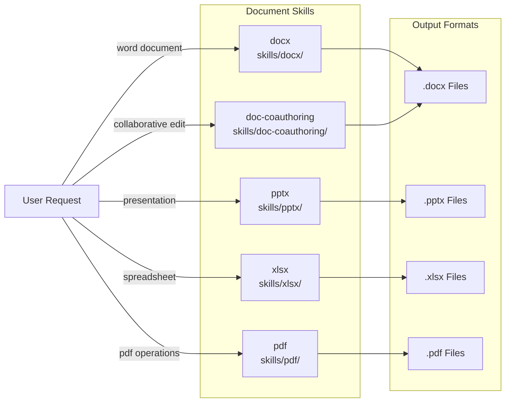
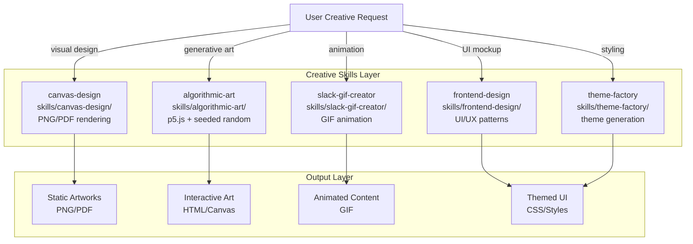
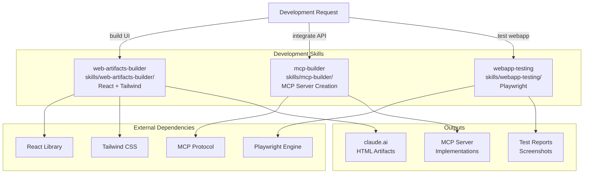
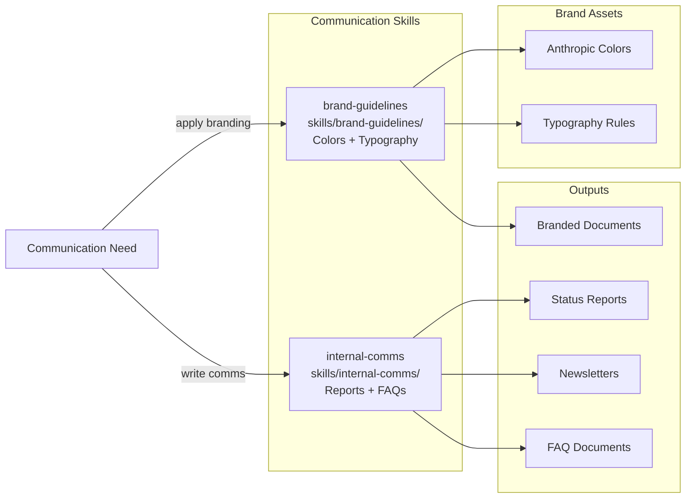
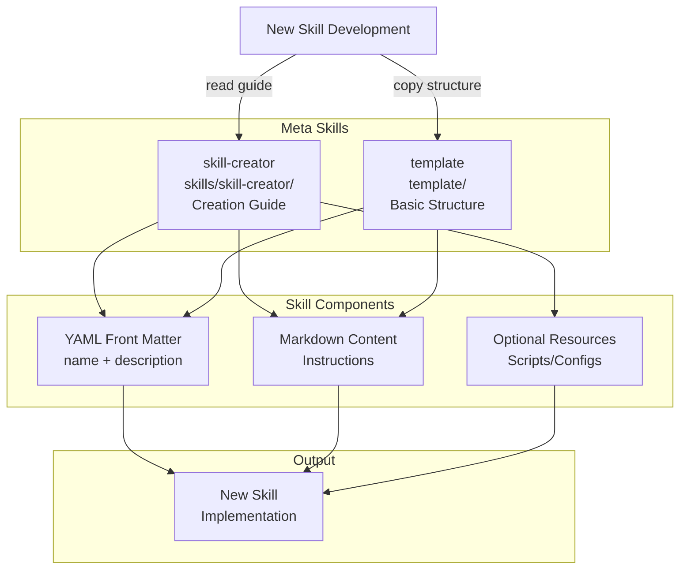
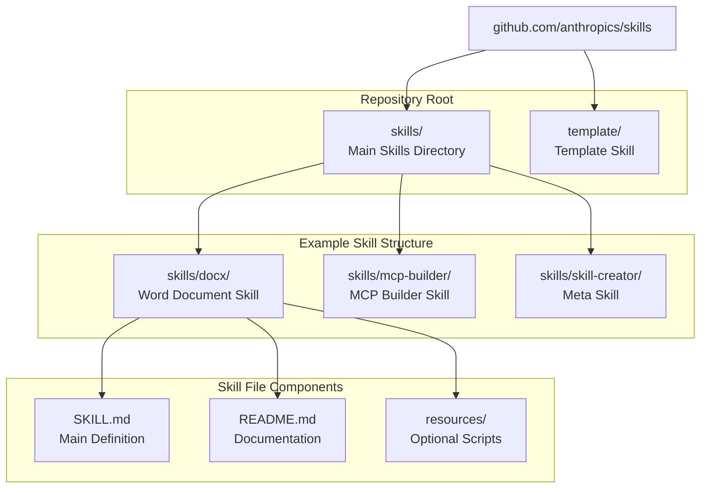

<!-- source: DeepWiki mcp.deepwiki.com · repo VoltAgent/awesome-agent-skills · extra page Anthropic Skills · fetched 2026-10-26 -->

# Anthropic Skills

<details>
<summary>Relevant source files</summary>

The following files were used as context for generating this wiki page:

- [README.md](README.md)

</details>


This page documents the 15 official Agent Skills published by Anthropic, the creators of Claude. These skills are maintained in the [`anthropics/skills`](https://github.com/anthropics/skills) repository and cover five functional domains: document creation, creative/design workflows, development tools, branding/communication, and meta-skills for skill development itself.

For information on the skill definition format used by these skills, see [Skill Definition Format](#3.1). For installation instructions across different AI assistants, see [Installing Skills](#2.1). For skills from other official teams, see [Other Team Skills](#4.1.6) and [Community Skills](#4.2).

## Overview

Anthropic Skills represent the reference implementation of the Agent Skills specification. They demonstrate best practices for skill structure, documentation quality, and use case definition. The skills span from basic document manipulation (Office file formats) to advanced development workflows (MCP server creation, web application testing) and creative generation (algorithmic art, GIF creation).

**Sources:** [README.md:97-130]()

## Skill Categories

The 15 Anthropic skills are organized into five functional categories:

| Category | Skill Count | Primary Focus |
|----------|-------------|---------------|
| Document Creation | 5 | Office file format manipulation (DOCX, PPTX, XLSX, PDF) |
| Creative and Design | 5 | Visual content generation and design tools |
| Development | 3 | Web development, testing, and MCP integration |
| Branding and Communication | 2 | Corporate identity and internal communications |
| Meta | 2 | Skill creation and template provision |

**Sources:** [README.md:99-130]()

### Category Breakdown

```mermaid
graph TB
    subgraph "Anthropic Skills Repository"
        Root["anthropics/skills<br/>15 Official Skills"]
    end
    
    subgraph "Document Creation (5)"
        Doc1["docx<br/>Word Documents"]
        Doc2["doc-coauthoring<br/>Collaborative Editing"]
        Doc3["pptx<br/>Presentations"]
        Doc4["xlsx<br/>Spreadsheets"]
        Doc5["pdf<br/>PDF Operations"]
    end
    
    subgraph "Creative and Design (5)"
        Art1["algorithmic-art<br/>p5.js Generative Art"]
        Art2["canvas-design<br/>PNG/PDF Visual Art"]
        Art3["frontend-design<br/>UI/UX Tools"]
        Art4["slack-gif-creator<br/>Animated GIFs"]
        Art5["theme-factory<br/>Visual Themes"]
    end
    
    subgraph "Development (3)"
        Dev1["web-artifacts-builder<br/>React + Tailwind"]
        Dev2["mcp-builder<br/>MCP Servers"]
        Dev3["webapp-testing<br/>Playwright Tests"]
    end
    
    subgraph "Branding and Communication (2)"
        Brand1["brand-guidelines<br/>Anthropic Brand"]
        Brand2["internal-comms<br/>Reports/FAQs"]
    end
    
    subgraph "Meta (2)"
        Meta1["skill-creator<br/>Creation Guide"]
        Meta2["template<br/>Basic Template"]
    end
    
    Root --> Doc1
    Root --> Doc2
    Root --> Doc3
    Root --> Doc4
    Root --> Doc5
    
    Root --> Art1
    Root --> Art2
    Root --> Art3
    Root --> Art4
    Root --> Art5
    
    Root --> Dev1
    Root --> Dev2
    Root --> Dev3
    
    Root --> Brand1
    Root --> Brand2
    
    Root --> Meta1
    Root --> Meta2
```



**Sources:** [README.md:99-130]()

## Document Creation Skills

These skills manipulate common office file formats, enabling programmatic document generation and analysis.

| Skill | Repository Path | Capabilities |
|-------|----------------|--------------|
| `docx` | `anthropics/skills/tree/main/skills/docx` | Create, edit, and analyze Microsoft Word documents |
| `doc-coauthoring` | `anthropics/skills/tree/main/skills/doc-coauthoring` | Collaborative document editing workflows |
| `pptx` | `anthropics/skills/tree/main/skills/pptx` | Create, edit, and analyze PowerPoint presentations |
| `xlsx` | `anthropics/skills/tree/main/skills/xlsx` | Create, edit, and analyze Excel spreadsheets |
| `pdf` | `anthropics/skills/tree/main/skills/pdf` | Extract text, create PDFs, handle PDF forms |

### Document Creation Workflow



**Sources:** [README.md:99-106]()

## Creative and Design Skills

These skills generate visual content and design artifacts using various libraries and tools.

| Skill | Repository Path | Technology Stack |
|-------|----------------|------------------|
| `algorithmic-art` | `anthropics/skills/tree/main/skills/algorithmic-art` | p5.js with seeded randomness |
| `canvas-design` | `anthropics/skills/tree/main/skills/canvas-design` | PNG and PDF generation |
| `frontend-design` | `anthropics/skills/tree/main/skills/frontend-design` | UI/UX development tools |
| `slack-gif-creator` | `anthropics/skills/tree/main/skills/slack-gif-creator` | Animated GIF generation (Slack-optimized) |
| `theme-factory` | `anthropics/skills/tree/main/skills/theme-factory` | Visual theme generation and application |

### Creative Pipeline Architecture



**Sources:** [README.md:107-114]()

## Development Skills

These skills support modern web development workflows, from artifact building to testing and MCP server integration.

| Skill | Repository Path | Primary Use Case |
|-------|----------------|------------------|
| `web-artifacts-builder` | `anthropics/skills/tree/main/skills/web-artifacts-builder` | Build complex claude.ai HTML artifacts with React and Tailwind CSS |
| `mcp-builder` | `anthropics/skills/tree/main/skills/mcp-builder` | Create Model Context Protocol (MCP) servers for external API integration |
| `webapp-testing` | `anthropics/skills/tree/main/skills/webapp-testing` | Test local web applications using Playwright automation framework |

### Development Skills Integration



For detailed information on MCP integration, see [MCP Server Integration](#3.3).

**Sources:** [README.md:115-120]()

## Branding and Communication Skills

These skills apply Anthropic's corporate identity and support internal communication workflows.

| Skill | Repository Path | Purpose |
|-------|----------------|---------|
| `brand-guidelines` | `anthropics/skills/tree/main/skills/brand-guidelines` | Apply Anthropic's brand colors, typography, and visual identity to artifacts |
| `internal-comms` | `anthropics/skills/tree/main/skills/internal-comms` | Write status reports, newsletters, and FAQ documents |

### Communication Workflow



**Sources:** [README.md:121-125]()

## Meta Skills

These skills facilitate the creation and documentation of new skills, serving as both guides and templates.

| Skill | Repository Path | Function |
|-------|----------------|----------|
| `skill-creator` | `anthropics/skills/tree/main/skills/skill-creator` | Comprehensive guide for creating skills that extend Claude's capabilities |
| `template` | `anthropics/skills/tree/main/template` | Basic template structure for new skill development |

### Meta Skills Structure



The `skill-creator` skill references the official [creation guide](https://support.claude.com/en/articles/12512198-how-to-create-custom-skills) for detailed instructions. For information on contribution requirements, see [Contribution Guidelines](#5.1).

**Sources:** [README.md:126-130](), [README.md:74]()

## Repository Structure

All Anthropic skills are hosted in the `anthropics/skills` GitHub repository. Each skill follows a standardized directory structure with YAML front matter and markdown documentation.

### File Path Mapping



**Sources:** [README.md:101-130]()

## Installation and Usage

To use Anthropic skills, copy the skill directory to your AI assistant's skill path. Each assistant has specific directory conventions.

### Installation Paths

| AI Assistant | Project Path | Global Path |
|-------------|-------------|-------------|
| Claude Code | `.claude/skills/` | `~/.claude/skills/` |
| Cursor | `.cursor/skills/` | `~/.cursor/skills/` |
| GitHub Copilot | `.github/skills/` | `~/.copilot/skills/` |
| Gemini CLI | `.gemini/skills/` | `~/.gemini/skills/` |
| Windsurf | `.windsurf/skills/` | `~/.codeium/windsurf/skills/` |

For complete installation instructions across all 8+ supported AI assistants, see [Installing Skills](#2.1). For compatibility information, see [AI Assistant Compatibility Matrix](#6.1).

**Sources:** [README.md:78-88]()

## Skill Definition Example

The following shows the basic structure referenced in the Awesome Agent Skills collection:

```yaml
---
name: api-tester
description: Test REST APIs and validate responses
---

# API Tester

Test HTTP endpoints and validate response structures.

## When to Use This Skill

Use this skill when you need to test API endpoints and verify response data.

## Instructions

When testing an API:

1. Send a request to the specified endpoint
2. Check the response status code
3. Validate the response body structure
4. Report any errors or unexpected results

## Response Validation

- Verify required fields exist
- Check data types match expected values
- Confirm nested objects have correct structure
```

This example demonstrates the YAML front matter (lines 1-4) containing `name` and `description` fields, followed by markdown content with structured sections. For detailed specification of this format, see [Skill Definition Format](#3.1).

**Sources:** [README.md:44-73]()

## Integration with Other Systems

Anthropic skills integrate with multiple systems and protocols:

### MCP Server Integration

The `mcp-builder` skill at `anthropics/skills/tree/main/skills/mcp-builder` enables creation of Model Context Protocol servers for external API integration. See [MCP Server Integration](#3.3) for technical details.

### Web Artifacts

The `web-artifacts-builder` skill creates HTML artifacts for claude.ai using React and Tailwind CSS. These artifacts are rendered directly in the Claude interface.

### Playwright Testing

The `webapp-testing` skill leverages Playwright for automated browser testing of local web applications.

**Sources:** [README.md:117-120]()

## Relationship to Other Official Skills

Anthropic's 15 skills represent one of 16 official team contributions to the Agent Skills ecosystem. Other major contributors include:

- Vercel Labs (8 skills): React/Next.js patterns
- Cloudflare (7 skills): Edge computing and Workers
- Hugging Face (8 skills): ML workflows
- Trail of Bits (22 skills): Security auditing
- Plus 11 additional official teams

For complete coverage of other teams, see [Official Team Skills](#4.1) and its subsections [Vercel Skills](#4.1.2), [Cloudflare Skills](#4.1.3), [Hugging Face Skills](#4.1.4), [Trail of Bits Security Skills](#4.1.5), and [Other Team Skills](#4.1.6).

**Sources:** [README.md:35](), [README.md:131-261]()

## Quality and Maintenance

As the reference implementation from Anthropic (the creators of Claude), these skills demonstrate:

- **Documentation Quality**: Comprehensive README files and inline documentation
- **Structural Best Practices**: Proper YAML front matter and markdown organization
- **Use Case Definition**: Clear "When to Use" sections and step-by-step instructions
- **Active Maintenance**: Regular updates from the Anthropic team

All Anthropic skills are publicly maintained at `github.com/anthropics/skills`. For contribution guidelines to the Awesome Agent Skills collection, see [Contributing to the Collection](#5) and [Quality Requirements](#5.2).

**Sources:** [README.md:35](), [README.md:74]()

---

