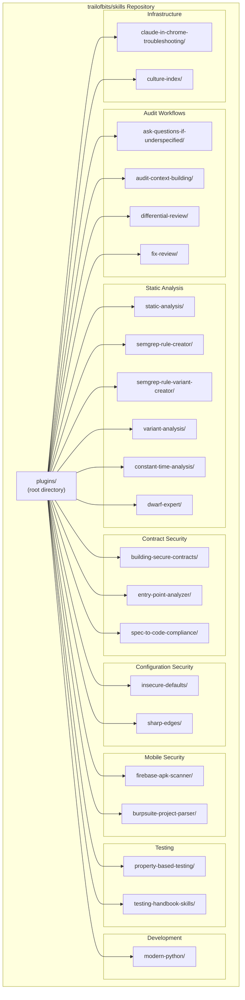
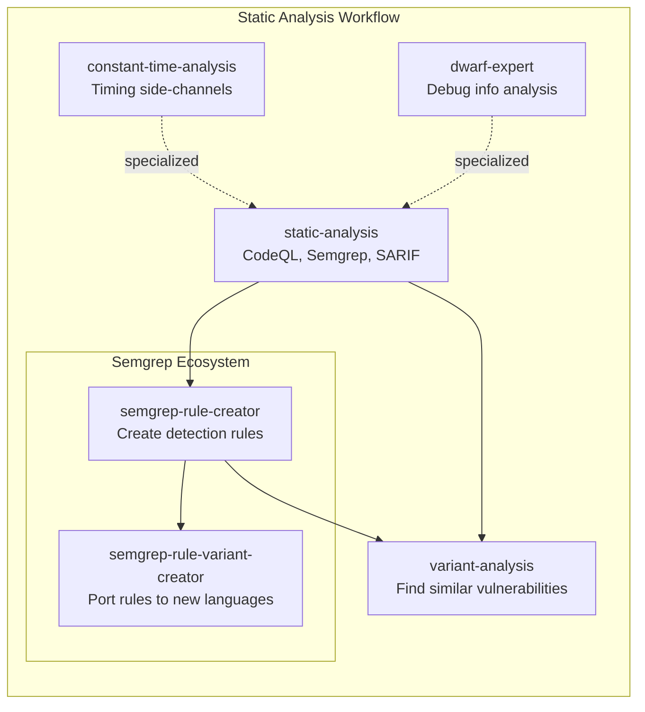
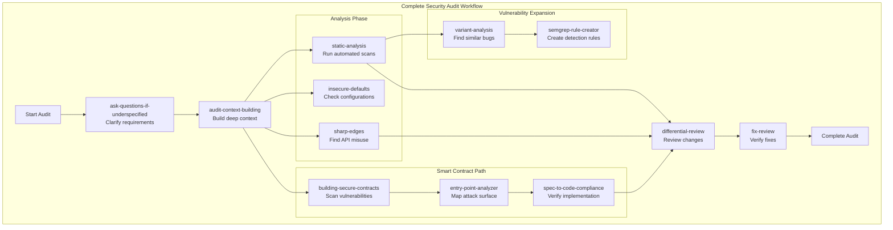
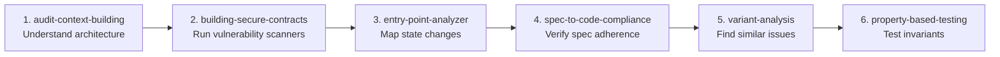
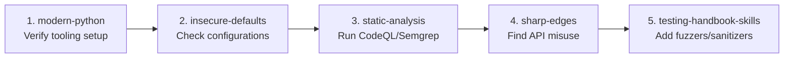
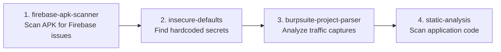

<!-- source: DeepWiki mcp.deepwiki.com · repo VoltAgent/awesome-agent-skills · extra page Trail of Bits Security Skills · fetched 2026-10-26 -->

# Trail of Bits Security Skills

<details>
<summary>Relevant source files</summary>

The following files were used as context for generating this wiki page:

- [README.md](README.md)

</details>


This document provides comprehensive documentation of the 22 security-focused agent skills contributed by Trail of Bits, the leading security research and consulting firm. These skills enable AI coding assistants to perform security audits, static analysis, vulnerability detection, smart contract review, and secure development workflows.

For general information about official team skills, see [Official Team Skills](#4.1). For community-contributed security skills, see [Specialized Domain Skills](#4.2.5). For contribution requirements, see [Quality Requirements](#5.2).

## Purpose and Scope

The Trail of Bits security skills collection represents the largest single-team contribution to the Awesome Agent Skills repository, with 22 specialized capabilities covering the full spectrum of security engineering workflows. All skills are maintained in the [`trailofbits/skills`](https://github.com/trailofbits/skills/tree/main/plugins/) repository under the `plugins/` directory.

This page documents:
- The organizational structure of the 22 Trail of Bits security skills
- Technical capabilities and use cases for each skill category
- Integration patterns with security tools and workflows
- Relationships between complementary skills for complex security tasks

**Sources:** [README.md:181-204]()

## Collection Overview

The Trail of Bits skills collection addresses eight primary security domains:

| Domain | Skill Count | Primary Focus |
|--------|-------------|---------------|
| Security Audit Workflows | 4 | Context building, differential review, fix verification |
| Static Analysis & Detection | 6 | CodeQL, Semgrep, variant analysis, timing analysis |
| Smart Contract Security | 3 | Blockchain audits, entry point analysis, spec compliance |
| Configuration Security | 2 | Insecure defaults, dangerous API patterns |
| Mobile & Application Security | 2 | Firebase scanning, Burp Suite integration |
| Testing Methodologies | 2 | Property-based testing, fuzzing, sanitizers |
| Development Practices | 1 | Modern Python tooling |
| Infrastructure & Tooling | 2 | MCP troubleshooting, documentation indexing |

All skills follow the standard agent skill format with YAML front matter and Markdown instructions, and are compatible with Claude Code, Cursor, GitHub Copilot, Gemini CLI, Windsurf, and other AI coding assistants (see [AI Assistant Integration](#3.2) for deployment paths).

**Sources:** [README.md:181-204]()

## Skill Taxonomy and Repository Structure



This diagram shows the directory structure of all 22 skills within the `trailofbits/skills` repository. Each directory contains a skill definition with YAML metadata and Markdown instructions following the standard format documented in [Skill Definition Format](#3.1).

**Sources:** [README.md:181-204]()

## Security Audit Workflow Skills

These four skills form a complete security audit lifecycle, from initial context gathering through fix verification.

### audit-context-building

**Repository:** [`trailofbits/skills/tree/main/plugins/audit-context-building`](https://github.com/trailofbits/skills/tree/main/plugins/audit-context-building)

**Purpose:** Deep architectural context via ultra-granular code analysis

Enables AI agents to build comprehensive understanding of codebases before security audits by performing systematic analysis of:
- Architectural patterns and design decisions
- Data flow paths and trust boundaries
- Dependencies and external integrations
- Attack surface enumeration

This skill is typically the first step in the audit workflow, providing the foundation for all subsequent security analysis.

### ask-questions-if-underspecified

**Repository:** [`trailofbits/skills/tree/main/plugins/ask-questions-if-underspecified`](https://github.com/trailofbits/skills/tree/main/plugins/ask-questions-if-underspecified)

**Purpose:** Prompt for clarification on ambiguous requirements

Trains AI agents to identify and surface ambiguous security requirements, unclear specifications, and underspecified threat models. Prevents false assumptions during audits by ensuring all security-critical decisions are explicitly documented and agreed upon.

### differential-review

**Repository:** [`trailofbits/skills/tree/main/plugins/differential-review`](https://github.com/trailofbits/skills/tree/main/plugins/differential-review)

**Purpose:** Security-focused diff review with git history analysis

Performs security-focused analysis of code changes by:
- Analyzing git diffs for security implications
- Reviewing commit history for security-sensitive modifications
- Identifying introduced vulnerabilities in changed code
- Detecting removed security controls

Integrates with git to access historical context and change patterns.

### fix-review

**Repository:** [`trailofbits/skills/tree/main/plugins/fix-review`](https://github.com/trailofbits/skills/tree/main/plugins/fix-review)

**Purpose:** Verify fix commits address audit findings without new bugs

Completes the audit workflow by verifying that:
- Fixes completely address reported vulnerabilities
- No new security issues are introduced
- Edge cases are properly handled
- Fix implementation matches recommended remediation

**Sources:** [README.md:183-184, 190-191, 194]()

## Static Analysis and Vulnerability Detection Skills

Six complementary skills for automated vulnerability detection and pattern-based security analysis.



### static-analysis

**Repository:** [`trailofbits/skills/tree/main/plugins/static-analysis`](https://github.com/trailofbits/skills/tree/main/plugins/static-analysis)

**Purpose:** Static analysis toolkit with CodeQL, Semgrep, and SARIF

Central skill for automated vulnerability detection supporting:
- **CodeQL queries** for deep semantic analysis
- **Semgrep rules** for pattern-based detection
- **SARIF output** for standardized reporting
- Integration with CI/CD pipelines

Acts as the foundation for the other static analysis skills in this category.

### semgrep-rule-creator

**Repository:** [`trailofbits/skills/tree/main/plugins/semgrep-rule-creator`](https://github.com/trailofbits/skills/tree/main/plugins/semgrep-rule-creator)

**Purpose:** Create and refine Semgrep rules for vulnerability detection

Guides AI agents through the process of:
- Writing Semgrep patterns for specific vulnerability classes
- Testing rules against known vulnerable code
- Refining patterns to reduce false positives
- Documenting rule metadata and severity

### semgrep-rule-variant-creator

**Repository:** [`trailofbits/skills/tree/main/plugins/semgrep-rule-variant-creator`](https://github.com/trailofbits/skills/tree/main/plugins/semgrep-rule-variant-creator)

**Purpose:** Port existing Semgrep rules to new target languages with test-driven validation

Enables cross-language vulnerability detection by:
- Analyzing existing Semgrep rules for one language
- Translating patterns to equivalent constructs in target languages
- Creating test cases to validate ported rules
- Maintaining semantic equivalence across language variants

### variant-analysis

**Repository:** [`trailofbits/skills/tree/main/plugins/variant-analysis`](https://github.com/trailofbits/skills/tree/main/plugins/variant-analysis)

**Purpose:** Find similar vulnerabilities via pattern-based analysis

After identifying a vulnerability, this skill:
- Extracts the vulnerability pattern
- Searches codebase for similar patterns
- Identifies variant instances of the same bug class
- Generates comprehensive reports of related issues

Critical for ensuring complete remediation of vulnerability classes rather than one-off fixes.

### constant-time-analysis

**Repository:** [`trailofbits/skills/tree/main/plugins/constant-time-analysis`](https://github.com/trailofbits/skills/tree/main/plugins/constant-time-analysis)

**Purpose:** Detect compiler-induced timing side-channels in crypto code

Specialized skill for cryptographic implementations that:
- Analyzes compiled code for timing variations
- Identifies non-constant-time operations in crypto primitives
- Detects compiler optimizations that introduce timing leaks
- Validates constant-time guarantees

### dwarf-expert

**Repository:** [`trailofbits/skills/tree/main/plugins/dwarf-expert`](https://github.com/trailofbits/skills/tree/main/plugins/dwarf-expert)

**Purpose:** DWARF debugging format expertise

Provides deep expertise in DWARF debug information format for:
- Binary analysis and reverse engineering
- Debug information validation
- Symbol table analysis
- Low-level debugging workflows

**Sources:** [README.md:188-189, 191-192, 198-199, 202, 204]()

## Smart Contract Security Skills

Three specialized skills for blockchain and smart contract security audits covering multiple blockchain platforms.

| Skill | Blockchains Supported | Primary Capability |
|-------|----------------------|-------------------|
| `building-secure-contracts` | 6 (Ethereum, Solana, etc.) | Vulnerability scanners, security patterns |
| `entry-point-analyzer` | Multi-chain | State-changing function identification |
| `spec-to-code-compliance` | Multi-chain | Specification compliance verification |

### building-secure-contracts

**Repository:** [`trailofbits/skills/tree/main/plugins/building-secure-contracts`](https://github.com/trailofbits/skills/tree/main/plugins/building-secure-contracts)

**Purpose:** Smart contract security toolkit with vulnerability scanners for 6 blockchains

Comprehensive toolkit providing:
- **Multi-blockchain support:** Ethereum, Solana, and 4 additional blockchain platforms
- **Vulnerability scanners:** Automated detection of common smart contract vulnerabilities
- **Security patterns:** Best practices for secure contract development
- **Known vulnerability database:** Reference implementations of vulnerable patterns

This is the primary skill for smart contract audits and secure contract development.

### entry-point-analyzer

**Repository:** [`trailofbits/skills/tree/main/plugins/entry-point-analyzer`](https://github.com/trailofbits/skills/tree/main/plugins/entry-point-analyzer)

**Purpose:** Identify state-changing entry points in smart contracts

Performs analysis to:
- Enumerate all public/external functions
- Identify state-modifying operations
- Map entry points to state transitions
- Analyze access control for each entry point

Critical for understanding attack surface and state manipulation risks.

### spec-to-code-compliance

**Repository:** [`trailofbits/skills/tree/main/plugins/spec-to-code-compliance`](https://github.com/trailofbits/skills/tree/main/plugins/spec-to-code-compliance)

**Purpose:** Specification-to-code compliance checker for blockchain audits

Verifies that smart contract implementations match their specifications by:
- Parsing formal specifications and whitepapers
- Mapping spec requirements to code implementations
- Identifying missing or incorrect functionality
- Generating compliance reports

Essential for audits where contracts must implement specific protocols or standards.

**Sources:** [README.md:185, 192, 201]()

## Configuration and Default Security Skills

Two skills focused on detecting dangerous defaults and configuration issues.

### insecure-defaults

**Repository:** [`trailofbits/skills/tree/main/plugins/insecure-defaults`](https://github.com/trailofbits/skills/tree/main/plugins/insecure-defaults)

**Purpose:** Detect insecure default configurations like hardcoded secrets, default credentials, and weak crypto

Scans for common configuration security issues:

| Vulnerability Class | Detection Capability |
|-------------------|---------------------|
| Hardcoded secrets | API keys, passwords, tokens in code |
| Default credentials | Unchanged default usernames/passwords |
| Weak cryptography | MD5, SHA1, deprecated algorithms |
| Insecure permissions | World-readable files, overly permissive access |
| Debug features | Enabled debug modes in production |

### sharp-edges

**Repository:** [`trailofbits/skills/tree/main/plugins/sharp-edges`](https://github.com/trailofbits/skills/tree/main/plugins/sharp-edges)

**Purpose:** Identify error-prone APIs and dangerous configurations

Identifies APIs and patterns that are:
- Known to be misused frequently
- Have security-sensitive side effects
- Require careful initialization or cleanup
- Have confusing or inconsistent behavior

Acts as a complement to `insecure-defaults` by focusing on API misuse patterns rather than configuration values.

**Sources:** [README.md:195, 200]()

## Mobile and Application Security Skills

### firebase-apk-scanner

**Repository:** [`trailofbits/skills/tree/main/plugins/firebase-apk-scanner`](https://github.com/trailofbits/skills/tree/main/plugins/firebase-apk-scanner)

**Purpose:** Scan Android APKs for Firebase misconfigurations and security vulnerabilities

Specialized Android security skill that:
- Extracts and analyzes APK contents
- Identifies Firebase configuration files
- Detects insecure Firebase rules
- Finds exposed API keys and credentials
- Reports misconfigured authentication flows

### burpsuite-project-parser

**Repository:** [`trailofbits/skills/tree/main/plugins/burpsuite-project-parser`](https://github.com/trailofbits/skills/tree/main/plugins/burpsuite-project-parser)

**Purpose:** Search and extract data from Burp Suite project files

Enables AI agents to:
- Parse Burp Suite project files (`.burp`)
- Extract HTTP requests and responses
- Search for specific patterns in captured traffic
- Analyze security testing results
- Generate reports from Burp Suite data

Bridges manual penetration testing workflows with automated analysis.

**Sources:** [README.md:186, 193]()

## Testing Methodology Skills

### property-based-testing

**Repository:** [`trailofbits/skills/tree/main/plugins/property-based-testing`](https://github.com/trailofbits/skills/tree/main/plugins/property-based-testing)

**Purpose:** Property-based testing for multiple languages and smart contracts

Implements property-based testing methodologies including:
- **Hypothesis (Python)** - Property-based testing framework
- **QuickCheck (Haskell)** - Original property-based testing tool
- **PropTest (Rust)** - Rust property testing
- **Smart contract properties** - Invariant testing for blockchain

Generates test cases by:
1. Defining properties that should always hold
2. Generating random inputs
3. Verifying properties across input space
4. Shrinking failing cases to minimal examples

### testing-handbook-skills

**Repository:** [`trailofbits/skills/tree/main/plugins/testing-handbook-skills`](https://github.com/trailofbits/skills/tree/main/plugins/testing-handbook-skills)

**Purpose:** Testing Handbook skills: fuzzers, static analysis, sanitizers

Comprehensive testing toolkit covering:
- **Fuzzers:** AFL, LibFuzzer, Honggfuzz
- **Static analyzers:** Clang Static Analyzer, Infer
- **Sanitizers:** AddressSanitizer, UndefinedBehaviorSanitizer, MemorySanitizer
- **Test harness creation** for various testing tools

Implements best practices from the Trail of Bits Testing Handbook.

**Sources:** [README.md:197, 203]()

## Development Practices Skills

### modern-python

**Repository:** [`trailofbits/skills/tree/main/plugins/modern-python`](https://github.com/trailofbits/skills/tree/main/plugins/modern-python)

**Purpose:** Modern Python tooling with uv, ruff, ty, and pytest best practices

Enforces modern Python development standards using:

| Tool | Purpose |
|------|---------|
| `uv` | Fast Python package installer and resolver |
| `ruff` | Extremely fast Python linter and formatter |
| `ty` | Type checking utilities |
| `pytest` | Testing framework with best practices |

Guides AI agents to:
- Set up modern Python projects
- Configure tooling correctly
- Write idiomatic, type-safe code
- Implement comprehensive test suites

**Sources:** [README.md:196]()

## Infrastructure and Tooling Skills

### claude-in-chrome-troubleshooting

**Repository:** [`trailofbits/skills/tree/main/plugins/claude-in-chrome-troubleshooting`](https://github.com/trailofbits/skills/tree/main/plugins/claude-in-chrome-troubleshooting)

**Purpose:** Diagnose and fix Claude in Chrome MCP extension connectivity issues

Specialized troubleshooting skill for the Claude in Chrome MCP extension that:
- Diagnoses connection failures
- Checks MCP server configuration
- Validates extension permissions
- Resolves common setup issues
- Provides step-by-step remediation

### culture-index

**Repository:** [`trailofbits/skills/tree/main/plugins/culture-index`](https://github.com/trailofbits/skills/tree/main/plugins/culture-index)

**Purpose:** Index and search culture documentation

Enables AI agents to:
- Index internal documentation and wikis
- Search organizational knowledge bases
- Retrieve relevant context from documentation
- Maintain updated indices of cultural and process documentation

Useful for onboarding and maintaining institutional knowledge.

**Sources:** [README.md:187, 189]()

## Skill Integration Patterns

The Trail of Bits skills are designed to work together in comprehensive security workflows. This diagram shows common integration patterns:



**Sources:** [README.md:181-204]()

## Common Security Workflows

### Blockchain Smart Contract Audit



### Python Application Security Review



### Mobile Application Security Assessment



**Sources:** [README.md:181-204]()

## Deployment and Usage

All Trail of Bits skills can be deployed to any supported AI coding assistant using the standard paths documented in [Installing Skills](#2.1):

| Assistant | Project Path | Global Path |
|-----------|-------------|-------------|
| Claude Code | `.claude/skills/` | `~/.claude/skills/` |
| Cursor | `.cursor/skills/` | `~/.cursor/skills/` |
| GitHub Copilot | `.github/skills/` | `~/.copilot/skills/` |
| Gemini CLI | `.gemini/skills/` | `~/.gemini/skills/` |
| Windsurf | `.windsurf/skills/` | `~/.codeium/windsurf/skills/` |

To install a Trail of Bits skill:

1. Clone the [`trailofbits/skills`](https://github.com/trailofbits/skills) repository
2. Copy the desired skill directory from `plugins/<skill-name>/` 
3. Paste into your AI assistant's skills directory
4. Restart your AI assistant or reload skills

For example, to install `static-analysis` for Claude Code:
```bash
git clone https://github.com/trailofbits/skills.git
cp -r skills/plugins/static-analysis ~/.claude/skills/
```

**Sources:** [README.md:76-87, 181-204]()

## Relationship to Other Skills

The Trail of Bits security skills complement other security-focused skills in the collection:

- **[Rootly Incident Responder](#4.2.1)** - Incident response and on-call management (use after detection)
- **[ffuf Web Fuzzing](#4.2.1)** - Web application fuzzing (complements `burpsuite-project-parser`)
- **[Defense in Depth](#4.2.5)** - Multi-layered security design patterns
- **[Security Bluebook Builder](#4.2.5)** - Security documentation for sensitive applications

For general development and testing workflows that integrate with security practices, see [Development and Testing Skills](#4.2.1).

**Sources:** [README.md:262-373]()

---

