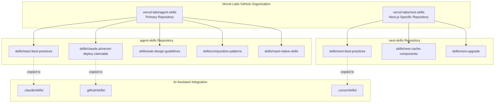
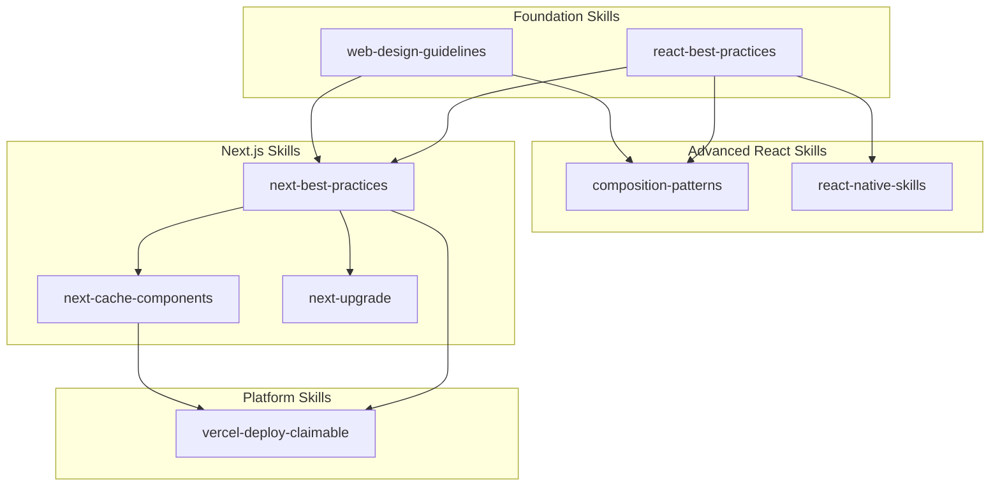
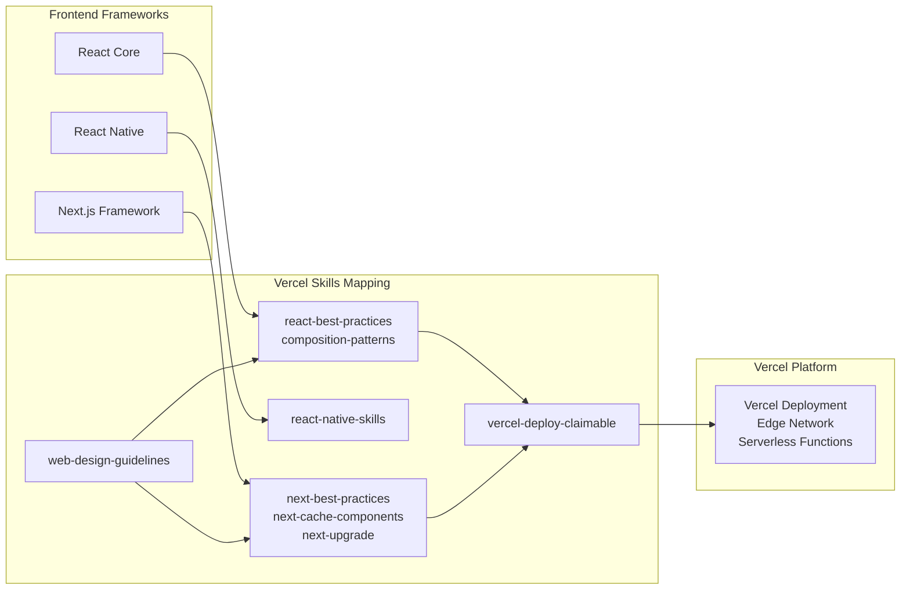
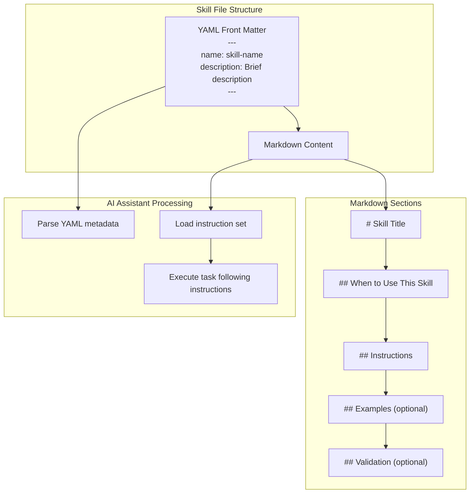
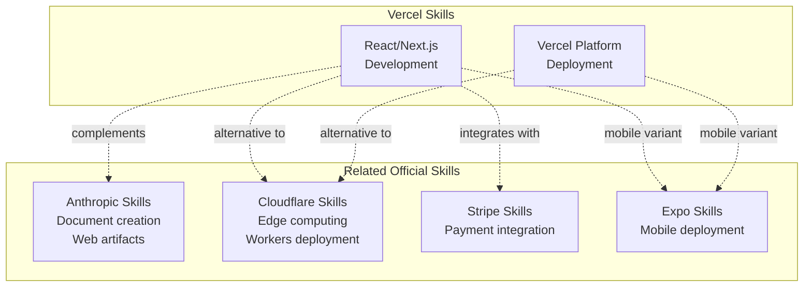

<!-- source: DeepWiki mcp.deepwiki.com · repo VoltAgent/awesome-agent-skills · extra page Vercel Skills · fetched 2026-10-26 -->

# Vercel Skills

Relevant source files

The following files were used as context for generating this wiki page:

- [README.md](README.md)

## Purpose and Scope

This page documents the 8 official Agent Skills contributed by the Vercel Engineering Team through Vercel Labs. These skills provide best practices, patterns, and workflows for developing with React, Next.js, and the Vercel platform. The skills focus on modern web development practices, performance optimization, deployment automation, and design standards.

For skills from other official teams, see [Official Team Skills](#4.1). For community-contributed development skills, see [Development and Testing Skills](#4.2.1).

**Sources:** [README.md:131-141]()

## Skill Categories

The Vercel skill collection is organized into four functional domains:

| Category | Skills | Focus Area |
|----------|--------|------------|
| **React Ecosystem** | `react-best-practices`, `composition-patterns`, `react-native-skills` | Component architecture, reusable patterns, cross-platform development |
| **Next.js Framework** | `next-best-practices`, `next-cache-components`, `next-upgrade` | Server-side rendering, caching strategies, framework migrations |
| **Deployment** | `vercel-deploy-claimable` | Platform deployment automation |
| **Design Standards** | `web-design-guidelines` | UI/UX guidelines and web design principles |

**Sources:** [README.md:131-141]()

## Repository Architecture

Vercel Labs maintains two separate GitHub repositories for their skill collection:

**Sources:** [README.md:133-141]()

## Skill Catalog

### React Best Practices

**Repository:** `vercel-labs/agent-skills/tree/main/skills/react-best-practices`

Provides comprehensive guidance on React component development, including modern patterns, performance optimization techniques, and architectural best practices aligned with Vercel's internal standards.

**Sources:** [README.md:133]()

### Vercel Deploy Claimable

**Repository:** `vercel-labs/agent-skills/tree/main/skills/claude.ai/vercel-deploy-claimable`

Automates deployment workflows to the Vercel platform. Handles project configuration, environment variable management, and deployment triggering through the Vercel API.

**Path Structure:** Note that this skill uses a nested `claude.ai` directory, suggesting initial development specifically for Claude Code before broader AI assistant compatibility.

**Sources:** [README.md:134]()

### Web Design Guidelines

**Repository:** `vercel-labs/agent-skills/tree/main/skills/web-design-guidelines`

Codifies Vercel's web design standards and UI/UX principles. Covers layout systems, typography, spacing, color usage, and responsive design patterns.

**Sources:** [README.md:135]()

### Composition Patterns

**Repository:** `vercel-labs/agent-skills/tree/main/skills/composition-patterns`

Teaches React component composition strategies and reusable pattern libraries. Focuses on compound components, render props, higher-order components, and custom hooks patterns.

**Sources:** [README.md:136]()

### Next.js Best Practices

**Repository:** `vercel-labs/next-skills/tree/main/skills/next-best-practices`

Documents recommended patterns for Next.js applications including App Router conventions, Server Components usage, data fetching strategies, and route organization.

**Sources:** [README.md:137]()

### Next.js Cache Components

**Repository:** `vercel-labs/next-skills/tree/main/skills/next-cache-components`

Provides detailed guidance on Next.js caching mechanisms including React Server Components cache, Data Cache, Full Route Cache, and Router Cache. Covers cache invalidation strategies and cache-aware component design.

**Sources:** [README.md:138]()

### Next.js Upgrade

**Repository:** `vercel-labs/next-skills/tree/main/skills/next-upgrade`

Guides AI assistants through Next.js version migration processes, including breaking change analysis, codemods application, dependency updates, and configuration adjustments.

**Sources:** [README.md:139]()

### React Native Skills

**Repository:** `vercel-labs/agent-skills/tree/main/skills/react-native-skills`

Covers React Native development best practices with emphasis on performance optimization, platform-specific code organization, and cross-platform component design.

**Sources:** [README.md:140]()

## Skill Dependency Graph

The following diagram illustrates how Vercel skills relate to each other and build upon shared knowledge domains:

**Dependency Patterns:**
- `react-best-practices` serves as a foundation for all React-based skills
- `composition-patterns` extends both React best practices and design guidelines
- Next.js skills build hierarchically: best practices → caching → upgrade workflows
- `vercel-deploy-claimable` requires understanding of Next.js configuration and caching

**Sources:** [README.md:131-141]()

## Technology Stack Coverage

**Sources:** [README.md:131-141]()

## Integration with AI Coding Assistants

All Vercel skills follow the standardized Agent Skill format and can be installed in any compatible AI coding assistant. The skills are distributed as external repositories and must be copied to the appropriate local directory.

### Installation Paths

| AI Assistant | Project Path | Global Path |
|--------------|--------------|-------------|
| Claude Code | `.claude/skills/` | `~/.claude/skills/` |
| Cursor | `.cursor/skills/` | `~/.cursor/skills/` |
| GitHub Copilot | `.github/skills/` | `~/.copilot/skills/` |
| Gemini CLI | `.gemini/skills/` | `~/.gemini/skills/` |
| Windsurf | `.windsurf/skills/` | `~/.codeium/windsurf/skills/` |
| Antigravity | `.agent/skills/` | `~/.gemini/antigravity/skills/` |
| Codex | `.codex/skills/` | `~/.codex/skills/` |
| OpenCode | `.opencode/skills/` | `~/.config/opencode/skills/` |

For detailed installation instructions, see [Installing Skills](#2.1).

**Sources:** [README.md:76-88]()

## Skill Format Structure

Each Vercel skill follows the standard YAML front matter + Markdown structure:

For detailed format specifications, see [Skill Definition Format](#3.1).

**Sources:** [README.md:42-73]()

## Skill Usage Patterns

The following table summarizes common use cases for each Vercel skill:

| Skill | Primary Use Case | Typical Trigger Phrases |
|-------|------------------|------------------------|
| `react-best-practices` | Component development guidance | "Create a React component", "Optimize this component" |
| `vercel-deploy-claimable` | Deployment automation | "Deploy to Vercel", "Create production build" |
| `web-design-guidelines` | UI/UX implementation | "Design this interface", "Apply design standards" |
| `composition-patterns` | Advanced component architecture | "Refactor using composition", "Create reusable pattern" |
| `next-best-practices` | Next.js application development | "Create Next.js app", "Implement SSR" |
| `next-cache-components` | Performance optimization | "Optimize caching", "Implement cache strategy" |
| `next-upgrade` | Framework migration | "Upgrade Next.js", "Migrate to App Router" |
| `react-native-skills` | Mobile development | "Create React Native component", "Optimize mobile performance" |

**Sources:** [README.md:131-141]()

## Quality and Maintenance

Vercel skills are maintained by the official Vercel Labs team and are updated to reflect current framework versions and platform capabilities. These skills represent production-tested patterns used internally at Vercel.

### Repository Locations

- **Primary React/General Skills:** `https://github.com/vercel-labs/agent-skills`
- **Next.js-Specific Skills:** `https://github.com/vercel-labs/next-skills`

### Update Frequency

Official team skills are periodically updated to align with major framework releases and platform updates. Users should periodically check the source repositories for updated versions.

**Sources:** [README.md:35](), [README.md:131-141]()

## Relationship to Other Official Skills

Vercel skills complement other official team skills in the ecosystem:

- **Anthropic Skills**: Vercel's `web-design-guidelines` complements Anthropic's `frontend-design` and `web-artifacts-builder` skills. See [Anthropic Skills](#4.1.1).
- **Cloudflare Skills**: Vercel deployment skills provide an alternative to Cloudflare Workers deployment. See [Cloudflare Skills](#4.1.3).
- **Stripe Skills**: Vercel React skills can be combined with Stripe integration skills for payment-enabled applications.
- **Expo Skills**: Vercel's `react-native-skills` complements Expo's mobile deployment workflows. See [Other Team Skills](#4.1.6).

**Sources:** [README.md:97-261]()

## Contributing and Feedback

Vercel skills are maintained in official Vercel Labs repositories. For issues, feature requests, or contributions:

1. Navigate to the appropriate repository (`vercel-labs/agent-skills` or `vercel-labs/next-skills`)
2. Review existing issues and pull requests
3. Submit feedback through GitHub issues
4. Propose changes via pull requests following repository contribution guidelines

This Awesome Agent Skills repository only curates links to these skills. To report issues with the collection entry itself, see [Contributing to the Collection](#5).

**Sources:** [README.md:374-392]()

---

