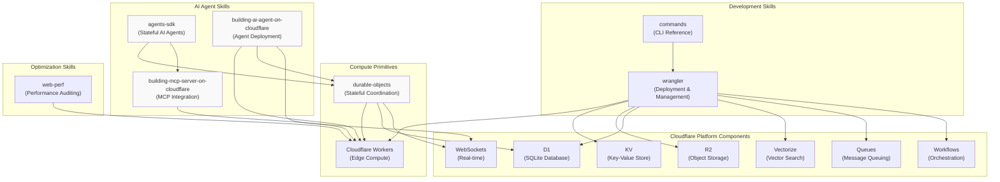
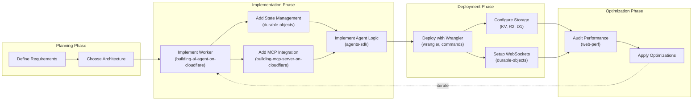
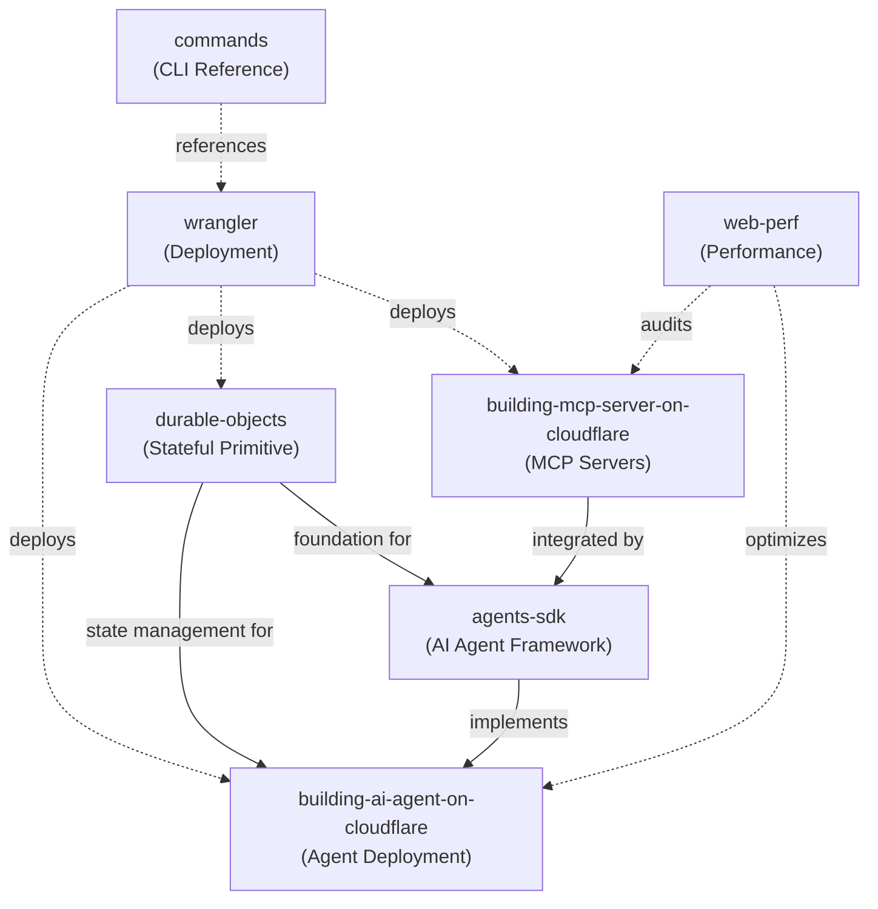

<!-- source: DeepWiki mcp.deepwiki.com · repo VoltAgent/awesome-agent-skills · extra page Cloudflare Skills · fetched 2026-10-26 -->

# Cloudflare Skills

Relevant source files

The following files were used as context for generating this wiki page:

- [README.md](README.md)

## Purpose and Scope

This document catalogs and explains Cloudflare's 7 official Agent Skills that teach AI coding assistants how to build, deploy, and optimize applications on the Cloudflare platform. These skills cover edge computing, stateful coordination with Durable Objects, MCP server development, web performance optimization, and CLI-based deployment workflows.

For information about installing and using skills with AI assistants, see [Installing Skills](#2.1). For other official team skills, see [Official Team Skills](#4.1).

**Sources:** [README.md:142-150]()

## Overview of Cloudflare Skills

Cloudflare maintains 7 official skills in the [cloudflare/skills](https://github.com/cloudflare/skills) repository, organized around core platform capabilities:

| Skill Name | Repository Path | Primary Focus |
|------------|----------------|---------------|
| `agents-sdk` | `cloudflare/skills/tree/main/agents-sdk` | Build stateful AI agents with scheduling, RPC, and MCP servers |
| `building-ai-agent-on-cloudflare` | `cloudflare/skills/tree/main/building-ai-agent-on-cloudflare` | Build AI agents with state and WebSockets on Cloudflare |
| `building-mcp-server-on-cloudflare` | `cloudflare/skills/tree/main/building-mcp-server-on-cloudflare` | Build remote MCP servers with tools and OAuth |
| `commands` | `cloudflare/skills/tree/main/commands` | Cloudflare CLI commands reference |
| `durable-objects` | `cloudflare/skills/tree/main/durable-objects` | Stateful coordination with RPC, SQLite, and WebSockets |
| `web-perf` | `cloudflare/skills/tree/main/web-perf` | Audit Core Web Vitals and render-blocking resources |
| `wrangler` | `cloudflare/skills/tree/main/wrangler` | Deploy and manage Workers, KV, R2, D1, Vectorize, Queues, Workflows |

**Sources:** [README.md:142-150]()

## Skill Categories

### Infrastructure and Deployment Skills

**`wrangler`** provides comprehensive guidance for deploying and managing Cloudflare resources. This skill teaches AI agents how to use the Wrangler CLI to deploy Workers, configure KV namespaces, manage R2 object storage, set up D1 databases, configure Vectorize indexes, deploy Queues, and orchestrate Workflows.

**`commands`** serves as a reference guide for Cloudflare CLI commands, enabling AI agents to execute platform operations through command-line interfaces.

### Stateful Computing Skills

**`durable-objects`** focuses on Cloudflare's unique stateful coordination primitive. This skill teaches AI agents how to implement RPC patterns, integrate SQLite storage within Durable Objects, and establish WebSocket connections for real-time communication. Durable Objects provide single-threaded, strongly consistent coordination across Cloudflare's edge network.

**`agents-sdk`** extends stateful capabilities specifically for AI agent development, incorporating scheduling mechanisms, RPC communication patterns, and MCP server integration within the Durable Objects framework.

### AI Integration Skills

**`building-ai-agent-on-cloudflare`** teaches the end-to-end process of deploying AI agents on Cloudflare's edge platform. This skill covers state management patterns, WebSocket integration for real-time agent communication, and leveraging Cloudflare's distributed architecture for agent deployment.

**`building-mcp-server-on-cloudflare`** focuses on implementing Model Context Protocol (MCP) servers as Cloudflare Workers. This skill covers tool definition, OAuth authentication flows, and remote MCP server patterns that allow AI agents to access external APIs and services through the MCP interface.

### Performance Optimization Skills

**`web-perf`** provides auditing capabilities for Core Web Vitals and render-blocking resources. This skill teaches AI agents how to analyze web performance metrics, identify bottlenecks, and recommend optimizations for applications deployed on Cloudflare's edge network.

**Sources:** [README.md:142-150]()

## Cloudflare Skill Ecosystem Architecture

**Cloudflare Skill Dependency and Platform Integration**

This diagram illustrates how Cloudflare's 7 skills integrate with platform components. The `wrangler` skill serves as the primary deployment interface, managing Workers and storage services (KV, R2, D1, Vectorize, Queues, Workflows). The `durable-objects` skill provides stateful coordination on top of Workers, leveraging D1 for persistence and WebSockets for real-time communication. AI-focused skills (`agents-sdk`, `building-ai-agent-on-cloudflare`, `building-mcp-server-on-cloudflare`) build upon these primitives to enable intelligent agent deployment. The `web-perf` skill provides optimization guidance for deployed applications.

**Sources:** [README.md:142-150]()

## Development Workflow Using Cloudflare Skills

**Cloudflare Skills Development Lifecycle**

This workflow diagram shows how the 7 Cloudflare skills work together in a typical development lifecycle. Projects begin by defining requirements and choosing an architecture. Implementation starts with basic Worker setup using `building-ai-agent-on-cloudflare`, adds stateful coordination via `durable-objects`, integrates external services through `building-mcp-server-on-cloudflare`, and implements agent logic using `agents-sdk`. Deployment leverages `wrangler` and `commands` to publish Workers and configure storage resources. Finally, `web-perf` audits performance and identifies optimization opportunities, creating an iterative improvement cycle.

**Sources:** [README.md:142-150]()

## Technical Stack Mapping

```mermaid
graph TB
    subgraph "GitHub Repository Structure"
        repo["github.com/cloudflare/skills"]
        agents_sdk_path["agents-sdk/"]
        building_ai_path["building-ai-agent-on-cloudflare/"]
        building_mcp_path["building-mcp-server-on-cloudflare/"]
        commands_path["commands/"]
        durable_path["durable-objects/"]
        web_perf_path["web-perf/"]
        wrangler_path["wrangler/"]
    end
    
    subgraph "CLI Tools"
        wrangler_cli["wrangler CLI<br/>(npx wrangler)"]
        npx["npx commands"]
    end
    
    subgraph "Platform APIs"
        workers_api["Workers API"]
        durable_api["Durable Objects API"]
        kv_api["KV API"]
        r2_api["R2 API"]
        d1_api["D1 API"]
        vectorize_api["Vectorize API"]
        queues_api["Queues API"]
        workflows_api["Workflows API"]
    end
    
    subgraph "Runtime Components"
        worker_runtime["Worker Runtime"]
        durable_runtime["Durable Object Runtime"]
        sqlite["SQLite in Durable Objects"]
        websocket_runtime["WebSocket Connections"]
    end
    
    subgraph "MCP Integration"
        mcp_protocol["Model Context Protocol"]
        mcp_tools["MCP Tools"]
        oauth_flow["OAuth Authentication"]
    end
    
    repo --> agents_sdk_path
    repo --> building_ai_path
    repo --> building_mcp_path
    repo --> commands_path
    repo --> durable_path
    repo --> web_perf_path
    repo --> wrangler_path
    
    wrangler_path --> wrangler_cli
    commands_path --> npx
    
    wrangler_cli --> workers_api
    wrangler_cli --> kv_api
    wrangler_cli --> r2_api
    wrangler_cli --> d1_api
    wrangler_cli --> vectorize_api
    wrangler_cli --> queues_api
    wrangler_cli --> workflows_api
    
    workers_api --> worker_runtime
    durable_api --> durable_runtime
    
    durable_path --> durable_runtime
    durable_path --> sqlite
    durable_path --> websocket_runtime
    
    agents_sdk_path --> durable_runtime
    agents_sdk_path --> mcp_protocol
    
    building_ai_path --> worker_runtime
    building_ai_path --> durable_runtime
    building_ai_path --> websocket_runtime
    
    building_mcp_path --> worker_runtime
    building_mcp_path --> mcp_protocol
    building_mcp_path --> mcp_tools
    building_mcp_path --> oauth_flow
    
    web_perf_path --> worker_runtime
```

**Code Entity and Repository Structure Mapping**

This diagram bridges natural language skill names to concrete code entities and repository structures. Each skill resides in the `github.com/cloudflare/skills` repository under its own directory path. The `wrangler` and `commands` skills interact with the `wrangler` CLI tool, which interfaces with Cloudflare's platform APIs (Workers, KV, R2, D1, Vectorize, Queues, Workflows). The `durable-objects` skill teaches patterns for the Durable Object Runtime, including SQLite integration and WebSocket management. AI-focused skills (`agents-sdk`, `building-ai-agent-on-cloudflare`, `building-mcp-server-on-cloudflare`) leverage these runtimes and the Model Context Protocol (MCP) for external integrations. The `web-perf` skill provides guidance for optimizing Worker Runtime performance.

**Sources:** [README.md:142-150]()

## Core Technology Integration

### Durable Objects Integration

Cloudflare Durable Objects provide globally distributed, strongly consistent state coordination. The `durable-objects` skill teaches AI agents how to:

- **Implement RPC patterns** for inter-object communication
- **Leverage SQLite storage** for persistent state within individual Durable Objects
- **Manage WebSocket connections** for real-time bidirectional communication
- **Coordinate distributed state** across Cloudflare's edge network

Durable Objects are the foundation for the `agents-sdk` and `building-ai-agent-on-cloudflare` skills, providing the stateful infrastructure required for complex AI agent deployments.

### MCP Server Development

The `building-mcp-server-on-cloudflare` skill focuses on implementing Model Context Protocol servers as Cloudflare Workers. Key capabilities include:

- **Tool definition and registration** using MCP protocol specifications
- **OAuth authentication flows** for secure API access
- **Remote MCP server patterns** enabling AI agents to interact with external services
- **Worker-based deployment** leveraging Cloudflare's edge network for low-latency tool execution

This skill is referenced by `agents-sdk` for comprehensive AI agent implementations that require external service integration.

### Wrangler CLI Operations

The `wrangler` skill provides comprehensive coverage of Wrangler CLI operations:

- **Worker deployment:** `wrangler deploy`, `wrangler dev`
- **KV operations:** Namespace creation, key management
- **R2 operations:** Bucket creation, object storage management
- **D1 operations:** Database creation, migrations, queries
- **Vectorize operations:** Index creation, vector search configuration
- **Queues operations:** Queue creation, message publishing
- **Workflows operations:** Workflow definition, execution, monitoring

The `commands` skill provides quick reference for these CLI operations.

**Sources:** [README.md:142-150]()

## Skill Relationships and Dependencies

**Cloudflare Skill Dependency Graph**

This graph shows the relationships between Cloudflare skills. Solid arrows indicate functional dependencies (e.g., `agents-sdk` builds upon `durable-objects`), while dashed arrows indicate operational relationships (e.g., `wrangler` deploys Workers built using other skills). The `durable-objects` skill serves as a foundational primitive for AI-focused skills. The `wrangler` and `commands` skills provide deployment and management capabilities for all other skills. The `web-perf` skill provides cross-cutting optimization guidance.

**Sources:** [README.md:142-150]()

## Platform-Specific Capabilities

### Edge Computing Focus

All Cloudflare skills are designed for edge computing deployments. Workers execute code globally across Cloudflare's network, providing:

- **Geographic distribution:** Code runs close to users worldwide
- **Low latency:** Reduced round-trip times through edge execution
- **Scalability:** Automatic scaling without capacity planning
- **Isolation:** V8 isolate-based execution for security and performance

### Storage and Data Services

The `wrangler` skill teaches integration with Cloudflare's storage ecosystem:

| Service | Purpose | Access Pattern |
|---------|---------|----------------|
| **KV** | Key-value store | Eventually consistent, global replication |
| **R2** | Object storage | S3-compatible API, no egress fees |
| **D1** | SQLite database | SQL queries, regional replication |
| **Durable Objects SQLite** | Per-object SQLite | Strongly consistent, single-object scope |
| **Vectorize** | Vector database | Semantic search, embeddings storage |
| **Queues** | Message queues | Asynchronous processing, FIFO ordering |

### WebSocket Support

The `durable-objects` and `building-ai-agent-on-cloudflare` skills teach WebSocket patterns for real-time communication:

- **Connection persistence:** Durable Objects maintain WebSocket connections
- **State synchronization:** Real-time updates across connected clients
- **RPC over WebSockets:** Request-response patterns using WebSocket transport
- **Agent communication:** Real-time interaction between AI agents and clients

**Sources:** [README.md:142-150]()

## Community Contribution

In addition to the 7 official Cloudflare team skills, the community has contributed:

**`dmmulroy/cloudflare-skill`** - A comprehensive Cloudflare platform reference covering Workers, Pages, storage services, AI capabilities, and networking features. This skill provides complementary documentation and patterns that extend the official skill set.

This community contribution is maintained by a Cloudflare engineer and serves as an additional resource for developers building on the Cloudflare platform.

**Sources:** [README.md:238-240]()

## Integration with AI Assistants

Cloudflare skills are compatible with all AI coding assistants that support the standard Agent Skills format. To use these skills:

1. **Navigate to the skill directory** in the [cloudflare/skills](https://github.com/cloudflare/skills) repository
2. **Copy the skill directory** to your AI assistant's skills path
3. **Reference the skill** when interacting with your AI assistant

For specific installation paths for different AI assistants, see [Installing Skills](#2.1). For general information about AI assistant integration, see [AI Assistant Integration](#3.2).

**Sources:** [README.md:76-87](), [README.md:142-150]()

---

