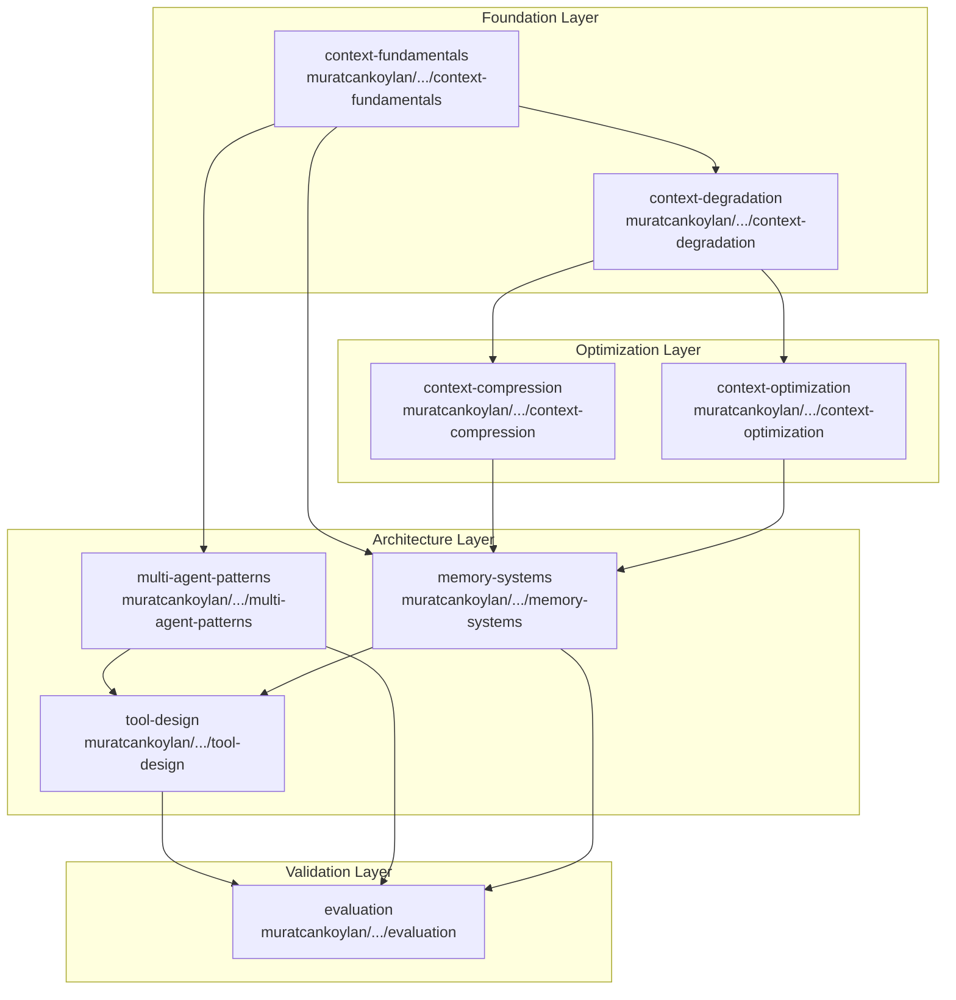
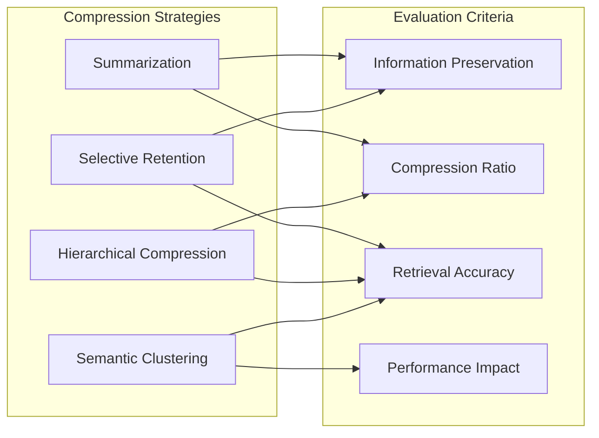
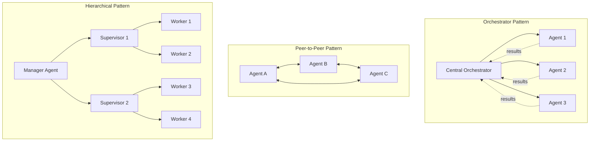
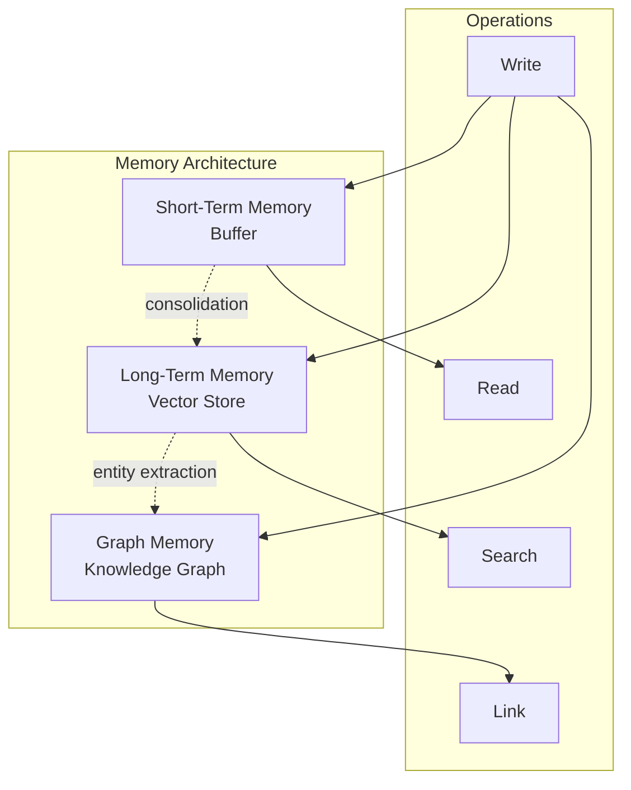
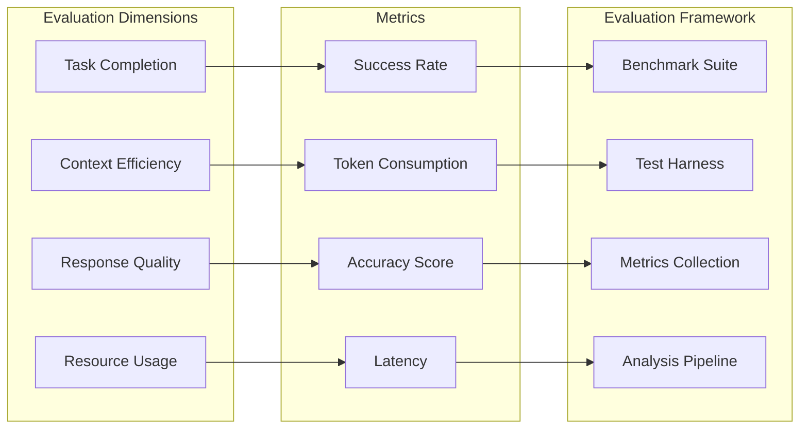
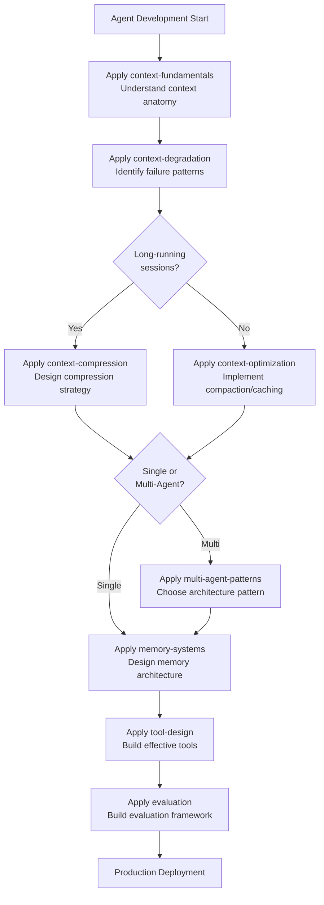

<!-- source: DeepWiki mcp.deepwiki.com · repo VoltAgent/awesome-agent-skills · extra page Context Engineering Skills · fetched 2026-10-26 -->

# Context Engineering Skills

<details>
<summary>Relevant source files</summary>

The following files were used as context for generating this wiki page:

- [README.md](README.md)

</details>


## Purpose and Scope

This page documents the 8 community-contributed skills focused on advanced AI agent patterns, specifically addressing context management, memory architectures, multi-agent coordination, and evaluation frameworks. These skills, maintained by the `muratcankoylan/Agent-Skills-for-Context-Engineering` repository, provide systematic approaches to handling context limitations, optimizing agent performance, and designing robust agent systems.

For general community development skills, see [Development and Testing Skills](#4.2.1). For basic skill usage, see [Using Your First Skill](#2.2). For the technical format of all skills, see [Skill Definition Format](#3.1).

**Sources:** [README.md:332-341]()

---

## Skill Collection Overview

The Context Engineering skill set addresses the fundamental challenge of managing and optimizing context in AI agent systems. These skills form a coherent framework that progresses from foundational concepts to advanced architectural patterns.

| Skill Name | Repository Path | Focus Area |
|------------|----------------|------------|
| `context-fundamentals` | `skills/context-fundamentals` | Context anatomy and core principles |
| `context-degradation` | `skills/context-degradation` | Failure pattern recognition |
| `context-compression` | `skills/context-compression` | Long-session compression strategies |
| `context-optimization` | `skills/context-optimization` | Compaction, masking, and caching |
| `multi-agent-patterns` | `skills/multi-agent-patterns` | Orchestrator, P2P, and hierarchical architectures |
| `memory-systems` | `skills/memory-systems` | Short-term, long-term, and graph memory |
| `tool-design` | `skills/tool-design` | Effective tool building and reduction patterns |
| `evaluation` | `skills/evaluation` | Agent system evaluation frameworks |

**Sources:** [README.md:334-341]()

---

## Context Engineering Architecture



**Diagram: Skill Dependency and Progression Model**

This diagram maps the 8 context engineering skills to their repository paths and shows their conceptual dependencies. The Foundation Layer establishes core understanding, the Optimization Layer applies compression techniques, the Architecture Layer implements patterns and memory systems, and the Validation Layer provides evaluation frameworks.

**Sources:** [README.md:334-341]()

---

## Foundation Skills

### Context Fundamentals (`context-fundamentals`)

The `context-fundamentals` skill establishes core understanding of context in agent systems, covering:

- **Context anatomy**: What constitutes context (system prompts, conversation history, tool results, external data)
- **Context window mechanics**: Token budgets, sliding windows, truncation strategies
- **Context importance**: Why context matters for agent coherence, task completion, and quality
- **Agent system structure**: How context flows through agent architectures

This skill serves as the prerequisite for all other context engineering skills, providing the conceptual foundation necessary to understand degradation patterns, optimization strategies, and architectural choices.

**Repository:** `muratcankoylan/Agent-Skills-for-Context-Engineering/tree/main/skills/context-fundamentals`

**Sources:** [README.md:334]()

### Context Degradation (`context-degradation`)

The `context-degradation` skill teaches recognition of context failure patterns:

| Degradation Pattern | Description | Impact |
|---------------------|-------------|--------|
| **Lost-in-Middle** | Information in middle of long contexts gets ignored | Missed critical data |
| **Context Poisoning** | Malicious or incorrect data corrupts reasoning | Wrong conclusions |
| **Context Distraction** | Irrelevant information diverts attention | Task deviation |
| **Context Clash** | Conflicting information creates confusion | Inconsistent outputs |

Each pattern includes diagnostic techniques and mitigation strategies for identifying when and why context fails in production systems.

**Repository:** `muratcankoylan/Agent-Skills-for-Context-Engineering/tree/main/skills/context-degradation`

**Sources:** [README.md:335]()

---

## Optimization Skills

### Context Compression (`context-compression`)

The `context-compression` skill provides systematic strategies for managing long-running agent sessions:



**Diagram: Context Compression Strategy Evaluation Matrix**

The skill covers design patterns for compression algorithms, evaluation frameworks for measuring effectiveness, and trade-offs between compression ratio and information preservation.

**Repository:** `muratcankoylan/Agent-Skills-for-Context-Engineering/tree/main/skills/context-compression`

**Sources:** [README.md:336]()

### Context Optimization (`context-optimization`)

The `context-optimization` skill implements three primary optimization strategies:

1. **Compaction**: Removing redundant or unnecessary context elements
   - Duplicate detection algorithms
   - Relevance scoring
   - Token budget allocation

2. **Masking**: Selective hiding of context based on task requirements
   - Privacy-preserving masking
   - Task-specific filtering
   - Dynamic visibility control

3. **Caching**: Strategic storage of frequently-accessed context
   - Cache invalidation policies
   - Hot/cold context separation
   - Retrieval optimization

**Repository:** `muratcankoylan/Agent-Skills-for-Context-Engineering/tree/main/skills/context-optimization`

**Sources:** [README.md:337]()

---

## Architecture Skills

### Multi-Agent Patterns (`multi-agent-patterns`)

The `multi-agent-patterns` skill documents three fundamental multi-agent architectures:



**Diagram: Multi-Agent Architecture Patterns from `multi-agent-patterns` Skill**

Each pattern includes:
- Communication protocols between agents
- Context sharing strategies
- Coordination mechanisms
- Failure handling approaches
- Use case suitability criteria

**Repository:** `muratcankoylan/Agent-Skills-for-Context-Engineering/tree/main/skills/multi-agent-patterns`

**Sources:** [README.md:338]()

### Memory Systems (`memory-systems`)

The `memory-systems` skill provides architectural patterns for three memory types:

| Memory Type | Characteristics | Implementation Patterns |
|-------------|-----------------|------------------------|
| **Short-Term Memory** | Volatile, conversation-scoped | In-memory buffers, sliding windows |
| **Long-Term Memory** | Persistent, cross-conversation | Vector databases, semantic indexing |
| **Graph-Based Memory** | Relational, entity-linked | Knowledge graphs, relationship tracking |



**Diagram: Memory System Architecture and Operations**

The skill covers memory lifecycle management, retrieval strategies, consolidation policies, and integration with agent reasoning loops.

**Repository:** `muratcankoylan/Agent-Skills-for-Context-Engineering/tree/main/skills/memory-systems`

**Sources:** [README.md:339]()

### Tool Design (`tool-design`)

The `tool-design` skill focuses on creating tools that agents can effectively use, including:

**Architectural Reduction Patterns:**
- Breaking complex operations into atomic tool calls
- Designing composable tool interfaces
- Managing tool dependencies
- Error handling and recovery

**Tool Effectiveness Criteria:**
1. **Discoverability**: Clear naming and descriptions
2. **Predictability**: Consistent behavior and outputs
3. **Composability**: Integration with other tools
4. **Observability**: Logging and debugging support

**Repository:** `muratcankoylan/Agent-Skills-for-Context-Engineering/tree/main/skills/tool-design`

**Sources:** [README.md:340]()

---

## Validation Skills

### Evaluation (`evaluation`)

The `evaluation` skill provides frameworks for measuring agent system performance:



**Diagram: Agent Evaluation Framework Components**

The skill includes:
- Benchmark design methodologies
- Metrics collection strategies
- Automated testing frameworks
- Performance profiling techniques
- A/B testing approaches for agent architectures

**Repository:** `muratcankoylan/Agent-Skills-for-Context-Engineering/tree/main/skills/evaluation`

**Sources:** [README.md:341]()

---

## Skill Integration Workflow



**Diagram: Context Engineering Skill Application Workflow**

This workflow demonstrates how the 8 skills integrate into a comprehensive agent development process, from foundational understanding through architecture design to production validation.

**Sources:** [README.md:334-341]()

---

## Skill Installation

All context engineering skills are installed using the standard skill installation paths documented in [Installing Skills](#2.1). For Claude Code:

**Project-specific:**
```bash
.claude/skills/context-fundamentals/
.claude/skills/context-degradation/
.claude/skills/context-compression/
# ... etc
```

**Global:**
```bash
~/.claude/skills/context-fundamentals/
~/.claude/skills/context-degradation/
~/.claude/skills/context-compression/
# ... etc
```

Each skill follows the standard YAML + Markdown format documented in [Skill Definition Format](#3.1).

**Sources:** [README.md:78-87](), [README.md:334-341]()

---

## Comparison with Related Skills

| Aspect | Context Engineering Skills | Development Skills ([#4.2.1](#4.2.1)) | Specialized Domain Skills ([#4.2.5](#4.2.5)) |
|--------|---------------------------|----------------------------------------|---------------------------------------------|
| **Focus** | Agent context and memory architecture | Code quality and development workflows | Domain-specific applications |
| **Scope** | Meta-level agent system design | Implementation and testing | Healthcare, finance, research |
| **User** | Agent system architects | Software developers | Domain specialists |
| **Integration** | Foundation for all agent systems | Uses context skills for better performance | May leverage context patterns |

Context engineering skills are foundational meta-skills that enhance the effectiveness of all other skill categories by improving how agents manage information, coordinate, and maintain coherence across interactions.

**Sources:** [README.md:332-341](), [README.md:293-331](), [README.md:344-354]()

---

