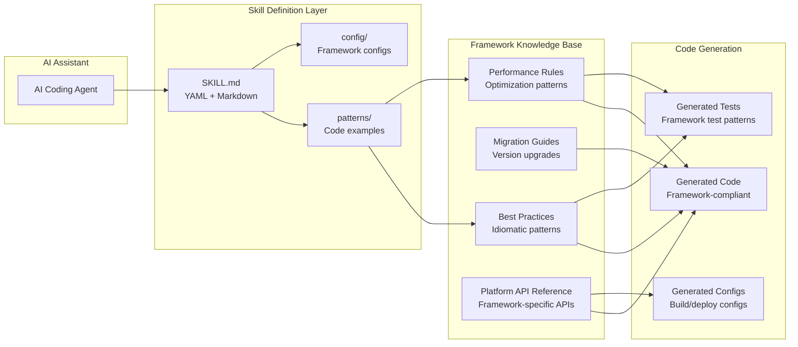
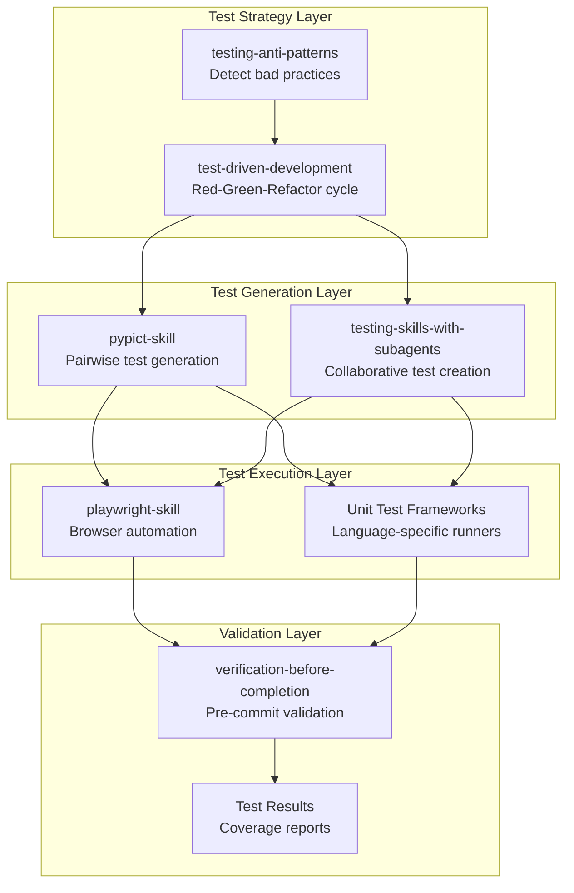
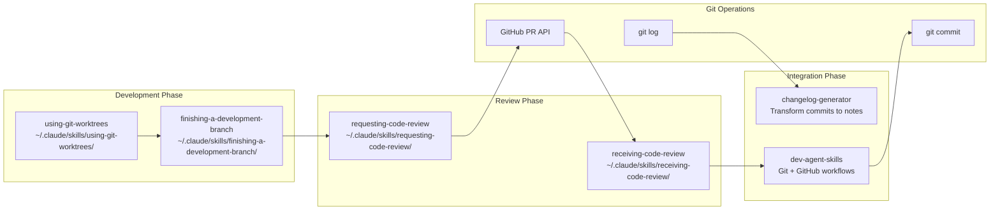
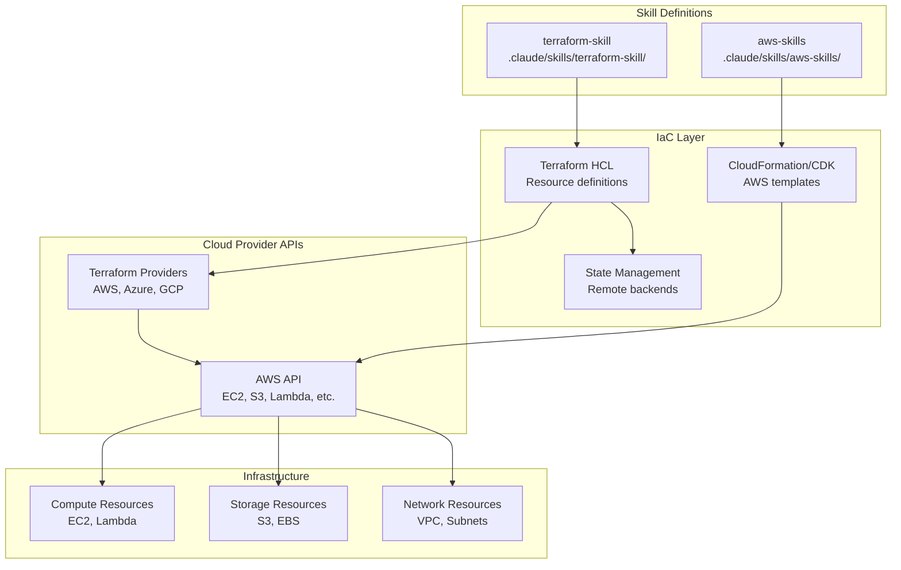
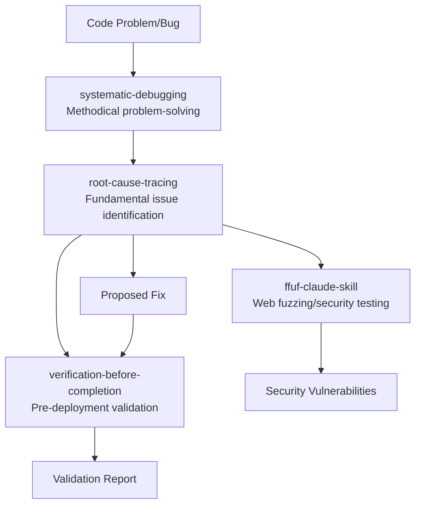
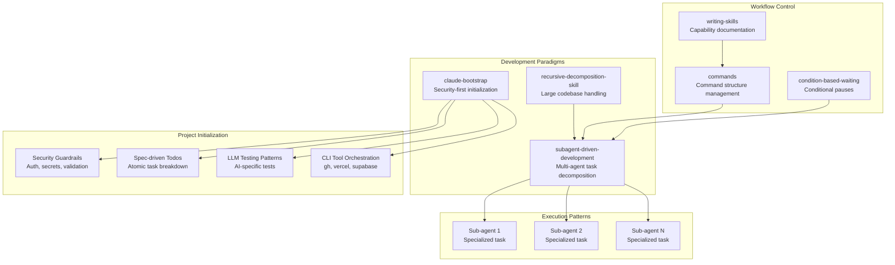
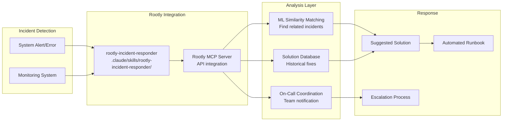

<!-- source: DeepWiki mcp.deepwiki.com · repo VoltAgent/awesome-agent-skills · extra page Development and Testing Skills · fetched 2026-10-26 -->

# Development and Testing Skills

<details>
<summary>Relevant source files</summary>

The following files were used as context for generating this wiki page:

- [README.md](README.md)

</details>


## Purpose and Scope

This document catalogs the 40+ community-contributed skills focused on software development workflows, testing methodologies, debugging practices, and engineering tooling. These skills extend AI coding assistants with specialized capabilities for building, testing, and maintaining software across multiple languages, frameworks, and platforms.

For marketing-focused skills, see [Marketing Skills](#4.2.2). For productivity and collaboration tools, see [Productivity and Collaboration Skills](#4.2.3). For advanced AI agent patterns and context management, see [Context Engineering Skills](#4.2.4).

**Sources:** [README.md:292-331]()

## Skill Taxonomy

The development and testing skills are organized into seven functional domains, each addressing specific engineering workflows:

```mermaid
graph TB
    DevTestingSkills["Development and Testing Skills<br/>(40+ Community Skills)"]
    
    DevTestingSkills --> FrameworkSpecific["Framework-Specific Skills<br/>6 skills"]
    DevTestingSkills --> Testing["Testing & Quality Assurance<br/>5 skills"]
    DevTestingSkills --> VersionControl["Version Control & Code Review<br/>5 skills"]
    DevTestingSkills --> Infrastructure["Infrastructure & Cloud<br/>2 skills"]
    DevTestingSkills --> Debugging["Debugging & Analysis<br/>4 skills"]
    DevTestingSkills --> DevPatterns["Development Patterns<br/>6 skills"]
    DevTestingSkills --> UIUX["UI/UX & Visualization<br/>4 skills"]
    DevTestingSkills --> Specialized["Specialized Development<br/>8 skills"]
    
    FrameworkSpecific --> Rails["robzolkos/skill-rails-upgrade"]
    FrameworkSpecific --> ReactNative["callstackincubator/react-native-best-practices"]
    FrameworkSpecific --> SwiftUI["AvdLee/swiftui-expert-skill"]
    FrameworkSpecific --> Swift["efremidze/swift-patterns-skill"]
    FrameworkSpecific --> Makepad["ZhangHanDong/makepad-skills"]
    FrameworkSpecific --> ThreeJS["CloudAI-X/threejs-skills"]
    
    Testing --> TDD["obra/test-driven-development"]
    Testing --> Playwright["lackeyjb/playwright-skill"]
    Testing --> Pypict["omkamal/pypict-skill"]
    Testing --> TestingSubagents["obra/testing-skills-with-subagents"]
    Testing --> AntiPatterns["obra/testing-anti-patterns"]
    
    VersionControl --> RequestReview["obra/requesting-code-review"]
    VersionControl --> ReceiveReview["obra/receiving-code-review"]
    VersionControl --> FinishBranch["obra/finishing-a-development-branch"]
    VersionControl --> GitWorktrees["obra/using-git-worktrees"]
    VersionControl --> DevAgentSkills["fvadicamo/dev-agent-skills"]
    
    Infrastructure --> Terraform["antonbabenko/terraform-skill"]
    Infrastructure --> AWS["zxkane/aws-skills"]
    
    Debugging --> SystematicDebug["obra/systematic-debugging"]
    Debugging --> RootCause["obra/root-cause-tracing"]
    Debugging --> FFUF["jthack/ffuf-claude-skill"]
    Debugging --> Verification["obra/verification-before-completion"]
    
    DevPatterns --> SubagentDev["obra/subagent-driven-development"]
    DevPatterns --> Bootstrap["alinaqi/claude-bootstrap"]
    DevPatterns --> Recursive["massimodeluisa/recursive-decomposition-skill"]
    DevPatterns --> Commands["obra/commands"]
    DevPatterns --> WritingSkills["obra/writing-skills"]
    DevPatterns --> Waiting["obra/condition-based-waiting"]
    
    UIUX --> UISkills["ibelick/ui-skills"]
    UIUX --> UIUXPro["nextlevelbuilder/ui-ux-pro-max-skill"]
    UIUX --> Screenshots["Shpigford/screenshots"]
    UIUX --> Slides["zarazhangrui/frontend-slides"]
    
    Specialized --> IOSSimulator["conorluddy/ios-simulator-skill"]
    Specialized --> Postgres["sanjay3290/postgres"]
    Specialized --> DeepResearch["sanjay3290/deep-research"]
    Specialized --> Rootly["Rootly-AI-Labs/rootly-incident-responder"]
    Specialized --> Vexor["scarletkc/vexor"]
    Specialized --> Changelog["ComposioHQ/changelog-generator"]
    Specialized --> PPT["op7418/NanoBanana-PPT-Skills"]
    Specialized --> Readme["Shpigford/readme"]
```



**Sources:** [README.md:292-331]()

## Framework and Language-Specific Skills

These skills provide deep expertise in specific programming languages, frameworks, and runtime environments, encoding best practices and platform-specific patterns.

| Skill Repository | Target Platform | Primary Capabilities | GitHub Path |
|-----------------|-----------------|---------------------|-------------|
| `robzolkos/skill-rails-upgrade` | Ruby on Rails | Rails app analysis, upgrade assessments, version migration | [Link](https://github.com/robzolkos/skill-rails-upgrade) |
| `callstackincubator/react-native-best-practices` | React Native | Performance optimization, mobile-specific patterns | [Link](https://github.com/callstackincubator/agent-skills/blob/main/skills/react-native-best-practices/SKILL.md) |
| `AvdLee/swiftui-expert-skill` | SwiftUI/iOS | iOS 26+ patterns, Liquid Glass adoption, modern SwiftUI | [Link](https://github.com/AvdLee/SwiftUI-Agent-Skill/tree/main/swiftui-expert-skill) |
| `efremidze/swift-patterns-skill` | Swift | Swift/SwiftUI best practices, idiomatic patterns | [Link](https://github.com/efremidze/swift-patterns-skill/tree/main/swift-patterns) |
| `ZhangHanDong/makepad-skills` | Rust/Makepad | Makepad UI development, setup, shaders, packaging | [Link](https://github.com/ZhangHanDong/makepad-skills) |
| `CloudAI-X/threejs-skills` | Three.js | 3D element creation, interactive experiences | [Link](https://github.com/CloudAI-X/threejs-skills) |

### Architecture Pattern: Framework Skill Structure



**Sources:** [README.md:294](), [README.md:327-330]()

## Testing and Quality Assurance Skills

Testing skills implement systematic approaches to code verification, from test-driven development to pairwise combinatorial testing and browser automation.

### Core Testing Skills

| Skill | Testing Approach | Key Features | Repository |
|-------|-----------------|--------------|------------|
| `obra/test-driven-development` | TDD workflow | Write tests before implementation | [obra/superpowers SKILL.md](https://github.com/obra/superpowers/blob/main/skills/test-driven-development/SKILL.md) |
| `lackeyjb/playwright-skill` | Browser automation | Automated UI testing with Playwright | [lackeyjb/playwright-skill](https://github.com/lackeyjb/playwright-skill) |
| `omkamal/pypict-skill` | Pairwise testing | Combinatorial test case generation | [omkamal/pypict-claude-skill SKILL.md](https://github.com/omkamal/pypict-claude-skill/blob/main/SKILL.md) |
| `obra/testing-skills-with-subagents` | Multi-agent testing | Collaborative testing using sub-agents | [obra/superpowers SKILL.md](https://github.com/obra/superpowers/blob/main/skills/testing-skills-with-subagents/SKILL.md) |
| `obra/testing-anti-patterns` | Quality gates | Identify ineffective testing practices | [obra/superpowers SKILL.md](https://github.com/obra/superpowers/blob/main/skills/testing-anti-patterns/SKILL.md) |

### Testing Workflow Integration



**Sources:** [README.md:307-313]()

## Version Control and Code Review Skills

These skills encode Git workflows, code review processes, and branch management strategies that teams use in production.

### Git Workflow Skills Mapping



**Code Review Process Flow:**

1. **Branch Finalization** - `obra/finishing-a-development-branch` validates work is complete
2. **Review Request** - `obra/requesting-code-review` structures PR submission
3. **Review Processing** - `obra/receiving-code-review` incorporates feedback
4. **Git Workflow Automation** - `fvadicamo/dev-agent-skills` handles commits and PR operations
5. **Release Documentation** - `ComposioHQ/changelog-generator` generates release notes from commit history

**Sources:** [README.md:314-316](), [README.md:322](), [README.md:308]()

## Infrastructure and Cloud Skills

Infrastructure skills provide expertise in Infrastructure as Code (IaC) and cloud platform automation.

| Skill | Platform | Capabilities | Repository |
|-------|----------|--------------|------------|
| `antonbabenko/terraform-skill` | Terraform | IaC best practices, resource management, state handling | [terraform-skill](https://github.com/antonbabenko/terraform-skill) |
| `zxkane/aws-skills` | AWS | Infrastructure automation, cloud architecture patterns, service integration | [aws-skills](https://github.com/zxkane/aws-skills) |

### Infrastructure Skill Architecture



**Sources:** [README.md:296-297]()

## Debugging and Analysis Skills

Debugging skills implement systematic approaches to problem identification, root cause analysis, and security testing.

### Debugging Skill Hierarchy



| Skill | Debugging Domain | Methodology | Repository |
|-------|-----------------|-------------|------------|
| `obra/systematic-debugging` | General debugging | Structured debugging workflows, hypothesis testing | [superpowers SKILL.md](https://github.com/obra/superpowers/blob/main/skills/systematic-debugging/SKILL.md) |
| `obra/root-cause-tracing` | Root cause analysis | Trace symptoms to fundamental causes | [superpowers SKILL.md](https://github.com/obra/superpowers/blob/main/skills/root-cause-tracing/SKILL.md) |
| `jthack/ffuf-claude-skill` | Web security testing | HTTP fuzzing, vulnerability discovery | [ffuf_claude_skill](https://github.com/jthack/ffuf_claude_skill) |
| `obra/verification-before-completion` | Pre-commit validation | Validation gates before task completion | [superpowers SKILL.md](https://github.com/obra/superpowers/blob/main/skills/verification-before-completion/SKILL.md) |

**Sources:** [README.md:310-311](), [README.md:318](), [README.md:302]()

## Development Pattern Skills

These meta-skills define development methodologies and architectural patterns for building software with AI assistance.

### Meta-Development Architecture



### Pattern Details

| Pattern Skill | Use Case | Key Concepts | Repository |
|--------------|----------|--------------|------------|
| `obra/subagent-driven-development` | Complex multi-step tasks | Task decomposition, parallel execution, sub-agent coordination | [superpowers SKILL.md](https://github.com/obra/superpowers/blob/main/skills/subagent-driven-development/SKILL.md) |
| `alinaqi/claude-bootstrap` | Project initialization | Security-first guardrails, spec-driven atomic todos, LLM testing, CLI orchestration | [claude-bootstrap](https://github.com/alinaqi/claude-bootstrap) |
| `massimodeluisa/recursive-decomposition-skill` | Large codebases (100+ files, 50k+ tokens) | Recursive task decomposition based on RLM research | [recursive-decomposition-skill](https://github.com/massimodeluisa/recursive-decomposition-skill) |
| `obra/commands` | Command management | Create and manage command structures | [superpowers commands](https://github.com/obra/superpowers/tree/main/skills/commands) |
| `obra/writing-skills` | Capability development | Document and develop new capabilities | [superpowers SKILL.md](https://github.com/obra/superpowers/blob/main/skills/writing-skills/SKILL.md) |
| `obra/condition-based-waiting` | Asynchronous workflows | Conditional pauses and state synchronization | [superpowers SKILL.md](https://github.com/obra/superpowers/blob/main/skills/condition-based-waiting/SKILL.md) |

**Sources:** [README.md:309](), [README.md:324](), [README.md:326](), [README.md:319-321]()

## UI/UX and Visualization Skills

Skills for designing, building, and documenting user interfaces and visual assets.

| Skill | Output Type | Capabilities | Repository |
|-------|------------|--------------|------------|
| `ibelick/ui-skills` | Web interfaces | Opinionated constraints for UI development | [ui-skills](https://github.com/ibelick/ui-skills) |
| `nextlevelbuilder/ui-ux-pro-max-skill` | UI/UX designs | Design patterns and best practices | [ui-ux-pro-max-skill](https://github.com/nextlevelbuilder/ui-ux-pro-max-skill) |
| `Shpigford/screenshots` | Marketing screenshots | Playwright-based screenshot generation | [screenshots](https://github.com/Shpigford/skills/tree/main/screenshots) |
| `zarazhangrui/frontend-slides` | HTML presentations | Animation-rich presentations with style previews | [frontend-slides](https://github.com/zarazhangrui/frontend-slides) |

**Sources:** [README.md:304-305](), [README.md:295](), [README.md:275]()

## Specialized Development Skills

Additional development skills addressing specific domains including mobile development, database operations, incident response, and documentation generation.

### Specialized Skill Matrix

| Skill | Domain | Technology | Primary Use Case | Repository |
|-------|--------|------------|------------------|------------|
| `conorluddy/ios-simulator-skill` | Mobile | iOS Simulator | Control and automate iOS Simulator | [ios-simulator-skill](https://github.com/conorluddy/ios-simulator-skill) |
| `sanjay3290/postgres` | Database | PostgreSQL | Safe read-only SQL query execution | [postgres](https://github.com/sanjay3290/ai-skills/tree/main/skills/postgres) |
| `sanjay3290/deep-research` | Research | Gemini Deep Research | Autonomous multi-step research workflows | [deep-research](https://github.com/sanjay3290/ai-skills/tree/main/skills/deep-research) |
| `Rootly-AI-Labs/rootly-incident-responder` | Incident Response | Rootly MCP Server | ML similarity matching, solution suggestions, on-call coordination | [rootly-incident-responder](https://github.com/Rootly-AI-Labs/Rootly-MCP-server/blob/main/examples/skills/rootly-incident-responder.md) |
| `scarletkc/vexor` | Code Search | Vector embeddings | Semantic file search with Claude/Codex integration | [vexor](https://github.com/scarletkc/vexor) |
| `ComposioHQ/changelog-generator` | Documentation | Git | Transform commits to release notes | [changelog-generator](https://github.com/ComposioHQ/awesome-claude-skills/tree/master/changelog-generator) |
| `op7418/NanoBanana-PPT-Skills` | Presentations | Document analysis | AI-powered PPT generation with styled images | [NanoBanana-PPT-Skills](https://github.com/op7418/NanoBanana-PPT-Skills) |
| `Shpigford/readme` | Documentation | Project analysis | Generate comprehensive project documentation | [readme](https://github.com/Shpigford/skills/tree/main/readme) |

### Incident Response Architecture



**Sources:** [README.md:298-301](), [README.md:306](), [README.md:308](), [README.md:274](), [README.md:290]()

## Skill Integration and Execution Model

Development and testing skills follow a common integration pattern across all supported AI coding assistants, with standardized file system paths and skill discovery mechanisms.

### File System Integration Paths

```mermaid
graph TB
    subgraph "Skill Repository Sources"
        GitHub["External GitHub Repos<br/>40+ development skills"]
    end
    
    subgraph "Project-Specific Paths"
        ClaudeProject[".claude/skills/test-driven-development/"]
        CursorProject[".cursor/skills/playwright-skill/"]
        CopilotProject[".github/skills/terraform-skill/"]
        GeminiProject[".gemini/skills/aws-skills/"]
        WindsurfProject[".windsurf/skills/systematic-debugging/"]
    end
    
    subgraph "Global User Paths"
        ClaudeGlobal["~/.claude/skills/subagent-driven-development/"]
        CursorGlobal["~/.cursor/skills/react-native-best-practices/"]
        CopilotGlobal["~/.copilot/skills/requesting-code-review/"]
        GeminiGlobal["~/.gemini/skills/swiftui-expert-skill/"]
        WindsurfGlobal["~/.codeium/windsurf/skills/ffuf-claude-skill/"]
    end
    
    subgraph "AI Assistant Execution"
        ClaudeCode["Claude Code"]
        Cursor["Cursor"]
        Copilot["GitHub Copilot"]
        GeminiCLI["Gemini CLI"]
        Windsurf["Windsurf"]
    end
    
    GitHub --> ClaudeProject
    GitHub --> CursorProject
    GitHub --> CopilotProject
    GitHub --> GeminiProject
    GitHub --> WindsurfProject
    
    GitHub --> ClaudeGlobal
    GitHub --> CursorGlobal
    GitHub --> CopilotGlobal
    GitHub --> GeminiGlobal
    GitHub --> WindsurfGlobal
    
    ClaudeProject --> ClaudeCode
    ClaudeGlobal --> ClaudeCode
    
    CursorProject --> Cursor
    CursorGlobal --> Cursor
    
    CopilotProject --> Copilot
    CopilotGlobal --> Copilot
    
    GeminiProject --> GeminiCLI
    GeminiGlobal --> GeminiCLI
    
    WindsurfProject --> Windsurf
    WindsurfGlobal --> Windsurf
```



### Skill Execution Flow

All development and testing skills follow this standardized execution pattern:

1. **Skill Discovery** - AI assistant scans project-specific and global skill directories
2. **Skill Loading** - YAML front matter parsed, markdown instructions loaded into context
3. **Task Matching** - User request matched against skill descriptions and use cases
4. **Context Building** - Skill instructions, code examples, and validation rules assembled
5. **Execution** - AI agent executes task steps according to skill instructions
6. **Validation** - Results validated against skill-defined criteria (e.g., `obra/verification-before-completion`)
7. **Output Generation** - Artifacts produced (code, tests, documentation, infrastructure configs)

**Sources:** [README.md:76-88]()

## Common Skill Patterns

Development and testing skills share several architectural patterns:

### Pattern 1: Validation-First Development

Skills like `obra/test-driven-development` and `obra/verification-before-completion` enforce validation gates before proceeding to the next step.

```yaml
---
name: verification-before-completion
description: Validate work before finalizing
---

## Validation Checklist

Before marking a task complete:
1. All tests pass
2. Code follows style guidelines
3. Documentation is updated
4. No security vulnerabilities introduced
```

### Pattern 2: Multi-Agent Decomposition

Skills like `obra/subagent-driven-development` and `massimodeluisa/recursive-decomposition-skill` break complex tasks into sub-tasks executed by specialized agents.

### Pattern 3: Tool Integration

Skills like `lackeyjb/playwright-skill`, `jthack/ffuf-claude-skill`, and `Rootly-AI-Labs/rootly-incident-responder` integrate external tools via command-line interfaces or MCP servers.

### Pattern 4: Framework Convention Encoding

Skills like `callstackincubator/react-native-best-practices` and `AvdLee/swiftui-expert-skill` encode platform-specific conventions and best practices.

**Sources:** [README.md:44-72](), [README.md:118]()

## Skill Composition Examples

Development skills can be composed together to create complex workflows:

### Example 1: Test-Driven Feature Development

```
1. obra/test-driven-development
   └─> Write failing test
2. obra/subagent-driven-development
   └─> Decompose implementation into sub-tasks
3. callstackincubator/react-native-best-practices (if React Native)
   └─> Implement with framework best practices
4. obra/verification-before-completion
   └─> Validate implementation
5. obra/requesting-code-review
   └─> Submit for review
```

### Example 2: Infrastructure Setup

```
1. antonbabenko/terraform-skill
   └─> Define infrastructure as code
2. zxkane/aws-skills
   └─> Configure AWS-specific services
3. obra/verification-before-completion
   └─> Validate Terraform plans
4. fvadicamo/dev-agent-skills
   └─> Commit infrastructure code
5. ComposioHQ/changelog-generator
   └─> Document infrastructure changes
```

### Example 3: Large Codebase Analysis

```
1. massimodeluisa/recursive-decomposition-skill
   └─> Decompose 100+ file analysis
2. scarletkc/vexor
   └─> Semantic search for relevant files
3. obra/systematic-debugging
   └─> Debug identified issues
4. obra/root-cause-tracing
   └─> Trace to fundamental causes
5. obra/requesting-code-review
   └─> Submit fixes for review
```

**Sources:** [README.md:292-331]()

---

