<!-- source: DeepWiki mcp.deepwiki.com · repo VoltAgent/awesome-agent-skills · extra page Hugging Face Skills · fetched 2026-10-26 -->

# Hugging Face Skills

<details>
<summary>Relevant source files</summary>

The following files were used as context for generating this wiki page:

- [README.md](README.md)

</details>


## Purpose and Scope

This document details the 8 official Agent Skills published by the Hugging Face team, designed to enable AI coding assistants to execute machine learning workflows on the Hugging Face Hub platform. These skills cover the complete ML lifecycle from dataset creation through model training, evaluation, and paper publishing.

For general information about Official Team Skills, see [Official Team Skills](#4.1). For skills from other ML and AI platforms, see [fal.ai Skills](#4.1.6).

**Sources:** [README.md:163-174]()

---

## Overview

The Hugging Face skill collection provides AI agents with capabilities to interact with the Hugging Face Hub infrastructure, including model repositories, dataset management, compute jobs, and experiment tracking. Each skill is hosted in the `huggingface/skills` repository under `skills/[skill-name]/` directories and follows the standardized YAML + Markdown format.

### Skill Repository Structure

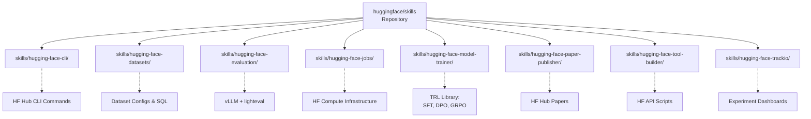

**Sources:** [README.md:163-174]()

---

## Skill Categories

The 8 Hugging Face skills are organized into four functional categories based on ML workflow stages:

| Category | Skills | Purpose |
|----------|--------|---------|
| **Infrastructure & CLI** | `hugging-face-cli` | Hub operations, repository management, compute job control |
| **Data Management** | `hugging-face-datasets` | Dataset creation, configuration, SQL querying |
| **Model Development** | `hugging-face-model-trainer`<br/>`hugging-face-jobs`<br/>`hugging-face-tool-builder` | Model training with TRL, compute job execution, API script building |
| **Evaluation & Publishing** | `hugging-face-evaluation`<br/>`hugging-face-paper-publisher`<br/>`hugging-face-trackio` | Model evaluation, paper publishing, experiment tracking |

**Sources:** [README.md:163-174]()

---

## Infrastructure & CLI Skills

### hugging-face-cli

The `hugging-face-cli` skill enables AI agents to execute Hugging Face Hub CLI commands for managing models, datasets, repositories, and compute jobs.

**Repository:** `github.com/huggingface/skills/tree/main/skills/hugging-face-cli`

**Core Capabilities:**
- Model and dataset repository operations
- Repository cloning and uploading
- Compute job submission and monitoring
- Hub authentication and configuration

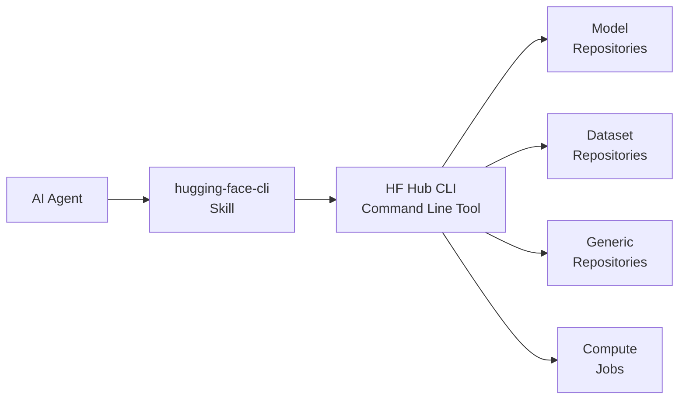

**Integration Pattern:**
- AI agents invoke the skill with natural language requests
- Skill translates to `huggingface-cli` commands
- CLI executes operations against HF Hub API
- Results returned to agent for further processing

**Sources:** [README.md:167]()

---

## Data Management Skills

### hugging-face-datasets

The `hugging-face-datasets` skill provides capabilities for creating, configuring, and querying datasets on the Hugging Face Hub.

**Repository:** `github.com/huggingface/skills/tree/main/skills/hugging-face-datasets`

**Core Capabilities:**
- Dataset creation and upload
- Dataset configuration files
- SQL-based dataset querying
- Data validation and schema management

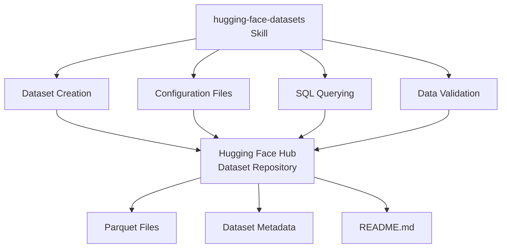

**Technical Details:**
- Supports dataset configuration YAML files
- Integrates with Hub's SQL query interface
- Handles data formats: Parquet, CSV, JSON, Arrow
- Manages dataset splits (train, validation, test)

**Sources:** [README.md:168]()

---

## Model Development Skills

### hugging-face-model-trainer

The `hugging-face-model-trainer` skill enables model training using the TRL (Transformer Reinforcement Learning) library with support for supervised fine-tuning (SFT), direct preference optimization (DPO), and grouped reward policy optimization (GRPO).

**Repository:** `github.com/huggingface/skills/tree/main/skills/hugging-face-model-trainer`

**Core Capabilities:**
- Supervised Fine-Tuning (SFT)
- Direct Preference Optimization (DPO)
- Grouped Reward Policy Optimization (GRPO)
- GGUF format conversion for quantized models

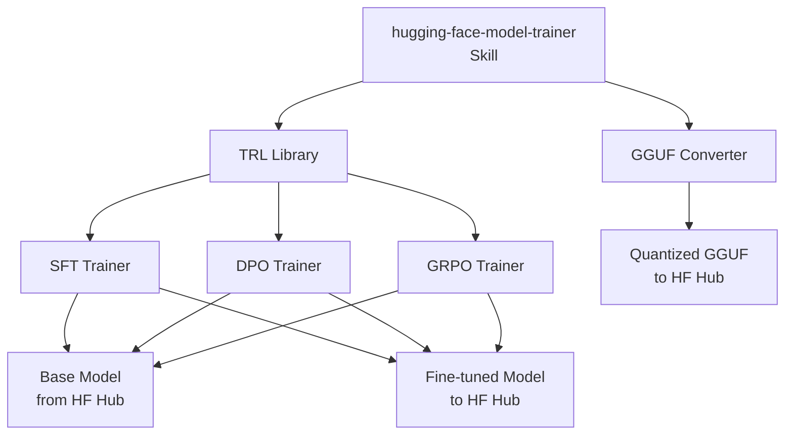

**Training Methods:**

| Method | Purpose | Use Case |
|--------|---------|----------|
| **SFT** | Supervised fine-tuning on instruction datasets | Adapt base models to specific tasks |
| **DPO** | Align models with human preferences | Improve output quality without reward models |
| **GRPO** | Optimize policies with grouped rewards | Advanced RL-based alignment |
| **GGUF** | Convert to quantized format | Deploy efficient inference |

**Sources:** [README.md:171]()

---

### hugging-face-jobs

The `hugging-face-jobs` skill allows AI agents to submit and run compute jobs and Python scripts on Hugging Face infrastructure.

**Repository:** `github.com/huggingface/skills/tree/main/skills/hugging-face-jobs`

**Core Capabilities:**
- Submit Python scripts as compute jobs
- Configure compute resources (GPUs, CPUs, memory)
- Monitor job execution status
- Retrieve job outputs and logs

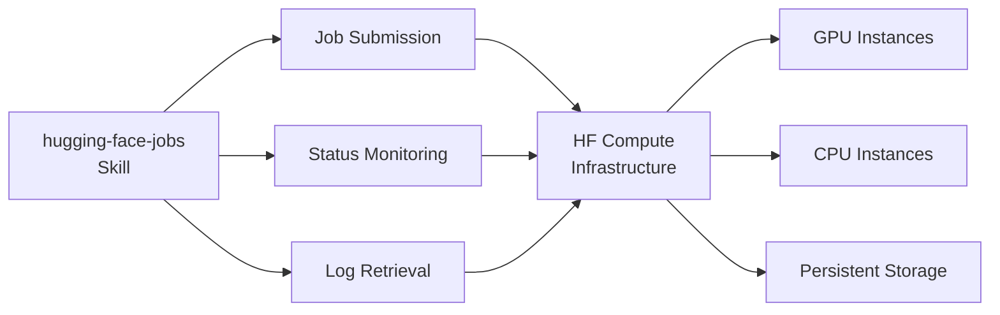

**Job Workflow:**
1. Agent defines Python script and dependencies
2. Skill submits job with resource requirements
3. HF infrastructure allocates compute resources
4. Job executes with access to Hub models/datasets
5. Outputs saved to Hub repositories or returned

**Sources:** [README.md:170]()

---

### hugging-face-tool-builder

The `hugging-face-tool-builder` skill enables creation of reusable Python scripts for Hugging Face API operations.

**Repository:** `github.com/huggingface/skills/tree/main/skills/hugging-face-tool-builder`

**Core Capabilities:**
- Build custom HF API wrapper scripts
- Create reusable automation tools
- Encapsulate common API patterns
- Generate parameterized utilities

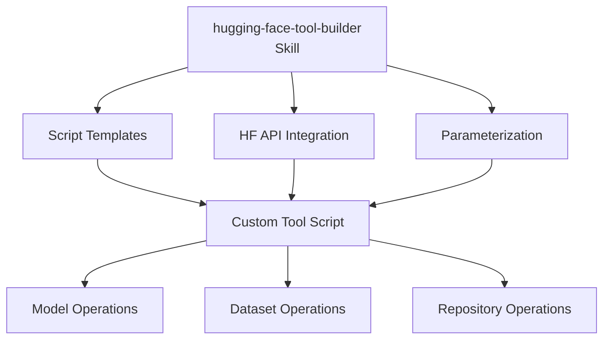

**Use Cases:**
- Batch model downloads
- Automated dataset preprocessing pipelines
- Custom evaluation harnesses
- Repository management workflows

**Sources:** [README.md:173]()

---

## Evaluation & Publishing Skills

### hugging-face-evaluation

The `hugging-face-evaluation` skill provides model evaluation capabilities using vLLM and lighteval frameworks with support for evaluation leaderboards.

**Repository:** `github.com/huggingface/skills/tree/main/skills/hugging-face-evaluation`

**Core Capabilities:**
- Model evaluation with vLLM inference engine
- Integration with lighteval benchmarks
- Generation of evaluation tables
- Leaderboard submission

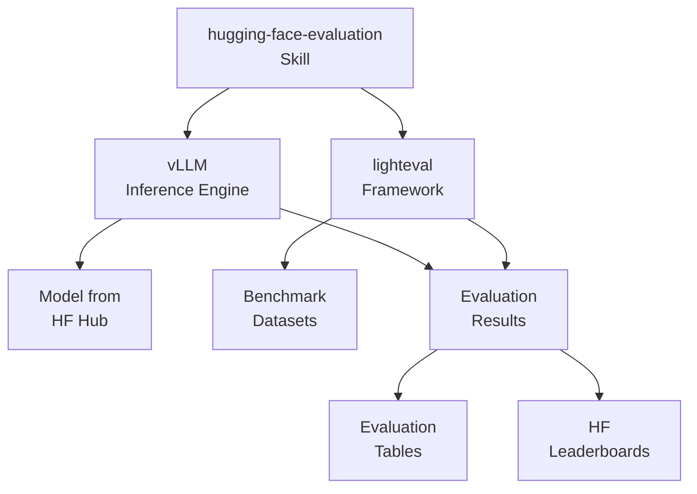

**Evaluation Pipeline:**
1. Load model from Hub using vLLM
2. Run lighteval benchmarks (MMLU, GSM8K, etc.)
3. Generate structured evaluation results
4. Create evaluation table cards
5. Submit to Hub leaderboards

**Sources:** [README.md:169]()

---

### hugging-face-paper-publisher

The `hugging-face-paper-publisher` skill enables publishing research papers on the Hugging Face Hub with linked models and datasets.

**Repository:** `github.com/huggingface/skills/tree/main/skills/hugging-face-paper-publisher`

**Core Capabilities:**
- Publish papers to HF Hub
- Link papers to model repositories
- Link papers to dataset repositories
- Generate paper metadata

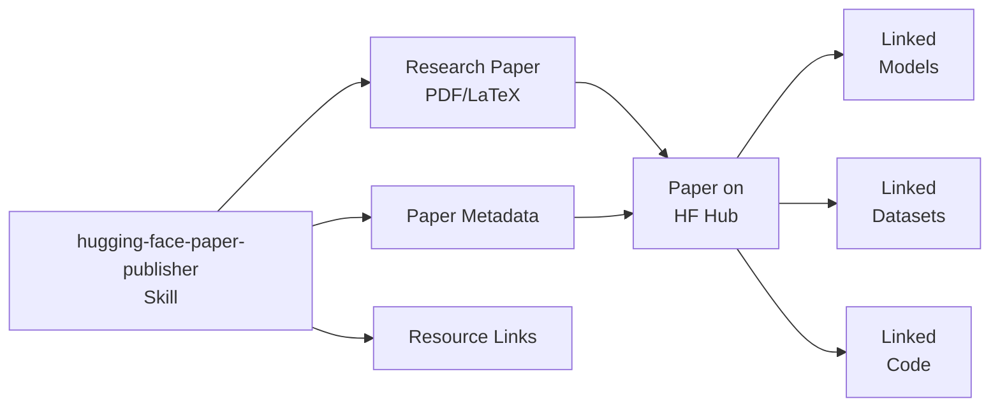

**Publishing Workflow:**
1. Prepare paper document (PDF or LaTeX)
2. Extract or define metadata (title, authors, abstract)
3. Identify related model/dataset repositories
4. Create paper repository on Hub
5. Link associated resources
6. Publish with proper citations

**Sources:** [README.md:172]()

---

### hugging-face-trackio

The `hugging-face-trackio` skill provides ML experiment tracking with real-time dashboard visualization.

**Repository:** `github.com/huggingface/skills/tree/main/skills/hugging-face-trackio`

**Core Capabilities:**
- Track experiment metrics
- Log hyperparameters
- Create real-time dashboards
- Compare experiment runs

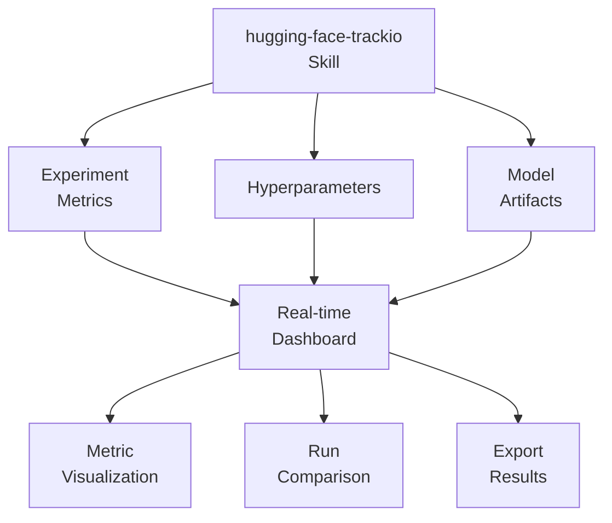

**Tracking Features:**
- Real-time metric streaming
- Hyperparameter grid search tracking
- Model checkpoint management
- Cross-run comparison views
- Integration with training jobs

**Sources:** [README.md:174]()

---

## Complete ML Workflow Integration

The following diagram illustrates how Hugging Face skills integrate into a complete machine learning workflow:

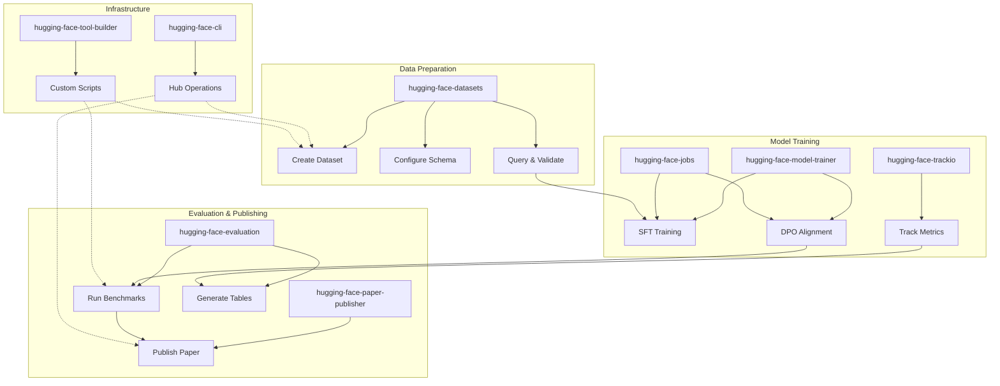

**Sources:** [README.md:163-174]()

---

## Common Use Cases

### Use Case 1: Full Model Training Pipeline

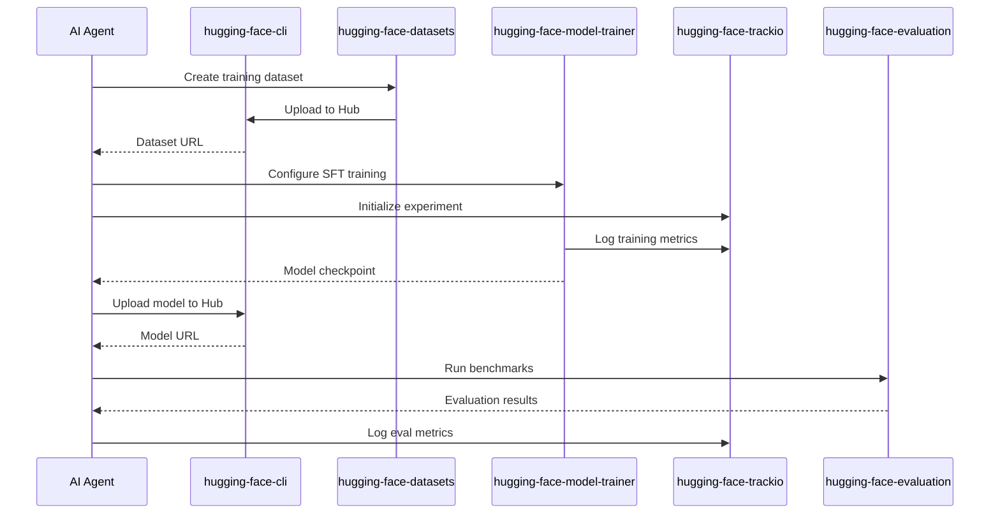

**Steps:**
1. Use `hugging-face-datasets` to create and upload training data
2. Use `hugging-face-cli` to verify dataset on Hub
3. Configure training with `hugging-face-model-trainer` (SFT)
4. Initialize experiment tracking with `hugging-face-trackio`
5. Monitor training metrics in real-time
6. Upload trained model with `hugging-face-cli`
7. Evaluate with `hugging-face-evaluation` (vLLM + lighteval)
8. Log evaluation results to trackio dashboard

**Sources:** [README.md:167-174]()

---

### Use Case 2: Research Paper with Model Release

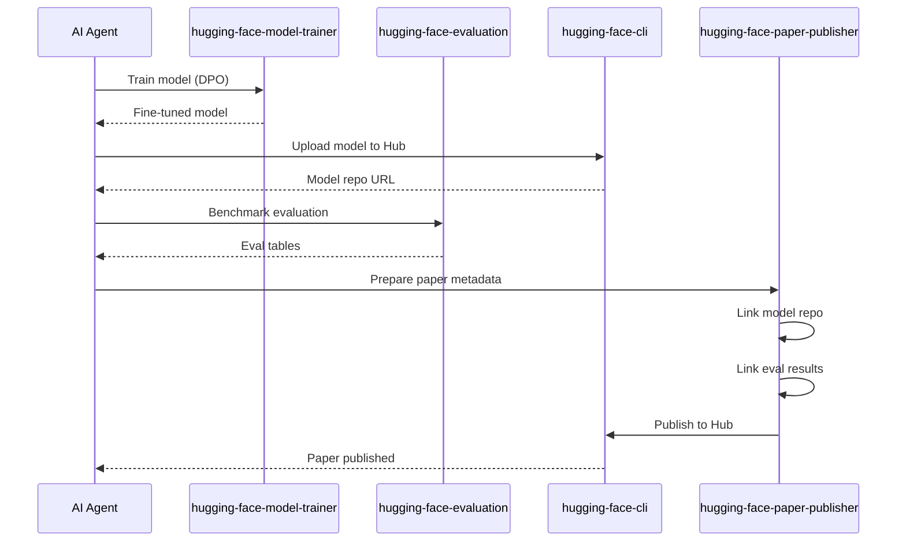

**Steps:**
1. Train model with `hugging-face-model-trainer` (DPO alignment)
2. Upload model repository with `hugging-face-cli`
3. Run comprehensive evaluation with `hugging-face-evaluation`
4. Generate evaluation tables and leaderboard entries
5. Prepare paper with `hugging-face-paper-publisher`
6. Link model and dataset repositories to paper
7. Publish paper on Hugging Face Hub

**Sources:** [README.md:169-172]()

---

### Use Case 3: Custom Automation Pipeline

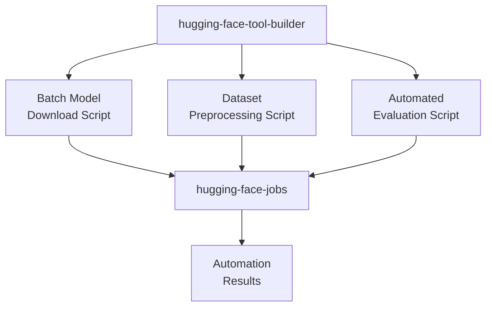

**Implementation:**
1. Use `hugging-face-tool-builder` to create custom API scripts:
   - Batch download utility for model comparison
   - Dataset preprocessing pipeline
   - Automated benchmark runner
2. Submit scripts as compute jobs with `hugging-face-jobs`
3. Monitor execution and collect results
4. Use `hugging-face-cli` to manage output artifacts

**Sources:** [README.md:170-173]()

---

## Integration with AI Assistants

All 8 Hugging Face skills are compatible with the standard AI assistant skill paths:

| Assistant | Project Path | Global Path |
|-----------|--------------|-------------|
| Claude Code | `.claude/skills/` | `~/.claude/skills/` |
| Cursor | `.cursor/skills/` | `~/.cursor/skills/` |
| GitHub Copilot | `.github/skills/` | `~/.copilot/skills/` |
| Gemini CLI | `.gemini/skills/` | `~/.gemini/skills/` |
| Windsurf | `.windsurf/skills/` | `~/.codeium/windsurf/skills/` |

**Installation Example:**
```bash
# Clone skill to project directory
git clone https://github.com/huggingface/skills
cp -r skills/skills/hugging-face-model-trainer .claude/skills/

# Or install globally
cp -r skills/skills/hugging-face-model-trainer ~/.claude/skills/
```

**Sources:** [README.md:76-87](), [README.md:163-174]()

---

## Technical Architecture

### Skill-to-Hub Integration Layer

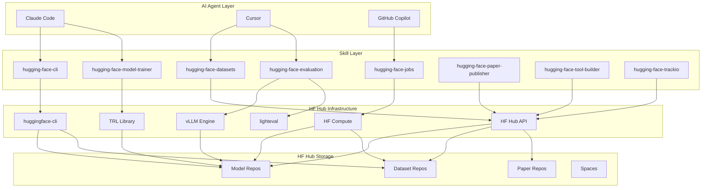

**Sources:** [README.md:76-87](), [README.md:163-174]()

---

## Skill Dependencies and Prerequisites

### Required Tools and Libraries

| Skill | External Dependencies | Configuration |
|-------|----------------------|---------------|
| `hugging-face-cli` | `huggingface-cli` (pip package) | HF token authentication |
| `hugging-face-datasets` | `datasets` library | Hub write access |
| `hugging-face-model-trainer` | `trl`, `transformers`, `accelerate` | GPU access recommended |
| `hugging-face-evaluation` | `vllm`, `lighteval` | GPU required for inference |
| `hugging-face-jobs` | HF account with compute credits | Compute quota |
| `hugging-face-paper-publisher` | Hub write access | Repository creation permissions |
| `hugging-face-tool-builder` | `huggingface_hub` library | Python 3.8+ |
| `hugging-face-trackio` | Hub write access | Repository permissions |

### Authentication Setup

All skills require Hugging Face Hub authentication:

```bash
# Set HF token as environment variable
export HF_TOKEN=hf_your_token_here

# Or login via CLI
huggingface-cli login
```

**Sources:** [README.md:163-174]()

---

## Summary

The Hugging Face skills collection provides comprehensive ML workflow automation through 8 specialized skills hosted at `github.com/huggingface/skills`. These skills integrate with HF Hub infrastructure to enable:

- **Data Management:** Dataset creation, configuration, and querying via `hugging-face-datasets`
- **Model Training:** SFT, DPO, GRPO training with TRL via `hugging-face-model-trainer`
- **Compute Jobs:** Python script execution on HF infrastructure via `hugging-face-jobs`
- **Evaluation:** vLLM and lighteval benchmarking via `hugging-face-evaluation`
- **Publishing:** Research paper publication via `hugging-face-paper-publisher`
- **Tracking:** Real-time experiment monitoring via `hugging-face-trackio`
- **Automation:** Custom tool development via `hugging-face-tool-builder`
- **Infrastructure:** Hub operations via `hugging-face-cli`

For contributing new Hugging Face skills, see [Contribution Guidelines](#5.1). For other official team skills, see [Official Team Skills](#4.1).

**Sources:** [README.md:163-174]()

---

