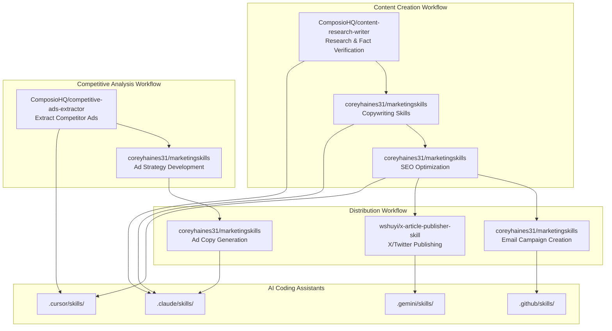
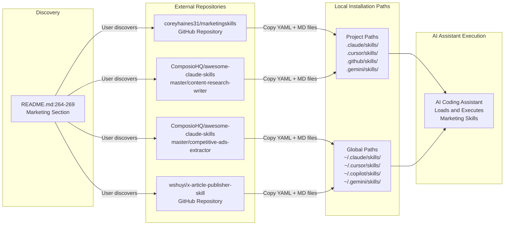

<!-- source: DeepWiki mcp.deepwiki.com · repo VoltAgent/awesome-agent-skills · extra page Marketing Skills · fetched 2026-10-26 -->

# Marketing Skills

<details>
<summary>Relevant source files</summary>

The following files were used as context for generating this wiki page:

- [README.md](README.md)

</details>


This page documents the community-contributed marketing skills available in the Awesome Agent Skills collection. These skills enable AI coding assistants to perform marketing-focused tasks including SEO optimization, content creation, competitive analysis, and social media management.

For development-related skills, see [Development and Testing Skills](#4.2.1). For productivity tools and collaboration, see [Productivity and Collaboration Skills](#4.2.3).

**Sources:** [README.md:264-269]()

## Overview

The marketing skills category comprises 4 specialized skill repositories contributed by community developers. These skills leverage AI coding assistants to automate and enhance various aspects of digital marketing workflows, from content research and copywriting to competitive intelligence and social media publishing.

**Sources:** [README.md:264-269]()

## Skill Repository Summary

The following table catalogs all marketing skills currently available in the collection:

| Repository | Skill Count | Primary Focus | Key Capabilities |
|------------|-------------|---------------|------------------|
| `coreyhaines31/marketingskills` | 23+ | Comprehensive marketing toolkit | SEO, copywriting, email marketing, advertising |
| `ComposioHQ/content-research-writer` | 1 | Content enhancement | Research integration, fact verification, source citation |
| `ComposioHQ/competitive-ads-extractor` | 1 | Competitive intelligence | Ad analysis, competitor monitoring, market insights |
| `wshuyi/x-article-publisher-skill` | 1 | Social media automation | X/Twitter publishing, article distribution |

**Sources:** [README.md:264-269]()

## Detailed Skill Descriptions

### coreyhaines31/marketingskills

The largest marketing skill repository in the collection, containing 23+ individual skills covering the full spectrum of digital marketing activities. This comprehensive toolkit addresses SEO optimization, copywriting workflows, email campaign development, and advertising content creation.

**Repository:** `coreyhaines31/marketingskills`

**Installation Path Examples:**
- Project-specific: `.claude/skills/marketingskills/`, `.cursor/skills/marketingskills/`
- Global: `~/.claude/skills/marketingskills/`, `~/.cursor/skills/marketingskills/`

**Core Capabilities:**
- **SEO/SEM:** Search engine optimization strategies, keyword research, meta tag generation
- **Copywriting:** Marketing copy creation, A/B testing variants, brand voice consistency
- **Email Marketing:** Campaign design, segmentation strategies, automation workflows
- **Advertising:** Ad copy generation, targeting recommendations, performance optimization

**Sources:** [README.md:266]()

### ComposioHQ/content-research-writer

Enhances content quality by integrating research capabilities into the writing workflow. This skill enables AI assistants to gather supporting evidence, verify factual claims, and incorporate authoritative sources into written content.

**Repository:** `ComposioHQ/content-research-writer`  
**Location:** `ComposioHQ/awesome-claude-skills/tree/master/content-research-writer`

**Primary Functions:**
- Research integration during content creation
- Fact verification and source attribution
- Citation management and reference formatting
- Enhanced credibility through evidence-based writing

**Sources:** [README.md:267]()

### ComposioHQ/competitive-ads-extractor

Provides competitive intelligence capabilities by analyzing competitor advertising strategies. This skill helps marketing teams understand competitive positioning, identify successful ad patterns, and inform their own advertising decisions.

**Repository:** `ComposioHQ/competitive-ads-extractor`  
**Location:** `ComposioHQ/awesome-claude-skills/tree/master/competitive-ads-extractor`

**Analytical Capabilities:**
- Competitor ad identification and extraction
- Ad messaging and creative analysis
- Targeting and positioning insights
- Trend identification across competitive landscape

**Sources:** [README.md:268]()

### wshuyi/x-article-publisher-skill

Automates the publication of articles to X (formerly Twitter), streamlining social media distribution workflows. This skill handles the technical integration with X's API and manages content formatting for the platform.

**Repository:** `wshuyi/x-article-publisher-skill`

**Publishing Features:**
- X/Twitter API integration
- Article-to-thread conversion
- Automated posting workflows
- Content scheduling and distribution

**Sources:** [README.md:269]()

## Marketing Workflow Architecture



This diagram illustrates how marketing skills integrate into typical marketing workflows. Content creation begins with research (`ComposioHQ/content-research-writer`), flows through copywriting and SEO optimization (`coreyhaines31/marketingskills`), and culminates in distribution via email campaigns or social publishing (`wshuyi/x-article-publisher-skill`). Competitive analysis (`ComposioHQ/competitive-ads-extractor`) informs advertising strategy development.

**Sources:** [README.md:264-269](), [README.md:76-87]()

## Skill Installation and Integration



This diagram maps the technical workflow from skill discovery to execution. Users discover marketing skills through the curated list in [README.md:264-269](). They then copy skill definition files from external repositories (e.g., `coreyhaines31/marketingskills`) to their AI assistant's skill directories (`.claude/skills/`, `.cursor/skills/`, etc.). The AI assistant loads these skills and makes them available for marketing task execution.

**Sources:** [README.md:264-269](), [README.md:76-87]()

## Marketing Skill Categories

The 23+ skills within the `coreyhaines31/marketingskills` repository span multiple marketing disciplines:

### Search Engine Optimization (SEO/SEM)

Skills focused on improving search visibility and organic traffic:
- Keyword research and analysis
- Meta description generation
- Title tag optimization
- Content structure for search engines
- Technical SEO auditing

### Copywriting

Content creation skills for various marketing contexts:
- Landing page copy development
- Product description writing
- Brand voice maintenance
- A/B test variant generation
- Call-to-action optimization

### Email Marketing

Campaign development and automation skills:
- Email sequence design
- Subject line testing
- Segmentation strategy
- Deliverability optimization
- Performance analysis

### Advertising

Paid advertising content and strategy skills:
- Ad copy creation
- Targeting parameter definition
- Budget allocation recommendations
- Performance metric analysis
- Platform-specific optimization

**Sources:** [README.md:266]()

## Integration with Other Community Skills

Marketing skills frequently complement other community skill categories:

| Skill Category | Integration Point | Example Workflow |
|----------------|-------------------|------------------|
| Productivity Skills ([#4.2.3](#4.2.3)) | Content management | Publish marketing content to Notion using `notiondevs/Notion Skills for Claude` |
| Development Skills ([#4.2.1](#4.2.1)) | Landing page creation | Generate marketing screenshots with `Shpigford/screenshots` |
| Specialized Domain Skills ([#4.2.5](#4.2.5)) | Image generation | Create marketing visuals using `sanjay3290/imagen` |
| Context Engineering ([#4.2.4](#4.2.4)) | Multi-agent campaigns | Coordinate content creation across multiple agents with `muratcankoylan/multi-agent-patterns` |

**Sources:** [README.md:264-369]()

## Skill Definition Format

Marketing skills follow the standardized Agent Skills format documented in [#3.1](#3.1):

```
---
name: skill-identifier
description: Brief description (≤10 words)
---

# Skill Title

Detailed explanation of skill purpose and capabilities.

## When to Use This Skill

Specific use cases and scenarios.

## Instructions

Step-by-step guidance for AI assistant execution.

## Validation

Success criteria and output verification.
```

Each marketing skill repository contains one or more skill definition files using this YAML front matter + Markdown structure. The AI coding assistant parses these files to understand task requirements and execution procedures.

**Sources:** [README.md:42-73]()

## Common Use Cases

### Content Production Pipeline

1. **Research Phase**: Use `ComposioHQ/content-research-writer` to gather supporting evidence
2. **Writing Phase**: Apply copywriting skills from `coreyhaines31/marketingskills`
3. **Optimization Phase**: Execute SEO skills for search visibility
4. **Distribution Phase**: Publish via `wshuyi/x-article-publisher-skill`

### Competitive Intelligence Workflow

1. **Data Collection**: Extract competitor ads using `ComposioHQ/competitive-ads-extractor`
2. **Analysis**: Apply analytical frameworks from `coreyhaines31/marketingskills`
3. **Strategy Development**: Generate differentiated ad copy
4. **Campaign Execution**: Deploy email or advertising campaigns

### Multi-Channel Campaign Development

1. **Email**: Design campaigns with email marketing skills
2. **Social Media**: Prepare X/Twitter content with publishing skill
3. **Paid Advertising**: Create ad variants for testing
4. **SEO Content**: Optimize organic search presence

**Sources:** [README.md:264-269]()

## Installation Paths Reference

Marketing skills can be installed at project or global scope across all supported AI coding assistants:

| AI Assistant | Project Path | Global Path |
|--------------|--------------|-------------|
| Claude Code | `.claude/skills/` | `~/.claude/skills/` |
| Cursor | `.cursor/skills/` | `~/.cursor/skills/` |
| GitHub Copilot | `.github/skills/` | `~/.copilot/skills/` |
| Gemini CLI | `.gemini/skills/` | `~/.gemini/skills/` |
| Windsurf | `.windsurf/skills/` | `~/.codeium/windsurf/skills/` |
| Antigravity | `.agent/skills/` | `~/.gemini/antigravity/skills/` |
| Codex | `.codex/skills/` | `~/.codex/skills/` |
| OpenCode | `.opencode/skills/` | `~/.config/opencode/skills/` |

**Project paths** install skills for a specific codebase. **Global paths** make skills available across all projects for the user.

**Sources:** [README.md:76-87]()

## Quality and Maintenance

All marketing skills in this collection have met the contribution requirements detailed in [#5.2](#5.2):

- Public repository hosting
- Comprehensive documentation
- Demonstrated community usage
- Proven real-world effectiveness

Marketing skills are maintained by their original authors in external repositories. This decentralized model ensures skills evolve with marketing best practices and platform changes. The Awesome Agent Skills repository ([README.md:264-269]()) curates links to these external repositories but does not host the implementations.

**Sources:** [README.md:264-269](), [README.md:374-382]()

## Contributing Marketing Skills

To submit a new marketing skill to the collection, see [Contributing to the Collection](#5). The contribution process requires:

1. Creating a public repository with skill definition files
2. Providing clear documentation and usage examples
3. Demonstrating community adoption and real-world usage
4. Submitting a pull request with entry added to [README.md:264-269]()

The maintainers prioritize quality over quantity, focusing on proven, community-adopted skills rather than experimental projects.

**Sources:** [README.md:374-382]()

---

