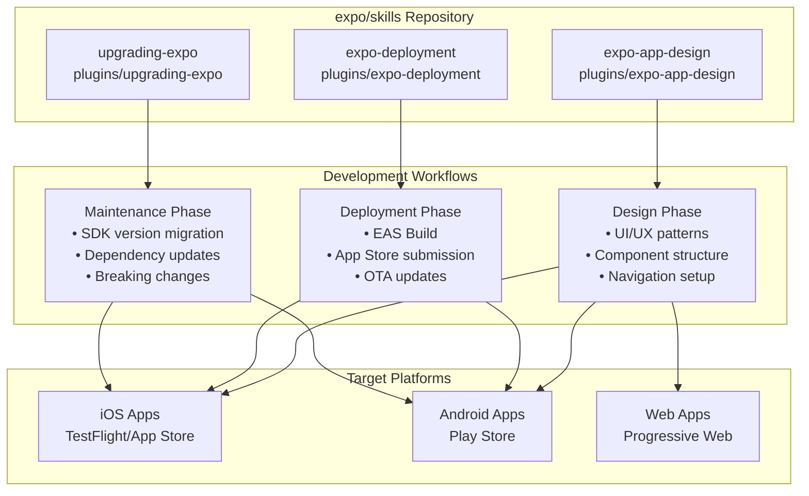
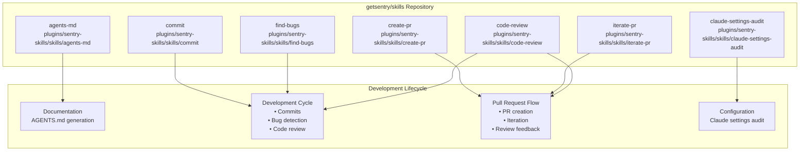
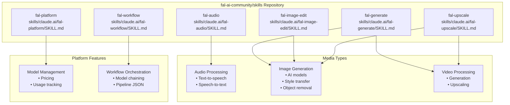
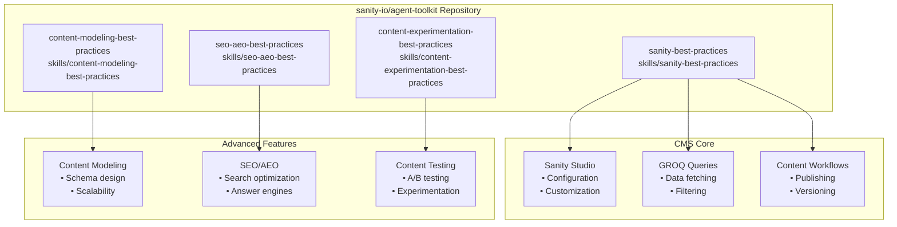
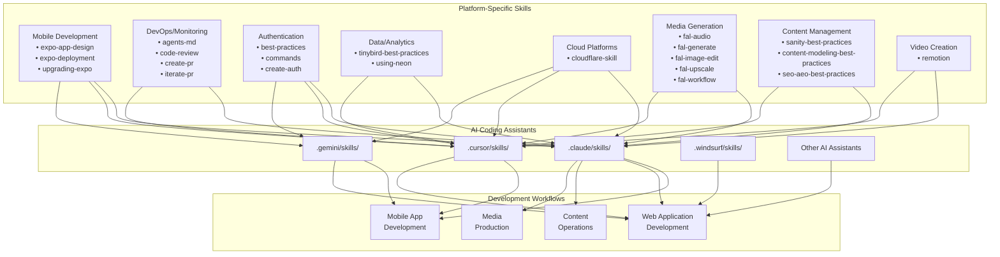
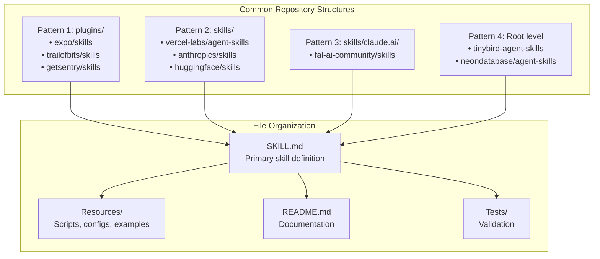

<!-- source: DeepWiki mcp.deepwiki.com · repo VoltAgent/awesome-agent-skills · extra page Other Team Skills · fetched 2026-10-26 -->

# Other Team Skills

<details>
<summary>Relevant source files</summary>

The following files were used as context for generating this wiki page:

- [README.md](README.md)

</details>


This page documents skills contributed by 11 official development teams beyond the five teams covered in dedicated pages (Anthropic, Vercel, Cloudflare, Hugging Face, and Trail of Bits). These teams provide platform-specific expertise across mobile development, monitoring, authentication, analytics, databases, AI infrastructure, content management, and video creation.

For skills from the five major teams with dedicated coverage, see [Anthropic Skills](#4.1.1), [Vercel Skills](#4.1.2), [Cloudflare Skills](#4.1.3), [Hugging Face Skills](#4.1.4), and [Trail of Bits Security Skills](#4.1.5). For community-contributed skills, see [Community Skills](#4.2).

## Overview of Contributing Teams

The following table summarizes the 11 teams documented in this section and their skill focus areas:

| Team | Repository | Skill Count | Primary Focus |
|------|-----------|-------------|---------------|
| Expo | [expo/skills](https://github.com/expo/skills) | 3 | Mobile app development and deployment |
| Sentry | [getsentry/skills](https://github.com/getsentry/skills) | 7 | Development workflow and monitoring |
| Better Auth | [better-auth/skills](https://github.com/better-auth/skills) | 3 | Authentication implementation |
| Tinybird | [tinybirdco/tinybird-agent-skills](https://github.com/tinybirdco/tinybird-agent-skills) | 1 | Real-time analytics pipelines |
| Neon | [neondatabase/agent-skills](https://github.com/neondatabase/agent-skills) | 1 | Serverless Postgres workflows |
| Cloudflare (dmmulroy) | [dmmulroy/cloudflare-skill](https://github.com/dmmulroy/cloudflare-skill) | 1 | Cloudflare platform reference |
| fal.ai | [fal-ai-community/skills](https://github.com/fal-ai-community/skills) | 6 | AI-powered media generation |
| Sanity | [sanity-io/agent-toolkit](https://github.com/sanity-io/agent-toolkit) | 4 | Content management systems |
| Remotion | [remotion-dev/skills](https://github.com/remotion-dev/skills) | 1 | Programmatic video creation |

**Sources:** [README.md:206-261]()

## Team Breakdown

### Expo Team - Mobile Development



**Expo Skills Architecture**

The Expo team provides three skills covering the complete mobile application lifecycle:

| Skill | Path | Purpose |
|-------|------|---------|
| `expo-app-design` | `plugins/expo-app-design` | Design and build Expo applications with best practices for React Native |
| `expo-deployment` | `plugins/expo-deployment` | Deploy Expo apps to production using EAS Build and Submit |
| `upgrading-expo` | `plugins/expo-deployment` | Upgrade Expo SDK versions with automated migration guidance |

**Sources:** [README.md:206-213]()

### Sentry Team - Development Workflow



**Sentry Development Skills**

Sentry's internal development team created seven skills for their own engineering workflows:

| Skill | File Path | Functionality |
|-------|-----------|---------------|
| `agents-md` | `plugins/sentry-skills/skills/agents-md` | Generate and manage `AGENTS.md` documentation files |
| `claude-settings-audit` | `plugins/sentry-skills/skills/claude-settings-audit` | Audit Claude configuration and settings |
| `code-review` | `plugins/sentry-skills/skills/code-review` | Perform systematic code reviews |
| `commit` | `plugins/sentry-skills/skills/commit` | Create commits following best practices |
| `create-pr` | `plugins/sentry-skills/skills/create-pr` | Generate pull requests with proper formatting |
| `find-bugs` | `plugins/sentry-skills/skills/find-bugs` | Identify bugs and potential issues in codebases |
| `iterate-pr` | `plugins/sentry-skills/skills/iterate-pr` | Process and respond to pull request feedback |

**Sources:** [README.md:214-223]()

### Better Auth Team - Authentication

The Better Auth team provides three skills focused on implementing authentication systems using their authentication framework:

| Skill | Repository Path | Purpose |
|-------|----------------|---------|
| `best-practices` | `better-auth/best-practices` | Best practices for Better Auth integration and implementation |
| `commands` | `better-auth/commands` | Better Auth CLI commands and tool usage |
| `create-auth` | `better-auth/create-auth` | Create authentication setup with Better Auth framework |

**Sources:** [README.md:224-229]()

### Tinybird Team - Real-Time Analytics

The Tinybird team provides a single comprehensive skill covering their real-time analytics platform:

| Skill | Repository Path | Coverage |
|-------|----------------|----------|
| `tinybird-best-practices` | `skills/tinybird-best-practices` | Guidelines for datasources, pipes, endpoints, and SQL queries in Tinybird projects |

**Sources:** [README.md:230-233]()

### Neon Team - Serverless Postgres

The Neon team provides a single skill for their serverless Postgres platform:

| Skill | Repository Path | Coverage |
|-------|----------------|----------|
| `using-neon` | `skills/neon-postgres` | Best practices for Neon Serverless Postgres implementation |

**Sources:** [README.md:234-237]()

### Cloudflare Engineer (dmmulroy) - Platform Reference

A Cloudflare engineer created a comprehensive platform reference skill:

| Skill | Repository Path | Coverage |
|-------|----------------|----------|
| `cloudflare-skill` | `skill/cloudflare` | Cloudflare platform reference for Workers, Pages, storage, AI, and networking |

**Sources:** [README.md:238-241]()

## Media and Content Skills

### fal.ai Team - AI Media Generation



**fal.ai Media Generation Skills**

The fal.ai team provides six skills covering AI-powered media generation and processing:

| Skill | File Path | Functionality |
|-------|-----------|---------------|
| `fal-audio` | `skills/claude.ai/fal-audio/SKILL.md` | Text-to-speech and speech-to-text using fal.ai audio models |
| `fal-generate` | `skills/claude.ai/fal-generate/SKILL.md` | Generate images and videos using fal.ai AI models |
| `fal-image-edit` | `skills/claude.ai/fal-image-edit/SKILL.md` | AI-powered image editing with style transfer and object removal |
| `fal-platform` | `skills/claude.ai/fal-platform/SKILL.md` | Platform APIs for model management, pricing, and usage tracking |
| `fal-upscale` | `skills/claude.ai/fal-upscale/SKILL.md` | Upscale and enhance image and video resolution using AI |
| `fal-workflow` | `skills/claude.ai/fal-workflow/SKILL.md` | Generate workflow JSON files for chaining AI models |

**Sources:** [README.md:242-250]()

### Sanity Team - Content Management



**Sanity Content Management Skills**

The Sanity team provides four skills for their headless CMS platform:

| Skill | Repository Path | Coverage |
|-------|----------------|----------|
| `sanity-best-practices` | `skills/sanity-best-practices` | Best practices for Sanity Studio, GROQ queries, and content workflows |
| `content-modeling-best-practices` | `skills/content-modeling-best-practices` | Guidelines for designing scalable content models in Sanity |
| `seo-aeo-best-practices` | `skills/seo-aeo-best-practices` | SEO and answer engine optimization patterns for content sites |
| `content-experimentation-best-practices` | `skills/content-experimentation-best-practices` | Content A/B testing and experimentation workflows |

**Sources:** [README.md:251-257]()

### Remotion Team - Programmatic Video

The Remotion team provides a single skill for programmatic video creation:

| Skill | Repository Path | Technology |
|-------|----------------|------------|
| `remotion` | `skills/remotion` | Programmatic video creation with React |

**Sources:** [README.md:258-261]()

## Skill Integration Architecture



**Skill Integration Model**

These official team skills follow the standardized integration model documented in [AI Assistant Integration](#3.2). Each skill is defined as a YAML front matter document with Markdown content, deployable to any of the eight supported AI coding assistants by copying to the appropriate directory path.

**Sources:** [README.md:206-261](), [README.md:76-88]()

## Skill Characteristics by Category

The following table summarizes the characteristics and typical use cases for skills from each team:

| Team | Skill Type | Platform Dependency | Integration Complexity | Primary Use Case |
|------|-----------|---------------------|----------------------|------------------|
| Expo | Platform-Specific | High (Expo SDK) | Medium | Mobile app development lifecycle |
| Sentry | Workflow | Low (Git/GitHub) | Low | Internal development processes |
| Better Auth | Framework-Specific | High (Better Auth) | Medium | Authentication implementation |
| Tinybird | Platform-Specific | High (Tinybird) | Medium | Real-time analytics pipelines |
| Neon | Platform-Specific | High (Neon) | Low | Serverless Postgres operations |
| Cloudflare | Platform-Specific | High (Cloudflare) | Medium | Edge computing workflows |
| fal.ai | API-Based | Medium (fal.ai API) | Medium | AI-powered media generation |
| Sanity | Platform-Specific | High (Sanity CMS) | Medium | Content management workflows |
| Remotion | Framework-Specific | High (Remotion) | High | Programmatic video creation |

**Sources:** [README.md:206-261]()

## Repository Structure Patterns



**Repository Organization Patterns**

Teams organize their skill repositories using several common patterns:

1. **plugins/ directory**: Used by Expo, Sentry, and Trail of Bits
2. **skills/ directory**: Used by Vercel, Anthropic, and Hugging Face
3. **skills/claude.ai/ nested**: Used by fal.ai for Claude-specific skills
4. **Root-level skills/**: Used by Tinybird and Neon

All patterns result in skills that conform to the standardized format documented in [Skill Definition Format](#3.1).

**Sources:** [README.md:206-261]()

## Usage Patterns and Best Practices

### Platform-Specific Skills

Skills from Expo, Better Auth, Tinybird, Neon, and Sanity require the corresponding platform or service to be actively used in the project:

```
# Example: Installing Expo skills for mobile development
.claude/skills/
├── expo-app-design/
│   └── SKILL.md
├── expo-deployment/
│   └── SKILL.md
└── upgrading-expo/
    └── SKILL.md
```

These skills contain platform-specific knowledge including:
- API patterns and conventions
- CLI command reference
- Configuration best practices
- Common troubleshooting scenarios

**Sources:** [README.md:206-241]()

### Development Workflow Skills

Skills from Sentry provide reusable patterns for common development workflows that can be adapted to any project:

```
# Example: Installing Sentry workflow skills
.cursor/skills/
├── code-review/
│   └── SKILL.md
├── commit/
│   └── SKILL.md
├── create-pr/
│   └── SKILL.md
└── iterate-pr/
    └── SKILL.md
```

These skills encode best practices for software development processes and can be used independently of the Sentry monitoring platform.

**Sources:** [README.md:214-223]()

### Media Generation Skills

Skills from fal.ai require API access to their service and include instructions for:
- Model selection
- Parameter configuration
- Output handling
- Cost optimization

```
# Example: Installing fal.ai media skills
.gemini/skills/
├── fal-generate/
│   └── SKILL.md
├── fal-image-edit/
│   └── SKILL.md
└── fal-upscale/
    └── SKILL.md
```

**Sources:** [README.md:242-250]()

## Comparison with Major Team Skills

Skills documented in this section differ from those covered in dedicated pages ([Anthropic](#4.1.1), [Vercel](#4.1.2), [Cloudflare](#4.1.3), [Hugging Face](#4.1.4), [Trail of Bits](#4.1.5)) primarily in:

| Characteristic | Major Teams (5) | Other Teams (11) |
|----------------|-----------------|------------------|
| Skill Count | 7-22 per team | 1-7 per team |
| Focus Breadth | Broad (multiple categories) | Narrow (platform-specific) |
| Documentation Depth | Extensive with examples | Concise with essentials |
| Community Adoption | High (thousands of users) | Medium (hundreds of users) |
| Update Frequency | Regular (weekly/monthly) | Occasional (quarterly) |

However, all skills follow the same standardized format and integration model regardless of team size or skill count.

**Sources:** [README.md:97-261]()

## Discovery and Installation

To discover and install skills from these teams:

1. Browse the [README.md:206-261]() for the complete skill listings
2. Navigate to the team's GitHub repository
3. Review the skill documentation in `SKILL.md` or equivalent
4. Copy the skill directory to your AI assistant's skills path
5. Reference the [Skills Paths table](#6.1) for your specific assistant

Example installation for Remotion skill in Claude Code:

```bash
# Navigate to Claude skills directory
cd ~/.claude/skills/

# Clone the Remotion skill
git clone https://github.com/remotion-dev/skills
cp -r skills/skills/remotion/ ./

# Verify installation
ls -la remotion/
```

For detailed installation instructions, see [Installing Skills](#2.1).

**Sources:** [README.md:76-88](), [README.md:206-261]()

---

