<!-- source: DeepWiki mcp.deepwiki.com · repo VoltAgent/awesome-agent-skills · extra page Productivity and Collaboration Skills · fetched 2026-10-26 -->

# Productivity and Collaboration Skills

<details>
<summary>Relevant source files</summary>

The following files were used as context for generating this wiki page:

- [README.md](README.md)

</details>


## Purpose and Scope

This page documents the 20+ community-contributed skills focused on productivity tools and team collaboration. These skills enable AI coding assistants to interact with popular productivity platforms (Notion, Linear, Slack, WhatsApp), generate presentation materials (PPT, HTML slides), coordinate multi-agent workflows, and analyze team communication patterns.

For development-focused skills including testing and CI/CD, see [Development and Testing Skills](#4.2.1). For marketing automation skills, see [Marketing Skills](#4.2.2). For advanced agent orchestration patterns, see [Context Engineering Skills](#4.2.4).

**Sources:** [README.md:271-291]()

## Skill Categories

The Productivity and Collaboration skill collection is organized into six functional categories, each addressing specific workflow needs:

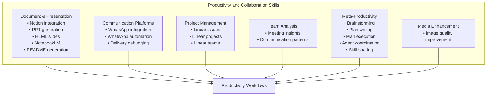

**Sources:** [README.md:271-291]()

## Repository Structure and Code Entities

The skills in this category are distributed across multiple external repositories, each with distinct organizational patterns:

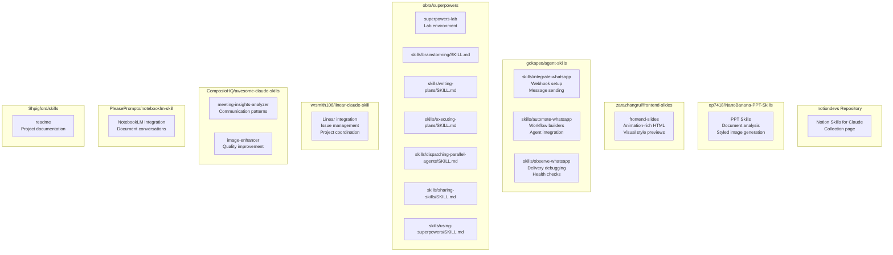

**Sources:** [README.md:273-290]()

## Document and Presentation Skills

These skills enable AI agents to create, manipulate, and generate various document formats for presentations and documentation:

| Skill | Repository | Primary Functions |
|-------|-----------|-------------------|
| **Notion Skills** | `notiondevs/Notion Skills for Claude` | Notion workspace integration, database operations, page creation |
| **NanoBanana-PPT-Skills** | `op7418/NanoBanana-PPT-Skills` | AI-powered PPT generation, document analysis, styled image insertion |
| **frontend-slides** | `zarazhangrui/frontend-slides` | HTML presentation generation, animation integration, visual style previews |
| **notebooklm-skill** | `PleasePrompto/notebooklm-skill` | NotebookLM API interaction, document-based Q&A |
| **readme** | `Shpigford/skills/tree/main/readme` | Comprehensive project documentation generation |

### Integration Architecture

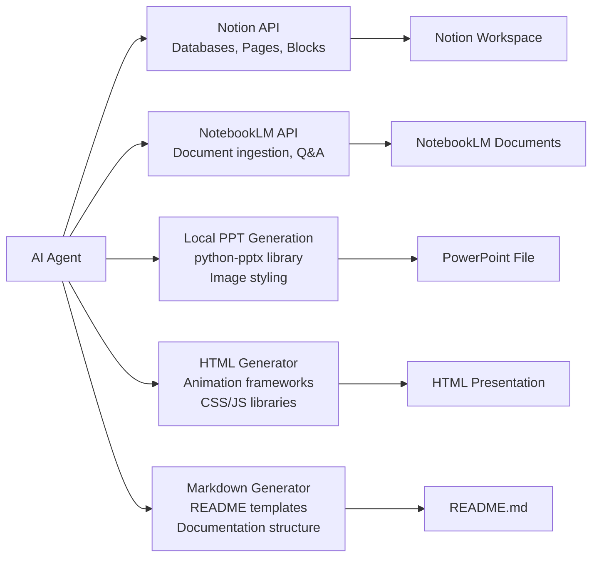

**Sources:** [README.md:273-276](), [README.md:279](), [README.md:290]()

## Communication Platform Skills

Three related skills from the `gokapso/agent-skills` repository provide comprehensive WhatsApp integration capabilities:

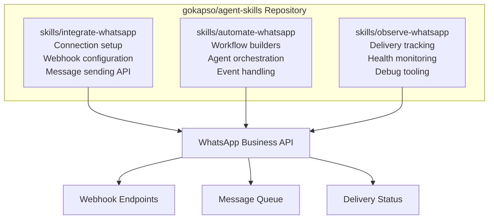

### WhatsApp Skills Workflow

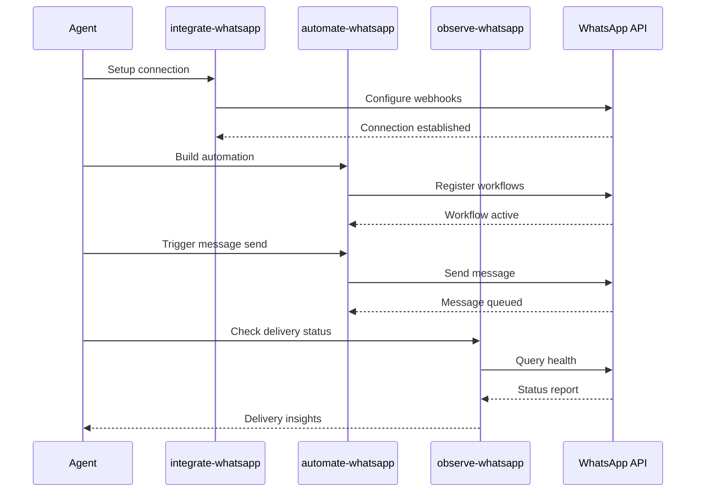

**Sources:** [README.md:276-278]()

## Project Management Skills

The Linear integration skill provides comprehensive project management capabilities:

| Skill Component | Repository Path | Functionality |
|----------------|----------------|---------------|
| **Linear Integration** | `wrsmith108/linear-claude-skill` | Issue creation, status updates, assignment management |
| **Project Operations** | `wrsmith108/linear-claude-skill` | Project lifecycle, milestone tracking, roadmap planning |
| **Team Coordination** | `wrsmith108/linear-claude-skill` | Team member management, workload distribution, notifications |

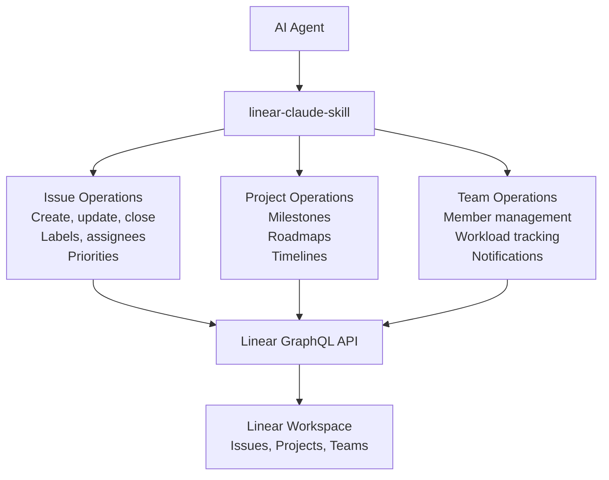

**Sources:** [README.md:289]()

## Meta-Productivity Skills (obra/superpowers)

The `obra/superpowers` repository contains seven interconnected skills that form a meta-productivity framework for coordinating AI agent workflows:

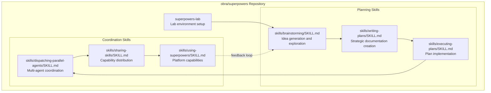

### Meta-Productivity Workflow Pattern

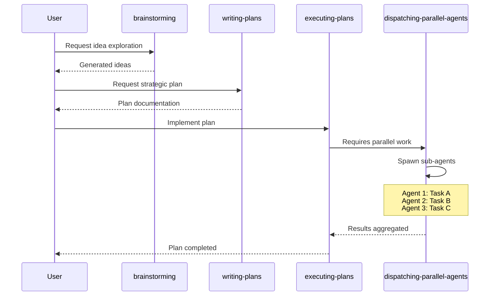

**Sources:** [README.md:280-286]()

## Team Analysis and Enhancement Skills

Skills for analyzing team communication and enhancing media quality:

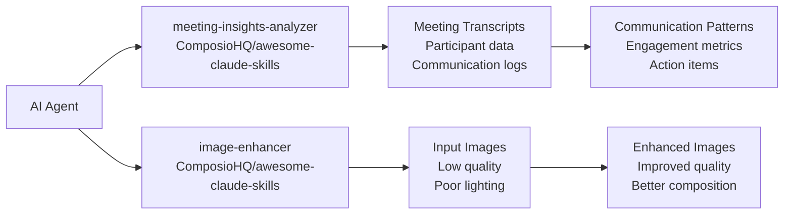

**Sources:** [README.md:287-288]()

## Skill Installation Paths

All productivity and collaboration skills follow the standard AI assistant installation conventions:

| AI Assistant | Project-Specific Path | Global Path |
|-------------|----------------------|-------------|
| **Claude Code** | `.claude/skills/` | `~/.claude/skills/` |
| **Cursor** | `.cursor/skills/` | `~/.cursor/skills/` |
| **GitHub Copilot** | `.github/skills/` | `~/.copilot/skills/` |
| **Gemini CLI** | `.gemini/skills/` | `~/.gemini/skills/` |
| **Windsurf** | `.windsurf/skills/` | `~/.codeium/windsurf/skills/` |
| **Antigravity** | `.agent/skills/` | `~/.gemini/antigravity/skills/` |
| **Codex** | `.codex/skills/` | `~/.codex/skills/` |
| **OpenCode** | `.opencode/skills/` | `~/.config/opencode/skills/` |

Users copy skill files from external repositories to these paths based on whether they need project-specific or user-wide availability.

**Sources:** [README.md:76-87]()

## Common Integration Patterns

### Pattern 1: API-Based Integration

Skills like `linear-claude-skill`, `integrate-whatsapp`, and Notion skills interact with external SaaS platforms via REST or GraphQL APIs:

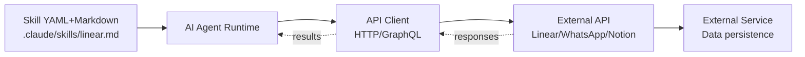

### Pattern 2: Local Generation

Skills like `NanoBanana-PPT-Skills`, `frontend-slides`, and `readme` generate artifacts locally without external API dependencies:

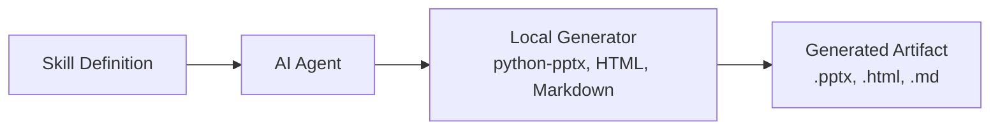

### Pattern 3: Meta-Coordination

The `obra/superpowers` skills coordinate multiple agents or workflows through a hierarchical orchestration pattern:

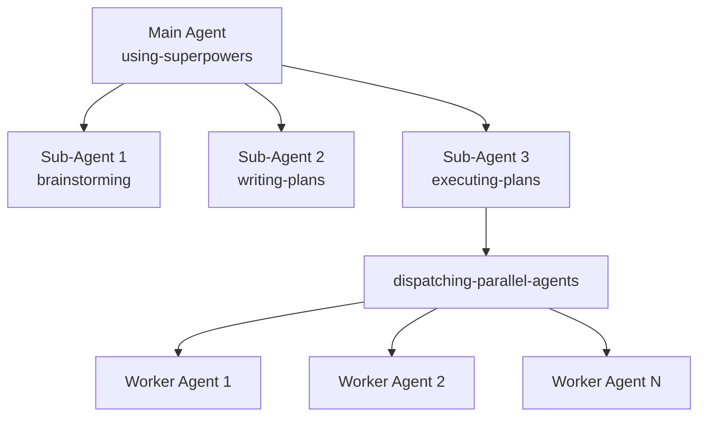

**Sources:** [README.md:271-291]()

## Skill Definition Structure

All productivity and collaboration skills follow the standard YAML + Markdown format defined in the skill specification:

```yaml
---
name: skill-name
description: Brief description (≤10 words)
---

# Skill Title

Description of what the skill does.

## When to Use This Skill

Use cases and triggering conditions.

## Instructions

Step-by-step execution instructions for the AI agent.

## Validation

Expected outputs and success criteria.
```

For detailed skill structure specifications, see [Skill Definition Format](#3.1).

**Sources:** [README.md:44-72]()

## Usage Example: Linear Project Management Workflow

A typical workflow combining multiple productivity skills:

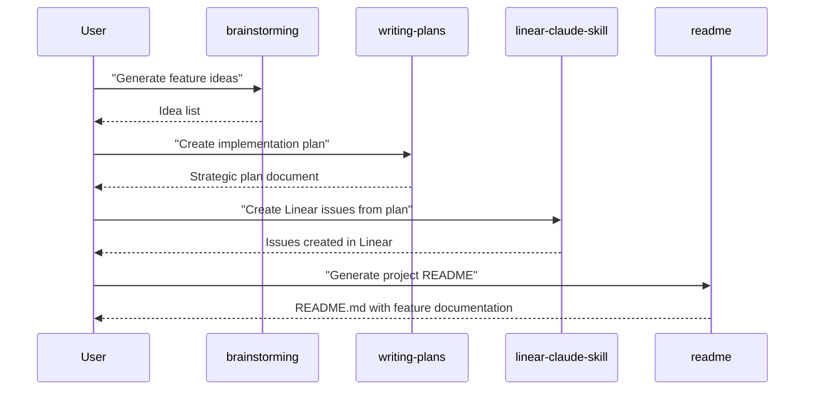

**Sources:** [README.md:280-290]()

## External Dependencies

Many productivity and collaboration skills require external service accounts or API keys:

| Skill Category | Required Services | Authentication |
|---------------|------------------|----------------|
| **Notion Skills** | Notion account, Notion API key | OAuth 2.0 or API token |
| **Linear Integration** | Linear workspace, API key | GraphQL API token |
| **WhatsApp Skills** | WhatsApp Business API account | Business API credentials |
| **NotebookLM** | Google account, NotebookLM access | Google OAuth |
| **Meeting Insights** | Meeting platform integration | Platform-specific API keys |

Skills that generate artifacts locally (PPT, HTML, README) do not require external authentication.

**Sources:** [README.md:273-290]()

## Skill Repository Maintenance

The productivity and collaboration skills are maintained by their respective authors:

- **notiondevs**: Notion Skills collection
- **op7418**: NanoBanana-PPT-Skills
- **zarazhangrui**: frontend-slides
- **gokapso**: WhatsApp integration suite
- **PleasePrompto**: NotebookLM skill
- **obra**: Superpowers meta-productivity framework
- **wrsmith108**: Linear integration
- **ComposioHQ**: Meeting insights and image enhancement
- **Shpigford**: README generator

For issues or feature requests, users should contact the repository maintainers directly via their GitHub repositories.

**Sources:** [README.md:271-291]()

---

