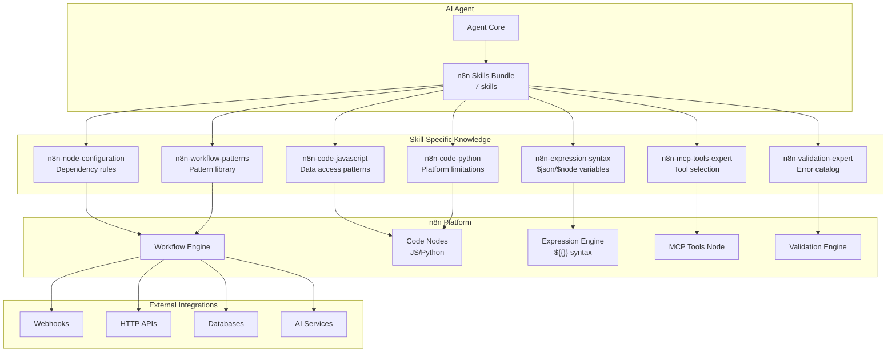
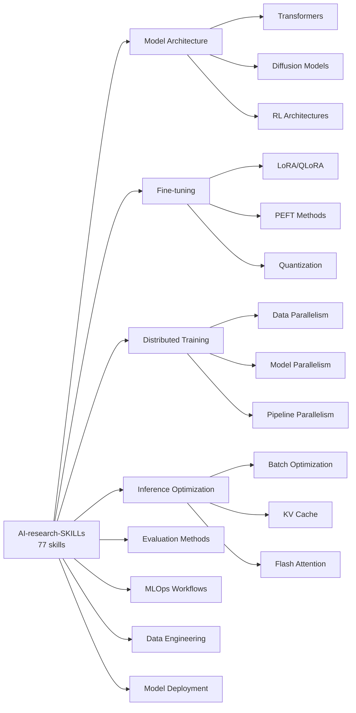
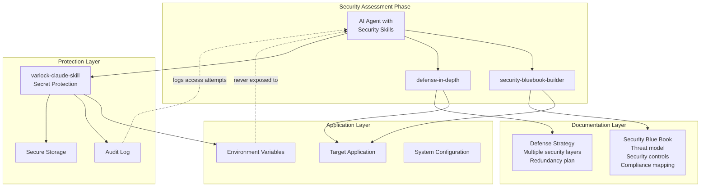
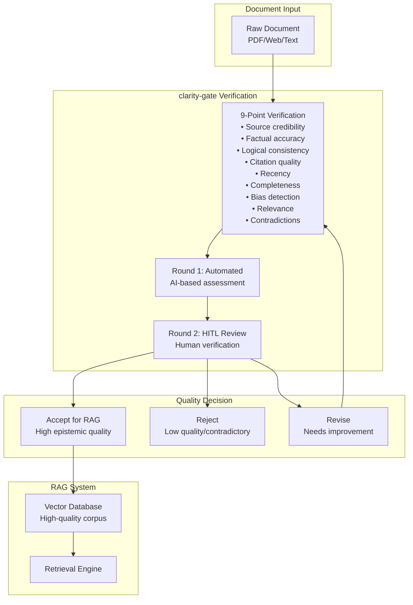
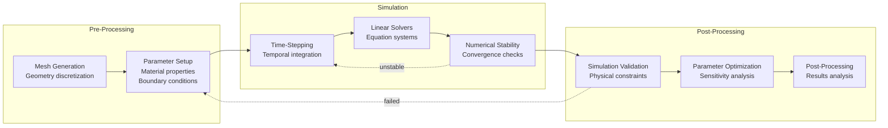
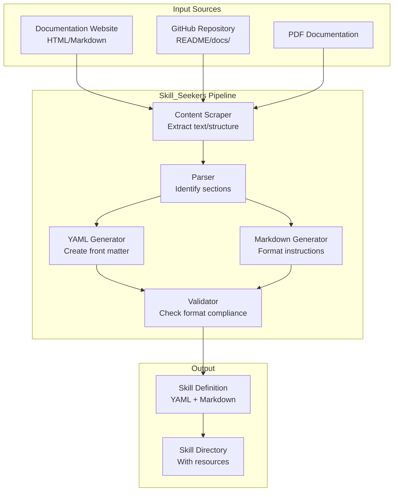
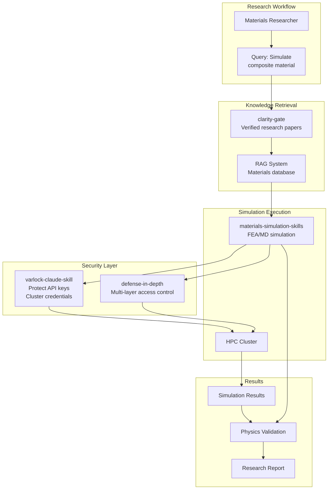

<!-- source: DeepWiki mcp.deepwiki.com · repo VoltAgent/awesome-agent-skills · extra page Specialized Domain Skills · fetched 2026-10-26 -->

# Specialized Domain Skills

<details>
<summary>Relevant source files</summary>

The following files were used as context for generating this wiki page:

- [README.md](README.md)

</details>


## Purpose and Scope

This document catalogs specialized domain skills that address niche applications and vertical-specific use cases. These skills extend AI coding assistants into specialized fields including workflow automation (n8n), scientific research, healthcare, security auditing, materials science, and knowledge engineering. Unlike general-purpose development skills ([4.2.1](#4.2.1)) or productivity tools ([4.2.3](#4.2.3)), specialized domain skills require deep domain expertise and often integrate with domain-specific platforms, APIs, or scientific computing frameworks.

This page covers 20+ community-contributed skills organized into 8 distinct domain categories. For official team skills with platform-specific integrations, see [4.1](#4.1). For context engineering and multi-agent patterns, see [4.2.4](#4.2.4).

**Sources:** [README.md:343-373]()

---

## Domain Taxonomy

The following diagram illustrates the hierarchical organization of specialized domain skills, showing how they map to specific vertical applications and technical domains.

```mermaid
graph TB
    SpecializedSkills["Specialized Domain Skills<br/>20+ Skills"]
    
    SpecializedSkills --> Automation["Workflow Automation<br/>7 skills"]
    SpecializedSkills --> Research["Scientific Research<br/>3 skills"]
    SpecializedSkills --> Health["Healthcare & Wellness<br/>1 skill"]
    SpecializedSkills --> Security["Security & Systems<br/>3 skills"]
    SpecializedSkills --> Media["Media & Communication<br/>2 skills"]
    SpecializedSkills --> Knowledge["Knowledge Engineering<br/>1 skill"]
    SpecializedSkills --> Materials["Materials Science<br/>1 skill"]
    SpecializedSkills --> Utilities["Utilities & Tools<br/>3 skills"]
    
    Automation --> n8nJS["n8n-code-javascript"]
    Automation --> n8nPy["n8n-code-python"]
    Automation --> n8nExpr["n8n-expression-syntax"]
    Automation --> n8nMCP["n8n-mcp-tools-expert"]
    Automation --> n8nNode["n8n-node-configuration"]
    Automation --> n8nValid["n8n-validation-expert"]
    Automation --> n8nWork["n8n-workflow-patterns"]
    
    Research --> ScientificSkills["claude-scientific-skills"]
    Research --> AIResearch["AI-research-SKILLs<br/>77 sub-skills"]
    Research --> Imagen["imagen"]
    
    Health --> AllyHealth["Claude-Ally-Health"]
    
    Security --> SecurityBluebook["security-bluebook-builder"]
    Security --> DefenseDepth["defense-in-depth"]
    Security --> Win11["claude-win11-speckit-update-skill"]
    
    Media --> Claudisms["claudisms"]
    Media --> SpeedReader["claude-speed-reader"]
    
    Knowledge --> ClarityGate["clarity-gate"]
    
    Materials --> MatSim["materials-simulation-skills"]
    
    Utilities --> Varlock["varlock-claude-skill"]
    Utilities --> BeautifulProse["beautiful_prose"]
    Utilities --> SkillSeekers["Skill_Seekers"]
```



**Sources:** [README.md:343-373]()

---

## Skill Catalog by Domain

### n8n Workflow Automation

n8n is a workflow automation platform that allows building complex integrations without code. These 7 skills provide comprehensive coverage of n8n development patterns, enabling AI agents to create, debug, and optimize n8n workflows.

| Skill | Repository | Focus Area |
|-------|-----------|------------|
| `n8n-code-javascript` | czlonkowski/n8n-skills | JavaScript coding in n8n Code nodes with data access patterns |
| `n8n-code-python` | czlonkowski/n8n-skills | Python coding in n8n Code nodes with platform limitations |
| `n8n-expression-syntax` | czlonkowski/n8n-skills | n8n expression syntax using `{{}}` and `$json`/`$node` variables |
| `n8n-mcp-tools-expert` | czlonkowski/n8n-skills | MCP tools integration with tool selection and node formats |
| `n8n-node-configuration` | czlonkowski/n8n-skills | Node configuration with dependency rules and AI connections |
| `n8n-validation-expert` | czlonkowski/n8n-skills | Fix n8n validation errors using error catalog |
| `n8n-workflow-patterns` | czlonkowski/n8n-skills | Workflow patterns for webhook, HTTP, database, and AI tasks |

**Sources:** [README.md:356-365]()

#### n8n Integration Architecture



**Sources:** [README.md:356-365]()

---

### Scientific Research Skills

These skills enable AI agents to perform scientific analysis, research workflows, and academic paper generation.

| Skill | Repository | Domain | Key Capabilities |
|-------|-----------|--------|-----------------|
| `claude-scientific-skills` | K-Dense-AI/claude-scientific-skills | General scientific research | Research analysis, data interpretation, scientific writing |
| `AI-research-SKILLs` | zechenzhangAGI/AI-research-SKILLs | AI/ML research engineering | 77 sub-skills across 20 categories: model architecture, fine-tuning, distributed training, inference, evaluation, MLOps |
| `imagen` | sanjay3290/ai-skills | Image generation | Generate images using Google Gemini's API |

**Sources:** [README.md:345](), [README.md:347](), [README.md:353]()

#### AI Research Skills Taxonomy

The `AI-research-SKILLs` repository contains 77 specialized sub-skills organized into 20 research engineering categories:



**Sources:** [README.md:353]()

---

### Healthcare Skills

| Skill | Repository | Capabilities |
|-------|-----------|-------------|
| `Claude-Ally-Health` | huifer/Claude-Ally-Health | Medical information analysis, symptom tracking, wellness guidance |

The `Claude-Ally-Health` skill provides health assistant capabilities including medical information analysis, symptom tracking, and wellness guidance. This skill is designed for informational purposes and should not replace professional medical advice.

**Sources:** [README.md:351]()

---

### Security and Systems Management Skills

These skills address security auditing, secure system architecture, and OS-level system management.

| Skill | Repository | Domain | Focus |
|-------|-----------|--------|-------|
| `security-bluebook-builder` | SHADOWPR0/security-bluebook-builder | Security documentation | Build security Blue Books for sensitive applications |
| `defense-in-depth` | obra/superpowers | Security architecture | Multi-layered security approaches and defense strategies |
| `claude-win11-speckit-update-skill` | NotMyself/claude-win11-speckit-update-skill | Windows administration | Windows 11 system management and configuration |
| `varlock-claude-skill` | wrsmith108/varlock-claude-skill | Secret management | Secure environment variable management preventing secret exposure |

**Sources:** [README.md:349-351](), [README.md:346](), [README.md:369]()

#### Security Skills Integration Pattern



**Sources:** [README.md:349-351](), [README.md:369]()

---

### Media and Communication Skills

| Skill | Repository | Purpose |
|-------|-----------|---------|
| `claudisms` | jeffersonwarrior/claudisms | SMS messaging integration for AI agents |
| `claude-speed-reader` | SeanZoR/claude-speed-reader | Speed read Claude responses at 600+ WPM using RSVP with Spritz-style ORP highlighting |

**Sources:** [README.md:348](), [README.md:371]()

---

### Knowledge Engineering Skills

| Skill | Repository | Capabilities |
|-------|-----------|-------------|
| `clarity-gate` | frmoretto/clarity-gate | Pre-ingestion verification for epistemic quality in RAG systems with 9-point verification and Two-Round HITL (Human-in-the-Loop) workflow |

The `clarity-gate` skill implements a rigorous quality gate for Retrieval-Augmented Generation (RAG) systems. It performs 9-point verification to assess epistemic quality before documents are ingested into knowledge bases, preventing low-quality or contradictory information from polluting the retrieval corpus.

#### Clarity Gate Architecture



**Sources:** [README.md:352]()

---

### Materials Science Skills

| Skill | Repository | Capabilities |
|-------|-----------|-------------|
| `materials-simulation-skills` | HeshamFS/materials-simulation-skills | Computational materials science: numerical stability, time-stepping, linear solvers, mesh generation, simulation validation, parameter optimization, post-processing |

The `materials-simulation-skills` repository provides specialized knowledge for computational materials science workflows, enabling AI agents to assist with finite element analysis, molecular dynamics simulations, and materials property calculations.

#### Materials Simulation Workflow



**Sources:** [README.md:368]()

---

### Utility and Tool Skills

| Skill | Repository | Purpose |
|-------|-----------|---------|
| `varlock-claude-skill` | wrsmith108/varlock-claude-skill | Secure environment variable management ensuring secrets are never exposed in Claude sessions, terminals, logs, or git commits |
| `beautiful_prose` | SHADOWPR0/beautiful_prose | Hard-edged writing style contract for timeless, forceful English prose without AI tics |
| `Skill_Seekers` | yusufkaraaslan/Skill_Seekers | Automatically convert documentation websites, GitHub repositories, and PDFs into Claude AI skills in minutes |

**Sources:** [README.md:369-372]()

#### Skill Generation Pipeline (Skill_Seekers)

The `Skill_Seekers` utility automates the creation of agent skills from existing documentation sources:



**Sources:** [README.md:372]()

---

## Cross-Domain Integration Patterns

Specialized domain skills often integrate with each other and with general-purpose skills to create comprehensive workflows.

### Example Integration: Security + RAG + Materials Science



**Sources:** [README.md:343-373]()

---

## Skill Selection Matrix

The following table helps determine which specialized skill to use based on use case:

| Domain | Use Case | Recommended Skill | Prerequisites |
|--------|----------|------------------|---------------|
| Workflow Automation | Build n8n webhook workflow | `n8n-workflow-patterns` | n8n platform access |
| Workflow Automation | Debug n8n Code node | `n8n-code-javascript` or `n8n-code-python` | n8n instance |
| Workflow Automation | Fix validation errors | `n8n-validation-expert` | n8n error logs |
| AI Research | Train transformer model | `AI-research-SKILLs` | GPU infrastructure |
| AI Research | Optimize inference | `AI-research-SKILLs` | Production model |
| Scientific Research | Literature analysis | `claude-scientific-skills` | Research papers |
| Healthcare | Track symptoms | `Claude-Ally-Health` | None |
| Security | Create threat model | `security-bluebook-builder` | Application architecture |
| Security | Design defense layers | `defense-in-depth` | Security requirements |
| Security | Protect secrets | `varlock-claude-skill` | Environment variables |
| Windows Admin | System configuration | `claude-win11-speckit-update-skill` | Windows 11 |
| RAG Systems | Verify document quality | `clarity-gate` | RAG pipeline |
| Materials Science | Run FEA simulation | `materials-simulation-skills` | Simulation software |
| Image Generation | Generate images | `imagen` | Google Gemini API key |
| SMS Integration | Send text messages | `claudisms` | SMS service API |
| Documentation | Convert docs to skills | `Skill_Seekers` | Source documentation |
| Writing | Enforce prose style | `beautiful_prose` | Writing tasks |
| Reading | Speed read responses | `claude-speed-reader` | Claude output |

**Sources:** [README.md:343-373]()

---

## Installation Patterns

All specialized domain skills follow the standard Agent Skills installation pattern. Copy the skill definition to your AI assistant's skill directory:

### Project-Specific Installation

```bash
# For Claude Code
mkdir -p .claude/skills/
cp -r /path/to/skill .claude/skills/

# For Cursor
mkdir -p .cursor/skills/
cp -r /path/to/skill .cursor/skills/

# For n8n automation skills example
git clone https://github.com/czlonkowski/n8n-skills
cp -r n8n-skills/skills/* .claude/skills/
```

### Global Installation

```bash
# For Claude Code
mkdir -p ~/.claude/skills/
cp -r /path/to/skill ~/.claude/skills/

# For multiple assistants
mkdir -p ~/.cursor/skills/ ~/.gemini/skills/ ~/.copilot/skills/
cp -r /path/to/skill ~/.cursor/skills/
cp -r /path/to/skill ~/.gemini/skills/
cp -r /path/to/skill ~/.copilot/skills/
```

For complete installation paths for all AI coding assistants, see [6.1](#6.1).

**Sources:** [README.md:76-88]()

---

## Contributing Domain Skills

To contribute a new specialized domain skill:

1. Ensure your skill addresses a **specific vertical domain** not covered by general-purpose skills
2. Document domain-specific prerequisites (APIs, platforms, knowledge requirements)
3. Include validation patterns and error handling specific to the domain
4. Provide examples demonstrating domain expertise
5. Verify the skill has proven community usage in the target domain

See [5.1](#5.1) for detailed contribution guidelines and [5.2](#5.2) for quality requirements.

**Sources:** [README.md:374-382]()

---

