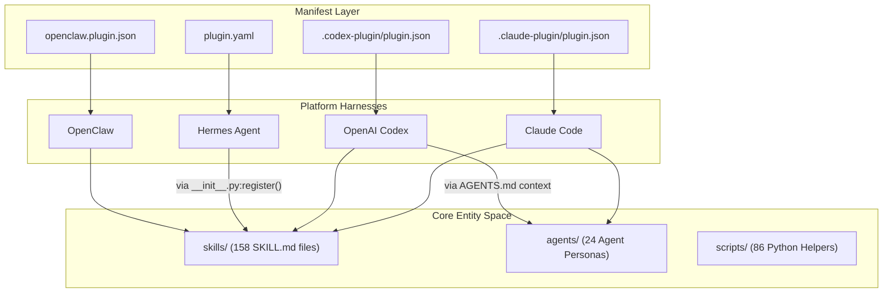
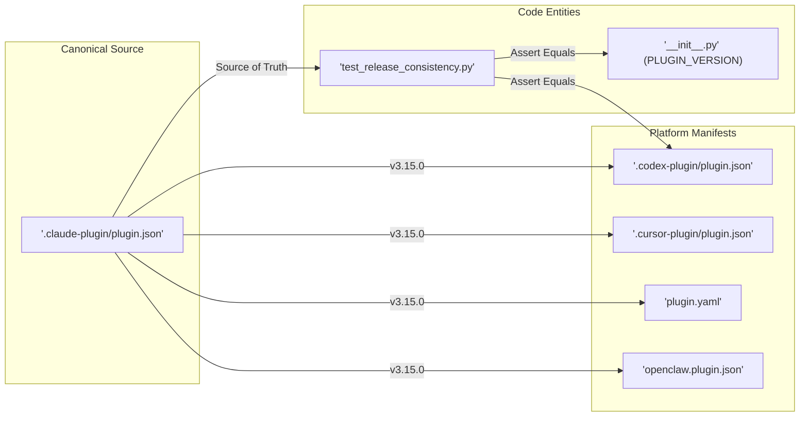

<!-- source: DeepWiki mcp.deepwiki.com · repo indranilbanerjee/digital-marketing-pro · page 1.2 Plugin Manifests & Platform Support · fetched 2026-10-26 -->

# Plugin Manifests & Platform Support

Relevant source files

The following files were used as context for generating this wiki page:

- [.claude-plugin/plugin.json](.claude-plugin/plugin.json)
- [.codex-plugin/plugin.json](.codex-plugin/plugin.json)
- [.cursor-plugin/plugin.json](.cursor-plugin/plugin.json)
- [.github/plugin/plugin.json](.github/plugin/plugin.json)
- [AGENTS.md](AGENTS.md)
- [CHANGELOG.md](CHANGELOG.md)
- [__init__.py](__init__.py)
- [gemini-extension.json](gemini-extension.json)
- [openclaw.plugin.json](openclaw.plugin.json)
- [package.json](package.json)
- [plugin.yaml](plugin.yaml)
- [tests/test_release_consistency.py](tests/test_release_consistency.py)

Digital Marketing Pro is designed as a "write-once, run-anywhere" plugin that adheres to the **Agent Skills** open standard. This allows the same 158 marketing skills and 24 specialist agents to operate across a wide range of AI agent harnesses including Claude Code, OpenAI Codex, Cursor, and Hermes Agent. The system uses platform-specific manifest files to register its capabilities while maintaining a single source of truth for logic and assets.

## Manifest Architecture & Registration

The plugin uses a multi-manifest strategy where each supported platform has a dedicated configuration file. These files point the respective agent harness to the core `skills/`, `agents/`, and `commands/` directories.

### Supported Platform Manifests

| Platform | Manifest File | Role |
| :--- | :--- | :--- |
| **Claude Code / Cowork** | [.claude-plugin/plugin.json:1-75]() | Primary manifest; defines metadata, keywords, and versioning. |
| **OpenAI Codex** | [.codex-plugin/plugin.json:1-47]() | Defines UI display names, default prompts, and Read/Write capabilities. |
| **Cursor** | [.cursor-plugin/plugin.json:1-38]() | Registers skills, agents, and commands for the Cursor IDE agent. |
| **Hermes Agent** | [plugin.yaml:1-41]() | Native YAML manifest for Nous Research Hermes. |
| **OpenClaw** | [openclaw.plugin.json:1-15]() | Native JSON manifest for the OpenClaw runtime. |
| **Gemini Antigravity** | [gemini-extension.json:1-7]() | Maps the extension context to `AGENTS.md`. |
| **GitHub Copilot CLI** | [.github/plugin/plugin.json:1-35]() | Standardized registration for GitHub's agent environment. |

### Registration Data Flow

The following diagram illustrates how different agent harnesses consume these manifests to expose the `skills/` library to the user.

**Agent Registration Pipeline**

**Sources:** [.claude-plugin/plugin.json:26-37](), [plugin.yaml:14-17](), [AGENTS.md:40-45](), [__init__.py:107-154]()

## Hermes Agent Native Integration

Unlike other platforms that purely read static JSON, **Hermes Agent** utilizes a Python-based adapter ([__init__.py]()) to dynamically register skills. 

### Implementation Details
1. **Discovery**: The `_walk_skills()` function [__init__.py:81-104]() iterates through the `skills/` directory to find every `SKILL.md`.
2. **Parsing**: It extracts `name` and `description` from the YAML frontmatter using `_parse_skill_frontmatter()` [__init__.py:51-78]().
3. **Registration**: The `register(ctx)` function [__init__.py:107-154]() calls `ctx.register_skill()` for each discovered skill, making them natively available in Hermes Desktop.

**Sources:** [__init__.py:12-17](), [plugin.yaml:14-16]()

## Version Synchronization & Consistency

To prevent "manifest rot," the project employs a strict version lockstep policy. The version defined in [.claude-plugin/plugin.json:3]() is considered the **Canonical Version**.

### Automated Consistency Checks
The test suite in `tests/test_release_consistency.py` ensures that all manifests remain in sync. Key tests include:
* **`test_all_json_manifests_match_canonical_version`**: Validates all 7 JSON manifests [tests/test_release_consistency.py:59-68]().
* **`test_hermes_plugin_yaml_matches_canonical_version`**: Checks the YAML manifest [tests/test_release_consistency.py:70-73]().
* **`test_hermes_adapter_PLUGIN_VERSION_matches_canonical`**: Ensures the `PLUGIN_VERSION` constant in `__init__.py` is updated [tests/test_release_consistency.py:75-80]().
* **`test_readme_version_badge_matches_canonical`**: Syncs the version badge in the project README [tests/test_release_consistency.py:82-87]().

### Cross-Manifest Relationship
The following diagram maps how the versioning metadata flows from the canonical source to the various platform entities.

**Version Synchronization Map**

**Sources:** [tests/test_release_consistency.py:36-40](), [CHANGELOG.md:7-9](), [__init__.py:48]()

## Agent Skills Open Standard

Digital Marketing Pro implements the **Agent Skills** open standard, which ensures that skill definitions (`SKILL.md`) are byte-portable. 

### Skill Contract Validation
To ensure that the natural language instructions in `SKILL.md` files correctly map to the underlying Python execution layer, the plugin uses a specialized linter:
* **File**: `scripts/check_skill_contracts.py` [CHANGELOG.md:14-14]()
* **Function**: Validates that the flags and actions described in the markdown fences of a skill match the real `argparse` configuration of the corresponding script [CHANGELOG.md:14-14]().

**Sources:** [AGENTS.md:83-85](), [CHANGELOG.md:14-14]()

---

