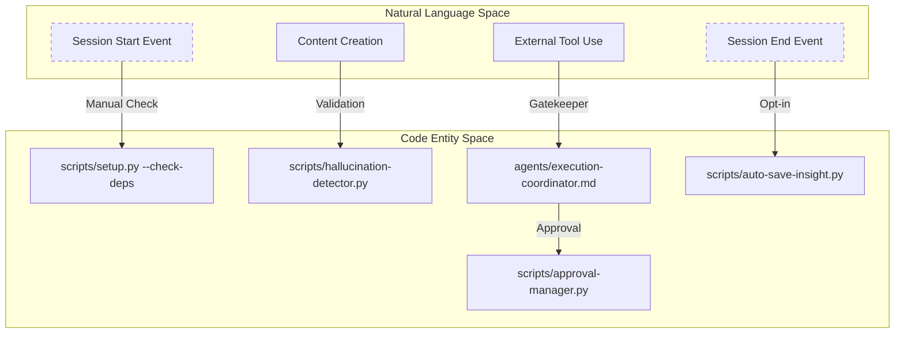
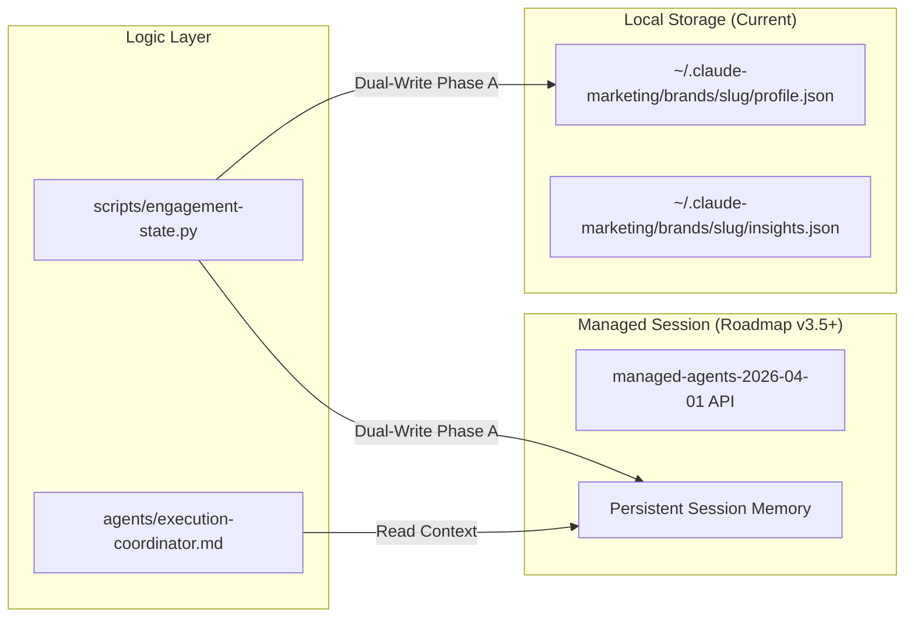

<!-- source: DeepWiki mcp.deepwiki.com · repo indranilbanerjee/digital-marketing-pro · page 10 Roadmap & Advanced Topics · fetched 2026-10-26 -->

# Roadmap & Advanced Topics

Relevant source files

The following files were used as context for generating this wiki page:

- [agents/execution-coordinator.md](agents/execution-coordinator.md)
- [docs/roadmap-multiagent-sessions-api.md](docs/roadmap-multiagent-sessions-api.md)
- [docs/v3.2-opt-ins.md](docs/v3.2-opt-ins.md)
- [hooks/hooks-reference.example.json](hooks/hooks-reference.example.json)
- [hooks/hooks.json](hooks/hooks.json)
- [scripts/hallucination-detector.py](scripts/hallucination-detector.py)
- [skills/add-integration/SKILL.md](skills/add-integration/SKILL.md)
- [skills/eval-config/SKILL.md](skills/eval-config/SKILL.md)
- [skills/eval-suite/SKILL.md](skills/eval-suite/SKILL.md)
- [skills/simulate/SKILL.md](skills/simulate/SKILL.md)

This section covers the future evolution of the Digital Marketing Pro (DMP) platform and advanced configuration topics for power users and developers. It details the transition from global hooks to a more precise agent-led model, provides a look at the upcoming Multi-agent Sessions API, and introduces advanced modeling skills for scenario simulation.

## Hooks Architecture

The hooks architecture in Digital Marketing Pro has undergone a significant migration from a global, "always-on" model to a scoped, agent-led model. In versions prior to v3.1, DMP utilized global hooks that fired on every operation within the environment, regardless of whether the user was performing marketing tasks.

Due to the lack of project-level scoping in the underlying agent harness, these global hooks (such as `SessionStart` and `PreToolUse`) often intercepted unrelated work [hooks/hooks.json:2-3](). Consequently, DMP v3.15.0 ships with an empty `hooks.json` by default [hooks/hooks.json:3-4](). The logic previously handled by hooks—such as brand compliance, hallucination detection, and dependency checks—has been migrated into the instructions of specialist agents and manual setup scripts [hooks/hooks-reference.example.json:2-3]().

### Hook Migration Overview

| Former Hook | Current Implementation |
| :--- | :--- |
| `SessionStart` | Replaced by manual `scripts/setup.py --check-deps` and the `/status` command [docs/v3.2-opt-ins.md:35](). |
| `PreToolUse Write\|Edit` | Embedded in content-producer agents and the `/check` command [docs/v3.2-opt-ins.md:36](). |
| `PreToolUse mcp_.*` | Handled by `execution-coordinator` agent approval flows [agents/execution-coordinator.md:12-16](). |
| `SessionEnd` | Replaced by `auto-save-insight.py` and the `auto_save_insights` brand flag [docs/v3.2-opt-ins.md:38](). |

For details on re-enabling specific hooks at the project level, see **[Hooks Architecture](#10.1)**.

---

## v3.2 Opt-Ins & Future Roadmap

The v3.2 release introduced several opt-in features to restore the convenience of global hooks without the invasive side effects. This includes "Ambient Insight Capture," which allows agents to save session learnings to `insights.json` automatically if the `auto_save_insights: true` flag is set in the brand's `profile.json` [docs/v3.2-opt-ins.md:123-132]().

### Multi-Agent Sessions API (v3.5 / v4.0)
The roadmap for v3.5 and beyond focuses on adopting the Anthropic **Managed Agents** and **Memory APIs** [docs/roadmap-multiagent-sessions-api.md:3-4](). This will move brand state from local JSON files to managed session memory, allowing for shared context between subagents without reloading the "Living Instruction File" (LIF) at every step [docs/roadmap-multiagent-sessions-api.md:19-23]().

### Advanced Modeling Skills
DMP includes advanced skills for high-stakes decision-making:
*   **Simulate**: Uses `revenue-simulator.py` to run Monte Carlo simulations (default 10,000 iterations) to predict revenue outcomes and channel mix impact [skills/simulate/SKILL.md:10-20]().
*   **What-If**: Models specific scenario shifts to identify sensitivity and risk [skills/simulate/SKILL.md:30-31]().

For details on these features and the long-term architectural plan, see **[v3.2 Opt-Ins & Future Roadmap](#10.2)**.

---

## Technical Architecture Diagrams

The following diagrams illustrate the relationship between high-level roadmap concepts and the underlying code entities.

### Entity Relationship: Lifecycle Management
This diagram shows how lifecycle events (formerly global hooks) are now mapped to specific scripts and agent instructions.

**Sources:** [hooks/hooks-reference.example.json:1-49](), [agents/execution-coordinator.md:59-60](), [docs/v3.2-opt-ins.md:123-127]().

### Data Flow: Multi-Agent Memory Roadmap
This diagram bridges current local file persistence with the planned Managed Agents API integration.

**Sources:** [docs/roadmap-multiagent-sessions-api.md:27-32](), [docs/roadmap-multiagent-sessions-api.md:62-64]().

---

## Sub-Pages
*   **[Hooks Architecture](#10.1)** — Technical deep dive into the transition from global to local hooks and the `hooks-reference.example.json` schema.
*   **[v3.2 Opt-Ins & Future Roadmap](#10.2)** — Details on the `auto_save_insights` mechanism, Monte Carlo simulation via `revenue-simulator.py`, and the v4.0 Managed Agents transition.

**Sources:**
* [hooks/hooks.json:1-5]()
* [hooks/hooks-reference.example.json:1-50]()
* [docs/roadmap-multiagent-sessions-api.md:1-76]()
* [docs/v3.2-opt-ins.md:1-150]()
* [skills/simulate/SKILL.md:1-46]()
* [agents/execution-coordinator.md:1-60]()

---

