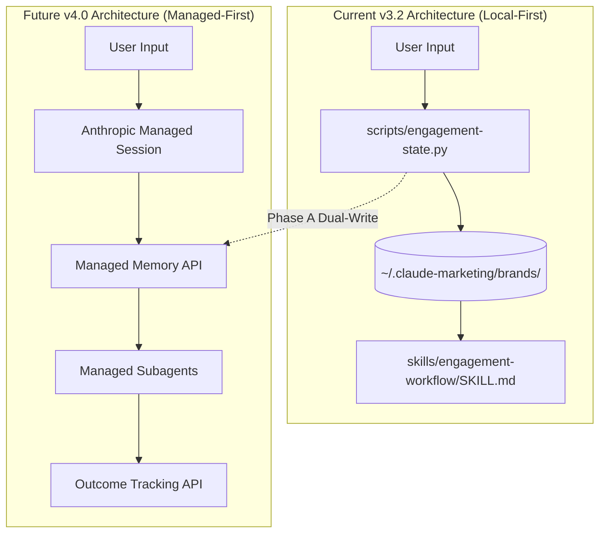
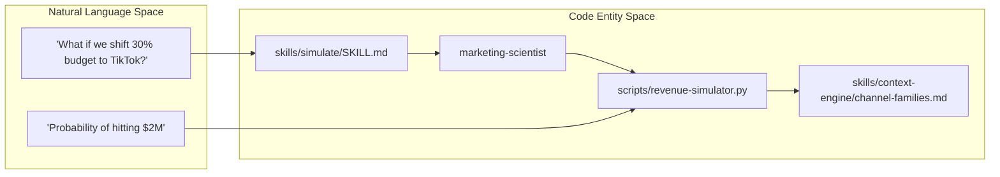

<!-- source: DeepWiki mcp.deepwiki.com · repo indranilbanerjee/digital-marketing-pro · page 10.2 v3.2 Opt-Ins & Future Roadmap · fetched 2026-10-26 -->

# v3.2 Opt-Ins & Future Roadmap

Relevant source files

The following files were used as context for generating this wiki page:

- [docs/roadmap-multiagent-sessions-api.md](docs/roadmap-multiagent-sessions-api.md)
- [docs/v3.2-opt-ins.md](docs/v3.2-opt-ins.md)
- [skills/add-integration/SKILL.md](skills/add-integration/SKILL.md)
- [skills/simulate/SKILL.md](skills/simulate/SKILL.md)

This page documents the transition from global, invasive hooks to a precision opt-in model introduced in v3.2. It also outlines the architectural roadmap for integrating Anthropic's Managed Agents and Memory APIs, alongside advanced simulation skills for marketing scenario modeling.

## 1. v3.2 Opt-In Architecture

In versions prior to v3.1, the system relied on four global hooks that fired on every `claude` command regardless of project context [docs/v3.2-opt-ins.md:5-10](). To improve multi-plugin coexistence and prevent invasive tool interception (specifically the `mcp_.*` matcher), v3.1 removed these global hooks [docs/v3.2-opt-ins.md:12-14]().

v3.2 introduces a precision opt-in model where users can re-enable these features at the user or project level without affecting the global environment.

### What Was Lost vs. What Now Compensates

| Hook Removed | Original Function | v3.2 Compensation |
| :--- | :--- | :--- |
| `SessionStart` | Brand summary banner | `/digital-marketing-pro:status` command [docs/v3.2-opt-ins.md:35]() |
| `PreToolUse Write\|Edit` | Hallucination/Compliance gate | `/digital-marketing-pro:check` or project-level opt-in [docs/v3.2-opt-ins.md:36]() |
| `PreToolUse mcp_.*` | MCP write gate | Per-agent decision flows [docs/v3.2-opt-ins.md:37]() |
| `SessionEnd` | Insight saving prompt | `auto_save_insights` flag in `profile.json` [docs/v3.2-opt-ins.md:38]() |

### Manual Re-enablement Pattern
Users can re-enable hooks by copying configurations from `hooks/hooks-reference.example.json` into their local settings [docs/v3.2-opt-ins.md:42-44]().

*   **User-level:** `~/.claude/settings.json` (fires for all sessions) [docs/v3.2-opt-ins.md:57-58]().
*   **Project-level:** `.claude/settings.local.json` (fires only in the project directory) [docs/v3.2-opt-ins.md:82-84]().

### Ambient Insight Capture
A new flag, `auto_save_insights`, allows agents to call `scripts/auto-save-insight.py` at checkpoints without a session-end prompt [docs/v3.2-opt-ins.md:123-127]().

**Sources:** [docs/v3.2-opt-ins.md:1-150](), [hooks/hooks-reference.example.json:1-100]()

## 2. New Commands: Status & Check

v3.2 introduces two primary on-demand replacements for the removed global hooks.

### /digital-marketing-pro:status
Replaces the `SessionStart` banner. It provides a real-time summary of the active brand, including:
*   Active brand slug and profile completeness.
*   Recent campaign performance and pending tasks.
*   MCP connector status and credential readiness.

### /digital-marketing-pro:check
Replaces the `PreToolUse` compliance gate. It triggers a manual quality audit of the current workspace or a specific file, running the `hallucination-detector.py` and `brand-voice-scorer.py` scripts on demand [docs/v3.2-opt-ins.md:36]().

**Sources:** [docs/v3.2-opt-ins.md:25-38](), [scripts/setup.py:68-70]()

## 3. Future Roadmap: Multiagent Sessions & Memory API

DMP v3.5 and v4.0 target integration with Anthropic’s `managed-agents-2026-04-01` beta features [docs/roadmap-multiagent-sessions-api.md:3-4]().

### Phase A: Dual-Write Integration (v3.5)
*   Add `use_managed_agents_beta: true` to the brand profile schema [docs/roadmap-multiagent-sessions-api.md:29]().
*   `engagement-state.py` will dual-write to local JSON and Anthropic Managed Memory [docs/roadmap-multiagent-sessions-api.md:30]().
*   Refactor dispatch sites in `skills/engagement-workflow/SKILL.md` to use managed subagent primitives [docs/roadmap-multiagent-sessions-api.md:31]().

### Phase B: Managed-Agents by Default (v4.0)
*   Managed agents become the default orchestration method [docs/roadmap-multiagent-sessions-api.md:36]().
*   `engagement-state.py` becomes a thin wrapper over the Memory API [docs/roadmap-multiagent-sessions-api.md:37]().

### Data Flow: Managed Sessions vs. Local Persistence

Title: Transition from Local Files to Managed Sessions API

**Sources:** [docs/roadmap-multiagent-sessions-api.md:1-46](), [scripts/engagement-state.py:1-40]()

## 4. Scenario Modeling: Simulate & What-If

The roadmap includes advanced scenario modeling via the `simulate` skill, utilizing Monte Carlo methods to predict revenue impact.

### Implementation Logic
1.  **Context Loading:** Loads `profile.json` and historical ROI data [skills/simulate/SKILL.md:25]().
2.  **Parameter Definition:** Calibrates ROI mean and standard deviation per channel [skills/simulate/SKILL.md:26]().
3.  **Execution:** Runs `revenue-simulator.py` (10,000+ iterations) [skills/simulate/SKILL.md:27]().
4.  **Sensitivity Analysis:** Generates tornado charts to identify variables driving the most variance [skills/simulate/SKILL.md:30]().

### Simulation Agent Mapping

Title: Simulation Logic to Code Entity Mapping

### Integration Features
The `add-integration` skill enables users to connect new MCP servers (e.g., Ahrefs, Stripe) to provide real-time data for these simulations [skills/add-integration/SKILL.md:11-12](). It uses the `execution-coordinator` agent to validate `.mcp.json` entries and test connectivity [skills/add-integration/SKILL.md:45]().

**Sources:** [skills/simulate/SKILL.md:1-46](), [skills/add-integration/SKILL.md:1-46]()

---

