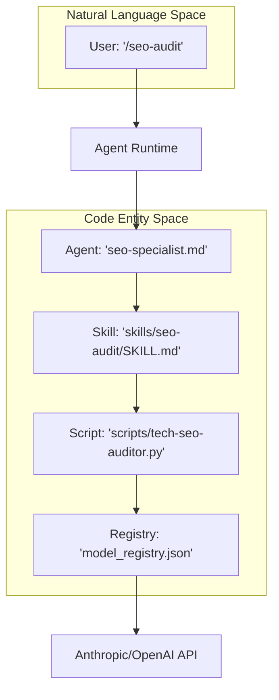
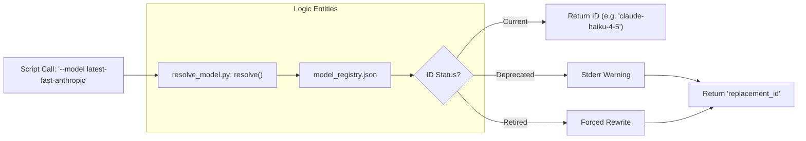

<!-- source: DeepWiki mcp.deepwiki.com · repo indranilbanerjee/digital-marketing-pro · page 11 Glossary · fetched 2026-10-26 -->

# Glossary

Relevant source files

The following files were used as context for generating this wiki page:

- [.claude-plugin/plugin.json](.claude-plugin/plugin.json)
- [.mcp.json.connectors-reference](.mcp.json.connectors-reference)
- [CHANGELOG.md](CHANGELOG.md)
- [CONNECTORS.md](CONNECTORS.md)
- [README.md](README.md)
- [SUBMISSION.md](SUBMISSION.md)
- [TESTING-GUIDE.md](TESTING-GUIDE.md)
- [agents/brand-guardian.md](agents/brand-guardian.md)
- [agents/competitive-intel.md](agents/competitive-intel.md)
- [agents/content-creator.md](agents/content-creator.md)
- [agents/cro-specialist.md](agents/cro-specialist.md)
- [agents/email-specialist.md](agents/email-specialist.md)
- [agents/execution-coordinator.md](agents/execution-coordinator.md)
- [agents/growth-engineer.md](agents/growth-engineer.md)
- [agents/influencer-manager.md](agents/influencer-manager.md)
- [agents/pr-outreach.md](agents/pr-outreach.md)
- [agents/social-media-manager.md](agents/social-media-manager.md)
- [commands/competitor-analysis.md](commands/competitor-analysis.md)
- [commands/doctor.md](commands/doctor.md)
- [commands/execute-action.md](commands/execute-action.md)
- [commands/seo-audit.md](commands/seo-audit.md)
- [docs/MODEL-CURATOR.md](docs/MODEL-CURATOR.md)
- [docs/architecture.md](docs/architecture.md)
- [docs/claude-interfaces.md](docs/claude-interfaces.md)
- [docs/engagement-methodology.md](docs/engagement-methodology.md)
- [docs/getting-started.md](docs/getting-started.md)
- [docs/integrations-guide.md](docs/integrations-guide.md)
- [docs/multi-brand-guide.md](docs/multi-brand-guide.md)
- [hooks/hooks-reference.example.json](hooks/hooks-reference.example.json)
- [hooks/hooks.json](hooks/hooks.json)
- [scripts/_connector_registry.py](scripts/_connector_registry.py)
- [scripts/action-doctor.py](scripts/action-doctor.py)
- [scripts/connector_executor.py](scripts/connector_executor.py)
- [scripts/connector_resolver.py](scripts/connector_resolver.py)
- [scripts/embed-c2pa.py](scripts/embed-c2pa.py)
- [scripts/hallucination-detector.py](scripts/hallucination-detector.py)
- [scripts/model_registry.json](scripts/model_registry.json)
- [scripts/refresh_models.py](scripts/refresh_models.py)
- [settings.json.example](settings.json.example)
- [skills/aeo-audit/SKILL.md](skills/aeo-audit/SKILL.md)
- [skills/aeo-geo/SKILL.md](skills/aeo-geo/SKILL.md)
- [skills/analytics-insights/SKILL.md](skills/analytics-insights/SKILL.md)
- [skills/c2pa-metadata/SKILL.md](skills/c2pa-metadata/SKILL.md)
- [skills/client-validation-document/SKILL.md](skills/client-validation-document/SKILL.md)
- [skills/context-engine/eu-code-of-practice.md](skills/context-engine/eu-code-of-practice.md)
- [skills/continuous-improvement-loop/SKILL.md](skills/continuous-improvement-loop/SKILL.md)
- [skills/engagement-workflow/SKILL.md](skills/engagement-workflow/SKILL.md)
- [skills/eval-config/SKILL.md](skills/eval-config/SKILL.md)
- [skills/eval-suite/SKILL.md](skills/eval-suite/SKILL.md)
- [skills/four-core-documents/SKILL.md](skills/four-core-documents/SKILL.md)
- [skills/growth-plan/SKILL.md](skills/growth-plan/SKILL.md)
- [skills/gsc-ai-performance/SKILL.md](skills/gsc-ai-performance/SKILL.md)
- [skills/help/SKILL.md](skills/help/SKILL.md)
- [skills/paid-advertising/SKILL.md](skills/paid-advertising/SKILL.md)
- [skills/paid-advertising/google-ads.md](skills/paid-advertising/google-ads.md)
- [tests/test_resolve_model.py](tests/test_resolve_model.py)

This page provides definitions for codebase-specific terms, acronyms, and domain jargon used within the Digital Marketing Pro plugin. It serves as a technical reference for onboarding engineers and marketers to understand how conceptual methodology maps to concrete code entities.

## Core System Terms

### WAT Architecture
The structural framework of the plugin, consisting of **W**orkflows (Skills), **A**gents, and **T**ools (Scripts/MCP).
*   **Implementation**: This is reflected in the top-level directory structure: `skills/`, `agents/`, and `scripts/`.
*   **Data Flow**: Agents [agents/:1-46]() interpret user intent, select a Workflow (Skill) [skills/:1-158](), and execute deterministic Tools (Scripts) [scripts/:1-110]() to produce outputs.

### Skill (Workflow)
A markdown-based definition of a specific marketing capability (e.g., `seo-audit`, `content-engine`).
*   **Code Entity**: Defined in `SKILL.md` files within `skills/` subdirectories.
*   **Key Function**: Uses YAML frontmatter to register commands and provide context to the agent runtime.
*   **Sources**: [docs/claude-interfaces.md:24-24](), [TESTING-GUIDE.md:202-205]()

### Specialist Agent
A persona-driven LLM configuration designed for specific marketing domains.
*   **Code Entity**: Defined in `agents/*.md`.
*   **Implementation**: There are 24 specialist agents, such as `execution-coordinator.md` and `brand-guardian.md`.
*   **Sources**: [docs/architecture.md:22-46](), [docs/claude-interfaces.md:25-25]()

### Model Curator
The abstraction layer that maps human-readable aliases to specific LLM model IDs, handling deprecations and vendor-specific parameter logic.
*   **Code Entity**: `scripts/resolve_model.py` and `scripts/model_registry.json`.
*   **Logic**: `resolve_model.resolve()` [scripts/resolve_model.py:12-45]() translates aliases like `latest-balanced-anthropic` to IDs like `claude-sonnet-4-6`.
*   **Sources**: [docs/MODEL-CURATOR.md:1-9](), [scripts/model_registry.json:1-10]()

---

## Methodology & State Terms

### 12-Part Engagement Flow
The v3.0 stateful methodology that orchestrates 61 steps from intake to continuous improvement.
*   **Code Entity**: `skills/engagement-workflow/SKILL.md`.
*   **Implementation**: Managed via the `engagement-state` script (referenced in [docs/architecture.md:7-7]()).
*   **Sources**: [README.md:5-5](), [docs/architecture.md:7-7]()

### Two-Views Model
A strategic concept where **v1** represents the AI's unbiased, research-backed view, and **v2** represents the client-validated view after the "Update-Back Rule" is applied.
*   **Context**: Part of the Client Validation phase (Part 5).
*   **Sources**: [docs/architecture.md:7-7](), [CHANGELOG.md:22-22]()

### Living Project Instruction File (LIF)
A persistent document that tracks the current state, decisions, and instructions for a specific brand engagement to ensure continuity across sessions.
*   **Sources**: [docs/architecture.md:7-7]()

---

## Technical & Execution Terms

### MCP (Model Context Protocol)
A protocol used to connect the plugin to external data sources and tools (CRMs, Ad platforms, etc.).
*   **Code Entity**: `.mcp.json` (active config) and `.mcp.json.connectors-reference` (catalog).
*   **Status**: Shipped empty by default for safety [hooks/hooks.json:2-2]().
*   **Sources**: [CONNECTORS.md:3-8](), [docs/architecture.md:17-18]()

### Execution Gate
A safety mechanism requiring explicit user approval before the plugin performs a "write" operation or external API call.
*   **Implementation**: Found in 18 execution-focused skills using the `disable-model-invocation: false` flag and `approval-manager.py`.
*   **Sources**: [CHANGELOG.md:17-17](), [docs/architecture.md:83-84]()

### C2PA (Article 50 Ready)
Refers to the Coalition for Content Provenance and Authenticity standards for AI disclosure, meeting EU AI Act requirements.
*   **Code Entity**: `scripts/embed-c2pa.py`.
*   **Function**: Injects machine-readable metadata (`c2pa.ai-disclosure`) into creative outputs.
*   **Sources**: [CHANGELOG.md:15-15](), [README.md:43-43]()

---

## System Mapping Diagrams

### From User Intent to Code Execution
The following diagram illustrates how a natural language request (e.g., "Audit my SEO") traverses the system entities.

**Diagram: Intent-to-Entity Resolution**

**Sources**: [docs/architecture.md:21-47](), [docs/claude-interfaces.md:24-26](), [TESTING-GUIDE.md:142-154]()

### Model Resolution Pipeline
How the system handles model IDs and deprecations through the Model Curator.

**Diagram: Model Resolver Logic Flow**

**Sources**: [docs/MODEL-CURATOR.md:3-9](), [scripts/resolve_model.py:12-85](), [tests/test_resolve_model.py:47-86]()

---

## Technical Terms Table

| Term | Definition | Code Pointer |
| :--- | :--- | :--- |
| **Brand Profile** | JSON object containing voice, goals, and industry data for a specific brand. | `~/.claude-marketing/brands/{slug}/profile.json` |
| **Slugify** | The process of turning a brand name into a filesystem-safe directory name. | `scripts/_common.py:slugify_brand` |
| **Adaptive Scorer** | Script that adjusts quality weights based on brand-specific context. | `scripts/adaptive-scorer.py` |
| **Connector Resolver** | Logic that matches a generic tool category (e.g., `~~CRM`) to a specific active MCP server. | `scripts/connector_resolver.py` |
| **Article 50 Assertion** | Machine-readable metadata indicating content was AI-generated. | `scripts/embed-c2pa.py --ai-disclosure` |
| **Skill Contract** | The agreement between a `SKILL.md` file's examples and the underlying script's `argparse` flags. | `scripts/check_skill_contracts.py` |

**Sources**: [CHANGELOG.md:13-18](), [docs/architecture.md:48-52](), [CONNECTORS.md:3-7](), [docs/MODEL-CURATOR.md:1-9]()