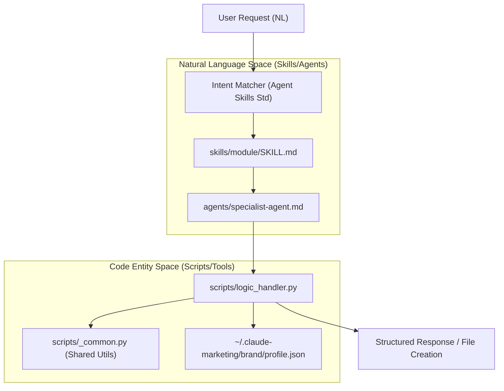
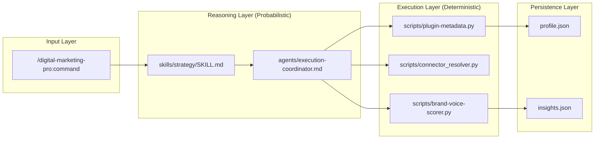

<!-- source: DeepWiki mcp.deepwiki.com · repo indranilbanerjee/digital-marketing-pro · page 2 Core Architecture · fetched 2026-10-26 -->

# Core Architecture

Relevant source files

The following files were used as context for generating this wiki page:

- [.github/plugin/plugin.json](.github/plugin/plugin.json)
- [AGENTS.md](AGENTS.md)
- [README.md](README.md)
- [docs/architecture.md](docs/architecture.md)
- [docs/claude-interfaces.md](docs/claude-interfaces.md)
- [docs/getting-started.md](docs/getting-started.md)
- [gemini-extension.json](gemini-extension.json)
- [skills/help/SKILL.md](skills/help/SKILL.md)

The Digital Marketing Pro architecture is built on the **WAT (Workflows, Agents, Tools)** framework, a multi-layered design that separates probabilistic AI reasoning from deterministic code execution. This structure ensures that while agents can creatively solve marketing problems, the underlying data processing, compliance checking, and API interactions remain consistent and auditable [docs/architecture.md:5-7]().

The system is organized into three primary pillars that coordinate to deliver 158 marketing skills through 24 specialist agents, supported by a library of 89 Python scripts [README.md:7-10]().

## The Three-Pillar Structure

The codebase is strictly partitioned into three directories, each serving a distinct role in the agentic loop.

### 1. Skills System (`skills/`)
The **Skills** layer represents the "Surface Area" of the plugin. It consists of 158 `SKILL.md` files that define the capabilities available to the user and the agent [AGENTS.md:40-40](). Each skill uses YAML frontmatter to declare its name and description, allowing any supported agent harness (Claude Code, Codex, etc.) to discover and match user intent to the correct skill [AGENTS.md:15-16]().
*   **For details, see [Skills System (#2.1)](#)**

### 2. Specialist Agents (`agents/`)
The **Agents** layer contains 24 specialist personas defined in Markdown files. These agents act as the "Reasoning Engine," coordinating complex tasks like brand guardianship, SEO strategy, and multi-channel execution [docs/architecture.md:22-46](). They operate under specific interaction contracts, such as the `PENDING_APPROVAL` pattern for high-stakes execution [README.md:20-20]().
*   **For details, see [Specialist Agents (#2.2)](#)**

### 3. Python Scripts Layer (`scripts/`)
The **Scripts** layer provides the "Deterministic Execution" backbone. These 89 scripts handle data persistence, scoring, and external integrations [docs/architecture.md:47-110](). By offloading heavy lifting (like ROI calculation or C2PA signing) to Python, the system avoids LLM math errors and ensures regulatory compliance [AGENTS.md:17-20]().
*   **For details, see [Python Scripts Layer (#2.3)](#)**

---

## Architectural Workflow: Natural Language to Code Execution

The following diagram illustrates how a user's natural language request traverses the WAT architecture to trigger specific code entities.

**Diagram: Request Resolution Pipeline**

**Sources:** [AGENTS.md:15-17](), [docs/architecture.md:11-47](), [skills/help/SKILL.md:23-25]()

---

## System Components & Interaction

The architecture relies on a "Context-First" approach. Every skill execution begins by loading the brand context to ground the AI's probabilistic reasoning in the brand's specific deterministic constraints (voice, jurisdiction, and goals) [docs/getting-started.md:114-115]().

### Component Association Map

| Architecture Layer | Code Entity Location | Responsibility |
| :--- | :--- | :--- |
| **Workflows** | `skills/engagement-workflow/` | Orchestrates the 12-Part Strategy Flow [docs/architecture.md:7-8]() |
| **Agents** | `agents/*.md` | Persona-based reasoning and tool selection [AGENTS.md:52-79]() |
| **Tools (Scripts)** | `scripts/*.py` | Deterministic logic, scoring, and I/O [docs/architecture.md:47-110]() |
| **Context Engine** | `skills/context-engine/` | Shared intelligence and compliance rules [README.md:18-18]() |
| **Persistence** | `~/.claude-marketing/` | Local state, brand profiles, and insights [docs/claude-interfaces.md:28-28]() |

### Data Flow and State Management

The system maintains state across sessions using a structured filesystem. While the AI provides the reasoning, the `scripts/setup.py` and `scripts/memory-manager.py` entities ensure that brand data remains consistent [docs/architecture.md:48-86]().

**Diagram: State & Context Integration**

**Sources:** [docs/architecture.md:50-52](), [docs/architecture.md:83-87](), [skills/help/SKILL.md:23-27]()

---

## Related Documentation

*   **[Skills System (#2.1)](#)**: Detailed breakdown of the `SKILL.md` anatomy and the intent-matching discovery mechanism.
*   **[Specialist Agents (#2.2)](#)**: Examination of the 24 agent personas and the `execution-coordinator` approval workflow.
*   **[Python Scripts Layer (#2.3)](#)**: Technical overview of the script library, JSON I/O contracts, and the `_common.py` utility.
*   **[Context Engine & Reference Data (#2.4)](#)**: Deep dive into the reference knowledge files that provide the industry intelligence for all skills.

**Sources:** [README.md:7-10](), [docs/architecture.md:11-13](), [AGENTS.md:38-51]()

---

