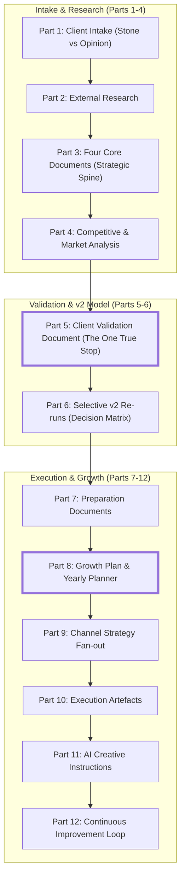
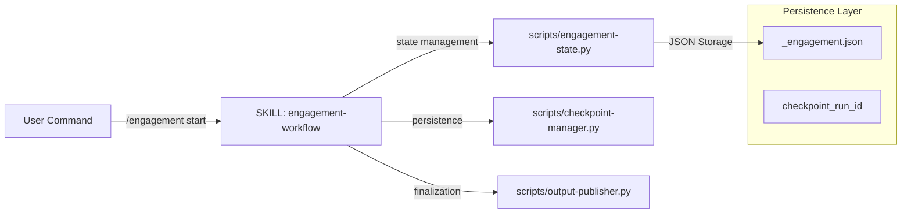

<!-- source: DeepWiki mcp.deepwiki.com · repo indranilbanerjee/digital-marketing-pro · page 3 12-Part Engagement Methodology · fetched 2026-10-26 -->

# 12-Part Engagement Methodology

Relevant source files

The following files were used as context for generating this wiki page:

- [TESTING-GUIDE.md](TESTING-GUIDE.md)
- [docs/architecture.md](docs/architecture.md)
- [docs/claude-interfaces.md](docs/claude-interfaces.md)
- [docs/engagement-methodology.md](docs/engagement-methodology.md)
- [docs/getting-started.md](docs/getting-started.md)
- [docs/integrations-guide.md](docs/integrations-guide.md)
- [docs/multi-brand-guide.md](docs/multi-brand-guide.md)
- [skills/client-validation-document/SKILL.md](skills/client-validation-document/SKILL.md)
- [skills/continuous-improvement-loop/SKILL.md](skills/continuous-improvement-loop/SKILL.md)
- [skills/engagement-workflow/SKILL.md](skills/engagement-workflow/SKILL.md)
- [skills/four-core-documents/SKILL.md](skills/four-core-documents/SKILL.md)
- [skills/growth-plan/SKILL.md](skills/growth-plan/SKILL.md)
- [skills/help/SKILL.md](skills/help/SKILL.md)

The **12-Part Engagement Methodology** (introduced in v3.0) is a stateful, sequential workflow designed to transform the plugin from a collection of one-off tools into a comprehensive marketing command center. While the system still supports atomic tasks (e.g., generating a single ad), the methodology provides a canonical structure for high-stakes strategic engagements, producing ~50–60 traceable files across a project lifecycle.

## Overview: The Stateful Workflow

Unlike one-off tasks, the 12-Part Methodology maintains shared state via an `_engagement.json` file and a structured directory tree under `~/.claude-marketing/brands/{brand-slug}/engagements/{engagement-id}/`. This ensures that every strategic decision—from channel selection to creative briefs—is grounded in validated research and client-approved positioning.

### When to Use
*   **Path A: One-off Tasks:** Use for quick deliverables like a single email or SEO audit when speed is the priority.
*   **Path B: Full Engagement:** Use for quarterly/annual planning, new client onboarding, or major brand repositioning where rigor, traceability, and compounding value are required.

### Core Workflow Diagram

This diagram shows how the methodology orchestrates the flow from initial data intake to continuous market monitoring.

**Sources:** [docs/engagement-methodology.md:47-64](), [skills/engagement-workflow/SKILL.md:21-21]()

---

## Technical Orchestration

The methodology is managed by the `engagement-workflow` skill, which interfaces with specialized Python scripts to maintain state, handle checkpoints, and publish outputs.

### Code Entity Space: Orchestration Layer

The following diagram bridges the methodology phases to the specific code entities that handle state and execution.

**Sources:** [skills/engagement-workflow/SKILL.md:35-58](), [docs/architecture.md:83-88]()

---

## Phases of the Engagement

The 12 parts are grouped into three major phases, each covered in detail on their respective child pages.

### 1. Intake, Research & The Strategic Spine (Parts 1–4)
This phase focuses on the **v1 Unbiased View**. It begins with Part 1, separating "Stone" facts (verified data) from "Opinion" (client hypotheses). It culminates in the **Four Core Documents** (3.1 Business Analysis, 3.2 Segmentation, 3.3 Positioning, 3.4 DMFlow), which comprise 61 explicit strategic steps.
*   **For details, see [Intake, Research & Four Core Documents (Parts 1–4)](#3.1).**

### 2. Client Validation & The Two-Views Model (Parts 5–6)
This phase introduces the **One True Stop**. Part 5 presents the v1 findings to the client for `ACCEPT/REJECT/EDIT` decisions. Part 6 uses a **Decision Matrix** to trigger selective **v2 Re-runs** of the strategic spine based on client feedback. This maintains a clean separation between market reality and client preference.
*   **For details, see [Client Validation & Two-Views Model (Parts 5–6)](#3.2).**

### 3. Execution, Growth Plan & Continuous Improvement (Parts 7–12)
The final phase moves from strategy to execution. Part 8 produces the flagship **Growth Plan** and **Yearly Planner**. Parts 9–11 handle the channel fan-out and creative production, while Part 12 establishes a **Continuous Improvement Loop** to feed market signals back into the strategy.
*   **For details, see [Execution, Growth Plan & Continuous Improvement (Parts 7–12)](#3.3).**

---

## Key Methodology Protocols

To ensure rigor across the 12 parts, the system enforces several technical protocols:

| Protocol | Purpose | Implementation |
| :--- | :--- | :--- |
| **Checkpointing** | Allows resuming interrupted sessions. | `checkpoint-manager.py` [skills/engagement-workflow/SKILL.md:45-58]() |
| **Update-Back Rule** | Ensures changes in execution (v2.x) flow back to source docs. | `update-back-rule.md` [skills/engagement-workflow/SKILL.md:32-32]() |
| **Quality Gates** | Blocking checks before finalizing Parts 5 and 8. | `/digital-marketing-pro:check --full` [skills/engagement-workflow/SKILL.md:72-79]() |
| **Two-Views Model** | Keeps v1 (unbiased) and v2 (client-validated) separate. | `two-views-model.md` [docs/engagement-methodology.md:20-20]() |

**Sources:** [docs/engagement-methodology.md:31-41](), [skills/engagement-workflow/SKILL.md:45-91]()

---

