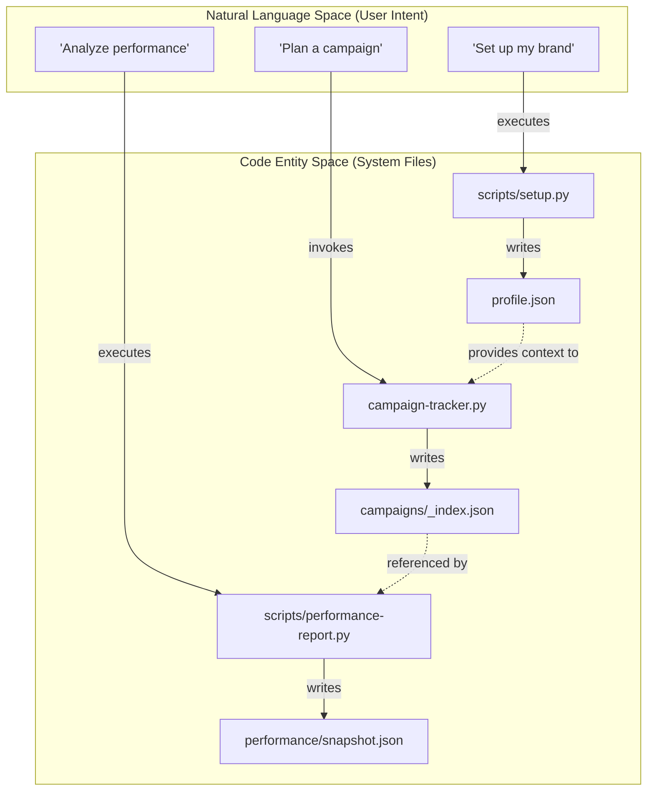
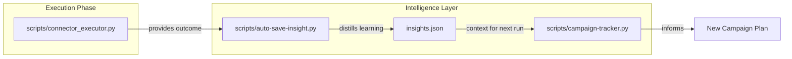

<!-- source: DeepWiki mcp.deepwiki.com · repo indranilbanerjee/digital-marketing-pro · page 4 Brand & Data Management · fetched 2026-10-26 -->

# Brand & Data Management

Relevant source files

The following files were used as context for generating this wiki page:

- [TESTING-GUIDE.md](TESTING-GUIDE.md)
- [docs/competitor-intelligence.md](docs/competitor-intelligence.md)
- [docs/cross-channel-sync.md](docs/cross-channel-sync.md)
- [docs/data-and-insights.md](docs/data-and-insights.md)
- [docs/engagement-methodology.md](docs/engagement-methodology.md)
- [docs/historical-data.md](docs/historical-data.md)
- [docs/integrations-guide.md](docs/integrations-guide.md)
- [docs/multi-brand-guide.md](docs/multi-brand-guide.md)
- [docs/strategy-and-kpis.md](docs/strategy-and-kpis.md)
- [skills/brand-setup/SKILL.md](skills/brand-setup/SKILL.md)

Digital Marketing Pro is designed as a stateful system that remembers brand identity, historical performance, and strategic learnings across sessions. This persistence is managed through a localized filesystem architecture that ensures data isolation between different clients or internal brands while allowing intelligence to compound over time.

## Brand Profile System

The core of the system's intelligence is the Brand Profile. Every marketing task—from generating a LinkedIn post to running a technical SEO audit—references this profile to ensure outputs are aligned with the brand's voice, business model, and compliance requirements.

Profiles are stored in a dedicated directory at `~/.claude-marketing/brands/{slug}/` [docs/multi-brand-guide.md:18-20](). Each brand is identified by a "slug" (a lowercase, hyphenated version of the brand name).

### The profile.json Schema
The primary configuration file is `profile.json`, which stores:
*   **Identity:** Mission, values, and USP [docs/multi-brand-guide.md:66-67]().
*   **Voice Settings:** Four numeric floats (Formality, Energy, Humor, Authority) on a 1-10 scale [docs/multi-brand-guide.md:69-74]().
*   **Business Model:** Type (B2B SaaS, DTC, etc.) and revenue model [docs/multi-brand-guide.md:67-68]().
*   **Compliance:** Target jurisdictions and industry regulations [docs/multi-brand-guide.md:78-78]().

For details on the setup process and full schema, see [Brand Profile Schema & Setup](#4.1).

**Sources:** [docs/multi-brand-guide.md:18-78](), [skills/brand-setup/SKILL.md:41-96]()

---

## Data Architecture & Persistence

The system uses a "Local-First" data strategy. Instead of a centralized database, it utilizes a structured filesystem under `~/.claude-marketing/` to maintain state.

### Filesystem Structure
The following diagram illustrates how the "Natural Language Space" (User Intent) maps to the "Code Entity Space" (Files and Scripts).

**Title: Brand Data Mapping (NL Space to Code Entity Space)**

**Sources:** [docs/data-and-insights.md:47-56](), [docs/historical-data.md:22-59]()

---

## Multi-Brand & Agency Operations

For agencies and multi-brand corporations, the system provides strict isolation. Only one brand is "active" at a time, tracked by `~/.claude-marketing/brands/_active-brand.json` [docs/multi-brand-guide.md:80-91]().

### Isolation and Switching
*   **Zero Leakage:** Insights learned for Brand A never influence the strategies for Brand B [docs/multi-brand-guide.md:93-102]().
*   **Switching:** The `/switch-brand` command updates the `active_slug` in the global config, immediately pivoting all specialist agents to the new context [docs/multi-brand-guide.md:80-91]().
*   **Agency Workflow:** Agencies can use the `{client-name}-{project}` naming convention for slugs to organize large rosters [docs/multi-brand-guide.md:148-150]().

For details on managing multiple clients and rotating credentials, see [Multi-Brand & Agency Operations](#4.2).

**Sources:** [docs/multi-brand-guide.md:80-102](), [TESTING-GUIDE.md:213-213]()

---

## Compounding Intelligence Layer

The system features a "Rolling Memory" that captures learnings from every session. This prevents the AI from repeating mistakes and allows it to double down on proven tactics.

### Historical Data Flow
The `campaign-tracker.py` script manages the lifecycle of marketing data, from initial planning to post-mortem analysis [docs/data-and-insights.md:38-41]().

**Title: Intelligence Compounding Loop**

### Key Persistence Files
| File | Purpose | Capacity |
| :--- | :--- | :--- |
| `insights.json` | Stores patterns, anomalies, and strategy adjustments [docs/historical-data.md:59-61](). | Rolling 200-entry buffer [docs/data-and-insights.md:53-53](). |
| `campaigns/` | Individual JSON files for every plan created [docs/data-and-insights.md:51-51](). | Indefinite [docs/historical-data.md:41-41](). |
| `performance/` | Timestamped snapshots of channel metrics [docs/data-and-insights.md:52-52](). | Indefinite [docs/historical-data.md:57-57](). |

For details on how memory is synced and historical data is queried, see [Persistent Memory & Historical Data](#4.3).

**Sources:** [docs/data-and-insights.md:24-56](), [docs/historical-data.md:59-80](), [docs/strategy-and-kpis.md:44-48]()

---

