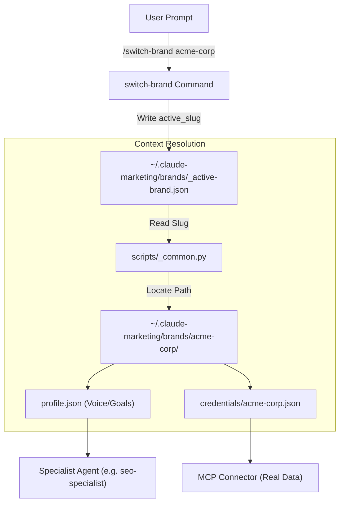
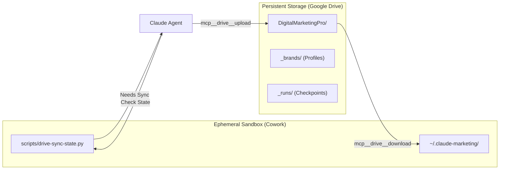

<!-- source: DeepWiki mcp.deepwiki.com · repo indranilbanerjee/digital-marketing-pro · page 4.2 Multi-Brand & Agency Operations · fetched 2026-10-26 -->

# Multi-Brand & Agency Operations

Relevant source files

The following files were used as context for generating this wiki page:

- [TESTING-GUIDE.md](TESTING-GUIDE.md)
- [docs/engagement-methodology.md](docs/engagement-methodology.md)
- [docs/integrations-guide.md](docs/integrations-guide.md)
- [docs/multi-brand-guide.md](docs/multi-brand-guide.md)
- [scripts/drive-sync-state.py](scripts/drive-sync-state.py)
- [skills/ab-test-plan/SKILL.md](skills/ab-test-plan/SKILL.md)
- [skills/budget-optimizer/SKILL.md](skills/budget-optimizer/SKILL.md)
- [skills/context-engine/SKILL.md](skills/context-engine/SKILL.md)
- [skills/context-engine/agency-operations-guide.md](skills/context-engine/agency-operations-guide.md)
- [skills/context-engine/crm-integration-guide.md](skills/context-engine/crm-integration-guide.md)
- [skills/cowork-setup/SKILL.md](skills/cowork-setup/SKILL.md)
- [skills/credential-switch/SKILL.md](skills/credential-switch/SKILL.md)
- [skills/crm-sync/SKILL.md](skills/crm-sync/SKILL.md)
- [skills/keyword-research/SKILL.md](skills/keyword-research/SKILL.md)
- [skills/roi-calculator/SKILL.md](skills/roi-calculator/SKILL.md)
- [skills/switch-brand/SKILL.md](skills/switch-brand/SKILL.md)

This page details the technical implementation and operational workflows for managing multiple client brands within a single Digital Marketing Pro installation. It covers brand isolation, credential rotation, agency-specific management tools, and the persistence solution for team-based Cowork environments.

## Brand Isolation & Slugs

The system enforces strict data isolation between brands using a slug-based directory structure. Every brand created via `/brand-setup` is assigned a unique, lowercase, hyphenated identifier (the "slug") derived from its name [docs/multi-brand-guide.md:20-20]().

### Brand Directory Structure
All brand-specific data is stored in isolated subdirectories within the global plugin data root:

| Path Component | Description |
| :--- | :--- |
| `~/.claude-marketing/brands/{slug}/profile.json` | Core identity, voice settings, and business model [docs/multi-brand-guide.md:26-26](). |
| `~/.claude-marketing/brands/{slug}/audiences.json` | Segmented buyer personas [docs/multi-brand-guide.md:27-27](). |
| `~/.claude-marketing/brands/{slug}/insights.json` | Rolling buffer of the last 200 marketing learnings [docs/multi-brand-guide.md:29-29](). |
| `~/.claude-marketing/brands/{slug}/engagements/` | v3.0 methodology state and deliverables [docs/multi-brand-guide.md:34-34](). |

### The Active Brand Mechanism
The system maintains a singleton state file, `~/.claude-marketing/brands/_active-brand.json`, which tracks the `active_slug` for the current session [docs/multi-brand-guide.md:82-88](). Every skill and script reads this file to pivot its context, ensuring that insights or campaign data from Brand A never "bleed" into Brand B [docs/multi-brand-guide.md:91-102]().

**Sources:** [docs/multi-brand-guide.md:18-102]()

## Switching Contexts

Agencies manage multiple clients by rotating the active brand and its associated API credentials.

### switch-brand Command
The `/switch-brand` command updates the `_active-brand.json` file. Upon execution, the context engine reloads the brand's voice dimensions (`formality`, `energy`, `humor`, `authority`), industry benchmarks, and compliance rules [TESTING-GUIDE.md:213-213](), [docs/multi-brand-guide.md:64-74]().

### credential-switch for API Rotation
Agencies must isolate client API tokens (e.g., for GA4, HubSpot, or Google Ads). The `/credential-switch` command manages profiles stored at `~/.claude-marketing/credentials/{slug}.json` [skills/context-engine/agency-operations-guide.md:14-14](). 
* **Implementation:** Credentials are never hardcoded; they are injected as environment variables (e.g., `${GA_PROPERTY_ID}`) into the Model Context Protocol (MCP) server definitions at runtime [docs/integrations-guide.md:64-68]().

### Multi-Brand Context Resolution

**Sources:** [docs/multi-brand-guide.md:80-91](), [skills/context-engine/agency-operations-guide.md:14-14](), [docs/integrations-guide.md:64-68](), [scripts/_common.py:72-72]()

## Agency Management Tools

### Agency Dashboard & Portfolio Health
The system provides a framework for tracking client health across the agency's portfolio. The **Client Health Score (0-100)** is a weighted composite of five dimensions [skills/context-engine/agency-operations-guide.md:38-49]():

| Dimension | Weight | Metric |
| :--- | :--- | :--- |
| **Campaign Activity** | 25% | Active campaigns vs. plan |
| **Budget Pacing** | 25% | Spend vs. plan + ROAS/CPA trends |
| **KPI Attainment** | 25% | Actual vs. target performance |
| **Content Pipeline** | 15% | Calendar coverage for next 30 days |
| **Engagement Health** | 10% | Social response times and engagement rates |

### Multi-CRM Operations
Agencies often connect different brands to different CRM platforms. The `crm-sync.py` script acts as a local preparation layer that validates and maps fields before the agent executes the actual write via a specific CRM MCP (e.g., `mcp-salesforce` or `@anthropic/mcp-hubspot`) [skills/context-engine/crm-integration-guide.md:11-25]().

**Sources:** [skills/context-engine/agency-operations-guide.md:38-75](), [skills/context-engine/crm-integration-guide.md:9-25]()

## Cowork Team Persistence (Google Drive)

In Anthropic Cowork environments, the local filesystem (`~/.claude-marketing/`) is ephemeral and vanishes at the end of a session [skills/cowork-setup/SKILL.md:14-16](). To support agency teams, the plugin implements a "Cowork+Drive" routing solution.

### Persistence Architecture
The `/cowork-setup` command wires the plugin to a Google Drive MCP. This creates a canonical folder structure in the team's shared Drive to store brand state persistently [skills/cowork-setup/SKILL.md:73-89]().

### State Synchronization Flow
The `scripts/drive-sync-state.py` script manages the local bookkeeping ledger (`_drive-sync.json`) that tells the agent which local files need to be uploaded to or downloaded from Drive [scripts/drive-sync-state.py:7-14]().

### Key Synchronization Actions
* **`profile-needs-upload`**: Compares local `profile.json` hash against the last recorded Drive hash [scripts/drive-sync-state.py:114-135]().
* **`add-pending-upload`**: Marks campaign plans or audit reports generated during a session as "pending" for Drive upload [scripts/drive-sync-state.py:47-48]().
* **Multi-Team Isolation**: Teams are isolated by their `drive_root_folder_name` defined in `_cowork-config.json` [skills/cowork-setup/SKILL.md:91-108]().

**Sources:** [skills/cowork-setup/SKILL.md:10-108](), [scripts/drive-sync-state.py:1-180]()

---

