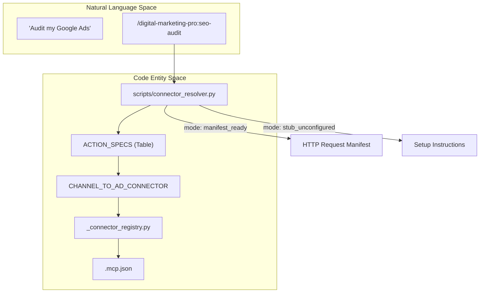
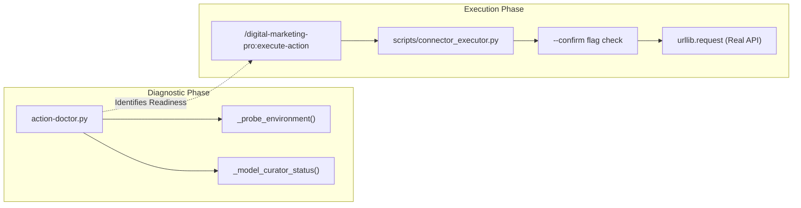

<!-- source: DeepWiki mcp.deepwiki.com · repo indranilbanerjee/digital-marketing-pro · page 5.1 Connector Catalog & Setup · fetched 2026-10-26 -->

# Connector Catalog & Setup

Relevant source files

The following files were used as context for generating this wiki page:

- [.mcp.json.connectors-reference](.mcp.json.connectors-reference)
- [.mcp.json.example](.mcp.json.example)
- [CONNECTORS.md](CONNECTORS.md)
- [SUBMISSION.md](SUBMISSION.md)
- [commands/competitor-analysis.md](commands/competitor-analysis.md)
- [commands/doctor.md](commands/doctor.md)
- [commands/execute-action.md](commands/execute-action.md)
- [commands/seo-audit.md](commands/seo-audit.md)
- [scripts/_connector_registry.py](scripts/_connector_registry.py)
- [scripts/action-doctor.py](scripts/action-doctor.py)
- [scripts/connector_executor.py](scripts/connector_executor.py)
- [scripts/connector_resolver.py](scripts/connector_resolver.py)
- [scripts/embed-c2pa.py](scripts/embed-c2pa.py)
- [skills/add-integration/SKILL.md](skills/add-integration/SKILL.md)
- [skills/c2pa-metadata/SKILL.md](skills/c2pa-metadata/SKILL.md)
- [skills/connect/SKILL.md](skills/connect/SKILL.md)
- [skills/integrations/SKILL.md](skills/integrations/SKILL.md)
- [skills/simulate/SKILL.md](skills/simulate/SKILL.md)

The Digital Marketing Pro plugin utilizes the **Model Context Protocol (MCP)** to bridge the gap between AI strategic reasoning and deterministic marketing execution. The system features a catalog of 68 MCP servers categorized by marketing function (CRM, SEO, Ads, etc.). Connectors are **opt-in and tool-agnostic**, allowing users to map generic placeholders like `~~CRM` to specific providers such as HubSpot or Salesforce `[CONNECTORS.md:5-7]()`.

## Connector Architecture & Transport Types

The plugin supports two primary transport types for MCP servers, catering to different execution environments (Claude Code CLI vs. Anthropic Cowork).

### 1. HTTP Connectors (Preferred)
These are hosted MCP servers that use Server-Sent Events (SSE) or HTTP POST. They are required for **Cowork** compatibility and are recommended for Claude Code to avoid local dependency management `[CONNECTORS.md:2-4]()`.
*   **Source:** `.mcp.json.connectors-reference` `[CONNECTORS.md:7-7]()`.
*   **Auth:** Typically OAuth on first connect or API keys in headers `[.mcp.json.connectors-reference:9-33]()`.

### 2. stdio/npx Connectors (Claude Code Only)
These run locally via `npx` or `command` execution. They are not supported in Cowork sessions `[CONNECTORS.md:39-41]()`.
*   **Source:** `.mcp.json.example` `[CONNECTORS.md:39-39]()`.
*   **Note:** Users must verify npx packages manually as many are conceptual or require local environment variables `[.mcp.json.example:3-3]()`.

### Connector Categories
| Category | Placeholder | Examples |
| :--- | :--- | :--- |
| **CRM** | `~~CRM` | HubSpot, Salesforce, Zoho `[CONNECTORS.md:15-15]()` |
| **SEO** | `~~SEO` | Ahrefs, Similarweb, Semrush `[CONNECTORS.md:18-18]()` |
| **Ads** | `~~Ads` | Google Ads, Meta, LinkedIn (via Unified Ads MCPs) `[CONNECTORS.md:44-44]()` |
| **Email** | `~~email marketing` | Klaviyo, Mailchimp, Brevo `[CONNECTORS.md:19-19]()` |
| **Social** | `~~chat` / `~~social` | Slack, Buffer, Hootsuite `[CONNECTORS.md:13-13]()`, `[CONNECTORS.md:46-46]()` |

**Sources:** `[CONNECTORS.md:1-50]()`, `[.mcp.json.connectors-reference:1-125]()`, `[.mcp.json.example:1-187]()`.

---

## Action Resolution Logic

The `connector_resolver.py` script acts as the intelligence layer that determines how a requested marketing action (e.g., `launch-ads`) is handled based on the current configuration `[scripts/connector_resolver.py:3-6]()`.

### Resolution Modes
1.  **`real`**: The action is executed locally via Python (e.g., `slack-incoming-webhook`) `[scripts/connector_resolver.py:10-13]()`.
2.  **`manifest_ready`**: The connector is configured, but the operation (Write/Launch) requires user approval. The resolver returns an HTTP request manifest for the agent to execute `[scripts/connector_resolver.py:15-20]()`.
3.  **`stub_unconfigured`**: No connector is found. The system returns setup instructions and the `.mcp.json` snippet needed to unlock the action `[scripts/connector_resolver.py:22-26]()`.

### Natural Language to Code Entity Mapping: Resolution
This diagram illustrates how a user's intent to audit a campaign flows from a command to the underlying resolution logic.

**Sources:** `[scripts/connector_resolver.py:8-35]()`, `[scripts/connector_resolver.py:58-86]()`, `[commands/seo-audit.md:10-14]()`.

---

## Activation & Setup

### Manual Activation
To activate a connector, copy the desired block from `.mcp.json.connectors-reference` into the root `.mcp.json` file under the `mcpServers` key `[CONNECTORS.md:7-7]()`.

### Guided Activation (Skills)
The plugin provides several skills to manage integrations interactively:
*   **`/digital-marketing-pro:integrations`**: Displays a status dashboard of what is connected and what skills are unlocked `[CONNECTORS.md:69-69]()`.
*   **`/digital-marketing-pro:connect <name>`**: Provides step-by-step instructions for a specific service `[CONNECTORS.md:70-70]()`.
*   **`/digital-marketing-pro:add-integration`**: Allows adding custom MCP servers not in the reference catalog `[CONNECTORS.md:71-71]()`.

### Unified Ads MCPs (v3.4+)
For agencies managing multiple platforms, the system supports unified aggregators to avoid duplicate tool surfaces `[CONNECTORS.md:51-53]()`:
*   **synter-media-ai**: Covers 7 platforms (Google, Meta, LinkedIn, etc.) `[CONNECTORS.md:57-57]()`.
*   **ryze-ai-google-ads**: Vendor-managed OAuth connector for Google/Meta `[CONNECTORS.md:58-58]()`.
*   **northbeam-mcp-selfhosted**: For organizations requiring self-hosted OAuth/API keys `[CONNECTORS.md:59-59]()`.

**Sources:** `[CONNECTORS.md:63-73]()`, `[CONNECTORS.md:51-61]()`.

---

## Readiness & Diagnostics (`/doctor`)

The `/digital-marketing-pro:doctor` command (powered by `scripts/action-doctor.py`) performs a pre-flight check of the environment `[commands/doctor.md:7-10]()`.

### Diagnostic Checks
1.  **Action Mapping**: Scans `ACTION_SPECS` to report which of the 14 core actions are `manifest_ready` `[scripts/action-doctor.py:7-11]()`.
2.  **Environment Probe**: Detects if the plugin is running in `cowork-sandbox`, `claude-code-mac`, `linux`, or `windows` `[scripts/action-doctor.py:79-98]()`.
3.  **Model Curator Freshness**: Checks the age of `model_registry.json`. If >60 days, it issues a `warn`; if >120 days, it issues an `urgent` error and provides the `refresh_models.py` command `[scripts/action-doctor.py:101-153]()`.
4.  **Cowork Persistence**: In Cowork, it verifies if `/digital-marketing-pro:cowork-setup` has been run to ensure brand data persists via Google Drive `[scripts/action-doctor.py:156-184]()`.

### Execution Pipeline: Doctor to Action
This diagram shows the relationship between diagnostic checks and the final execution gate.

**Sources:** `[scripts/action-doctor.py:7-23]()`, `[commands/execute-action.md:8-18]()`, `[scripts/connector_executor.py:1-50]()`.

---

## Execution Safety Gates

The `execute-action` command and `connector_executor.py` enforce strict safety protocols for real API calls `[commands/execute-action.md:8-10]()`.

*   **Read Ops**: Require the `--execute` flag to fire `[commands/execute-action.md:17-17]()`.
*   **Write Ops**: Require both `--execute` and `--confirm` flags. Without confirmation, the action is blocked `[commands/execute-action.md:18-18]()`.
*   **OAuth Restriction**: Connectors requiring OAuth (like Google Ads or LinkedIn) cannot be fired directly via Python; they return a `manifest_ready` status, signaling that they must be executed through the Claude/MCP tool path `[commands/execute-action.md:35-41]()`.
*   **Audit Trail**: Every successful execution is logged to `~/.claude-marketing/brands/{brand}/executions/` `[commands/execute-action.md:72-72]()`.

**Sources:** `[commands/execute-action.md:12-72]()`, `[scripts/connector_resolver.py:15-26]()`.

---

