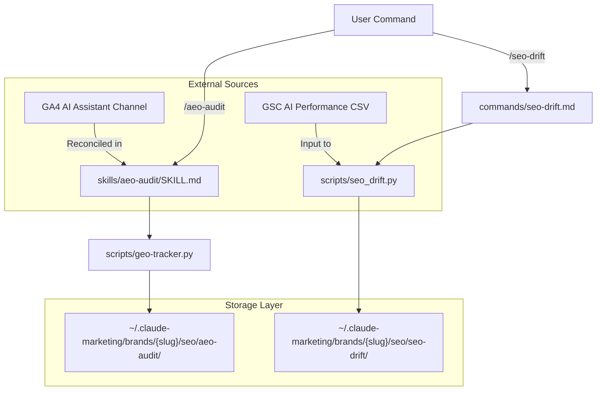
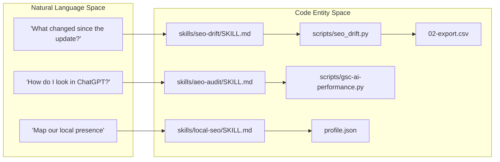

<!-- source: DeepWiki mcp.deepwiki.com · repo indranilbanerjee/digital-marketing-pro · page 6.1 SEO & AEO/GEO Skills · fetched 2026-10-26 -->

# SEO & AEO/GEO Skills

Relevant source files

The following files were used as context for generating this wiki page:

- [commands/backlink-gap.md](commands/backlink-gap.md)
- [commands/keyword-cluster.md](commands/keyword-cluster.md)
- [commands/seo-drift.md](commands/seo-drift.md)
- [scripts/backlink_gap.py](scripts/backlink_gap.py)
- [scripts/gsc-ai-performance.py](scripts/gsc-ai-performance.py)
- [scripts/keyword_cluster.py](scripts/keyword_cluster.py)
- [scripts/seo_drift.py](scripts/seo_drift.py)
- [skills/ad-creative/SKILL.md](skills/ad-creative/SKILL.md)
- [skills/aeo-audit/SKILL.md](skills/aeo-audit/SKILL.md)
- [skills/aeo-geo/SKILL.md](skills/aeo-geo/SKILL.md)
- [skills/aeo-geo/ai-visibility-audit.md](skills/aeo-geo/ai-visibility-audit.md)
- [skills/analytics-insights/SKILL.md](skills/analytics-insights/SKILL.md)
- [skills/backlink-gap/SKILL.md](skills/backlink-gap/SKILL.md)
- [skills/content-brief/SKILL.md](skills/content-brief/SKILL.md)
- [skills/context-engine/eu-code-of-practice.md](skills/context-engine/eu-code-of-practice.md)
- [skills/gsc-ai-performance/SKILL.md](skills/gsc-ai-performance/SKILL.md)
- [skills/influencer-brief/SKILL.md](skills/influencer-brief/SKILL.md)
- [skills/keyword-cluster/SKILL.md](skills/keyword-cluster/SKILL.md)
- [skills/local-seo/SKILL.md](skills/local-seo/SKILL.md)
- [skills/page-seo-analysis/SKILL.md](skills/page-seo-analysis/SKILL.md)
- [skills/paid-advertising/SKILL.md](skills/paid-advertising/SKILL.md)
- [skills/paid-advertising/google-ads.md](skills/paid-advertising/google-ads.md)
- [skills/seo-audit/SKILL.md](skills/seo-audit/SKILL.md)
- [skills/seo-drift/SKILL.md](skills/seo-drift/SKILL.md)
- [skills/share-of-voice/SKILL.md](skills/share-of-voice/SKILL.md)
- [skills/share-of-voice/x-twitter-source-evidence.md](skills/share-of-voice/x-twitter-source-evidence.md)
- [skills/sitemap-manager/SKILL.md](skills/sitemap-manager/SKILL.md)
- [skills/tech-seo-audit/SKILL.md](skills/tech-seo-audit/SKILL.md)
- [skills/technical-seo/SKILL.md](skills/technical-seo/SKILL.md)

The SEO & AEO/GEO skill suite provides a comprehensive framework for managing search visibility in both traditional "Classic Search" (Google, Bing) and the emerging "AI-Native Search" landscape (ChatGPT, Perplexity, Google AI Mode). This system transitions from keyword-centric optimization to entity-centric visibility, incorporating the latest 2026 platform updates such as Google's AI Mode and the GSC AI Performance Report.

## 1. Traditional SEO Skills

The codebase implements a deterministic pipeline for traditional SEO tasks, utilizing Python scripts to process data from Search Console, rank trackers, and backlink providers.

### 1.1 SEO Auditing and Drift Analysis
The system performs deep audits and temporal comparisons to detect "drift"—volatility caused by algorithm updates or competitor activity.

*   **`seo-audit`**: Evaluates on-page, technical, and authority signals [skills/seo-audit/SKILL.md:1-5]().
*   **`seo-drift`**: Compares two snapshots (Baseline vs. Current) to classify keyword movement into categories: `growth`, `decline`, `reshuffle`, `stable`, `new`, or `lost` [commands/seo-drift.md:1-4]().
*   **Implementation**: The `scripts/seo_drift.py` script calculates deltas and applies a noise threshold (default 5%) to filter out SERP volatility [commands/seo-drift.md:25-33]().

### 1.2 Keyword Intelligence and Clustering
Instead of flat keyword lists, the system uses SERP-overlap clustering to build pillar-and-spoke architectures.

*   **`keyword-cluster`**: Uses `scripts/keyword_cluster.py` to group keywords based on URL overlap in the top 10 search results [commands/keyword-cluster.md:33-34]().
*   **Internal Link Mapping**: Automatically generates a map of internal links to reinforce the pillar/spoke hierarchy [commands/keyword-cluster.md:37-38]().

### 1.3 Local SEO and Agentic Booking
Updated for the "I/O 2026" expansion, the local SEO module focuses on **Agentic Booking** for verticals like home repair, beauty, and pet care [skills/local-seo/SKILL.md:14-23](). It prioritizes:
1.  **AvailabilityFeed** structured data for AI agent reasoning [skills/local-seo/SKILL.md:25-27]().
2.  **Pricing transparency** in service catalogs to prevent agents from skipping the business [skills/local-seo/SKILL.md:27-28]().

**Sources:** [skills/seo-audit/SKILL.md](), [commands/seo-drift.md](), [scripts/seo_drift.py](), [commands/keyword-cluster.md](), [skills/local-seo/SKILL.md]()

---

## 2. AEO/GEO: AI-Native Visibility

Answer Engine Optimization (AEO) and Generative Engine Optimization (GEO) represent the "AI-first" branch of the system. This module audits and optimizes how brands are cited across 6 canonical AI surfaces.

### 2.1 The 6 Canonical Platforms
The system tracks visibility across a standardized set of platforms defined in `scripts/geo-tracker.py` [skills/aeo-audit/SKILL.md:90-91]():
1.  **Google AI Mode**: The conversational default (Gemini 3.5 Flash) [skills/aeo-audit/SKILL.md:11-13]().
2.  **Google AI Overviews**: The summary block atop classic SERPs.
3.  **ChatGPT**: OpenAI's primary interface.
4.  **Perplexity**: AI-native search engine.
5.  **Gemini**: Google's standalone AI.
6.  **Microsoft Copilot**: Bing-integrated AI.

### 2.2 Data Flow: Synthetic Probes vs. GSC Actuals
The system reconciles "Synthetic Probes" (what AI *could* say) with "GSC Actuals" (what AI *did* say).

| Source | File / Skill | Data Type | Purpose |
| :--- | :--- | :--- | :--- |
| **Synthetic Probe** | `aeo-audit` | JSON Probe Results | Simulates user queries to see if the brand is cited [skills/aeo-audit/SKILL.md:62](). |
| **GSC AI Report** | `gsc-ai-performance` | CSV Export | Actual impressions from Google AI Overviews/Mode [skills/gsc-ai-performance/SKILL.md:11-15](). |
| **GA4 Attribution** | `analytics-insights` | `ai-assistant` Medium | Actual click-through traffic from AI engines [skills/analytics-insights/SKILL.md:10-15](). |

**Sources:** [skills/aeo-audit/SKILL.md](), [skills/aeo-geo/SKILL.md](), [skills/gsc-ai-performance/SKILL.md](), [skills/analytics-insights/SKILL.md]()

---

## 3. Technical Architecture & Data Flow

The following diagram bridges the high-level SEO/AEO concepts to the specific code entities that execute them.

### SEO/AEO Execution Pipeline
This diagram shows how user commands interact with Python scripts and local storage.

**Sources:** [skills/aeo-audit/SKILL.md:57-71](), [commands/seo-drift.md:38-49](), [skills/gsc-ai-performance/SKILL.md:81-89](), [skills/analytics-insights/SKILL.md:22-28]()

---

## 4. Share of Voice (SOV) & Competitive Intelligence

The `share-of-voice` skill aggregates data across organic, paid, social, and AI dimensions to calculate a brand's market presence relative to competitors.

### 4.1 SOV Calculation Logic
The system uses a weighted model to determine visibility [skills/share-of-voice/SKILL.md:25-27]():
*   **Organic SOV**: Keywords are weighted by Monthly Search Volume (MSV) and Position CTR (Pos 1 = 100%, Pos 2 = 65%, etc.).
*   **Social SOV**: Combines Mention Volume with Sentiment Weighting (Positive = 1.5x, Negative = 0.5x).
*   **AI SOV**: Uses the 1-10 visibility scorecard across the 6 canonical platforms.

### 4.2 X/Twitter Evidence Packets
When social listening connectors are incomplete, the system uses `skills/share-of-voice/x-twitter-source-evidence.md` to normalize manual data exports [skills/share-of-voice/x-twitter-source-evidence.md:23-38]().

| Field | Description |
| :--- | :--- |
| `entity` | Brand or competitor being measured |
| `public_metrics` | Reply, repost, like, and view counts |
| `dedupe_key` | URL or deterministic hash for duplicate removal |

**Sources:** [skills/share-of-voice/SKILL.md](), [skills/share-of-voice/x-twitter-source-evidence.md]()

---

## 5. System Entity Mapping

This diagram maps the logical marketing domains to the specific code files and data structures used by the Digital Marketing Pro system.

**Sources:** [skills/aeo-audit/SKILL.md:33](), [commands/seo-drift.md:14-20](), [skills/local-seo/SKILL.md:31-48](), [skills/gsc-ai-performance/SKILL.md:81-89]()

## 6. Compliance and Transparency (EU AI Act)

For any SEO or AEO output targeting EU markets, the system enforces compliance with **Article 50 of the EU AI Act** [skills/aeo-geo/SKILL.md:42]().
*   **Machine-Readable Marking**: Embeds C2PA manifests with the `c2pa.ai-disclosure` assertion [skills/context-engine/eu-code-of-practice.md:72]().
*   **Visible Disclosure**: Required for "Deepfakes" or AI-generated text published on matters of public interest [skills/context-engine/eu-code-of-practice.md:50-51]().

**Sources:** [skills/aeo-geo/SKILL.md](), [skills/context-engine/eu-code-of-practice.md]()

---

