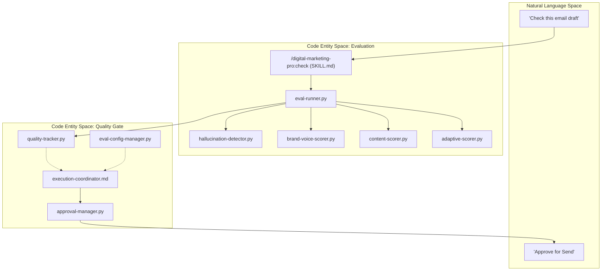
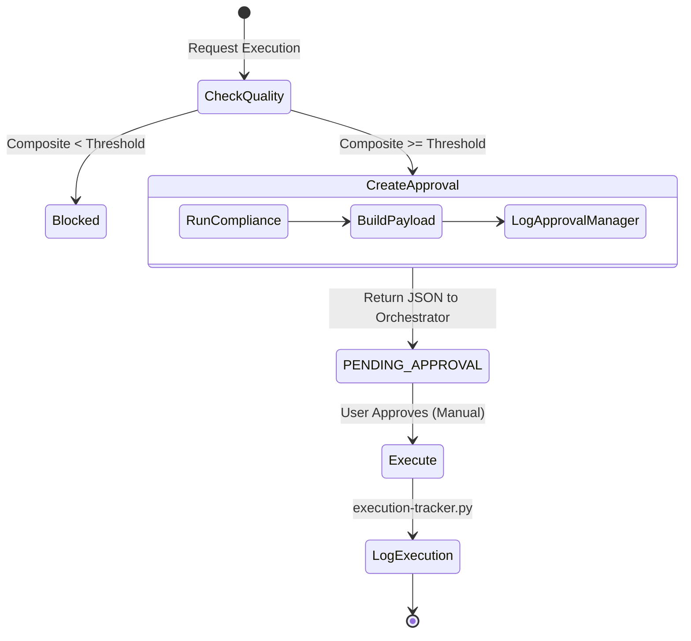

<!-- source: DeepWiki mcp.deepwiki.com · repo indranilbanerjee/digital-marketing-pro · page 7.1 Evaluation & Quality Gate System · fetched 2026-10-26 -->

# Evaluation & Quality Gate System

Relevant source files

The following files were used as context for generating this wiki page:

- [agents/execution-coordinator.md](agents/execution-coordinator.md)
- [docs/architecture.md](docs/architecture.md)
- [docs/claude-interfaces.md](docs/claude-interfaces.md)
- [docs/getting-started.md](docs/getting-started.md)
- [hooks/hooks-reference.example.json](hooks/hooks-reference.example.json)
- [hooks/hooks.json](hooks/hooks.json)
- [scripts/eval-config-manager.py](scripts/eval-config-manager.py)
- [scripts/hallucination-detector.py](scripts/hallucination-detector.py)
- [scripts/prompt-ab-tester.py](scripts/prompt-ab-tester.py)
- [scripts/quality-tracker.py](scripts/quality-tracker.py)
- [skills/campaign-audit/SKILL.md](skills/campaign-audit/SKILL.md)
- [skills/check/SKILL.md](skills/check/SKILL.md)
- [skills/eval-config/SKILL.md](skills/eval-config/SKILL.md)
- [skills/eval-suite/SKILL.md](skills/eval-suite/SKILL.md)
- [skills/help/SKILL.md](skills/help/SKILL.md)
- [skills/status/SKILL.md](skills/status/SKILL.md)

The Evaluation & Quality Gate System is a multi-layered verification framework designed to ensure all marketing output meets brand standards, regulatory requirements, and factual accuracy before publication. It transitions the system from probabilistic generation to deterministic quality enforcement through a suite of specialized scorers and an automated approval workflow.

## 1. System Overview

The evaluation system operates as a "Quality Gate" that content must pass before the `execution-coordinator` agent allows any external write operations [agents/execution-coordinator.md:40-52](). It replaces previous global hooks with an explicit, user-invoked `/digital-marketing-pro:check` command [skills/check/SKILL.md:28-31]().

### Core Components
*   **Master Orchestrator**: `scripts/eval-runner.py` coordinates the execution of specialized scorers [skills/check/SKILL.md:35-46]().
*   **Specialized Scorers**: Independent Python scripts targeting specific dimensions like hallucinations, brand voice, and readability [docs/architecture.md:105-108]().
*   **Config Manager**: `scripts/eval-config-manager.py` maintains per-brand thresholds and weights [scripts/eval-config-manager.py:5-10]().
*   **Quality Tracker**: `scripts/quality-tracker.py` persists evaluation results for regression testing and A/B analysis [docs/architecture.md:109-110]().

### Evaluation Pipeline Flow

The following diagram illustrates the flow from content generation to the final execution gate, mapping Natural Language requirements to the underlying Code Entities.

**Content Evaluation & Approval Pipeline**

**Sources:** [skills/check/SKILL.md:17-46](), [agents/execution-coordinator.md:50-52](), [scripts/eval-config-manager.py:5-10]()

---

## 2. Specialized Evaluation Scripts

### 2.1 Hallucination Detector (`hallucination-detector.py`)
This script uses sentence windowing and pattern matching to identify potential AI fabrications. It scans for:
*   **Unattributed Statistics**: Percentages or figures lacking a source citation [skills/check/SKILL.md:39]().
*   **Placeholder URLs**: Generic domains like `example.com` or `your-site.com` [skills/check/SKILL.md:39]().
*   **Unsupported Superlatives**: Terms like "best," "#1," or "leading" without substantiation [skills/check/SKILL.md:39]().
*   **Fabricated Citations**: Patterns indicating non-existent studies or sources [skills/check/SKILL.md:39]().

### 2.2 Brand Voice Scorer (`brand-voice-scorer.py`)
Analyzes content against the `profile.json` of the active brand. It calculates scores for four primary dimensions:
1.  **Formality** (1-10)
2.  **Energy** (1-10)
3.  **Humor** (1-10)
4.  **Authority** (1-10)
It also checks against "Prefer" and "Avoid" word lists defined in the brand profile [skills/check/SKILL.md:110-117]().

### 2.3 Adaptive Scorer (`adaptive-scorer.py`)
Adjusts scoring weights based on the content type and brand context. For example, it places higher weight on `hallucination` scores for ad copy than for internal content briefs [docs/architecture.md:50](), [scripts/eval-config-manager.py:81-86]().

**Sources:** [docs/architecture.md:50-52](), [skills/check/SKILL.md:33-46](), [scripts/eval-config-manager.py:43-50]()

---

## 3. Configuration & Thresholds

The `eval-config-manager.py` script manages the `_config.json` file located at `~/.claude-marketing/brands/{slug}/quality/_config.json` [scripts/eval-config-manager.py:5-10]().

### Default Thresholds & Weights
The system applies a `default` scoring rubric, with specific overrides for high-stakes content types:

| Content Type | Quality Min | Voice Min | Hallucination Min | Weight (Quality/Voice/Halluc) |
| :--- | :--- | :--- | :--- | :--- |
| **Default** | 50 | 50 | 60 | 0.25 / 0.20 / 0.20 |
| **Ad Copy** | 70 | 70 | 80 | 0.30 / 0.25 / 0.25 |
| **Press Release** | 70 | 60 | 80 | (Varies by Config) |

**Sources:** [scripts/eval-config-manager.py:62-110]()

---

## 4. Execution Coordinator & Approval Workflow

The `execution-coordinator` agent acts as the final gatekeeper. It is a subagent that cannot interact directly with the user; instead, it returns a `PENDING_APPROVAL` status [agents/execution-coordinator.md:12-28]().

### Approval Steps
1.  **Gate Consumption**: It reads the latest evaluation result from `quality-tracker.py` rather than re-running the scorers [agents/execution-coordinator.md:50]().
2.  **Auto-Reject**: If the composite score is below the `auto_reject_threshold` (default: 40), execution is blocked [agents/execution-coordinator.md:51](), [scripts/eval-config-manager.py:67]().
3.  **Record Creation**: It calls `approval-manager.py` to create a formal record including risk levels and rollback instructions [agents/execution-coordinator.md:43-49]().

**Approval State Machine**

**Sources:** [agents/execution-coordinator.md:18-28](), [agents/execution-coordinator.md:40-52](), [scripts/approval-manager.py:59-60]()

---

## 5. A/B Testing and Regression

The system includes a `prompt-ab-tester.py` script to compare different prompt strategies or content variants [scripts/prompt-ab-tester.py:5-10]().

### Key Functions
*   `create-test`: Initializes a named test (e.g., `email-subject-q1`) [scripts/prompt-ab-tester.py:98-126]().
*   `log-variant`: Records evaluation scores for Variant A vs. Variant B [scripts/prompt-ab-tester.py:129-178]().
*   `get-results`: Calculates average composite scores and determines a statistical winner [scripts/prompt-ab-tester.py:181-210]().

**Sources:** [scripts/prompt-ab-tester.py:13-26]()

---

