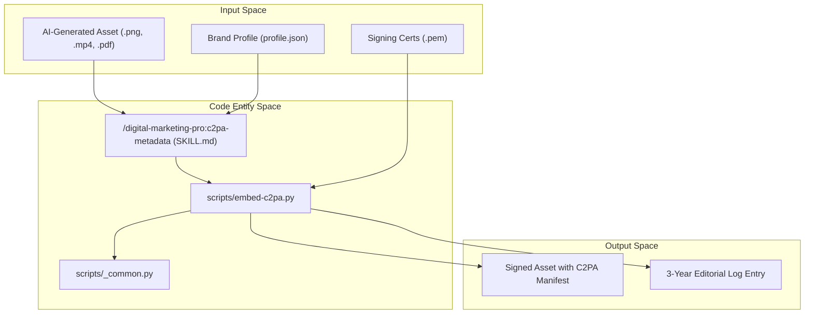
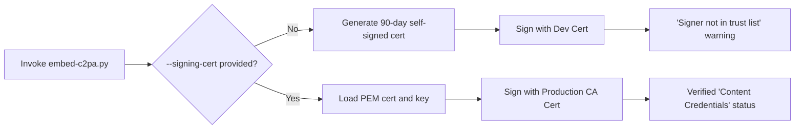

<!-- source: DeepWiki mcp.deepwiki.com · repo indranilbanerjee/digital-marketing-pro · page 7.2 C2PA Content Provenance & EU AI Act Compliance · fetched 2026-10-26 -->

# C2PA Content Provenance & EU AI Act Compliance

Relevant source files

The following files were used as context for generating this wiki page:

- [.claude-plugin/plugin.json](.claude-plugin/plugin.json)
- [.mcp.json.connectors-reference](.mcp.json.connectors-reference)
- [CHANGELOG.md](CHANGELOG.md)
- [CONNECTORS.md](CONNECTORS.md)
- [SUBMISSION.md](SUBMISSION.md)
- [commands/competitor-analysis.md](commands/competitor-analysis.md)
- [commands/seo-audit.md](commands/seo-audit.md)
- [docs/brand-guidelines.md](docs/brand-guidelines.md)
- [docs/c2pa-production-cert-guide.md](docs/c2pa-production-cert-guide.md)
- [scripts/embed-c2pa.py](scripts/embed-c2pa.py)
- [skills/aeo-audit/SKILL.md](skills/aeo-audit/SKILL.md)
- [skills/aeo-geo/SKILL.md](skills/aeo-geo/SKILL.md)
- [skills/analytics-insights/SKILL.md](skills/analytics-insights/SKILL.md)
- [skills/c2pa-metadata/SKILL.md](skills/c2pa-metadata/SKILL.md)
- [skills/context-engine/eu-code-of-practice.md](skills/context-engine/eu-code-of-practice.md)
- [skills/gsc-ai-performance/SKILL.md](skills/gsc-ai-performance/SKILL.md)
- [skills/paid-advertising/SKILL.md](skills/paid-advertising/SKILL.md)
- [skills/paid-advertising/google-ads.md](skills/paid-advertising/google-ads.md)

This page details the Digital Marketing Pro compliance subsystem designed to meet the transparency requirements of the **EU AI Act Article 50** (applicable 2 August 2026). The system provides a technical framework for embedding machine-readable provenance manifests and visible AI disclosures into marketing assets using the **C2PA (Coalition for Content Provenance and Authenticity)** open standard.

Sources: [.claude-plugin/plugin.json:49-55](), [skills/context-engine/eu-code-of-practice.md:3-8](), [skills/c2pa-metadata/SKILL.md:6-18]()

## Subsystem Architecture & Data Flow

The compliance subsystem consists of a high-level skill interface (`/digital-marketing-pro:c2pa-metadata`) and a core Python execution script (`embed-c2pa.py`). It bridges the gap between AI-generated creative outputs and regulatory transparency mandates.

### Compliance Data Flow

The diagram below illustrates how an AI-generated asset moves through the provenance embedding pipeline to reach compliance.

**Title: Provenance Embedding Pipeline**

Sources: [skills/c2pa-metadata/SKILL.md:29-35](), [scripts/_common.py:13-13](), [docs/c2pa-production-cert-guide.md:58-66]()

## EU AI Act Article 50 Requirements

The subsystem is specifically architected to address the two distinct obligations defined in Article 50:

1.  **Machine-Readable Marking:** Generative AI outputs must be marked in a machine-readable format. The system uses **C2PA Spec 2.4** assertions to satisfy this.
2.  **Deployer Disclosure:** Marketing teams (deployers) must disclose AI generation for **deepfakes** (resembling real persons/places) and **public interest text** (unless human editorial responsibility is assumed).

| Requirement | Technical Implementation | File Reference |
| :--- | :--- | :--- |
| Machine-Readable Mark | C2PA Manifest + `c2pa.ai-disclosure` assertion | [skills/c2pa-metadata/SKILL.md:21-27]() |
| Deepfake Disclosure | Visible IPTC `algorithmicMedia` claim | [skills/c2pa-metadata/SKILL.md:86-92]() |
| Human Review Record | `reviewer` field in manifest + Editorial Log | [skills/c2pa-metadata/SKILL.md:48-55]() |
| Interoperability | IPTC digital-source-type vocabulary | [skills/c2pa-metadata/SKILL.md:94-95]() |

Sources: [skills/context-engine/eu-code-of-practice.md:16-25](), [skills/c2pa-metadata/SKILL.md:9-18]()

## Implementation: embed-c2pa.py

The `scripts/embed-c2pa.py` script is the primary worker. It supports embedding manifests into images, video, audio, and PDF documents.

### Key Assertions & Claims
The script maps user-provided claims to the standardized IPTC vocabulary to ensure interoperability with regulatory enforcement tools:

*   **`ai-generated-content`**: Maps to `algorithmicMedia`. Used for assets fully generated by AI.
*   **`ai-assisted-edits`**: Maps to `compositeWithTrainedAlgorithmicMedia`. Used for human-created assets with AI modifications (e.g., Generative Fill).
*   **`ai-no-substantive-changes`**: Maps to `minorHumanEdits`. Used for AI upscaling or noise reduction where semantic meaning is unchanged.

### AI-Disclosure Assertion (C2PA 2.4)
The script implements the `--ai-disclosure` flag [CHANGELOG.md:15-15](), which embeds the `c2pa.ai-disclosure` assertion. This is the specific machine-readable pathway identified in the EU Code of Practice for Article 50 compliance.

Sources: [skills/c2pa-metadata/SKILL.md:86-95](), [CHANGELOG.md:15-15](), [skills/context-engine/eu-code-of-practice.md:71-73]()

## Certificate Management: Dev vs. Production

Digital Marketing Pro provides a dual-pathway for digital signatures to support both development and enterprise deployment.

**Title: C2PA Signing Logic**

### Production Requirements
For assets bound for EU markets, self-signed certificates are insufficient for legal compliance. Production certificates must be obtained from a **CAI-recognized signing authority** such as Adobe, Truepic, or Microsoft Azure Confidential Ledger.

*   **Format:** PEM-encoded ECDSA P-256 keys.
*   **Security:** Keys should never be committed to the repository and must be passed via runtime flags or environment variables.

Sources: [docs/c2pa-production-cert-guide.md:6-10](), [docs/c2pa-production-cert-guide.md:12-23](), [skills/c2pa-metadata/SKILL.md:100-108]()

## Editorial Log Retention

To satisfy the accountability requirements of the EU AI Act, the system maintains a record of AI generation and human review.

*   **3-Year Requirement:** The plugin advises brands to maintain editorial logs for a minimum of 3 years to document human oversight.
*   **Human Review Exception:** Article 50 allows for non-disclosure of AI-generated text if a human assumes "editorial responsibility." The system tracks the `reviewer` name within the C2PA manifest to provide a technical audit trail for this exception.

Sources: [docs/c2pa-production-cert-guide.md:105-105](), [skills/c2pa-metadata/SKILL.md:48-55](), [skills/context-engine/eu-code-of-practice.md:50-52]()

## AEO/GEO Visibility Auditing

Compliance is linked to visibility. The `aeo-audit` skill evaluates how AI answer engines (Google AI Mode, ChatGPT, Perplexity) cite the brand.

*   **Citation Accuracy:** The audit fact-checks AI descriptions against the brand's `profile.json` [skills/aeo-audit:35-36]().
*   **Source Authority:** Analyzes which pages drive AI mentions, allowing brands to prioritize which content requires C2PA signing first [skills/aeo-audit:38-38]().

Sources: [skills/aeo-audit/SKILL.md:9-15](), [skills/aeo-audit/SKILL.md:31-41](), [skills/aeo-geo/SKILL.md:12-18]()

---

