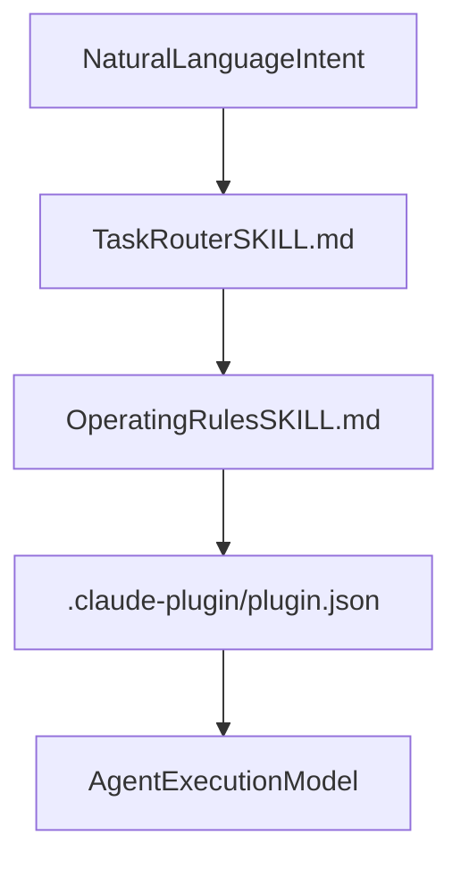
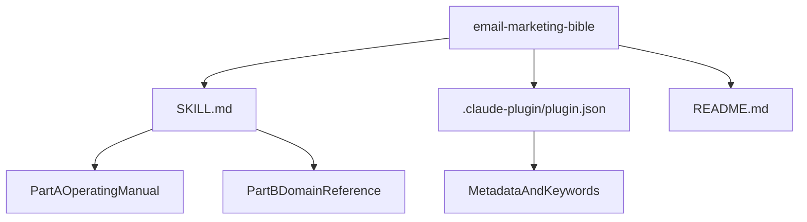

<!-- source: DeepWiki mcp.deepwiki.com · repo CosmoBlk/email-marketing-bible · page 1 Overview · fetched 2026-10-26 -->

# Overview

Relevant source files

The following files were used as context for generating this wiki page:

- [.claude-plugin/plugin.json](.claude-plugin/plugin.json)
- [README.md](README.md)
- [SKILL.md](SKILL.md)

## Purpose and Scope

The `email-marketing-bible` is a comprehensive agent skill package designed to provide AI agents with production-grade email marketing capabilities, domain reference material, and strict safety guardrails [SKILL.md:2-13](), [README.md:1-10](). Developed for platforms like Claude Code, Claude Desktop, and general agent runtimes, it acts as a discipline layer ensuring that automated agents operate under strict pre-send checklists, anti-slop copy protocols, and structured design pipelines rather than unconstrained generation [README.md:5-22]().

The codebase topology centers around the root operating instruction file (`SKILL.md`), the plugin manifest (`.claude-plugin/plugin.json`), and distribution documentation (`README.md`), backed by a complete set of industry playbooks and reference manuals [SKILL.md:1-92](), [README.md:70-101](), [.claude-plugin/plugin.json:1-18]().

*Sources: [SKILL.md:1-92](), [.claude-plugin/plugin.json:1-18]()*

---

## System Topology & Package Structure

The package is organized to be consumed natively by agent skill loaders and plugin systems. The core logic resides in `SKILL.md`, which contains both Part A (the Agent Operating Manual) and Part B (the Domain Reference) [SKILL.md:20-24](). Package metadata, versioning, and extension integration points are defined in the plugin manifest [.claude-plugin/plugin.json:1-18]().

*Sources: [SKILL.md:1-92](), [README.md:1-108](), [.claude-plugin/plugin.json:1-18]()*

---

## Sub-Topics and Child Pages

- **[Installation and Usage](#1.1)** — Covers git-clone installation workflows into `~/.claude/skills`, plugin manifest configurations, and standard invocation patterns for running audits, flows, and copy generation [README.md:11-67]().
- **[Repository Layout](#1.2)** — Details the structural map of files and directories, including the root `SKILL.md`, mirrored copies, plugin manifests, assets, and licensing files [SKILL.md:1-13](), [.claude-plugin/plugin.json:1-18]().

*Sources: [SKILL.md:1-13](), [README.md:11-67](), [.claude-plugin/plugin.json:1-18]()*

---

