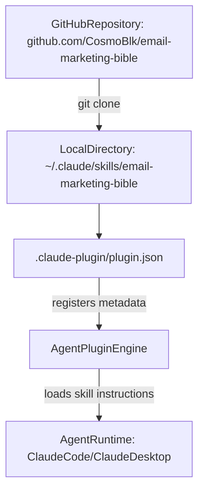
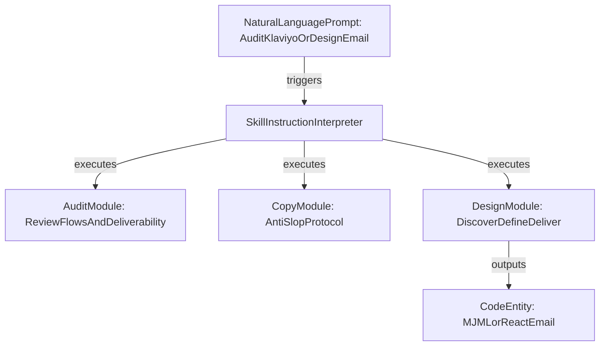

<!-- source: DeepWiki mcp.deepwiki.com · repo CosmoBlk/email-marketing-bible · page 1.1 Installation and Usage · fetched 2026-10-26 -->

# Installation and Usage

<details>
<summary>Relevant source files</summary>

The following files were used as context for generating this wiki page:

- [.claude-plugin/plugin.json](.claude-plugin/plugin.json)
- [README.md](README.md)

</details>


The scope of this document covers the installation mechanics of the `email-marketing-bible` skill package into local agent environments (such as Claude Code and Claude Desktop), the plugin configuration schema, and the natural language invocation patterns used to direct the agent through marketing, deliverability, copy, and design tasks.

---

## Installation Mechanics

The skill can be installed locally via `git clone` directly into the agent skill directory hierarchy, making it available to any agent runtime that parses the skill format [README.md:11-18](). 

The standard installation target for local Claude skills is `~/.claude/skills/email-marketing-bible` [README.md:13-15](). 

```bash
git clone https://github.com/CosmoBlk/email-marketing-bible.git ~/.claude/skills/email-marketing-bible
```

Alternatively, the repository provides a plugin manifest file located at `.claude-plugin/plugin.json` which registers the package metadata, versioning information (`2.7.1`), licensing (MIT), repository endpoints, and icon assets [.claude-plugin/plugin.json:1-18](). The plugin manifest defines key search keywords such as `email-marketing`, `deliverability`, `copywriting`, `marketing-automation`, `email-design`, and `mcp` [.claude-plugin/plugin.json:14]().

Title: Installation and Runtime Loading Topology

Sources: [README.md:11-18](), [.claude-plugin/plugin.json:1-18]()

---

## Invocation Patterns and Natural Language Interfacing

Once installed, the agent operates as an expert email marketing consultant [README.md:39-41](). Users interact with the skill through specialized natural language prompts designed to trigger specific operational modes (auditing, building flows, fixing deliverability, rewriting copy, or directing design) [README.md:43-66]().

Title: Natural Language to Execution Mapping

Sources: [README.md:39-66]()

### Core Prompt Archetypes

1. **Audit and Build Flows**:
   Instructs the agent to evaluate existing ESP setups, identify missing lifecycle sequences, and build high-converting flows [README.md:43-48]().
   ```text
   "Audit my Klaviyo account for a DTC skincare brand doing $2M/year. I have a welcome series, abandoned cart, and one weekly newsletter. What am I missing, and build me whatever flow would earn the most first."
   ```
   *Sources: [README.md:43-48]()*

2. **Deliverability Triage**:
   Instructs the agent to diagnose inbox placement issues, reputation decline, or engagement drops [README.md:50-54]().
   ```text
   "My emails are landing in Gmail promotions and opens dropped from 22% to 14% over three months. What is going on and how do I fix it?"
   ```
   *Sources: [README.md:50-54]()*

3. **Copy De-sloping**:
   Forces the agent to remove artificial phrasing, apply proven conversion frameworks (PAS, AIDA, BAB), and align tone with human brand voices [README.md:29](), [README.md:56-60]().
   ```text
   "Here is a draft welcome email. Make it sound like a person, not an AI, and keep it on our brand voice."
   ```
   *Sources: [README.md:56-60]()*

4. **Design Pipeline (Discover-Define-Deliver)**:
   Engages the design module, requiring divergence (seed strings and multiple directions) prior to converging on inbox-safe `MJML` or `React Email` outputs [README.md:30](), [README.md:62-66](), [README.md:106-108]().
   ```text
   "Design a launch email for a premium coffee brand. List 15 directions first, I will pick. Then build the pick as MJML and run a critic loop on the render."
   ```
   *Sources: [README.md:62-66]()*

---

