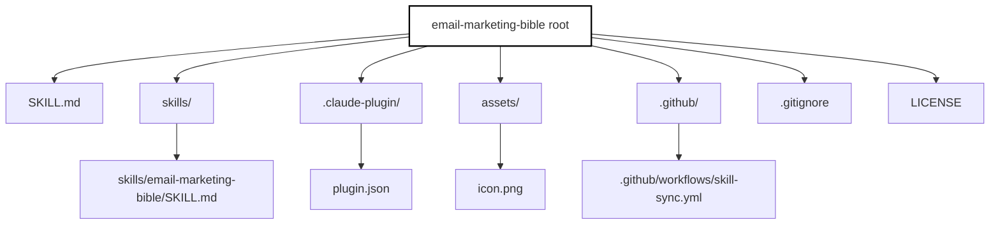
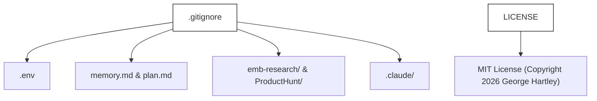
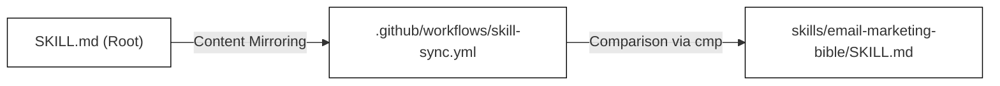

<!-- source: DeepWiki mcp.deepwiki.com · repo CosmoBlk/email-marketing-bible · page 1.2 Repository Layout · fetched 2026-10-26 -->

# Repository Layout

Relevant source files

The following files were used as context for generating this wiki page:

- [.gitignore](.gitignore)
- [LICENSE](LICENSE)
- [assets/icon.png](assets/icon.png)

## Purpose and Scope
This document maps out the file and directory structure of the `email-marketing-bible` repository. It details the physical organization of the codebase, including the root-level core skill file, its synchronized copy inside the `skills/` directory, plugin manifests (`.claude-plugin`), brand and distribution assets (`assets/`), CI/CD automation workflows (`.github/`), version control exclusion policies (`.gitignore`), and the project license (`LICENSE`).

---

## 1. Directory Topology and Root Layout
The repository is organized as an agent skill package designed for integration into Claude Code and AI Studio environments. The root directory contains the authoritative instruction file `SKILL.md`, while distribution packages and synchronization copies are maintained in parallel directories.

*Diagram 1: High-level repository directory map.*

Sources: `.gitignore:1-35`, `LICENSE:1-22`

---

## 2. Licensing and Version Control Exclusions
Project governance and exclusions are strictly enforced via the root configuration files. The project is distributed under the MIT License, granting permissive use while limiting liability.

The `.gitignore` file explicitly isolates public distribution assets from internal research, temporary drafts, and user-specific environment configurations. It protects sensitive development notes (`memory.md`, `plan.md`, `CLAUDE.md`), experimental research dumps (`emb-research/`, `intelligentsend-*.md`), and working directories from leaking into public releases.

*Diagram 2: Governance, licensing boundaries, and exclusion filters.*

Sources: `.gitignore:1-35`, `LICENSE:1-22`

---

## 3. Plugin Assets and Manifest Configuration
The repository includes branding and distribution configurations to support plugin registry consumption.

*   **Plugin Manifest (`.claude-plugin`)**: Defines plugin metadata, versioning, keywords, and entry points required by client parsers.
*   **Assets (`assets/icon.png`)**: Provides visual branding assets utilized in marketplace displays and plugin cards [assets/icon.png:1-52]().

Sources: `assets/icon.png:1-52`

---

## 4. CI/CD Synchronization Mechanics
To maintain parity between the root execution context and the packaged skill directory, automated checks or mirror structures ensure that the root `SKILL.md` and the replica under `skills/` remain synchronized. 

*Diagram 3: Natural language skill synchronization flow across execution paths.*

Sources: `.gitignore:1-35`

---

