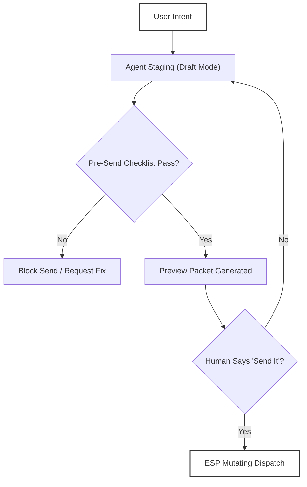
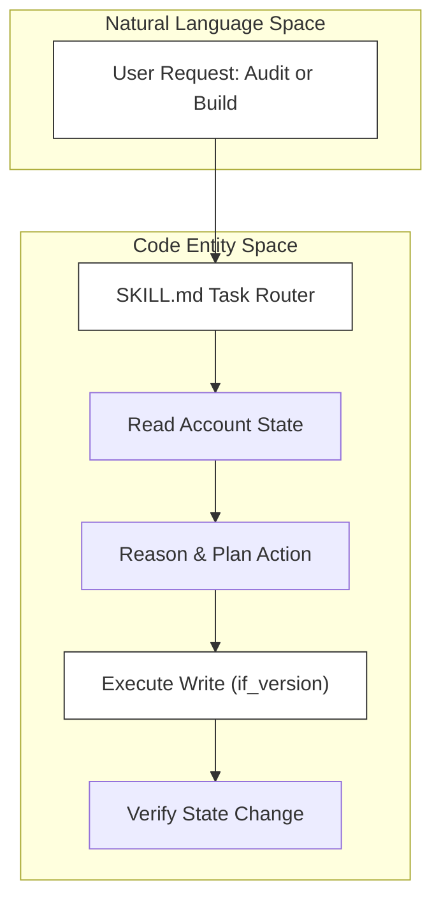

<!-- source: DeepWiki mcp.deepwiki.com · repo CosmoBlk/email-marketing-bible · page 2 Agent Operating Manual (SKILL.md Part A) · fetched 2026-10-26 -->

# Agent Operating Manual (SKILL.md Part A)

Relevant source files

The following files were used as context for generating this wiki page:

- [SKILL.md](SKILL.md)
- [skills/email-marketing-bible/SKILL.md](skills/email-marketing-bible/SKILL.md)

The purpose of this page is to outline the core operating rules governing AI agent behavior when interacting with email marketing infrastructure, live ESPs (Email Service Providers), and messaging channels. As defined in `SKILL.md`, Part A establishes the absolute boundaries, task routing paradigms, automation loops, copywriting constraints, and design pipelines required to safely run autonomous marketing workflows [SKILL.md:24-92]().

For deep technical dives into specific sub-topics, refer to the respective child pages:
- [Safety Gates and Pre-Send Checklist](#2.1)
- [Task Router and Automation Loop](#2.2)
- [Anti-Slop Copy Protocol](#2.3)
- [Email Design Pipeline (Discover-Define-Deliver)](#2.4)

---

## 2.1. Safety Gates and Pre-Send Checklist

Every segment, draft, campaign, flow, or staged send executed against a production ESP is live. To prevent catastrophic mishaps (such as blasting unintended lists or triggering raw mutating endpoints), agents must adhere to strict safety gates and pre-flight validation checklists [SKILL.md:26-35](). 

Key operational rules include:
- **No Unapproved Sends**: No send or schedule to more than one recipient without explicit human approval ("send it" or equivalent) in the conversation [SKILL.md:29]().
- **Draft-by-Default**: All campaigns are staged as drafts until explicitly authorized [SKILL.md:75]().
- **Endpoint Protection**: Never probe unknown mutating endpoints (`/send`, `/dispatch`, `/trigger`, `/fire`, `/publish`) on a live audience [SKILL.md:32]().
- **Pre-Send Verification**: Rigorous validation of authentication (SPF, DKIM, DMARC), suppressions, unsubscribe links (RFC 8058), and physical addresses before any broadcast [SKILL.md:80-92]().

*Diagram 1: Natural Language Space to Code Entity Space — Safety gate workflow enforcing human-in-the-loop validation via `SKILL.md` rules.*

For details on blocked endpoints, suppression logic, and authentication checks, see [Safety Gates and Pre-Send Checklist](#2.1).

**Sources:** [SKILL.md:26-35](), [SKILL.md:80-92](), [skills/email-marketing-bible/SKILL.md:26-35](), [skills/email-marketing-bible/SKILL.md:80-92]()

---

## 2.2. Task Router and Automation Loop

The agent operating model shifts the marketer's role from operator to director [SKILL.md:51-62](). Agents utilize an intent-to-section task router to map user natural language requests to precise execution instructions, operating under a continuous feedback loop: **Read state → Reason → Act → Verify** [SKILL.md:36-55]().

| Intent | Target Domain | Gather First |
|---|---|---|
| Audit a programme | §2 + Reference | Read access, recent sends [SKILL.md:40]() |
| Build a flow | §7 + §2 | Model, trigger, audience, offer, exclusions [SKILL.md:41]() |
| Send a campaign | §3 | Segment, consent basis, copy, sender, timing [SKILL.md:42]() |
| Diagnose deliverability | §11 | Domain, ESP, bounce/complaint rates [SKILL.md:43]() |

Furthermore, field operations require specific technical safeguards such as optimistic concurrency control via `if_version` on write operations, brand re-assertion after idle periods, and decoding tracking-wrapped CTAs [SKILL.md:63-79]().

*Diagram 2: Natural Language Space to Code Entity Space — Routing user intents through the Read-Reason-Act-Verify execution loop defined in `SKILL.md`.*

For details on autonomy dials, concurrency handling (`if_version`), and silent failure monitoring, see [Task Router and Automation Loop](#2.2).

**Sources:** [SKILL.md:36-79](), [skills/email-marketing-bible/SKILL.md:36-79]()

---

## 2.3. Anti-Slop Copy Protocol

To combat generic, AI-generated "slop" that degrades sender reputation and engagement, agents must enforce strict copywriting constraints [SKILL.md:44]() ("§4"). This includes eliminating forbidden phrasing, ensuring high semantic burstiness, backing claims with real metrics, and utilizing structured persuasive frameworks like PAS (Problem-Agitate-Solve), AIDA, and BAB (Before-After-Bridge).

For details on forbidden vocabulary lists, burstiness scoring algorithms, and proof metric requirements, see [Anti-Slop Copy Protocol](#2.3).

**Sources:** [SKILL.md:44]()

---

## 2.4. Email Design Pipeline (Discover-Define-Deliver)

Email design under agent control follows a rigorous pipeline: starting from seed strings and brand design tokens, mapping to proven archetypes, rendering across robust substrates (MJML, React Email, or Maizzle), and passing through a screenshot critic loop to check dark-mode safety, asset size limits (<200KB per image), and cross-client compatibility [SKILL.md:45]().

For details on archetype selection, layout rendering substrates, and the automated screenshot critic verification loop, see [Email Design Pipeline (Discover-Define-Deliver)](#2.4).

**Sources:** [SKILL.md:45]()

---

