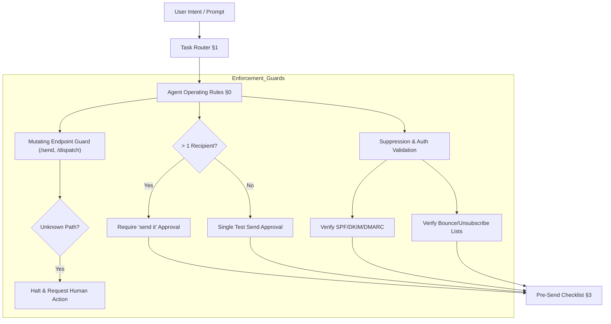
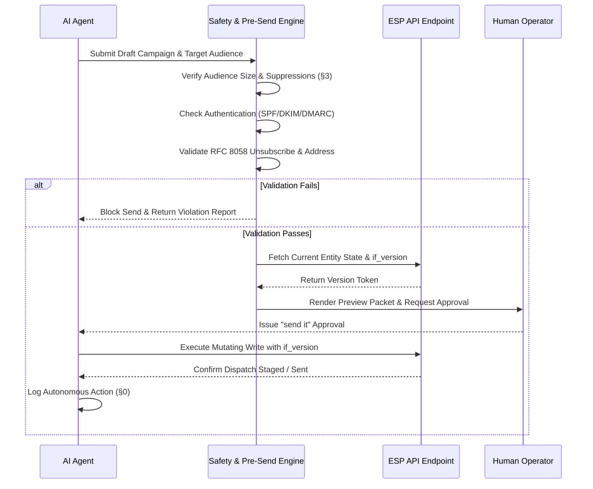

<!-- source: DeepWiki mcp.deepwiki.com · repo CosmoBlk/email-marketing-bible · page 2.1 Safety Gates and Pre-Send Checklist · fetched 2026-10-26 -->

# Safety Gates and Pre-Send Checklist

Relevant source files

The following files were used as context for generating this wiki page:

- [SKILL.md](SKILL.md)
- [skills/email-marketing-bible/SKILL.md](skills/email-marketing-bible/SKILL.md)

## Purpose and Scope

This page covers Section 2.1 of the operating manual, detailing the hard rules (§0) [SKILL.md:26-35] and the Pre-Send Checklist (§3) [SKILL.md:80-92] governing AI agent interactions with live Email Service Provider (ESP) endpoints. Every segment, draft, campaign, flow, or staged send executed via agentic workflows is treated as a live production action. This specification defines the programmatic guardrails, blocked mutating endpoints, draft-by-default execution models, explicit approval gates ("send it"), and automated compliance/authentication validation checks required before any payload reaches an audience.

Sources: [SKILL.md:26-35](), [SKILL.md:80-92]()

---

## 1. Hard Rules and Agent Operating Gates (§0)

The agent operating manual establishes non-negotiable execution boundaries to prevent accidental bulk dispatches or state corruption in production ESP environments [SKILL.md:26-35]. 

* **Human-in-the-Loop Send Approval**: No send or schedule operation targeting more than one recipient may execute without explicit human approval within the current conversational context (e.g., the literal string `"send it"` or equivalent confirmation) [SKILL.md:29]. Single-recipient test sends similarly require explicit authorization [SKILL.md:29].
* **Mandatory Preview Packet**: Prior to requesting approval, agents must render a preview packet containing: preview URLs, computed audience size, applied exclusions and suppressions, subject lines, preview text, scheduled send time, `from-name` and monitored `reply-to` addresses, unsubscribe mechanisms, and an explicit compliance risk assessment [SKILL.md:30].
* **Automatic Send Blocking**: The pre-flight pipeline automatically blocks execution if authentication records are incomplete, unsubscribe links or physical mailing addresses are absent, complaint rates meet or exceed `0.1%`, consent baselines are ambiguous, or the target audience list includes suppressed, bounced, or previously complained contacts [SKILL.md:31].
* **Mutating Endpoint Restrictions**: Agents are strictly prohibited from probing unknown mutating endpoints on live audiences [SKILL.md:32]. Paths matching patterns like `/send`, `/dispatch`, `/trigger`, `/fire`, or `/publish` can execute immediate dispatches [SKILL.md:32]. If the proper scheduled-approval sequence is ambiguous, execution halts and human intervention is required [SKILL.md:32].
* **Channel Mode Separation**: Transactional, marketing, lifecycle, and cold outbound messaging modes operate under distinct compliance rules, sender domains, and consent bases [SKILL.md:33]. Cross-contamination between modes is blocked [SKILL.md:33].
* **Audit Logging**: Every autonomous modification—including segment alterations, flow edits, campaign creations, and staged sends—must be logged for post-action human auditing [SKILL.md:34].

Sources: [SKILL.md:26-35]()

---

## Diagram 1: Agent Operating Rules to Execution Logic

The following diagram bridges natural language operating mandates to their internal enforcement entities and validation checkpoints.

Sources: [SKILL.md:26-35](), [SKILL.md:80-92]()

---

## 2. Mutating Endpoints and Concurrency Safety (§2b)

Operational field notes from live ESP integrations establish specialized constraints for API interactions, preventing silent failures and race conditions [SKILL.md:63-79]:

* **Optimistic Concurrency Control (`if_version`)**: Every write operation must supply an optimistic concurrency version parameter (`if_version`) [SKILL.md:67]. Upon conflict detection, the agent must re-read state and retry with the refreshed version string rather than guessing or overriding [SKILL.md:67].
* **Brand Context Re-Assertion**: MCP (Model Context Protocol) and API contexts can silently reset to default brand profiles during idle periods [SKILL.md:68]. Agents must explicitly re-assert brand and account identifiers prior to executing any write batch [SKILL.md:68].
* **Silent-Parameter API Safeguards**: APIs with implicit parameters frequently default to send-to-all configurations [SKILL.md:69]. Pre-flight validation must explicitly assert audience IDs and calculated counts before invocation [SKILL.md:69]. Probing unknown body keys on live audiences risks mass unconsented dispatch [SKILL.md:69].
* **Draft-by-Default State**: All campaign assets default to draft status [SKILL.md:75]. Only the explicit evaluation of the "send it" approval trigger transitions a payload to dispatch [SKILL.md:75].

Sources: [SKILL.md:63-79]()

---

## Diagram 2: Pre-Flight Validation and Dispatch Data Flow

This diagram illustrates the data flow from an initial draft asset through the safety checks, concurrency versioning, and human approval gates before reaching the ESP dispatch layer.

Sources: [SKILL.md:26-35](), [SKILL.md:63-79](), [SKILL.md:80-92]()

---

## 3. The Pre-Send Checklist Engine (§3)

Before any communication is authorized for deployment, the Pre-Send Checklist mandates verification across nine discrete validation vectors [SKILL.md:80-92]:

| Vector | Validation Rule | Technical Requirement |
| :--- | :--- | :--- |
| **Audience** | Size and segment logic verification [SKILL.md:84] | Compare AI-generated segment counts against actual database records to prevent over-broad targeting [SKILL.md:84]. |
| **Suppressions** | Comprehensive exclusion list check [SKILL.md:85] | Filter out unsubscribed, bounced, complained, globally suppressed, frequency-capped contacts, and those with open support tickets [SKILL.md:85]. |
| **Authentication** | Domain alignment check [SKILL.md:86] | Verify SPF, DKIM, and DMARC alignment with policies set to `p=quarantine` or stricter (noting strict enforcement thresholds like Microsoft Outlook requiring all three at volumes exceeding 5K/day) [SKILL.md:86]. |
| **Compliance** | Header and footer validation [SKILL.md:87] | Confirm presence of RFC 8058 one-click unsubscribe headers and physical mailing address [SKILL.md:87]. |
| **Copy** | Anti-slop and length constraints [SKILL.md:88] | Enforce anti-slop guidelines (§4), restrict CTAs to a single target, cap subject lines at $\le 45$ characters, and verify preview text adds contextual value [SKILL.md:88]. |
| **Design** | Layout and rendering constraints [SKILL.md:89] | Enforce single-column layouts ($\le 600\text{px}$), dark-mode safety, asset alt-text, live-text headlines, explicit text/button styling, image size limits ($<200\text{KB}$ per image, $<800\text{KB}$ aggregate), spam-score evaluation, and animated WebP validation [SKILL.md:89]. |
| **Links** | URL integrity check [SKILL.md:90] | Decode tracking-wrapped CTAs, block placeholder URLs, and ensure Liquid merge tags render safely inside `href` attributes without breaking HTML syntax [SKILL.md:70, SKILL.md:73, SKILL.md:90]. |
| **Sender** | Identity and consent validation [SKILL.md:91] | Verify sender `from-name` and monitored `reply-to` headers, re-assert brand context, set precise delivery timestamps, and validate consent basis for the target audience [SKILL.md:91]. |
| **Non-Email** | Multi-channel compliance [SKILL.md:92] | For US SMS, verify 10DLC brand and campaign registration; for WhatsApp, confirm template approval and category opt-in; enforce local time quiet hours (e.g., SMS restricted to 8:00 AM – 9:00 PM recipient local time) [SKILL.md:92]. |

Sources: [SKILL.md:63-79](), [SKILL.md:80-92]()

---

