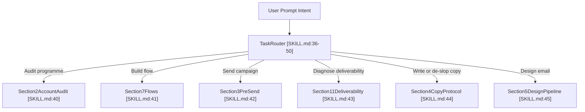
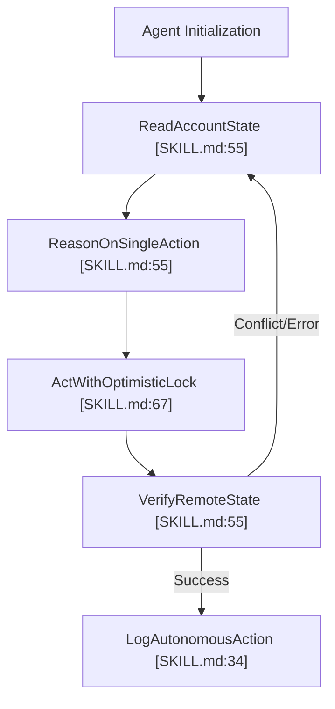

<!-- source: DeepWiki mcp.deepwiki.com · repo CosmoBlk/email-marketing-bible · page 2.2 Task Router and Automation Loop · fetched 2026-10-26 -->

# Task Router and Automation Loop

Relevant source files

The following files were used as context for generating this wiki page:

- [SKILL.md](SKILL.md)
- [skills/email-marketing-bible/SKILL.md](skills/email-marketing-bible/SKILL.md)

## Purpose and Scope
This page details the core orchestration mechanics defined in Part A of the skill reference: the **Task Router** (§1) and the **Read→Reason→Act→Verify Loop** (§2) [SKILL.md:36-62](). It covers how agent prompts are mapped to operational sections, the feedback loops governing autonomous ESP interactions, and the concurrency controls (`if_version`) required to safely mutate live email infrastructure [SKILL.md:63-79]().

---

## 1. Intent-to-Section Routing (`TaskRouter`)

The Task Router acts as the dispatch switchboard for incoming user intents. When an agent ingests a prompt regarding email marketing operations, it matches the natural language intent against a structured routing matrix to determine the target section and required pre-flight data [SKILL.md:36-50]().

### Routing Matrix Architecture

*Figure 1: Bridging Natural Language Space intents to operational section handlers within `SKILL.md`.*

Sources: `[SKILL.md:36-50]()`, `[skills/email-marketing-bible/SKILL.md:36-50]()`

---

## 2. The Read→Reason→Act→Verify Loop

The operating model transitions the marketer from an execution operator to an autonomous director [SKILL.md:51-54](). The execution engine relies on a strict four-stage iterative loop [SKILL.md:55]():

1. **Read State**: Ingest current account baseline (lists, active flows, recent campaign performance, deliverability standing, and existing suppressions) [SKILL.md:55]().
2. **Reason**: Evaluate gaps against benchmark standards and formulate a single isolated action [SKILL.md:55]().
3. **Act**: Execute a targeted change via MCP or API connectors under strict autonomy boundaries [SKILL.md:55]().
4. **Verify**: Confirm the state change settled correctly on the remote ESP before proceeding [SKILL.md:55]().

### Execution Data Flow

*Figure 2: Data flow for the Read→Reason→Act→Verify execution loop.*

Sources: `[SKILL.md:34-55]()`, `[SKILL.md:67]()`, `[skills/email-marketing-bible/SKILL.md:34-55]()`, `[skills/email-marketing-bible/SKILL.md:67]()`

---

## 3. Autonomy Boundaries and Concurrency Control

To prevent silent failures and unintended mass-dispatch events, the operating model enforces strict runtime constraints and concurrency checks [SKILL.md:63-79]().

### Concurrency and State Management

- **Optimistic Concurrency (`if_version`)**: Every write operation must pass the current record version (`if_version`). On version conflicts, the agent must re-read remote state and retry rather than guessing or forcing writes [SKILL.md:67]().
- **Context Re-Assertion**: Because MCP context can silently reset to default brands after idle periods, the agent must explicitly re-assert brand and account IDs prior to every write batch [SKILL.md:68]().
- **Pre-Flight Payload Assertion**: Silent-parameter APIs frequently default to "send-to-all" if audience parameters are omitted. The agent must pre-flight assert audience ID and exact recipient counts before probing any mutating endpoint [SKILL.md:69]().
- **Draft-by-Default**: All campaigns, flows, and staged sends default to draft status. Only an explicit user prompt containing `"send it"` (or equivalent) in the conversation stream triggers a live blast [SKILL.md:75]().

Sources: `[SKILL.md:63-79]()`, `[skills/email-marketing-bible/SKILL.md:63-79]()`

---

