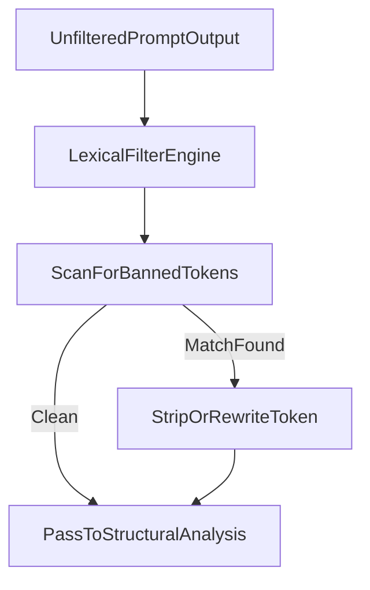
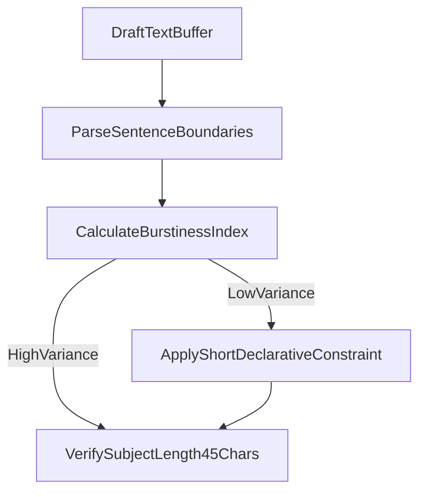
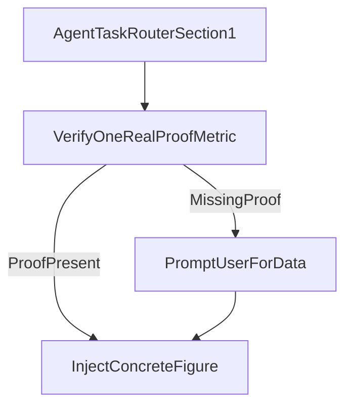
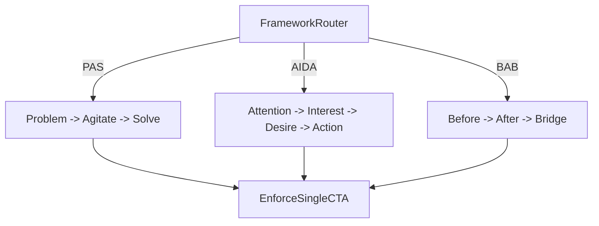

<!-- source: DeepWiki mcp.deepwiki.com · repo CosmoBlk/email-marketing-bible · page 2.3 Anti-Slop Copy Protocol · fetched 2026-10-26 -->

# Anti-Slop Copy Protocol

Relevant source files

The following files were used as context for generating this wiki page:

- [README.md](README.md)
- [SKILL.md](SKILL.md)

## Purpose and Scope

The Anti-Slop Copy Protocol is an operational constraint layer defined within the `email-marketing-bible` agent skill package (`[SKILL.md:44-44]()`, `[README.md:29-29]()`). Its primary purpose is to intercept raw generative model output during email copy drafting and systematically eliminate common AI stylistic markers ("slop"), enforce structural burstiness, mandate empirical proof metrics, and apply conversion-focused copywriting frameworks (PAS, AIDA, BAB) before any email draft is staged or presented for human review (`[README.md:80-80]()`). 

Sources: `[SKILL.md:44-44]`, `[README.md:29-29]`, `[README.md:80-80]()`

---

## Forbidden Phrasing and Lexical Filtering

The protocol acts as a strict lexical filter. Large language models naturally favor predictable, highly probable token sequences that human readers instantly identify as machine-generated. The anti-slop rules block specific categories of words and transitional fluff.

### Banned Lexical Categories
* **AI Transitional Adverbs**: Words like "furthermore", "moreover", "consequently", "delve", "tapestry", "beacon", "revolutionize", and "unlock".
* **Hype Superlatives**: Unsubstantiated claims such as "game-changing", "seamless", "cutting-edge", "unprecedented", and "revolutionary".
* **Meta-Commentary**: Conversational padding like "In today's fast-paced digital world", "As we navigate", or "Look no further".

The agent must evaluate drafts against these lexical constraints prior to passing the pre-send validation check (`[SKILL.md:88-88]()`).

Sources: `[SKILL.md:88-88]`, `[README.md:29-29]()`

---

## Burstiness and Perplexity Control

Standard AI text exhibits low perplexity—sentences tend to be uniform in length and predictable in syntactic structure. The Anti-Slop Protocol enforces structural variance (burstiness) by mandating a deliberate mix of ultra-short declaratives, compound statements, and fragmented rhythms.

### Structural Rules
* **Sentence Length Distribution**: Every paragraph must alternate between a short punchy sentence (under 6 words) and a longer explanatory sentence.
* **Rhythmic Interruption**: Passive voice constructions are systematically refactored into active, agent-driven phrasing.
* **Subject-Line Constraints**: Subject lines must remain strictly under 45 characters, with preview text acting as a complementary information expander rather than a redundant echo (`[SKILL.md:88-88]`).

Sources: `[SKILL.md:88-88]`, `[README.md:80-80]()`

---

## Proof Metrics and Empirical Grounding

AI-generated copy relies heavily on generic assertions ("Many users save time"). The Anti-Slop Protocol substitutes these claims with concrete, falsifiable metrics and empirical grounding.

### Grounding Rules
* **Mandatory Data Points**: Every promotional or lifecycle email draft must incorporate at least one verifiable proof metric (e.g., specific percentages, dollar figures, exact timelines, or named case studies).
* **Source Attribution**: Claims regarding conversion rates, retention, or speed must trace back to verified benchmarks or first-party data structures.
* **Zero-Assumption Policy**: If an agent prompt lacks a real proof point, the agent must halt generation and request the missing data point from the user before finalizing the copy.

Sources: `[SKILL.md:36-50]`, `[README.md:29-29]()`

---

## Copywriting Frameworks: PAS, AIDA, and BAB

When constructing email flows (welcome series, abandoned cart, win-back), the agent maps the core offer to proven copywriting frameworks referenced in the skill architecture (`[README.md:29-29]()`).

### Framework Definitions
* **PAS (Problem, Agitate, Solve)**: Identifies a precise customer pain point, amplifies the frustration of living with that pain, and introduces the product/service as the definitive resolution.
* **AIDA (Attention, Interest, Desire, Action)**: Captures immediate notice via a subject-line hook, builds deep engagement through relevant mechanics, creates emotional or financial longing, and concludes with a single frictionless Call to Action (CTA) (`[SKILL.md:88-88]()`).
* **BAB (Before, After, Bridge)**: Paints the picture of the user's current undesirable state ("Before"), contrasts it with an ideal future state ("After"), and positions the offer as the mechanism ("Bridge") to cross between them.

Sources: `[SKILL.md:88-88]`, `[README.md:29-29]()`

---

