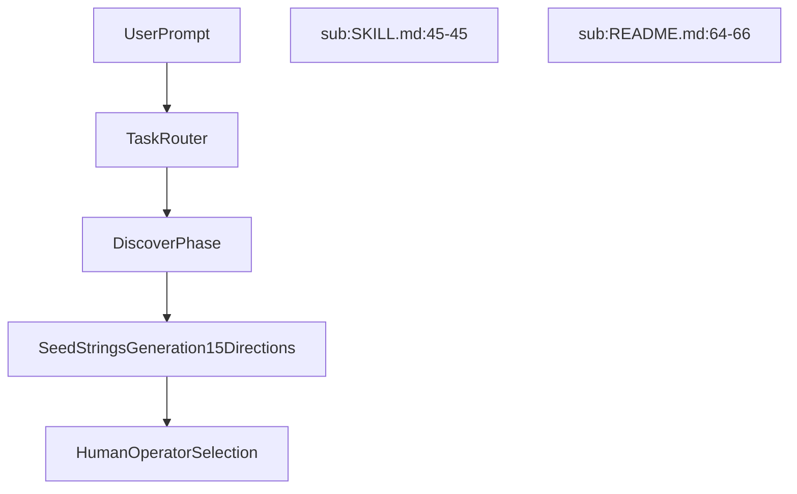
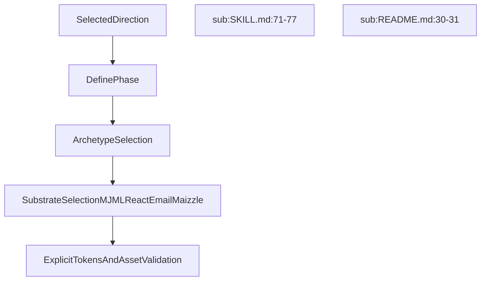
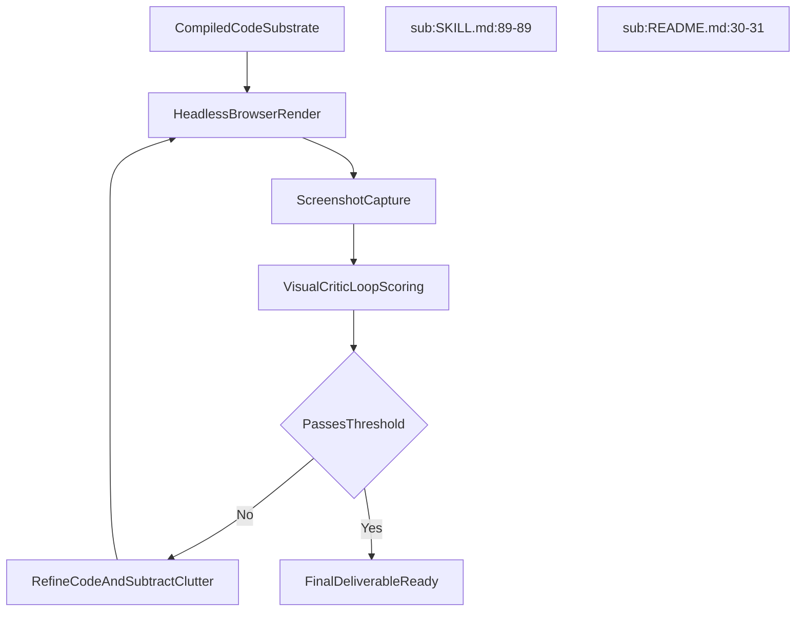
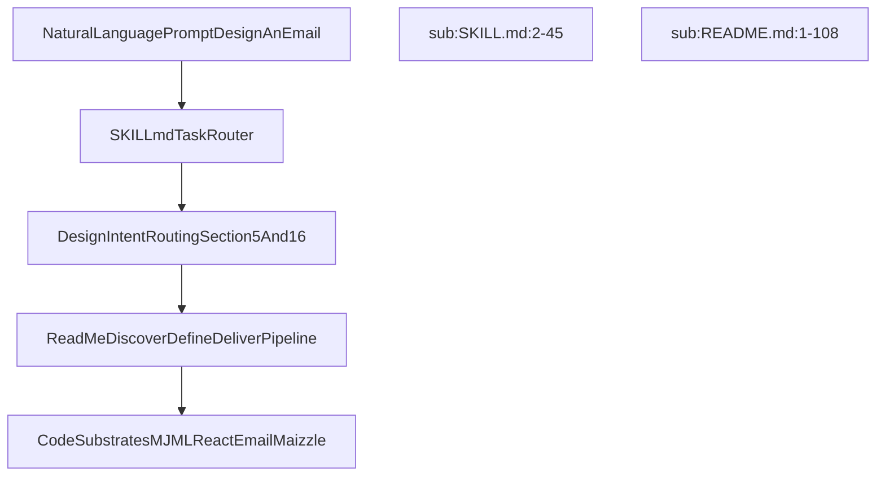

<!-- source: DeepWiki mcp.deepwiki.com · repo CosmoBlk/email-marketing-bible · page 2.4 Email Design Pipeline (Discover-Define-Deliver) · fetched 2026-10-26 -->

# Email Design Pipeline (Discover-Define-Deliver)

Relevant source files

The following files were used as context for generating this wiki page:

- [README.md](README.md)
- [SKILL.md](SKILL.md)

This leaf page details Section 2.4 of the `email-marketing-bible` operating manual, establishing the structured AI email design pipeline adapted from Anshu Chimala's product design methodology [README.md:108-108](). The pipeline enforces a rigorous three-phase workflow—Discover, Define, Deliver—governed by seed strings for creative divergence, strict layout archetypes, inbox-safe code substrates (MJML, React Email, Maizzle), and an automated screenshot critic loop to eliminate generic AI visual slop.

---

## 1. The Discover Phase: Seed Strings and Divergence

When tasked with generating a campaign or flow design, the agent is restricted from immediately outputting a static template or single rendering. Instead, it must initiate the **Discover** phase by generating a divergent set of seed strings and conceptual directions [README.md:64-66]().

- **Divergent Ideation**: The agent produces 15 distinct stylistic and thematic directions based on brand tokens, target audience, and campaign goals [README.md:64-66]() (`Task Router | Design an email | §5 + §16 | brand tokens, archetype, goal` [SKILL.md:45-45]()).
- **Human-in-the-Loop Selection**: The human operator reviews the divergent seed strings and selects a preferred direction before any layout code is compiled [README.md:64-66]().
- **Anti-Default Guardrails**: Prevents models from falling back on repetitive default layouts, generic stock graphics, or unconstrained generative image artifacts.

**Sources:** [SKILL.md:45-45](), [README.md:64-66]()

---

## 2. The Define Phase: Archetypes and Code Substrates

Once a direction is locked, the agent transitions to the **Define** phase. This phase maps the selected concept onto established email archetypes and selects the appropriate production substrate [README.md:30-31]().

### Substrates
The codebase supports three primary production-grade email code substrates:
1. **MJML**: Semantic XML-based markup language compiled into responsive, multi-client safe HTML tables.
2. **React Email**: Component-driven architecture allowing modular, type-safe email templates using React primitives.
3. **Maizzle**: Tailwind CSS-powered framework designed for advanced utility-first email styling.

### Design and Code Rules
- **Explicit Styling**: Set text and button colors explicitly on every design element to prevent theme default drifts (such as grey headlines or dark text on coloured buttons) [SKILL.md:72-72]().
- **Hero & CTA Constraints**: Every email must adhere to structural simplicity—featuring a single hero unit, a live-text headline, and exactly one primary button [SKILL.md:76-76](). Secondary content must rely strictly on inline links [SKILL.md:76-76]().
- **Asset Handling**: Animated WebP formats are prioritized over standard GIFs for hero animations, with mandatory post-render verification to ensure CDNs do not flatten them to frame one [SKILL.md:71-71](). Quote tiles must be rendered from clean HTML via headless Chrome rather than raw image generation models to prevent garbled type [SKILL.md:77-77]().

**Sources:** [SKILL.md:71-77](), [README.md:30-31]()

---

## 3. The Deliver Phase: Screenshot Critic Loop and Subtraction

The final phase, **Deliver**, relies on an iterative validation loop where the generated code is rendered, captured via headless browser automation, and critically evaluated against quality benchmarks [README.md:30-31]().

- **Headless Render**: The chosen substrate (MJML/React/Maizzle) is compiled and rendered in a virtual DOM / headless browser environment.
- **Screenshot Capture & Scoring**: An automated critic loop captures visual snapshots across multiple viewport widths and client engines, scoring elements against readability, dark-mode safety, and weight constraints (images under 200KB each, total weight under 800KB) [SKILL.md:89-89]().
- **Delivery by Subtraction**: If visual clutter or layout violations are detected, the critic loop enforces subtraction—removing redundant margins, secondary buttons, or decorative elements until only high-impact conversion paths remain.

**Sources:** [SKILL.md:89-89](), [README.md:30-31]()

---

## 4. System Integration: Natural Language Space to Code Entity Space

To bridge high-level human instructions with concrete code execution, the email design pipeline maps natural language inputs directly to specific routing targets and execution files within the repository structure.

**Sources:** [SKILL.md:2-45](), [README.md:1-108]()

---

