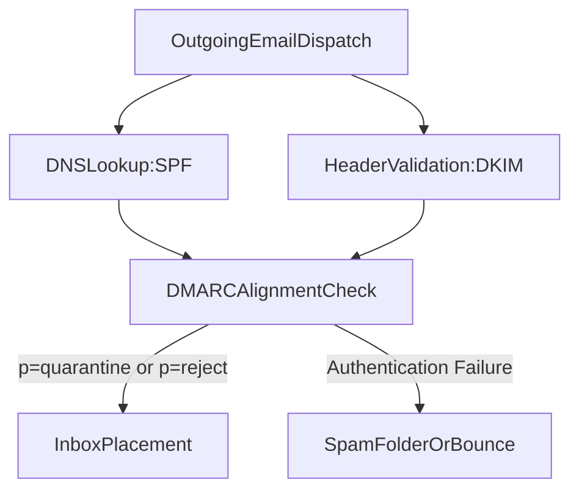
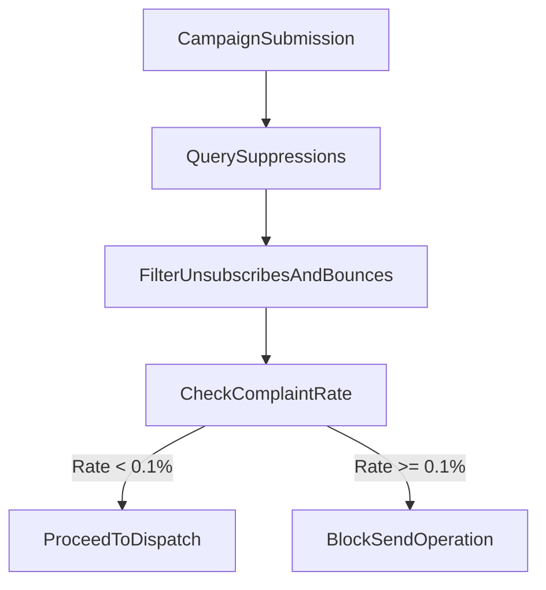
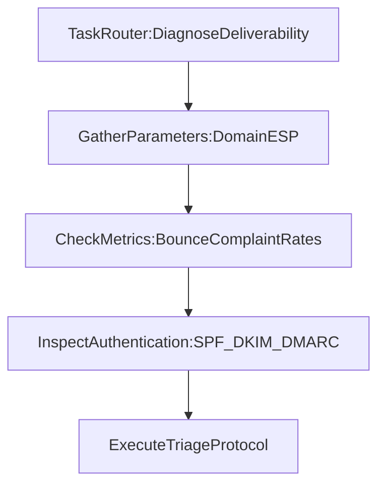
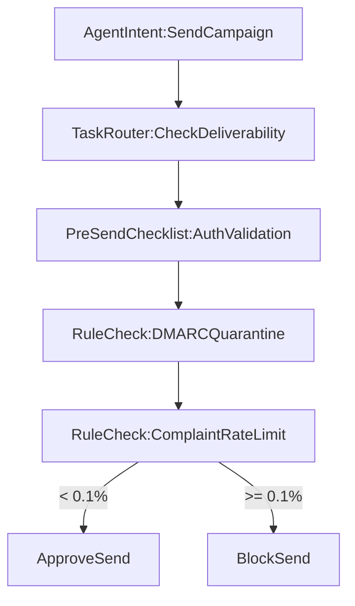

<!-- source: DeepWiki mcp.deepwiki.com · repo CosmoBlk/email-marketing-bible · page 3.2 Deliverability and Authentication · fetched 2026-10-26 -->

# Deliverability and Authentication

Relevant source files

The following files were used as context for generating this wiki page:

- [SKILL.md](SKILL.md)
- [skills/email-marketing-bible/SKILL.md](skills/email-marketing-bible/SKILL.md)

## Purpose and Scope
This page establishes the technical baseline and operational procedures for email deliverability, cryptographic domain authentication (SPF, DKIM, DMARC, BIMI), metric threshold monitoring, Mail Privacy Protection (MPP) handling, and diagnostic triage within the `email-marketing-bible` agent package. Ensuring strict adherence to these parameters prevents domain reputation degradation, inbox placement filtering, and automated blocklisting.

Sources: [SKILL.md:1-20]()

---

## Domain Authentication Protocols

Cryptographic sender verification is mandatory for all production dispatches. Major mailbox providers (such as Google, Microsoft, and Yahoo) enforce strict alignment standards.

*   **Sender Policy Framework (SPF):** Publishes authorized sending IPs and servers via DNS TXT records. Prevents basic envelope-from address spoofing.
*   **DomainKeys Identified Mail (DKIM):** Cryptographically signs headers and body content with a private key, validated via public keys published in DNS selectors (`selector._domainkey.domain.com`).
*   **Domain-based Message Authentication, Reporting, and Conformance (DMARC):** Ties SPF and DKIM to the visible `From:` header via organizational domain alignment. Production environments must enforce policies of `p=quarantine` or `p=reject`. Mailbox providers like Outlook require strict SPF, DKIM, and DMARC alignment for volumes exceeding 5,000 emails per day [SKILL.md:86]().
*   **Brand Indicators for Message Identification (BIMI):** Requires a verified mark certificate (VMC) and an SVG Tiny P/S compliant logo file published via DNS (`default._bimi.domain.com`) to render brand logos in supported enterprise inboxes.

Sources: [SKILL.md:80-92]()

Sources: [SKILL.md:80-92]()

---

## Complaint and Bounce Thresholds

Maintaining clean lists and rapid suppression handling is critical for maintaining sender reputation scores.

*   **Complaint Rate Threshold:** The hard limit for spam complaints is **0.1%**. If the complaint rate reaches or exceeds 0.1%, the agentic system or human operator must immediately block the send [SKILL.md:31]().
*   **Bounce Management:** Hard bounces (invalid addresses, non-existent domains) must be suppressed instantly on first occurrence. Soft bounces (temporary mailbox full, server down) are monitored across successive campaign cycles before transition to permanent suppression.
*   **Suppression Hygiene:** Audiences must be scrubbed against known unsubscribed, bounced, complained, and globally suppressed contacts prior to every execution batch [SKILL.md:85]().

Sources: [SKILL.md:28-35](), [SKILL.md:80-92]()

Sources: [SKILL.md:28-35](), [SKILL.md:80-92]()

---

## Mail Privacy Protection (MPP) Handling

Apple's Mail Privacy Protection prefetches remote content—including tracking pixels—via proxy servers, resulting in pre-fetched open signals that distort traditional engagement metrics.

*   **Signal Distortion:** Open rates lose reliability as an engagement metric for Apple Mail users.
*   **Triage Strategy:** Shift reliance from open-rate-based segmentation and trigger flows to deterministic intent signals:
    *   Click-through rates (CTR).
    *   Transactional events (purchases, API actions).
    *   Form submissions and direct replies.

Sources: [SKILL.md:1-20]()

---

## Deliverability Diagnostic Triage Procedures

When deliverability degrades, agents and operators must execute structured diagnostic routines as defined in the task router framework (`§1` and `§11`) [SKILL.md:43]().

### Triage Execution Steps
1.  **Gather Context:** Pull recent campaign metrics, bounce category breakdowns, complaint volume, and recent domain or infrastructure changes [SKILL.md:43]().
2.  **Verify DNS Records:** Confirm active propagation of SPF, DKIM CNAME/TXT entries, and DMARC reporting policies (`ruf`/`rua`).
3.  **Inspect Engagement Patterns:** Identify dormant segments, unverified consent bases, or sudden spikes in volume without ramp-up.
4.  **Isolate Mutating Endpoints:** Ensure testing does not invoke unauthorized dispatch endpoints (`/send`, `/dispatch`, `/trigger`, `/fire`, `/publish`) on live production lists [SKILL.md:32]().

Sources: [SKILL.md:28-49]()

Sources: [SKILL.md:28-49]()

---

## Pre-Flight Authentication & Deliverability Gate

Before any campaign batch is cleared for human approval (`"send it"`), the system evaluates programmatic gates [SKILL.md:29-31]().

Sources: [SKILL.md:28-35](), [SKILL.md:80-92]()

---

