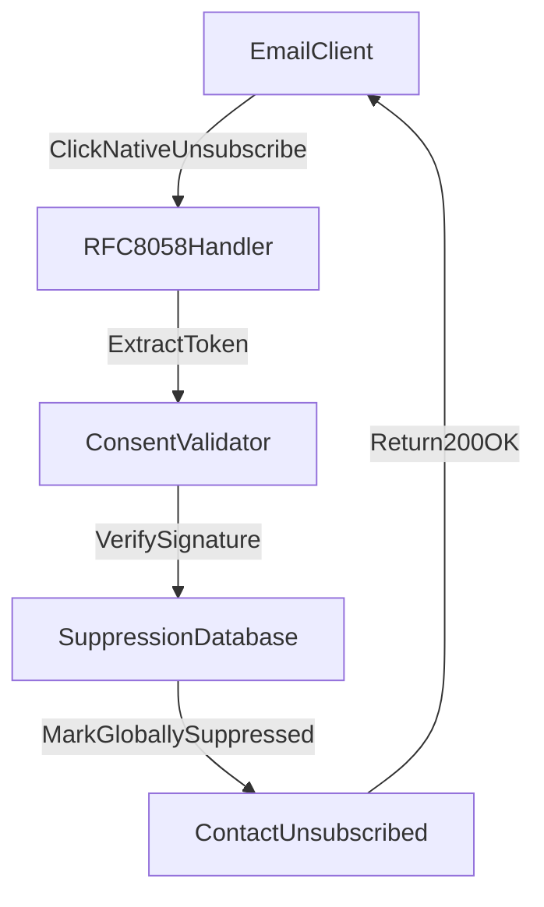
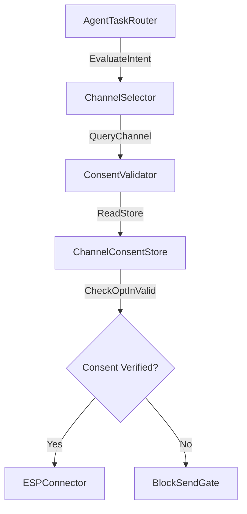

<!-- source: DeepWiki mcp.deepwiki.com · repo CosmoBlk/email-marketing-bible · page 3.3 Compliance and Consent · fetched 2026-10-26 -->

# Compliance and Consent

Relevant source files

The following files were used as context for generating this wiki page:

- [SKILL.md](SKILL.md)

## Purpose and Scope
This page defines the regulatory, technical, and architectural requirements for managing consent, legal compliance, and suppression handling within the `email-marketing-bible` agent package. It covers major global legislative frameworks (CAN-SPAM, GDPR, CASL, Spam Act, CCPA), the technical implementation of RFC 8058 one-click unsubscribe, and per-channel consent boundaries for email, SMS, WhatsApp, and RCS. Compliance rules operate as hard safety gates inside agent workflows `[SKILL.md:28-35]()`, `[SKILL.md:80-92]()`.

---

## 1. Global Regulatory Frameworks Matrix

Different jurisdictions enforce strict penalties for unsolicited commercial messaging, non-transparent data collection, and failure to honor opt-outs. The agent operating manual codifies these into mandatory pre-send checks `[SKILL.md:28-35]()`, `[SKILL.md:80-92]()`.

| Regulation | Jurisdiction | Opt-in Model | Unsubscribe Requirement | Penalties / Enforcement |
| :--- | :--- | :--- | :--- | :--- |
| **CAN-SPAM** | United States | Opt-out (Negative) | Must process within 10 business days; clear opt-in/opt-out mechanism. | Up to $51,744+ per violation (FTC). |
| **GDPR** | European Union | Opt-in (Explicit, Freely given) | Immediate, frictionless revocation; right to be forgotten. | Up to €20M or 4% of global annual turnover. |
| **CASL** | Canada | Express Opt-in (No pre-checked boxes) | Unsubscribe effective immediately (max 10 days, practical limit is instant). | Up to $10M CAD (CRTC). |
| **Spam Act** | Australia | Opt-in (Expressed or Inferred) | Must be functional for at least 30 days; processed within 5 business days. | Civil penalties up to $2.2M+ AUD (ACMA). |
| **CCPA / CPRA** | California, USA | Opt-out / Right to restrict | Clear "Do Not Sell/Share My Info" link; honor global privacy control signals. | Statutory damages up to $7,500 per intentional violation. |

### Sources
- `[SKILL.md:28-35]()`
- `[SKILL.md:80-92]()`

---

## 2. RFC 8058 One-Click Unsubscribe Architecture

RFC 8058 standardizes one-click unsubscribe functionality for email by requiring two specific headers (`List-Unsubscribe` and `List-Unsubscribe-Post`) that allow mailbox providers (such as Gmail and Yahoo) to render a native "Unsubscribe" button in the UI. When triggered, the provider issues an HTTP POST request rather than a GET request, preventing pre-fetching bots from accidentally unsubscribing users.

### Natural Language to Code Entity Mapping: RFC 8058 Request Flow

### Technical Requirements for RFC 8058 Compliance
- **Headers**: Every outgoing marketing email must include:
  - `List-Unsubscribe: <https://example.com/unsubscribe?token=xyz>, <mailto:unsub@example.com?subject=unsubscribe>`
  - `List-Unsubscribe-Post: List-Unsubscribe=One-Click`
- **Execution Endpoint (`RFC8058Handler`)**: Must accept incoming POST requests without requiring active session cookies or interactive form submissions.
- **Processing Window**: Must update the `SuppressionDatabase` and return an HTTP `200 OK` status code within standard gateway timeout limits (under 3 seconds).

### Sources
- `[SKILL.md:80-92]()`

---

## 3. Per-Channel Consent Rules and Data Architecture

Different communication channels operate under distinct legal and operational consent constraints. Agents must never mix transmission channels or assume consent carries over from email to messaging networks `[SKILL.md:33-33]()`, `[SKILL.md:92-92]`.

### Natural Language to Code Entity Mapping: Multi-Channel Consent Verification

### Channel Specifics
- **Email**: Requires explicit or implied consent depending on jurisdiction (GDPR vs. CAN-SPAM). Must honor global suppressions.
- **SMS / 10DLC (US)**: Requires prior express written consent (TCPA compliant). Brand and campaign registration are mandatory before dispatch `[SKILL.md:92-92]()`. Quiet hours must be enforced based on the recipient's local time (typically 8:00 AM to 9:00 PM) `[SKILL.md:92-92]()`.
- **WhatsApp**: Requires strict opt-in category selection. Outbound messages outside of a 24-hour customer service window must use pre-approved templates (`[SKILL.md:92-92]()`).
- **RCS**: Subject to the same rigorous compliance frameworks as SMS, incorporating rich media verification and carrier-level vetting.

### Sources
- `[SKILL.md:33-33]()`
- `[SKILL.md:92-92]()`

---

## 4. Pre-Send Compliance Gates and Enforcement Mechanisms

The agent operating manual mandates hard safety gates before any campaign or automated flow can trigger live delivery `[SKILL.md:28-35]()`. If any compliance condition fails, the execution pipeline triggers a hard block.

### Pre-Send Evaluation Logic
1. **Suppression Filtering**: Check audience lists against bounced, complained, unsubscribed, and globally suppressed records (`[SKILL.md:85-85]()`).
2. **Authentication Validation**: Ensure SPF, DKIM, and DMARC alignment (`p=quarantine` or `p=reject`) before sending volumes exceeding threshold limits (e.g., 5,000+ daily for Outlook) (`[SKILL.md:86-86]()`).
3. **Mandatory Elements Check**: Verify the physical postal address and RFC 8058 one-click headers are present in the HTML and text payloads (`[SKILL.md:87-87]()`).
4. **Complaint Rate Threshold**: Automatically block sends if the historical complaint rate of the sending domain or segment is $\ge 0.1\%$ (`[SKILL.md:31-31]()`).

### Sources
- `[SKILL.md:28-35]()`
- `[SKILL.md:80-92]()`

---

