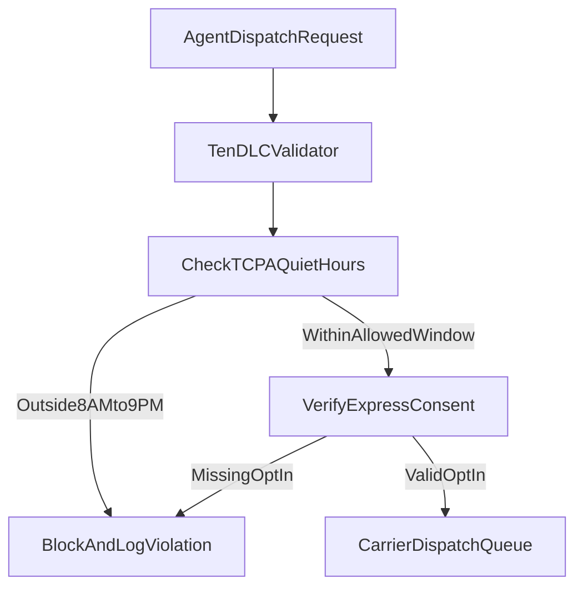
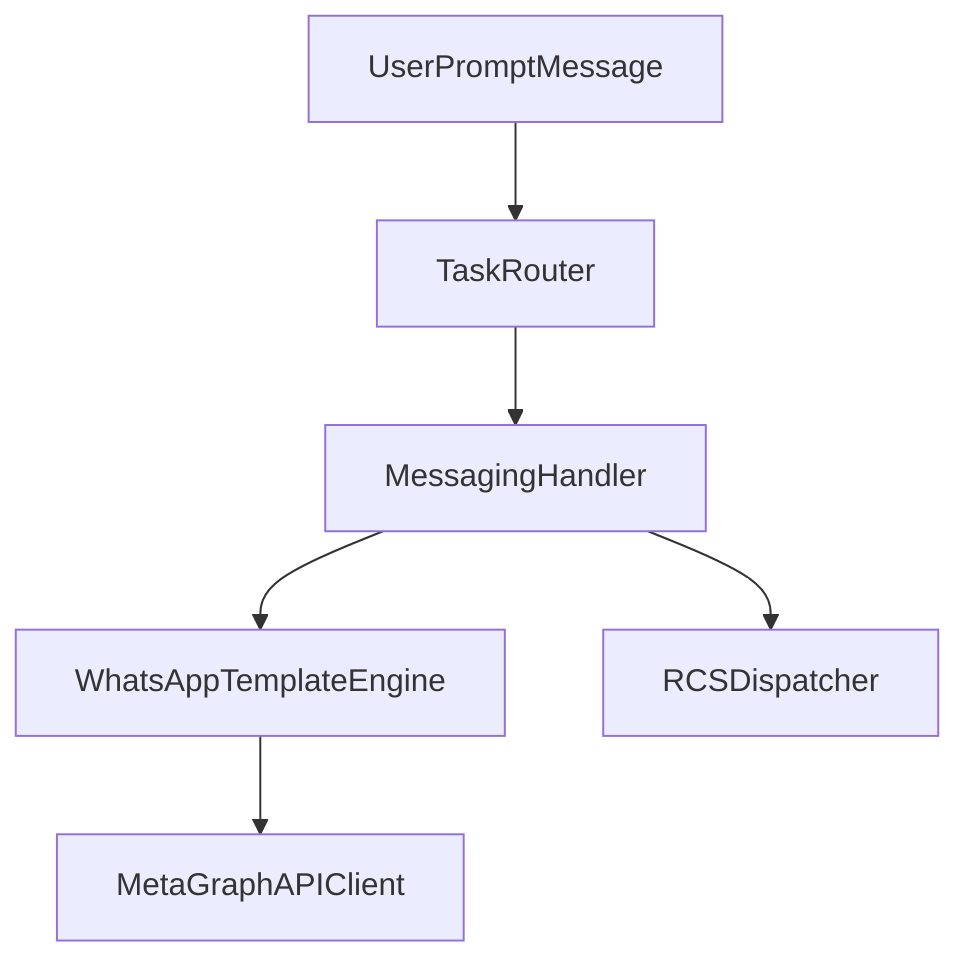

<!-- source: DeepWiki mcp.deepwiki.com · repo CosmoBlk/email-marketing-bible · page 3.4 Multichannel Messaging and Cold Outbound · fetched 2026-10-26 -->

# Multichannel Messaging and Cold Outbound

Relevant source files

The following files were used as context for generating this wiki page:

- [SKILL.md](SKILL.md)
- [skills/email-marketing-bible/SKILL.md](skills/email-marketing-bible/SKILL.md)

## Purpose and Scope
This page covers the technical architecture and compliance rules for multichannel messaging (WhatsApp, SMS, 10DLC, RCS) and cold outbound campaigns governed by the agent skill package. Because non-email channels and cold outbound operate under entirely different legal frameworks (such as TCPA, carrier registration, and separate domain reputation models), agents must strictly isolate these modalities from standard marketing and transactional email streams `[SKILL.md:33-33]()`.

Sources: `[SKILL.md:33-33]()`

---

## SMS / 10DLC and TCPA Compliance
Carrier networks (via The Campaign Registry - TCR) require strict brand and campaign registration for 10-Digit Long Code (10DLC) messaging in the United States. Unregistered traffic faces heavy carrier filtering or outright blocking.

### Key Rules and Implementation Parameters
- **Brand and Campaign Registration:** All business SMS traffic must map to a verified 10DLC brand profile and an approved use-case campaign (e.g., marketing, conversational, or transactional alerts) `[SKILL.md:92-92]()`.
- **TCPA Quiet Hours:** Automated messaging must respect local recipient time zones. The standard operational window is strictly **8:00 AM to 9:00 PM local time** `[SKILL.md:92-92]()`. Dispatches outside these hours violate federal telemarketing laws and trigger carrier penalties.
- **Consent Basis:** Express written consent is mandatory for marketing SMS. Opt-out mechanisms (such as keyword triggers like STOP) must be honored instantly across all sending nodes.

*Diagram 1: Natural Language Space to Code Entity Space — SMS Compliance Pipeline routing dispatches through `TenDLCValidator` and `CheckTCPAQuietHours`.*

Sources: `[SKILL.md:92-92](), [SKILL.md:33-33]()`

---

## WhatsApp and RCS Business Messaging
Rich communication channels require pre-approved templates and explicit category opt-ins before an agent can initiate or respond to a conversation.

### Channel Operational Mechanics
- **WhatsApp Template Categories:** Messages sent outside the 24-hour customer service window must use Meta-approved templates restricted to specific categories: utility, marketing, or authentication. Agents must never modify template bodies dynamically beyond approved variable parameters.
- **RCS Business Messaging:** Rich Communication Services (RCS) provide native application-like interfaces within default mobile messaging clients, requiring brand agent verification and verified sender IDs.
- **Opt-In Requirements:** Just as with SMS, channel-specific consent must be captured cleanly. Mixing email consent bases with WhatsApp or RCS opt-ins is a compliance failure.

*Diagram 2: Natural Language Space to Code Entity Space — Routing multichannel messaging requests through `TaskRouter` to `MessagingHandler` and channel-specific clients like `MetaGraphAPIClient`.*

Sources: `[SKILL.md:48-49](), [SKILL.md:92-92]()`

---

## Cold Outbound Infrastructure and ICP Setup
Cold email outbound operates under separate domains, distinct IP pools, and specialized data hygiene rules to protect the core corporate sending reputation.

### Infrastructure & Execution Parameters
- **Domain Isolation:** Never run cold outbound campaigns on primary brand domains (`brand.com`). Provision dedicated, warmed-up secondary domains (e.g., `trybrand.com` or `getbrand.com`) with independent SPF, DKIM, and DMARC alignments.
- **Ideal Customer Profile (ICP) Data Hygiene:** Agent-driven list building must verify contact accuracy and strict relevance before staging any outreach. Bounced emails and spam complaints on cold domains rapidly degrade mailbox placement.
- **Volume Scaling:** Automated ramp-up schedules (warmup) must precede any high-volume cold sequencing. Agents must maintain strict daily limits per mailbox to mimic human sending patterns.

Sources: `[SKILL.md:48-48](), [SKILL.md:33-33]()`

---

