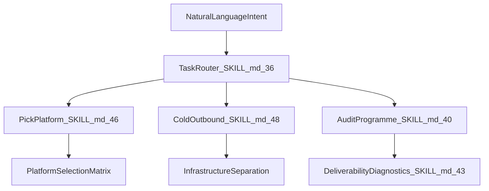
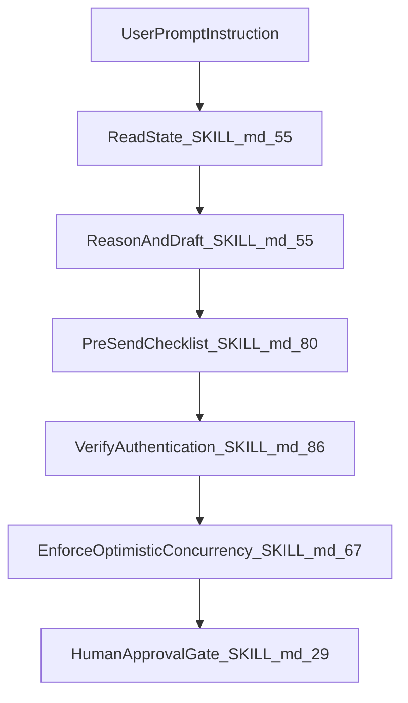

<!-- source: DeepWiki mcp.deepwiki.com · repo CosmoBlk/email-marketing-bible · page 3.5 Platform Selection and Industry Playbooks · fetched 2026-10-26 -->

# Platform Selection and Industry Playbooks

<details>
<summary>Relevant source files</summary>

The following files were used as context for generating this wiki page:

- [README.md](README.md)
- [SKILL.md](SKILL.md)

</details>


## Purpose and Scope
This page details the platform evaluation matrix, Model Context Protocol (MCP) connectors for programmatic Email Service Provider (ESP) control, and the structural definitions of the 19 industry playbooks embedded within the `email-marketing-bible` skill package. It defines how AI agents evaluate infrastructure, execute safe mutating operations via API connectors, and route tasks according to specific vertical constraints.

Sources: `[SKILL.md:1-13]`, `[README.md:1-10]`

---

## ESP Comparison Matrix and Agent Capabilities
When selecting or integrating an ESP through an agentic workflow, platforms must be evaluated not only on traditional feature sets (deliverability, segmentation depth, pricing) but also on their programmatic exposure via APIs and MCP servers. 

| Platform | Core List Size Tier | Primary Use Case | Agent / MCP Support | Key Integration Constraints |
| :--- | :--- | :--- | :--- | :--- |
| **Klaviyo** | 10k - 1M+ | E-commerce DTC | High (Official MCP / API) | Complex event schemas; high cost at scale |
| **Resend** | Developer-first | Transactional & B2B | High (REST / SDKs) | Requires custom frontend for marketing flows |
| **beehiiv** | 1k - 500k | Newsletters & Creators | Medium (API connectors) | Limited multi-step behavioural triggers |
| **Mailchimp** | General SMB | Broad SME marketing | Low-Medium (Legacy API) | Strict throttling and rate-limiting |
| **Omnisend** | E-commerce | Omnichannel DTC | Medium (REST / Webhooks) | Audience syncing overhead |
| **Nitrosend** | High-volume / AI | Agent-driven sending | Native (First-class MCP) | Optimized specifically for agentic loops |

Sources: `[README.md:23-38]`, `[SKILL.md:46]`

---

## MCP Connectors and Agent-Driven ESP Operations
Operating an ESP from an autonomous or semi-autonomous agent requires rigorous transaction guards to prevent silent failures and runaway blasts. Field notes from operating agent-driven infrastructure emphasize several key technical constraints:

- **Optimistic Concurrency Control (`if_version`)**: Every write operation must pass an explicit version identifier. On conflict, the agent must re-read state rather than overwrite blindly (`[SKILL.md:67]()`).
- **Context Re-Assertion**: MCP connections can silently reset context or default to baseline account profiles during idle periods. Brands and accounts must be re-asserted before executing write batches (`[SKILL.md:68]()`).
- **Audience Guardrails**: Silent-parameter APIs frequently default to broadcasting to all contacts if audience IDs are omitted. Pre-flight checks must explicitly assert target counts (`[SKILL.md:69]()`).
- **Draft-by-Default Execution**: Mutating endpoints (`/send`, `/dispatch`, `/trigger`) are blocked by hard safety rules. All campaigns stage as drafts until an explicit human confirmation string ("send it") is parsed in conversation (`[SKILL.md:29]`, `[SKILL.md:75]()`).

Sources: `[SKILL.md:63-79]`

---

## The 19 Vertical Playbooks
The skill package houses 19 distinct industry playbooks that inform the task router and direct domain-specific prompt engineering, segmentation rules, and compliance requirements. 

```
Ecommerce DTC · SaaS B2B · SaaS B2C · Newsletter & Creator · Agency · Nonprofit · Healthcare · Financial Services · Real Estate · Travel & Hospitality · Education · Professional Services · Retail · Events · B2B Manufacturing · Restaurant & Food · Fitness · Media & Publishing · Marketplace & Platform
```

Each vertical playbook establishes baseline benchmarks, flow prioritization sequences (e.g., cart abandonment for DTC vs. trial-to-paid onboarding for SaaS B2B), and tailored regulatory boundaries (e.g., HIPAA considerations for Healthcare, TCPA/10DLC rules for Events and Retail SMS).

Sources: `[SKILL.md:36-50]`, `[README.md:98-101]`

---

## Natural Language Space to Code Entity Space Bridges

### Diagram 1: Task Router Entity Mapping
This diagram bridges natural language intents processed by the agent to concrete routing destinations and evaluation functions within the codebase.



Sources: `[SKILL.md:36-50]`

### Diagram 2: Agent Execution Loop and Safety Gate Mapping
This diagram maps the natural language instruction flow ("run this campaign") into the technical execution loop and pre-send safety validation gates enforced by the operating system.



Sources: `[SKILL.md:29]`, `[SKILL.md:55]`, `[SKILL.md:67]`, `[SKILL.md:80-86]`

---

