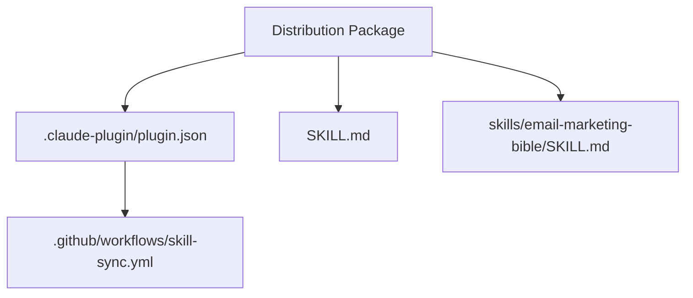
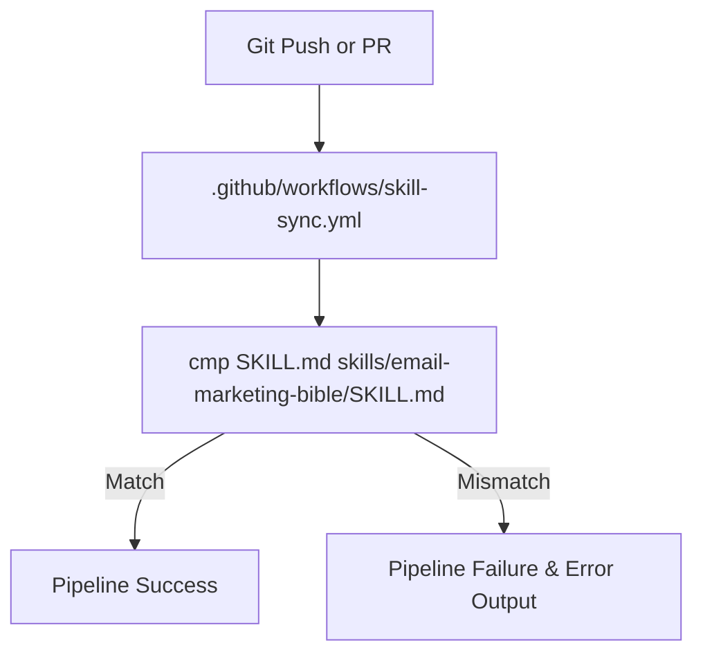

<!-- source: DeepWiki mcp.deepwiki.com · repo CosmoBlk/email-marketing-bible · page 4 Packaging and Maintenance · fetched 2026-10-26 -->

# Packaging and Maintenance

Relevant source files

The following files were used as context for generating this wiki page:

- [.claude-plugin/plugin.json](.claude-plugin/plugin.json)
- [.github/workflows/skill-sync.yml](.github/workflows/skill-sync.yml)

## Purpose and Scope
This page provides an overview of the packaging, distribution mechanics, and repository hygiene practices used in the `email-marketing-bible` codebase. It outlines how the agent skill is packaged for distribution, how consistency is maintained across duplicate instruction files via continuous integration, and how repository boundaries and licensing are enforced.

For deep technical dives into individual components, refer to the child pages linked below:
- [Plugin Manifest and Assets](#4.1) — Plugin metadata, versioning, and asset references in `.claude-plugin/plugin.json`.
- [CI: SKILL.md Sync Check](#4.2) — The GitHub Actions workflow validating the synchronization of root and plugin-nested `SKILL.md` files.
- [Ignored Files and Licensing](#4.3) — Repository hygiene rules via `.gitignore` and open-source terms under the MIT license.

*Sources: [.claude-plugin/plugin.json:1-18](), [.github/workflows/skill-sync.yml:1-15]()*

---

## 4.1. Plugin Manifest and Assets

The agent skill package relies on a structured plugin manifest located at `.claude-plugin/plugin.json` to define its identity, execution metadata, author information, and associated visual assets. This file governs how agent loaders register the skill, exposing configurations such as the display name, semantic versioning, repository links, and plugin keywords.

For detailed documentation on manifest properties, keyword taxonomy, versioning constraints, and icon asset mapping, see [Plugin Manifest and Assets](#4.1).

*Sources: [.claude-plugin/plugin.json:1-18]()*

---

## 4.2. CI: SKILL.md Sync Check

To support both direct `git clone` installations (which read from the repository root) and plugin-directory consumption (which read from nested paths), the primary instructions are maintained in two separate locations. To prevent drift between these files, the repository utilizes an automated workflow defined in `.github/workflows/skill-sync.yml`.

*Sources: [.github/workflows/skill-sync.yml:1-15]()*

For a comprehensive explanation of why this file duplication exists and how the byte-by-byte `cmp` check operates during pull requests and pushes, see [CI: SKILL.md Sync Check](#4.2).

*Sources: [.github/workflows/skill-sync.yml:1-15]()*

---

## 4.3. Ignored Files and Licensing

Repository hygiene is enforced through `.gitignore` rules that exclude private documentation, local research artifacts, and build-time assets from version control, keeping the distribution package lean and secure. Additionally, the project is licensed under terms defined in the plugin manifest to govern code and content redistribution.

For specifics regarding exclusion rules and open-source licensing terms, see [Ignored Files and Licensing](#4.3).

*Sources: [.claude-plugin/plugin.json:13-13]()*, [.claude-plugin/plugin.json:1-18]()

---

