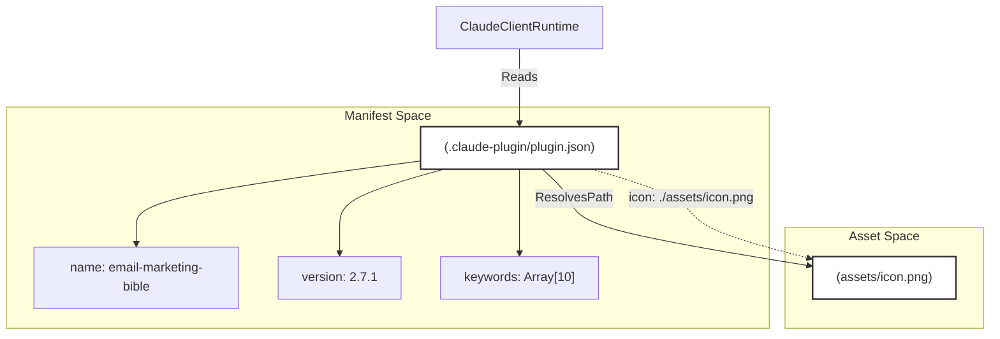
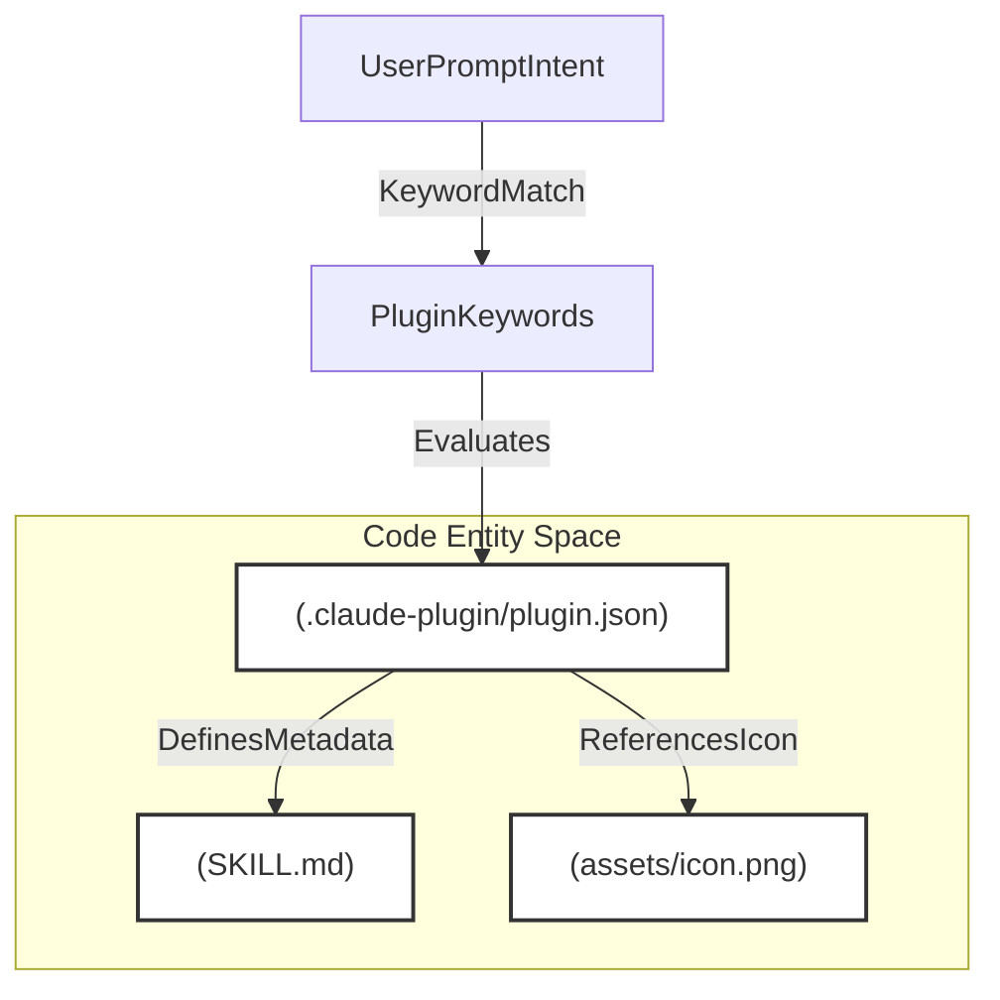

<!-- source: DeepWiki mcp.deepwiki.com · repo CosmoBlk/email-marketing-bible · page 4.1 Plugin Manifest and Assets · fetched 2026-10-26 -->

# Plugin Manifest and Assets

<details>
<summary>Relevant source files</summary>

The following files were used as context for generating this wiki page:

- [.claude-plugin/plugin.json](.claude-plugin/plugin.json)
- [assets/icon.png](assets/icon.png)

</details>


## Purpose and Scope

This page details the configuration schema, metadata fields, versioning scheme, and asset usage defined in `.claude-plugin/plugin.json` and `assets/icon.png` for the `email-marketing-bible` skill package. The plugin manifest acts as the primary registry document that enables Claude agent runtimes to discover, load, and represent the skill correctly within client environments.

Sources: [.claude-plugin/plugin.json:1-18](), [assets/icon.png:1-52]()

---

## Plugin Manifest Structure (`plugin.json`)

The plugin manifest `.claude-plugin/plugin.json` is a JSON-formatted descriptor that defines the identity, ownership, links, and operational metadata for the email marketing skill. 

### Core Fields and Identification
The manifest identifies the package using a unique string identifier (`name`) and a human-readable title (`displayName`). It tracks the exact release via a semantic version (`version`) string.

* `name`: Uniquely identifies the skill as `email-marketing-bible` [`[.claude-plugin/plugin.json:2-2]()`].
* `displayName`: Presents the formatted title `"Email Marketing Bible"` [`[.claude-plugin/plugin.json:3-3]()`].
* `version`: Tracks the semantic release version `"2.7.1"` [`[.claude-plugin/plugin.json:4-4]()`].
* `description`: Summarizes the skill's capabilities across data-backed email flows, deliverability, copy de-slopping, design direction, MCP ESP operations, and the 19 industry playbooks [`[.claude-plugin/plugin.json:5-5]()`].

```json
{
  "name": "email-marketing-bible",
  "displayName": "Email Marketing Bible",
  "version": "2.7.1",
  "description": "Data-backed email marketing skill for AI agents..."
}
```

Sources: [.claude-plugin/plugin.json:1-5]()

### Author, Licensing, and Endpoint Metadata
The manifest embeds provenance information to link back to the maintainer, repository, documentation, and licensing terms under the MIT license.

* `author`: Specifies the creator object containing `name` ("George Hartley"), `email` ("george@nitrosend.com"), and `url` ("https://x.com/gthartley") [`[.claude-plugin/plugin.json:6-10]()`].
* `homepage`: Points to the official landing page at `https://nitrosend.com/email-marketing-bible` [`[.claude-plugin/plugin.json:11-11]()`].
* `repository`: Links to the source code repository at `https://github.com/CosmoBlk/email-marketing-bible` [`[.claude-plugin/plugin.json:12-12]()`].
* `license`: Declares `MIT` licensing compliance [`[.claude-plugin/plugin.json:13-13]()`].
* `documentationUrl` & `supportUrl`: Directs users to external documentation and issue trackers [`[.claude-plugin/plugin.json:16-17]()`].

Sources: [.claude-plugin/plugin.json:6-13](), [.claude-plugin/plugin.json:16-17]()

---

## Keyword Architecture and Discovery

To facilitate agent discovery and capability matching, the `keywords` array supplies domain-specific tags. These strings allow automated routing systems to associate user prompts involving deliverability, copywriting, compliance, or ESP tools with this package.

The array consists of 10 distinct technical tags [`[.claude-plugin/plugin.json:14-14]()`]:
1. `"email-marketing"`
2. `"deliverability"`
3. `"copywriting"`
4. `"marketing-automation"`
5. `"email-design"`
6. `"ecommerce"`
7. `"saas"`
8. `"cold-email"`
9. `"compliance"`
10. `"mcp"`

```json
"keywords": [
  "email-marketing",
  "deliverability",
  "copywriting",
  "marketing-automation",
  "email-design",
  "ecommerce",
  "saas",
  "cold-email",
  "compliance",
  "mcp"
]
```

Sources: [.claude-plugin/plugin.json:14-14]()

---

## Icon Asset Usage and Packaging

The visual representation of the plugin within the client UI is anchored by the `"icon"` field pointing to a local PNG asset [`[.claude-plugin/plugin.json:15-15]()`]. 

* `icon`: Evaluates to `./assets/icon.png` [`[.claude-plugin/plugin.json:15-15]()`].
* `assets/icon.png`: A binary-encoded PNG image file providing the visual badge for the `email-marketing-bible` package when rendered in client skill registries or UI management panels [`[assets/icon.png:1-52]()`].

Sources: [.claude-plugin/plugin.json:15-15](), [assets/icon.png:1-52]()

---

## Manifest and Asset Architecture

Title: Manifest and Asset Integration Flow



Sources: [.claude-plugin/plugin.json:1-18](), [assets/icon.png:1-52]()

---

## Discovery and Runtime Mapping

Title: Natural Language Space to Code Entity Space



Sources: [.claude-plugin/plugin.json:1-18](), [assets/icon.png:1-52]()

---

