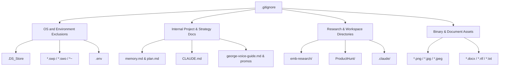
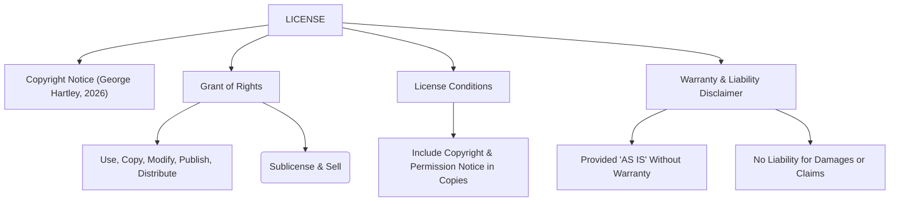

<!-- source: DeepWiki mcp.deepwiki.com · repo CosmoBlk/email-marketing-bible · page 4.3 Ignored Files and Licensing · fetched 2026-10-26 -->

# Ignored Files and Licensing

Relevant source files

The following files were used as context for generating this wiki page:

- [.gitignore](.gitignore)
- [LICENSE](LICENSE)

## Purpose and Scope
This page details the repository hygiene configurations and legal distribution terms for `email-marketing-bible`. It covers the exclusion rules defined in `[.gitignore:1-34]()` that prevent private notes, operational environment variables, research directories, and binary assets from entering public version control, alongside the open-source governance terms specified in the `[LICENSE:1-21]()` file.

Sources: `[.gitignore:1-34](), [LICENSE:1-21]()`

---

## 1. Git Exclusion Architecture (`.gitignore`)

The `.gitignore` file enforces strict boundaries between public source distribution and private development artifacts, workspace state files, and proprietary research notes.

*Sources: `[.gitignore:1-34]()`*

### Exemption Categories
*   **Operating System & Environment:** Excludes transient OS metadata (`.DS_Store`) `[.gitignore:2]`, editor swap files (`*.swp`, `*.swo`, `*~`) `[.gitignore:3-5]`, and local environment configuration files (`.env`) `[.gitignore:8]` to prevent secret leakage.
*   **Internal Project and Strategy Files:** Masks private agent operational notes (`memory.md`, `plan.md`) `[.gitignore:11-12]`, agent instructions (`CLAUDE.md`) `[.gitignore:13]`, voice guides (`george-voice-guide.md`) `[.gitignore:19]`, pricing strategy (`nitrosend-pricing.md`) `[.gitignore:24]`, and outreach tracking files (`expert-outreach.csv`) `[.gitignore:16]`.
*   **Research & Workspace Directories:** Excludes external workspace directories, research drops, and distribution scaffolding such as `emb-research/` `[.gitignore:32]`, `ProductHunt/` `[.gitignore:33]`, and local runtime configurations under `.claude/` `[.gitignore:34]`.
*   **Binary and Document Assets:** Blocks raw design exports and documentation binaries including images (`*.png`, `*.jpg`, `*.jpeg`) `[.gitignore:25-27]`, Word documents (`*.docx`) `[.gitignore:28]`, rich text files (`*.rtf`) `[.gitignore:29]`, and raw text dumps (`*.txt`) `[.gitignore:30]`.

Sources: `[.gitignore:1-34]()`

---

## 2. Licensing Terms (`LICENSE`)

The repository is distributed under the MIT License, granting permissive usage rights while disclaiming warranty liability for the package maintainers.

*Sources: `[LICENSE:1-21]()`*

### Core Clauses
*   **Copyright Holder:** Copyright is held by George Hartley (2026) as defined in `[LICENSE:3]`.
*   **Grant of License:** Permission is granted free of charge to any person obtaining a copy of the software and associated documentation files (`[LICENSE:5-10]()`) to deal in the software without restriction, covering rights to use, copy, modify, merge, publish, distribute, sublicense, and/or sell copies.
*   **Attribution Condition:** The copyright notice and permission notice must be included in all copies or substantial portions of the software (`[LICENSE:12-13]()`).
*   **Warranty Disclaimer:** The software is provided "AS IS", without warranty of any kind, express or implied, including but not limited to warranties of merchantability, fitness for a particular purpose, and non-infringement (`[LICENSE:15-17]`). Authors are held harmless from any claims, damages, or liabilities arising from code execution or usage (`[LICENSE:18-21]()`).

Sources: `[LICENSE:1-21]()`

---

