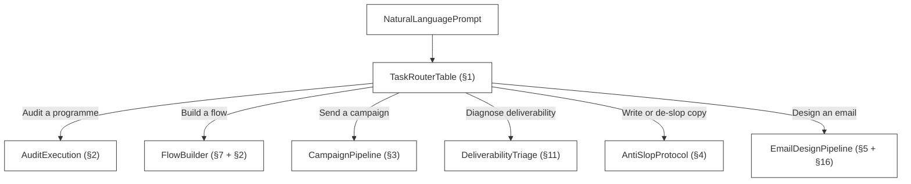
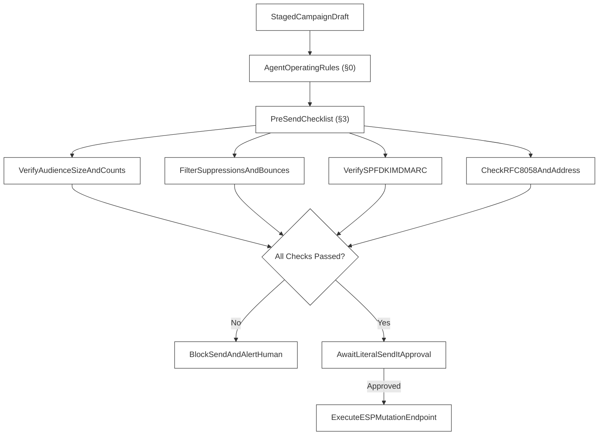

<!-- source: DeepWiki mcp.deepwiki.com · repo CosmoBlk/email-marketing-bible · page 5 Glossary · fetched 2026-10-26 -->

# Glossary

Relevant source files

The following files were used as context for generating this wiki page:

- [README.md](README.md)
- [SKILL.md](SKILL.md)
- [skills/email-marketing-bible/SKILL.md](skills/email-marketing-bible/SKILL.md)

## Purpose and Scope

This page defines the core domain terms, technical primitives, and operational constructs utilized across the `email-marketing-bible` codebase and agent skill package (`[SKILL.md:1-13]`, `[README.md:1-10]`). It bridges natural language prompt intents with underlying technical mechanisms, schema representations, and safety controls implemented throughout the skill documentation.

Sources: `[SKILL.md:1-13]`, `[README.md:1-10]()`

---

## Technical & Domain Terminology

### 1. 10DLC (10-Digit Long Code)
The standard telephone numbering system for Application-to-Person (A2P) text messaging in the United States. Requires explicit brand and campaign registration before automated sending to prevent carrier filtering and throttling (`[SKILL.md:92-92]()`).

### 2. Anti-Slop Copy Protocol
A structured set of copywriting rules and frameworks (such as PAS, AIDA, and BAB) designed to detect and strip AI-generated clichés, excessive adjectives, and synthetic patterns from email drafts prior to human review (`[SKILL.md:44-44]`, `[README.md:23-29]()`).

### 3. Archetypes
Standardized structural templates and visual layouts applied during the email design phase to govern hierarchy, typography, and container structures (`[SKILL.md:45-45]`, `[README.md:81-81]()`).

### 4. BIMI (Brand Indicators for Message Identification) & VMC (Verified Mark Certificates)
An email authentication standard that displays a verified brand logo next to incoming messages in supported inboxes. Requires strict DMARC alignment (`p=quarantine` or `p=reject`) and a cryptographic VMC (`[SKILL.md:86-86]`, `[README.md:76-82]()`).

### 5. DDD (Discover-Define-Deliver)
An AI-driven email design pipeline adapted from industry practices. It uses seed strings for divergence, broad-first direction picking, a screenshot critic loop, and model chaining to generate inbox-safe code (MJML or React Email) (`[README.md:106-108]()`).

### 6. ESP (Email Service Provider)
The underlying infrastructure and platform (e.g., Klaviyo, Resend, Mailchimp, Nitrosend) that manages subscriber lists, delivery pipelines, and campaign execution via APIs or Model Context Protocol (MCP) connectors (`[README.md:23-38]()`).

### 7. Flows
Automated, multi-step lifecycle email sequences (such as welcome series, abandoned cart triggers, post-purchase cross-sell, and win-back campaigns) triggered by user events or time deltas (`[SKILL.md:41-41]`, `[README.md:27-27]()`).

### 8. `if_version`
An optimistic concurrency control field included in ESP write requests. On version conflict, the agent must re-read state and retry rather than overwriting blindly (`[SKILL.md:67-67]()`).

### 9. Liquid Merge Defaults
Dynamic template variable substitution syntax (e.g., template tags). When rendered inside HTML attributes such as `href`, inner quotes must be carefully structured to prevent breaking the attribute parser (`[SKILL.md:70-70]()`).

### 10. MCP (Model Context Protocol)
A standardized communication protocol enabling AI agents to interact with external tools and ESP backends. Requires continuous brand and account re-assertion due to silent context resets (`[SKILL.md:63-68]()`).

### 11. MPP (Mail Privacy Protection)
Apple's privacy mechanism that automatically pre-fetches remote images in emails, artificially inflating open rates and distorting traditional engagement metrics (`[SKILL.md:15-20]()`).

### 12. Read-Reason-Act-Verify Loop
The foundational operational loop executed by AI agents managing marketing automation accounts: reading account state, reasoning about next steps, executing a single discrete action, and verifying the outcome (`[SKILL.md:55-55]()`).

### 13. RFC 8058
The Internet Engineering Task Force standard specifying One-Click Unsubscribe headers (`List-Unsubscribe` and `List-Unsubscribe-Post`), which are mandatory for modern inbox placement and compliance (`[SKILL.md:87-87]()`).

### 14. Send-Safety Gates
Hard operational boundaries (`§0` and `§3`) that block automated blasts, require explicit human confirmation ("send it"), and validate pre-send criteria before execution (`[SKILL.md:26-35]`, `[SKILL.md:80-92]()`).

### 15. Silent-Parameter APIs
API endpoints that default to broad actions (such as sending to all contacts) if specific target parameters are omitted. Agents must pre-flight assert audience IDs and counts before invoking mutating endpoints (`[SKILL.md:69-69]()`).

### 16. Sunset Policy
An automated protocol for identifying unengaged subscribers through inactivity thresholds, triggering re-engagement campaigns, and ultimately suppressing them to protect sender reputation (`[SKILL.md:85-85]()`).

### 17. Suppressions
The exclusion lists comprising unsubscribed, hard-bounced, spam-complained, or globally suppressed addresses that must be filtered out prior to staging any campaign (`[SKILL.md:28-34]`, `[SKILL.md:85-85]()`).

### 18. Task Router
The execution routing matrix that maps natural language user intents to specific manual sections and required initial data gathering steps (`[SKILL.md:36-50]()`).

Sources: `[SKILL.md:15-92]`, `[README.md:23-108]()`

---

## Natural Language to Task Router Mapping

The following diagram bridges natural language prompt inputs (Natural Language Space) to the structured routing logic and execution sections (Code Entity Space) defined in the task router table.

Sources: `[SKILL.md:36-50]()`

---

## Pre-Send Gate Validation Data Flow

The following diagram maps the safety gate validation process from high-level operational rules to concrete pre-flight checks executed prior to firing an ESP campaign.

Sources: `[SKILL.md:26-35]`, `[SKILL.md:80-92]()`