# Page: Overview

# Overview

<details>
<summary>Relevant source files</summary>

The following files were used as context for generating this wiki page:

- [.claude-plugin/plugin.json](.claude-plugin/plugin.json)
- [README.md](README.md)
- [SKILL.md](SKILL.md)

</details>


## Purpose and Scope

The `email-marketing-bible` is a comprehensive agent skill package designed to provide AI agents with production-grade email marketing capabilities, domain reference material, and strict safety guardrails [SKILL.md:2-13](), [README.md:1-10](). Developed for platforms like Claude Code, Claude Desktop, and general agent runtimes, it acts as a discipline layer ensuring that automated agents operate under strict pre-send checklists, anti-slop copy protocols, and structured design pipelines rather than unconstrained generation [README.md:5-22]().

The codebase topology centers around the root operating instruction file (`SKILL.md`), the plugin manifest (`.claude-plugin/plugin.json`), and distribution documentation (`README.md`), backed by a complete set of industry playbooks and reference manuals [SKILL.md:1-92](), [README.md:70-101](), [.claude-plugin/plugin.json:1-18]().

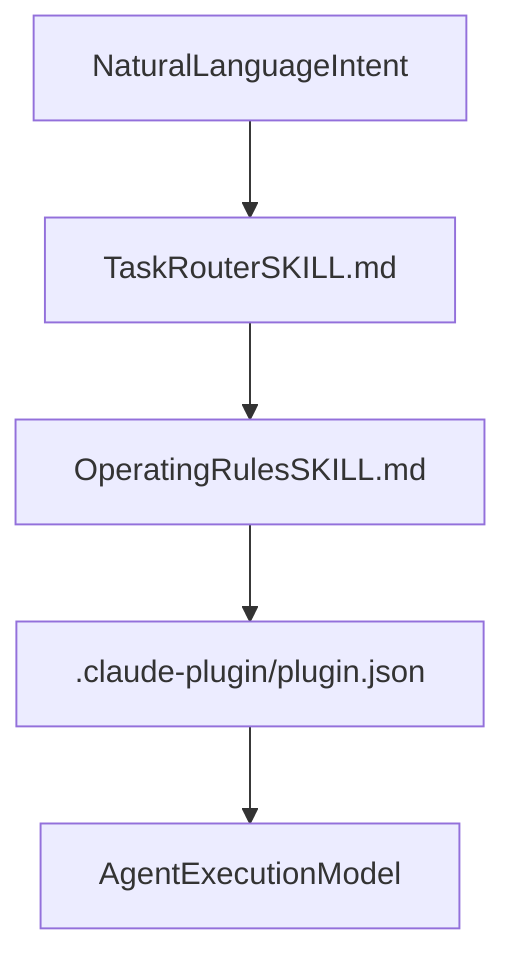
*Sources: [SKILL.md:1-92](), [.claude-plugin/plugin.json:1-18]()*

---

## System Topology & Package Structure

The package is organized to be consumed natively by agent skill loaders and plugin systems. The core logic resides in `SKILL.md`, which contains both Part A (the Agent Operating Manual) and Part B (the Domain Reference) [SKILL.md:20-24](). Package metadata, versioning, and extension integration points are defined in the plugin manifest [.claude-plugin/plugin.json:1-18]().

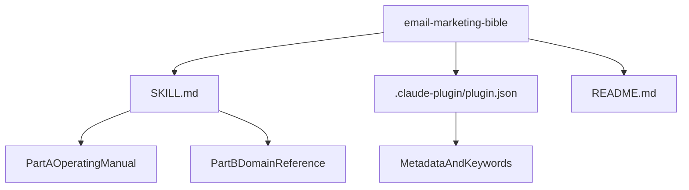
*Sources: [SKILL.md:1-92](), [README.md:1-108](), [.claude-plugin/plugin.json:1-18]()*

---

## Sub-Topics and Child Pages

- **[Installation and Usage](#1.1)** — Covers git-clone installation workflows into `~/.claude/skills`, plugin manifest configurations, and standard invocation patterns for running audits, flows, and copy generation [README.md:11-67]().
- **[Repository Layout](#1.2)** — Details the structural map of files and directories, including the root `SKILL.md`, mirrored copies, plugin manifests, assets, and licensing files [SKILL.md:1-13](), [.claude-plugin/plugin.json:1-18]().

*Sources: [SKILL.md:1-13](), [README.md:11-67](), [.claude-plugin/plugin.json:1-18]()*

---

# Page: Installation and Usage

# Installation and Usage

<details>
<summary>Relevant source files</summary>

The following files were used as context for generating this wiki page:

- [.claude-plugin/plugin.json](.claude-plugin/plugin.json)
- [README.md](README.md)

</details>


The scope of this document covers the installation mechanics of the `email-marketing-bible` skill package into local agent environments (such as Claude Code and Claude Desktop), the plugin configuration schema, and the natural language invocation patterns used to direct the agent through marketing, deliverability, copy, and design tasks.

---

## Installation Mechanics

The skill can be installed locally via `git clone` directly into the agent skill directory hierarchy, making it available to any agent runtime that parses the skill format [README.md:11-18](). 

The standard installation target for local Claude skills is `~/.claude/skills/email-marketing-bible` [README.md:13-15](). 

```bash
git clone https://github.com/CosmoBlk/email-marketing-bible.git ~/.claude/skills/email-marketing-bible
```

Alternatively, the repository provides a plugin manifest file located at `.claude-plugin/plugin.json` which registers the package metadata, versioning information (`2.7.1`), licensing (MIT), repository endpoints, and icon assets [.claude-plugin/plugin.json:1-18](). The plugin manifest defines key search keywords such as `email-marketing`, `deliverability`, `copywriting`, `marketing-automation`, `email-design`, and `mcp` [.claude-plugin/plugin.json:14]().

Title: Installation and Runtime Loading Topology
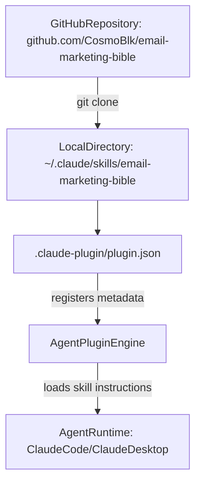
Sources: [README.md:11-18](), [.claude-plugin/plugin.json:1-18]()

---

## Invocation Patterns and Natural Language Interfacing

Once installed, the agent operates as an expert email marketing consultant [README.md:39-41](). Users interact with the skill through specialized natural language prompts designed to trigger specific operational modes (auditing, building flows, fixing deliverability, rewriting copy, or directing design) [README.md:43-66]().

Title: Natural Language to Execution Mapping
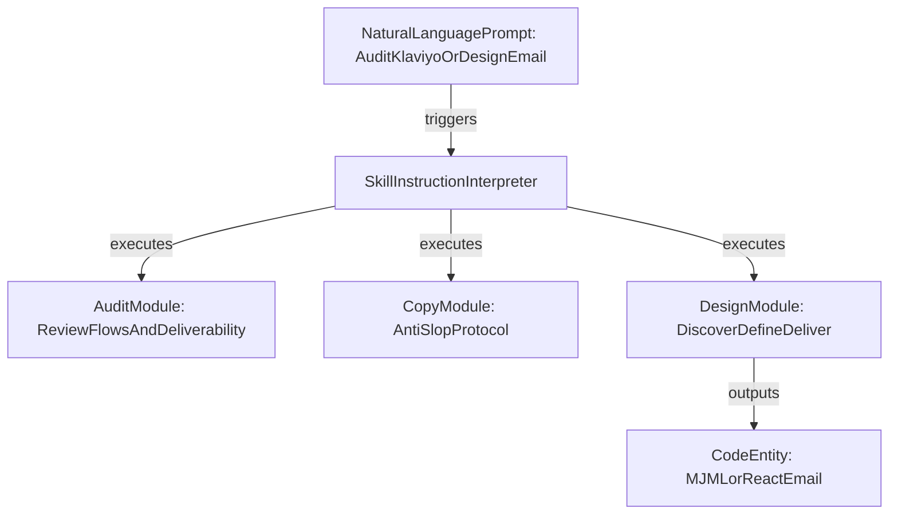
Sources: [README.md:39-66]()

### Core Prompt Archetypes

1. **Audit and Build Flows**:
   Instructs the agent to evaluate existing ESP setups, identify missing lifecycle sequences, and build high-converting flows [README.md:43-48]().
   ```text
   "Audit my Klaviyo account for a DTC skincare brand doing $2M/year. I have a welcome series, abandoned cart, and one weekly newsletter. What am I missing, and build me whatever flow would earn the most first."
   ```
   *Sources: [README.md:43-48]()*

2. **Deliverability Triage**:
   Instructs the agent to diagnose inbox placement issues, reputation decline, or engagement drops [README.md:50-54]().
   ```text
   "My emails are landing in Gmail promotions and opens dropped from 22% to 14% over three months. What is going on and how do I fix it?"
   ```
   *Sources: [README.md:50-54]()*

3. **Copy De-sloping**:
   Forces the agent to remove artificial phrasing, apply proven conversion frameworks (PAS, AIDA, BAB), and align tone with human brand voices [README.md:29](), [README.md:56-60]().
   ```text
   "Here is a draft welcome email. Make it sound like a person, not an AI, and keep it on our brand voice."
   ```
   *Sources: [README.md:56-60]()*

4. **Design Pipeline (Discover-Define-Deliver)**:
   Engages the design module, requiring divergence (seed strings and multiple directions) prior to converging on inbox-safe `MJML` or `React Email` outputs [README.md:30](), [README.md:62-66](), [README.md:106-108]().
   ```text
   "Design a launch email for a premium coffee brand. List 15 directions first, I will pick. Then build the pick as MJML and run a critic loop on the render."
   ```
   *Sources: [README.md:62-66]()*

---

# Page: Repository Layout

# Repository Layout

<details>
<summary>Relevant source files</summary>

The following files were used as context for generating this wiki page:

- [.gitignore](.gitignore)
- [LICENSE](LICENSE)
- [assets/icon.png](assets/icon.png)

</details>


## Purpose and Scope
This document maps out the file and directory structure of the `email-marketing-bible` repository. It details the physical organization of the codebase, including the root-level core skill file, its synchronized copy inside the `skills/` directory, plugin manifests (`.claude-plugin`), brand and distribution assets (`assets/`), CI/CD automation workflows (`.github/`), version control exclusion policies (`.gitignore`), and the project license (`LICENSE`).

---

## 1. Directory Topology and Root Layout
The repository is organized as an agent skill package designed for integration into Claude Code and AI Studio environments. The root directory contains the authoritative instruction file `SKILL.md`, while distribution packages and synchronization copies are maintained in parallel directories.

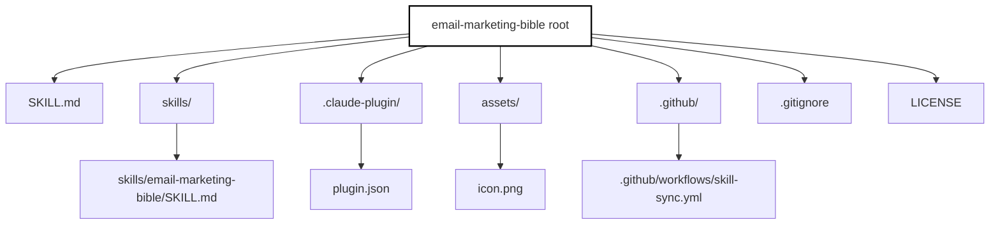
*Diagram 1: High-level repository directory map.*

Sources: `.gitignore:1-35`, `LICENSE:1-22`

---

## 2. Licensing and Version Control Exclusions
Project governance and exclusions are strictly enforced via the root configuration files. The project is distributed under the MIT License, granting permissive use while limiting liability.

The `.gitignore` file explicitly isolates public distribution assets from internal research, temporary drafts, and user-specific environment configurations. It protects sensitive development notes (`memory.md`, `plan.md`, `CLAUDE.md`), experimental research dumps (`emb-research/`, `intelligentsend-*.md`), and working directories from leaking into public releases.

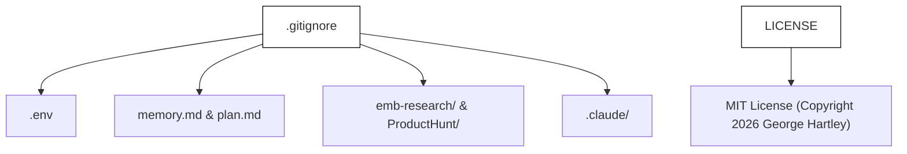
*Diagram 2: Governance, licensing boundaries, and exclusion filters.*

Sources: `.gitignore:1-35`, `LICENSE:1-22`

---

## 3. Plugin Assets and Manifest Configuration
The repository includes branding and distribution configurations to support plugin registry consumption.

*   **Plugin Manifest (`.claude-plugin`)**: Defines plugin metadata, versioning, keywords, and entry points required by client parsers.
*   **Assets (`assets/icon.png`)**: Provides visual branding assets utilized in marketplace displays and plugin cards [assets/icon.png:1-52]().

Sources: `assets/icon.png:1-52`

---

## 4. CI/CD Synchronization Mechanics
To maintain parity between the root execution context and the packaged skill directory, automated checks or mirror structures ensure that the root `SKILL.md` and the replica under `skills/` remain synchronized. 

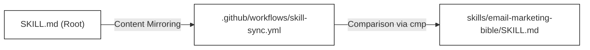
*Diagram 3: Natural language skill synchronization flow across execution paths.*

Sources: `.gitignore:1-35`

---

# Page: Agent Operating Manual (SKILL.md Part A)

# Agent Operating Manual (SKILL.md Part A)

<details>
<summary>Relevant source files</summary>

The following files were used as context for generating this wiki page:

- [SKILL.md](SKILL.md)
- [skills/email-marketing-bible/SKILL.md](skills/email-marketing-bible/SKILL.md)

</details>


The purpose of this page is to outline the core operating rules governing AI agent behavior when interacting with email marketing infrastructure, live ESPs (Email Service Providers), and messaging channels. As defined in `SKILL.md`, Part A establishes the absolute boundaries, task routing paradigms, automation loops, copywriting constraints, and design pipelines required to safely run autonomous marketing workflows [SKILL.md:24-92]().

For deep technical dives into specific sub-topics, refer to the respective child pages:
- [Safety Gates and Pre-Send Checklist](#2.1)
- [Task Router and Automation Loop](#2.2)
- [Anti-Slop Copy Protocol](#2.3)
- [Email Design Pipeline (Discover-Define-Deliver)](#2.4)

---

## 2.1. Safety Gates and Pre-Send Checklist

Every segment, draft, campaign, flow, or staged send executed against a production ESP is live. To prevent catastrophic mishaps (such as blasting unintended lists or triggering raw mutating endpoints), agents must adhere to strict safety gates and pre-flight validation checklists [SKILL.md:26-35](). 

Key operational rules include:
- **No Unapproved Sends**: No send or schedule to more than one recipient without explicit human approval ("send it" or equivalent) in the conversation [SKILL.md:29]().
- **Draft-by-Default**: All campaigns are staged as drafts until explicitly authorized [SKILL.md:75]().
- **Endpoint Protection**: Never probe unknown mutating endpoints (`/send`, `/dispatch`, `/trigger`, `/fire`, `/publish`) on a live audience [SKILL.md:32]().
- **Pre-Send Verification**: Rigorous validation of authentication (SPF, DKIM, DMARC), suppressions, unsubscribe links (RFC 8058), and physical addresses before any broadcast [SKILL.md:80-92]().

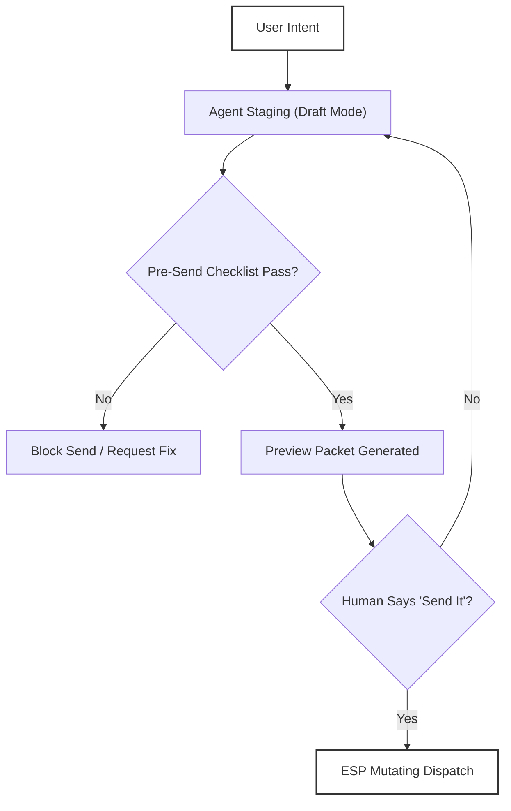
*Diagram 1: Natural Language Space to Code Entity Space — Safety gate workflow enforcing human-in-the-loop validation via `SKILL.md` rules.*

For details on blocked endpoints, suppression logic, and authentication checks, see [Safety Gates and Pre-Send Checklist](#2.1).

**Sources:** [SKILL.md:26-35](), [SKILL.md:80-92](), [skills/email-marketing-bible/SKILL.md:26-35](), [skills/email-marketing-bible/SKILL.md:80-92]()

---

## 2.2. Task Router and Automation Loop

The agent operating model shifts the marketer's role from operator to director [SKILL.md:51-62](). Agents utilize an intent-to-section task router to map user natural language requests to precise execution instructions, operating under a continuous feedback loop: **Read state → Reason → Act → Verify** [SKILL.md:36-55]().

| Intent | Target Domain | Gather First |
|---|---|---|
| Audit a programme | §2 + Reference | Read access, recent sends [SKILL.md:40]() |
| Build a flow | §7 + §2 | Model, trigger, audience, offer, exclusions [SKILL.md:41]() |
| Send a campaign | §3 | Segment, consent basis, copy, sender, timing [SKILL.md:42]() |
| Diagnose deliverability | §11 | Domain, ESP, bounce/complaint rates [SKILL.md:43]() |

Furthermore, field operations require specific technical safeguards such as optimistic concurrency control via `if_version` on write operations, brand re-assertion after idle periods, and decoding tracking-wrapped CTAs [SKILL.md:63-79]().

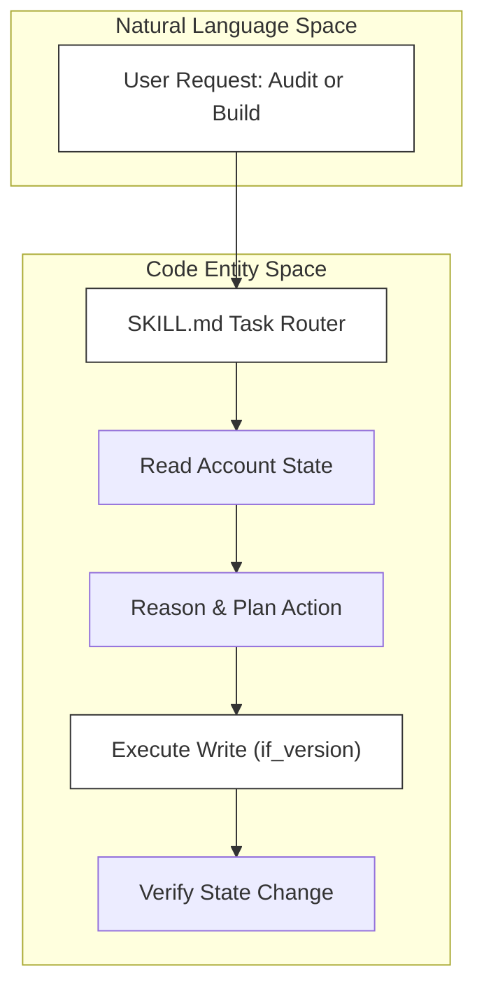
*Diagram 2: Natural Language Space to Code Entity Space — Routing user intents through the Read-Reason-Act-Verify execution loop defined in `SKILL.md`.*

For details on autonomy dials, concurrency handling (`if_version`), and silent failure monitoring, see [Task Router and Automation Loop](#2.2).

**Sources:** [SKILL.md:36-79](), [skills/email-marketing-bible/SKILL.md:36-79]()

---

## 2.3. Anti-Slop Copy Protocol

To combat generic, AI-generated "slop" that degrades sender reputation and engagement, agents must enforce strict copywriting constraints [SKILL.md:44]() ("§4"). This includes eliminating forbidden phrasing, ensuring high semantic burstiness, backing claims with real metrics, and utilizing structured persuasive frameworks like PAS (Problem-Agitate-Solve), AIDA, and BAB (Before-After-Bridge).

For details on forbidden vocabulary lists, burstiness scoring algorithms, and proof metric requirements, see [Anti-Slop Copy Protocol](#2.3).

**Sources:** [SKILL.md:44]()

---

## 2.4. Email Design Pipeline (Discover-Define-Deliver)

Email design under agent control follows a rigorous pipeline: starting from seed strings and brand design tokens, mapping to proven archetypes, rendering across robust substrates (MJML, React Email, or Maizzle), and passing through a screenshot critic loop to check dark-mode safety, asset size limits (<200KB per image), and cross-client compatibility [SKILL.md:45]().

For details on archetype selection, layout rendering substrates, and the automated screenshot critic verification loop, see [Email Design Pipeline (Discover-Define-Deliver)](#2.4).

**Sources:** [SKILL.md:45]()

---

# Page: Safety Gates and Pre-Send Checklist

# Safety Gates and Pre-Send Checklist

<details>
<summary>Relevant source files</summary>

The following files were used as context for generating this wiki page:

- [SKILL.md](SKILL.md)
- [skills/email-marketing-bible/SKILL.md](skills/email-marketing-bible/SKILL.md)

</details>


## Purpose and Scope

This page covers Section 2.1 of the operating manual, detailing the hard rules (§0) [SKILL.md:26-35] and the Pre-Send Checklist (§3) [SKILL.md:80-92] governing AI agent interactions with live Email Service Provider (ESP) endpoints. Every segment, draft, campaign, flow, or staged send executed via agentic workflows is treated as a live production action. This specification defines the programmatic guardrails, blocked mutating endpoints, draft-by-default execution models, explicit approval gates ("send it"), and automated compliance/authentication validation checks required before any payload reaches an audience.

Sources: [SKILL.md:26-35](), [SKILL.md:80-92]()

---

## 1. Hard Rules and Agent Operating Gates (§0)

The agent operating manual establishes non-negotiable execution boundaries to prevent accidental bulk dispatches or state corruption in production ESP environments [SKILL.md:26-35]. 

* **Human-in-the-Loop Send Approval**: No send or schedule operation targeting more than one recipient may execute without explicit human approval within the current conversational context (e.g., the literal string `"send it"` or equivalent confirmation) [SKILL.md:29]. Single-recipient test sends similarly require explicit authorization [SKILL.md:29].
* **Mandatory Preview Packet**: Prior to requesting approval, agents must render a preview packet containing: preview URLs, computed audience size, applied exclusions and suppressions, subject lines, preview text, scheduled send time, `from-name` and monitored `reply-to` addresses, unsubscribe mechanisms, and an explicit compliance risk assessment [SKILL.md:30].
* **Automatic Send Blocking**: The pre-flight pipeline automatically blocks execution if authentication records are incomplete, unsubscribe links or physical mailing addresses are absent, complaint rates meet or exceed `0.1%`, consent baselines are ambiguous, or the target audience list includes suppressed, bounced, or previously complained contacts [SKILL.md:31].
* **Mutating Endpoint Restrictions**: Agents are strictly prohibited from probing unknown mutating endpoints on live audiences [SKILL.md:32]. Paths matching patterns like `/send`, `/dispatch`, `/trigger`, `/fire`, or `/publish` can execute immediate dispatches [SKILL.md:32]. If the proper scheduled-approval sequence is ambiguous, execution halts and human intervention is required [SKILL.md:32].
* **Channel Mode Separation**: Transactional, marketing, lifecycle, and cold outbound messaging modes operate under distinct compliance rules, sender domains, and consent bases [SKILL.md:33]. Cross-contamination between modes is blocked [SKILL.md:33].
* **Audit Logging**: Every autonomous modification—including segment alterations, flow edits, campaign creations, and staged sends—must be logged for post-action human auditing [SKILL.md:34].

Sources: [SKILL.md:26-35]()

---

## Diagram 1: Agent Operating Rules to Execution Logic

The following diagram bridges natural language operating mandates to their internal enforcement entities and validation checkpoints.

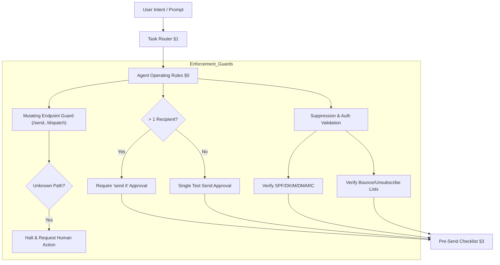
Sources: [SKILL.md:26-35](), [SKILL.md:80-92]()

---

## 2. Mutating Endpoints and Concurrency Safety (§2b)

Operational field notes from live ESP integrations establish specialized constraints for API interactions, preventing silent failures and race conditions [SKILL.md:63-79]:

* **Optimistic Concurrency Control (`if_version`)**: Every write operation must supply an optimistic concurrency version parameter (`if_version`) [SKILL.md:67]. Upon conflict detection, the agent must re-read state and retry with the refreshed version string rather than guessing or overriding [SKILL.md:67].
* **Brand Context Re-Assertion**: MCP (Model Context Protocol) and API contexts can silently reset to default brand profiles during idle periods [SKILL.md:68]. Agents must explicitly re-assert brand and account identifiers prior to executing any write batch [SKILL.md:68].
* **Silent-Parameter API Safeguards**: APIs with implicit parameters frequently default to send-to-all configurations [SKILL.md:69]. Pre-flight validation must explicitly assert audience IDs and calculated counts before invocation [SKILL.md:69]. Probing unknown body keys on live audiences risks mass unconsented dispatch [SKILL.md:69].
* **Draft-by-Default State**: All campaign assets default to draft status [SKILL.md:75]. Only the explicit evaluation of the "send it" approval trigger transitions a payload to dispatch [SKILL.md:75].

Sources: [SKILL.md:63-79]()

---

## Diagram 2: Pre-Flight Validation and Dispatch Data Flow

This diagram illustrates the data flow from an initial draft asset through the safety checks, concurrency versioning, and human approval gates before reaching the ESP dispatch layer.

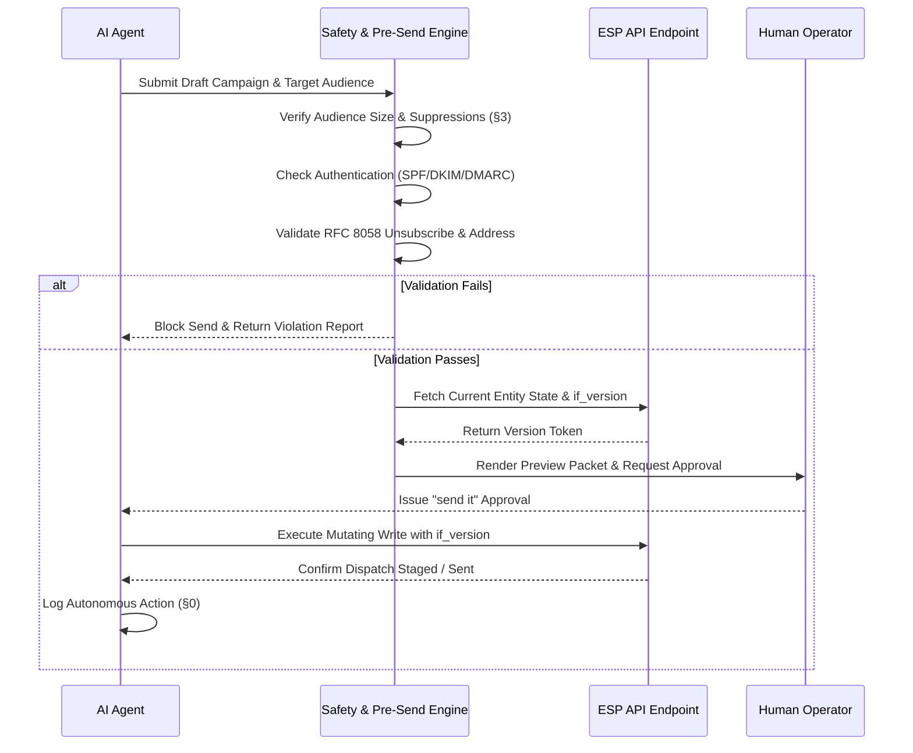
Sources: [SKILL.md:26-35](), [SKILL.md:63-79](), [SKILL.md:80-92]()

---

## 3. The Pre-Send Checklist Engine (§3)

Before any communication is authorized for deployment, the Pre-Send Checklist mandates verification across nine discrete validation vectors [SKILL.md:80-92]:

| Vector | Validation Rule | Technical Requirement |
| :--- | :--- | :--- |
| **Audience** | Size and segment logic verification [SKILL.md:84] | Compare AI-generated segment counts against actual database records to prevent over-broad targeting [SKILL.md:84]. |
| **Suppressions** | Comprehensive exclusion list check [SKILL.md:85] | Filter out unsubscribed, bounced, complained, globally suppressed, frequency-capped contacts, and those with open support tickets [SKILL.md:85]. |
| **Authentication** | Domain alignment check [SKILL.md:86] | Verify SPF, DKIM, and DMARC alignment with policies set to `p=quarantine` or stricter (noting strict enforcement thresholds like Microsoft Outlook requiring all three at volumes exceeding 5K/day) [SKILL.md:86]. |
| **Compliance** | Header and footer validation [SKILL.md:87] | Confirm presence of RFC 8058 one-click unsubscribe headers and physical mailing address [SKILL.md:87]. |
| **Copy** | Anti-slop and length constraints [SKILL.md:88] | Enforce anti-slop guidelines (§4), restrict CTAs to a single target, cap subject lines at $\le 45$ characters, and verify preview text adds contextual value [SKILL.md:88]. |
| **Design** | Layout and rendering constraints [SKILL.md:89] | Enforce single-column layouts ($\le 600\text{px}$), dark-mode safety, asset alt-text, live-text headlines, explicit text/button styling, image size limits ($<200\text{KB}$ per image, $<800\text{KB}$ aggregate), spam-score evaluation, and animated WebP validation [SKILL.md:89]. |
| **Links** | URL integrity check [SKILL.md:90] | Decode tracking-wrapped CTAs, block placeholder URLs, and ensure Liquid merge tags render safely inside `href` attributes without breaking HTML syntax [SKILL.md:70, SKILL.md:73, SKILL.md:90]. |
| **Sender** | Identity and consent validation [SKILL.md:91] | Verify sender `from-name` and monitored `reply-to` headers, re-assert brand context, set precise delivery timestamps, and validate consent basis for the target audience [SKILL.md:91]. |
| **Non-Email** | Multi-channel compliance [SKILL.md:92] | For US SMS, verify 10DLC brand and campaign registration; for WhatsApp, confirm template approval and category opt-in; enforce local time quiet hours (e.g., SMS restricted to 8:00 AM – 9:00 PM recipient local time) [SKILL.md:92]. |

Sources: [SKILL.md:63-79](), [SKILL.md:80-92]()

---

# Page: Task Router and Automation Loop

# Task Router and Automation Loop

<details>
<summary>Relevant source files</summary>

The following files were used as context for generating this wiki page:

- [SKILL.md](SKILL.md)
- [skills/email-marketing-bible/SKILL.md](skills/email-marketing-bible/SKILL.md)

</details>


## Purpose and Scope
This page details the core orchestration mechanics defined in Part A of the skill reference: the **Task Router** (§1) and the **Read→Reason→Act→Verify Loop** (§2) [SKILL.md:36-62](). It covers how agent prompts are mapped to operational sections, the feedback loops governing autonomous ESP interactions, and the concurrency controls (`if_version`) required to safely mutate live email infrastructure [SKILL.md:63-79]().

---

## 1. Intent-to-Section Routing (`TaskRouter`)

The Task Router acts as the dispatch switchboard for incoming user intents. When an agent ingests a prompt regarding email marketing operations, it matches the natural language intent against a structured routing matrix to determine the target section and required pre-flight data [SKILL.md:36-50]().

### Routing Matrix Architecture

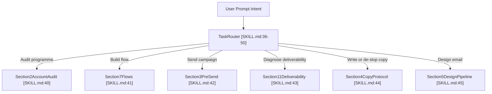

*Figure 1: Bridging Natural Language Space intents to operational section handlers within `SKILL.md`.*

Sources: `[SKILL.md:36-50]()`, `[skills/email-marketing-bible/SKILL.md:36-50]()`

---

## 2. The Read→Reason→Act→Verify Loop

The operating model transitions the marketer from an execution operator to an autonomous director [SKILL.md:51-54](). The execution engine relies on a strict four-stage iterative loop [SKILL.md:55]():

1. **Read State**: Ingest current account baseline (lists, active flows, recent campaign performance, deliverability standing, and existing suppressions) [SKILL.md:55]().
2. **Reason**: Evaluate gaps against benchmark standards and formulate a single isolated action [SKILL.md:55]().
3. **Act**: Execute a targeted change via MCP or API connectors under strict autonomy boundaries [SKILL.md:55]().
4. **Verify**: Confirm the state change settled correctly on the remote ESP before proceeding [SKILL.md:55]().

### Execution Data Flow

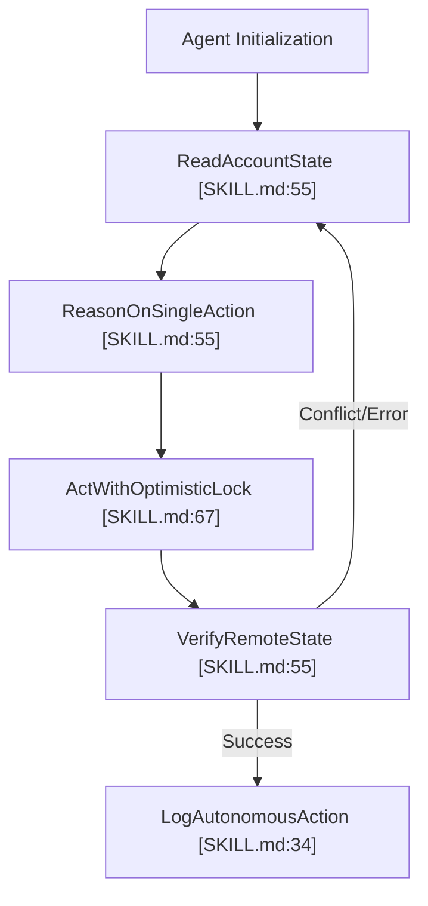

*Figure 2: Data flow for the Read→Reason→Act→Verify execution loop.*

Sources: `[SKILL.md:34-55]()`, `[SKILL.md:67]()`, `[skills/email-marketing-bible/SKILL.md:34-55]()`, `[skills/email-marketing-bible/SKILL.md:67]()`

---

## 3. Autonomy Boundaries and Concurrency Control

To prevent silent failures and unintended mass-dispatch events, the operating model enforces strict runtime constraints and concurrency checks [SKILL.md:63-79]().

### Concurrency and State Management

- **Optimistic Concurrency (`if_version`)**: Every write operation must pass the current record version (`if_version`). On version conflicts, the agent must re-read remote state and retry rather than guessing or forcing writes [SKILL.md:67]().
- **Context Re-Assertion**: Because MCP context can silently reset to default brands after idle periods, the agent must explicitly re-assert brand and account IDs prior to every write batch [SKILL.md:68]().
- **Pre-Flight Payload Assertion**: Silent-parameter APIs frequently default to "send-to-all" if audience parameters are omitted. The agent must pre-flight assert audience ID and exact recipient counts before probing any mutating endpoint [SKILL.md:69]().
- **Draft-by-Default**: All campaigns, flows, and staged sends default to draft status. Only an explicit user prompt containing `"send it"` (or equivalent) in the conversation stream triggers a live blast [SKILL.md:75]().

Sources: `[SKILL.md:63-79]()`, `[skills/email-marketing-bible/SKILL.md:63-79]()`

---

# Page: Anti-Slop Copy Protocol

# Anti-Slop Copy Protocol

<details>
<summary>Relevant source files</summary>

The following files were used as context for generating this wiki page:

- [README.md](README.md)
- [SKILL.md](SKILL.md)

</details>


## Purpose and Scope

The Anti-Slop Copy Protocol is an operational constraint layer defined within the `email-marketing-bible` agent skill package (`[SKILL.md:44-44]()`, `[README.md:29-29]()`). Its primary purpose is to intercept raw generative model output during email copy drafting and systematically eliminate common AI stylistic markers ("slop"), enforce structural burstiness, mandate empirical proof metrics, and apply conversion-focused copywriting frameworks (PAS, AIDA, BAB) before any email draft is staged or presented for human review (`[README.md:80-80]()`). 

Sources: `[SKILL.md:44-44]`, `[README.md:29-29]`, `[README.md:80-80]()`

---

## Forbidden Phrasing and Lexical Filtering

The protocol acts as a strict lexical filter. Large language models naturally favor predictable, highly probable token sequences that human readers instantly identify as machine-generated. The anti-slop rules block specific categories of words and transitional fluff.

### Banned Lexical Categories
* **AI Transitional Adverbs**: Words like "furthermore", "moreover", "consequently", "delve", "tapestry", "beacon", "revolutionize", and "unlock".
* **Hype Superlatives**: Unsubstantiated claims such as "game-changing", "seamless", "cutting-edge", "unprecedented", and "revolutionary".
* **Meta-Commentary**: Conversational padding like "In today's fast-paced digital world", "As we navigate", or "Look no further".

The agent must evaluate drafts against these lexical constraints prior to passing the pre-send validation check (`[SKILL.md:88-88]()`).

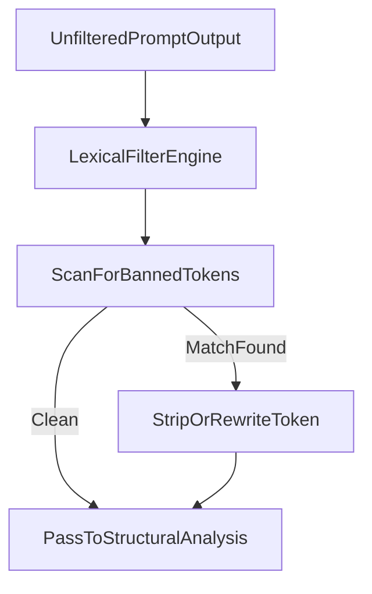
Sources: `[SKILL.md:88-88]`, `[README.md:29-29]()`

---

## Burstiness and Perplexity Control

Standard AI text exhibits low perplexity—sentences tend to be uniform in length and predictable in syntactic structure. The Anti-Slop Protocol enforces structural variance (burstiness) by mandating a deliberate mix of ultra-short declaratives, compound statements, and fragmented rhythms.

### Structural Rules
* **Sentence Length Distribution**: Every paragraph must alternate between a short punchy sentence (under 6 words) and a longer explanatory sentence.
* **Rhythmic Interruption**: Passive voice constructions are systematically refactored into active, agent-driven phrasing.
* **Subject-Line Constraints**: Subject lines must remain strictly under 45 characters, with preview text acting as a complementary information expander rather than a redundant echo (`[SKILL.md:88-88]`).

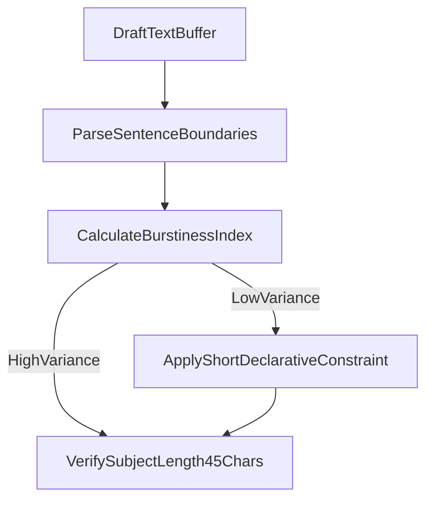
Sources: `[SKILL.md:88-88]`, `[README.md:80-80]()`

---

## Proof Metrics and Empirical Grounding

AI-generated copy relies heavily on generic assertions ("Many users save time"). The Anti-Slop Protocol substitutes these claims with concrete, falsifiable metrics and empirical grounding.

### Grounding Rules
* **Mandatory Data Points**: Every promotional or lifecycle email draft must incorporate at least one verifiable proof metric (e.g., specific percentages, dollar figures, exact timelines, or named case studies).
* **Source Attribution**: Claims regarding conversion rates, retention, or speed must trace back to verified benchmarks or first-party data structures.
* **Zero-Assumption Policy**: If an agent prompt lacks a real proof point, the agent must halt generation and request the missing data point from the user before finalizing the copy.

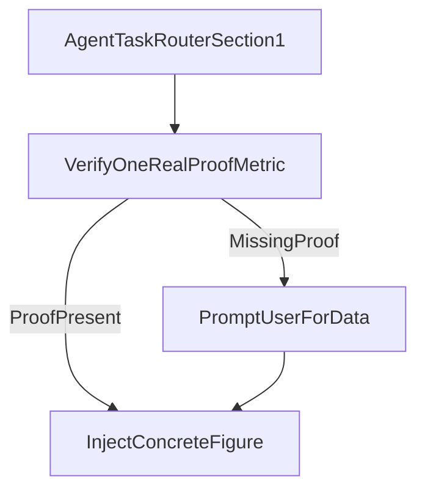
Sources: `[SKILL.md:36-50]`, `[README.md:29-29]()`

---

## Copywriting Frameworks: PAS, AIDA, and BAB

When constructing email flows (welcome series, abandoned cart, win-back), the agent maps the core offer to proven copywriting frameworks referenced in the skill architecture (`[README.md:29-29]()`).

### Framework Definitions
* **PAS (Problem, Agitate, Solve)**: Identifies a precise customer pain point, amplifies the frustration of living with that pain, and introduces the product/service as the definitive resolution.
* **AIDA (Attention, Interest, Desire, Action)**: Captures immediate notice via a subject-line hook, builds deep engagement through relevant mechanics, creates emotional or financial longing, and concludes with a single frictionless Call to Action (CTA) (`[SKILL.md:88-88]()`).
* **BAB (Before, After, Bridge)**: Paints the picture of the user's current undesirable state ("Before"), contrasts it with an ideal future state ("After"), and positions the offer as the mechanism ("Bridge") to cross between them.

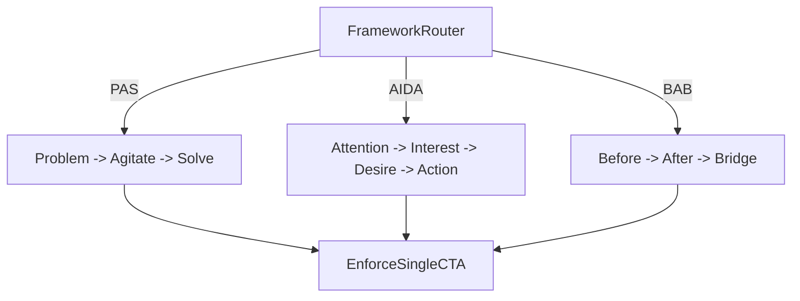
Sources: `[SKILL.md:88-88]`, `[README.md:29-29]()`

---

# Page: Email Design Pipeline (Discover-Define-Deliver)

# Email Design Pipeline (Discover-Define-Deliver)

<details>
<summary>Relevant source files</summary>

The following files were used as context for generating this wiki page:

- [README.md](README.md)
- [SKILL.md](SKILL.md)

</details>


This leaf page details Section 2.4 of the `email-marketing-bible` operating manual, establishing the structured AI email design pipeline adapted from Anshu Chimala's product design methodology [README.md:108-108](). The pipeline enforces a rigorous three-phase workflow—Discover, Define, Deliver—governed by seed strings for creative divergence, strict layout archetypes, inbox-safe code substrates (MJML, React Email, Maizzle), and an automated screenshot critic loop to eliminate generic AI visual slop.

---

## 1. The Discover Phase: Seed Strings and Divergence

When tasked with generating a campaign or flow design, the agent is restricted from immediately outputting a static template or single rendering. Instead, it must initiate the **Discover** phase by generating a divergent set of seed strings and conceptual directions [README.md:64-66]().

- **Divergent Ideation**: The agent produces 15 distinct stylistic and thematic directions based on brand tokens, target audience, and campaign goals [README.md:64-66]() (`Task Router | Design an email | §5 + §16 | brand tokens, archetype, goal` [SKILL.md:45-45]()).
- **Human-in-the-Loop Selection**: The human operator reviews the divergent seed strings and selects a preferred direction before any layout code is compiled [README.md:64-66]().
- **Anti-Default Guardrails**: Prevents models from falling back on repetitive default layouts, generic stock graphics, or unconstrained generative image artifacts.

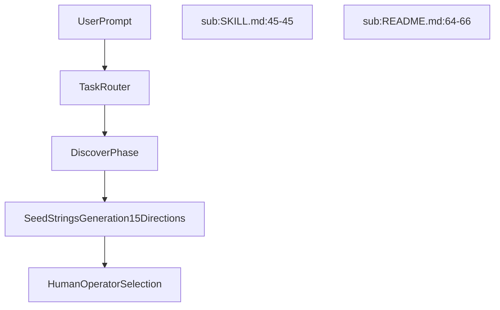

**Sources:** [SKILL.md:45-45](), [README.md:64-66]()

---

## 2. The Define Phase: Archetypes and Code Substrates

Once a direction is locked, the agent transitions to the **Define** phase. This phase maps the selected concept onto established email archetypes and selects the appropriate production substrate [README.md:30-31]().

### Substrates
The codebase supports three primary production-grade email code substrates:
1. **MJML**: Semantic XML-based markup language compiled into responsive, multi-client safe HTML tables.
2. **React Email**: Component-driven architecture allowing modular, type-safe email templates using React primitives.
3. **Maizzle**: Tailwind CSS-powered framework designed for advanced utility-first email styling.

### Design and Code Rules
- **Explicit Styling**: Set text and button colors explicitly on every design element to prevent theme default drifts (such as grey headlines or dark text on coloured buttons) [SKILL.md:72-72]().
- **Hero & CTA Constraints**: Every email must adhere to structural simplicity—featuring a single hero unit, a live-text headline, and exactly one primary button [SKILL.md:76-76](). Secondary content must rely strictly on inline links [SKILL.md:76-76]().
- **Asset Handling**: Animated WebP formats are prioritized over standard GIFs for hero animations, with mandatory post-render verification to ensure CDNs do not flatten them to frame one [SKILL.md:71-71](). Quote tiles must be rendered from clean HTML via headless Chrome rather than raw image generation models to prevent garbled type [SKILL.md:77-77]().

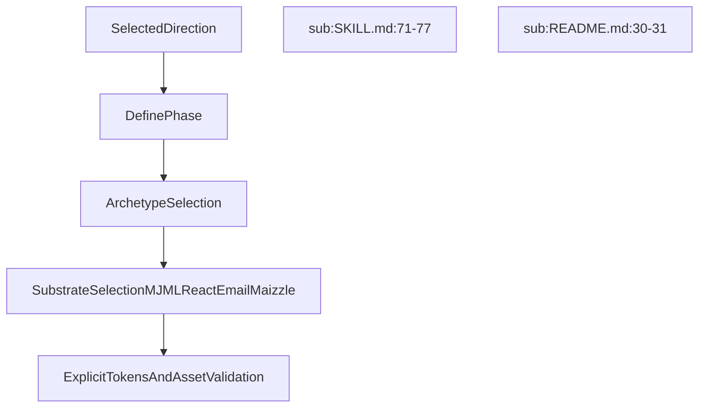

**Sources:** [SKILL.md:71-77](), [README.md:30-31]()

---

## 3. The Deliver Phase: Screenshot Critic Loop and Subtraction

The final phase, **Deliver**, relies on an iterative validation loop where the generated code is rendered, captured via headless browser automation, and critically evaluated against quality benchmarks [README.md:30-31]().

- **Headless Render**: The chosen substrate (MJML/React/Maizzle) is compiled and rendered in a virtual DOM / headless browser environment.
- **Screenshot Capture & Scoring**: An automated critic loop captures visual snapshots across multiple viewport widths and client engines, scoring elements against readability, dark-mode safety, and weight constraints (images under 200KB each, total weight under 800KB) [SKILL.md:89-89]().
- **Delivery by Subtraction**: If visual clutter or layout violations are detected, the critic loop enforces subtraction—removing redundant margins, secondary buttons, or decorative elements until only high-impact conversion paths remain.

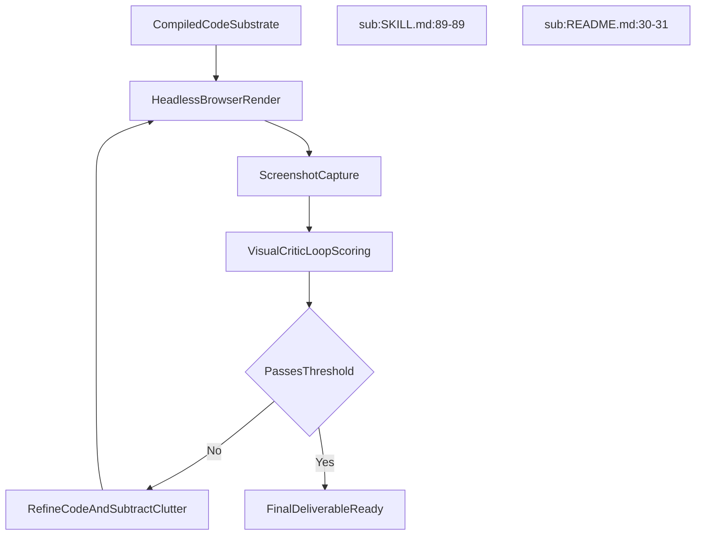

**Sources:** [SKILL.md:89-89](), [README.md:30-31]()

---

## 4. System Integration: Natural Language Space to Code Entity Space

To bridge high-level human instructions with concrete code execution, the email design pipeline maps natural language inputs directly to specific routing targets and execution files within the repository structure.

```mermaid
graph TD
    A["NaturalLanguagePromptDesignAnEmail"] --> B["SKILLmdTaskRouter"]
    B --> C["DesignIntentRoutingSection5And16"]
    C --> D["ReadMeDiscoverDefineDeliverPipeline"]
    D --> E["CodeSubstratesMJMLReactEmailMaizzle"]
    
    sub:SKILL.md:2-45
    sub:README.md:1-108
```

**Sources:** [SKILL.md:2-45](), [README.md:1-108]()

---

# Page: Domain Reference (SKILL.md Part B)

# Domain Reference (SKILL.md Part B)

<details>
<summary>Relevant source files</summary>

The following files were used as context for generating this wiki page:

- [SKILL.md](SKILL.md)
- [skills/email-marketing-bible/SKILL.md](skills/email-marketing-bible/SKILL.md)

</details>


This page serves as an overview of Part B of the agent skill reference, which provides data-backed domain reference material for AI agents and marketers. While Part A establishes the operating manual and safety gates (`[SKILL.md:24-34]`), Part B governs the core data models, benchmark thresholds, lifecycle flow recipes, compliance standards, and vertical playbooks used when executing campaigns through an ESP or connector (`[SKILL.md:4-8]`). 

As a parent page, this section outlines the major thematic pillars of the domain reference. For comprehensive breakdowns, consult the respective child pages linked below.

Sources: `[SKILL.md:1-20]`, `[skills/email-marketing-bible/SKILL.md:1-20]()`

---

## 3.1. Metrics, Flows and Segmentation

The metrics and lifecycle architecture govern how agent-driven campaigns measure success and automate customer journeys. Core performance indicators include open rates, click-through rates, revenue per recipient (RPR), complaint rates (hard-capped under 0.1%), and unsubscription velocity (`[SKILL.md:31]`). Lifecycle flows—such as the welcome series, abandoned cart, post-purchase cross-sell, and win-back sequences—rely on event triggers and audience segmentation rules to deliver contextual messaging.

To prevent list degradation, agents must enforce strict sunset policies that automatically identify, suppress, or re-engage unengaged subscribers after specific inactivity windows (typically 90 to 180 days). AI agents coordinate these segmentation tasks via intent routing based on read access and recent campaign metrics (`[SKILL.md:40-41]`).

For detailed recipes, benchmarks, and lifecycle flow logic, see [Metrics, Flows and Segmentation](#3.1).

```mermaid
graph TD
    "TaskRouter"["TaskRouter"] --> "AuditProgramme"["AuditProgramme"]
    "TaskRouter" --> "BuildFlow"["BuildFlow"]
    "AuditProgramme" --> "ReadState"["ReadState"]
    "BuildFlow" --> "TriggerEngine"["TriggerEngine"]
    "TriggerEngine" --> "WelcomeFlow"["WelcomeFlow"]
    "TriggerEngine" --> "CartFlow"["CartFlow"]
    "TriggerEngine" --> "WinBackFlow"["WinBackFlow"]

    subclass "TaskRouter" skillEntity
```
*Figure 1: Task Router mapping intents to lifecycle flow automation.*

Sources: `[SKILL.md:36-41]`, `[skills/email-marketing-bible/SKILL.md:36-41]()`

---

## 3.2. Deliverability and Authentication

Deliverability forms the foundational boundary of all outbound messaging. Technical authentication requires strict alignment across Sender Policy Framework (SPF), DomainKeys Identified Mail (DKIM), and Domain-based Message Authentication, Reporting, and Conformance (DMARC) set to `p=quarantine` or `p=reject` policies (`[SKILL.md:86]`). Major inbox providers like Microsoft Outlook enforce strict multi-protocol validation for high-volume senders exceeding 5,000 emails per day (`[SKILL.md:86]`).

Agents handling deliverability must continuously monitor complaint and bounce thresholds, handle Apple Mail Privacy Protection (MPP) inflation of open rates, and execute rapid triage procedures when domain reputation dips or spam-trap hits occur (`[SKILL.md:43]`).

For authentication setup guides, complaint mitigation, and triage runbooks, see [Deliverability and Authentication](#3.2).

```mermaid
graph TD
    "AgentDeliverabilityCheck"["AgentDeliverabilityCheck"] --> "VerifySPF"["VerifySPF"]
    "AgentDeliverabilityCheck" --> "VerifyDKIM"["VerifyDKIM"]
    "AgentDeliverabilityCheck" --> "VerifyDMARC"["VerifyDMARC"]
    "VerifyDMARC" --> "EvaluateThresholds"["EvaluateThresholds"]
    "EvaluateThresholds" --> "BlockSend"["BlockSend"]

    subclass "AgentDeliverabilityCheck" skillEntity
```
*Figure 2: Deliverability validation pipeline enforcing safety checks prior to dispatch.*

Sources: `[SKILL.md:43]`, `[SKILL.md:86]`, `[skills/email-marketing-bible/SKILL.md:43]`, `[skills/email-marketing-bible/SKILL.md:86]`

---

## 3.3. Compliance and Consent

Regulatory frameworks dictate strict legal boundaries for automated and manual communications. Agents must enforce compliance across CAN-SPAM, GDPR, CASL, the Australian Spam Act, and CCPA. A critical technical requirement for all commercial email is support for RFC 8058 one-click list-unsubscribe headers alongside a verified physical mailing address in the footer (`[SKILL.md:87]`).

Consent rules vary significantly by channel and jurisdiction, requiring explicit opt-in mechanisms, auditable timestamp collection, and honor-bound suppression lists that immediately propagate opt-out requests across all synced platforms.

For deep-dive compliance matrices and RFC 8058 technical specs, see [Compliance and Consent](#3.3).

Sources: `[SKILL.md:87]`, `[skills/email-marketing-bible/SKILL.md:87]`

---

## 3.4. Multichannel Messaging and Cold Outbound

Beyond traditional email, modern outbound strategies integrate SMS, 10DLC (10-Digit Long Code) registration, WhatsApp Business API templates, and Rich Communication Services (RCS) messaging. Each channel carries strict constraints, including mandatory TCPA quiet hours (e.g., local recipient time between 9:00 PM and 8:00 AM for SMS) (`[SKILL.md:92]`), category-specific WhatsApp opt-in approvals, and strict carrier filtering rules.

Cold email outbound requires specialized infrastructure separate from marketing domains, including distinct sending domains, warming schedules, ideal customer profile (ICP) data hygiene, and controlled daily send volumes to protect domain reputation (`[SKILL.md:48]`).

For channel-specific configuration parameters, quiet-hour calculation logic, and cold-outbound playbooks, see [Multichannel Messaging and Cold Outbound](#3.4).

Sources: `[SKILL.md:48]`, `[SKILL.md:92]`, `[skills/email-marketing-bible/SKILL.md:48]`, `[skills/email-marketing-bible/SKILL.md:92]`

---

## 3.5. Platform Selection and Industry Playbooks

Choosing the correct Email Service Provider (ESP) or Customer Engagement Platform depends on list size, transactional requirements, budget, tech stack integration, and whether the platform supports agent-driven workflows via Model Context Protocol (MCP) or native connectors (`[SKILL.md:46]`). 

The skill reference supplies a comparative ESP evaluation matrix and 19 dedicated vertical playbooks (covering e-commerce, B2B SaaS, publishing, agency operations, and more) to tailor messaging cadences, content archetypes, and data flows to specific business models (`[SKILL.md:4-8]`).

For the complete ESP comparison matrix, MCP connection architectures, and vertical playbooks, see [Platform Selection and Industry Playbooks](#3.5).

Sources: `[SKILL.md:4-8]`, `[SKILL.md:46]`, `[skills/email-marketing-bible/SKILL.md:4-8]`, `[skills/email-marketing-bible/SKILL.md:46]`

---

# Page: Metrics, Flows and Segmentation

# Metrics, Flows and Segmentation

<details>
<summary>Relevant source files</summary>

The following files were used as context for generating this wiki page:

- [SKILL.md](SKILL.md)

</details>


## Purpose and Scope

This page establishes the technical specification for core email metrics, benchmarking protocols, automated lifecycle flow recipes (welcome, cart abandonment, post-purchase, win-back), dynamic segmentation logic, and suppression/sunset policies managed by the `email-marketing-bible` agent skill package.

Sources: `[SKILL.md:1-21]`, `[SKILL.md:36-50]`

---

## Core Metrics and Health Diagnostics

The agent operates on continuous state reading, tracking performance indicators and hard threshold limits across all active campaigns and lifecycle flows `[SKILL.md:51-62]`. 

- **Complaint Rate**: Hard-gated threshold at `<0.1%`. Any campaign or flow hitting or exceeding this limit triggers an immediate send block `[SKILL.md:31]`.
- **Authentication Alignment**: Mandatory tracking of SPF, DKIM, and DMARC alignment (`p=quarantine` or stronger), particularly for volume thresholds exceeding 5,000 emails/day `[SKILL.md:86]`.
- **Audience & Suppression Counts**: Real-time validation of audience size, active suppressions (unsubscribed, bounced, complained, globally suppressed), and frequency-capping limits `[SKILL.md:84-85]`.

Sources: `[SKILL.md:31]`, `[SKILL.md:51-62]`, `[SKILL.md:84-86]`

---

## Lifecycle Flow Recipes

Lifecycle flows are structured automation sequences triggered by user behavior or time-based events. The task router routes flow construction through specific parameter requirements: model, trigger, audience, offer, and exclusions `[SKILL.md:41]`.

```
Title: Flow Execution and Concurrency State Machine
graph TD
    A["AgentTaskRouter"] --> B["FlowTriggerEvent"]
    B --> C["ReadAccountState"]
    C --> D["EvaluateIfVersion"]
    D --> E{"ConflictDetected"}
    E -- Yes --> F["ReReadAndRetryWithFreshVersion"]
    E -- No --> G["ExecuteFlowWriteBatch"]
    F --> G
    G --> H["VerifySilentParameters"]
```
Sources: `[SKILL.md:36-41]`, `[SKILL.md:67-69]`

### Flow Recipes Architecture

- **Welcome Flow**: Triggered upon subscription or account creation. Requires explicit consent basis verification, single-column responsive design (`≤600px`), and clear promotional or onboarding offers `[SKILL.md:89-91]`.
- **Cart Abandonment**: Triggered when a session payload contains an abandoned checkout. Relies on optimistic concurrency (`if_version`) to handle rapid state updates without overwriting customer cart modifications `[SKILL.md:67]`.
- **Post-Purchase Cross-Sell**: Triggered by order fulfillment events. Excludes recently purchased SKU categories and enforces frequency caps to prevent fatigue `[SKILL.md:85]`.
- **Win-Back**: Triggered after a defined period of inactivity (e.g., 60-90 days of zero opens/clicks). Enforces sunset policies before marking contacts as unengaged.

Sources: `[SKILL.md:41]`, `[SKILL.md:67]`, `[SKILL.md:85-89]`

---

## Segmentation and Sunset Policy

Audience segmentation requires strict validation against actual database counts to prevent AI-generated segments from expanding beyond intended parameters `[SKILL.md:84]`.

```
Title: Segment Validation and Suppression Data Flow
graph TD
    A["AISegmentQuery"] --> B["AudienceSizeVerification"]
    B --> C["SuppressionListCheck"]
    C --> D["MigrationOptOutValidation"]
    D --> E["FinalCleanAudience"]
    
    subgraph "Suppression Checks"
        C1["Unsubscribed"]
        C2["HardBounced"]
        C3["Complained"]
        C4["GlobalSuppressions"]
    end
    
    C -.-> C1
    C -.-> C2
    C -.-> C3
    C -.-> C4
```
Sources: `[SKILL.md:78]`, `[SKILL.md:84-85]`

### Migration and Sunset Rules
- **Migration Opt-Out State**: Migration opt-out and unsubscription states must be queried directly from the legacy ESP's API. CSV exports drop unsubscription flags and must never be relied upon as a single source of truth `[SKILL.md:78]`.
- **Sunset Policy**: Contacts exhibiting zero engagement over a sustained window are systematically segregated or suppressed to protect sender domain reputation and maintain complaint rates strictly below the `<0.1%` ceiling `[SKILL.md:31]`.

Sources: `[SKILL.md:31]`, `[SKILL.md:78]`, `[SKILL.md:84-85]`

---

# Page: Deliverability and Authentication

# Deliverability and Authentication

<details>
<summary>Relevant source files</summary>

The following files were used as context for generating this wiki page:

- [SKILL.md](SKILL.md)
- [skills/email-marketing-bible/SKILL.md](skills/email-marketing-bible/SKILL.md)

</details>


## Purpose and Scope
This page establishes the technical baseline and operational procedures for email deliverability, cryptographic domain authentication (SPF, DKIM, DMARC, BIMI), metric threshold monitoring, Mail Privacy Protection (MPP) handling, and diagnostic triage within the `email-marketing-bible` agent package. Ensuring strict adherence to these parameters prevents domain reputation degradation, inbox placement filtering, and automated blocklisting.

Sources: [SKILL.md:1-20]()

---

## Domain Authentication Protocols

Cryptographic sender verification is mandatory for all production dispatches. Major mailbox providers (such as Google, Microsoft, and Yahoo) enforce strict alignment standards.

*   **Sender Policy Framework (SPF):** Publishes authorized sending IPs and servers via DNS TXT records. Prevents basic envelope-from address spoofing.
*   **DomainKeys Identified Mail (DKIM):** Cryptographically signs headers and body content with a private key, validated via public keys published in DNS selectors (`selector._domainkey.domain.com`).
*   **Domain-based Message Authentication, Reporting, and Conformance (DMARC):** Ties SPF and DKIM to the visible `From:` header via organizational domain alignment. Production environments must enforce policies of `p=quarantine` or `p=reject`. Mailbox providers like Outlook require strict SPF, DKIM, and DMARC alignment for volumes exceeding 5,000 emails per day [SKILL.md:86]().
*   **Brand Indicators for Message Identification (BIMI):** Requires a verified mark certificate (VMC) and an SVG Tiny P/S compliant logo file published via DNS (`default._bimi.domain.com`) to render brand logos in supported enterprise inboxes.

Sources: [SKILL.md:80-92]()

```mermaid
graph TD
    A["OutgoingEmailDispatch"] --> B["DNSLookup:SPF"]
    A --> C["HeaderValidation:DKIM"]
    B --> D["DMARCAlignmentCheck"]
    C --> D
    D -->|"p=quarantine or p=reject"| E["InboxPlacement"]
    D -->|"Authentication Failure"| F["SpamFolderOrBounce"]
```
Sources: [SKILL.md:80-92]()

---

## Complaint and Bounce Thresholds

Maintaining clean lists and rapid suppression handling is critical for maintaining sender reputation scores.

*   **Complaint Rate Threshold:** The hard limit for spam complaints is **0.1%**. If the complaint rate reaches or exceeds 0.1%, the agentic system or human operator must immediately block the send [SKILL.md:31]().
*   **Bounce Management:** Hard bounces (invalid addresses, non-existent domains) must be suppressed instantly on first occurrence. Soft bounces (temporary mailbox full, server down) are monitored across successive campaign cycles before transition to permanent suppression.
*   **Suppression Hygiene:** Audiences must be scrubbed against known unsubscribed, bounced, complained, and globally suppressed contacts prior to every execution batch [SKILL.md:85]().

Sources: [SKILL.md:28-35](), [SKILL.md:80-92]()

```mermaid
graph TD
    A["CampaignSubmission"] --> B["QuerySuppressions"]
    B --> C["FilterUnsubscribesAndBounces"]
    C --> D["CheckComplaintRate"]
    D -->|"Rate < 0.1%"| E["ProceedToDispatch"]
    D -->|"Rate >= 0.1%"| F["BlockSendOperation"]
```
Sources: [SKILL.md:28-35](), [SKILL.md:80-92]()

---

## Mail Privacy Protection (MPP) Handling

Apple's Mail Privacy Protection prefetches remote content—including tracking pixels—via proxy servers, resulting in pre-fetched open signals that distort traditional engagement metrics.

*   **Signal Distortion:** Open rates lose reliability as an engagement metric for Apple Mail users.
*   **Triage Strategy:** Shift reliance from open-rate-based segmentation and trigger flows to deterministic intent signals:
    *   Click-through rates (CTR).
    *   Transactional events (purchases, API actions).
    *   Form submissions and direct replies.

Sources: [SKILL.md:1-20]()

---

## Deliverability Diagnostic Triage Procedures

When deliverability degrades, agents and operators must execute structured diagnostic routines as defined in the task router framework (`§1` and `§11`) [SKILL.md:43]().

### Triage Execution Steps
1.  **Gather Context:** Pull recent campaign metrics, bounce category breakdowns, complaint volume, and recent domain or infrastructure changes [SKILL.md:43]().
2.  **Verify DNS Records:** Confirm active propagation of SPF, DKIM CNAME/TXT entries, and DMARC reporting policies (`ruf`/`rua`).
3.  **Inspect Engagement Patterns:** Identify dormant segments, unverified consent bases, or sudden spikes in volume without ramp-up.
4.  **Isolate Mutating Endpoints:** Ensure testing does not invoke unauthorized dispatch endpoints (`/send`, `/dispatch`, `/trigger`, `/fire`, `/publish`) on live production lists [SKILL.md:32]().

Sources: [SKILL.md:28-49]()

```mermaid
graph TD
    A["TaskRouter:DiagnoseDeliverability"] --> B["GatherParameters:DomainESP"]
    B --> C["CheckMetrics:BounceComplaintRates"]
    C --> D["InspectAuthentication:SPF_DKIM_DMARC"]
    D --> E["ExecuteTriageProtocol"]
```
Sources: [SKILL.md:28-49]()

---

## Pre-Flight Authentication & Deliverability Gate

Before any campaign batch is cleared for human approval (`"send it"`), the system evaluates programmatic gates [SKILL.md:29-31]().

```mermaid
graph TD
    A["AgentIntent:SendCampaign"] --> B["TaskRouter:CheckDeliverability"]
    B --> C["PreSendChecklist:AuthValidation"]
    C --> D["RuleCheck:DMARCQuarantine"]
    D --> E["RuleCheck:ComplaintRateLimit"]
    E -->|"< 0.1%"| F["ApproveSend"]
    E -->|">= 0.1%"| G["BlockSend"]
```
Sources: [SKILL.md:28-35](), [SKILL.md:80-92]()

---

# Page: Compliance and Consent

# Compliance and Consent

<details>
<summary>Relevant source files</summary>

The following files were used as context for generating this wiki page:

- [SKILL.md](SKILL.md)

</details>


## Purpose and Scope
This page defines the regulatory, technical, and architectural requirements for managing consent, legal compliance, and suppression handling within the `email-marketing-bible` agent package. It covers major global legislative frameworks (CAN-SPAM, GDPR, CASL, Spam Act, CCPA), the technical implementation of RFC 8058 one-click unsubscribe, and per-channel consent boundaries for email, SMS, WhatsApp, and RCS. Compliance rules operate as hard safety gates inside agent workflows `[SKILL.md:28-35]()`, `[SKILL.md:80-92]()`.

---

## 1. Global Regulatory Frameworks Matrix

Different jurisdictions enforce strict penalties for unsolicited commercial messaging, non-transparent data collection, and failure to honor opt-outs. The agent operating manual codifies these into mandatory pre-send checks `[SKILL.md:28-35]()`, `[SKILL.md:80-92]()`.

| Regulation | Jurisdiction | Opt-in Model | Unsubscribe Requirement | Penalties / Enforcement |
| :--- | :--- | :--- | :--- | :--- |
| **CAN-SPAM** | United States | Opt-out (Negative) | Must process within 10 business days; clear opt-in/opt-out mechanism. | Up to $51,744+ per violation (FTC). |
| **GDPR** | European Union | Opt-in (Explicit, Freely given) | Immediate, frictionless revocation; right to be forgotten. | Up to €20M or 4% of global annual turnover. |
| **CASL** | Canada | Express Opt-in (No pre-checked boxes) | Unsubscribe effective immediately (max 10 days, practical limit is instant). | Up to $10M CAD (CRTC). |
| **Spam Act** | Australia | Opt-in (Expressed or Inferred) | Must be functional for at least 30 days; processed within 5 business days. | Civil penalties up to $2.2M+ AUD (ACMA). |
| **CCPA / CPRA** | California, USA | Opt-out / Right to restrict | Clear "Do Not Sell/Share My Info" link; honor global privacy control signals. | Statutory damages up to $7,500 per intentional violation. |

### Sources
- `[SKILL.md:28-35]()`
- `[SKILL.md:80-92]()`

---

## 2. RFC 8058 One-Click Unsubscribe Architecture

RFC 8058 standardizes one-click unsubscribe functionality for email by requiring two specific headers (`List-Unsubscribe` and `List-Unsubscribe-Post`) that allow mailbox providers (such as Gmail and Yahoo) to render a native "Unsubscribe" button in the UI. When triggered, the provider issues an HTTP POST request rather than a GET request, preventing pre-fetching bots from accidentally unsubscribing users.

### Natural Language to Code Entity Mapping: RFC 8058 Request Flow

```mermaid
graph TD
    User["EmailClient"] -->|ClickNativeUnsubscribe| PostRequest["RFC8058Handler"]
    PostRequest -->|ExtractToken| TokenValidator["ConsentValidator"]
    TokenValidator -->|VerifySignature| SuppressionDB["SuppressionDatabase"]
    SuppressionDB -->|MarkGloballySuppressed| UnsubStatus["ContactUnsubscribed"]
    UnsubStatus -->|Return200OK| User
```

### Technical Requirements for RFC 8058 Compliance
- **Headers**: Every outgoing marketing email must include:
  - `List-Unsubscribe: <https://example.com/unsubscribe?token=xyz>, <mailto:unsub@example.com?subject=unsubscribe>`
  - `List-Unsubscribe-Post: List-Unsubscribe=One-Click`
- **Execution Endpoint (`RFC8058Handler`)**: Must accept incoming POST requests without requiring active session cookies or interactive form submissions.
- **Processing Window**: Must update the `SuppressionDatabase` and return an HTTP `200 OK` status code within standard gateway timeout limits (under 3 seconds).

### Sources
- `[SKILL.md:80-92]()`

---

## 3. Per-Channel Consent Rules and Data Architecture

Different communication channels operate under distinct legal and operational consent constraints. Agents must never mix transmission channels or assume consent carries over from email to messaging networks `[SKILL.md:33-33]()`, `[SKILL.md:92-92]`.

### Natural Language to Code Entity Mapping: Multi-Channel Consent Verification

```mermaid
graph TD
    Agent["AgentTaskRouter"] -->|EvaluateIntent| ChannelSelector["ChannelSelector"]
    ChannelSelector -->|QueryChannel| ConsentValidator["ConsentValidator"]
    ConsentValidator -->|ReadStore| ChannelConsentStore["ChannelConsentStore"]
    ChannelConsentStore -->|CheckOptInValid| Decision{Consent Verified?}
    Decision -->|Yes| ESPConnector["ESPConnector"]
    Decision -->|No| BlockGate["BlockSendGate"]
```

### Channel Specifics
- **Email**: Requires explicit or implied consent depending on jurisdiction (GDPR vs. CAN-SPAM). Must honor global suppressions.
- **SMS / 10DLC (US)**: Requires prior express written consent (TCPA compliant). Brand and campaign registration are mandatory before dispatch `[SKILL.md:92-92]()`. Quiet hours must be enforced based on the recipient's local time (typically 8:00 AM to 9:00 PM) `[SKILL.md:92-92]()`.
- **WhatsApp**: Requires strict opt-in category selection. Outbound messages outside of a 24-hour customer service window must use pre-approved templates (`[SKILL.md:92-92]()`).
- **RCS**: Subject to the same rigorous compliance frameworks as SMS, incorporating rich media verification and carrier-level vetting.

### Sources
- `[SKILL.md:33-33]()`
- `[SKILL.md:92-92]()`

---

## 4. Pre-Send Compliance Gates and Enforcement Mechanisms

The agent operating manual mandates hard safety gates before any campaign or automated flow can trigger live delivery `[SKILL.md:28-35]()`. If any compliance condition fails, the execution pipeline triggers a hard block.

### Pre-Send Evaluation Logic
1. **Suppression Filtering**: Check audience lists against bounced, complained, unsubscribed, and globally suppressed records (`[SKILL.md:85-85]()`).
2. **Authentication Validation**: Ensure SPF, DKIM, and DMARC alignment (`p=quarantine` or `p=reject`) before sending volumes exceeding threshold limits (e.g., 5,000+ daily for Outlook) (`[SKILL.md:86-86]()`).
3. **Mandatory Elements Check**: Verify the physical postal address and RFC 8058 one-click headers are present in the HTML and text payloads (`[SKILL.md:87-87]()`).
4. **Complaint Rate Threshold**: Automatically block sends if the historical complaint rate of the sending domain or segment is $\ge 0.1\%$ (`[SKILL.md:31-31]()`).

### Sources
- `[SKILL.md:28-35]()`
- `[SKILL.md:80-92]()`

---

# Page: Multichannel Messaging and Cold Outbound

# Multichannel Messaging and Cold Outbound

<details>
<summary>Relevant source files</summary>

The following files were used as context for generating this wiki page:

- [SKILL.md](SKILL.md)
- [skills/email-marketing-bible/SKILL.md](skills/email-marketing-bible/SKILL.md)

</details>


## Purpose and Scope
This page covers the technical architecture and compliance rules for multichannel messaging (WhatsApp, SMS, 10DLC, RCS) and cold outbound campaigns governed by the agent skill package. Because non-email channels and cold outbound operate under entirely different legal frameworks (such as TCPA, carrier registration, and separate domain reputation models), agents must strictly isolate these modalities from standard marketing and transactional email streams `[SKILL.md:33-33]()`.

Sources: `[SKILL.md:33-33]()`

---

## SMS / 10DLC and TCPA Compliance
Carrier networks (via The Campaign Registry - TCR) require strict brand and campaign registration for 10-Digit Long Code (10DLC) messaging in the United States. Unregistered traffic faces heavy carrier filtering or outright blocking.

### Key Rules and Implementation Parameters
- **Brand and Campaign Registration:** All business SMS traffic must map to a verified 10DLC brand profile and an approved use-case campaign (e.g., marketing, conversational, or transactional alerts) `[SKILL.md:92-92]()`.
- **TCPA Quiet Hours:** Automated messaging must respect local recipient time zones. The standard operational window is strictly **8:00 AM to 9:00 PM local time** `[SKILL.md:92-92]()`. Dispatches outside these hours violate federal telemarketing laws and trigger carrier penalties.
- **Consent Basis:** Express written consent is mandatory for marketing SMS. Opt-out mechanisms (such as keyword triggers like STOP) must be honored instantly across all sending nodes.

```mermaid
graph TD
    A["AgentDispatchRequest"] --> B["TenDLCValidator"]
    B --> C["CheckTCPAQuietHours"]
    C -->|Outside8AMto9PM| D["BlockAndLogViolation"]
    C -->|WithinAllowedWindow| E["VerifyExpressConsent"]
    E -->|MissingOptIn| D
    E -->|ValidOptIn| F["CarrierDispatchQueue"]
```
*Diagram 1: Natural Language Space to Code Entity Space — SMS Compliance Pipeline routing dispatches through `TenDLCValidator` and `CheckTCPAQuietHours`.*

Sources: `[SKILL.md:92-92](), [SKILL.md:33-33]()`

---

## WhatsApp and RCS Business Messaging
Rich communication channels require pre-approved templates and explicit category opt-ins before an agent can initiate or respond to a conversation.

### Channel Operational Mechanics
- **WhatsApp Template Categories:** Messages sent outside the 24-hour customer service window must use Meta-approved templates restricted to specific categories: utility, marketing, or authentication. Agents must never modify template bodies dynamically beyond approved variable parameters.
- **RCS Business Messaging:** Rich Communication Services (RCS) provide native application-like interfaces within default mobile messaging clients, requiring brand agent verification and verified sender IDs.
- **Opt-In Requirements:** Just as with SMS, channel-specific consent must be captured cleanly. Mixing email consent bases with WhatsApp or RCS opt-ins is a compliance failure.

```mermaid
graph TD
    H["UserPromptMessage"] --> I["TaskRouter"]
    I --> J["MessagingHandler"]
    J --> K["WhatsAppTemplateEngine"]
    K --> L["MetaGraphAPIClient"]
    J --> M["RCSDispatcher"]
```
*Diagram 2: Natural Language Space to Code Entity Space — Routing multichannel messaging requests through `TaskRouter` to `MessagingHandler` and channel-specific clients like `MetaGraphAPIClient`.*

Sources: `[SKILL.md:48-49](), [SKILL.md:92-92]()`

---

## Cold Outbound Infrastructure and ICP Setup
Cold email outbound operates under separate domains, distinct IP pools, and specialized data hygiene rules to protect the core corporate sending reputation.

### Infrastructure & Execution Parameters
- **Domain Isolation:** Never run cold outbound campaigns on primary brand domains (`brand.com`). Provision dedicated, warmed-up secondary domains (e.g., `trybrand.com` or `getbrand.com`) with independent SPF, DKIM, and DMARC alignments.
- **Ideal Customer Profile (ICP) Data Hygiene:** Agent-driven list building must verify contact accuracy and strict relevance before staging any outreach. Bounced emails and spam complaints on cold domains rapidly degrade mailbox placement.
- **Volume Scaling:** Automated ramp-up schedules (warmup) must precede any high-volume cold sequencing. Agents must maintain strict daily limits per mailbox to mimic human sending patterns.

Sources: `[SKILL.md:48-48](), [SKILL.md:33-33]()`

---

# Page: Platform Selection and Industry Playbooks

# Platform Selection and Industry Playbooks

<details>
<summary>Relevant source files</summary>

The following files were used as context for generating this wiki page:

- [README.md](README.md)
- [SKILL.md](SKILL.md)

</details>


## Purpose and Scope
This page details the platform evaluation matrix, Model Context Protocol (MCP) connectors for programmatic Email Service Provider (ESP) control, and the structural definitions of the 19 industry playbooks embedded within the `email-marketing-bible` skill package. It defines how AI agents evaluate infrastructure, execute safe mutating operations via API connectors, and route tasks according to specific vertical constraints.

Sources: `[SKILL.md:1-13]`, `[README.md:1-10]`

---

## ESP Comparison Matrix and Agent Capabilities
When selecting or integrating an ESP through an agentic workflow, platforms must be evaluated not only on traditional feature sets (deliverability, segmentation depth, pricing) but also on their programmatic exposure via APIs and MCP servers. 

| Platform | Core List Size Tier | Primary Use Case | Agent / MCP Support | Key Integration Constraints |
| :--- | :--- | :--- | :--- | :--- |
| **Klaviyo** | 10k - 1M+ | E-commerce DTC | High (Official MCP / API) | Complex event schemas; high cost at scale |
| **Resend** | Developer-first | Transactional & B2B | High (REST / SDKs) | Requires custom frontend for marketing flows |
| **beehiiv** | 1k - 500k | Newsletters & Creators | Medium (API connectors) | Limited multi-step behavioural triggers |
| **Mailchimp** | General SMB | Broad SME marketing | Low-Medium (Legacy API) | Strict throttling and rate-limiting |
| **Omnisend** | E-commerce | Omnichannel DTC | Medium (REST / Webhooks) | Audience syncing overhead |
| **Nitrosend** | High-volume / AI | Agent-driven sending | Native (First-class MCP) | Optimized specifically for agentic loops |

Sources: `[README.md:23-38]`, `[SKILL.md:46]`

---

## MCP Connectors and Agent-Driven ESP Operations
Operating an ESP from an autonomous or semi-autonomous agent requires rigorous transaction guards to prevent silent failures and runaway blasts. Field notes from operating agent-driven infrastructure emphasize several key technical constraints:

- **Optimistic Concurrency Control (`if_version`)**: Every write operation must pass an explicit version identifier. On conflict, the agent must re-read state rather than overwrite blindly (`[SKILL.md:67]()`).
- **Context Re-Assertion**: MCP connections can silently reset context or default to baseline account profiles during idle periods. Brands and accounts must be re-asserted before executing write batches (`[SKILL.md:68]()`).
- **Audience Guardrails**: Silent-parameter APIs frequently default to broadcasting to all contacts if audience IDs are omitted. Pre-flight checks must explicitly assert target counts (`[SKILL.md:69]()`).
- **Draft-by-Default Execution**: Mutating endpoints (`/send`, `/dispatch`, `/trigger`) are blocked by hard safety rules. All campaigns stage as drafts until an explicit human confirmation string ("send it") is parsed in conversation (`[SKILL.md:29]`, `[SKILL.md:75]()`).

Sources: `[SKILL.md:63-79]`

---

## The 19 Vertical Playbooks
The skill package houses 19 distinct industry playbooks that inform the task router and direct domain-specific prompt engineering, segmentation rules, and compliance requirements. 

```
Ecommerce DTC · SaaS B2B · SaaS B2C · Newsletter & Creator · Agency · Nonprofit · Healthcare · Financial Services · Real Estate · Travel & Hospitality · Education · Professional Services · Retail · Events · B2B Manufacturing · Restaurant & Food · Fitness · Media & Publishing · Marketplace & Platform
```

Each vertical playbook establishes baseline benchmarks, flow prioritization sequences (e.g., cart abandonment for DTC vs. trial-to-paid onboarding for SaaS B2B), and tailored regulatory boundaries (e.g., HIPAA considerations for Healthcare, TCPA/10DLC rules for Events and Retail SMS).

Sources: `[SKILL.md:36-50]`, `[README.md:98-101]`

---

## Natural Language Space to Code Entity Space Bridges

### Diagram 1: Task Router Entity Mapping
This diagram bridges natural language intents processed by the agent to concrete routing destinations and evaluation functions within the codebase.

```mermaid
graph TD
A["NaturalLanguageIntent"] --> B["TaskRouter_SKILL_md_36"]
B --> C["PickPlatform_SKILL_md_46"]
B --> D["ColdOutbound_SKILL_md_48"]
B --> E["AuditProgramme_SKILL_md_40"]
C --> F["PlatformSelectionMatrix"]
D --> G["InfrastructureSeparation"]
E --> H["DeliverabilityDiagnostics_SKILL_md_43"]
```

Sources: `[SKILL.md:36-50]`

### Diagram 2: Agent Execution Loop and Safety Gate Mapping
This diagram maps the natural language instruction flow ("run this campaign") into the technical execution loop and pre-send safety validation gates enforced by the operating system.

```mermaid
graph TD
A["UserPromptInstruction"] --> B["ReadState_SKILL_md_55"]
B --> C["ReasonAndDraft_SKILL_md_55"]
C --> D["PreSendChecklist_SKILL_md_80"]
D --> E["VerifyAuthentication_SKILL_md_86"]
E --> F["EnforceOptimisticConcurrency_SKILL_md_67"]
F --> G["HumanApprovalGate_SKILL_md_29"]
```

Sources: `[SKILL.md:29]`, `[SKILL.md:55]`, `[SKILL.md:67]`, `[SKILL.md:80-86]`

---

# Page: Packaging and Maintenance

# Packaging and Maintenance

<details>
<summary>Relevant source files</summary>

The following files were used as context for generating this wiki page:

- [.claude-plugin/plugin.json](.claude-plugin/plugin.json)
- [.github/workflows/skill-sync.yml](.github/workflows/skill-sync.yml)

</details>


## Purpose and Scope
This page provides an overview of the packaging, distribution mechanics, and repository hygiene practices used in the `email-marketing-bible` codebase. It outlines how the agent skill is packaged for distribution, how consistency is maintained across duplicate instruction files via continuous integration, and how repository boundaries and licensing are enforced.

For deep technical dives into individual components, refer to the child pages linked below:
- [Plugin Manifest and Assets](#4.1) — Plugin metadata, versioning, and asset references in `.claude-plugin/plugin.json`.
- [CI: SKILL.md Sync Check](#4.2) — The GitHub Actions workflow validating the synchronization of root and plugin-nested `SKILL.md` files.
- [Ignored Files and Licensing](#4.3) — Repository hygiene rules via `.gitignore` and open-source terms under the MIT license.

```mermaid
graph TD
    A["Distribution Package"] --> B[".claude-plugin/plugin.json"]
    A --> C["SKILL.md"]
    A --> D["skills/email-marketing-bible/SKILL.md"]
    B --> E[".github/workflows/skill-sync.yml"]
```
*Sources: [.claude-plugin/plugin.json:1-18](), [.github/workflows/skill-sync.yml:1-15]()*

---

## 4.1. Plugin Manifest and Assets

The agent skill package relies on a structured plugin manifest located at `.claude-plugin/plugin.json` to define its identity, execution metadata, author information, and associated visual assets. This file governs how agent loaders register the skill, exposing configurations such as the display name, semantic versioning, repository links, and plugin keywords.

For detailed documentation on manifest properties, keyword taxonomy, versioning constraints, and icon asset mapping, see [Plugin Manifest and Assets](#4.1).

*Sources: [.claude-plugin/plugin.json:1-18]()*

---

## 4.2. CI: SKILL.md Sync Check

To support both direct `git clone` installations (which read from the repository root) and plugin-directory consumption (which read from nested paths), the primary instructions are maintained in two separate locations. To prevent drift between these files, the repository utilizes an automated workflow defined in `.github/workflows/skill-sync.yml`.

```mermaid
graph TD
    A["Git Push or PR"] --> B[".github/workflows/skill-sync.yml"]
    B --> C["cmp SKILL.md skills/email-marketing-bible/SKILL.md"]
    C -->|Match| D["Pipeline Success"]
    C -->|Mismatch| E["Pipeline Failure & Error Output"]
```
*Sources: [.github/workflows/skill-sync.yml:1-15]()*

For a comprehensive explanation of why this file duplication exists and how the byte-by-byte `cmp` check operates during pull requests and pushes, see [CI: SKILL.md Sync Check](#4.2).

*Sources: [.github/workflows/skill-sync.yml:1-15]()*

---

## 4.3. Ignored Files and Licensing

Repository hygiene is enforced through `.gitignore` rules that exclude private documentation, local research artifacts, and build-time assets from version control, keeping the distribution package lean and secure. Additionally, the project is licensed under terms defined in the plugin manifest to govern code and content redistribution.

For specifics regarding exclusion rules and open-source licensing terms, see [Ignored Files and Licensing](#4.3).

*Sources: [.claude-plugin/plugin.json:13-13]()*, [.claude-plugin/plugin.json:1-18]()

---

# Page: Plugin Manifest and Assets

# Plugin Manifest and Assets

<details>
<summary>Relevant source files</summary>

The following files were used as context for generating this wiki page:

- [.claude-plugin/plugin.json](.claude-plugin/plugin.json)
- [assets/icon.png](assets/icon.png)

</details>


## Purpose and Scope

This page details the configuration schema, metadata fields, versioning scheme, and asset usage defined in `.claude-plugin/plugin.json` and `assets/icon.png` for the `email-marketing-bible` skill package. The plugin manifest acts as the primary registry document that enables Claude agent runtimes to discover, load, and represent the skill correctly within client environments.

Sources: [.claude-plugin/plugin.json:1-18](), [assets/icon.png:1-52]()

---

## Plugin Manifest Structure (`plugin.json`)

The plugin manifest `.claude-plugin/plugin.json` is a JSON-formatted descriptor that defines the identity, ownership, links, and operational metadata for the email marketing skill. 

### Core Fields and Identification
The manifest identifies the package using a unique string identifier (`name`) and a human-readable title (`displayName`). It tracks the exact release via a semantic version (`version`) string.

* `name`: Uniquely identifies the skill as `email-marketing-bible` [`[.claude-plugin/plugin.json:2-2]()`].
* `displayName`: Presents the formatted title `"Email Marketing Bible"` [`[.claude-plugin/plugin.json:3-3]()`].
* `version`: Tracks the semantic release version `"2.7.1"` [`[.claude-plugin/plugin.json:4-4]()`].
* `description`: Summarizes the skill's capabilities across data-backed email flows, deliverability, copy de-slopping, design direction, MCP ESP operations, and the 19 industry playbooks [`[.claude-plugin/plugin.json:5-5]()`].

```json
{
  "name": "email-marketing-bible",
  "displayName": "Email Marketing Bible",
  "version": "2.7.1",
  "description": "Data-backed email marketing skill for AI agents..."
}
```

Sources: [.claude-plugin/plugin.json:1-5]()

### Author, Licensing, and Endpoint Metadata
The manifest embeds provenance information to link back to the maintainer, repository, documentation, and licensing terms under the MIT license.

* `author`: Specifies the creator object containing `name` ("George Hartley"), `email` ("george@nitrosend.com"), and `url` ("https://x.com/gthartley") [`[.claude-plugin/plugin.json:6-10]()`].
* `homepage`: Points to the official landing page at `https://nitrosend.com/email-marketing-bible` [`[.claude-plugin/plugin.json:11-11]()`].
* `repository`: Links to the source code repository at `https://github.com/CosmoBlk/email-marketing-bible` [`[.claude-plugin/plugin.json:12-12]()`].
* `license`: Declares `MIT` licensing compliance [`[.claude-plugin/plugin.json:13-13]()`].
* `documentationUrl` & `supportUrl`: Directs users to external documentation and issue trackers [`[.claude-plugin/plugin.json:16-17]()`].

Sources: [.claude-plugin/plugin.json:6-13](), [.claude-plugin/plugin.json:16-17]()

---

## Keyword Architecture and Discovery

To facilitate agent discovery and capability matching, the `keywords` array supplies domain-specific tags. These strings allow automated routing systems to associate user prompts involving deliverability, copywriting, compliance, or ESP tools with this package.

The array consists of 10 distinct technical tags [`[.claude-plugin/plugin.json:14-14]()`]:
1. `"email-marketing"`
2. `"deliverability"`
3. `"copywriting"`
4. `"marketing-automation"`
5. `"email-design"`
6. `"ecommerce"`
7. `"saas"`
8. `"cold-email"`
9. `"compliance"`
10. `"mcp"`

```json
"keywords": [
  "email-marketing",
  "deliverability",
  "copywriting",
  "marketing-automation",
  "email-design",
  "ecommerce",
  "saas",
  "cold-email",
  "compliance",
  "mcp"
]
```

Sources: [.claude-plugin/plugin.json:14-14]()

---

## Icon Asset Usage and Packaging

The visual representation of the plugin within the client UI is anchored by the `"icon"` field pointing to a local PNG asset [`[.claude-plugin/plugin.json:15-15]()`]. 

* `icon`: Evaluates to `./assets/icon.png` [`[.claude-plugin/plugin.json:15-15]()`].
* `assets/icon.png`: A binary-encoded PNG image file providing the visual badge for the `email-marketing-bible` package when rendered in client skill registries or UI management panels [`[assets/icon.png:1-52]()`].

Sources: [.claude-plugin/plugin.json:15-15](), [assets/icon.png:1-52]()

---

## Manifest and Asset Architecture

Title: Manifest and Asset Integration Flow

```mermaid
graph TD
    A["ClaudeClientRuntime"] -->|Reads| B["pluginJson"]
    B -->|ResolvesPath| C["iconAsset"]
    
    subgraph "Manifest Space"
        B["(.claude-plugin/plugin.json)"]
        B --> D["name: email-marketing-bible"]
        B --> E["version: 2.7.1"]
        B --> F["keywords: Array[10]"]
    end
    
    subgraph "Asset Space"
        C["(assets/icon.png)"]
    end

    B -.->|"icon: ./assets/icon.png"| C

    style B fill:#fff,stroke:#333,stroke-width:2px
    style C fill:#fff,stroke:#333,stroke-width:2px
```

Sources: [.claude-plugin/plugin.json:1-18](), [assets/icon.png:1-52]()

---

## Discovery and Runtime Mapping

Title: Natural Language Space to Code Entity Space

```mermaid
graph TD
    NL["UserPromptIntent"] -->|KeywordMatch| K["PluginKeywords"]
    K -->|Evaluates| P["plugin.json"]
    
    subgraph "Code Entity Space"
        P["(.claude-plugin/plugin.json)"]
        SKILL["(SKILL.md)"]
        ICON["(assets/icon.png)"]
    end
    
    P -->|DefinesMetadata| SKILL
    P -->|ReferencesIcon| ICON

    style P fill:#fff,stroke:#333,stroke-width:2px
    style SKILL fill:#fff,stroke:#333,stroke-width:2px
    style ICON fill:#fff,stroke:#333,stroke-width:2px
```

Sources: [.claude-plugin/plugin.json:1-18](), [assets/icon.png:1-52]()

---

# Page: CI: SKILL.md Sync Check

# CI: SKILL.md Sync Check

<details>
<summary>Relevant source files</summary>

The following files were used as context for generating this wiki page:

- [.github/workflows/skill-sync.yml](.github/workflows/skill-sync.yml)
- [skills/email-marketing-bible/SKILL.md](skills/email-marketing-bible/SKILL.md)

</details>


## Purpose and Scope

This page documents the continuous integration (CI) mechanism responsible for maintaining consistency between the repository's root skill file and its packaged plugin copy. Specifically, it details the implementation of `.github/workflows/skill-sync.yml`, the rationale behind duplicating `SKILL.md` within the directory structure, and the failure modes managed by the `cmp` byte-level comparison utility.

Sources: [.github/workflows/skill-sync.yml:1-15](), [skills/email-marketing-bible/SKILL.md:1-13]()

---

## Workflow Implementation: `skill-sync.yml`

The synchronization check is implemented as a GitHub Actions workflow running on standard Linux runners (`ubuntu-latest`). The workflow triggers automatically on every `push` and `pull_request` event targeting the repository [.github/workflows/skill-sync.yml:1-3]().

```
WorkflowExecutionFlow
┌─────────────────────────┐
│       push / pr         │
└────────────┬────────────┘
             │ triggers
             ▼
┌─────────────────────────┐
│     check (job)         │
└────────────┬────────────┘
             │ runs on ubuntu-latest
             ▼
┌─────────────────────────┐
│ actions/checkout@v4     │
└────────────┬────────────┘
             │ clones repo
             ▼
┌─────────────────────────┐
│ cmp command execution   │
└─────────────────────────┘
```

Sources: [.github/workflows/skill-sync.yml:1-15]()

The core validation step invokes the standard Unix `cmp` utility to perform a strict, byte-by-byte comparison between the root skill definition and the plugin's internal copy [.github/workflows/skill-sync.yml:10-15](). 

```yaml
cmp SKILL.md skills/email-marketing-bible/SKILL.md || {
  echo "::error::skills/email-marketing-bible/SKILL.md must match SKILL.md (the plugin directory reads the copy, git-clone installs read the root). Copy SKILL.md over it."
  exit 1
}
```

If the files diverge even by a single character or newline, `cmp` returns a non-zero exit status, triggering the fallback block which logs a structured GitHub Actions error annotation using the `::error::` command format and terminates the job with exit code `1` [.github/workflows/skill-sync.yml:12-15]().

Sources: [.github/workflows/skill-sync.yml:1-15]()

---

## Architecture: Natural Language to Code Entity Space

To understand why this CI check is necessary, we must map the architectural dual-purpose of the skill files to their concrete code entities within the repository.

```
SystemArchitectureMapping
┌──────────────────────────────────────────────┐
│ Natural Language Space                       │
│ (Distribution & Consumption Vectors)         │
└──────────────────────┬───────────────────────┘
                       │ maps to
                       ▼
┌──────────────────────────────────────────────┐
│ Code Entity Space                            │
│                                              │
│  Root Vector:                                │
│    [SKILL.md]                                │
│    Used by: Git-clone installations          │
│                                              │
│  Plugin Vector:                              │
│    [skills/email-marketing-bible/SKILL.md]   │
│    Used by: Local plugin directory parsing   │
│                                              │
│  Enforcement Mechanism:                      │
│    [.github/workflows/skill-sync.yml]        │
│    Executes: cmp verification job            │
└──────────────────────────────────────────────┘
```

Sources: [.github/workflows/skill-sync.yml:1-15](), [skills/email-marketing-bible/SKILL.md:1-13]()

---

## Why File Duplication Exists

The repository acts simultaneously as a standalone git-cloneable agent capability package and as a structured plugin manifest asset. This dual consumer topology requires the skill specification to exist in two distinct paths:

1. **Root Installation Path (`SKILL.md`)**: Consumed directly when users or automated agents install the package via direct `git clone` into local environments (such as `~/.claude/skills`).
2. **Plugin Packaging Path (`skills/email-marketing-bible/SKILL.md`)**: Consumed when the repository is ingested as a structured plugin package containing local manifest bindings and metadata.

Because different agent runtimes and distribution channels look for the skill payload in different relative locations, the file contents must be kept identical. The CI workflow guarantees that maintainers do not update one location while forgetting to propagate changes to the other.

Sources: [.github/workflows/skill-sync.yml:10-15](), [skills/email-marketing-bible/SKILL.md:1-13]()

---

# Page: Ignored Files and Licensing

# Ignored Files and Licensing

<details>
<summary>Relevant source files</summary>

The following files were used as context for generating this wiki page:

- [.gitignore](.gitignore)
- [LICENSE](LICENSE)

</details>


## Purpose and Scope
This page details the repository hygiene configurations and legal distribution terms for `email-marketing-bible`. It covers the exclusion rules defined in `[.gitignore:1-34]()` that prevent private notes, operational environment variables, research directories, and binary assets from entering public version control, alongside the open-source governance terms specified in the `[LICENSE:1-21]()` file.

Sources: `[.gitignore:1-34](), [LICENSE:1-21]()`

---

## 1. Git Exclusion Architecture (`.gitignore`)

The `.gitignore` file enforces strict boundaries between public source distribution and private development artifacts, workspace state files, and proprietary research notes.

```mermaid
graph TD
    GitIgnore[".gitignore"] --> OSEnv["OS and Environment Exclusions"]
    GitIgnore --> InternalDocs["Internal Project & Strategy Docs"]
    GitIgnore --> ResearchDirs["Research & Workspace Directories"]
    GitIgnore --> BinaryAssets["Binary & Document Assets"]

    OSEnv --> DS[".DS_Store"]
    OSEnv --> Swp["*.swp / *.swo / *~"]
    OSEnv --> Env[".env"]

    InternalDocs --> Mem["memory.md & plan.md"]
    InternalDocs --> Claude["CLAUDE.md"]
    InternalDocs --> Guides["george-voice-guide.md & promos"]

    ResearchDirs --> EmbRes["emb-research/"]
    ResearchDirs --> ProdHunt["ProductHunt/"]
    ResearchDirs --> ClaudeDir[".claude/"]

    BinaryAssets --> Images["*.png / *.jpg / *.jpeg"]
    BinaryAssets --> Docs["*.docx / *.rtf / *.txt"]
```
*Sources: `[.gitignore:1-34]()`*

### Exemption Categories
*   **Operating System & Environment:** Excludes transient OS metadata (`.DS_Store`) `[.gitignore:2]`, editor swap files (`*.swp`, `*.swo`, `*~`) `[.gitignore:3-5]`, and local environment configuration files (`.env`) `[.gitignore:8]` to prevent secret leakage.
*   **Internal Project and Strategy Files:** Masks private agent operational notes (`memory.md`, `plan.md`) `[.gitignore:11-12]`, agent instructions (`CLAUDE.md`) `[.gitignore:13]`, voice guides (`george-voice-guide.md`) `[.gitignore:19]`, pricing strategy (`nitrosend-pricing.md`) `[.gitignore:24]`, and outreach tracking files (`expert-outreach.csv`) `[.gitignore:16]`.
*   **Research & Workspace Directories:** Excludes external workspace directories, research drops, and distribution scaffolding such as `emb-research/` `[.gitignore:32]`, `ProductHunt/` `[.gitignore:33]`, and local runtime configurations under `.claude/` `[.gitignore:34]`.
*   **Binary and Document Assets:** Blocks raw design exports and documentation binaries including images (`*.png`, `*.jpg`, `*.jpeg`) `[.gitignore:25-27]`, Word documents (`*.docx`) `[.gitignore:28]`, rich text files (`*.rtf`) `[.gitignore:29]`, and raw text dumps (`*.txt`) `[.gitignore:30]`.

Sources: `[.gitignore:1-34]()`

---

## 2. Licensing Terms (`LICENSE`)

The repository is distributed under the MIT License, granting permissive usage rights while disclaiming warranty liability for the package maintainers.

```mermaid
graph TD
    LicenseFile["LICENSE"] --> Copyright["Copyright Notice (George Hartley, 2026)"]
    LicenseFile --> Permissions["Grant of Rights"]
    LicenseFile --> Conditions["License Conditions"]
    LicenseFile --> Liability["Warranty & Liability Disclaimer"]

    Permissions --> Use["Use, Copy, Modify, Publish, Distribute"]
    Permissions --> Sub("Sublicense & Sell")

    Conditions --> Notice["Include Copyright & Permission Notice in Copies"]

    Liability --> AsIs["Provided 'AS IS' Without Warranty"]
    Liability --> NoLiab["No Liability for Damages or Claims"]
```
*Sources: `[LICENSE:1-21]()`*

### Core Clauses
*   **Copyright Holder:** Copyright is held by George Hartley (2026) as defined in `[LICENSE:3]`.
*   **Grant of License:** Permission is granted free of charge to any person obtaining a copy of the software and associated documentation files (`[LICENSE:5-10]()`) to deal in the software without restriction, covering rights to use, copy, modify, merge, publish, distribute, sublicense, and/or sell copies.
*   **Attribution Condition:** The copyright notice and permission notice must be included in all copies or substantial portions of the software (`[LICENSE:12-13]()`).
*   **Warranty Disclaimer:** The software is provided "AS IS", without warranty of any kind, express or implied, including but not limited to warranties of merchantability, fitness for a particular purpose, and non-infringement (`[LICENSE:15-17]`). Authors are held harmless from any claims, damages, or liabilities arising from code execution or usage (`[LICENSE:18-21]()`).

Sources: `[LICENSE:1-21]()`

---

# Page: Glossary

# Glossary

<details>
<summary>Relevant source files</summary>

The following files were used as context for generating this wiki page:

- [README.md](README.md)
- [SKILL.md](SKILL.md)
- [skills/email-marketing-bible/SKILL.md](skills/email-marketing-bible/SKILL.md)

</details>


## Purpose and Scope

This page defines the core domain terms, technical primitives, and operational constructs utilized across the `email-marketing-bible` codebase and agent skill package (`[SKILL.md:1-13]`, `[README.md:1-10]`). It bridges natural language prompt intents with underlying technical mechanisms, schema representations, and safety controls implemented throughout the skill documentation.

Sources: `[SKILL.md:1-13]`, `[README.md:1-10]()`

---

## Technical & Domain Terminology

### 1. 10DLC (10-Digit Long Code)
The standard telephone numbering system for Application-to-Person (A2P) text messaging in the United States. Requires explicit brand and campaign registration before automated sending to prevent carrier filtering and throttling (`[SKILL.md:92-92]()`).

### 2. Anti-Slop Copy Protocol
A structured set of copywriting rules and frameworks (such as PAS, AIDA, and BAB) designed to detect and strip AI-generated clichés, excessive adjectives, and synthetic patterns from email drafts prior to human review (`[SKILL.md:44-44]`, `[README.md:23-29]()`).

### 3. Archetypes
Standardized structural templates and visual layouts applied during the email design phase to govern hierarchy, typography, and container structures (`[SKILL.md:45-45]`, `[README.md:81-81]()`).

### 4. BIMI (Brand Indicators for Message Identification) & VMC (Verified Mark Certificates)
An email authentication standard that displays a verified brand logo next to incoming messages in supported inboxes. Requires strict DMARC alignment (`p=quarantine` or `p=reject`) and a cryptographic VMC (`[SKILL.md:86-86]`, `[README.md:76-82]()`).

### 5. DDD (Discover-Define-Deliver)
An AI-driven email design pipeline adapted from industry practices. It uses seed strings for divergence, broad-first direction picking, a screenshot critic loop, and model chaining to generate inbox-safe code (MJML or React Email) (`[README.md:106-108]()`).

### 6. ESP (Email Service Provider)
The underlying infrastructure and platform (e.g., Klaviyo, Resend, Mailchimp, Nitrosend) that manages subscriber lists, delivery pipelines, and campaign execution via APIs or Model Context Protocol (MCP) connectors (`[README.md:23-38]()`).

### 7. Flows
Automated, multi-step lifecycle email sequences (such as welcome series, abandoned cart triggers, post-purchase cross-sell, and win-back campaigns) triggered by user events or time deltas (`[SKILL.md:41-41]`, `[README.md:27-27]()`).

### 8. `if_version`
An optimistic concurrency control field included in ESP write requests. On version conflict, the agent must re-read state and retry rather than overwriting blindly (`[SKILL.md:67-67]()`).

### 9. Liquid Merge Defaults
Dynamic template variable substitution syntax (e.g., template tags). When rendered inside HTML attributes such as `href`, inner quotes must be carefully structured to prevent breaking the attribute parser (`[SKILL.md:70-70]()`).

### 10. MCP (Model Context Protocol)
A standardized communication protocol enabling AI agents to interact with external tools and ESP backends. Requires continuous brand and account re-assertion due to silent context resets (`[SKILL.md:63-68]()`).

### 11. MPP (Mail Privacy Protection)
Apple's privacy mechanism that automatically pre-fetches remote images in emails, artificially inflating open rates and distorting traditional engagement metrics (`[SKILL.md:15-20]()`).

### 12. Read-Reason-Act-Verify Loop
The foundational operational loop executed by AI agents managing marketing automation accounts: reading account state, reasoning about next steps, executing a single discrete action, and verifying the outcome (`[SKILL.md:55-55]()`).

### 13. RFC 8058
The Internet Engineering Task Force standard specifying One-Click Unsubscribe headers (`List-Unsubscribe` and `List-Unsubscribe-Post`), which are mandatory for modern inbox placement and compliance (`[SKILL.md:87-87]()`).

### 14. Send-Safety Gates
Hard operational boundaries (`§0` and `§3`) that block automated blasts, require explicit human confirmation ("send it"), and validate pre-send criteria before execution (`[SKILL.md:26-35]`, `[SKILL.md:80-92]()`).

### 15. Silent-Parameter APIs
API endpoints that default to broad actions (such as sending to all contacts) if specific target parameters are omitted. Agents must pre-flight assert audience IDs and counts before invoking mutating endpoints (`[SKILL.md:69-69]()`).

### 16. Sunset Policy
An automated protocol for identifying unengaged subscribers through inactivity thresholds, triggering re-engagement campaigns, and ultimately suppressing them to protect sender reputation (`[SKILL.md:85-85]()`).

### 17. Suppressions
The exclusion lists comprising unsubscribed, hard-bounced, spam-complained, or globally suppressed addresses that must be filtered out prior to staging any campaign (`[SKILL.md:28-34]`, `[SKILL.md:85-85]()`).

### 18. Task Router
The execution routing matrix that maps natural language user intents to specific manual sections and required initial data gathering steps (`[SKILL.md:36-50]()`).

Sources: `[SKILL.md:15-92]`, `[README.md:23-108]()`

---

## Natural Language to Task Router Mapping

The following diagram bridges natural language prompt inputs (Natural Language Space) to the structured routing logic and execution sections (Code Entity Space) defined in the task router table.

```mermaid
graph TD
    UserPrompt["NaturalLanguagePrompt"] --> TaskRouter["TaskRouterTable (§1)"]
    
    TaskRouter -->|"Audit a programme"| AuditSection["AuditExecution (§2)"]
    TaskRouter -->|"Build a flow"| FlowSection["FlowBuilder (§7 + §2)"]
    TaskRouter -->|"Send a campaign"| CampaignSection["CampaignPipeline (§3)"]
    TaskRouter -->|"Diagnose deliverability"| DeliverabilitySection["DeliverabilityTriage (§11)"]
    TaskRouter -->|"Write or de-slop copy"| CopySection["AntiSlopProtocol (§4)"]
    TaskRouter -->|"Design an email"| DesignSection["EmailDesignPipeline (§5 + §16)"]

    classDef default fill:#fff,stroke:#333,stroke-width:1px;
    class UserPrompt,TaskRouter,AuditSection,FlowSection,CampaignSection,DeliverabilitySection,CopySection,DesignSection default;
```

Sources: `[SKILL.md:36-50]()`

---

## Pre-Send Gate Validation Data Flow

The following diagram maps the safety gate validation process from high-level operational rules to concrete pre-flight checks executed prior to firing an ESP campaign.

```mermaid
graph TD
    DraftState["StagedCampaignDraft"] --> SafetyGates["AgentOperatingRules (§0)"]
    
    SafetyGates --> PreFlight["PreSendChecklist (§3)"]
    
    PreFlight --> AudienceCheck["VerifyAudienceSizeAndCounts"]
    PreFlight --> SuppressionCheck["FilterSuppressionsAndBounces"]
    PreFlight --> AuthCheck["VerifySPFDKIMDMARC"]
    PreFlight --> ComplianceCheck["CheckRFC8058AndAddress"]

    AudienceCheck --> GateDecision{"All Checks Passed?"}
    SuppressionCheck --> GateDecision
    AuthCheck --> GateDecision
    ComplianceCheck --> GateDecision

    GateDecision -->|"No"| BlockSend["BlockSendAndAlertHuman"]
    GateDecision -->|"Yes"| AwaitConsent["AwaitLiteralSendItApproval"]

    AwaitConsent -->|"Approved"| LiveDispatch["ExecuteESPMutationEndpoint"]

    classDef default fill:#fff,stroke:#333,stroke-width:1px;
    class DraftState,SafetyGates,PreFlight,AudienceCheck,SuppressionCheck,AuthCheck,ComplianceCheck,GateDecision,BlockSend,AwaitConsent,LiveDispatch default;
```

Sources: `[SKILL.md:26-35]`, `[SKILL.md:80-92]()`